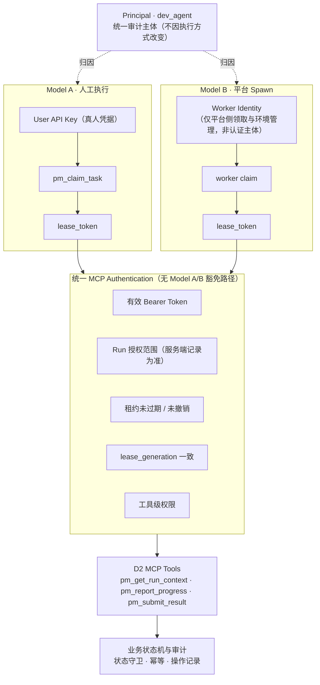

# ADR-0002：执行凭据与三层身份分离（Principal / Credential / Executor）

> 状态：**Accepted（2026-11-01，架构专家裁决「建议通过，附带安全约束」）**
> 日期：2026-11-01
> 决策者：外部架构专家（用户转交裁决）；问题清单来源 `docs/executor/ai-pm-q2-executor-credential-expert-questions.md`（Q-A~Q-H 八问）
> 一句话：**Model A / Model B 统一用 Run 级 `lease_token` 作为执行端 MCP 凭据（A1+B1），不新增 Executor Credential、不改变 ADR-0001 的 attribution-only principal 模型；Principal 负责归因，Credential 负责授权，Executor 负责执行——三者分离，但 Run 级授权链路统一。**
> 上位关系：不修改 ADR-0001（D4 attribution-only、D6 Registry 推迟均维持）；**修订 D2 R-G4**（Model B 拒绝条款）；**修订 D1「worker 不签发 lease_token 明文」的实施裁定**（T-031 实施裁定 1）。
> 关联：`docs/executor/ai-pm-t031-executor-expert-review-pack.md`（评审 Q2）、`docs/slice-d/ai-pm-slice-d2-mcp-context-v1.md`、`docs/executor/ai-pm-codex-bootstrap-v1.md`、todo.md（T-032 / T-051 / T-080~T-082）。

---

## 1. 背景

评审 Q2 指出：平台 spawn 的 Codex 进程（Model B，T-031）没有任何 MCP 凭据——按 D2 R-G4（`lease_token_hash IS NULL` 一律拒绝）与 T-031 实施裁定 1（worker 不签发 token 明文），Model B 执行端**调任何 run 级 MCP 工具都会被拒绝**，D4 的 `pm_submit_result` 落库后同样无法被调用。三条既有裁决（ADR-0001 D4「Agent 不发凭据」、ADR-0001 §7「lease_token 是唯一凭据」、D2 R-G4「Model B 拒绝」）与评审要求的「短期、限定 Run、可撤销执行凭据」交叉，八问清单（Q-A~Q-H）交专家裁决。

## 2. 裁决（七项，专家原文归纳）

| # | 裁点 | 裁决 |
|---|---|---|
| **D1** | 凭据架构 | **A1+B1**：Model A / Model B 统一使用 Run 级 `lease_token`；不新增独立 Executor Credential；不改变 ADR-0001 attribution-only 模型。Worker Identity 仅用于平台侧任务领取及执行环境管理，不替代 Run 级执行凭据 |
| **D2** | MCP 认证 | 所有 Run 级 MCP 工具必须验证：① 有效 Bearer Token；② Token Hash 与服务端 Run 记录一致；③ 请求 Run ID 与凭据授权范围一致；④ Run 状态允许当前操作；⑤ 租约未过期且未撤销；⑥ 当前租约 generation 有效；⑦ 工具级权限满足要求。**Model A 与 Model B 不得设置不同的认证豁免路径** |
| **D3** | 凭据生命周期 | Token 有效性绑定 Run 租约；取消/隔离/重新领取/租约回收时旧凭据必须失效；**增加绝对执行截止时间防无限续租**；**管理端终止必须优先完成服务端凭据撤销，进程终止作为后续资源清理** |
| **D4** | 审计 | 保持 `dev_agent` 为 attribution principal；**新增 `execution_mode`** 区分人工执行 / 平台 Spawn / 远程执行 / 容器执行；任务触发人不应被误认为实际操作的监督者；**无人值守执行允许触发人为空** |
| **D5** | 项目与租户隔离 | **T-051 提升为安全前置任务**；Claim 阶段必须校验 Tenant/Project 授权；Run 级 Token 不得扩大 Claim 阶段获得的权限；多租户和跨机执行上线前必须完成对应隔离能力 |
| **D6** | 凭据下发 | V1 允许 `AI_PM_LEASE_TOKEN` 环境变量注入；禁止经命令行参数、stdout、stderr、审计日志、普通应用日志泄露 Token；多租户共享 Worker 必须进一步提供 OS 账户、容器或等效隔离 |
| **D7** | Bootstrap 与 Registry | Bootstrap 采用**统一安装能力 + Model A / Model B Launch Profile 分层**；真人 API Key 不进入平台 Spawn 的执行进程；Run 级 Token 只交付给被授权的 Run 执行端；**Executor Registry 不作为 T-032 前置条件**，完整实现推迟到确有多 Executor 调度需求时 |

**最终原则（专家原文）**：Principal 负责归因，Credential 负责授权，Executor 负责执行。三者分离，但 Run 级授权链路统一。

## 3. 落地影响清单（裁决 → 具体改动）

| # | 影响 | 落点 | 归属任务 |
|---|---|---|---|
| L1 | **修订 D2 R-G4**：删除「Model B 一律拒绝」；改为「`lease_token_hash IS NULL` 拒绝」且 Model B claim 同样签发 token | `docs/slice-d/ai-pm-slice-d2-mcp-context-v1.md` §6.1；`crates/pm-application/src/run_dispatch/claim.rs`（worker claim 返回明文） | T-032 |
| L2 | **修订 T-031 实施裁定 1**：`AI_PM_LEASE_TOKEN` 从「留空待 D4」改为「claim 后注入执行端环境」 | `crates/pm-infrastructure/src/codex_executor.rs:235-239`（注入清单） | T-032 |
| L3 | **终止顺序反转**：现有 `cancel_run`/`record_termination` 是「先 terminate 进程 → 再落终态」；按 D3 改为「先落终态 + 清凭据（DB 事务，原子）→ 后 terminate 进程」 | `crates/pm-application/src/run_executor.rs:216-247 / 476-524` | T-032 |
| L4 | **绝对执行截止强制化**：`timeout_seconds = NULL` 当前不判定；改为领取时必须存在有效上限（Run 列默认值或调度前置校验） | `run_executor.rs:308-317`（`timed_out`）；`0011_run_dispatch.sql` | T-032 |
| L5 | **`execution_mode` 新列**（`human`/`spawn`/`remote`/`container`，V1 前两值）：显式区分执行形态，替代从 `lease_owner` 前缀推导 | `0011` 补列或新迁移；`task_run` 写入路径 | T-032（迁移） |
| L6 | **`triggered_by_user_id` 语义与可空性核查**：D4 要求「无人值守允许触发人为空」——若列约束 NOT NULL 需放宽；审计口径补「触发人 ≠ 监督人」 | T-021b δ 列定义；T-059 审计三列 | T-032 核查 / T-059 |
| L7 | **T-051 升级为安全前置**：per-project 调用方绑定从「观察项」改为「多租户/跨机上线前置」 | todo.md T-051；M8（T-080~T-082）排期联动 | 排期裁定 |
| L8 | **codex-bootstrap 分层修订**：统一安装能力 + Model A/B Launch Profile；两条凭据红线成文（真人 key 不进 spawn 进程、Run token 只交被授权执行端） | `docs/executor/ai-pm-codex-bootstrap-v1.md`（未过稿，T-087 定稿时并入） | T-087 |
| L9 | 评审包 §8 的 Q2 行关闭，指向本 ADR | `docs/executor/ai-pm-t031-executor-expert-review-pack.md` | 本次 |

## 4. 实施要点与待确认项（登记，不阻塞本 ADR）

| # | 项 | 说明 |
|---|---|---|
| P1 | **lease generation 的必要性论证** | D2-⑥ 要求「当前租约 generation 有效」，但现有 schema 无 generation 字段。**2026-11-01 补充论证（外部建议 X3，场景走查通过）**：数据正确性上既有机制「每次 claim 签发新随机 token + hash 覆盖」（`claim.rs:552-576`，含 B3-1 重领）+「回收路径清空 hash + 置终态」（`lease.rs:66-76` isolate_started_run）已提供等价 fencing——双执行端并发写入不可达。但 X3 给出了 generation 的正确语义与增量价值：**「新租约所有权建立时递增（重领/重派），心跳不换 token 不递增」**——把 fencing 从「覆盖 hash 的巧合实现」升级为显式契约，同时满足 D2-⑥ 与审计可观测（代次 = Run 被重领次数）。**实施倾向方案 a**：`0011` 补列 `lease_generation INT NOT NULL DEFAULT 1`，claim/重领时 +1，MCP 校验带代次一致性；方案 b（确认 hash 等价替代 ⑥）降为备选。最终随 T-032 过稿由用户拍板，**不得静默省略该裁决项** |
| P2 | **终止顺序反转引入的新窗口** | 先落终态后杀进程 → 终态 Run 的进程若 terminate 失败，`reconcile_orphans`（只查 `claimed/running`）不会兜底 → 需补「终态但 `executor_session` 非空且进程存活」的清理路径（重试 terminate / 扩展 reconcile / 告警），否则出现终态僵尸进程 |
| P3 | **worker 明文传递链路的泄露面** | L1+L2 后 token 明文流经 worker 内存 → 环境变量 → 执行端进程。按 D6 禁止面检查全链路：worker 日志、审计 `after_data`、pid 文件、process.json 均不得落明文 |
| P4 | **T-051 排期冲突** | D5 把 T-051 提为安全前置，与「尽快进入 D4」的评审建议存在张力——T-051 只需在**多租户/跨机上线前**完成，单机 V1（D4/T-041）不受阻；在 todo 中明确其门控条件即可，不阻塞 D4 |

## 5. 明确不做

- 不新增 Executor Credential 表/凭据类型（D1）。
- 不为 Model B 开认证豁免路径（D2）。
- 不把 Executor Registry / `executor_id` FK 纳入 T-032（D7）。
- 不改变 ADR-0001 的 attribution-only principal 模型与 D2 的 MCP actor 口径。
---

## 6. 最终统一架构（2026-11-01 专家复审定稿）

> 来源：专家复审 §四「建议形成的最终架构」（原图已转 mermaid）。整合 ADR-0002 七项裁决与补充建议 X1–X3 后的统一模型。

**七项架构特点（专家原文，全部与既有裁决一致）**：

1. Agent 不需要独立凭据（ADR-0001 D4）。
2. 不需要新增 Executor Credential 体系（本 ADR D1）。
3. Model A 和 Model B 使用相同的 MCP 认证机制（D2，无豁免路径）。
4. MCP Session 不承担身份认证职责（X2：Session=通信上下文，Token=凭据；现状无状态 transport 已满足，成文为 transport 升级红线）。
5. Executor 不拥有超出 Run 的权限（D5：Run 级 Token 不得扩大 Claim 权限）。
6. Run 终止后，执行凭据立即失效（D3 + 既有四处清 hash 路径）。
7. 未来切换容器、远程节点，不需要推翻认证架构（`execution_mode`/`executor_kind` 已预留 `remote`/`container` 值）。

**任务拆分（专家复审 §五，2026-11-01 采纳）**：ADR-0002 八项裁决分层实施——T-032 只承担认证闭环 P0 五项（token 签发注入 / R-G4 修订 / 工具级权限与 Session 重认证 / 租约失效与 fencing / Token 脱敏与日志安全）；`execution_mode` 审计列移交 **T-059**（P1，与审计三列同批迁移）；Tenant/Project 权限绑定归 **T-051**（P0 安全前置）；Executor 生命周期**管理能力**新建任务（P2，编 T-093）；Registry 完整实现维持 **P11**（P2）。评审 Q1 启动协议 / Q3 子进程回收维持 P0 留在 T-032（数据面正确性，不因拆分降级）。
**用户最终裁决（2026-11-01，修正专家复审 §五的过窄拆分）**：确认执行**数据面**（Q1 启动持久化协议 / Q2 执行端身份与 MCP 认证 / Q3 子进程回收与终止保障 / Token 生命周期与 fencing / MCP 工具权限校验 / 日志脱敏与凭据安全）**全部 P0 归 T-032**——维持外部评审对 Q1/Q2/Q3 的 P0 定级，三者共同构成 T-032 的执行可靠性与安全闭环；仅将 Executor **管理面**（查询与展示 / 手动管理界面）拆至 T-093（P2），完整 Executor Registry P2 后续任务。补充关键约束：Q1/Q2/Q3 不能各自独立验收，必须构成完整执行生命周期（创建 → 持久化启动意图 → spawn → 记录身份 → 获取凭据 → MCP 执行 → 心跳续租 → 终态 → 撤销凭据 → 回收子进程 → 持久化最终状态），覆盖两个故障窗口（进程启动未持久化身份 / Run 撤销后子进程存活）；T-032 验收标准提升为「平台在正常运行、异常退出及重启恢复场景下，都能证明一个 Run 对应的执行进程、执行凭据和最终状态具有一致且可追溯的生命周期」（详见 T-032 设计稿 §8.1）。
---

## 7. T1–T4 终裁记录（2026-11-01，设计稿过稿裁决）

针对 T-032 设计稿过稿前的三个技术裁定点（问题清单 `docs/executor/ai-pm-t032-finalization-expert-questions.md`），专家终裁 **T1: ii / T2: a / T3: i / T4: 确认**：

| # | 裁决 | 强化约束（终裁附加） |
|---|---|---|
| **T1** | 选项 ii：`executor_session` 前置持久化作为启动意图，**不新增 `task_run.stage`**；spawn 失败保留 session，重试覆盖 | ① **PID 文件不存在不能直接等同于子进程不存在**——spawn 成功但 PID 未持久化时进程仍必须可发现回收，启动意图 / 身份持久化 / 启动确认构成完整协议，不留不可恢复的孤儿窗口；② 旧 session 覆盖前保留必要历史（`session_replaced` 事件）。语义定调：**executor_session 是启动意图，不等于进程已经启动** |
| **T2** | 方案 a：新增 `lease_generation` | 首次有效领取 = 1；每次成功获取执行权（含过期重领）递增；心跳续租与领取失败不递增；**MCP 必须同时验证 token 与 generation，旧 generation 永远不能重新获得授权**。语义定调：**lease_generation 是执行权世代，不等于普通凭据校验** |
| **T3** | 选项 i：新增 Run 级 `deadline_at` | 首次成功 claim 时按 `task.timeout_seconds` 与环境默认上限计算**固化**；后续重领、心跳续租**均不得重置或延长**；Task 参数事后修改不影响在跑 Run；**绝对执行截止优先于租约续期** |
| **T4** | 确认 `last_agent_heartbeat_at` / `last_progress_at` | 进程存活 / Agent 心跳 / 执行进展 / Run 绝对截止**四类信号必须分立**；**心跳不能自动视为执行进展** |

**迁移约束（终裁修正实施方设想）**：0011 / 0015 已应用，**不得直接修改已应用的历史迁移**——全部新列采用新增 **forward-only migration `0023_run_executor_hardening.sql`**。四项均属 T-032 的 P0 执行生命周期闭环，不拆分、不降级；实施完成后必须端到端验证：启动崩溃恢复、旧 generation fencing、绝对截止、心跳与进展分离、子进程终止回收。