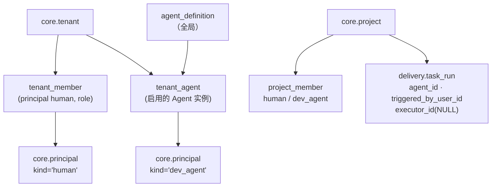

# ADR-0001：多租户、用户、Agent 与 Codex Executor 的身份关系

> 状态：**Accepted（2026-11-01，用户正式裁决）**
> 日期：2026-11-01
> 决策者：项目所有者（用户）+ AI 实施方
> 一句话：Tenant 是数据隔离、资源归属与费用核算的边界，V1 **一次建** `core.tenant` / `core.tenant_member` / 租户业务数据的 `tenant_id`；Agent 是**归因主体**而非认证主体；Executor Registry 归 D3。
> 上位约束：`AGENTS.md` 规则 1（新项目、无存量数据，不做回填脚本、双写、兼容分支）。
> 关联文档：`docs/ai-pm-principal-identity-v1.md`（T-021a / β 范围）、`docs/ai-pm-slice-d2-mcp-context-v1.md`（MCP actor 契约）、`docs/ai-pm-customer-master-data-v1.md`（客户主数据）。

---

## 1. 背景

四条已核实的事实决定了这份 ADR 的必要性与边界：

| # | 事实 | 证据 |
|---|---|---|
| F1 | **全库无租户概念**：17 个迁移、42 张表，`tenant` 零命中 | `migrations/*.sql` 全量 grep 无 `tenant` |
| F2 | 42 张表中 **39 张是租户业务数据**，且其中 36 张已带 `project_id`（6 张不带的：`core.customer`、`core.project`、`core.principal`、`ai.skill_definition`、`ai.llm_provider`、`integration.repo_import_source`），多数已有 `UNIQUE(project_id, id)` 复合键 | `0001:42/45`、`0002:12-13`、`0003:17`、`0006:17-19`、`0008:30-31`；`migrations/*.sql` 逐表核对 |
| F3 | Agent 今天**没有实体层**：`bootstrap.rs:175-189` 每个项目建 4 个 `core.principal`（owner human / `ai_pm` / 两个 `dev_agent`），`project_member` 直接挂项目 | `core.principal.kind IN ('human','dev_agent','ai_pm','service')`（`0001:33-35`） |
| F4 | 上游身份侧**已多租户**：`tid` 是强制 claim；API Key token 的 `sub` 是绑定的真实 user_id（未绑定 400）；`roles=["service"]` 打业务端点一律 403 | `docs/ai-pm-principal-identity-v1.md` §4、`apps/pm-api/src/auth.rs` |

结论：身份侧已经多租户，**数据侧没有边界**。若等第二个租户出现再补，就要面对全库迁移 + 每一行历史数据的归属判断 + 权限体系重写——这正是 `AGENTS.md` 规则 1 要避免的形态。因此 **V1 一次建对**。

---

## 2. 决策（D1–D6）

| # | 决策 | 含义 |
|---|---|---|
| **D1** | **Tenant 是一等实体** | 新增 `core.tenant` 与 `core.tenant_member`；租户业务数据带 `tenant_id`；隔离在库内可验证，不依赖部署拓扑 |
| **D2** | **不机械扩散 `tenant_id`** | 只给租户业务数据加；全局共享的定义、字典、系统配置不加（清单见 §3） |
| **D3** | **Agent 三层，项目授权复用 `project_member`** | `agent_definition`（全局可复用角色定义）→ `tenant_agent`（租户启用的 Agent 实例，拥有一个 `dev_agent` principal）→ 项目授权写 `project_member`，**不另造 grant 表** |
| **D4** | **Agent 是 attribution-only principal** | 不发独立凭据，不改真人 API Key 与 MCP 认证协议；上游 service token 仍被业务面拒绝 |
| **D5** | **`tenant_member.role` 是租户角色的唯一事实源** | Token 里的 `roles` 只作提示；管理端点必须查库当前成员状态与角色（撤权即时生效） |
| **D6** | **Executor Registry 移出 V1** | 归 T-030 / D3；Run 预留可空 `executor_id`，不建无运行基础的注册表 |

### D3 的字段级取舍

- `agent_id` 指向 **`core.principal(id)`**（`kind='dev_agent'/'ai_pm'`），与 `governance.audit_log.actor_id` 保持同一 id 空间，避免 Run → Agent → Principal 的多跳 join。
- `core.tenant_agent` 回答「这个租户启用了哪些 Agent、映射到哪个 principal、是否启用」，不参与审计识别。
- 被拒绝的替代：`agent_id` 指向 `tenant_agent(id)`（多一跳 join、且审计与 Run 出现两套 agent 标识）。

### D6 的字段级取舍

`executor_id` **不加外键**（Registry 不存在）。这违反常规，故在此成文：它是 T-030 的前向列，落地 Registry 时补 FK，期间任何写入方不得据 `executor_id` 做鉴权或计费——执行端事实仍以自报的 `executor_kind` / `client_name` / `client_version` / `lease_owner` 为准（D2 已明确自报值不可作凭证）。

---

## 3. 数据归属分类（本 ADR 的核心清单）

### 3.1 三条规则

1. **租户业务数据**必须带 `tenant_id UUID NOT NULL`，且必须有指向租户的**组合外键**（`(tenant_id, 父键)` → 父表 `(tenant_id, id)`）。只加列不加组合外键 = 没有隔离，视为未完成。
2. **全局共享数据**不得带 `tenant_id`；若某张全局表将来需要租户维度（如租户自带模型凭据），把它降级为租户业务数据 + 凭据配置实体，属于新 ADR。
3. `tenant_id` 只用于**隔离过滤**，不用于业务语义；跨租户聚合（费用核算）走独立视图/定时汇总，不进业务查询路径。

### 3.2 全局共享（**不加** `tenant_id`）

| 表 | 性质 | 说明 |
|---|---|---|
| `core.principal` | 主体目录 | 真人/agent/service 的全局身份行；租户归属由 `tenant_member` / `tenant_agent` 表达 |
| `ai.skill_definition` | 技能定义目录 | 平台能力词表，所有租户共用 |
| `ai.llm_provider` | 模型 provider 配置 | 平台级凭据载体；租户自带 LLM 凭据时降级（见规则 2） |
| **`agent_definition`（新）** | Agent 角色定义 | 角色/能力定义，全局可复用（D3） |

`core.tenant` 本身是租户根，不给自己加 `tenant_id`。

### 3.3 租户键表（`tenant_id` 是**键的一部分**，不参与隔离过滤）

| 表 | 说明 |
|---|---|
| **`core.tenant`（新）** | `id UUID`、`provider TEXT`、`external_key TEXT`（= lmms `claims.tid` 字符串化）、`display_name`、`is_active`、`UNIQUE(provider, external_key)` |
| **`core.tenant_member`（新）** | `(tenant_id, principal_id)` 主键；`role IN ('tenant_admin','member')`；D5 的唯一事实源 |
| `core.principal_identity`（T-021a 建） | 三元组 `(provider, claims_tenant_key, subject)` 的映射；`claims_tenant_key` 是上游 `tid` 原文，不是内部 `tenant_id`（见 §7 交接） |

### 3.4 租户业务数据（**加** `tenant_id`）——39 张现有表

| schema | 表 |
|---|---|
| `core` | `customer`、`project`、`project_member` |
| `delivery` | `requirement`、`requirement_revision`、`milestone`、`task`、`task_requirement`、`task_run`、`task_run_failure`、`task_supersession`、`task_waiting`、`task_policy_override`、`task_repository`、`task_run_repository`、`policy_scope`、`task_acceptance_criterion`、`task_knowledge_ref` |
| `integration` | `inbound_event`、`job`、`notification`、`project_ssh_key`、`project_repository`、`repo_import`、`repo_import_source`、`outbox_event` |
| `ai` | `project_ai_config`、`project_skill_binding`、`analysis_run`、`change_proposal`、`agent_feedback`、`project_document`、`document_revision`、`document_proposal`、`document_index_state`、`knowledge_reference` |
| `governance` | `approval_request`、`human_intervention`、`audit_log` |

新增租户业务表：**`core.tenant_agent`**（`(tenant_id, id)` 唯一键，`principal_id` 指向 `dev_agent` principal，`is_enabled`）。

> 计数自检：3（全局）+ 39（业务）= 42，与现有迁移表数一致；`core.tenant` / `tenant_member` / `principal_identity` / `agent_definition` / `tenant_agent` 为新增表。

### 3.5 约束模式（三种形态，逐表 DDL 在 T-021b 迁移方案中展开）

```sql
-- (a) 顶层实体：customer 先有 tenant；project 的既有单列 FK 必须换成组合 FK
ALTER TABLE core.customer ADD COLUMN tenant_id UUID NOT NULL REFERENCES core.tenant(id);
ALTER TABLE core.customer ADD CONSTRAINT uq_customer_tenant_id UNIQUE (tenant_id, id);
-- 自引用（0017:13 parent_id UUID REFERENCES core.customer(id)）同样要换组合 FK，
-- 否则租户 A 的客户可以挂到租户 B 的父客户
ALTER TABLE core.customer DROP CONSTRAINT customer_parent_id_fkey;
ALTER TABLE core.customer ADD CONSTRAINT fk_customer_parent
    FOREIGN KEY (tenant_id, parent_id) REFERENCES core.customer (tenant_id, id);

ALTER TABLE core.project
    ADD COLUMN tenant_id UUID NOT NULL REFERENCES core.tenant(id),
    DROP CONSTRAINT project_customer_id_fkey,          -- 既有单列 FK（0001:20）
    ADD CONSTRAINT fk_project_customer
        FOREIGN KEY (tenant_id, customer_id) REFERENCES core.customer (tenant_id, id),
    ADD CONSTRAINT uq_project_tenant_id UNIQUE (tenant_id, id);

-- (b) 直挂 project 的表（示意，其余 36 张同构）
ALTER TABLE delivery.task
    ADD COLUMN tenant_id UUID NOT NULL,
    ADD CONSTRAINT fk_task_tenant_project
        FOREIGN KEY (tenant_id, project_id) REFERENCES core.project (tenant_id, id);

-- (c) 不直挂 project 的子表：锚定父行的 (tenant_id, id)
ALTER TABLE integration.repo_import_source
    ADD COLUMN tenant_id UUID NOT NULL,
    ADD CONSTRAINT fk_ris_tenant_import
        FOREIGN KEY (tenant_id, repo_import_id) REFERENCES integration.repo_import (tenant_id, id);
```

不变量：

- **I1**：每张租户业务表必须有 `tenant_id`（非空）+ 至少一个组合外键；评审/测试用 `information_schema` 机械断言（§10 XT-3）。
- **I2**：既有 `(project_id, id)` 复合键**保留**（子表已有大量 `FOREIGN KEY (project_id, 父id)`），新增 `(tenant_id, id)` 只用于租户级锚定。
- **I3**：查询过滤用 `tenant_id`，不允许靠 project join「推导」——推导只用于建设期赋值，不用于读路径。
- **I4（既有全局唯一约束必须改租户内唯一）**：`code` 类命名空间今天全库唯一，租户化后会出现"两个租户不能建同名 code"的假冲突与跨租户探测面。需改的三处：`core.project.code`（`0001:21` `UNIQUE`）、`core.customer` 的 `customer_code_uniq`（`0017:18`）、`integration.outbox_event.idempotency_key`（`0010:138`）。其余 `UNIQUE(...)` 均以 `project_id`/`task_id`/`id` 为前缀，不受影响；纯 UUID 列的唯一约束（如 `source_proposal_id`、`proposal_id`）保持原样。

---

## 4. 身份关系



- 一个 Tenant 含多个 User（`tenant_member`）、Project、Agent（`tenant_agent`）。
- 一个 Project 授权多个 User / Agent（`project_member`）。
- 一个 Agent（`tenant_agent` + 其 principal）可参与**多个** Project，**每个项目单独授权**（D3：不另造 grant 表）。
- 一个 Executor 可服务多租户，但每次执行必须有独立 Run 上下文与隔离环境（Run 上的 `tenant_id` 是这条纪律的库内载体）。
- **Agent 与 Executor 不建立一对一绑定**：`agent_id` 与 `executor_id` 在 Run 上独立记录。

---

## 5. Run 与审计的身份字段（不双写）

| 事实 | 落点 | 说明 |
|---|---|---|
| 谁被调度执行 | `task_run.agent_id` → `core.principal` | δ（T-021b） |
| 谁触发（真人） | `task_run.triggered_by_user_id` → `core.principal`（human） | δ；命名沿用本 ADR 原文 |
| 哪个执行器 | `task_run.executor_id`（可空、无 FK） | δ 前向列，见 D6 |
| 哪次执行 | `task_run.id` | 已有 |
| 机器人执行主体 | `audit_log.actor_id`（agent principal） | 已有 + T-021a 改为真实来源 |
| 真人授权身份 | `audit_log.actor_identity_id` / `actor_client` / `actor_auth_mode` | T-021a |
| 创建人 / 审批人 | **仅审计行** | 不写 Run：同一事实双写会在回放时产生两套真相 |

MCP 工具口径不变（D2 契约）：工具代表代理，actor = 项目内 `dev_agent` / `ai_pm`；真人信息进 `actor_identity_id` / `actor_client`。这与 D4「Agent 不发凭据」一致：**代理是执行主体，真人是授权/认证主体**。

---

## 6. 权限与撤权

- 有效权限 = Tenant 策略 ∩ Project 授权 ∩ Agent 角色 ∩ 本次 Run 授权；下层不得放宽上层。
- `tenant_admin` 只来自 `tenant_member.role`（D5）。鉴权中间件在**每次请求**查库；token `roles` 只用于日志提示。
- 撤权即时生效：把 `tenant_member` 行降级/删除后，同一张仍在有效期内的 token 立刻失去管理端点权限（不再等 ≤15 分钟过期，`ai-pm-principal-identity-v1.md` §10.1 的已知缺口由此关闭）。
- **两级角色不合并**：`tenant_member.role` 是**租户级**管理权（管理 principal、租户配置、启停 Agent）；项目内权限仍由 `project_member.role`（owner/developer/ai_pm）决定。`tenant_admin` **不自动**成为项目 owner，也不自动获得项目内业务写权限——可见性仍按 `project_member` 过滤（T-022）。跨项目可见的例外范围见 R6。
- Agent 永不拥有 `tenant_admin`；需要人工审批的操作不得由 Agent 自行批准。
- 凭据隔离：模型凭据与 Git 凭据分开；凭据归属平台或 Tenant（当前 Git 是项目级 `integration.project_ssh_key`，**与本节原则存在偏差**，见 §12 未决 R3）；明文不落 Task/Run/日志/知识库/Git。

---

## 7. 与既有设计的关系

| 文档 | 关系 |
|---|---|
| `ai-pm-principal-identity-v1.md`（β） | **范围不变**，C29–C42 全部保留；仅一条列名调整（`tenant_id TEXT` → `claims_tenant_key TEXT`，避免与内部 `tenant_id UUID` 同名冲突，见移交说明） |
| `ai-pm-slice-d2-mcp-context-v1.md` | **不改**：MCP actor 仍是 `dev_agent` / `ai_pm`；`lease_token` 仍是 run 级唯一凭据 |
| T-022（可见性收口） | 仍按 `project_member` 过滤，**只依赖 T-021a**（principal → membership），不需要 `tenant_id`；租户维度过滤在 T-021b 之后叠加，不改变 T-022 的语义 |
| T-051（待裁 #12） | **仍开放**：per-project 调用方绑定未纳入本 ADR |
| 客户主数据 G1–G4 | 不变；`core.customer` 只是新增 `tenant_id`，语义不加码 |

### 7.1 β → α 的列名移交（显式，防止后续被"顺手清理"）

T-021a 先落库，此时 `core.tenant` 尚不存在，因此：

- `principal_identity` 用 `claims_tenant_key TEXT`（上游 `tid` 原文），**不叫** `tenant_id`。
- T-021b（α）建 `core.tenant` 后：`principal_identity.tenant_id UUID REFERENCES core.tenant(id)`，由 `(provider, claims_tenant_key)` 解析得到；**没有回填脚本**（新项目，无存量），直接改契约 + 重跑测试。

---

## 8. 备选方案与拒绝理由

| 方案 | 内容 | 拒绝理由 |
|---|---|---|
| A. 部署 = 租户 | 不建 `core.tenant`；隔离由部署拓扑承担；数据按 `project_id` 隔离 | **用户裁定拒绝**：Tenant 是产品架构的数据隔离/归属/核算边界；等第二租户出现再改 = 全库迁移 + 历史归属判断 + 权限体系重构 |
| B. 全表机械加 `tenant_id` | 42 张表一律加列 | **用户裁定拒绝**：全局定义/字典/系统配置不属于租户业务数据，机械扩散会制造永远为常量的列与错误语义 |
| C. 只加顶层实体 + 读路径推导 | `customer`/`project` 加 `tenant_id`，其余靠 join 推导 | 拒绝：读路径每处都要 join，且无法用库内约束防跨租户子行（I1/I3 的防线失效） |
| D. Agent 作为认证主体（独立凭据） | Agent 领自己的 token | 拒绝：上游 `roles=["service"]` 打业务面 403；要支持需改上游签发 + 放宽业务面闸门，属另一个 ADR |

---

## 9. 后果

**正面**

- 隔离在库内可证明：组合外键使「tenant_id 与父行不一致」的写入在 DB 层被拒，不依赖代码纪律。
- 费用核算/配额有了确定载体（`task_run.tenant_id`）。
- Agent 模型只加两张表，`project_member` 复用，不产生第三套授权体系。
- 撤权即时生效（D5），关闭 token 有效期内仍可管理的管理面缺口。

**负面 / 代价**

- 39 张表加列 + 组合外键，所有写路径需显式带 `tenant_id`（列表/详情查询要加过滤），测试需补多租户场景。
- 迁移必须**一次覆盖完整清单**，中途态（部分表有列）会被 I1 断言判失败，不能分批上线。
- 鉴权中间件多一次查库（`tenant_member`），需按请求缓存（同请求内只查一次）。

---

## 10. 风险与验收要求

| 风险 | 缓解 |
|---|---|
| 某张表漏加 `tenant_id` 或漏组合外键 | I1 机械断言（XT-3）+ 迁移评审清单对照 §3.4 |
| 写路径忘记带 `tenant_id`，插入落到默认值/错误租户 | `tenant_id` 非空 + 组合外键；应用层 `tenant_id` 只从 `AuthedPrincipal` 取，不接受请求体传入 |
| `claims_tenant_key` 与内部 `tenant_id` 混用 | §7.1 移交说明 + 代码类型区分（`ClaimsTenantKey(String)` vs `TenantId(Uuid)`） |
| 一次迁移过大导致不可回滚 | 新项目无存量：失败即重建（`AGENTS.md` 规则 1），不写 down 脚本 |

**T-021b 验收矩阵（编号接 ADR 之后，α/γ/δ）**

| 编号 | 场景 | 断言 |
|---|---|---|
| XT-1 | 租户 A 的 token 读租户 B 的 project / task / run | 404（不泄露存在性），审计不留成功行 |
| XT-2 | 租户 A 的 token 写租户 B 的资源 | 404；库内无新增行 |
| XT-3 | 迁移后 `information_schema` 断言 | §3.4 的 39 张表全部有 `tenant_id NOT NULL` + 至少一个 `(tenant_id, *)` 组合外键 |
| XT-4 | 租户 A 与租户 B 各建同 `code` 的 project / customer | 两者都成功（I4：全局唯一约束已改租户内唯一） |
| FK-1 | 插入 `tenant_id=B` 而 `project_id` 属于 A | 违反外键被拒（DB 层，不经应用代码） |
| FK-2 | `core.project` 的 `customer_id` 跨租户 | 违反外键被拒 |
| RV-1 | `tenant_member.role` 由 `tenant_admin` 降为 `member` | 同一有效 token **立即**失去 `PATCH /v1/pm/principals/*` 权限 |
| RV-2 | token `roles` 含 `tenant_admin` 但库内无成员行 | 403（D5：token 不作为事实源） |
| AG-1 | MCP 写路径 | `audit_log.actor_id` = `dev_agent` principal；`actor_identity_id` = 真人；`task_run.agent_id` 与 `actor_id` 同一 id |
| AG-2 | 未启用的 `tenant_agent` 调 `pm_claim_task` | 403；无 run 产生 |
| EX-1 | 写入 `executor_id = NULL` 与任意非 NULL 值 | 均可落库（Registry 未建，不做 FK 校验） |

---

## 11. 迁移方案的两阶段

1. **本 ADR（已完成）**：锁定表清单（§3）、约束模式（§3.5）、不变量（I1–I3）、验收（§10）。
2. **T-021b 开工前产出逐表迁移方案**：39 张表逐条 DDL（列 + 组合外键 + 既有键保留情况）+ 迁移序号（0019 起）+ `information_schema` 断言测试。**不允许在方案产出前直接改表**。

---

## 12. 未决（本 ADR 不覆盖，登记待裁）

| # | 项 | 处置 |
|---|---|---|
| R1 | 无 lmms 的私有部署认证（`provider='local'/'oidc'`） | 独立任务；`provider` 维度已预留，不改本 ADR 的表结构 |
| R2 | 私有部署首管理员 bootstrap（是否允许"首个登录者即 admin"） | 与 R1 同批裁；默认仍按 env 指定 |
| R3 | Git 凭据现为**项目级**（`integration.project_ssh_key`），与 §6「归属平台或 Tenant」不一致 | 待首批私有部署需求明确后裁；V1 不动 |
| R4 | 费用核算/配额聚合视图 | V1 不做；`task_run.tenant_id` 已具备载体 |
| R5 | `project_member` 是否需要区分"human 授权"与"agent 授权"的独立状态机 | 等 D3 执行端接入后观察；V1 只复用现有 `role` 列 |
| R6 | `tenant_admin` 是否可见非成员项目（审计/客户/任务列表） | 与 T-022 一起裁：默认**不可见**（按 `project_member` 过滤），管理端点只暴露 principal 与租户配置。若运维需要"全租户只读视图"，另开审计专用入口，不放宽业务列表 |
