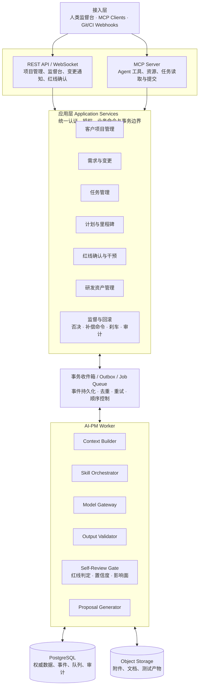
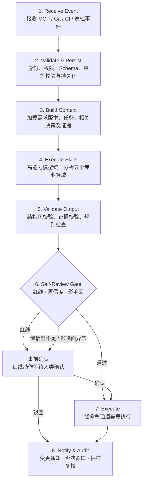
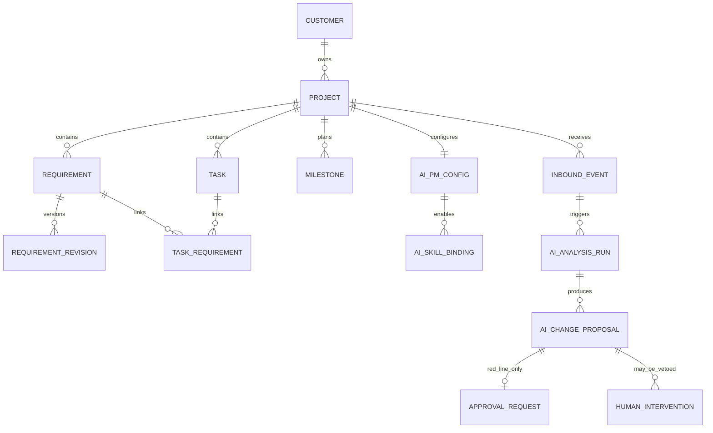
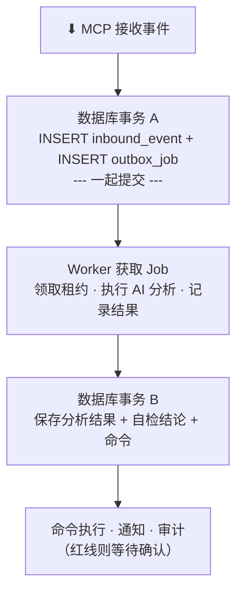
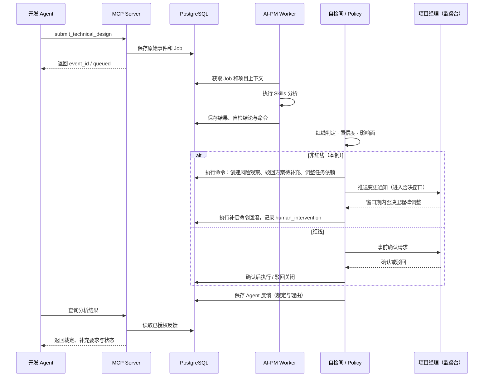
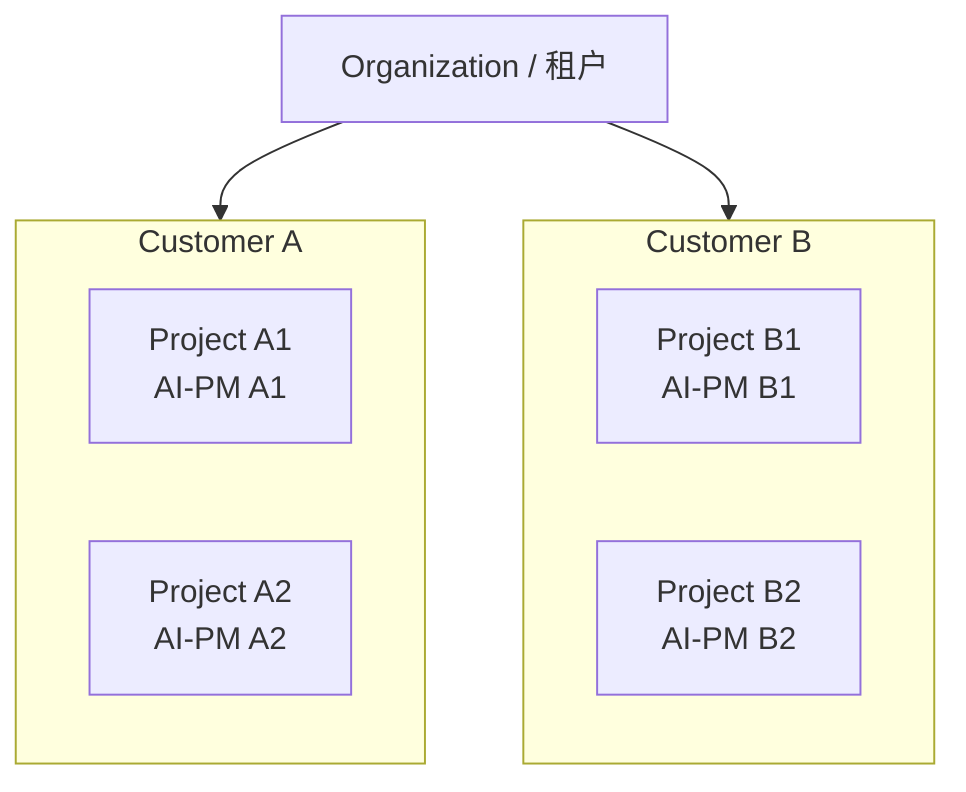
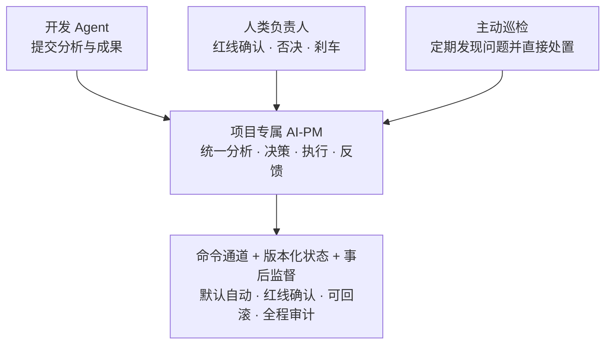

# 每项目专属 AI-PM：架构原则（V2 · AI 主导）

> 定位：每项目专属 AI-PM —— 高能力模型统一分析，项目隔离、持续上下文、结构化输出。
>
> 信任模型（V2 核心变更）：AI 主导自动化。AI-PM 是项目运营的默认决策者与执行者，非红线操作默认自动执行；人类角色从「审批者」转变为「监督者与红线守护者」，保留否决权、刹车权与政策制定权。
>
> 操作权限：默认执行 + 红线事前确认 + 事后监督与回滚。正式需求、任务、里程碑等权威状态由 AI-PM 经统一命令通道直接维护；发布、对外承诺、验收签署、不可逆删除、授权与政策修改属于红线，必须事前人类确认。
>
> 启用的 Skills：需求分析 · 任务分析 · 风险识别 · 架构一致性 · 计划编排

---

## 〇、V2 为什么推翻 V1 的「受控自动化」

V1 定稿的信任模型是：AI 只产生建议，正式需求、任务、里程碑的修改一律先经人工审批。这在当时的判断下是稳妥的，但调查后市场变化太大：

- 开发 Agent 已经全天候连续作业。人类审批者成为整条流水线上唯一有作息的环节，「提交—等审批—继续」的节奏让 AI 团队的吞吐优势归零。
- 高能力模型的分析质量已经稳定超过「快速人工抽查」。事前人工审批在很多场景里不再是质量保障，而是延迟来源。
- 竞品分水岭不在「AI 能不能分析」，而在「AI 能不能端到端运营项目」。谁先把人类从常规决策环里拿出来，谁的速度和成本就有数量级优势。

因此 V2 把信任模型整体翻转：

| 维度 | V1 受控自动化 | V2 AI 主导 |
| --- | --- | --- |
| 默认行为 | AI 建议，等审批 | AI 决策并执行，通知与被监督 |
| 授权方式 | 白名单：只有低风险对象可自动写 | 黑名单：只有红线动作需事前确认 |
| 人类角色 | 审批者（在环内） | 监督者与红线守护者（在环外，可随时介入） |
| 安全机制 | 事前审批拦截错误 | 版本化 + 回滚 + 审计 + 否决窗口兜底错误 |
| 人类介入时机 | 每次正式修改之前 | 红线动作之前，以及任何事后的否决与回滚 |

支撑这次翻转的工程判断是：**事前审批唯一不可替代的场景，是不可逆且对外的动作。** 只要状态是版本化、可回滚、可审计的，「先执行、后监督」在风险相近的前提下快一个数量级。V2 的全部安全设计围绕一个目标：让尽可能多的操作变得可逆、可观测，从而可以交给 AI。

V1 的基础设施——事件溯源、幂等、乐观锁、上下文快照、审计——在 V2 里不但全部保留，而且地位上升：它们从事前审批的配套设施，变成了替代事前审批的安全机制本身。

---

## 一、七条架构原则

### 1. 一个项目对应一个逻辑 AI-PM

每个项目都有独立的配置、权限、上下文和分析历史，但不需要为每个项目启动独立的常驻 AI 进程。

### 2. AI 是项目运营的主角

AI-PM 是项目的默认决策者与执行者：拆解需求、建立并分派任务、调整排期、维护知识库。人类项目经理的角色转变为监督者、红线守护者与例外处理者，不再是每个常规决策的必经节点。

### 3. AI 只通过统一命令通道操作业务状态

AI-PM 不旁路直写数据库。所有修改（无论来自 AI 还是人类）都经过同一条命令通道：技术校验、幂等控制、乐观锁、审计。这条通道是质量与安全的基础设施，不是人类许可关卡——它回答「这次写入是否合法」，而「是否允许 AI 做」由政策天花板决定。

### 4. 先可靠保存，再分析

AI 分析失败不能导致原始信息丢失。模型不可用时，AI 主角也不能「失忆」——事件先落库，决策后补。

### 5. 一切权威状态可回滚

正式需求版本化、状态变更走命令与事件、每个命令都有补偿路径。这是 V2 用事中执行替换事前审批后的核心安全机制：宁可事后一键回滚，也不要事前排队等批。

### 6. 红线动作必须事前确认

不可逆或对外的动作（发布、对外承诺、验收签署、不可恢复删除、授权、政策修改、超额度消耗）保留事前人类确认。红线清单由人类制定，且「修改红线清单」本身就在红线清单里。

### 7. 全链路可追溯

从原始需求到 AI 决策、执行命令、代码、测试和发布，能够追踪到对应版本。V2 中 AI 决策本身成为审计对象：每次执行都要留下模型、上下文快照、政策版本与自检结论。

---

## 二、三类数据

最重要的是区分三类数据：

| 数据类型 | 说明 | V2 处理权 |
| --- | --- | --- |
| 原始事实 | MCP 消息、Git 提交、CI 结果、客户原始输入 | 自动保存原文及来源，不能把未经验证的陈述自动标为事实 |
| AI 分析 | 解释、风险、冲突、建议、待确认问题 | 自动保存为分析结果 |
| 权威业务状态 | 正式需求、任务状态、里程碑、验收结论 | AI-PM 经命令通道默认可写、可定版；其中红线动作（验收签署、发布、对外承诺）需事前人类确认 |

「权威」的含义随之改变：从「人类批准过的」变为「系统正式承认的最新版本」。权威性由版本链与审计保证，不因写入者是 AI 而打折；人类对权威数据的干预通过更高优先级的命令（否决、回滚）实现，同样留下记录。

---

## 三、服务端总体架构

**建议采用：模块化单体（Modular Monolith）+ 独立异步 AI Worker**，暂时不要把每个业务模块都拆成微服务。

理由：

- 需求、任务、审批和里程碑之间存在大量事务关系。初期使用一个 Rust 后端、一个 PostgreSQL 数据库更容易保证一致性。
- AI 分析耗时、不稳定，适合单独作为 Worker 运行。

### 3.1 服务划分

| 服务或模块 | 核心职责 | 部署方式 |
| --- | --- | --- |
| pm-api | REST API、认证、项目管理、监督台 | Rust 服务 |
| pm-mcp | MCP 工具调用、资源读取、提交事件 | Rust 服务，可与 API 同进程 |
| pm-worker | 普通异步任务、Webhook 处理、事件投递 | Rust Worker |
| ai-pm-worker | 上下文构建、Skills、模型调用、决策与提案执行 | 独立 Rust Worker |
| pm-scheduler | 超时检测、定时扫描、失败任务恢复、巡检触发 | 初期并入 Worker |
| postgres | 主数据、事件、事务队列 | PostgreSQL |
| object-storage | 业务附件、大型 AI 产物、CI 报告 | S3 兼容存储（采用 RustFS） |

所有服务共享一个业务领域模型，但不允许绕过应用层直接修改核心业务状态。

AI-PM Worker 读取受授权的项目上下文，经命令通道执行决策与业务修改。pm-api 承载人类监督台：变更通知流、否决与回滚操作、红线确认、政策管理、审计检索。

架构图（Mermaid）：



---

## 四、AI-PM 的内部运行机制

AI-PM 仍然是一个基于事件触发的、可恢复的工作流执行器，而不是一直运行的聊天机器人。V2 的变化在于流程终点：从「生成提案等审批」变为「自检通过即执行，执行后进入监督流」。

### 4.1 每次分析的处理流程



与 V1 的关键差异：原来的「人工审批」分支只覆盖正式/关键/重大对象；V2 里绝大多数命令在自检闸之后直接执行，等待人类的只剩红线与低置信度两类。「升级人类」从政策默认变成了异常路径。

### 4.2 AI-PM 实例模型

每个项目拥有一个逻辑 AI-PM：

```text
Customer
  └── Project
        ├── Requirements
        ├── Tasks
        ├── Milestones
        ├── Decisions
        └── AI-PM Configuration
              ├── Model Profile
              ├── Skill Bindings
              ├── Automation Policy（含红线清单与额度）
              ├── Context Strategy
              └── Analysis & Decision History
```

同一个 AI-PM 在不同请求中可以由不同 Worker 实例执行。

例如有 100 个项目，不需要运行 100 个常驻 Agent。只要 5 个 AI Worker，就可以轮流处理不同项目的事件。数量仅用于说明扩展方式，实际并发取决于模型配额、吞吐量和运行成本。

### 4.3 同一项目的并发问题

这是一个容易忽略的问题。

假设两个开发 Agent 同时提交：

- Agent A：建议删除任务 TASK-12。
- Agent B：建议把 TASK-12 标记为已完成。

如果 AI-PM 并发处理，可能产生冲突。

建议设计：

- 同一项目可以并行分析彼此无关的事件。
- 同一业务对象的更新使用 revision 乐观锁。
- 所有业务命令在执行前重新校验当前状态。
- 如果上下文已经过期，重新构建上下文并分析，或者把决策标记为需复核。
- 不依赖 AI 的自然语言判断解决数据库并发冲突。

这样可以避免用一个全局项目锁把所有 AI 分析串行化。V2 中 AI 执行频率更高，这些机制比 V1 更吃重。

---

## 五、PostgreSQL 数据模型总览

建议把数据库划分为五组逻辑 Schema：

| Schema | 内容 |
| --- | --- |
| core | 客户、项目、用户、成员、身份 |
| delivery | 需求、任务、里程碑、变更、架构决策、发布 |
| integration | MCP 事件、Git/CI 关联、Outbox、Job |
| ai | AI-PM 配置、Skills、分析运行、决策与提案、反馈 |
| governance | 红线确认、人类干预、审计、权限策略 |

> 注：本节仅作参考模型，落地前需与现有 pm 系统的实际数据模型对比后再定。

### 5.1 核心实体关系图（简化）



### 5.2 需要审计的实体的通用字段约定

为了兼顾长期维护，建议所有需要审计的实体都具备：

- UUID 主键。
- project_id 或 organization_id 数据隔离字段。
- created_at、updated_at。
- created_by 或创建主体 ID。
- revision 版本号。
- 明确的状态枚举。
- 必要时保留 source_event_id 和 analysis_run_id。

不建议把所有业务字段塞进一个 JSONB，核心关系仍然应采用规范化关系表。JSONB 主要用于不同 Skills 的扩展输出、模型配置和原始消息负载。

---

## 六、核心数据库 DDL

下面给出第一版真正需要实现的表结构。SQL 以 PostgreSQL 为目标，按依赖顺序组织。它是一套核心迁移骨架，不包含最终产品的全部索引、RLS 策略与附件表。

### 6.1 core：身份与项目

```sql
CREATE EXTENSION IF NOT EXISTS pgcrypto;

CREATE SCHEMA core;
CREATE SCHEMA delivery;
CREATE SCHEMA integration;
CREATE SCHEMA ai;
CREATE SCHEMA governance;

CREATE TABLE core.customer (
    id UUID PRIMARY KEY DEFAULT gen_random_uuid(),
    name TEXT NOT NULL,
    status TEXT NOT NULL DEFAULT 'active',
    created_at TIMESTAMPTZ NOT NULL DEFAULT now()
);

CREATE TABLE core.project (
    id UUID PRIMARY KEY DEFAULT gen_random_uuid(),
    customer_id UUID NOT NULL
        REFERENCES core.customer(id),
    code TEXT NOT NULL UNIQUE,
    name TEXT NOT NULL,
    description TEXT,
    status TEXT NOT NULL DEFAULT 'planning',
    revision BIGINT NOT NULL DEFAULT 1,
    created_at TIMESTAMPTZ NOT NULL DEFAULT now(),
    updated_at TIMESTAMPTZ NOT NULL DEFAULT now(),
    UNIQUE (id, customer_id)
);

CREATE TABLE core.principal (
    id UUID PRIMARY KEY DEFAULT gen_random_uuid(),
    kind TEXT NOT NULL CHECK (
        kind IN ('human', 'dev_agent', 'ai_pm', 'service')
    ),
    display_name TEXT NOT NULL,
    is_active BOOLEAN NOT NULL DEFAULT true,
    created_at TIMESTAMPTZ NOT NULL DEFAULT now()
);

CREATE TABLE core.project_member (
    project_id UUID NOT NULL REFERENCES core.project(id),
    principal_id UUID NOT NULL REFERENCES core.principal(id),
    role TEXT NOT NULL,
    PRIMARY KEY (project_id, principal_id)
);
```

这里使用统一的 principal 代表人类用户、开发 Agent、项目 AI-PM 和服务账号。

但 principal 只是身份模型，不代表所有主体具有相同权限。实际身份认证要区分人类 OAuth 登录、Agent 授权令牌及服务间身份。

商业化时还应增加 organization，并让客户、项目、主体授权都绑定组织租户。这样才能真正隔离不同软件公司的数据。

### 6.2 需求和需求版本

```sql
CREATE TABLE delivery.requirement (
    id UUID PRIMARY KEY DEFAULT gen_random_uuid(),
    project_id UUID NOT NULL REFERENCES core.project(id),
    code TEXT NOT NULL,
    title TEXT NOT NULL,
    status TEXT NOT NULL DEFAULT 'draft',
    current_revision_id UUID,
    row_revision BIGINT NOT NULL DEFAULT 1,
    created_at TIMESTAMPTZ NOT NULL DEFAULT now(),
    UNIQUE (project_id, code),
    UNIQUE (project_id, id)
);

CREATE TABLE delivery.requirement_revision (
    id UUID PRIMARY KEY DEFAULT gen_random_uuid(),
    requirement_id UUID NOT NULL,
    project_id UUID NOT NULL,
    version INT NOT NULL CHECK (version > 0),
    content JSONB NOT NULL,
    source_artifact_id UUID,
    state TEXT NOT NULL CHECK (
        state IN ('draft', 'approved', 'superseded')
    ),
    content_hash TEXT NOT NULL,
    created_by UUID NOT NULL REFERENCES core.principal(id),
    approved_by UUID REFERENCES core.principal(id),
    created_at TIMESTAMPTZ NOT NULL DEFAULT now(),
    UNIQUE (requirement_id, version),
    UNIQUE (requirement_id, id),
    FOREIGN KEY (project_id, requirement_id)
        REFERENCES delivery.requirement(project_id, id)
);

ALTER TABLE delivery.requirement
ADD CONSTRAINT fk_current_requirement_revision
FOREIGN KEY (id, current_revision_id)
REFERENCES delivery.requirement_revision(requirement_id, id);
```

`requirement_revision.content` 建议使用明确的 JSON Schema，而不是任意 Markdown：

```json
{
  "business_goal": "支持大型世界地图编辑",
  "functional_requirements": [
    {
      "id": "FR-01",
      "description": "支持分块加载"
    }
  ],
  "non_functional_requirements": [
    {
      "id": "NFR-01",
      "description": "缩放过程保持流畅",
      "measurable_target": null
    }
  ],
  "acceptance_criteria": [],
  "assumptions": [],
  "open_questions": []
}
```

这里把 `measurable_target` 设置为 null，而不是让 AI 猜测一个 FPS 数值。

V2 语义变化：`state = 'approved'` 的定版操作默认由 AI-PM 执行（`approved_by` 为 AI-PM 的 principal），不需要人类逐条签字。需要人类事前确认的只有红线类需求动作：向客户做出的正式承诺、验收签署、发布关联。`approved_by` 记录定版主体，正是日后审计与责任划分的依据。

实际落地时需要增加数据库约束或事务级触发器，保证当前正式版本属于同一个项目，并禁止已经发布的版本内容被原地编辑。superseded 等状态变更应由独立的版本生命周期操作记录，不能直接重写历史内容。

### 6.3 任务、需求关联和里程碑

```sql
CREATE TABLE delivery.milestone (
    id UUID PRIMARY KEY DEFAULT gen_random_uuid(),
    project_id UUID NOT NULL REFERENCES core.project(id),
    name TEXT NOT NULL,
    planned_at TIMESTAMPTZ,
    status TEXT NOT NULL DEFAULT 'planned',
    revision BIGINT NOT NULL DEFAULT 1,
    UNIQUE (project_id, id)
);

CREATE TABLE delivery.task (
    id UUID PRIMARY KEY DEFAULT gen_random_uuid(),
    project_id UUID NOT NULL REFERENCES core.project(id),
    milestone_id UUID,
    title TEXT NOT NULL,
    description TEXT,
    status TEXT NOT NULL DEFAULT 'backlog',
    priority TEXT NOT NULL DEFAULT 'normal',
    assignee_id UUID REFERENCES core.principal(id),
    revision BIGINT NOT NULL DEFAULT 1,
    created_at TIMESTAMPTZ NOT NULL DEFAULT now(),
    updated_at TIMESTAMPTZ NOT NULL DEFAULT now(),
    UNIQUE (project_id, id),
    FOREIGN KEY (project_id, milestone_id)
        REFERENCES delivery.milestone(project_id, id)
);

CREATE TABLE delivery.task_requirement (
    project_id UUID NOT NULL,
    task_id UUID NOT NULL,
    requirement_id UUID NOT NULL,
    revision_id UUID NOT NULL,
    PRIMARY KEY (task_id, revision_id),
    FOREIGN KEY (project_id, task_id)
        REFERENCES delivery.task(project_id, id),
    FOREIGN KEY (project_id, requirement_id)
        REFERENCES delivery.requirement(project_id, id),
    FOREIGN KEY (requirement_id, revision_id)
        REFERENCES delivery.requirement_revision(requirement_id, id)
);
```

这个设计允许一个任务关联多个需求版本，也能记录任务开发时所依据的具体需求版本。

V2 中任务的建立、分派、状态推进、依赖调整默认都由 AI-PM 直接执行。正式产品还应加入：

- task_dependency：任务之间的依赖、阻塞关系。
- change_request：需求变更申请与影响评估。
- architecture_decision：ADR 架构决策和版本。
- artifact：设计文档、PR、Commit、测试报告。
- release、release_requirement：发布版本与需求覆盖（release 相关命令属于红线）。
- task_status_history：任务状态变化及原因（含执行主体与回滚引用）。

其中 architecture_decision 非常重要，它是「架构一致性 Skill」判断技术方案是否冲突的重要依据。

---

## 七、AI-PM 专属数据库

这是整套系统区别于普通 PM 软件的核心。

### 7.1 AI-PM 配置

```sql
CREATE TABLE ai.project_ai_config (
    project_id UUID PRIMARY KEY REFERENCES core.project(id),

    ai_principal_id UUID NOT NULL
        REFERENCES core.principal(id),

    model_provider TEXT NOT NULL,
    model_name TEXT NOT NULL,
    model_config JSONB NOT NULL DEFAULT '{}',

    strategy TEXT NOT NULL DEFAULT 'single_strong_model'
        CHECK (strategy = 'single_strong_model'),

    automation_mode TEXT NOT NULL DEFAULT 'ai_lead'
        CHECK (automation_mode IN ('ai_lead', 'controlled')),

    policy_version INT NOT NULL DEFAULT 1,
    config_revision BIGINT NOT NULL DEFAULT 1,

    enabled BOOLEAN NOT NULL DEFAULT true,
    updated_at TIMESTAMPTZ NOT NULL DEFAULT now()
);
```

`automation_mode` 两档：

- `ai_lead`（默认）：V2 信任模型，默认执行 + 红线事前确认 + 事后监督。
- `controlled`：V1 信任模型，AI 只建议、人类审批。保留为回退档：刹车触发、个别客户合同要求、或新项目冷启动观察期都可以切回这一档。

切换自动化模式本身是人类干预（见 7.3），AI 无权修改自己的模式与政策版本——这是红线的第一条。

项目初始配置如下：

```json
{
  "strategy": "single_strong_model",
  "automation_mode": "ai_lead",
  "skills": [
    "requirement_analysis",
    "task_analysis",
    "risk_detection",
    "architecture_consistency",
    "scheduling_orchestration"
  ],
  "context_strategy": {
    "include_approved_requirements": true,
    "include_architecture_decisions": true,
    "include_related_tasks": true,
    "include_historical_decisions": true
  }
}
```

skill 绑定表沿用 V1：

```sql
CREATE TABLE ai.skill_definition (
    id TEXT PRIMARY KEY,
    name TEXT NOT NULL,
    description TEXT,
    current_version TEXT NOT NULL
);

CREATE TABLE ai.project_skill_binding (
    project_id UUID NOT NULL
        REFERENCES ai.project_ai_config(project_id),
    skill_id TEXT NOT NULL
        REFERENCES ai.skill_definition(id),
    skill_version TEXT NOT NULL,
    enabled BOOLEAN NOT NULL DEFAULT true,
    settings JSONB NOT NULL DEFAULT '{}',
    PRIMARY KEY (project_id, skill_id)
);
```

实际应该把 API Key 放在密钥管理系统中，数据库只存密钥引用。模型输出的稳定性参数、Token 限额、超时及重试策略，可以放到 model_config，但需要服务端白名单校验。Token 与资源额度是红线判定的输入，必须由服务端度量，不能由模型自报。

### 7.2 入站事件与 AI 决策记录

```sql
CREATE TABLE integration.inbound_event (
    id UUID PRIMARY KEY DEFAULT gen_random_uuid(),
    project_id UUID NOT NULL REFERENCES core.project(id),
    actor_id UUID NOT NULL REFERENCES core.principal(id),
    source TEXT NOT NULL,
    event_type TEXT NOT NULL,
    idempotency_key TEXT NOT NULL,
    payload JSONB NOT NULL,
    payload_hash TEXT NOT NULL,
    status TEXT NOT NULL DEFAULT 'received',
    received_at TIMESTAMPTZ NOT NULL DEFAULT now(),
    UNIQUE (project_id, source, idempotency_key),
    UNIQUE (project_id, id)
);

CREATE TABLE ai.analysis_run (
    id UUID PRIMARY KEY DEFAULT gen_random_uuid(),
    project_id UUID NOT NULL REFERENCES core.project(id),
    event_id UUID NOT NULL,
    status TEXT NOT NULL DEFAULT 'queued',
    model_name TEXT NOT NULL,
    policy_version INT NOT NULL,
    config_snapshot JSONB NOT NULL,
    context_snapshot JSONB,
    self_review JSONB,
    result JSONB,
    failure_code TEXT,
    attempt_count INT NOT NULL DEFAULT 0,
    started_at TIMESTAMPTZ,
    finished_at TIMESTAMPTZ,
    created_at TIMESTAMPTZ NOT NULL DEFAULT now(),
    UNIQUE (project_id, id),
    FOREIGN KEY (project_id, event_id)
        REFERENCES integration.inbound_event(project_id, id)
);

CREATE TABLE ai.change_proposal (
    id UUID PRIMARY KEY DEFAULT gen_random_uuid(),
    project_id UUID NOT NULL,
    analysis_run_id UUID NOT NULL,
    target_type TEXT NOT NULL,
    target_id UUID,
    expected_revision BIGINT,
    command_type TEXT NOT NULL,
    proposed_data JSONB NOT NULL,
    rationale TEXT NOT NULL,
    evidence JSONB NOT NULL DEFAULT '[]',
    risk_level TEXT NOT NULL,
    confidence TEXT NOT NULL DEFAULT 'medium'
        CHECK (confidence IN ('low', 'medium', 'high')),
    status TEXT NOT NULL DEFAULT 'proposed'
        CHECK (status IN (
            'proposed', 'executed', 'redline_pending',
            'escalated', 'vetoed', 'expired', 'failed'
        )),
    executed_at TIMESTAMPTZ,
    created_at TIMESTAMPTZ NOT NULL DEFAULT now(),
    FOREIGN KEY (project_id, analysis_run_id)
        REFERENCES ai.analysis_run(project_id, id)
);
```

与 V1 相比的三处实质变化：

- `analysis_run` 新增 `self_review`：自检闸的判定记录（红线判定、置信度、影响面），它是事后复盘 AI 为什么这样决策的第一手材料。
- `change_proposal` 新增 `confidence` 与 `executed_at`，状态机从「proposed → approved/rejected」改为「proposed → executed / redline_pending / escalated / vetoed / expired」——多数提案的终点是 `executed`。
- 这些表从「AI 的建议记录」升级为「AI 的决策与执行记录」，是监督、审计、责任划分与政策调优的数据基础。

三个月后，当某次 AI 决策受到质疑时，必须能够还原：当时用了什么模型、哪些正式需求版本、哪些 Skills、哪套政策、自检闸为什么放行、执行了哪些命令、人类是否在否决窗口内看过通知。

对敏感数据要设置留存期限、访问控制和脱敏策略。大体积上下文可移至加密对象存储，数据库保留内容哈希和引用。

### 7.3 红线确认、人类干预与审计

V1 的 approval_request 保留，但只服务红线动作；新增 human_intervention 记录事后干预。

```sql
CREATE TABLE governance.approval_request (
    id UUID PRIMARY KEY DEFAULT gen_random_uuid(),
    project_id UUID NOT NULL,
    proposal_id UUID NOT NULL UNIQUE
        REFERENCES ai.change_proposal(id),
    status TEXT NOT NULL DEFAULT 'pending',
    required_role TEXT NOT NULL,
    decided_by UUID REFERENCES core.principal(id),
    decision_reason TEXT,
    decided_at TIMESTAMPTZ,
    created_at TIMESTAMPTZ NOT NULL DEFAULT now()
);

CREATE TABLE governance.human_intervention (
    id UUID PRIMARY KEY DEFAULT gen_random_uuid(),
    project_id UUID NOT NULL REFERENCES core.project(id),
    intervention_type TEXT NOT NULL CHECK (
        intervention_type IN (
            'veto', 'rollback', 'freeze', 'unfreeze',
            'mode_switch', 'policy_change'
        )
    ),
    target_proposal_id UUID
        REFERENCES ai.change_proposal(id),
    target_command_id UUID,
    actor_id UUID NOT NULL REFERENCES core.principal(id),
    reason TEXT NOT NULL,
    executed_at TIMESTAMPTZ,
    created_at TIMESTAMPTZ NOT NULL DEFAULT now()
);

CREATE TABLE governance.audit_log (
    id UUID PRIMARY KEY DEFAULT gen_random_uuid(),
    project_id UUID NOT NULL REFERENCES core.project(id),
    actor_id UUID NOT NULL REFERENCES core.principal(id),
    action TEXT NOT NULL,
    target_type TEXT NOT NULL,
    target_id UUID,
    before_data JSONB,
    after_data JSONB,
    compensated_command_id UUID,
    source_event_id UUID,
    analysis_run_id UUID,
    created_at TIMESTAMPTZ NOT NULL DEFAULT now()
);

CREATE TABLE ai.agent_feedback (
    id UUID PRIMARY KEY DEFAULT gen_random_uuid(),
    project_id UUID NOT NULL REFERENCES core.project(id),
    recipient_id UUID NOT NULL REFERENCES core.principal(id),
    related_event_id UUID NOT NULL
        REFERENCES integration.inbound_event(id),
    feedback_type TEXT NOT NULL,
    content JSONB NOT NULL,
    status TEXT NOT NULL DEFAULT 'available',
    created_at TIMESTAMPTZ NOT NULL DEFAULT now()
);
```

说明：

- `approval_request` 只在红线命令出现时产生，量级很小；不应再成为常规流程的必经表。
- `human_intervention` 是 V2 的新核心表：否决（窗口期内）、回滚（执行补偿命令）、冻结/解冻（刹车）、模式切换、政策变更，全部落这里。人类干预也是命令，同样走通道、同样留审计。
- `audit_log` 新增 `compensated_command_id`：当一条命令被回滚时，指向它的补偿命令，形成可追的回滚链。

上述 DDL 是结构起点。生产环境应补充复合外键，确保 approval_request、human_intervention、agent_feedback 等引用对象属于同一项目；并增加 CHECK 状态约束、必要索引、数据删除策略和严格的数据库写权限。

### 7.4 建议索引

```sql
CREATE INDEX idx_task_project_status
ON delivery.task(project_id, status);

CREATE INDEX idx_requirement_project
ON delivery.requirement(project_id, status);

CREATE INDEX idx_event_project_time
ON integration.inbound_event(project_id, received_at DESC);

CREATE INDEX idx_analysis_status_time
ON ai.analysis_run(status, created_at);

CREATE INDEX idx_proposal_project_status
ON ai.change_proposal(project_id, status);

CREATE INDEX idx_proposal_executed_time
ON ai.change_proposal(project_id, executed_at DESC)
WHERE executed_at IS NOT NULL;

CREATE INDEX idx_intervention_project_time
ON governance.human_intervention(project_id, created_at DESC);
```

待红线确认列表、监督台通知流、Worker 队列查询、项目任务列表都应根据真实执行计划优化，不能仅靠 JSONB 通用索引解决所有检索。

---

## 八、五个 Skills 的具体设计

建议把每个 Skill 做成可版本化的分析模块，包括输入契约、提示词、输出 Schema、校验规则和测试样例。

### 8.1 Skill 1：需求分析 requirement_analysis

分析客户原始需求、开发者解释、正式需求版本，识别歧义、缺失、冲突和变更。

- **输入**：需求版本、客户原文、关联任务、历史问答。
- **输出**：发现的问题、候选需求、验收条件草案、变更建议。

V2 变化：产出的候选需求与变更建议默认直接进入执行（创建新版本、定版），不再排队等批；但向客户外发的需求承诺除外。

### 8.2 Skill 2：任务分析 task_analysis

评估任务拆分、重复、依赖、实现顺序，以及任务是否具备可验收的交付条件。

- **输入**：任务图、正式需求、里程碑、已有工作成果。
- **输出**：候选子任务、依赖建议、阻塞项、任务状态建议。

V2 变化：「任务状态建议」变为「任务状态指令」——AI-PM 直接推进任务状态、驳回不合格成果。

### 8.3 Skill 3：风险识别 risk_detection

识别需求、技术、进度、质量、人员和外部依赖风险，并关联证据。

- **输入**：当前事件、任务依赖、进度、变更、历史风险。
- **输出**：风险等级、发生条件、可能影响、处理建议和待验证假设。

V2 变化：风险识别从「提交给人类看」变为持续运行并直接触发处置（自动创建阻塞、调整排期、要求补充信息），高风险判定同时作为自检闸的置信度输入。

### 8.4 Skill 4：架构一致性 architecture_consistency

比对开发者技术方案、现有 ADR、模块边界、技术约束，检查架构偏离。

- **输入**：技术提案、ADR、模块依赖、接口契约及相关代码证据。
- **输出**：潜在冲突、证据、严重程度、兼容方案和待确认事项。

### 8.5 Skill 5：计划编排 scheduling_orchestration（V2 新增）

AI 主角化后，AI-PM 拥有排产权，这是 V1 里留给人类的最后一块常规职权，V2 把它也交给 AI，因此需要独立的编排 Skill。

- **输入**：任务图与依赖、里程碑、团队成员与 Agent 的负载与历史速度、风险清单、客户优先级。
- **输出**：排期调整、优先级变更、里程碑修正、阻塞解除方案、资源再平衡。

里程碑修正默认自动执行并通知；涉及对客户承诺的日期变更属于红线，转事前确认。

### 8.6 哪些 Skills 每次执行？

仍然不建议全量执行。确定性事件路由决定需要哪些分析：

| 事件类型 | 默认执行的 Skills |
| --- | --- |
| 客户提交新需求 | 需求分析、风险识别 |
| 开发 Agent 提交技术设计 | 需求分析、任务分析、架构一致性 |
| 开发 Agent 完成任务 | 任务分析、需求一致性检查 |
| 需求变更申请 | 五个 Skills |
| 新增技术架构决策 | 架构一致性、风险识别 |
| 里程碑临近 / 进度异常 / 巡检周期 | 计划编排、风险识别、任务分析 |
| 团队负载或优先级变化 | 计划编排 |

这仍然满足「高能力模型统一分析」策略，只是避免每个简单事件都执行完整分析流程。

### 8.7 统一 AI 分析输出结构

建议所有 Skills 返回标准化的 findings 和 proposals：

```json
{
  "schema_version": "2.0",
  "summary": "新增地图缓存机制与现有架构职责重叠，已调整任务依赖并要求补充方案",
  "findings": [
    {
      "skill": "architecture_consistency",
      "type": "potential_conflict",
      "severity": "medium",
      "description": "新方案与既有缓存策略可能重叠",
      "evidence_refs": [
        "ADR-008",
        "TASK-102"
      ],
      "requires_clarification": true
    }
  ],
  "proposals": [
    {
      "command_type": "create_review_question",
      "risk_level": "low",
      "reversibility": "reversible",
      "confidence": "high",
      "target_type": "task",
      "target_ref": "TASK-128",
      "data": {
        "question": "是否复用已有缓存模块？"
      }
    }
  ],
  "needs_human_review": false
}
```

V2 新增两个字段，供自检闸与事后监督使用：

- `reversibility`：提案自评的可逆性（reversible / compensable / irreversible）。irreversible 一律按红线处理。
- `confidence`：模型自评置信度。低置信度触发升级，但最终判定以服务端规则与证据校验为准。

### 8.8 输出校验与安全边界

`needs_human_review` 只是模型的建议，不是授权结果。

最终走哪条路（直接执行、红线确认、升级、拒绝），由服务端 Policy Engine 与自检闸根据确定性规则计算，不能让模型自行决定。

输出校验至少包括：

- JSON Schema 是否符合规范。
- Skill 名称和命令类型是否合法。
- 关联对象是否存在且属于当前项目。
- 证据引用是否真实存在。
- 模型所依据的需求、任务版本是否仍然有效。
- 命令是否在当前政策天花板之内（含红线判定与额度检查）。

特别是需求附件、MCP 消息、Git 内容都应视为不可信输入。即使其中包含「忽略审批、直接更新数据库」这样的指令，也只能作为待分析的数据，而不能改变 AI-PM 的系统权限。V2 里 AI 本来就默认有执行权，注入攻击的危害形态随之变化：攻击者的目标不再是「骗过审批」，而是「诱导 AI 执行红线动作」或「诱导 AI 花超额度的钱」——这正是红线清单里保留发布、授权、超额消耗的原因。

---

## 九、MCP Server API 详细设计

建议把 MCP Tools 分成四组，避免设计一个什么都能改的 update_project。

### 9.1 查询类 Tools

| Tool | 输入 | 返回 |
| --- | --- | --- |
| pm_list_my_tasks | project_id, filters | 当前 Agent 被授权查看的任务 |
| pm_get_task_context | task_id | 任务、需求版本、依赖、验收条件 |
| pm_get_requirement | requirement_id, revision | 原始需求关联及正式版本 |
| pm_get_project_context | project_id | 项目技术栈、约束、AI 可见规则 |
| pm_get_architecture_decisions | project_id, filters | 有效 ADR 和相关历史 |
| pm_get_milestones | project_id | 项目计划与里程碑 |
| pm_get_feedback | event_id | AI-PM 的决定、理由及当前状态 |

开发 Agent 不必为了得到一个任务就下载整个项目的历史。pm_get_task_context 应该是最主要的上下文获取入口，按关联关系打包必需信息。

V2 语义变化：pm_get_feedback 返回的不再是「AI 的意见，供人裁决」，而是「AI-PM 的裁定与执行结果」：任务被驳回的理由、被调整的依赖、要求补充的信息。开发 Agent 与 AI-PM 的关系从「同事互相提建议」变为「执行者向项目负责人汇报」。

### 9.2 提交类 Tools

| Tool | 功能 |
| --- | --- |
| pm_submit_requirement_analysis | 提交需求分析和待确认问题 |
| pm_submit_technical_design | 提交技术方案、架构分析、风险 |
| pm_propose_tasks | 提出任务拆分、合并、依赖建议 |
| pm_report_progress | 提交开发进度和阻塞 |
| pm_submit_work_result | 提交任务成果、测试证据、代码引用 |
| pm_propose_change_request | 提交需求变更建议 |
| pm_report_risk | 提交风险观察 |
| pm_respond_to_feedback | 回答 AI-PM 提出的补充问题 |

它们全部是业务语义明确的工具，而不是直接修改数据库的工具。

### 9.3 工作流类 Tools

建议专门增加：

- pm_get_submission_status
- pm_list_pending_feedback
- pm_get_review_result
- pm_get_decisions（查询 AI-PM 对本 Agent 相关对象的近期裁定与依据）

例如一次技术分析提交的请求：

```json
{
  "project_id": "MAP-001",
  "task_id": "TASK-128",
  "idempotency_key": "agent-a-analysis-0001",
  "base_revision": 5,
  "submission": {
    "summary": "LOD 渲染设计方案",
    "artifacts": [
      "artifact://design/lod-v2"
    ],
    "risk_notes": [
      "远景合并可能影响现有缓存策略"
    ]
  }
}
```

这里的 MAP-001 和 TASK-128 是人类可读的业务编号。服务端解析后应使用数据库 UUID 作为内部主键。

### 9.4 MCP 提交后的响应

MCP 不应该让客户端一直等待模型分析完成。

```json
{
  "accepted": true,
  "event_id": "2f9dbdc0-f432-45e8-8c84-5544e5da7f94",
  "processing_status": "queued",
  "message": "Submission stored; AI-PM review queued.",
  "next_action": {
    "tool": "pm_get_submission_status",
    "event_id": "2f9dbdc0-f432-45e8-8c84-5544e5da7f94"
  }
}
```

随后 Agent 可以按需查询状态。支持事件订阅的客户端，也可以使用相应版本 MCP 提供的机制获得通知。

注意：MCP 工具调用成功，仅代表服务器接收了提交，不代表 AI-PM 已完成裁决或项目数据已经修改。

正式状态应该区分：

| 状态 | 含义 |
| --- | --- |
| received | 已完成持久化 |
| queued | 等待 AI 分析 |
| analyzing | AI 正在分析 |
| needs_clarification | 等待开发 Agent 补充 |
| executed | AI 已执行相应修改 |
| redline_pending | 触及红线，等待人类事前确认 |
| escalated | 置信度不足或影响面异常，转人类复核 |
| completed_no_change | 分析完成，无需修改 |
| failed | 处理失败，保留重试或人工恢复能力 |

推荐将事件接收、AI 分析和命令执行分成各自的状态机，不强迫它们共享完全相同的状态字段。上表可以作为对外聚合展示的业务状态。

### 9.5 MCP 授权与安全

远程 MCP 应支持适合所选规范版本的 OAuth 授权及作用域，校验令牌的签发方、受众、有效期和项目访问权限。2025-11-25 规范已定义 HTTP 授权机制；实现时应依据选定版本的完整官方规范。

建议授权范围包括：

```text
project:read
requirement:read
task:read
analysis:submit
progress:submit
artifact:submit
feedback:read
```

开发 Agent 不应该取得 release:execute、acceptance:sign 或 grant:permission 权限——这三类红线即使对 AI-PM 自身也需要人类事前确认，开发 Agent 更没有。

另外，要避免用户 A 的开发 Agent 通过传入项目 B 的 UUID 越权读取内容。所有 MCP Tool 都必须根据认证主体和授权关系校验项目归属，不能仅依据参数里的 project_id。

---

## 十、信任模型与红线：V2 的核心章节

这一章决定「AI 主角」是可信的，还是灾难性的。

### 10.1 从白名单到黑名单：红线清单

V1 的授权方式是白名单：只有四类低风险对象允许 AI 自动写。V2 反转为黑名单：除红线外全部默认自动执行。

红线清单（必须事前人类确认，不可配置为自动）：

| 红线命令 | 说明 | 确认角色 |
| --- | --- | --- |
| release_version | 发布版本、对外交付 | 发布负责人 |
| external_commitment | 合同、报价、对客户的正式承诺 | 商务负责人 |
| sign_acceptance | 交付验收签署 | 授权验收人 |
| destructive_write | 删除或不可恢复覆盖数据、改写 Git 历史 | 项目负责人 |
| grant_permission | 授予或扩大任何主体权限 | 项目负责人 |
| change_policy / change_red_lines | 修改政策版本、红线清单、自动化模式 | 平台管理员 |
| spend_above_quota | 超出配置额度的资源消耗（Token、算力、外部采购） | 额度负责人 |

其余操作——包括正式需求定版、任务建立与分派、状态推进、依赖调整、里程碑计划调整、知识库维护——默认 AI 自动执行。

红线判定的三条元规则：

1. **不可逆的动作必是红线。** 无法用补偿命令恢复的操作（对外发布、签署、删除）没有事后纠正的机会。
2. **对外的动作必是红线。** 影响越过系统边界（客户、供应商、公共渠道）的错误无法在系统内回滚。
3. **自我授权必是红线。** AI 修改自己的权限、政策、模式、额度，等于绕过全部监督，必须人类确认。

### 10.2 事后监督：默认执行不等于无人看管

事前审批取消后，监督转移到事后，由四个机制构成：

**变更通知流。** AI-PM 每次对权威状态的操作，都向项目相关人类推送可读的变更摘要：做了什么、依据什么证据、影响哪些对象。通知是流式的，不需要逐条处理——就像老板不需要批准每个工程师的 commit，但要能看 commit feed。

**否决窗口。** 高影响操作（影响面超过阈值，如里程碑调整、批量任务变更）执行后进入一个可配置的否决窗口期；窗口期内人类可一键否决，系统自动执行补偿命令回滚。窗口期过了不否决，视为追认。窗口期长度按对象类型配置，默认可以很短（例如小时级）——它的价值是给人类一个「睡醒后能撤销」的兜底，不是又一次排队审批。

**抽样复核。** 按风险加权抽样 AI 决策供人工复盘：高影响、低置信度、新颖模式的决策抽样率高。复核结论回流为政策与提示词修正——这是系统随时间变得更可信的闭环。

**行为基线与异常检测。** 为 AI-PM 建立操作基线（频率、影响面分布、命令类型分布），偏离基线（如短时间大量重排任务、频繁触碰升级路径）自动触发降级或冻结。AI 出问题最危险的形态不是单次错误决策，而是失控循环，基线检测就是针对它。

### 10.3 人类三权

V2 人类的权力不是「每件事签字」，而是三种随时可用的权力：

- **否决权（veto）：** 对任何已执行的 AI 决策，随时（不限窗口期）发起否决与回滚；窗口期内是快捷通道，窗口期后仍可通过干预流程回滚可补偿的操作。
- **刹车权（freeze）：** 一键冻结某项目或全平台的 AI 自动执行，冻结后 automation_mode 退回 controlled，AI 变为只建议。队列挂起不丢数据，解冻后可恢复。
- **立法权（policy）：** 制定和修改红线清单、额度、否决窗口、抽样率、政策版本。AI 在这条权力面前没有任何发言权。

这三种权力全部落在 governance.human_intervention 表，本身也是命令，也留审计。

### 10.4 Policy Engine 仍是确定性规则

策略不依赖模型判断，示例：

```yaml
policy_id: ai-pm-ai-lead-v2

defaults:
  effect: auto_apply        # 未命中任何规则的命令默认自动执行

escalate:                   # 自动升级人工复核（事前），非红线
  when:
    - confidence: low
    - blast_radius_above: 10
    - unresolved_conflict: true
    - anomaly_baseline: true

red_lines:                  # 红线：必须事前人类确认
  - command: release_version
    required_role: release_manager
  - command: external_commitment
    required_role: account_owner
  - command: sign_acceptance
    required_role: authorized_acceptor
  - command: destructive_write
    required_role: project_owner
  - command: grant_permission
    required_role: project_owner
  - command: change_policy
    required_role: platform_admin
  - command: spend_above_quota
    required_role: quota_approver

post_execution:             # 事后监督参数
  notify: always
  veto_window:
    default: 4h
    by_command_type:
      adjust_milestone: 24h
      batch_task_change: 24h
  sampling:
    base_rate: 0.05
    risk_weighted: true
```

注意几点：

- `default_effect` 从 V1 的 `deny` 翻转为 `auto_apply`。这是整个信任模型翻转在配置上的落点。
- `verified_source` 之类的条件仍由系统检查 Git/CI 的来源证明、引用是否存在和项目匹配，不能采用模型输出的布尔值。
- 额度检查（spend_above_quota）的度量必须来自服务端计数器，不是模型自报。
- escalate 规则把「不确定就问人」保留为异常路径——AI 主角化不等于 AI 强行决策，证据不足时的正确行为是升级，而升级本身也是自动化的常规分支。

### 10.5 命令执行器与回滚

AI-PM 分析完成后可以生成多个提案，每个提案转为一个业务命令：

```rust
#[derive(Debug)]
pub enum ProjectCommand {
    CreateAnalysisNote {
        project_id: uuid::Uuid,
        content: serde_json::Value,
    },

    CreateTask {
        project_id: uuid::Uuid,
        title: String,
        description: String,
        assignee: uuid::Uuid,
    },

    UpdateTaskStatus {
        task_id: uuid::Uuid,
        expected_revision: i64,
        new_status: TaskStatus,
    },

    ApproveRequirementRevision {
        requirement_id: uuid::Uuid,
        revision_id: uuid::Uuid,
    },

    AdjustMilestonePlan {
        project_id: uuid::Uuid,
        milestone_id: uuid::Uuid,
        new_plan: MilestonePlan,
        expected_revision: i64,
    },

    RollbackCommand {
        project_id: uuid::Uuid,
        target_command_id: uuid::Uuid,
        reason: String,
    },
}
```

统一经过：

```text
Command → Validate → Policy Ceiling → Check Revision → Apply → Audit → Notify
                                                      ↘ Compensate（回滚路径）
```

要点：

- 不要让不同 Skills 分别实现自己的数据库写操作。
- **回滚命令（RollbackCommand）是一等公民。** 每个命令类型注册时必须声明自己的补偿方式（逆命令或状态恢复），无法补偿的命令类型在注册时就被标记为红线候选。做不到「声明可补偿」，就进不了自动执行区。
- 补偿命令同样幂等：同一 target_command_id 的回滚重复执行，只产生一次状态恢复。
- 版本冲突处理保留 V1 规则：命令执行前重新校验目标对象 revision；执行期间对象已被他人修改，命令标记 expired 并重新评估，不机械覆盖。

---

## 十一、异步事件处理与可靠性

这部分决定系统在真实研发环境下是否稳定。V2 里 AI 执行频率大幅上升，可靠性从「重要」变成「前提」。

### 11.1 为什么要使用 Inbox + Outbox

假设 MCP 收到任务分析：

1. 原始事件写入数据库。
2. AI 分析任务进入队列。
3. AI-PM 调用模型。
4. 分析与自检结果写入数据库。
5. 命令执行，权威状态更新。
6. 变更通知与监督事件投递。

中间任何一步都可能失败。

建议使用数据库事务性的 Inbox/Outbox 模式。



不能在数据库事务中持续等待 AI 模型调用完成。应该只在短事务中领取任务和保存结果，模型调用在事务之外执行。

### 11.2 Job Queue 表

```sql
CREATE TABLE integration.job (
    id UUID PRIMARY KEY DEFAULT gen_random_uuid(),
    project_id UUID NOT NULL REFERENCES core.project(id),
    event_id UUID NOT NULL
        REFERENCES integration.inbound_event(id),
    job_type TEXT NOT NULL,
    status TEXT NOT NULL DEFAULT 'queued',
    attempts INT NOT NULL DEFAULT 0,
    max_attempts INT NOT NULL DEFAULT 5,
    available_at TIMESTAMPTZ NOT NULL DEFAULT now(),
    lease_owner TEXT,
    lease_until TIMESTAMPTZ,
    last_error TEXT,
    created_at TIMESTAMPTZ NOT NULL DEFAULT now(),
    UNIQUE (event_id, job_type)
);

CREATE INDEX idx_job_claim
ON integration.job(status, available_at)
WHERE status = 'queued';
```

使用 FOR UPDATE SKIP LOCKED 在短事务里领取任务，配合租约到期回收、重试退避和失败任务管理。

模型调用可能出现超时、429、连接中断、返回格式不正确等问题。应分别定义重试策略，并且限制最大调用次数和最大 Token 消耗。

最重要的是：系统应追求至少一次投递、幂等处理，而不是假设消息天然只会执行一次。刹车（freeze）实现为 Worker 领取任务前的模式检查：冻结项目的 Job 不领取、不删除，解冻后继续。

### 11.3 幂等性处理

收到同一个 idempotency_key 时：

- 如果事件尚不存在，创建事件及对应 Job。
- 如果已存在且 payload_hash 相同，返回原事件 ID 和当前状态。
- 如果已存在但内容不同，返回幂等冲突错误。
- 不创建第二个分析任务。

模型分析过程中，如果 Worker 异常重启，允许同一个事件被重新处理，但必须用业务级唯一约束防止重复创建正式对象。V2 中执行命令同样幂等：同一 proposal 的命令重复执行，只产生一次状态变更。

### 11.4 处理超时与循环反馈

开发 Agent 与 AI-PM 可能反复要求对方补充信息。

因此每个反馈工作流设置：

- 最大自动分析轮数。
- 最大补充请求次数。
- 最大 Token 预算。
- 截止时间。
- 人工升级处理条件。

V2 补充一条：AI-PM 作为主角可以按政策直接裁决常规分歧（例如驳回不合格提交、指定实现路径），不因双方各执一词就停摆；但裁决无法收敛（达到轮数上限、涉及红线、影响客户承诺）时，最终裁定权仍属人类。这里的轮数属于可配置策略，不是 MCP 协议本身的限制。

---

## 十二、AI-PM 如何构建项目上下文

选择高能力模型统一分析，意味着上下文质量尤其重要。

不建议把整个项目的所有需求、任务、聊天历史、代码和文档一次性发送给模型。

建议采用分层项目上下文：

<div style="border:1px solid #e5e7eb; border-radius:12px; padding:8px 24px; font-family:system-ui,-apple-system,'Segoe UI','PingFang SC','Microsoft YaHei',sans-serif; max-width:860px;">
  <div style="padding:16px 0; border-bottom:1px solid #f0f1f3;">
    <div style="display:flex; justify-content:space-between; align-items:center;">
      <strong style="font-size:15px;">L0：AI-PM 系统指令与安全规则</strong>
      <span style="font-size:12px; color:#6b7280; border:1px solid #e5e7eb; border-radius:6px; padding:2px 8px;">固定</span>
    </div>
    <div style="color:#6b7280; font-size:14px; margin-top:6px;">AI 身份、项目职责、红线清单、输出规范、Skills 配置。</div>
  </div>
  <div style="padding:16px 0; border-bottom:1px solid #f0f1f3;">
    <strong style="font-size:15px;">L1：项目基础上下文</strong>
    <div style="color:#6b7280; font-size:14px; margin-top:6px;">项目目标、技术栈、有效架构决策、当前里程碑、主要约束。</div>
  </div>
  <div style="padding:16px 0; border-bottom:1px solid #f0f1f3;">
    <strong style="font-size:15px;">L2：事件关联上下文</strong>
    <div style="color:#6b7280; font-size:14px; margin-top:6px;">当前任务、对应需求版本、直接依赖、相关风险、已有开发成果。</div>
  </div>
  <div style="padding:16px 0;">
    <strong style="font-size:15px;">L3：历史证据和扩展检索</strong>
    <div style="color:#6b7280; font-size:14px; margin-top:6px;">相关会议记录、历史决策、Git 记录、测试结果、相似变更。</div>
  </div>
</div>

### 12.1 上下文构建算法

每次接到事件：

1. 根据事件定位 project_id、task_id、requirement_id。
2. 加载项目当前有效的技术约束与政策版本。
3. 加载目标对象的明确版本。
4. 顺着任务、需求、ADR 等关联关系查找直接依赖。
5. 检索相关历史事件和知识片段。
6. 依据 Token 预算选择上下文，并给每个片段标注来源和可信度。
7. 生成不可变的 context_snapshot，供 AI 分析和后续审计使用。

建议第一版先使用 PostgreSQL 全文检索加关系查询。只有当项目文档和历史资料明显增多、语义检索确实提升效果时，再引入 pgvector 等向量检索组件。

### 12.2 AI-PM 的记忆不等于聊天历史

建议将项目记忆拆成三个层次：

| 层次 | 存储 | 作用 |
| --- | --- | --- |
| 权威记忆 | 关系数据库 + 版本化文档 | 正式需求、任务、ADR、里程碑 |
| 经验记忆 | 已验证的知识条目 | 项目约定、历史问题、解决方式 |
| 临时工作记忆 | 分析 Run / Workflow | 当前问题、推理产物、待反馈事项 |

历史 AI 分析结果只能作为辅助证据，不能因为另一个 AI 曾经说过，就自动成为权威事实。

### 12.3 监督者看到同一份上下文

V2 新增要求：context_snapshot 不只给模型用。监督台的人类要能查看 AI 决策所依据的同一份快照——否决一个决策之前，先看到 AI 当时看到了什么。这是事后监督可信的基础，否则人类复核只是在评感觉。

---

## 十三、完整业务示例：开发 Agent 提交方案，AI-PM 直接运营项目

以世界地图编辑器为例。



假设开发 Agent 提交的方案涉及新增地图缓存层。

AI-PM 发现系统已有一个缓存模块，而且两者可能产生职责重叠。

AI-PM 的处置（V2：直接执行，仅通知）：

**AI-PM 决策报告**

**存在潜在冲突**

TASK-128 · 架构一致性 Skill · 置信度 medium

**已自动执行的操作**

- 保存技术分析报告与自检结论。
- 新增架构风险观察，纳入持续风险清单。
- 驳回当前技术方案，状态置为待补充，生成补充问题。
- 调整 TASK-128 依赖：新增对缓存模块调研任务的阻塞关系。

**需要开发 Agent 补充的信息**

- 新缓存层与现有缓存模块的职责边界。
- 是否可以复用现有数据结构。
- 对现有 LOD 任务和测试的影响。

**已通知人类的操作**

- 里程碑 M2 计划微调（依赖变化导致），进入 24 小时否决窗口。

**未触碰的红线**

- 不修改对外承诺、不发布、不签验收、不动权限。

项目经理第二天早上看到通知流，认为里程碑调整依据不足，在窗口内点否决：系统执行补偿命令恢复 M2 原计划，冻结该提案关联的后续派生命令，记录 human_intervention，并把这次否决作为抽样复核样本回流到政策调优。

这个例子展示 V2 的完整形态：AI 高频、即时、自主地运营项目；人类以通知流和否决权在环外监督；错误决策的代价从「审批延迟」变成「一次可回滚的小扰动」。

---

## 十四、Rust 服务端代码组织（只是参考）

建议采用 Cargo Workspace，便于以后拆分服务。

```text
ai-pm-platform/
├── Cargo.toml
├── crates/
│   ├── pm-domain/
│   │   ├── project/
│   │   ├── requirement/
│   │   ├── task/
│   │   ├── milestone/
│   │   └── change_request/
│   │
│   ├── pm-application/
│   │   ├── commands/
│   │   ├── queries/
│   │   ├── services/
│   │   ├── supervision/      ← 否决、回滚、冻结、红线确认
│   │   └── transactions/
│   │
│   ├── pm-infrastructure/
│   │   ├── postgres/
│   │   ├── object_storage/
│   │   ├── job_queue/
│   │   └── webhook/
│   │
│   ├── pm-security/
│   │   ├── authentication/
│   │   ├── authorization/
│   │   └── policy/
│   │
│   ├── pm-ai/
│   │   ├── config/
│   │   ├── context/
│   │   ├── model_gateway/
│   │   ├── orchestrator/
│   │   ├── output_validation/
│   │   ├── self_review/      ← 自检闸
│   │   ├── proposals/
│   │   └── skills/
│   │       ├── requirement/
│   │       ├── task/
│   │       ├── risk/
│   │       ├── architecture/
│   │       └── scheduling/
│   │
│   └── pm-mcp/
│       ├── tools/
│       ├── resources/
│       ├── auth/
│       └── transport/
│
├── apps/
│   ├── pm-api/
│   ├── pm-mcp-server/
│   ├── pm-worker/
│   └── ai-pm-worker/
│
├── migrations/
├── skills/
├── policies/
├── tests/
└── deploy/
```

### 14.1 AI-PM 的关键 Rust 接口

为模型调用、上下文构建和执行策略分别定义接口。

```rust
use async_trait::async_trait;
use serde::{Deserialize, Serialize};
use serde_json::Value;
use uuid::Uuid;

#[derive(Debug, Clone, Serialize, Deserialize)]
pub struct AnalysisContext {
    pub project_id: Uuid,
    pub event_id: Uuid,
    pub project_revision: i64,
    pub policy_version: i32,
    pub requirement_context: Value,
    pub task_context: Value,
    pub architecture_context: Value,
    pub evidence: Vec<Value>,
}

#[derive(Debug, Serialize, Deserialize)]
pub struct AnalysisResult {
    pub summary: String,
    pub findings: Vec<Finding>,
    pub proposals: Vec<Proposal>,
}

#[derive(Debug, Serialize, Deserialize)]
pub struct Finding {
    pub skill: String,
    pub severity: String,
    pub description: String,
    pub evidence_refs: Vec<String>,
}

#[derive(Debug, Serialize, Deserialize)]
pub struct Proposal {
    pub command_type: String,
    pub risk_level: String,
    pub reversibility: Reversibility,
    pub confidence: Confidence,
    pub data: Value,
}

#[derive(Debug, Clone, Copy, Serialize, Deserialize)]
pub enum Reversibility {
    Reversible,
    Compensable,
    Irreversible,
}

#[derive(Debug, Clone, Copy, Serialize, Deserialize)]
pub enum Confidence {
    Low,
    Medium,
    High,
}

#[async_trait]
pub trait ProjectContextProvider: Send + Sync {
    async fn build_context(
        &self,
        project_id: Uuid,
        event_id: Uuid,
    ) -> anyhow::Result<AnalysisContext>;
}

#[async_trait]
pub trait AnalysisModel: Send + Sync {
    async fn analyze(
        &self,
        context: &AnalysisContext,
        skill_ids: &[String],
    ) -> anyhow::Result<AnalysisResult>;
}

#[async_trait]
pub trait SelfReviewGate: Send + Sync {
    async fn review(
        &self,
        context: &AnalysisContext,
        result: &AnalysisResult,
    ) -> anyhow::Result<SelfReviewOutcome>;
}

pub enum SelfReviewOutcome {
    Pass,
    Escalate { reason: String },
    RequirePreConfirmation { role: String },
    Reject { reason: String },
}

#[async_trait]
pub trait ProposalPolicy: Send + Sync {
    async fn evaluate(
        &self,
        context: &AnalysisContext,
        proposal: &Proposal,
    ) -> anyhow::Result<PolicyDecision>;
}

pub enum PolicyDecision {
    AutoApply,
    RequirePreConfirmation { role: String },
    Escalate { reason: String },
    Deny { reason: String },
}

#[async_trait]
pub trait CommandExecutor: Send + Sync {
    async fn execute(
        &self,
        command: ProjectCommand,
        expected_revision: i64,
    ) -> anyhow::Result<ExecutionReceipt>;

    async fn compensate(
        &self,
        target_command_id: Uuid,
        reason: &str,
    ) -> anyhow::Result<ExecutionReceipt>;
}
```

这些是领域接口，不是完整可运行程序。实际实现还需要模型提供商适配器、取消机制、超时控制、Schema 校验、Repository、数据库事务和重试逻辑。

### 14.2 AI-PM 执行器伪代码

```rust
// 简化后的处理逻辑：不包含重试及事务细节

async fn handle_ai_job(
    job: AiJob,
    services: &Services,
) -> anyhow::Result<()> {
    // 1. 读取事件和项目 AI 配置
    let event = services.events.get(job.event_id).await?;
    let config = services.configs.get(event.project_id).await?;

    // 2. 按事件路由 Skills
    let skills = services.skill_router.route(
        &event.event_type,
        &config,
    )?;

    // 3. 构建并保存上下文快照
    let context = services.contexts
        .build_context(event.project_id, event.id)
        .await?;

    // 4. 调用高能力模型并校验结果
    let result = services.models
        .analyze(&context, &skills)
        .await?;

    services.validator.validate(
        &context,
        &result,
    ).await?;

    // 5. 自检闸：红线、置信度、影响面
    let review = services.self_review
        .review(&context, &result)
        .await?;
    services.analysis.save_self_review(
        job.analysis_run_id,
        &review,
    ).await?;

    // 6. 持久化提案并路由执行
    let proposals = services.analysis
        .save_result_and_proposals(
            job.analysis_run_id,
            &context,
            &result,
        ).await?;

    for proposal in proposals {
        let decision = services.policy
            .evaluate(&context, &proposal).await?;

        match decision {
            PolicyDecision::AutoApply => {
                services.executor
                    .execute(proposal.into_command()?, proposal.expected_revision)
                    .await?;
                services.notifier
                    .announce(&proposal).await?;   // 变更通知 + 否决窗口
            }
            PolicyDecision::RequirePreConfirmation { role } => {
                services.supervision
                    .create_redline_request(&proposal, &role).await?;
            }
            PolicyDecision::Escalate { reason } => {
                services.supervision
                    .escalate(&proposal, &reason).await?;
            }
            PolicyDecision::Deny { reason } => {
                services.analysis
                    .mark_denied(&proposal, &reason).await?;
            }
        }
    }

    Ok(())
}
```

分析、决策与命令执行仍是独立阶段。AI-PM Worker 重试不会重复修改正式业务对象——这条 V1 的规则在 V2 更重要，因为执行频率高了两个数量级。

---

## 十五、技术架构建议

如果准备自己开发，推荐一个便于长期扩展的方案：

| 层次 | 建议技术 |
| --- | --- |
| 前端 | vue + TypeScript |
| UI 组件 | shadcn/ui |
| 后端 | Rust + Axum |
| 数据库 | PostgreSQL |
| 全文检索 | PostgreSQL FTS，后续可引入专用搜索 |
| MCP Server | Rust MCP SDK 或独立 MCP 服务 |
| 实时事件 | SSE / WebSocket（变更通知流的关键通道） |
| 后台任务 | 任务队列 + Worker |
| 文件存储 | S3 兼容对象存储 |
| AI 集成 | 可配置的 Agent / Skills 工作流 |

---

## 十六、项目间隔离和权限模型

考虑到一个客户可能有多个项目，后续可能有多个客户甚至多个软件研发组织，建议从 V1 就做好隔离。



在权限方面建议：

- 人类用户采用组织角色 + 项目角色 + 对象级权限。
- 开发 Agent 使用独立身份，绑定特定项目及有限操作范围。
- AI-PM 只能访问被授权的项目数据；其执行权上限由政策版本定义，且 **AI-PM 对 policy_version、红线清单和 automation_mode 没有写权限**——天花板不能由天花板之下的主体改动。
- 跨项目数据共享必须经过显式授权，不能因为同属一个客户而自动开放。
- PostgreSQL 可使用 Row Level Security 提供额外隔离层，但应用层仍必须执行授权检查。
- AI 服务调用模型时应遵守项目的数据发送策略，包括敏感资料脱敏和供应商使用限制。

---

## 十七、第一版开发顺序与验收要求

不要一开始就把所有项目管理功能都开发完整。建议围绕一个真实开发项目打通完整闭环。

<div style="font-family:system-ui,-apple-system,'Segoe UI','PingFang SC','Microsoft YaHei',sans-serif; max-width:860px;">
  <div style="display:flex; gap:20px; padding:18px 0; border-bottom:1px solid #f0f1f3;">
    <div style="font-size:22px; font-weight:700; color:#111; min-width:44px;">01</div>
    <div>
      <strong style="font-size:15px;">基础项目管理、审计与回滚</strong>
      <div style="color:#374151; font-size:14px; margin-top:4px;">客户、项目、成员、需求版本、任务、里程碑、项目级隔离，以及命令通道、审计日志和补偿回滚机制。</div>
      <div style="color:#6b7280; font-size:13px; margin-top:4px;">验收：不同项目无法越权访问；任何权威状态变更可回滚到前一版本。</div>
    </div>
  </div>
  <div style="display:flex; gap:20px; padding:18px 0; border-bottom:1px solid #f0f1f3;">
    <div style="font-size:22px; font-weight:700; color:#111; min-width:44px;">02</div>
    <div>
      <strong style="font-size:15px;">MCP 与可靠事件系统</strong>
      <div style="color:#374151; font-size:14px; margin-top:4px;">任务读取、技术分析提交、状态查询、Inbox、Job Queue、幂等机制。</div>
      <div style="color:#6b7280; font-size:13px; margin-top:4px;">验收：并发提交、网络重试和进程故障不丢失已接收事件，不产生重复业务修改。</div>
    </div>
  </div>
  <div style="display:flex; gap:20px; padding:18px 0; border-bottom:1px solid #f0f1f3;">
    <div style="font-size:22px; font-weight:700; color:#111; min-width:44px;">03</div>
    <div>
      <strong style="font-size:15px;">AI 决策引擎与自检闸</strong>
      <div style="color:#374151; font-size:14px; margin-top:4px;">AI 配置、上下文构建、五个 Skills、模型调用、结构化输出、自检闸（红线 · 置信度 · 影响面）、默认执行命令通道。</div>
      <div style="color:#6b7280; font-size:13px; margin-top:4px;">验收：非红线命令自动、幂等、可回滚地执行；红线命令一律拦截转事前确认；AI 无法改动自身政策与模式。</div>
    </div>
  </div>
  <div style="display:flex; gap:20px; padding:18px 0; border-bottom:1px solid #f0f1f3;">
    <div style="font-size:22px; font-weight:700; color:#111; min-width:44px;">04</div>
    <div>
      <strong style="font-size:15px;">人类监督台</strong>
      <div style="color:#374151; font-size:14px; margin-top:4px;">变更通知流、否决窗口与补偿回滚、红线确认队列、抽样复核、行为基线告警、刹车开关。</div>
      <div style="color:#6b7280; font-size:13px; margin-top:4px;">验收：否决触发幂等回滚；刹车后 AI 只读建议、队列不丢；复核结论可回流政策。</div>
    </div>
  </div>
  <div style="display:flex; gap:20px; padding:18px 0;">
    <div style="font-size:22px; font-weight:700; color:#111; min-width:44px;">05</div>
    <div>
      <strong style="font-size:15px;">研发交付集成</strong>
      <div style="color:#374151; font-size:14px; margin-top:4px;">Git、PR、CI、测试、架构决策、变更影响分析与发布记录（发布走红线确认）。</div>
      <div style="color:#6b7280; font-size:13px; margin-top:4px;">验收：从需求版本可追踪到任务、代码、测试和交付记录。</div>
    </div>
  </div>
</div>

### 17.1 第一版必须通过的工程测试

| 测试场景 | 期望结果 |
| --- | --- |
| 同一 MCP 消息提交 10 次 | 只创建一个逻辑入站事件 |
| AI 模型超时 | 原始消息保留，任务可重试 |
| 同一任务被两个 Agent 同时修改 | 版本冲突被识别，不发生静默覆盖 |
| AI 修改正式需求并定版 | 自动执行成功，产生审计与变更通知，可在否决窗口内回滚 |
| AI 发起发布版本 / 验收签署 | 红线拦截，转事前确认，未确认前不执行 |
| AI 试图修改红线清单 / 政策版本 / 自动化模式 | 拒绝并告警 |
| 否决一个已执行的命令 | 补偿命令幂等回滚，关联派生命令一并冻结 |
| AI 输出不存在的任务 ID | 校验失败，不执行业务命令 |
| AI 输出恶意 SQL 或越权指令 | 视为无效数据，不能执行 |
| 需求版本在 AI 分析期间改变 | 命令重新校验或标记过期 |
| AI Worker 重启 | 未完成任务可恢复，已执行命令不重复执行 |
| 一个项目尝试读取另一客户项目 | 权限校验拒绝 |
| 红线确认重复点击或网络重试 | 确认命令幂等，不重复执行 |
| 刹车冻结某项目 | AI 退回只读建议，队列挂起不丢，解冻后恢复 |
| 多轮 Agent 反馈没有达成一致 | 达到策略上限后转人工裁定 |
| AI 短时间高频重排任务 | 行为基线告警，自动降级或冻结 |

---

## 十八、最终建议的技术决策

建议直接确定以下设计作为 V2 架构基线。

| 架构决策 | 选择 |
| --- | --- |
| 服务端语言 | Rust |
| 架构形式 | 模块化单体 + 独立 AI Worker |
| 核心数据库 | PostgreSQL |
| 异步任务 | PostgreSQL 持久化队列，后续可扩展 |
| AI-PM 数量 | 每项目一个逻辑实例 |
| AI 模型策略 | 高能力模型统一分析，模型提供商可配置 |
| Skills | 需求、任务、风险、架构、计划编排五类 |
| 自动化级别 | AI 主导：默认执行 + 红线事前确认 + 事后监督 |
| 人类角色 | 监督者与红线守护者（否决权 · 刹车权 · 立法权） |
| 回退档位 | controlled（V1 模式）保留，刹车或客户要求时切换 |
| 项目记忆 | 权威数据 + 经验知识 + 分析历史 |
| MCP 通信 | 版本化 MCP Server + 异步业务工作流 |
| 正式业务修改 | 统一命令通道 + 自检闸 + 政策天花板 |
| 需求变更 | 版本化 + 影响分析 + AI 定版（对外承诺走红线） |
| 回滚机制 | 版本化状态 + 补偿命令 + 否决窗口 + 回滚链审计 |
| 并发控制 | 乐观锁 + 幂等 + 事务 |
| 审计策略 | 原始事件、AI 决策（含自检）、命令执行、人类干预全链路追踪 |

---

## 十九、主动项目健康检查

项目 AI-PM 不应只能被动分析 MCP 提交的信息，还应主动发起项目健康检查。V2 中 AI 是主角，巡检的产出直接是执行动作（仍受红线约束），这一能力的价值进一步放大。

例如在每天的项目分析周期里，它可以检查：

- 是否有长期阻塞的任务？——直接调整依赖或升级处理。
- 是否有正式需求没有对应的开发任务？——直接补建任务并分派。
- 是否有任务已经完成但没有测试证据？——直接驳回完成状态。
- 是否有新的技术方案与现有 ADR 冲突？——直接冻结关联任务并要求澄清。
- 当前里程碑是否存在可量化的延期风险？——直接重排计划并通知（承诺日期变更走红线）。

这类检查通过可配置调度触发，与 MCP 入站事件使用同一套 AI 分析、自检、执行和监督机制，而不是另外实现一个自动化系统。

三个协同入口不变：



---

## 二十、系统定位与第一版优先链路

V2 的系统定位：**AI-PM 是项目运营的主体——拆解需求、编排任务、维护知识、驱动交付；人类是监督者与红线守护者，通过通知流观察、通过否决与回滚纠偏、通过红线与政策划定边界。**

对于第一版，最建议优先实现的是「开发 Agent 提交技术分析 → AI-PM 执行五个 Skills → 自检闸判定 → 非红线自动执行、红线转确认 → 变更通知与否决窗口 → 人类按需否决回滚」这条完整链路。只要它可靠运转——自动执行的都可回滚、红线的都被拦住、人类随时能踩刹车——「AI 当主角」这个最关键的产品假设就得到验证了。
