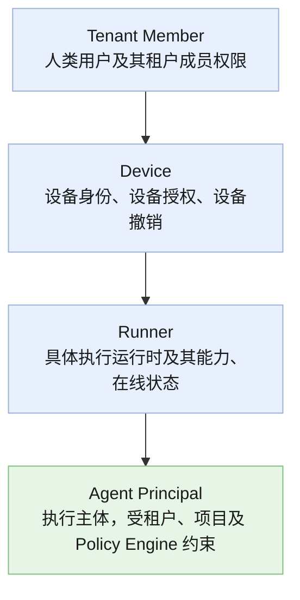

# Codex Bootstrap V1 设计稿专家评审

> 评审对象：`docs/ai-pm-codex-bootstrap-v1.md`（V1 用户供稿整理，**未过稿**；自称 Slice F — Codex Environment Bootstrap，验收矩阵 BOOT-01~14）
>
> 评审结论：**总体方向通过 · 有条件过稿**——保留主体结构，补充关键技术裁决后过稿；建议将本稿定位升级为 PM-AI 正式基础能力「Development Environment Management（开发环境管理）」。
>
> 记录说明：本文件为专家评审意见的原文记录，仅做格式整理（Markdown 化、表格规范化、代码围栏恢复、配图转写为 Mermaid），不改动措辞与结论。评审修订**暂未并入设计稿正文**，待用户确认后按 T-087 定稿流程收编。文末附整理注：专家建议的任务编号与 `todo.md` §10.7 既有编号的对照（评审原文要求落盘前核对）。

---

## 〇、总体判断

我的判断是：这份设计的方向是正确的，而且应该作为 PM-AI 的一个独立能力建设，但目前还不适合直接进入实施。

它解决的不只是 Codex 的安装问题，而是 PM-AI 如何把一个普通开发环境转变成一个经过身份认证、权限授权、能力验证、可以参与任务执行的可信执行节点。

我建议保留这份设计的主体结构，但在正式过稿前补充几个关键技术裁决。

尤其有一个问题需要注意：**这份设计必须与已经实施的 D3（T-031）和正在收敛的 T-032 对齐，不能再独立设计一套执行身份和执行生命周期。**

---

## 一、先看整体架构是否成立

你提出的三个层次划分是正确的：

| 层次 | 组件 | 核心职责 |
| --- | --- | --- |
| 平台端 | Platform Worker | Task/Run 调度、租约、生命周期 |
| 开发机端 | Local Runner | Workspace、Git、Codex 进程管理 |
| Codex 端 | Skill + MCP | 工作规范、平台接口 |

这里最重要的架构原则是：

> **MCP 是通信接口，不是执行运行时。**

这个原则应该提升为 PM-AI 的长期架构约束。

还有一点值得明确：V1 和 V2 不应该发展成两套不同的执行架构。

- V1：用户主动打开 Codex，Codex 执行任务。
- V2：Local Runner 主动启动 Codex，Codex 执行任务。
- 两者：使用同一套 Task、Run、Principal、MCP 和 Policy 模型。

这样未来增加 Claude Code 或其他 Agent 执行器时，也不必重新设计整个环境接入体系。

---

## 二、必须修正的六个问题

### P0-1：V1 与 D3（T-031）的职责边界没有说清楚

这是我认为最重要的问题。

此前 D3 已经确定并实施了：

- 本地 spawn Codex CLI。
- RunExecutor / CodexExecutor。
- Workspace、Git mirror、worktree。
- Run 启动、终止和回收。
- 执行日志及生命周期管理。

也就是说，PM-AI 已经有了本地执行引擎的基础。

现在这份设计又提出：V1 安装 Local Worker，V2 才支持无人值守 Runner。

这里存在概念上的歧义。如果 V1 已经安装 Local Runner，那么它究竟是：

1. 一个只负责环境注册、仓库检查的轻量客户端？
2. 一个完整的本地执行运行时，只是暂时不启用自动调度？
3. D3 已有的 CodexExecutor 的安装和部署载体？

我建议采用第三种方向，但明确区分运行模式：

| 能力 | V1 手动模式 | V2 自动模式 |
| --- | --- | --- |
| 安装 Local Runner | 是 | 是 |
| Device 注册 | 是 | 是 |
| MCP | 是 | 是 |
| Codex Skill | 是 | 是 |
| 用户主动启动 Codex | 是 | 可选 |
| Runner 自动领取 Run | 否 | 是 |
| Runner 自动 spawn Codex | 否 | 是 |
| Workspace 管理 | 可验证、按需使用 | 自动管理 |
| Commit / Delivery 收集 | 手动执行流程 | 自动执行流程 |

这里还有一个重要约束：**V2 不应该重新实现 D3 的执行引擎，而应该让常驻 Runner 复用 D3 已有的 CodexExecutor。**

建议增加一条 ADR：

> Local Runner 是开发机端统一执行运行时。V1 以交互式接入为主，V2 增加无人值守调度能力。两种模式共享同一套执行引擎，不产生两套 Codex 进程管理实现。

### P0-2：Device、Runner、Agent Principal 的身份关系需要明确

你已经明确了：

- Device 不等于 Tenant Member。
- 一个用户可以有多台 Device。
- 一个 Device 可以服务多个 Project。

这些判断正确。

但目前缺少一个重要问题：**Codex 通过 MCP 连接平台时，平台究竟认定它是谁？**

这里不能简单地把 Device 当成 Agent 身份。

建议采用以下身份关系：



> 整理注：原图为评审随文配图（垂直四层，末层 Agent Principal 绿色强调），已按用户指示转写为 Mermaid。

这里需要强调：

- Member 是授权来源。
- Device 是设备身份。
- Runner 是运行时身份。
- Agent Principal 是平台执行授权所识别的主体。

**不能因为一个用户授权了一台设备，就让该设备自动拥有这个用户在所有项目中的权限。**

这也必须与已经讨论的 `ai-pm-adr-0001-tenant-agent-executor-identity.md`、`ai-pm-principal-identity-v1.md` 和 T-032 对齐。

特别是 T-032 仍然涉及 Agent 身份与 MCP 凭据的闭环问题，Bootstrap 不应该提前创造另一套认证协议。

我的建议是：**Bootstrap 负责发起注册和授权，不负责重新定义身份体系。**

### P0-3：OAuth 与 Device 注册不能视为同一件事

目前的流程：

```text
Codex
  ↓
Bootstrap API
  ↓
一次性授权码
  ↓
用户登录
  ↓
注册 Device / Runner
  ↓
颁发访问凭证
```

方向正确，但少了两个安全边界。

第一，用户 OAuth 登录成功，只能证明用户身份，不能直接证明某台 Device 已经获得执行权限。

第二，Remote MCP 的 OAuth 凭证与 Local Runner 的设备凭证，不应该默认是同一个 Token。

建议明确分成两条（三类）认证通道：

| 凭证 | 使用者 | 用途 |
| --- | --- | --- |
| User OAuth | Codex / 用户会话 | 证明用户身份、完成授权 |
| Device Credential | Local Runner | 证明设备身份 |
| Agent Credential | Agent 执行主体 | 调用受授权的执行接口 |

凭证应具备独立的撤销、过期、刷新及轮换机制。

另外，设备授权建议采用短时效、一次性、绑定授权会话的机制，避免授权码被其他设备抢先使用。

设备凭证最好采用设备专属密钥进行持有证明，而不只是一个可复制的长期 Bearer Token。

### P0-4：设备撤销的执行语义不够完整

原文：

> 撤销设备授权后，必须立即阻止新的任务领取。已运行的 Run 应进入受控终止或失效处理。

这是正确的，但还不够。建议定义一个明确的撤销协议：

1. Device 进入 revoked。
2. 设备及其所有 Runner 的新任务领取立即被拒绝。
3. 设备刷新凭证立即失效。
4. 正在运行的 Run 进入终止或失效处理。
5. 已失效的执行实例不得继续回写有效结果。
6. 已有的租约不能因为尚未到期就继续赋予执行权限。
7. 撤销事件写入审计日志。

特别注意：**撤销授权必须由服务端实时判定，不能依赖 Runner 下一次心跳才生效。**

这里还要与 T-032 的启动持久化、子进程回收及生命周期一致性总验收保持一致。否则就会出现：设备已经撤销，但之前启动的 Codex 仍然能够提交结果的情况。

### P0-5：Project Binding 与 Repository 授权混在了一起

你已经明确一个 Project 可以有多个 Repository。

但是：`runner_project_binding` 是否意味着 Runner 绑定 Project 后，就自动获得该 Project 所有 Repository 的访问权？

我不建议这样设计。应当分开：

- Project Binding：Runner 被允许服务哪个 Project。
- Repository Access：Runner 是否有权访问具体 Repository。
- Workspace：本次 Run 实际使用哪些 Repository。

例如：

```text
Project: PM-AI
  ├── Repository A
  ├── Repository B
  └── Repository C

Device: Windows PC
  └── Runner
      ├── Project Binding: PM-AI
      ├── Repository A: Allowed
      ├── Repository B: Allowed
      └── Repository C: Denied
```

这对于后续多仓库执行尤其重要。**Project Binding 不应该自动扩大 Repository 的授权范围。**

另外，Runner 的项目绑定应当由有权限的 Tenant Member 明确授权，而不是由 Bootstrap Skill 自行决定。

### P0-6：Bootstrap 的 Ready 状态定义过于宽泛

原文：

> PM-AI 将该开发环境标记为 Ready。

我建议把 Ready 定义成一个有明确条件的服务端状态，而不是安装程序最后发送一个成功信号。

至少区分：

| 状态 | 含义 |
| --- | --- |
| pending | 等待初始化 |
| authorizing | 等待用户授权 |
| installing | 安装中 |
| verifying | 自检中 |
| ready | 所有必要检查通过 |
| degraded | 部分能力异常 |
| revoked | 授权撤销 |
| offline | 心跳超时 |
| failed | 初始化失败 |

其中 ready 至少要求：

- Device 已注册且未撤销。
- Runner 身份认证通过。
- Runner 版本符合服务端兼容要求。
- MCP 身份认证通过。
- 项目授权通过。
- 至少一个被授权的 Repository 可访问。
- Workspace 创建成功。
- 执行能力符合对应运行模式的要求。

另外，MCP 自检和 Runner 自检应当分别进行。**不能用 MCP 正常来代表整个开发环境正常。**

---

## 三、Plugin 技术方案：方向正确，但安装协议需要修正

### 3.1 技术路线可行

我核对了 OpenAI 当前的官方开发文档。Codex Plugin 确实支持：

- 打包多个 Skill。
- 配置 Remote MCP。
- 使用 `.codex-plugin/plugin.json`。
- 配置安装后的 onboardingSkill。
- 通过 Plugin 组织分发和初始化流程。

官方资料（评审者引用，未附具体链接）：

- Package your plugin
- Codex MCP 配置
- Plugins in ChatGPT and Codex

因此，原设计选择 Plugin + Bootstrap Skill 是合理的。

但我建议调整几个细节。

### 3.2 安装包目录结构

原结构中 `manifest.json` 没有明确说明它的协议用途。建议不要让它与 plugin.json 形成两套身份清单。可以改成：

```text
pm-ai-codex/
├── .codex-plugin/
│   └── plugin.json
│
├── .mcp.json
│
├── skills/
│   ├── pm-ai-bootstrap/
│   │   └── SKILL.md
│   ├── pm-task-execution/
│   │   └── SKILL.md
│   ├── pm-learn/
│   │   └── SKILL.md
│   └── pm-knowledge/
│       └── SKILL.md
│
├── scripts/
│   ├── install-worker.ps1
│   ├── install-worker.sh
│   ├── verify-install.ps1
│   └── verify-install.sh
│
└── release-manifest.json
```

其中：

- `plugin.json`：插件元数据、Skill、MCP、onboarding 配置。
- `.mcp.json`：Remote MCP 配置。
- `release-manifest.json`：Worker 下载地址、版本、平台、SHA-256、签名等发布信息。

注意，OpenAI 当前文档还提供了可移植的根目录 plugin.json 格式。当前 `.codex-plugin/plugin.json` 属于 Codex 兼容布局，建议 V1 先固定一种经过实际 Codex 版本验证的格式，不要同时维护两套。

### 3.3 Bootstrap Skill 不应直接负责安装细节

Skill 负责决策和引导：

```text
检查环境
  ↓
判断是否已安装
  ↓
选择安装方案
  ↓
请求用户授权
  ↓
调用安装脚本
  ↓
调用验证脚本
  ↓
提交初始化结果
```

真正的安装逻辑由脚本完成。

这符合你提出的核心原则：**安装说明负责指导安装，安装程序负责保证安装正确，PM-AI 服务端负责验证安装结果。**

### 3.4 SHA-256 还不够

建议增加：

- 发布清单签名。
- Worker 二进制签名验证。
- 防止下载地址被替换。
- 防止版本降级。
- 下载失败的恢复机制。
- 安装失败时恢复原配置。

SHA-256 只能验证文件是否与某个已知摘要一致，不能单独证明这个摘要本身来自可信发布方。

---

## 四、建议增加的三个设计章节

上述六个问题解决之后，我认为还需要补充三个章节，才能真正形成可实施的设计稿。

### 4.1 安装协议与版本兼容

这是当前设计比较薄弱的地方。

你已经提出 Skill、MCP、Runner 独立版本管理，这是正确的。但必须定义版本协商协议。例如：

```json
{
  "bootstrap_version": "1.0.0",
  "runner_version": "1.2.0",
  "skill_version": "1.0.0",
  "mcp_protocol_version": "1",
  "platform_api_version": "1"
}
```

服务端需要能够判断：

- Runner 是否支持当前 API。
- Skill 是否支持当前 MCP 工具。
- Runner 是否支持目标执行能力。
- 是否需要升级。
- 是否允许继续执行。

建议采用：**最低兼容版本 + 能力声明 + 协议版本**，而不是简单比较版本号。

例如 Runner 支持：

```text
capabilities:
  - workspace.create
  - git.worktree
  - codex.spawn
  - execution.terminate
  - delivery.collect
```

平台根据能力决定是否允许该 Runner 领取特定类型的 Run。

### 4.2 安装失败与重新初始化协议

BOOT-11、BOOT-13 提到了升级、卸载和恢复，但没有定义具体语义。建议明确以下场景：

| 场景 | 预期行为 |
| --- | --- |
| 已安装相同版本 | 幂等，不重复安装 |
| 已安装旧版本 | 执行升级 |
| 下载失败 | 不影响已有版本 |
| 校验失败 | 拒绝安装 |
| 安装中断 | 可恢复 |
| MCP 配置失败 | 保留原配置 |
| 设备授权失败 | 清理未完成的注册状态 |
| 重新初始化 | 明确复用或重新注册 Device |
| 卸载 Runner | 不自动撤销用户的其他设备授权 |

这里有一个细节：**卸载本地程序不等于撤销服务端设备授权。** 这两个动作应该独立。否则用户重装系统、重新安装 Runner 时，会出现设备身份管理混乱。

### 4.3 数据模型与状态归属

目前提出了六个服务端对象：

- device
- runner
- runner_registration
- runner_heartbeat
- runner_capability
- runner_project_binding

我建议先不要直接将这六个对象全部设计成独立数据库表。先定义领域实体及数据归属：

| 对象 | 建议 |
| --- | --- |
| Device | 独立实体 |
| Runner | 独立实体 |
| Registration | 授权记录，可有独立生命周期 |
| Heartbeat | Runner 状态字段 + 必要的心跳历史 |
| Capability | Runner 能力声明，可采用结构化数据 |
| Project Binding | 独立授权关系 |

尤其是 Heartbeat，不一定需要一张每次心跳都写入的业务表。可以将最新状态保存在 Runner 上，审计或历史数据另行处理。

避免为了未来可能需要的管理界面，过早建立大量低价值数据表。

---

## 五、验收标准需要加强

原来的 BOOT-01～14 覆盖面不错，但主要验证的是安装功能，缺少安全性、生命周期和故障恢复方面的验收。建议补充：

| 编号 | 新增验收要求 | 优先级 |
| --- | --- | --- |
| BOOT-15 | Device、Runner、Agent Principal 身份关系符合现有身份 ADR | P0 |
| BOOT-16 | Remote MCP 与 Runner 凭证分离管理 | P0 |
| BOOT-17 | 撤销设备后立即阻止新 Run 领取 | P0 |
| BOOT-18 | 撤销后旧执行实例不能提交有效结果 | P0 |
| BOOT-19 | Project Binding 不自动扩大 Repository 权限 | P0 |
| BOOT-20 | Ready 必须通过服务端独立验证 | P0 |
| BOOT-21 | Runner 与 MCP 协议版本兼容性验证 | P1 |
| BOOT-22 | 安装升级支持签名验证和回滚 | P1 |
| BOOT-23 | 支持设备重装、Runner 重注册和凭证轮换 | P1 |
| BOOT-24 | 安装及授权全过程可审计 | P1 |
| BOOT-25 | V2 复用 D3 CodexExecutor，不重复实现执行引擎 | P0 |

另外，BOOT-04 的 Windows、macOS、Linux 支持，应明确 CPU 架构，例如 x86_64、ARM64。否则跨平台验收标准还不够具体。

---

## 六、实施拆分建议

我不建议把这 25 项直接作为一个大任务实施。建议仍然保留独立 Slice F，但将其拆为六个有依赖关系的任务：

```text
Slice F · Codex Environment Bootstrap

1. T-087 · Bootstrap 架构与协议定稿   P0
   - 身份关系与 T-032 对齐
   - Device / Runner 领域模型
   - Bootstrap API
   - 版本兼容协议
   - Ready 状态定义

2. T-088 · Codex Plugin 与 Skill 分发   P1
   - Plugin manifest
   - Bootstrap Skill
   - Remote MCP 配置
   - 安装入口

3. T-089 · Local Runner 安装器   P1
   - Windows / macOS / Linux
   - 下载、签名、校验
   - 安装、升级、卸载
   - 幂等和恢复

4. T-090 · Device 注册与授权   P0
   - 一次性授权
   - OAuth
   - Device / Runner 注册
   - 凭证颁发和轮换
   - 撤销

5. T-091 · Project / Repository 绑定与自检   P0
   - 项目授权
   - 多 Repository
   - Workspace 检查
   - Ready 验证

6. T-092 · 开发环境管理页面   P2
   - 设备列表
   - Runner 状态
   - 绑定管理
   - 授权撤销
   - 执行能力展示
```

> 整理注：以上任务编号为评审者给出的建议拆分（原文「lice F」为「Slice F」的粘贴截断，已修复）。评审原文同时要求：正式落盘前应与现有 todo.md 核对，避免与既有 T-087～T-092 冲突——对照结论见文末「九、整理注」。

这里有两个重要的实施依赖：

1. T-087 的身份与协议裁决必须等待 T-032 的身份、MCP 凭证和执行生命周期边界收敛。
2. T-090、T-091 的服务端能力优先于管理页面，不能先做一个漂亮的开发环境页面，再反向补安全模型。

T-088 和 T-089 可以在协议定稿后并行推进。管理页面可以后置，不影响 Bootstrap 核心能力验收。

---

## 七、我认为还需要一个重要的产品决策

原设计说：

> 用户复制一条初始化指令交给 Codex。

我赞成这个交互，但建议把它设计成 PM-AI 的**标准安装协议**，而不是一个临时提示词。用户拿到的指令应该类似：

```text
PM-AI Bootstrap

请初始化当前 Codex 开发环境。

1. 阅读 PM-AI 官方 Bootstrap 安装说明。
2. 检查当前 Codex 和操作系统环境。
3. 安装或升级 PM-AI Plugin。
4. 安装 Local Runner。
5. 配置 PM-AI Remote MCP。
6. 引导我完成设备授权。
7. 让我选择要关联的 Project 和 Repository。
8. 执行完整环境自检。
9. 将自检结果提交给 PM-AI。
10. 确认开发环境达到 Ready 状态。

安装地址：
https://pm-ai.example.com/install/codex
```

但这里要有一个产品原则：**安装 URL 是稳定入口，安装包和安装协议由服务端管理。**

未来即使：

- Worker 从 Rust 改为其他实现；
- MCP 接口升级；
- Plugin 增加 Skill；
- OAuth 流程发生变化；
- Runner 增加其他 Agent 执行器；

用户也不需要重新学习一套安装方法。

另外，不能把这条指令理解为绕过 Codex 的权限审批。插件安装、脚本执行、设备授权等操作仍然要有相应的用户确认。

---

## 八、最终评审结论

| 评审项目 | 结论 |
| --- | --- |
| Plugin + Skill 分发 | 通过 |
| Remote MCP | 通过 |
| Platform Worker / Local Runner 分离 | 通过 |
| V1 / V2 共用执行协议 | 通过 |
| Device / Runner 身份模型 | 需要补充 |
| OAuth 与设备凭证 | 需要补充 |
| 撤销授权语义 | 必须补充 |
| Project / Repository 授权 | 必须补充 |
| Ready 状态 | 必须补充 |
| 安装升级与恢复 | 需要补充 |
| 与 D3 / T-032 的衔接 | 必须裁决 |

### 最终建议：保留 V1，补充后过稿

我建议不要推翻这份设计，也不要把它收窄成单纯的 Codex 安装文档。

它应该成为 PM-AI 的一个正式基础能力：**Development Environment Management（开发环境管理）**。其长期职责是：

1. 管理哪些设备可以接入 PM-AI。
2. 管理哪些 Runner 可以执行任务。
3. 管理 Runner 可以访问哪些 Project 和 Repository。
4. 验证执行环境是否达到 Ready。
5. 管理设备授权、凭证和撤销。
6. 为未来无人值守 Agent 执行提供基础设施。

还有一个边界：不要让 Bootstrap 承担 Run 调度、Task 生命周期、Commit 裁决等职责，这些仍然属于已有的执行管线。

我建议本稿最终定位为 **ADR + Bootstrap 安装协议 + 开发环境领域模型 + UI 原型**，T-087 负责最终架构裁决。

这份设计最有价值的地方，不是让 Codex 自动安装一个 MCP，而是让 PM-AI 从「管理 AI 研发任务」真正走向「管理 AI 研发执行环境」。

---

## 九、整理注：专家建议任务编号与 todo.md 既有编号对照

评审原文要求「正式落盘前还应与现有 todo.md 核对，避免与既有 T-087～T-092 冲突」。核对结果：**编号全部重叠，但内容划分不同**，落盘时以 todo.md §10.7 既有编号为准，专家拆分仅作 T-087 定稿的范围参考：

| 专家建议拆分 | todo.md §10.7 既有条目 | 对照结论 |
| --- | --- | --- |
| T-087 Bootstrap 架构与协议定稿 | T-087 Codex Bootstrap 设计稿定稿 | 一致；专家补充的裁决点（身份对齐 T-032、版本兼容协议、Ready 定义）与既有 6 项待裁点合并 |
| T-088 Codex Plugin 与 Skill 分发 | T-088 服务端 Bootstrap API + Device/Runner 注册域 | 冲突：专家的 T-088 ≈ 既有 T-089（安装包）/ T-090（Skill+MCP 配置）的分发面 |
| T-089 Local Runner 安装器 | T-089 安装包与 Worker 安装程序 | 基本一致（专家强化签名/防降级/回滚） |
| T-090 Device 注册与授权 | T-090 Bootstrap Skill + MCP 配置 + 自检闭环 | 冲突：专家的 T-090 ≈ 既有 T-088 的服务端授权面 |
| T-091 Project/Repository 绑定与自检 | T-091 前端两页 | 冲突：专家的 T-091 ≈ 既有 T-088（绑定域）+ T-090（自检闭环） |
| T-092 开发环境管理页面 | T-092 V2 无人值守 Runner（延后） | 冲突：专家的 T-092 ≈ 既有 T-091（前端管理页） |

两条评审实施依赖需在 T-087 定稿时体现进前置关系：

1. **T-087 的身份与协议裁决必须等待 T-032 收敛**（既有 §10.7 未显式登记此依赖）。
2. **服务端授权能力（既有 T-088）优先于管理页面（既有 T-091）**——与既有前置关系一致，评审予以确认强化。