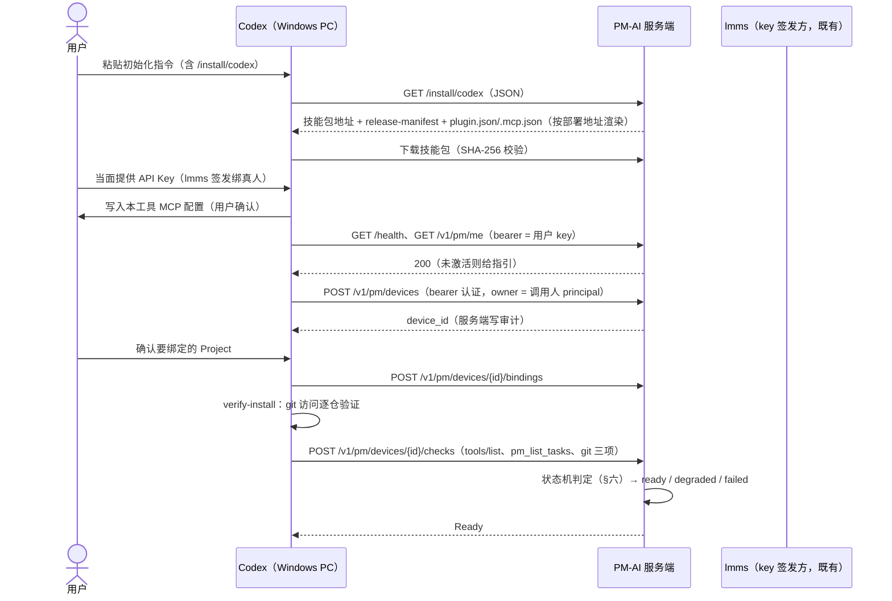
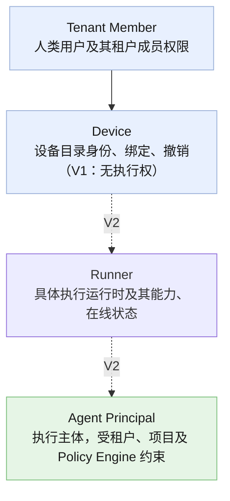

# Codex 自动初始化与开发环境接入（Codex Bootstrap）设计稿 V1.2（T-087 定稿）

> **标注图例**：〔用户供稿〕= 2026-11-01 用户提供的设计供稿整理；〔原型〕= 用户提供的界面原型图转写（原图为微信临时文件，已失效，本文转写为文字线框）；〔整理注〕= 落盘时的格式性说明，不含设计裁决；〔评审收编〕= 2026-11-01 外部专家评审意见收编进正文（评审原文与逐条对照见 `ai-pm-codex-bootstrap-review.md`）；**〔定稿〕**= 2026-11-02 T-087 brainstorming 六项裁清点裁决（用户逐项确认）；**〔我的裁定〕**= 用户授权「后面按照推荐」后由执行者裁定的派生细节，可否决。

| 项 | 内容 |
| --- | --- |
| 文档性质 | 设计稿（ADR + Bootstrap 安装协议 + 开发环境领域模型 + 界面原型），**已过稿——M10（T-088~T-091）实施基线** |
| 版本 | **V1.3**（2026-11-02 外部专家评审收编，§〇-B；V1.2 = 2026-11-02 T-087 定稿；V1.1 = 2026-11-01 评审收编；V1 = 同日用户供稿） |
| 记录 | 司南（产品经理 Agent）按用户供稿整理落盘（V1）；外部专家评审收编（V1.1）；ZCode 按 §0.1 brainstorming 六项裁清点定稿（V1.2）；第二份外部专家评审收编（V1.3，有条件通过，P0×5 + P1×4 + 任务约束×3）；**用户过稿（2026-11-02）** |
| 状态 | **已过稿（2026-11-02）**——T-087 归档于 todo.md §13；**T-088~T-091 解禁**，按 §十三 依赖图领取 |
| 上位约束 | `ai-pm-mcp-executor-positioning-v1.md`、`ai-pm-executor-onboarding-runbook-v1.md`、`ai-pm-adr-0001-tenant-agent-executor-identity.md`、`ai-pm-principal-identity-v1.md`、`ai-pm-adr-0002-executor-credential-separation.md`、`ai-pm-multi-repo-model-v1.md`、`ai-pm-slice-d-execution-pipeline-v1.md`、`ai-pm-slice-d3-executor-hardening-v1.md`（T-032） |
| 关联条目 | todo.md §10.7 M10（T-087~T-092，T-087 已归档 §13）；M8 T-080（onboarding URL，本稿的直系前身，**两条任务线已收编为一条**）；评审记录 `ai-pm-codex-bootstrap-review.md`（第一轮）与 `ai-pm-codex-bootstrap-review2.md`（第二轮，本轮） |

---

## 〇-A、T-087 定稿裁决汇总〔定稿〕

六项裁清点的裁决与落点（详述在各节，此处为唯一索引）：

| # | 裁清点 | 裁决 | 落点 |
| --- | --- | --- | --- |
| 1 | 部署拓扑 | **V1 按真实两机拓扑**：服务器跑 PM-AI 栈（pm-api + PG + `/mcp`），Windows PC 跑 Codex；**T-081（`/mcp` 跨机暴露）并入 V1 前置**；M-01 同机实测结果保留为回归基线 | §〇、§十三 |
| 2 | V1 是否装 Runner 二进制 | **不装**。V1 = 技能 + Remote MCP 配置 + 设备登记 + 自检；BOOT-05 判 V2；`install-worker.*` 移出 T-089；Local Runner 定位（§2.1）不变，V2 到来 | §二、§四、§十一 |
| 3 | Codex 用什么凭据连 MCP | **沿用 lmms 真人 key**（T-080 流程原样）；不新增凭据签发体系；一次性授权码 + Web 确认页 + 授权会话**整块砍除归 V2/T-055**；三通道表改写（Agent Credential 划除）；跨机越权面由 **claim 校验调用人 `project_member`** 封住（**T-051 关闭**，落 T-088） | §五 |
| 4 | 六对象归位 | **V1 两张新表**（`devenv.device` + `devenv.device_project_binding`，迁移 `0027`）；`runner` / `runner_registration` / `runner_capability` / `runner_heartbeat` 四对象 V2 再定表结构（V1 零生产者不建空表）；版本与安装审计走既有 `governance.audit_log` | §5.5、§5.6 |
| 5 | 与 T-080 `/install/codex` 的关系 | **合并**：`/install/{tool}` 是唯一稳定入口，JSON 响应新增 `bootstrap` 段；T-080 遗留的前端接入卡片 = T-091 卡片；两条任务线收编为一条 | §三、§十三 |
| 6 | 包的 executor-neutral | **中立核心包 `pm-ai-skills/` + 薄适配层**：四份 SKILL.md 按通用 agentskills 格式写、包内不含部署地址；Codex 适配 = `/install/codex` 渲染 `plugin.json` + `.mcp.json`；Codex 是首发适配目标，不是唯一目标（trae / z-code 走「技能目录落盘」指令） | §3.1 |

**派生裁定**〔我的裁定〕（用户授权「后面按照推荐」，逐条可否决）：

1. **设备归因走请求头**：`X-AI-PM-Device-Id`，由新增薄转发层读取，claim 时落 `task_run.executor_id`（ADR-0001 D6 无 FK 前向列语义维持）。**不改 11 个既有 MCP 工具契约**；头值自报不可信原则不变（D2：自报不作凭证）。
2. **claim 成员校验与 MCP 调用人归因共享同一基础设施**：rmcp 3.8 工厂闭包不见 HTTP 请求（T-059 已证阻塞），axum 三层鉴权链解析出的调用人 principal 进不了工具上下文。T-088 须先落**薄转发层**（T-059 候选①/②择一）——一次修复同时解阻 T-051（成员校验）、T-059（审计三列）、设备归因（头读取）三件事。
3. **Ready 状态机 V1 子集**：`authorizing`（无授权码）与 `offline`（无心跳生产者）两态标 V2。
4. **T-082 `pm_list_tasks` 升级为 T-090 硬前置**（自检「任务可读」依赖它）。
5. **迁移号 `0027_devenv.sql`**（0025 = M9 discovery 在施；0026 = D5 已用）。
6. **定稿沿用本文件演进**（V1.1 → V1.2），不另立文件。
7. **分发安全 V1 判定**：安装物 = 纯文本技能包 + 脚本，对 skills 包做 SHA-256 + `release-manifest` 同源校验；二进制签名 / 防降级 / 恢复体系随 V2 Runner 到来（届时才有二进制可签）。
8. **重新初始化规则**：本地 `device.json` 存活且服务端设备未 revoked → 复用；否则新注册；卸载本地技能 ≠ 撤销服务端设备（§八）。
9. **`plugin.json` 布局**（根目录可移植 vs `.codex-plugin/` 兼容）：沿 V1.1 §3.1 注——T-089 对着测试 PC 上的真实 Codex 版本实测定一种，定稿不预判。
10. **`pm-learn` SKILL.md 的内容归 M9（T-086）产出，本包只承载位置**：中立性互不感知，M10 不写 /pm-learn 的分析逻辑，M9 不知道 Codex 存在。

**builder-check 补裁**〔我的裁定〕（独立审稿人通读 V1.2 后提出的六个「不问清就得猜」问题，均按仓库既有裁决取默认解）：

11. **仓库清单来源**：绑定项目的仓库列表读自既有 `integration.project_repository`（0008）经 T-022 可见性的项目读端点；`POST /bindings` 载荷携带 `declared_repository_ids`（⊆ 该项目 `project_repository`）；`verified_repositories` ⊆ declared（§四步 6、§5.6）。
12. **状态写者**：服务端持久化**两个正交维度**——`status`（生命周期 `active`/`revoked`，`POST /revoke` 写）与 `readiness`（就绪快照 `installed`/`connected`/`authenticated`/`ready`/`degraded`/`failed`，**`POST /checks` 是唯一写者**）。`pending` / `verifying` 是 Skill 的**客户端阶段**，不落库、不设状态端点。`POST /devices` 创建即 `status='active'` + `readiness=NULL`。图2 的 [Verifying] 徽标改为四层徽标（§六、§九）。〔评审收编 P1-1/P1-3〕
13. **自报设备头的校验深度**：薄层按调用人租户查 `devenv.device`；**存在 + owner = 调用人 + 未撤销** → 写 `executor_id`；未知 / 他租户 / 他人设备 / 已撤销 → **忽略（写 NULL）+ 审计 `device_attribution_ignored`，不拒绝请求**——拒绝会把自报头变成凭证，违反 D2（§5.1）。
14. **管理面端点与可见范围**：T-088 补 `GET /v1/pm/devices`（列表）/ `GET /{id}`（详情）/ `POST /{id}/revoke` / `DELETE /{id}/bindings/{binding_id}`。可见范围沿用 `tenant_member.role` 唯一事实源：**member 只见自己 owner 的设备并可撤销自己的；tenant owner/admin 见全租户设备并可撤销任意设备**（§十三）。
15. **技能包分发形态**：单个 zip `pm-ai-skills-<version>.zip`，**随 pm-api 构建内嵌**（`include_bytes`，与 T-080「工具清单内置代码」同一思路），`GET /install/packages/pm-ai-skills-<version>.zip` 同源下发；`release-manifest.json` 由服务端从内嵌包生成，SHA-256 覆盖整个 zip；不引入外置静态托管（§3.3）。
16. **T-081 与薄转发层的先后**：T-081 **先行且限定部署层**（绑定地址 / 反代 / TLS / `Host` 校验语义，transport 无关）；rmcp `allowed_hosts` 放开是一行配置，候选①/②皆存活。薄层的候选选择归 T-088，**T-088 继承 T-081 的两机安装闭环为回归项**——若选候选②替换 rmcp HTTP 服务，跨机验收不得倒退（§十三）。

---

## 〇-B、外部专家评审收编（2026-11-02，V1.3）〔评审收编〕

**评审结论**：架构方向通过，**有条件通过**——不推翻 V1.2、不扩大 V1 范围；重点修正身份语义、绑定权限与 Ready 判定。要求完成下列 P0 修改后再作为实施基线。

**评审原文落盘**：`docs/ai-pm-codex-bootstrap-review2.md`（评审全文 + 逐条对照）。

| # | 评审条目 | 收编裁决 | 落点 |
| --- | --- | --- | --- |
| **P0-1** | `X-AI-PM-Device-Id` 不能被当成设备身份；三种身份须分层（Principal 可信 / Device ID 不可信声明 / Runner ID 经认证） | **采纳并成文为硬约束**：Device ID 仅是「客户端声明的开发环境标识」，**不构成设备身份认证，也不构成任何权限凭据**；服务端不得仅凭它建立设备信任、扩大项目/仓库/执行权限；设备不在调用人租户范围或未登记时按未登记设备处理，**不得影响 Principal 的授权结果**。V2 引入设备凭据后才允许设备级授权 | §5.1（新增三层身份表 + 硬约束段）、§5.4（授权流水线） |
| **P0-1b** | 审计须区分 `actor_principal_id` / `claimed_device_id` / `run_id`，不得让 Device ID 覆盖真人身份 | **采纳**：新增 `governance.audit_log.claimed_device_id`（可空 UUID，与 `task_run.executor_id` 同源同值），与 T-059 审计三列**同批迁移**；`actor_id`/`actor_identity_id` 口径不变 | §5.6（DDL）、§5.7（新增审计口径段）、§十三（T-088/T-059） |
| **P0-2** | Device Project Binding 不能成为权限授予机制；须写清服务端执行顺序 | **采纳**：成文六步授权流水线——**认证真人 Principal → 校验 Tenant/Project 成员资格 → 校验目标 Repository 访问权 → 解析 Device ID（仅归因）→ 记录 Binding 关系 → 执行 MCP Tool**；Device 解析可在权限校验前后进行，**但不得成为权限校验的替代品**。并入 T-088 验收标准 | §5.4（授权流水线）、§5.1（硬约束） |
| **P0-3** | T-081 必须是**真实部署验收门禁**，网络连通不等于身份链路可用 | **采纳**：T-081 验收从「能访问」升级为**七项身份链路验收**（含「MCP 工具拿到正确真人 Principal 上下文」「T-051 成员校验仍有效」「T-059 审计归因仍有效」「反代不截断长连接/协议交互」「未认证与越权请求被正确拒绝」），且必须**从真实 Windows 开发机发起**（禁止服务器内部自测充当） | §十三（T-081）、todo.md §10.5 |
| **P1-1** | Device 生命周期须明确（Active / Revoked / Disabled） | **采纳并裁**：V1 **不引入 `disabled`**（评审明示「不需要就不要提前引入」）；生命周期**与就绪状态拆为两列**——`status`（`active`/`revoked`）+ `readiness`（就绪快照）；语义成文：重新初始化复用未撤销 Device；**已撤销 Device 不得通过相同 ID 自动恢复**；撤销设备**不撤销真人 Principal**、**不改变 Repository 自身权限**；Binding 有效性受 Device 状态约束 | §5.5（DDL 两列）、§6（状态定义）、§5.3 |
| **P1-2** | Bootstrap 必须幂等 | **采纳**：成文幂等三态（有效 Device → 复用 / 不存在 → 创建 / 已撤销 → **不得自动恢复**）；重复 Bootstrap 不产生重复记录；重复绑定不产生重复 Binding（`UNIQUE(device_id, project_id)` 保证）；**原有有效绑定不被无意清除**；解绑与重绑有明确操作语义 | §八、§5.6（约束） |
| **P1-3** | Ready ≠ 安装成功，须分层且可退化 | **采纳**：四层分离 **Installed / Connected / Authenticated / Ready**（不合并为一个布尔值）；Ready 定义为**可验证的能力状态快照**而非永久属性——认证过期、绑定撤销、MCP 不可用时均可从 Ready 退化 | §6（Ready 四层 + 退化条件 + 检查项矩阵） |
| **P1-4** | SHA-256 需明确信任根，不能描述为发布者身份认证 | **采纳**：成文——V1 的同源 manifest + SHA-256 实现的是**文件完整性验证**，**不构成独立的发布者身份认证机制**（同源被篡改时 ZIP 与 manifest 可同时被替换）；不宣称供应链安全保证 | §3.3 |
| **—** | V1/V2 边界（评审完全赞成，要求不得提前做 Runner / 设备凭据 / 心跳 / 设备级领取 / 无人值守 / 进程管理） | **采纳**：§十一增列**「V1 明确不做」六项禁入清单**，作为 V1 范围护栏 | §十一 |
| **—** | 任务验收约束（T-081 真实两机 / T-088 权限与归因分离 / T-090 干净环境） | **采纳**：三条写入 §十三 对应任务 | §十三 |
| **—** | T-090 对 T-082 的硬依赖（评审赞成） | **维持**：T-082 仍为 T-090 硬前置 | §十三 |

**评审未改动 V1.2 的部分**（明示保留）：两机拓扑、不装 Runner、lmms 真人 key、两表模型、合并 `/install`、中立包结构、BOOT→C138~C162 映射、§十三 依赖图。

**评审强调并写入文档的核心原则**〔评审收编〕：

> **V1 是「真人通过一个已登记的开发环境接入 PM-AI」，不是「PM-AI 已经信任这台开发机器」。**
> 这条边界必须贯穿 Device 表、MCP 中间层、审计记录和权限校验。

---

## 〇、一句话结论与能力定位

把「Codex 接入」正式纳入 PM-AI 的 **Codex 接入与自动初始化（Codex Bootstrap）**：用户复制一条初始化指令交给 Codex，Codex 读取安装说明后**自动**完成技能包安装、MCP 配置、设备登记与项目关联，最后执行自检，确认可以正常领取 Task、回写执行状态——而不是让用户手动复制 MCP JSON、修改配置文件。

> **核心原则**〔用户供稿〕：**安装说明负责指导安装，安装程序负责保证安装正确，PM-AI 服务端负责验证安装结果。** 不要让 AI 仅凭一段 Markdown 自己猜测应该如何修改配置文件。

**V1 能力边界**〔定稿，修订评审收编的长期定位〕：

- **V1 的「Development Environment Management」= 目录 + 验证闭环**：管理哪些设备**声明了执行意愿**（登记），并验证其平台连通、任务可读、仓库可访问（自检 → Ready）。设备是**目录实体**，不持有执行凭据。
- **执行权在真人 key 上**（ADR-0002 Model A）：用户在 PC 上手动开 Codex，Codex 凭用户 key 走 MCP 领取任务。
- Run 调度、设备层执行凭据、无人值守——**V2**（T-092），届时 Local Runner（§2.1）到来，设备从「目录」升级为「可信执行节点」。

**职责边界**〔评审收编〕：Bootstrap **不承担** Run 调度、Task 生命周期、Commit 裁决——这些仍属于既有执行管线（Slice D）。

**长期架构原则**〔评审收编〕：**MCP 是通信接口，不是执行运行时。** 此原则提升为 PM-AI 的长期架构约束（详见 §二）。

---

## 一、标准安装协议与用户体验

在 PM-AI 项目管理页面增加一个入口（图1 原型）：用户只需要把这段文字交给 Codex，Codex 接下来完成安装。

**图1 原型转写〔原型〕**——「Codex 环境接入」卡片：

```
┌──────────────────────────────────────────────────────┐
│  Codex 环境接入                       [支持自动初始化] │
│  将以下指令发送给 Codex，即可初始化当前开发环境。       │
│                                                      │
│  PM-AI Bootstrap                                     │
│  请阅读以下安装说明，并为当前环境初始化                 │
│  PM-AI 技能与 MCP：                                  │
│                                                      │
│  https://pm-ai.example.com/install/codex             │
│                                                      │
│  ┌────────────────────────────────────────────────┐  │
│  │              ⧉  复制初始化指令                  │  │
│  └────────────────────────────────────────────────┘  │
│  示例地址，正式环境请替换为 PM-AI 的实际部署地址。      │
└──────────────────────────────────────────────────────┘
```

### 1.1 标准安装指令〔定稿修订评审收编〕

初始化指令是 PM-AI 的**标准安装协议**。V1 按七步生命周期（§四）修订：

```text
PM-AI Bootstrap

请初始化当前开发环境。

1. 阅读 PM-AI 安装说明（人读 Markdown / agent 读 JSON，同一 URL）。
2. 检查当前执行端与操作系统环境。
3. 安装 PM-AI 技能包，并按说明写入本工具的 MCP 配置
   （需要 API Key 时向我索取；Key 不得出现在安装指令或 URL 中）。
4. 按说明验证平台连通（/health 与 /v1/pm/me）。
5. 引导我确认要绑定的 Project，登记本设备并验证仓库访问。
6. 执行完整环境自检，并把结果提交给平台。
7. 确认开发环境达到 Ready 状态后结束。

安装地址：
https://pm-ai.example.com/install/codex
```

**产品原则**〔用户供稿，不变〕：**安装 URL 是稳定入口，安装包和安装协议由服务端管理。**

**边界**：这条指令**不是**绕过执行端权限审批的通道——技能包落盘、配置文件写入等操作仍然要有相应的用户确认；**Key 由用户当面交给 agent**（T-080 既定流程，M-01 已实测），指令与 URL 永不承载 Key。

---

## 二、先明确：PM-AI 需要安装的是什么？

把三个东西分开，避免架构混淆〔用户供稿〕：

| 层 | 组件 | 职责 | V1 是否安装 |
| --- | --- | --- | --- |
| **平台端** | PM-AI Worker | 负责 Run 调度、租约、超时回收、执行实例管理、结果接收。部署在 PM-AI 服务端，**不应该每个 Codex 都安装一套** | 否（服务端既有） |
| **开发机端** | PM-AI Runner / Local Worker | 负责连接 PM-AI、准备 Workspace、管理本地仓库、启动 Codex 执行实例、收集 Commit 和执行证据 | **否（V2）** |
| **Codex 端** | PM-AI Skill + MCP | Skill 提供工作规范和执行流程；MCP 提供 Task、Knowledge、Run 等平台接口 | **是（V1 全部）** |

**关键架构判断**〔用户供稿〕：**MCP 不等于 Worker。**

〔评审收编〕此判断强化为：**MCP 是通信接口，不是执行运行时**，并提升为 PM-AI 的长期架构约束。

- MCP 是 Codex 与 PM-AI 通信的接口；Worker 是负责执行任务的运行时。
- 用户在 Codex 中手动开发：Codex 通过 MCP 领取 Task。← **V1 全部内容**
- PM-AI 无人值守执行：平台 Runner 在开发机上启动 Codex，Codex 再通过 MCP 与平台交互。← **V2**
- 两者使用**相同的 Skill、MCP 协议和权限模型**。

〔整理注〕这与既有架构一致：Task 是业务任务，Run 是执行实例，Workspace 隔离执行环境，Project 与 Repository 解耦，一个 Project 可以有多个 Repository。

### 2.1 Local Runner 的定位〔评审收编，V1 不动〕

〔评审收编〕V1（安装 Local Worker）与 V2（无人值守 Runner）不能发展成两套执行架构：

- V1：用户主动打开 Codex，Codex 执行任务。〔定稿注：**V1 实际不装任何本地运行时**，本行描述的是「用户驱动」这一运行模式〕
- V2：Local Runner 主动启动 Codex，Codex 执行任务。
- 两者：使用同一套 Task、Run、Principal、MCP 和 Policy 模型。

这样未来增加 Claude Code 或其他 Agent 执行器时，也不必重新设计整个环境接入体系。

**Local Runner 的明确定位**：不是轻量客户端，而是 **D3（T-031）已有 CodexExecutor 的安装与部署载体**，同时是完整的本地执行运行时——由运行模式（V1 手动 / V2 自动，见 §十一）决定是否启用自动调度。

**硬约束**：**V2 不重新实现 D3 的执行引擎，常驻 Runner 复用 D3 已有的 CodexExecutor**，不产生两套 Codex 进程管理实现（验收 BOOT-25）。

---

## 三、推荐的安装技术方案

**推荐**〔用户供稿〕：**技能包 + Bootstrap Skill + Remote MCP**。〔定稿修订〕原「安装程序」在 V1 收敛为技能包内的自检脚本（`verify-install.*`）——V1 没有二进制要装，确定性安装逻辑只剩配置写入与验证。

为什么不是单纯提供一个 MCP URL？因为 MCP URL 只能解决通信配置，不能可靠地完成设备登记、项目绑定和环境自检。

### 3.1 安装包目录结构〔定稿修订评审收编修订〕

**中立核心包 + 薄适配层**（裁清点 6 = α）：

```text
pm-ai-skills/                        ← 中立核心包（原 pm-ai-codex/ 改名）
├── skills/
│   ├── pm-ai-bootstrap/
│   │   └── SKILL.md                 ← 七步生命周期编排（M10）
│   ├── pm-task-execution/
│   │   └── SKILL.md                 ← 领取/执行/提交规范，走既有 11+N 工具（M10）
│   ├── pm-learn/
│   │   └── SKILL.md                 ← Discovery 技能（内容归 M9/T-086，此处承载位置）
│   └── pm-knowledge/
│       └── SKILL.md                 ← 文档工具使用规范（M10）
├── scripts/
│   ├── verify-install.ps1
│   └── verify-install.sh            ← 自检脚本（MCP 连通 / git 访问 / 任务可读）
└── release-manifest.json            ← 包版本、协议版本、SHA-256、最低兼容版本
```

- 四份 SKILL.md 按通用 agentskills 格式编写，**不引用 Codex 专有 API，包内不含任何部署地址**。
- **仓库源目录 = `skills/`（仓库根）**〔我的裁定，对齐 M9〕：M9 的 T-086 已把 `skills/pm-learn/SKILL.md` 落在此处，T-089 直接以该目录为打包源，补齐另三个 SKILL.md 与 `scripts/`；`pm-ai-skills` 是**打包产物名**（`pm-ai-skills-<version>.zip`），不是仓库目录名。
- **Codex 适配** = `/install/codex` 按部署地址**渲染** `plugin.json` + `.mcp.json` 文本（agent 落盘）；`plugin.json` 布局二选一以实测为准（派生裁定 9）。
- **trae / z-code / 通用适配** = `/install/{tool}` 给「技能目录落盘到本工具路径」指令（T-080 的内置工具清单 + 通用兜底结构直接沿用）。

| 组件 | 职责 |
| --- | --- |
| 技能包 `pm-ai-skills/` | 分发 Skill 与自检脚本（工具无关） |
| Bootstrap Skill | **决策与引导**初始化流程（不直接负责安装细节，见 3.2） |
| 自检脚本 `scripts/` | 确定性验证（连通 / 访问 / 任务可读） |
| `release-manifest.json` | 包版本、协议版本、SHA-256、最低兼容版本 |
| MCP | 连接 PM-AI 服务 |

MCP 配置示意（不变）：

```json
{
  "mcpServers": {
    "pm-ai": {
      "type": "http",
      "url": "https://pm-ai.example.com/mcp"
    }
  }
}
```

用户倾向〔用户供稿〕：使用 **Remote MCP**，而不是让每台机器运行一个本地 MCP Server。〔定稿注〕V1 两机拓扑下 `/mcp` 从 loopback 放开到内网地址由 **T-081** 承载（V1 前置，裁清点 1）。

### 3.2 Bootstrap Skill 与脚本的分工〔评审收编，不变〕

Skill 负责决策和引导，**真正的验证逻辑由脚本完成**：

```text
检查环境
  ↓
判断是否已初始化
  ↓
选择执行方案
  ↓
请求用户授权（Key 索取 / Project 确认）
  ↓
写入配置、登记设备、绑定项目
  ↓
调用自检脚本
  ↓
提交自检结果
```

### 3.3 分发安全〔评审收编 + 定稿 V1 判定〕

**SHA-256 只能验证文件与某个已知摘要一致，不能单独证明该摘要来自可信发布方。**

**V1 判定**〔我的裁定，派生 7 / 15；评审收编 P1-4〕：V1 安装物是**纯文本技能包 + 脚本**。分发形态：单个 zip `pm-ai-skills-<version>.zip` **随 pm-api 构建内嵌**（`include_bytes`，与 T-080「工具清单内置代码」同一思路），经 `GET /install/packages/pm-ai-skills-<version>.zip` **同源下发**；`release-manifest.json` 由服务端从内嵌包生成，SHA-256 覆盖整个 zip；不引入外置静态托管、无第三方下载源。V1 交付：zip SHA-256 校验 + manifest 最低兼容版本检查（防降级）。

**信任根的准确表述**〔评审收编 P1-4〕：V1 使用同源 manifest 与 SHA-256 校验实现的是**文件完整性验证**——它能证明「文件与 manifest 声明一致」「下载过程未发生非预期内容变化」，**但不能单独证明发布者身份**（同源服务器被篡改时 ZIP 与 manifest 可同时被替换）。**不得将其描述为独立的发布者身份认证机制，也不得宣称供应链安全保证。** 发布方身份认证（清单签名）属 V2 二进制分发范围。

**V2 判定**：Runner 二进制到来时，完整交付评审收编清单——发布清单签名、二进制签名验证、防下载地址替换、防版本降级、下载失败恢复、安装失败恢复原配置。

---

## 四、自动初始化的完整流程（Bootstrap Lifecycle）

〔用户供稿八步〕**〔定稿〕V1 收敛为七步**（授权码步消失、Worker 安装步移除；V2 步骤括注）：

1. **获取安装说明**——执行端读 `GET /install/{tool}`（Markdown 给人 / JSON 给 agent，T-080 既有）；对 Codex，说明含技能包下载地址与渲染好的 `plugin.json` / `.mcp.json`。
2. **识别开发环境**——检查操作系统、执行端种类与版本、是否已初始化（本地 `device.json` 检测）。
3. **配置 Remote MCP**——用户把 API Key 当面交给 agent（T-080 流程），agent 按说明写入本工具配置；**Key 不进指令与 URL**。V1 不安装 Local Worker（V2 步骤：下载、验签、装用户目录）。
4. **验证连通**——`GET /health` 200 + `GET /v1/pm/me` 200；未激活给出「联系管理员激活」指引（T-080 既有语义）。
5. **登记设备**——`POST /v1/pm/devices`（key 认证）：登记 Device（owner = 调用人 principal），写本地 `device.json`。〔V2 增：Runner 注册 + 能力上报〕
6. **绑定项目与仓库**——用户确认要绑定的 Project；agent 经既有项目读端点读取该项目的 `integration.project_repository` 清单，用户确认要声明的子集；`POST /v1/pm/devices/{id}/bindings`（载荷 `project_id` + `declared_repository_ids`）；自检脚本验证本机对声明仓库的 Git 访问，验证通过的仓库清单随自检上报写入 `verified_repositories`（⊆ declared）。
7. **自检与 Ready**——逐项自检：MCP `tools/list`、`pm_list_tasks`（绑定项目任务可读）、Git 访问；`POST /v1/pm/devices/{id}/checks` 上报**四层结果**（Installed / Connected / Authenticated / Ready，§6.2）；服务端按 §六状态机逐项验证后写 `readiness`〔评审收编修订：不是安装程序发送一个成功信号；Ready 是**快照**，可退化〕。

> **注意**〔用户供稿〕：下载程序、修改系统配置、安装服务等操作，仍然需要遵循执行端的权限和审批机制。不能假设一段提示词就能绕过用户授权。

---

## 五、身份认证与安全设计

### 5.0 接入时序图（V1）〔定稿，替代原授权码时序〕



原 V1 的「一次性授权码 → Web 确认 → 签发短期凭证」时序**整块移除**：它的存在前提是「不把 key 交给 agent」；V1 的 key 本来就在 Codex 配置里（用户当面交付，T-080 既定），授权码无物可换。该时序随设备令牌一起归 **V2/T-055**。

### 5.1 身份关系：Member → Device →（V2: Runner）→ Agent Principal〔评审收编 + 定稿 V1 注〕

〔用户供稿〕已明确：Device 不等于 Tenant Member；一个用户可以有多台 Device；一个 Device 可以服务多个 Project。

〔评审收编〕必须补充回答：**Codex 通过 MCP 连接平台时，平台究竟认定它是谁？**



**V1 判定**〔定稿〕：**Device 是目录实体，不进认证链**——MCP 调用的身份就是真人 principal（key → `core.principal_identity` → `core.principal`，既有三层链），审计归因仍走 `dev_agent`（ADR-0001 D2 口径不变）。Device 对执行路径的全部贡献是**归因**：`X-AI-PM-Device-Id` 自报头 → `task_run.executor_id`（T-091 页面可看「这台 PC 跑过哪些 run」，V2 Registry 落 FK 时直接复用）。**自报头校验深度**〔派生 13〕：按调用人租户查设备，存在 + owner = 调用人 + 未撤销才写入；其余一律忽略（写 NULL）并审计 `device_attribution_ignored`，**不拒绝请求**——拒绝会把自报头变成凭证。

### 5.1.1 三层身份与可信度〔评审收编 P0-1〕

**V1 Device ID 仅作为客户端声明的开发环境标识，不构成设备身份认证，也不构成任何权限凭据。服务端不得仅凭 `X-AI-PM-Device-Id` 建立设备信任、扩大项目权限、仓库权限或执行权限。**

| 身份 | 来源 | 可信程度 | 用途 |
| --- | --- | --- | --- |
| **Principal** | 真人 API Key（lmms 签发绑真人） | **可信** | 认证、授权、审计主体——**唯一授权依据** |
| **Device ID** | 请求 Header（客户端自报） | **不可信声明** | 环境归因、关联记录——**仅此** |
| **Runner ID** | V2 设备凭据 | 经认证 | 设备级执行身份（V2 才存在） |

**所有 MCP 工具调用必须先完成真人 Principal 认证与既有权限校验。Device ID 仅用于辅助归因；当其不存在、无效或不属于当前 Principal 可访问的租户范围时，应按未登记设备处理，不得影响 Principal 的授权结果。**

V2 引入设备凭据后，才允许将经过认证的设备身份用于设备级授权与执行控制。

四点强调〔评审收编，不变〕：

- **Member 是授权来源。**
- **Device 是设备身份（V1：目录身份）。**
- **Runner 是运行时身份（V2 才存在）。**
- **Agent Principal 是平台执行授权所识别的主体**（MCP 工具 actor = 项目 `dev_agent`，既有）。

**不能因为一个用户授权了一台设备，就让该设备自动拥有这个用户在所有项目中的权限。**〔定稿落点：claim 校验调用人 `project_member`（T-051 关闭），把这句话从原则变成执行路径上的强制检查。〕

**对齐约束**〔评审收编，不变〕：Bootstrap 负责发起注册和授权，不负责重新定义身份体系，不提前创造另一套认证协议——对齐 `adr-0001` / `principal-identity-v1` / `adr-0002` / T-032。

### 5.2 凭据通道〔定稿改写评审收编〕

评审收编的三通道表按 V1 裁决（裁清点 3）改写：

| 凭证 | 使用者 | 用途 | V1 判定 |
| --- | --- | --- | --- |
| User Credential | Codex / 用户会话 | 证明用户身份、完成授权；MCP bearer | **= lmms 真人 key（既有链，零新增）**；签发方是 lmms，ai-pm 不发凭证 |
| Device Credential | 本地 Runner | 证明设备身份 | **V2**（V1 设备是目录实体，无凭据） |
| ~~Agent Credential~~ | ~~Agent 执行主体~~ | ~~调用受授权的执行接口~~ | **划除**〔定稿〕——ADR-0002 D1 已裁不新增 Executor Credential；Run 级执行凭据 = claim 时签发的 `lease_token`，不是 Bootstrap 的签发对象 |

〔评审收编保留〕授权码三属性（短时效 / 一次性 / 绑定授权会话）与设备凭证持有证明（proof-of-possession，衔接 ADR-0002）**成文随 V2 保留**；V1 不实现。

**V1 的安全闭环**（诚实陈述）：claim 成员校验（新增，T-051 关闭）+ 真人 key 生命周期（既有：`is_active` / 管理员激活与停用）+ 全过程审计（`governance.audit_log`）。设备层的安全语义（撤销断执行、凭证分离）**随 V2 Runner 到来激活**——V1 里执行权从未落在设备上，无需在设备上撤销执行权。

### 5.3 设备撤销协议〔评审收编 + 定稿 V1/V2 映射〕

七步协议逐步给 V1/V2 判定：

| # | 协议步骤 | V1 | V2 |
| --- | --- | --- | --- |
| 1 | Device 进入 revoked | ✅ 目录状态 + 审计 | ✅ |
| 2 | 新任务领取立即被拒 | **V2**（V1 执行权在真人 key，不在设备） | ✅ |
| 3 | 刷新凭证立即失效 | **V2**（无设备凭证） | ✅ |
| 4 | 在途 Run 进入终止处理 | **V2** | ✅（衔接 T-032 终止顺序反转） |
| 5 | 失效实例不得回写有效结果 | **V2**（D3 lease 失效机制届时衔接） | ✅ |
| 6 | 未到期租约不延续执行权限 | **V2** | ✅ |
| 7 | 撤销事件写审计 | ✅ | ✅ |

〔评审收编保留〕**撤销必须由服务端实时判定，不依赖心跳**——V1 下撤销即时生效于目录与页面（T-091）；执行面效果 V2 到来。〔评审收编保留〕与 T-032 对齐：V2 撤销语义须与启动持久化、子进程回收及生命周期一致性总验收保持一致。

### 5.4 Project Binding 与 Repository Access 分层〔评审收编 + 定稿 V1 语义〕

〔用户供稿〕已明确一个 Project 可以有多个 Repository。

〔评审收编〕`device_project_binding` **不得**被解释为「绑定 Project 即自动获得该 Project 所有 Repository 的访问权」。三者分开：

- **Project Binding**：设备被（声明）服务哪个 Project。
- **Repository Access**：执行主体是否有权访问具体 Repository。
- **Workspace**：本次 Run 实际使用哪些 Repository（V2）。

```text
Project: PM-AI
  ├── Repository A
  ├── Repository B
  └── Repository C

Device: Windows PC
  └── 绑定 PM-AI
      ├── Repository A: 自检验证可访问 → verified
      ├── Repository B: 自检验证可访问 → verified
      └── Repository C: 未声明 → 不验证不记录
```

**V1 判定**〔定稿〕：V1 的 Binding 是**声明 + 已验证清单**——`verified_repositories` 只记录自检时实测可访问的仓库，是**事实记录**，不是授权授予（授权语义 = 有权访问，V2 随 Runner 落地）。MCP 路径的仓库权限与今天完全一致（key → claim 成员校验 → Run 租约范围），Binding 不扩大也不缩小它。

### 5.4.1 服务端授权流水线〔评审收编 P0-2〕

**Device Project Binding 不得成为权限授予机制。** 服务端执行顺序成文如下：

```text
MCP 请求
  │
  ├── 1. 认证真人 Principal
  ├── 2. 校验 Principal 的 Tenant / Project 成员资格
  ├── 3. 校验目标 Repository 的访问权限
  ├── 4. 解析 Device ID（仅归因）
  ├── 5. 记录 Device / Project Binding 关系
  └── 6. 执行 MCP Tool
```

**Device 解析可以在权限校验前后进行，但不能成为权限校验的替代品。**

反例（服务端必须拒绝）：用户 A 是 Project 成员，Project 关联 R1 / R2，Device D 已绑定该项目，但 A 对 R2 无操作权——此时**不得**因 D 绑定了 Project 就允许 A 操作 R2。Binding 只说明「这台环境声明服务于该 Project」，A 的权限仍由 A 自己的成员资格与仓库权限决定。

〔评审收编〕本节落入 **T-088 验收标准**（不只作为架构原则）：绑定存在但成员无仓库权时，工具调用必须按「无权限」拒绝，且审计记录中的 `actor_principal_id` 指向真人 A、`claimed_device_id` 指向 D——两者不得互相覆盖。

〔评审收编保留〕**授权来源**：绑定由有权限的 Tenant Member（设备 owner 本人）明确确认，Bootstrap Skill 不得自行决定。

### 5.5 领域对象与数据归属〔定稿修订评审收编修订〕

| 对象 | 评审收编建议 | 定稿归属 |
| --- | --- | --- |
| device | 独立实体 | **V1 落表** `devenv.device`（§5.6） |
| runner | 独立实体 | **V2**（零生产者不建空表；表结构随 Runner 设计定） |
| runner_registration | 授权记录，可有独立生命周期 | **V2**（与设备令牌同批） |
| runner_heartbeat | Runner 状态字段 + 心跳历史 | **V2**（V1 无心跳生产者；`offline` 态随之） |
| runner_capability | Runner 能力声明（结构化） | **V2**（§七 capabilities 届时激活） |
| device_project_binding | 独立授权关系 | **V1 落表** `devenv.device_project_binding`（声明 + 已验证清单语义，§5.4） |

版本与安装审计（BOOT-14）走既有 `governance.audit_log`〔定稿，不另建表〕。

权限仍然遵循已有的租户、项目、Repository 和 principal 模型〔用户供稿〕；身份按 §5.1 对齐既有身份 ADR〔评审收编〕。

### 5.6 DDL 草案：迁移 `0027_devenv.sql`〔定稿新增〕

遵循 0019 多租户模式（`tenant_id NOT NULL` + `(tenant_id,id)` 唯一 + 组合外键）；具体约束形态以 T-088 迁移评审为准：

```sql
CREATE SCHEMA IF NOT EXISTS devenv;

-- 设备目录（V1：无凭据列、无心跳列——随 V2 演进追加 forward-only 迁移）
CREATE TABLE devenv.device (
    id                  UUID PRIMARY KEY DEFAULT gen_random_uuid(),
    tenant_id           UUID NOT NULL REFERENCES core.tenant(id),
    owner_principal_id  UUID NOT NULL REFERENCES core.principal(id),
    name                TEXT NOT NULL,               -- 用户可读名称（agent 生成，用户可改）
    platform            TEXT NOT NULL,               -- 'windows' / 'macos' / 'linux'
    os_version          TEXT,
    executor_kind       TEXT NOT NULL DEFAULT 'codex',  -- 自报：执行端种类
    executor_version    TEXT,                        -- 自报：执行端版本
    -- 生命周期：能否被接受为「有效登记设备」。V1 只有 active / revoked 两态
    -- （评审 P1-1：不需要 Disabled 就不提前引入）。与就绪状态正交，分列存储。
    status              TEXT NOT NULL DEFAULT 'active'
                        CHECK (status IN ('active','revoked')),
    -- 就绪快照：最近一次自检的结论（四层，见 §6）。可为 null（尚未自检）。
    readiness           TEXT
                        CHECK (readiness IN ('installed','connected','authenticated',
                                             'ready','degraded','failed')),
    last_check_at       TIMESTAMPTZ,
    last_check          JSONB,                       -- 自检结果（四层逐项 pass/fail + 证据）
    revoked_at          TIMESTAMPTZ,
    created_at          TIMESTAMPTZ NOT NULL DEFAULT now(),
    updated_at          TIMESTAMPTZ NOT NULL DEFAULT now(),
    UNIQUE (tenant_id, id)
);
CREATE INDEX idx_device_owner ON devenv.device (tenant_id, owner_principal_id);

-- 设备↔项目绑定（声明 + 已验证仓库清单，§5.4）
CREATE TABLE devenv.device_project_binding (
    id          UUID PRIMARY KEY DEFAULT gen_random_uuid(),
    tenant_id   UUID NOT NULL,
    device_id   UUID NOT NULL REFERENCES devenv.device(id),
    project_id  UUID NOT NULL,
    declared_repository_ids JSONB NOT NULL DEFAULT '[]',  -- 用户声明的仓库 id 集（⊆ integration.project_repository）
    verified_repositories   JSONB NOT NULL DEFAULT '[]',  -- 自检验证通过的仓库清单（⊆ declared，由 /checks 写入）
    bound_by    UUID NOT NULL REFERENCES core.principal(id),
    bound_at    TIMESTAMPTZ NOT NULL DEFAULT now(),
    FOREIGN KEY (tenant_id, project_id) REFERENCES core.project (tenant_id, id),
    UNIQUE (tenant_id, id),
    UNIQUE (device_id, project_id)          -- 幂等保证：重复绑定不产生重复 Binding（P1-2）
);
CREATE INDEX idx_binding_device ON devenv.device_project_binding (device_id);

-- 审计：设备归因与真人身份分离（评审 P0-1b）
-- claimed_device_id = 本次调用**客户端声明**使用的开发环境（不可信声明，仅归因）；
-- actor_id / actor_identity_id = 真实发起人，绝不被设备覆盖。
-- 与 T-059 审计三列（actor_identity_id / actor_client / actor_auth_mode）同批迁移。
ALTER TABLE governance.audit_log
    ADD COLUMN IF NOT EXISTS claimed_device_id UUID REFERENCES devenv.device(id);
CREATE INDEX idx_audit_claimed_device ON governance.audit_log (claimed_device_id)
    WHERE claimed_device_id IS NOT NULL;
```

迁移同步事项（T-088 做）：schema 计数更新（43+discovery 7+…+2）；`tenant_schema` 测试期望扩充；`information_schema` 断言两新表均带 `tenant_id` 与组合 FK（对 `device` 是 `core.tenant`，对 binding 是 `core.project(tenant_id,id)`）；**`claimed_device_id` 与 T-059 的 `actor_client` / `actor_auth_mode` 同批迁移**（审计三列 + 设备归因列一次到位）。

### 5.7 审计口径：真人 Actor 与设备归因三分〔评审收编 P0-1b〕

**不得让 Device ID 覆盖真人 principal 的审计身份。** 每条 MCP 相关审计至少能区分三件事：

| 审计维度 | 落点 | 语义 |
| --- | --- | --- |
| **谁发起了调用** | `governance.audit_log.actor_id`（执行主体，项目内 `dev_agent` / `ai_pm`）+ `actor_identity_id`（真人 `core.principal_identity`） | **真人身份，口径不变**（ADR-0001 D2） |
| **客户端声称使用哪个开发环境** | `governance.audit_log.claimed_device_id`（新增，可空） | **不可信声明，仅归因**；无设备声明时为 NULL |
| **属于哪次执行** | `governance.audit_log.target_type='task_run'` + `target_id` = run_id | 既有机制，不改 |

配套规则：

1. `claimed_device_id` 与 `task_run.executor_id` **同源同值**（同一次解析结果），非 run 级调用只有前者。
2. 设备声明非法（未知 / 他租户 / 他人设备 / 已撤销）时，`claimed_device_id` 写 NULL，并写一条 `device_attribution_ignored` 审计——**不拒绝请求**。
3. **设备声明的校验结果绝不改变真人 Actor 列**：`actor_id` / `actor_identity_id` 不因设备头的出现或消失而变化。
4. 审计列的写入随 T-088 薄转发层落地——**T-059 的 rmcp transport 阻塞在此一并解除**（薄层让 axum 解析出的调用人 principal 与请求头进入工具上下文，审计三列与设备归因同时可写）。

〔评审收编〕否则以后查问题时，容易把「哪个人操作」与「哪台机器发起请求」混为一谈。

---

## 六、Ready 状态定义（服务端状态机）〔评审收编新增 + 定稿 V1 子集 + 评审 P1-1/P1-3 修订〕

Ready 定义成一个**有明确条件的服务端状态**，而不是安装程序最后发送一个成功信号。

### 6.1 两个正交维度〔评审收编 P1-1〕

**生命周期（`status`）与就绪状态（`readiness`）拆为两列**——前者回答「能否被接受为有效登记设备」，后者回答「能力是否齐备」：

| 维度 | 列 | 取值 | 变更者 |
| --- | --- | --- | --- |
| 生命周期 | `devenv.device.status` | `active` / `revoked` | `POST /revoke` 写 `revoked`；**V1 不引入 `disabled`**（评审明示「不需要就不要提前引入」） |
| 就绪快照 | `devenv.device.readiness` | `installed` / `connected` / `authenticated` / `ready` / `degraded` / `failed` / NULL | `POST /checks` 唯一写者 |

〔评审收编〕语义成文：

- **重新初始化复用未撤销 Device**。
- **已撤销 Device 不得通过相同 ID 自动恢复**——本地 `device.json` 存活但服务端已 `revoked` 时，必须新注册（§八）。
- **撤销设备不撤销真人 Principal**——`is_active` 与真人 key 生命周期不受设备状态影响。
- **撤销设备不改变 Repository 自身权限**——仓库授权由真人成员资格与仓库权限决定（§5.4.1）。
- **Binding 的有效性受 Device 状态约束**——设备 `revoked` 后其 Binding 不再视为有效登记，但**不自动删除行**（保留历史与审计）。

### 6.2 Ready 四层〔评审收编 P1-3〕

**不把四者合并成一个布尔值**——分四层，各自可独立判定与展示：

| 层 | 语义 | V1 判定 |
| --- | --- | --- |
| **Installed** | 本地文件和配置安装完成 | 技能包文件存在、版本与 manifest 一致；MCP 配置存在 |
| **Connected** | Remote MCP 可以连接 | `/health` 200；`/mcp` initialize 200 |
| **Authenticated** | 真人身份认证成功 | `/v1/pm/me` 200 且 principal `is_active=true` |
| **Ready** | 必要能力全部通过自检 | 下表检查项全绿 |

`readiness` 取**四层中达到的最高层**（未连通则不可能已认证，以此类推）。

**Ready 的检查项矩阵**〔评审收编〕：

| 检查项 | Ready 条件 |
| --- | --- |
| Skill | 文件存在，版本与 manifest 一致 |
| MCP | Remote MCP 配置存在 |
| Authentication | 真人 API Key 能通过认证 |
| Device | Device 已登记且有效（`status='active'`） |
| Project | 至少一个有效 Project Binding |
| Repository | 所绑定的仓库信息可被服务端识别（`verified_repositories` 非空） |
| Tool | 核心 MCP 工具可正常调用（`tools/list` + `pm_list_tasks`） |

### 6.3 Ready 是快照，不是永久属性〔评审收编 P1-3〕

**Ready 应当是一个检查结果快照，而不是永久有效的设备属性。** 下列情形可使环境从 Ready 退化：

- 真人认证过期 / principal 被停用（`is_active=false`）。
- Binding 被撤销或解绑。
- MCP 不可用（网络、配置被改、服务端异常）。
- 执行端版本低于最低兼容版本。

退化由下一次 `POST /checks` 或管理端读取时判定并写入 `readiness` + `last_check_at`；`last_check` 保留最近一次逐项结果与证据。**Ready 不因「曾经成功过」而长期有效。**

### 6.4 V2 才有的状态〔评审收编保留〕

| 状态 | 含义 | V1 | V2 |
| --- | --- | --- | --- |
| pending | 等待初始化 | **客户端阶段**（Skill 内部，不落库） | ✅ |
| authorizing | 等待用户授权 | — **V2**（V1 无授权码） | ✅ |
| installing | 安装/配置中 → 已登记待自检 | ✅ `status='active'` + `readiness=NULL`（`POST /devices` 创建即此态） | ✅ |
| verifying | 自检中 | **客户端阶段**（自检脚本运行期间，不落库；服务端判定同步完成） | ✅ |
| offline | 心跳超时 | — **V2**（V1 无心跳生产者） | ✅ |

**写者唯一**〔我的裁定，派生 12〕：V1 不设独立状态迁移端点；`status` 只由 `/revoke` 写 `revoked`，`readiness` 只由 `/checks` 写。

`ready` 的 V1 条件〔定稿 + 评审 P1-3〕：

- Device 已登记且 `status='active'`。
- MCP 身份认证通过（`/v1/pm/me` 200，principal `is_active`）。
- 项目绑定存在且有效（至少一个，owner 本人确认；设备未 revoked）。
- 至少一个已声明仓库实测 Git 可访问（`verified_repositories` 非空）。
- `pm_list_tasks` 在绑定项目上可读。
- 执行端版本满足最低兼容（§七）。

**MCP 自检和（V2 的）Runner 自检分别进行——不能用 MCP 正常来代表整个开发环境正常。**〔评审收编保留〕V1 的自检 = MCP 自检（tools/list + 任务可读）+ 环境自检（Git 访问），两项都过才 ready。

---

## 七、安装协议与版本兼容〔评审收编新增 + 定稿 V1 判定〕

版本协商采用**最低兼容版本 + 能力声明 + 协议版本**。V1 生效的版本字段：

```json
{
  "bootstrap_version": "1.0.0",
  "skill_version": "1.0.0",
  "mcp_protocol_version": "1",
  "platform_api_version": "1"
}
```

`runner_version` 与 `capabilities`（`workspace.create` / `git.worktree` / `codex.spawn` / `execution.terminate` / `delivery.collect`）**V2 随 Runner 到来**；「平台根据能力决定是否允许领取特定类型的 Run」同批。

V1 服务端判定：自检上报时校验 `skill_version` / `bootstrap_version` ≥ manifest 声明的最低兼容版本；不满足 → `degraded` + 升级指引（重跑初始化指令即可升级，技能包无状态）。

---

## 八、安装失败与重新初始化协议〔评审收编新增 + 定稿 V1 判定〕

| 场景 | 预期行为 | V1 |
| --- | --- | --- |
| 已初始化相同版本 | 幂等，不重复写入 | ✅（`device.json` + 服务端比对） |
| 已有旧版技能包 | 覆盖升级 | ✅ |
| 下载失败 | 不影响已有配置 | ✅ |
| 校验失败 | 拒绝安装 | ✅（SHA-256 不符即中断） |
| 安装中断 | 可恢复（重跑指令） | ✅ |
| MCP 配置失败 | 保留原配置 | ✅（写入前备份，失败回滚） |
| 设备登记失败 | 清理本地 `device.json` 半成品 | ✅ |
| 重新初始化 | 本地 `device.json` 存活且服务端未 revoked → **复用**；否则新注册〔我的裁定，派生 8〕 | ✅ |
| 卸载本地技能 | 不自动撤销服务端设备 | ✅（**卸载 ≠ 撤销**） |
| 升级/卸载 Runner 二进制 | — | **V2** |

**细节**〔评审收编保留〕：**卸载本地程序不等于撤销服务端设备授权**，两个动作独立。

### 8.1 Bootstrap 幂等三态〔评审收编 P1-2〕

```text
Bootstrap
  │
  ├── 已有有效 Device（status='active'）→ 复用
  ├── Device 不存在                      → 创建
  └── Device 已撤销（status='revoked'）  → 不得自动恢复，须新注册
```

幂等保证〔评审收编〕：

1. **同一 Device 重复执行 Bootstrap 不产生重复记录**——`POST /devices` 携带本地 `device.json` 的 device_id，服务端按 owner + 平台匹配已有 `active` 设备则复用。
2. **重复绑定不产生重复 Binding**——`UNIQUE(device_id, project_id)` 保证；重复请求为幂等更新（覆盖 `declared_repository_ids`，不新增行）。
3. **原有有效绑定不会被无意清除**——重新初始化**只更新**目标 Project 的声明仓库集，不触碰其他 Project 的 Binding；清除某 Project 的声明须经显式解绑。
4. **解绑与重绑语义**——解绑 = `DELETE /v1/pm/devices/{id}/bindings/{binding_id}`（软语义：行保留、标 `unbound_at`，供审计与历史）；重绑 = 对同一 Project 再次 `POST /bindings`（复活该行或新建，取决于实现约定——**T-088 须择一并写进验收**〔我的裁定〕：采用**软删除 + 同 Project 重绑复活原行**，保证 `UNIQUE(device_id, project_id)` 恒成立且历史可追）。
5. **已撤销设备不得通过相同 ID 自动恢复**——本地 `device.json` 存活但服务端 `status='revoked'` 时，Bootstrap 走「新注册」分支（新 device_id），并明确提示用户旧设备已撤销。

---

## 九、PM-AI 页面还应该提供什么

建议增加一个独立的「开发环境」管理页面（图2 原型）。这意味着 PM-AI 不再只是管理 Task，还能知道**哪些真实开发环境声明了执行意愿**。

**图2 原型转写〔原型〕**——「开发环境」管理页（V1 字段以〔定稿〕标注修订）：

```
┌──────────────────────────────────────────────────────┐
│  开发环境                                  [2 台已就绪]│
│  ┌────────────────────────────────────────────────┐  │
│  │ Windows Development PC              [Ready]    │  │
│  │ Codex 0.163 · Windows 11   〔定稿：V1 无 Runner 版本行〕│
│  │ 绑定项目：World Map Editor、PM-AI               │  │
│  │ 最后自检：刚刚              〔定稿：V1 无心跳，以自检代〕│
│  │ [MCP 正常] [仓库可访问]    〔定稿：V1 无 Worker 徽标〕│
│  │                        查看详情 · 撤销授权      │  │
│  ├────────────────────────────────────────────────┤  │
│  │ MacBook Pro                       [Installed] │  │
│  │ 绑定项目：PM-AI                                 │  │
│  └────────────────────────────────────────────────┘  │
│  ┌────────────────────────────────────────────────┐  │
│  │              +  添加开发环境                    │  │
│  └────────────────────────────────────────────────┘  │
└──────────────────────────────────────────────────────┘
```

〔评审收编〕管理页能力清单：设备列表、状态（V1 = **四层就绪徽标**（Installed / Connected / Authenticated / Ready）+ 生命周期（Active / Revoked）+ 最后自检，**无在线徽标**）、绑定管理、授权撤销、（V2：执行能力展示、Runner 版本与在线）。实施上**服务端授权能力（T-088）优先于管理页面（T-091）**；管理页面后置不影响 Bootstrap 核心能力验收。

〔评审收编 P1-3〕**页面必须呈现「就绪是快照」的事实**——自检时间与逐项结果可见；设备不因「曾经 Ready」而永久显示 Ready；`readiness` 退化时页面同步反映。

「添加开发环境」入口 = 图1 接入卡片（T-080 遗留的前端任务在此落位，裁清点 5）。

---

## 十、验收标准（Slice F — Codex Environment Bootstrap）

BOOT-01~14〔用户供稿；BOOT-04 按评审收编修订〕+ BOOT-15~25〔评审收编〕，**〔定稿〕映射为项目验收矩阵 C138~C162**（D5 用至 C137），并逐条给 V1/V2 判定：

| C 系列 | BOOT | 验收要求 | V1/V2 判定 |
| --- | --- | --- | --- |
| C138 | BOOT-01 | 提供一个可分发的技能包/安装入口 | V1 ✓（`/install/{tool}` + `pm-ai-skills/`） |
| C139 | BOOT-02 | 仅通过初始化指令和安装 URL 即可启动安装流程 | V1 ✓ |
| C140 | BOOT-03 | 自动识别操作系统及执行端版本（原「Worker 版本」随 V1 无 Worker 修订） | V1 ✓ |
| C141 | BOOT-04 | 支持 Windows、macOS、Linux（x86_64 / ARM64） | V1 部分：安装物为纯文本天然跨平台，**PC(Windows) 先行实测**，macOS/Linux 后补 |
| C142 | BOOT-05 | 自动下载、校验和安装 Worker | **V2**（裁清点 2） |
| C143 | BOOT-06 | 自动配置 PM-AI MCP | V1 ✓ |
| C144 | BOOT-07 | 支持 OAuth 设备授权 | **V2**（V1 用户授权 = lmms key；裁清点 3） |
| C145 | BOOT-08 | 自动注册 Device / Runner | V1 ✓ Device（Runner 部分 V2） |
| C146 | BOOT-09 | 支持 Project 与多个 Repository 绑定 | V1 ✓（声明 + 已验证清单） |
| C147 | BOOT-10 | 自动完成环境自检 | V1 ✓（MCP + 任务可读 + Git 三项） |
| C148 | BOOT-11 | 支持升级、卸载、重新初始化 | V1 部分（技能包升级 + 重新初始化 ✓；Runner 卸载 V2） |
| C149 | BOOT-12 | 支持服务端撤销设备授权 | V1 部分（目录撤销 + 审计 ✓；执行面效果 §5.3 表 V2） |
| C150 | BOOT-13 | 安装失败可以恢复，不破坏已有 Codex 配置 | V1 ✓（§八） |
| C151 | BOOT-14 | 安装和升级均有版本记录及审计日志 | V1 ✓（`governance.audit_log` + `device.last_check`） |
| C152 | BOOT-15 | Device、Runner、Agent Principal 身份关系符合现有身份 ADR | V1 ✓（§5.1：Device=目录实体不进认证链） |
| C153 | BOOT-16 | Remote MCP 与 Runner 凭证分离管理 | **V2**（V1 无 Runner 凭证；MCP 凭据 = 真人 key） |
| C154 | BOOT-17 | 撤销设备后立即阻止新 Run 领取 | **V2**（§5.3 步 2） |
| C155 | BOOT-18 | 撤销后旧执行实例不能提交有效结果 | **V2**（§5.3 步 5） |
| C156 | BOOT-19 | Project Binding 不自动扩大 Repository 权限 | V1 ✓（§5.4：事实记录语义） |
| C157 | BOOT-20 | Ready 必须通过服务端独立验证 | V1 ✓（§六状态机） |
| C158 | BOOT-21 | Runner 与 MCP 协议版本兼容性验证 | V1 部分（四版本字段 ✓；runner_version V2） |
| C159 | BOOT-22 | 安装升级支持签名验证和回滚 | **V2**（V1 = SHA-256 + manifest 同源校验，§3.3） |
| C160 | BOOT-23 | 支持设备重装、Runner 重注册和凭证轮换 | V1 部分（重装/重注册 ✓；凭证轮换 V2） |
| C161 | BOOT-24 | 安装及授权全过程可审计 | V1 ✓ |
| C162 | BOOT-25 | V2 复用 D3 CodexExecutor，不重复实现执行引擎 | **V2**（硬约束保持） |

**测试拓扑**〔定稿〕：V1 ✓ 项在**真实两机拓扑**（服务器栈 + Windows PC）上实测；M-01（Trae 同机）结果保留为回归基线。V1 的关键断言：跨机「粘贴 URL → 帮我安装 → 配置就位 → 登记设备 → Ready → `pm_list_tasks` 可读」全程无手工编辑配置文件；未激活 / 校验失败 / 绑定空仓库三条失败路径给出明确指引而非报错。

### 10.1 评审新增验收项〔评审收编 P0/P1〕

评审未新增 BOOT 编号，但提出了 10 条必须验收的约束；映射为 **C163~C172**（续 C138~C162）：

| C 系列 | 来源 | 验收要求 | 归属 |
| --- | --- | --- | --- |
| C163 | P0-1 | Device ID 仅作不可信声明；服务端不得仅凭它建立信任或扩大任何权限；非法声明不影响 Principal 授权结果 | T-088 |
| C164 | P0-1b | 审计可区分真人 Actor / `claimed_device_id` / run；设备声明绝不覆盖真人身份列 | T-088（与 T-059 同批） |
| C165 | P0-2 | Binding 不授予权限：成员无仓库权时工具调用被拒，且审计两列分别指向真人与设备 | T-088 |
| C166 | P0-3 | T-081 七项身份链路验收全绿，且**从真实 Windows 开发机发起**（禁止服务器内部自测） | T-081 |
| C167 | P1-1 | Device 生命周期（`active`/`revoked`）与就绪状态分离；已撤销设备不得自动恢复；撤销设备不撤销真人、不改仓库权限；Binding 有效性受设备状态约束 | T-088 |
| C168 | P1-2 | Bootstrap 幂等三态：重复执行不产生重复记录/重复 Binding；原有有效绑定不被清除；解绑与重绑语义明确 | T-088、T-090 |
| C169 | P1-3 | Ready 四层（Installed / Connected / Authenticated / Ready）分列可判；Ready 为快照，认证过期/绑定撤销/MCP 不可用时可退化 | T-090 |
| C170 | P1-4 | SHA-256 仅作文件完整性验证，文档与实现均不得表述为发布者身份认证或供应链安全保证 | T-089 |
| C171 | 任务约束 | T-088 验收：Principal 权限与 Device 归因完全分离、Binding 不扩大权限 | T-088 |
| C172 | 任务约束 | T-090 验收：**从干净 Windows 环境**开始，完整执行安装 → 认证 → 自检 → Ready | T-090 |

---

## 十一、实施阶段建议（V1 / V2 运行模式）

〔用户供稿〕分两个阶段实施，〔定稿〕按裁清点 2 修订：

| 阶段 | 范围 |
| --- | --- |
| **V1：Codex 手动启动 + 自动初始化** | 用户复制一段指令，Codex 执行 Bootstrap Skill，配置 MCP、登记设备、绑定项目、自检并达到 Ready。**不装任何本地运行时** |
| **V2：无人值守 Runner** | Local Runner（复用 D3 CodexExecutor）装到开发机，设备令牌 + 授权码到来，PM-AI 自主调度 Run |

运行模式对比（修订评审收编表）：

| 能力 | V1 手动模式 | V2 自动模式 |
| --- | --- | --- |
| MCP | 是 | 是 |
| Codex Skill | 是 | 是 |
| Device 登记 | 是（目录实体） | 是（+ 凭据） |
| Local Runner 安装 | **否** | 是 |
| 用户主动启动 Codex | 是 | 可选 |
| Runner 自动领取 Run | 否 | 是 |
| Runner 自动 spawn Codex | 否 | 是 |
| Workspace 管理 | 不涉及 | 自动管理 |
| Commit / Delivery 收集 | 既有管线（D4，服务端 spawn 路径） | Runner 自动执行流程 |

两阶段**共用同一套 MCP 协议和身份体系**〔用户供稿〕；并**共用同一套执行引擎（D3 CodexExecutor）**〔评审收编〕，不产生两套 Codex 进程管理实现。

〔评审收编〕**V1 明确不做六项**：本地 Runner 安装器 / 设备凭据签发 / 设备心跳 / 设备级任务领取 / 无人值守执行 / Runner 进程管理——详见 §13.5。**不要为了给未来的 V2 铺路，把 V1 做成一个半成品 Runner。**

〔整理注〕实施任务编号以 todo.md §10.7（T-087~T-092）为准；评审建议的六任务拆分与既有编号的对照见评审记录 §九。

---

## 十二、ADR 概述：Codex 自动初始化与开发环境接入

### 目标

PM-AI 必须支持通过简单的安装指令和安装地址，让执行端自动完成开发环境初始化，无需用户手动配置 MCP 或编辑配置文件；并以此为起点建立 **Development Environment Management（开发环境管理）**基础能力〔评审收编〕——**V1 = 设备目录 + 验证闭环，V2 = 可信执行节点**〔定稿〕。

### 核心决策

1. 使用 **中立技能包 `pm-ai-skills/` + Bootstrap Skill** 作为安装分发入口（薄适配层按工具渲染，Codex 首发）；初始化指令为标准安装协议（§1.1），**安装 URL 是稳定入口**，安装包与安装协议由服务端管理。〔定稿修订：原「Codex Plugin」改为中立包 + 适配，裁清点 6〕
2. 使用 Remote MCP 作为 Codex 与 PM-AI 的标准通信接口；**MCP 是通信接口，不是执行运行时**（长期架构约束）。
3. **V1 不装本地运行时**；Local Runner 是 D3 CodexExecutor 的安装与部署载体，V2 到来；两种模式共享同一套执行引擎，不产生两套 Codex 进程管理实现。〔定稿修订裁清点 2〕
4. 平台端 Worker 负责任务调度、租约、Run 生命周期管理，与 Local Runner 不得混为一谈。
5. **V1 凭据 = lmms 真人 key（MCP bearer，既有链）**；ai-pm 不新增凭据签发体系；Run 级凭据 = claim 时签发的 `lease_token`（ADR-0002 D1）；设备令牌 + 一次性授权码 + 三凭证分离**归 V2/T-055**。**不在安装指令或 URL 中传递 Key**；Key 由用户当面交付 agent（T-080 既定）。〔定稿修订裁清点 3〕
6. **身份关系对齐既有身份 ADR**：Member 是授权来源、Device 是目录身份（V1）/ 设备身份（V2）、Runner 是运行时身份（V2）、Agent Principal 是执行主体；**Bootstrap 只发起注册和授权，不重新定义身份体系**。设备归因走 `X-AI-PM-Device-Id` 自报头 → `task_run.executor_id`（自报不作凭证）。〔定稿新增派生 1〕
7. **跨机安全前置**：claim（及领取入口）校验调用人是 `project_member`——**T-051 关闭于 T-088**；校验与 MCP 审计归因（T-059）共享「调用人身份进工具上下文」薄转发层。〔定稿新增派生 2〕
8. **Project Binding 与 Repository Access 分层**；V1 Binding = 声明 + 已验证仓库清单（事实记录），授权语义 V2；绑定由设备 owner 明确确认。〔定稿修订 §5.4〕
9. Skill、MCP、Runner 独立版本管理，版本协商采用「最低兼容版本 + 能力声明 + 协议版本」（§七，V1 四字段）；**Ready 为服务端状态机**（§六，V1 子集），MCP 自检与环境自检分立。〔评审收编 P1-3〕**Ready 分四层（Installed / Connected / Authenticated / Ready）且为快照**，认证过期、绑定撤销、MCP 不可用时可退化。
10. **V1 数据模型 = `devenv.device` + `devenv.device_project_binding` 两表（迁移 0027）**；四 Runner 对象 V2 再定；审计走 `governance.audit_log`。〔定稿新增裁清点 4〕
11. **V1 Device ID 仅是不可信声明，不是设备身份**〔评审收编 P0-1〕：三层身份分层——**Principal（真人 key，可信，唯一授权依据） / Device ID（请求头，不可信声明，仅归因） / Runner ID（V2 设备凭据，经认证）**；服务端不得仅凭 Device ID 建立设备信任或扩大任何权限；设备非法声明**不影响 Principal 的授权结果**。
12. **审计三分**〔评审收编 P0-1b〕：`actor_id`/`actor_identity_id`（真人）、`claimed_device_id`（客户端声明）、`target_type='task_run'`+`target_id`（run）三者可区分；**设备声明绝不覆盖真人身份列**。
13. **Device Project Binding 不是权限授予机制**〔评审收编 P0-2〕：授权流水线固定为「认证真人 → 校验成员资格 → 校验仓库访问权 → 解析 Device ID（仅归因）→ 记录 Binding → 执行工具」，Device 解析不得替代任何权限校验。
14. **Device 生命周期与就绪状态正交**〔评审收编 P1-1〕：`status`（`active`/`revoked`）与 `readiness`（就绪快照）两列；V1 不引入 `disabled`；已撤销设备不得自动恢复，且撤销设备不撤销真人 Principal、不改变 Repository 权限。

### 设计约束

- 安装过程必须幂等（各场景语义见 §八 V1 列；三态见 §8.1）。
- 不得覆盖用户已有执行端配置；安装失败恢复原配置。
- 不得未经授权安装后台服务或修改系统安全设置；不绕过执行端权限审批。
- **卸载本地程序 ≠ 撤销服务端设备授权**，两个动作独立。
- Worker（V2）不拥有绕过平台 Policy Engine 的权限。
- 所有任务状态变更仍由 PM-AI 后端统一处理。
- 一个 Project 支持多个 Repository，一个 Device 支持多个 Project；**Binding 不自动扩大 Repository 授权**〔评审收编 P0-2〕。
- 撤销协议七步（§5.3）按 V1/V2 判定表执行；V2 撤销由服务端实时判定，不依赖心跳。
- 〔评审收编 P1-4〕SHA-256 + 同源 manifest 仅是**文件完整性验证**，**不得表述为发布者身份认证或供应链安全保证**。
- 〔评审收编〕**V1 是「真人通过一个已登记的开发环境接入 PM-AI」，不是「PM-AI 已经信任这台开发机器」**——此边界贯穿 Device 表、MCP 中间层、审计记录与权限校验。

### 实施阶段

- **V1**：技能包分发、MCP 配置、设备登记、项目绑定、自检、Ready（交互式接入；两机拓扑实测）。
- **V2**：Local Runner（复用 D3 CodexExecutor）、设备令牌与授权码、无人值守 Run 调度、自动升级和故障恢复、能力协商全量激活。

---

## 十三、任务分工与依赖（T-087 定稿后的 M10）〔定稿新增〕

**依赖图**：

```text
T-081 /mcp 跨机暴露 ──┐
T-087 本定稿（过稿）──┼─→ T-088 服务端 ──┬─→ T-090 Skill+自检闭环 ─→ V1 验收（两机实测）
T-051（成员校验）─────┘   │              └─→ T-091 前端两页
                          └─→ T-089 技能包 ──┘（T-090 还需 T-082 硬前置）
T-086（M9 /pm-learn）→ SKILL.md 内容进包（位置由 T-089 预留）
```

| 任务 | 修订后范围 | 前置 |
| --- | --- | --- |
| **T-087** | 本定稿；用户过稿后关闭 | — |
| **T-088 服务端** | 薄转发层（调用人身份进工具上下文；T-059 候选①/②择一，**继承 T-081 两机安装闭环为回归项**）→ claim `project_member` 校验（**T-051 关闭**）+ 设备归因头读取（派生 13 校验深度）→ `executor_id`；`0027_devenv.sql` 两表 + `audit_log.claimed_device_id`（评审 P0-1b，与 T-059 同批）；端点：`POST /v1/pm/devices`、`GET /v1/pm/devices`、`GET /{id}`、`POST /{id}/bindings`、`DELETE /{id}/bindings/{binding_id}`、`POST /{id}/checks`、`POST /{id}/revoke`；可见范围按 `tenant_member.role`（member 见/撤自己的，owner/admin 见/撤全租户，派生 14）；§六状态机（`status`/`readiness` 两列，写者唯一）；`/install/{tool}` JSON 增 `bootstrap` 段（技能包地址 / manifest / 端点清单 / 版本字段）+ `GET /install/packages/…zip` 同源下发（派生 15）；登记/绑定/撤销/自检上报/归因忽略全部写审计；**增补见 §13.3** | T-087 过稿、T-081 |
| **T-089 技能包与分发** | `pm-ai-skills/` 包骨架 + `release-manifest.json` 生成 + `verify-install.*`；pm-api 内嵌打包（`include_bytes`）；`/install/{tool}` 渲染适配（`plugin.json` 布局对真实 Codex 版本实测二选一）。**`install-worker.*` 移除**（裁清点 2）；SHA-256 定位为完整性验证而非发布者认证（评审 P1-4） | T-087 过稿 |
| **T-090 Skill 与自检闭环** | 四份 SKILL.md（bootstrap / task-execution / knowledge / learn 占位）；七步生命周期实现；自检三项（tools/list、`pm_list_tasks`、Git 访问）→ **按四层上报** → 服务端写 `readiness`（评审 P1-3，增补见 §13.4）；未激活 / 失败路径指引文案 | T-088、T-089、**T-082（硬前置，升级自 M8）** |
| **T-091 前端两页** | 接入卡片（= T-080 遗留前端，图1）+ 开发环境管理页（图2，V1 字段：§九）；`VITE_USE_MOCK=0` 可跑 | T-088 |
| **T-092** | V2 不变（Runner / 设备令牌 / 授权码 / 能力协商全量） | V1 稳定 |

**M9 联动**：T-081 落地同时解锁 M9 的 T-086（`/pm-learn` 在真实 PC 实测）；`pm-learn` SKILL.md 内容归 M9 产出、T-089 只留位置（派生 10）。

**T-081 的范围约束**〔派生 16〕：T-081 先行且**限定部署层**（绑定地址 / 反代 / TLS / `Host` 校验语义，transport 无关）；rmcp `allowed_hosts` 放开是一行配置，薄层候选①/②皆存活。薄层候选的选择归 T-088；若选候选②替换 rmcp HTTP 服务，T-081 的跨机安装闭环与 rmcp 契约测试作为 T-088 回归项，不得倒退。

**排序含义**：T-088 是关键路径（薄层 + 迁移 + 端点）；T-089 可与 T-088 并行；T-090 收口；T-091 随 T-088 后任意时点。

### 13.1 三条任务验收约束〔评审收编〕

| 任务 | 必须验收的内容 |
| --- | --- |
| **T-081** | **真实 Windows → Server MCP 通信**，而非服务器内部自测（见 §13.2 七项身份链路验收） |
| **T-088** | **Principal 权限与 Device 归因完全分离**；**Binding 不扩大 Project / Repository 权限** |
| **T-090** | **从干净 Windows 环境开始**，完整执行安装、认证、自检、Ready |

### 13.2 T-081 验收升级为七项身份链路门禁〔评审收编 P0-3〕

**跨机连通只是网络验收，不能代替身份链路验收。** T-081 至少验收：

1. Windows 开发机能够访问服务器 `/mcp`。
2. MCP 认证链路能够使用现有真人 API Key。
3. MCP 工具能够获得**正确的真人 Principal 上下文**。
4. **T-051 的 Project Member 校验仍然有效**。
5. **T-059 的审计归因仍然有效**。
6. MCP 长连接或协议交互**不会被反向代理错误截断**。
7. **未认证请求和越权请求被正确拒绝**。

〔评审收编〕第 3、4、5 条为身份链路核心，不得以「curl 能返回响应」替代。

### 13.3 T-088 范围增补〔评审收编 P0-1/P0-2/P1-1/P1-2〕

在 §十三 T-088 原范围之上追加：

- **审计三列 + 设备归因列同批迁移**：`governance.audit_log.claimed_device_id` 与 T-059 的 `actor_client` / `actor_auth_mode` 一并落 `0027_devenv.sql`（§5.6）。
- **生命周期与就绪两列**：`status`（`active`/`revoked`）+ `readiness`（四层快照），写者唯一（§6.1）。
- **Bootstrap 幂等三态**（§8.1）：复用 / 创建 / 已撤销不得自动恢复；重复绑定幂等；原有绑定不被清除；解绑与重绑语义。
- **授权流水线成文并进验收**（§5.4.1）：绑定存在但成员无仓库权时必须拒绝，且审计 `actor_principal_id` 指向真人、`claimed_device_id` 指向设备——两者不互相覆盖。

### 13.4 T-090 增补〔评审收编 P1-3〕

自检结果按 **Installed / Connected / Authenticated / Ready 四层**上报（§6.2），服务端据此写 `readiness`；**Ready 是快照**——认证过期、绑定撤销、MCP 不可用时均可退化（§6.3）。验收须**从干净 Windows 环境开始**（无既有技能包、无既有 MCP 配置）。

### 13.5 V1 明确不做清单〔评审收编〕

评审强调：**不要为了给未来的 V2 铺路，把 V1 做成一个半成品 Runner。** V1 **不得**出现：

1. 本地 Runner 安装器。
2. 设备凭据签发。
3. 设备心跳。
4. 设备级任务领取。
5. 无人值守执行。
6. Runner 进程管理。

〔评审收编〕V1 的价值是：**让一个真实开发环境能够快速接入 PM-AI，并通过真人身份使用 MCP。**
