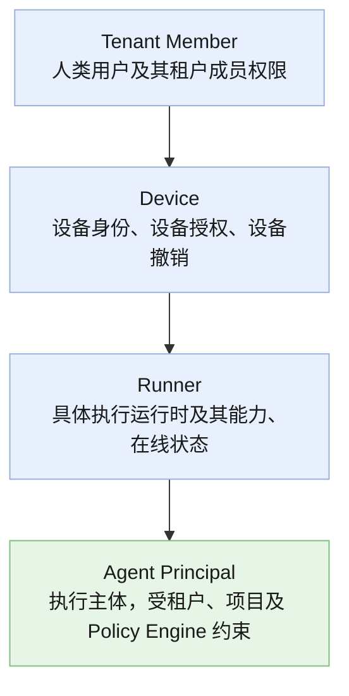

# Codex 自动初始化与开发环境接入（Codex Bootstrap）设计稿 V1.1

> **标注图例**：〔用户供稿〕= 2026-11-01 用户提供的设计供稿整理；〔原型〕= 用户提供的界面原型图转写（原图为微信临时文件，已失效，本文转写为文字线框）；〔整理注〕= 落盘时的格式性说明，不含设计裁决；〔评审收编〕= 2026-11-01 外部专家评审意见收编进正文（评审原文与逐条对照见 `ai-pm-codex-bootstrap-review.md`）。

| 项 | 内容 |
| --- | --- |
| 文档性质 | 设计稿（ADR + Bootstrap 安装协议 + 开发环境领域模型 + 界面原型），**未过稿** |
| 版本 | V1.1（2026-11-01 外部评审收编；V1 = 同日用户供稿） |
| 记录 | 司南（产品经理 Agent）按用户供稿整理落盘（V1）；外部专家评审收编（V1.1，经用户确认） |
| 状态 | **评审收编完毕**——「有条件过稿」的全部补充条件（6 项 P0 + 3 个新增章节 + 验收 BOOT-15~25）已并入正文；待 todo.md §10.7 T-087 定稿最终裁决（**硬依赖：须等 T-032 收敛**），经用户过稿后方可进入实施 |
| 上位约束 | `ai-pm-mcp-executor-positioning-v1.md`、`ai-pm-executor-onboarding-runbook-v1.md`、`ai-pm-adr-0001-tenant-agent-executor-identity.md`、`ai-pm-principal-identity-v1.md`、`ai-pm-adr-0002-executor-credential-separation.md`、`ai-pm-multi-repo-model-v1.md`、`ai-pm-slice-d-execution-pipeline-v1.md`、`ai-pm-slice-d3-executor-hardening-v1.md`（T-032） |
| 关联条目 | todo.md §10.7 M10（T-087~T-092）；M8 T-080（onboarding URL，本稿的直系前身）；评审记录 `ai-pm-codex-bootstrap-review.md` |

---

## 〇、一句话结论与能力定位

把「Codex 接入」正式纳入 PM-AI 的 **Codex 接入与自动初始化（Codex Bootstrap）**：用户复制一条初始化指令交给 Codex，Codex 读取安装说明后**自动**完成 Worker 安装、MCP 配置、身份认证与项目关联，最后执行自检，确认可以正常领取 Task、回写执行状态——而不是让用户手动复制 MCP JSON、下载 Worker、修改配置文件。

> **核心原则**〔用户供稿〕：**安装说明负责指导安装，安装程序负责保证安装正确，PM-AI 服务端负责验证安装结果。** 不要让 AI 仅凭一段 Markdown 自己猜测应该如何修改配置文件。

**能力定位（评审后升级）**〔评审收编〕：本稿不是单纯的「Codex 安装文档」，而是 PM-AI 的正式基础能力——**Development Environment Management（开发环境管理）**。它解决的是：PM-AI 如何把一个普通开发环境转变成一个经过身份认证、权限授权、能力验证、可以参与任务执行的可信执行节点。长期职责：

1. 管理哪些设备可以接入 PM-AI。
2. 管理哪些 Runner 可以执行任务。
3. 管理 Runner 可以访问哪些 Project 和 Repository。
4. 验证执行环境是否达到 Ready。
5. 管理设备授权、凭证和撤销。
6. 为未来无人值守 Agent 执行提供基础设施。

**职责边界**〔评审收编〕：Bootstrap **不承担** Run 调度、Task 生命周期、Commit 裁决——这些仍属于既有执行管线（Slice D）。

**长期架构原则**〔评审收编〕：**MCP 是通信接口，不是执行运行时。** 此原则提升为 PM-AI 的长期架构约束（详见 §二）。

---

## 一、标准安装协议与用户体验

在 PM-AI 项目管理页面增加一个入口（图1 原型）：用户只需要把这段文字交给 Codex，Codex 接下来完成安装。

**图1 原型转写〔原型〕**——「Codex 环境接入」卡片：

```
┌──────────────────────────────────────────────────────┐
│  Codex 环境接入                       [支持自动初始化] │
│  将以下指令发送给 Codex，即可初始化当前开发环境。       │
│                                                      │
│  PM-AI Bootstrap                                     │
│  请阅读以下安装说明，并为当前 Codex 环境初始化          │
│  PM-AI Worker 和 MCP：                               │
│                                                      │
│  https://pm-ai.example.com/install/codex             │
│                                                      │
│  ┌────────────────────────────────────────────────┐  │
│  │              ⧉  复制初始化指令                  │  │
│  └────────────────────────────────────────────────┘  │
│  示例地址，正式环境请替换为 PM-AI 的实际部署地址。      │
└──────────────────────────────────────────────────────┘
```

### 1.1 标准安装指令〔评审收编〕

初始化指令应设计为 PM-AI 的**标准安装协议**，而不是一个临时提示词。用户拿到的指令类似：

```text
PM-AI Bootstrap

请初始化当前 Codex 开发环境。

1. 阅读 PM-AI 官方 Bootstrap 安装说明。
2. 检查当前 Codex 和操作系统环境。
3. 安装或升级 PM-AI Plugin。
4. 安装 Local Runner。
5. 配置 PM-AI Remote MCP。
6. 引导我完成设备授权。
7. 让我选择要关联的 Project 和 Repository。
8. 执行完整环境自检。
9. 将自检结果提交给 PM-AI。
10. 确认开发环境达到 Ready 状态。

安装地址：
https://pm-ai.example.com/install/codex
```

**产品原则**：**安装 URL 是稳定入口，安装包和安装协议由服务端管理。** 未来即使 Worker 从 Rust 改为其他实现、MCP 接口升级、Plugin 增加 Skill、OAuth 流程发生变化、Runner 增加其他 Agent 执行器，用户也不需要重新学习一套安装方法。

**边界**：这条指令**不是**绕过 Codex 权限审批的通道——插件安装、脚本执行、设备授权等操作仍然要有相应的用户确认。

---

## 二、先明确：PM-AI 需要安装的是什么？

把三个东西分开，避免架构混淆〔用户供稿〕：

| 层 | 组件 | 职责 |
| --- | --- | --- |
| **平台端** | PM-AI Worker | 负责 Run 调度、租约、超时回收、执行实例管理、结果接收。部署在 PM-AI 服务端，**不应该每个 Codex 都安装一套** |
| **开发机端** | PM-AI Runner / Local Worker | 负责连接 PM-AI、准备 Workspace、管理本地仓库、启动 Codex 执行实例、收集 Commit 和执行证据 |
| **Codex 端** | PM-AI Skill + MCP | Skill 提供工作规范和执行流程；MCP 提供 Task、Knowledge、Run 等平台接口 |

**关键架构判断**〔用户供稿〕：**MCP 不等于 Worker。**

〔评审收编〕此判断强化为：**MCP 是通信接口，不是执行运行时**，并提升为 PM-AI 的长期架构约束。

- MCP 是 Codex 与 PM-AI 通信的接口；Worker 是负责执行任务的运行时。
- 用户在 Codex 中手动开发：Codex 通过 MCP 领取 Task。
- PM-AI 无人值守执行：平台 Runner 在开发机上启动 Codex，Codex 再通过 MCP 与平台交互。
- 两者使用**相同的 Skill、MCP 协议和权限模型**。

〔整理注〕这与既有架构一致：Task 是业务任务，Run 是执行实例，Workspace 隔离执行环境，Project 与 Repository 解耦，一个 Project 可以有多个 Repository。

### 2.1 Local Runner 的定位〔评审收编〕

〔评审收编〕V1（安装 Local Worker）与 V2（无人值守 Runner）不能发展成两套执行架构：

- V1：用户主动打开 Codex，Codex 执行任务。
- V2：Local Runner 主动启动 Codex，Codex 执行任务。
- 两者：使用同一套 Task、Run、Principal、MCP 和 Policy 模型。

这样未来增加 Claude Code 或其他 Agent 执行器时，也不必重新设计整个环境接入体系。

**Local Runner 的明确定位**：不是轻量客户端，而是 **D3（T-031）已有 CodexExecutor 的安装与部署载体**，同时是完整的本地执行运行时——由运行模式（V1 手动 / V2 自动，见 §十一）决定是否启用自动调度。

**硬约束**：**V2 不重新实现 D3 的执行引擎，常驻 Runner 复用 D3 已有的 CodexExecutor**，不产生两套 Codex 进程管理实现（验收 BOOT-25）。

---

## 三、推荐的安装技术方案

**推荐**〔用户供稿〕：**Codex Plugin + Bootstrap Skill + 安装程序 + Remote MCP**。

为什么不是单纯提供一个 MCP URL？因为 MCP URL 只能解决通信配置，不能可靠地完成本地 Worker 安装、Workspace 配置和环境检测。

> OpenAI 当前已经支持把 Skill 和 MCP 配置一起打包成 Plugin，也支持配置安装后的 onboarding Skill，可以把初始化流程纳入插件安装体验。

### 3.1 安装包目录结构〔评审收编修订〕

〔评审收编〕原 V1 结构中的 `manifest.json` 用途不明，不与 `plugin.json` 形成两套身份清单；发布信息独立为 `release-manifest.json`，安装脚本提升到包根 `scripts/`：

```text
pm-ai-codex/
├── .codex-plugin/
│   └── plugin.json
│
├── .mcp.json
│
├── skills/
│   ├── pm-ai-bootstrap/
│   │   └── SKILL.md
│   ├── pm-task-execution/
│   │   └── SKILL.md
│   ├── pm-learn/
│   │   └── SKILL.md
│   └── pm-knowledge/
│       └── SKILL.md
│
├── scripts/
│   ├── install-worker.ps1
│   ├── install-worker.sh
│   ├── verify-install.ps1
│   └── verify-install.sh
│
└── release-manifest.json
```

| 组件 | 职责 |
| --- | --- |
| Plugin | 分发 Skill 和 MCP 配置 |
| Bootstrap Skill | **决策与引导**初始化流程（不直接负责安装细节，见 3.3） |
| 安装脚本 `scripts/` | 确定性安装 Worker / 验证安装 |
| `release-manifest.json` | Worker 下载地址、版本、平台、SHA-256、**签名**等发布信息 |
| MCP | 连接 PM-AI 服务 |

三者分工〔评审收编〕：

- `plugin.json`：插件元数据、Skill、MCP、onboarding 配置。
- `.mcp.json`：Remote MCP 配置。
- `release-manifest.json`：发布信息（下载地址、版本、平台、SHA-256、签名）。

> 〔评审收编〕注意：OpenAI 当前文档同时提供可移植的根目录 `plugin.json` 格式；`.codex-plugin/plugin.json` 属于 Codex 兼容布局。V1 先固定**一种**经过实际 Codex 版本验证的格式，不同时维护两套（留 T-087 裁决）。

MCP 配置示意：

```json
{
  "mcpServers": {
    "pm-ai": {
      "type": "http",
      "url": "https://pm-ai.example.com/mcp"
    }
  }
}
```

> Codex 支持 Streamable HTTP MCP 和 Bearer Token、OAuth 等认证方式。MCP 配置可以在用户级 Codex 配置中共享，也可以在受信任项目中使用项目级配置。

用户倾向〔用户供稿〕：使用 **Remote MCP**，而不是让每台机器运行一个本地 MCP Server。

### 3.2 Bootstrap Skill 与脚本的分工〔评审收编〕

Skill 负责决策和引导，**真正的安装逻辑由脚本完成**：

```text
检查环境
  ↓
判断是否已安装
  ↓
选择安装方案
  ↓
请求用户授权
  ↓
调用安装脚本
  ↓
调用验证脚本
  ↓
提交初始化结果
```

### 3.3 分发安全〔评审收编〕

**SHA-256 只能验证文件与某个已知摘要一致，不能单独证明该摘要来自可信发布方。** 分发链路必须增加：

- 发布清单签名。
- Worker 二进制签名验证。
- 防止下载地址被替换。
- 防止版本降级。
- 下载失败的恢复机制。
- 安装失败时恢复原配置。

---

## 四、自动初始化的完整流程（Bootstrap Lifecycle）

〔用户供稿〕八步（V1.1 修订处以〔评审收编〕标注）：

1. **获取安装包**——Codex 通过 Plugin 或安装 URL 获取 PM-AI Bootstrap Skill。
2. **识别开发环境**——检查操作系统、Codex 版本、Rust/Node 等依赖（按实际 Worker 实现需要检测），检查是否已经安装 Worker。
3. **安装 Local Worker**——下载对应平台的二进制文件，按 §3.3 分发安全清单校验**签名**与版本，安装到用户目录。
4. **连接 MCP**——配置 PM-AI Remote MCP，执行 OAuth 授权，获取用户身份。
5. **注册开发环境**——向 PM-AI 注册 Device / Runner，建立租户与开发环境的关联。
6. **绑定项目与仓库**——用户选择 Project、Repository，检查 Git 状态和访问权限。支持一个 Project 绑定多个 Repository。
7. **运行自检**——测试 MCP、Worker、Runner 心跳、Workspace 创建、仓库访问和任务读取权限。〔评审收编〕**MCP 自检与 Runner 自检分别进行**（见 §六）。
8. **完成初始化**——PM-AI 按服务端状态机（§六）逐项验证通过后将环境标记为 **ready**〔评审收编修订：不是安装程序发送一个成功信号〕，Codex 可以开始领取和执行 Task。

> **注意**〔用户供稿〕：下载程序、修改系统配置、安装服务、启动后台进程等操作，仍然需要遵循 Codex 的权限和审批机制。不能假设一段提示词就能绕过用户授权。

---

## 五、身份认证与安全设计

**不要让用户在安装指令里直接放一个长期有效的 API Token**，使用一次性初始化凭证〔用户供稿〕：

```text
Codex
  │
  │ 1. 请求初始化
  ▼
PM-AI Bootstrap API
  │
  │ 2. 返回一次性授权码
  ▼
Codex 打开授权页面
  │
  │ 3. 用户登录并确认授权
  ▼
PM-AI
  │
  │ 4. 注册 Device / Runner
  ▼
颁发短期访问凭证及刷新凭证
  │
  ▼
Worker + MCP 正式连接
```

### 5.1 身份关系：Member → Device → Runner → Agent Principal〔评审收编〕

〔用户供稿〕已明确：Device 不等于 Tenant Member；一个用户可以有多台 Device；一个 Device 可以服务多个 Project。

〔评审收编〕必须补充回答：**Codex 通过 MCP 连接平台时，平台究竟认定它是谁？** 不能简单地把 Device 当成 Agent 身份。身份关系如下：



四点强调：

- **Member 是授权来源。**
- **Device 是设备身份。**
- **Runner 是运行时身份。**
- **Agent Principal 是平台执行授权所识别的主体。**

**不能因为一个用户授权了一台设备，就让该设备自动拥有这个用户在所有项目中的权限。**

**对齐约束**：本节身份关系必须与 `ai-pm-adr-0001-tenant-agent-executor-identity.md`、`ai-pm-principal-identity-v1.md`、`ai-pm-adr-0002-executor-credential-separation.md` 和 T-032 对齐——T-032 仍然涉及 Agent 身份与 MCP 凭据的闭环问题，**Bootstrap 负责发起注册和授权，不负责重新定义身份体系，不提前创造另一套认证协议。**

### 5.2 双认证通道与凭证分离〔评审收编〕

原一次性授权流程方向正确，但缺两个安全边界：

1. **用户 OAuth 登录成功只能证明用户身份，不能直接证明某台 Device 已经获得执行权限。**
2. **Remote MCP 的 OAuth 凭证与 Local Runner 的设备凭证，不应该默认是同一个 Token。**

因此凭证明确分为三条通道：

| 凭证 | 使用者 | 用途 |
| --- | --- | --- |
| User OAuth | Codex / 用户会话 | 证明用户身份、完成授权 |
| Device Credential | Local Runner | 证明设备身份 |
| Agent Credential | Agent 执行主体 | 调用受授权的执行接口 |

三类凭证各自具备**独立的撤销、过期、刷新及轮换机制**。

**授权码三属性**〔评审收编〕：设备授权采用**短时效、一次性、绑定授权会话**的一次性授权码，避免授权码被其他设备抢先使用。

**设备凭证形态**〔评审收编〕：设备凭证采用**设备专属密钥进行持有证明**（proof-of-possession），与 ADR-0002 已裁定的 lease_token 模型衔接；不使用可复制的长期 Bearer Token。

### 5.3 设备撤销协议〔评审收编〕

撤销设备授权不是「阻止新领取 + 终止在途 Run」两句话，而是一个明确协议：

1. Device 进入 revoked。
2. 设备及其所有 Runner 的**新任务领取立即被拒绝**。
3. 设备**刷新凭证立即失效**。
4. 正在运行的 Run 进入终止或失效处理。
5. **已失效的执行实例不得继续回写有效结果。**
6. **已有的租约不能因为尚未到期就继续赋予执行权限。**
7. 撤销事件写入审计日志。

**特别注意：撤销授权必须由服务端实时判定，不能依赖 Runner 下一次心跳才生效。**

与 T-032 对齐：撤销语义须与 T-032 的启动持久化、子进程回收及生命周期一致性总验收保持一致——否则会出现「设备已撤销，但之前启动的 Codex 仍能提交结果」的情况。

### 5.4 Project Binding 与 Repository Access 分层〔评审收编〕

〔用户供稿〕已明确一个 Project 可以有多个 Repository。

〔评审收编〕`runner_project_binding` **不得**被解释为「绑定 Project 即自动获得该 Project 所有 Repository 的访问权」。三者分开：

- **Project Binding**：Runner 被允许服务哪个 Project。
- **Repository Access**：Runner 是否有权访问具体 Repository。
- **Workspace**：本次 Run 实际使用哪些 Repository。

```text
Project: PM-AI
  ├── Repository A
  ├── Repository B
  └── Repository C

Device: Windows PC
  └── Runner
      ├── Project Binding: PM-AI
      ├── Repository A: Allowed
      ├── Repository B: Allowed
      └── Repository C: Denied
```

**Project Binding 不应该自动扩大 Repository 的授权范围。** 这对后续多仓库执行尤其重要。

**授权来源**：Runner 的项目绑定应当由**有权限的 Tenant Member 明确授权**，而不是由 Bootstrap Skill 自行决定。

### 5.5 领域对象与数据归属〔评审收编修订〕

〔用户供稿〕提出六个服务端对象。〔评审收编〕**不要直接把六个对象全部设计成独立数据库表**，先定义领域实体及数据归属：

| 对象 | 归属建议 |
| --- | --- |
| device | 独立实体 |
| runner | 独立实体 |
| runner_registration | 授权记录，可有独立生命周期 |
| runner_heartbeat | **Runner 状态字段 + 必要的心跳历史**（不建每次心跳都写入的业务表；最新状态保存在 Runner 上，审计/历史另行处理） |
| runner_capability | Runner 能力声明，可采用结构化数据（见 §七 capabilities） |
| runner_project_binding | 独立授权关系 |

〔整理注〕六对象与既有 `core.principal` / `core.tenant_agent` / T-021b `executor_id` 的归位（新表还是挂既有表）留 T-087 裁决（todo.md §10.7 T-087 待裁点 4）。

权限仍然遵循已有的租户、项目、Repository 和 principal 模型〔用户供稿〕；身份归按 §5.1 对齐既有身份 ADR〔评审收编〕。

---

## 六、Ready 状态定义（服务端状态机）〔评审收编新增〕

Ready 定义成一个**有明确条件的服务端状态**，而不是安装程序最后发送一个成功信号。至少区分：

| 状态 | 含义 |
| --- | --- |
| pending | 等待初始化 |
| authorizing | 等待用户授权 |
| installing | 安装中 |
| verifying | 自检中 |
| ready | 所有必要检查通过 |
| degraded | 部分能力异常 |
| revoked | 授权撤销 |
| offline | 心跳超时 |
| failed | 初始化失败 |

`ready` 至少要求：

- Device 已注册且未撤销。
- Runner 身份认证通过。
- Runner 版本符合服务端兼容要求（§七）。
- MCP 身份认证通过。
- 项目授权通过。
- 至少一个被授权的 Repository 可访问。
- Workspace 创建成功。
- 执行能力符合对应运行模式的要求（§十一）。

**MCP 自检和 Runner 自检分别进行——不能用 MCP 正常来代表整个开发环境正常。**

---

## 七、安装协议与版本兼容〔评审收编新增〕

Skill、MCP、Runner 独立版本管理〔用户供稿〕之外，必须定义**版本协商协议**：

```json
{
  "bootstrap_version": "1.0.0",
  "runner_version": "1.2.0",
  "skill_version": "1.0.0",
  "mcp_protocol_version": "1",
  "platform_api_version": "1"
}
```

服务端需要能够判断：

- Runner 是否支持当前 API。
- Skill 是否支持当前 MCP 工具。
- Runner 是否支持目标执行能力。
- 是否需要升级。
- 是否允许继续执行。

采用：**最低兼容版本 + 能力声明 + 协议版本**，而不是简单比较版本号。

Runner 能力声明示例：

```text
capabilities:
  - workspace.create
  - git.worktree
  - codex.spawn
  - execution.terminate
  - delivery.collect
```

平台根据能力决定是否允许该 Runner 领取特定类型的 Run。

---

## 八、安装失败与重新初始化协议〔评审收编新增〕

BOOT-11、BOOT-13 提到升级、卸载和恢复〔用户供稿〕，V1.1 明确各场景语义：

| 场景 | 预期行为 |
| --- | --- |
| 已安装相同版本 | 幂等，不重复安装 |
| 已安装旧版本 | 执行升级 |
| 下载失败 | 不影响已有版本 |
| 校验失败 | 拒绝安装 |
| 安装中断 | 可恢复 |
| MCP 配置失败 | 保留原配置 |
| 设备授权失败 | 清理未完成的注册状态 |
| 重新初始化 | 明确复用或重新注册 Device |
| 卸载 Runner | 不自动撤销用户的其他设备授权 |

**细节**：**卸载本地程序不等于撤销服务端设备授权**，两个动作独立——否则用户重装系统、重新安装 Runner 时，设备身份管理会混乱。

---

## 九、PM-AI 页面还应该提供什么

建议增加一个独立的「开发环境」管理页面（图2 原型）。这意味着 PM-AI 不再只是管理 Task，还能知道**哪些真实开发环境可以执行任务**。

**图2 原型转写〔原型〕**——「开发环境」管理页：

```
┌──────────────────────────────────────────────────────┐
│  开发环境                                  [2 台在线] │
│  ┌────────────────────────────────────────────────┐  │
│  │ Windows Development PC                [Online] │  │
│  │ Runner v1.2.0 · Codex · Windows 11             │  │
│  │ 绑定项目：World Map Editor、PM-AI               │  │
│  │ 最后心跳：刚刚                                  │  │
│  │ [MCP 正常] [Worker 正常]                        │  │
│  │                        查看详情 · 撤销授权      │  │
│  ├────────────────────────────────────────────────┤  │
│  │ MacBook Pro                           [Online] │  │
│  │ Runner v1.2.0 · Codex · macOS                  │  │
│  │ 绑定项目：PM-AI                                 │  │
│  │ [MCP 正常] [Worker 正常]                        │  │
│  └────────────────────────────────────────────────┘  │
│  ┌────────────────────────────────────────────────┐  │
│  │              +  添加开发环境                    │  │
│  └────────────────────────────────────────────────┘  │
└──────────────────────────────────────────────────────┘
```

〔评审收编〕管理页能力清单：设备列表、Runner 状态（版本/在线）、绑定管理、授权撤销、执行能力展示。实施上**服务端授权能力（既有 T-088）优先于管理页面（既有 T-091）**——不能先做漂亮的管理页面再反向补安全模型；管理页面后置不影响 Bootstrap 核心能力验收。

---

## 十、验收标准（Slice F — Codex Environment Bootstrap）

〔用户供稿〕BOOT-01~14（BOOT-04 按〔评审收编〕修订：明确 CPU 架构）：

| 编号 | 验收要求 |
| --- | --- |
| BOOT-01 | 提供一个可分发的 Codex Plugin 或安装入口 |
| BOOT-02 | 仅通过初始化指令和安装 URL 即可启动安装流程 |
| BOOT-03 | 自动识别操作系统及 Worker 版本 |
| BOOT-04 | 支持 Windows、macOS、Linux（**x86_64 / ARM64**） |
| BOOT-05 | 自动下载、校验和安装 Worker |
| BOOT-06 | 自动配置 PM-AI MCP |
| BOOT-07 | 支持 OAuth 设备授权 |
| BOOT-08 | 自动注册 Device / Runner |
| BOOT-09 | 支持 Project 与多个 Repository 绑定 |
| BOOT-10 | 自动完成环境自检 |
| BOOT-11 | 支持升级、卸载、重新初始化 |
| BOOT-12 | 支持服务端撤销设备授权 |
| BOOT-13 | 安装失败可以恢复，不破坏已有 Codex 配置 |
| BOOT-14 | 安装和升级均有版本记录及审计日志 |

〔评审收编〕追加 BOOT-15~25（安全性、生命周期与故障恢复）：

| 编号 | 新增验收要求 | 优先级 |
| --- | --- | --- |
| BOOT-15 | Device、Runner、Agent Principal 身份关系符合现有身份 ADR | P0 |
| BOOT-16 | Remote MCP 与 Runner 凭证分离管理 | P0 |
| BOOT-17 | 撤销设备后立即阻止新 Run 领取 | P0 |
| BOOT-18 | 撤销后旧执行实例不能提交有效结果 | P0 |
| BOOT-19 | Project Binding 不自动扩大 Repository 权限 | P0 |
| BOOT-20 | Ready 必须通过服务端独立验证 | P0 |
| BOOT-21 | Runner 与 MCP 协议版本兼容性验证 | P1 |
| BOOT-22 | 安装升级支持签名验证和回滚 | P1 |
| BOOT-23 | 支持设备重装、Runner 重注册和凭证轮换 | P1 |
| BOOT-24 | 安装及授权全过程可审计 | P1 |
| BOOT-25 | V2 复用 D3 CodexExecutor，不重复实现执行引擎 | P0 |

---

## 十一、实施阶段建议（V1 / V2 运行模式）

〔用户供稿〕分两个阶段实施：

| 阶段 | 范围 |
| --- | --- |
| **V1：Codex 手动启动 + 自动初始化** | 用户复制一段指令，Codex 执行 Bootstrap Skill，安装 Worker、配置 MCP、授权并注册设备 |
| **V2：无人值守 Runner** | 用户安装一次 Worker，后续 PM-AI 可以自主调度 Run，Runner 自动创建 Workspace、启动 Codex、执行 Task、收集 Commit 和 Delivery Manifest、回传证据 |

两阶段**共用同一套 MCP 协议和身份体系**〔用户供稿〕；〔评审收编〕并**共用同一套执行引擎（D3 CodexExecutor）**，不产生两套 Codex 进程管理实现。

〔评审收编〕运行模式对比（同一 Local Runner，两种模式）：

| 能力 | V1 手动模式 | V2 自动模式 |
| --- | --- | --- |
| 安装 Local Runner | 是 | 是 |
| Device 注册 | 是 | 是 |
| MCP | 是 | 是 |
| Codex Skill | 是 | 是 |
| 用户主动启动 Codex | 是 | 可选 |
| Runner 自动领取 Run | 否 | 是 |
| Runner 自动 spawn Codex | 否 | 是 |
| Workspace 管理 | 可验证、按需使用 | 自动管理 |
| Commit / Delivery 收集 | 手动执行流程 | 自动执行流程 |

另一个值得考虑的设计〔用户供稿〕：将 PM-AI 的**安装包版本与服务端 API 版本分离**，支持 Worker 自动升级和 MCP 能力协商〔评审收编〕——升级为 §七 的版本协商协议（最低兼容版本 + 能力声明 + 协议版本）。

〔整理注〕实施任务编号以 todo.md §10.7（T-087~T-092）为准；评审建议的六任务拆分与既有编号的对照见评审记录 §九。两条实施依赖〔评审收编〕：**T-087 的身份与协议裁决必须等待 T-032 收敛**；**服务端授权能力优先于管理页面**。

---

## 十二、ADR 概述：Codex 自动初始化与开发环境接入

### 目标

PM-AI 必须支持通过简单的安装指令和安装地址，让 Codex 自动完成开发环境初始化，无需用户手动配置 MCP、下载 Worker 或编辑配置文件；并以此为起点建立 **Development Environment Management（开发环境管理）**基础能力〔评审收编〕。

### 核心决策

1. 使用 Codex Plugin + Bootstrap Skill 作为安装分发入口；初始化指令为标准安装协议（§1.1），**安装 URL 是稳定入口**，安装包与安装协议由服务端管理。
2. 使用 Remote MCP 作为 Codex 与 PM-AI 的标准通信接口；**MCP 是通信接口，不是执行运行时**（长期架构约束）。
3. **Local Runner 是开发机端统一执行运行时，是 D3 CodexExecutor 的安装与部署载体。V1 以交互式接入为主，V2 增加无人值守调度能力；两种模式共享同一套执行引擎，不产生两套 Codex 进程管理实现。**
4. 平台端 Worker 负责任务调度、租约、Run 生命周期管理，与 Local Runner 不得混为一谈。
5. **凭证三通道分离**（User OAuth / Device Credential / Agent Credential），各自独立撤销、过期、刷新、轮换；设备授权用短时效、一次性、绑定授权会话的一次性授权码；设备凭证用设备专属密钥持有证明（衔接 ADR-0002），**不在安装指令中传递长期 Token**。
6. **身份关系对齐既有身份 ADR**（ADR-0001 / principal-identity-v1 / ADR-0002 / T-032）：Member 是授权来源、Device 是设备身份、Runner 是运行时身份、Agent Principal 是执行主体；**Bootstrap 只发起注册和授权，不重新定义身份体系**。
7. **Project Binding 与 Repository Access 分层**，绑定不自动扩大仓库授权；绑定由有权限的 Tenant Member 明确授权。
8. Skill、MCP、Runner 独立版本管理，版本协商采用「**最低兼容版本 + 能力声明 + 协议版本**」（§七）；**Ready 为服务端状态机**（§六），MCP 自检与 Runner 自检分立。

### 设计约束

- 安装过程必须幂等（各场景语义见 §八）。
- 不得覆盖用户已有 Codex 配置；安装失败恢复原配置。
- 不得未经授权安装后台服务或修改系统安全设置；不绕过 Codex 权限审批。
- 设备撤销执行 §5.3 七步协议，由服务端**实时判定**，不依赖心跳。
- **卸载本地程序 ≠ 撤销服务端设备授权**，两个动作独立。
- Worker 不拥有绕过平台 Policy Engine 的权限。
- 所有任务状态变更仍由 PM-AI 后端统一处理。
- 一个 Project 支持多个 Repository，一个 Device 支持多个 Project；**Project Binding 不自动扩大 Repository 授权**。
- 撤销后已失效执行实例不得回写有效结果；未到期租约不延续执行权限。

### 实施阶段

- **V1**：Codex Bootstrap、MCP 配置、Runner 安装、设备授权、自检（交互式接入，复用 D3 执行引擎的按需路径）。
- **V2**：Runner 常驻运行、无人值守 Run 调度（复用 D3 CodexExecutor）、自动升级和故障恢复。

> 〔整理注〕本稿定位：ADR + Bootstrap 安装协议 + 开发环境领域模型 + UI 原型；最终架构裁决由 todo.md §10.7 T-087 负责（硬依赖：等 T-032 收敛）。
