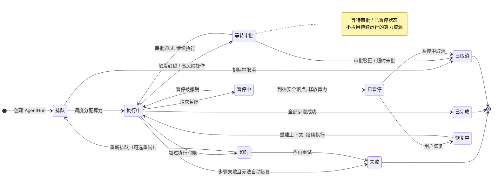
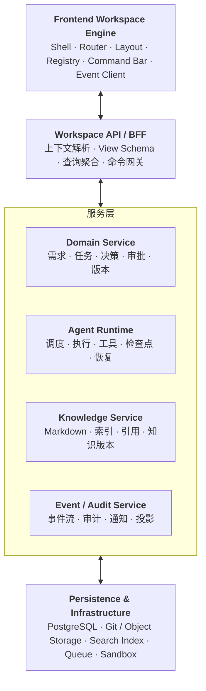
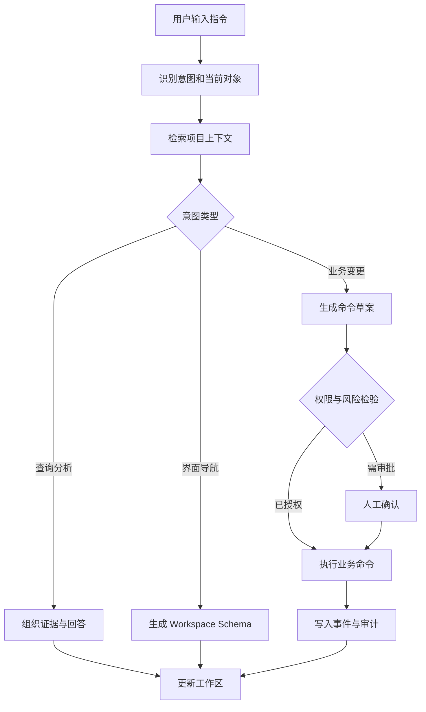
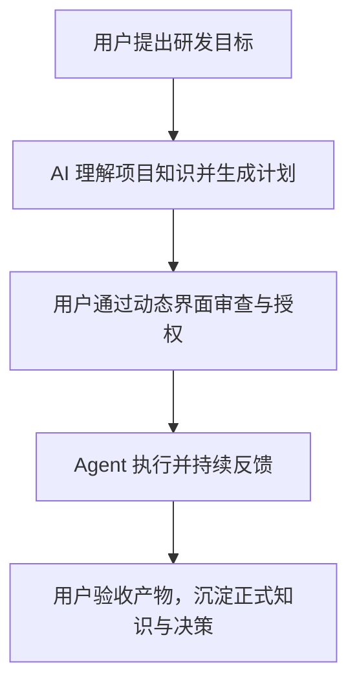

# AI 研发管理平台：混合式 AI 工作空间设计方案（V1.0 定稿）

- 版本：v1.0 定稿 · 2026-10-30（评审已交付；四项骨架裁决已并入）
- 性质：产品交互架构设计，桌面端优先
- 配套图：[图1 信息架构](figures/ai-workspace-ia.html) · [图2 桌面主界面布局](figures/ai-workspace-shell.html) · [图3 目标执行计划卡](figures/goal-plan-card.html) · [图4 动态布局模板](figures/layout-templates.html)

**整理说明**：本文整理自产品口述稿与五张示意图。一至十一章为原稿详细设计的成文化（标注"整理说明"处为整理补充）；附录 A/B 为整理补充；评审已于 2026-10-30 交付，骨架裁决 B-1/B-2/B-3/B-12 已并入正文（见 §二、§1.4、§七、附录 B）；附录 C/D 为评审识别的两份 P0 前置子规格（整理补充）。其余待裁决项集中列在附录 B。

---

## 〇、定位

> 一个以 AI 负责人为协作入口，以动态工作区为交互核心，以结构化业务系统为事实基础，以项目知识与决策体系为长期记忆的 **AI 原生研发管理平台**。

它不是把 Jira、禅道、Linear 之类的传统管理系统接上聊天机器人，而是改变用户管理研发活动的方式。

最终形态：

1. 用户用自然语言表达目标，也能通过传统页面精确操作。
2. AI 负责人理解项目全局，组织多个 Agent 协作。
3. 主工作区根据任务切换为计划、决策、执行、验收或知识分析界面。
4. 重要事实、审批、代码和知识都有可追溯来源。
5. 用户在 AI 视图与传统视图之间无损切换。
6. AI 可以持续推进授权范围内的任务，但高风险操作需要明确批准。

**核心原则：AI 空间与传统空间是两种工作方式，而不是两套业务数据。**

两个空间共享同一个统一领域与知识服务（Goal · Requirement · Task · AgentRun · Decision · Knowledge · Artifact · Event），任一视图只是领域模型的投影。所有写操作（无论来自 AI 还是人）必须经过同一领域服务层与同一状态机，任何一个空间都不允许绕过。这是"无损切换"能够成立的架构前提。

## 一、产品信息架构

一级导航按**用户的工作意图**组织，不按传统软件的"需求管理、任务管理、缺陷管理、项目管理"组织。

**图1 · 信息架构**（HTML 版：[figures/ai-workspace-ia.html](figures/ai-workspace-ia.html)）

```
┌─────────────────── AI R&D Workspace ───────────────────┐
│            统一工作空间 · 项目上下文 · 权限体系             │
│                                                        │
│  ✦ AI 原生空间            ▦ 传统业务空间                  │
│  01 总控台                需求管理                        │
│  02 目标与计划             任务与缺陷                      │
│  03 AI 执行中心            迭代与里程碑                    │
│  04 决策中心              项目文档                        │
│  05 项目认知中心           版本与发布                      │
│  06 产物验收               团队与配置                      │
│                                                        │
│  ▤ 统一领域与知识服务                                     │
│  Goal · Requirement · Task · AgentRun · Decision ·     │
│  Knowledge · Artifact · Event                          │
│  权限 / 审计 / 版本 / 引用 / 状态机                       │
└────────────────────────────────────────────────────────┘
```

### 1.1 AI 原生空间：意图导向

| # | 入口 | 回答的问题 | 核心领域对象 |
|---|------|-----------|-------------|
| 01 | 总控台 | 现在整体怎么样、我该处理什么 | Event / Decision / AgentRun（聚合） |
| 02 | 目标与计划 | 要达成什么、怎么拆解 | Goal / Requirement / Plan |
| 03 | AI 执行中心 | AI 正在做什么、做得怎么样 | AgentRun / Task / Artifact |
| 04 | 决策中心 | 哪些事需要我拍板 | Decision / Approval |
| 05 | 项目认知中心 | 为什么这么做、知识在哪里 | Knowledge |
| 06 | 产物验收 | 交付物是否达标 | Artifact / Acceptance |

### 1.2 传统业务空间：领域导向

需求管理、任务与缺陷、迭代与里程碑、项目文档、版本与发布、团队与配置。

保留表格化、批量操作、精确编辑能力；是结构化事实的录入与审计入口。AI 空间负责"推进"，传统空间负责"准确"，二者互补而非替代。

### 1.3 路由设计

```
/workspace/:projectId
  /home                  AI 总控台
  /goals                 目标与计划
  /runs                  AI 执行中心
  /decisions             决策中心
  /knowledge             项目认知中心
  /artifacts             产物验收

  /focus/:objectType/:id 聚焦工作区

  /classic
    /requirements        需求管理
    /tasks               任务
    /issues              缺陷
    /iterations          迭代与里程碑
    /documents           项目文档
    /releases            版本与发布

  /settings
    /agents              Agent 配置
    /permissions         权限
    /knowledge           知识库配置
    /integrations        集成
```

**`/focus/:objectType/:id` 是全案的关键机制**：同一个需求、任务、决策或执行记录可以被直接打开为专用 AI 工作界面，而不必每次从聊天首页进入。它同时是"无损切换"的载体——URL 即上下文，AI 视图与传统视图通过同一对象 id 互相跳转，不丢现场。

### 1.4 两空间对象映射（草案，待评审）

| 领域对象 | AI 原生投影 | 传统投影 |
|---------|------------|---------|
| Goal | /goals 目标树 | —（暂无传统页） |
| Requirement | /goals 拆解物；/focus/requirement/:id | /classic/requirements |
| Task / 缺陷 | /runs 执行轨迹；/focus/task/:id | /classic/tasks、/classic/issues |
| AgentRun | /runs；/focus/agentrun/:id | —（无需传统页） |
| Decision | /decisions 审批队列与记录；/focus/decision/:id | 记录归档至 /classic/documents |
| Knowledge | /knowledge | /classic/documents |
| Artifact | /artifacts | /classic/releases |
| Event | 各页时间线 | 审计（横切能力，见附录 B-3） |

切换语义（无损的定义）：① URL 携带对象 id，跨视图跳转不丢上下文；② 两视图读写同一后端，状态实时一致；③ 任一视图可一键跳到另一视图的同一对象；④ UI 现场同样保留——筛选条件、未提交编辑、滚动位置，有未保存修改时明确提示（完整定义见流程 E）。

**存量七页归属裁决（B-3，2026-10-30，按评审建议执行，可复核）**：

| 现有页面（ai-pm-web） | 归属 | 迁移口径 |
|---|---|---|
| overview | 由 /home AI 总控台取代 | 总控台四层结构是其超集；P0 期间 /classic/overview 重定向过渡，P1 末下线 |
| requirements | /classic/requirements | 直接映射，适配统一对象 id |
| tasks | /classic/tasks | 直接映射；缺陷入口口径待 B-4 |
| approvals | 由 /decisions 决策中心承担 | P0–P1 期间 /classic/approvals 保留操作能力，P2 权限审批上线后取代下线 |
| audit | 横切能力，不属任一空间 | 迁至 /settings/audit + 顶部全局入口；审计两空间的全部命令 |
| projects | 壳级能力 | 项目选择进顶部栏/工作区切换器；管理页迁 /settings/projects |
| settings | /settings | 按路由设计扩展 agents / permissions / knowledge / integrations |

## 二、桌面端主界面布局

结构：**稳定外壳 + 动态主区域 + 可折叠上下文面板 + 全局指令栏**。

**图2 · 布局示意**（HTML 版：[figures/ai-workspace-shell.html](figures/ai-workspace-shell.html)）

布局规格：

| 区域 | 建议尺寸 | 行为 |
|------|---------|------|
| 顶部栏 | 高 52–60px | 始终固定：项目上下文、全局搜索、通知、空间设置 |
| 左导航 | 宽 220–260px | 可折叠至 56–64px：AI 空间入口 + 最近工作 |
| 主工作区 | 自适应，最小 600px | 支持标签页、分栏、全屏 |
| 右上下文栏 | 宽 280–360px | 可隐藏、可固定：项目 / AI 负责人 / 关联知识 / 操作权限 |
| AI 指令栏 | 最小高 64px | 常驻底部，支持展开为完整对话 |
| 工作区标签 | 高 36–44px | 保留多个工作上下文 |

设计基准：以 1440px 以上桌面宽度为主；较窄屏幕**优先隐藏右侧上下文栏**，而不是压缩核心业务内容。

**切换范式裁决（B-1，2026-10-30）**：默认混合式——壳、左导航与指令栏常驻，主工作区在 AI 视图与传统视图间切换；全屏对话为"专注模式"特例（从指令栏展开进入、随时退出）。不设互斥的"AI 模式 / 传统模式"全局开关。

**端优先裁决（B-2，2026-10-30）**：桌面先行（排期先后，非范围裁剪）；Registry 组件自 P0 起遵守响应式约束（断点契约纳入 §5.1 注册声明，复用壳的 useResponsive）；移动端完整适配为 P3 后的独立里程碑，与 PRISM"移动端必须"裁决并存。

指令栏交互（草案补充）：`/` 引用对象、`@` 指定 Agent、Enter 发送；展开为完整对话时占据主区域，收起时保留最近回复摘要，保证后台推进的任务不被打断感知。

## 三、核心页面设计

### 3.1 AI 总控台：让用户知道现在该做什么

总控台不是报表集合，而是一个**项目注意力分配系统**。四层信息结构：

| 层级 | 内容 | 设计要求 |
|------|------|---------|
| 第一层 | AI 负责人每日简报 | 3–5 条最重要的结论 |
| 第二层 | 待我处理 | 审批、冲突、阻塞、验收 |
| 第三层 | 目标与执行进展 | 以目标组织，而不是孤立任务 |
| 第四层 | 风险、趋势、近期事件 | 支持展开证据与详细记录 |

"待我处理"必须比普通任务列表更突出：一个决策事项不仅显示"等待审批"，还显示——为什么需要用户决策、AI 推荐什么、是否存在不可逆影响、最迟何时处理。

总控台的每张卡片都必须能下钻到真实对象（/focus），不能只是静态 AI 摘要。

### 3.2 目标与计划：把自然语言转化为可执行工作

用户可以直接输入自然语言目标：

```text
在下一次迭代中完成世界地图森林生成模块，要求兼容现有高度、温度和湿度数据，
并保证大范围地图浏览的性能。
```

AI 负责人首先不应该直接开始编写代码，而是生成一个**可审查的目标计划**（图3：[figures/goal-plan-card.html](figures/goal-plan-card.html)）：目标描述、AI 建议的任务拆解（每步标注负责 Agent）、需要确认的约束、审批/澄清动作。

必须区分三个计划版本：

1. **AI 提出的计划**（草稿）
2. **用户批准的计划**（基线）
3. **实际执行中的计划**（运行时）

计划变更必须记录差异。对已批准的计划，AI 可以在授权范围内调整执行顺序，但不能擅自改变核心目标和验收标准——后者必须回到审批。

### 3.3 AI 执行中心：管理执行，不是观看聊天

三种视角：

- **目标视角**：目标完成到什么程度，哪些子任务阻塞。
- **Agent 视角**：各 Agent 当前负责什么，资源占用、运行状态如何。
- **执行轨迹视角**：某次运行调用了哪些工具、修改了什么、产生什么结果。

其中最重要的是**执行轨迹**——它是"重要事实有可追溯来源"这条承诺在执行层的落点。

AgentRun 状态机：



**状态语义（原稿原则）**：AI 宣称"任务完成"只能代表执行结束，不应该自动代表业务验收通过。`已完成`（`run.completed`）是执行状态；业务验收是独立裁决（§3.6 产物验收），两者不得自动耦合。

#### 执行详情：按事件类型组织执行轨迹

执行轨迹不是流水账，而是按事件类型组织的结构化记录。执行详情（`/focus/agentrun/:id`）按以下类型过滤与分组渲染：

| 事件类型 | 展示内容 |
|---------|---------|
| `plan.created` | AI 创建或更新执行计划（更新时必须附差异） |
| `knowledge.retrieved` | 引用了哪些知识及版本 |
| `tool.started` | 调用了哪个工具、执行什么操作 |
| `tool.completed` | 结果、耗时、错误摘要 |
| `artifact.created` | 生成了哪些文件或代码变更 |
| `approval.requested` | 为什么暂停、等待谁批准 |
| `run.failed` | 错误原因与恢复选项 |
| `run.completed` | 完成情况和验收证据 |

**展示与审计原则**（原稿）：默认只展示有意义的关键事件，工具原始输出放在可展开详情中。不要把模型内部推理文本当作审计依据；应记录可验证的输入、工具动作、输出、引用和明确给出的决策理由。整理补充：这条原则同时适用于总控台简报与对话卡片——凡是呈现给用户的结论，都要能展开为这条可验证链条。

对这八类事件的三点整理说明（草案）：

1. **它们是领域 Event 的展示投影，不是前端自造的分类**。底层是 append-only 事件流（对齐架构原则的 Event 对象与 Inbox/Outbox），执行详情只是按类型过滤渲染。每条事件带时间戳、执行者（哪个 Agent / 哪个工具）、关联对象引用（工具调用 id、Artifact id、审批 id）——这条事件流同时是证据卡的数据源。
2. **与状态机对齐还缺四类**：`run.paused` / `run.resumed`（暂停与恢复）、`approval.resolved`（批准/驳回的结果留痕）、`run.timeout`、`run.cancelled`。状态机的每一个迁移都应有对应事件，尤其 `approval.requested` 不能"有去无回"——谁批准的、依据什么，必须留痕。
3. **`plan.created` 身兼两职**（创建或更新）：更新时必须输出差异，衔接差异卡与三版本计划（§3.2），否则违反"计划变更必须记录差异"。

其中 `knowledge.retrieved` 要求记录知识版本，是"重要事实有可追溯来源"这条承诺在执行层的关键落点——它与知识空间定稿的 Markdown 版本机制直接咬合。

### 3.4 决策中心：让 AI 的建议成为可审查的工程决策

原稿定位：这是**建议重点投入设计资源**的页面。由三部分组成。

**审批队列**：红线动作的事前确认（对齐架构原则 V2 第十章"红线清单 + 人类三权"），每项含背景、AI 推荐、不可逆影响、最迟处理时间（与总控台"待我处理"同源）。

**决策记录**：每个正式决策包含八项：

1. 决策问题及背景
2. 备选方案
3. 评价维度与权重
4. AI 推荐方案及理由
5. 关联需求、历史决策和技术证据
6. 风险、影响范围和回退策略
7. 审批人、审批状态、最终结果
8. 决策生效版本及后续验证结果

对架构决策，应能直接打开基准测试、原型代码或性能报告——技术证据可下钻到 /focus 或原始产物。

裁决动作不止同意/拒绝：必须支持**暂缓决策**与**要求补充证据**。对应 §3.3 的 `approval.resolved` 事件区分四种结果（approved / rejected / deferred / evidence_requested）；"要求补充证据"会生成一个补充证据的执行任务（AgentRun），完成后回到审批队列，与执行中心形成闭环。第 8 项"后续验证结果"同理：决策记录应显式引用负责验证的 AgentRun，验证结论回写决策。

与 ADR 模板的关系（整理说明）：八项中 1/2/4/5/6/8 与知识空间定稿的 ADR 模板（背景/问题/候选方案/决策/依据/后果与风险/历史变更）一一对应；3（评价维度与权重）与 7（审批流程字段）是本设计新增。建议：决策正文按 ADR 模板发布进知识空间（正文权威），3 与 7 作为流程字段权威在 PG——两个权威、互不重复，符合"一个信息只有一个权威来源"。

**升级规则**：AI 授权范围内的自主决定 vs 必须升级的边界清单（Policy Engine 确定性规则）。

### 3.5 项目认知中心：把 AI 记忆变成可管理的产品能力

底层直接复用《Markdown 知识空间与 PageIndex 检索层设计》定稿，认知中心是它的 UI 投影，**不另建知识系统**：Markdown 树 = 知识正文权威；PG = 业务状态权威；PageIndex = 派生检索索引（仅检索用）；六态文档发布状态机跨 Git/PG 一致。

用户不应该只看到文件目录，而是三种知识视图：

| 视图 | 内容 | 数据来源（整理说明） |
|------|------|---------------------|
| 知识目录视图 | 按需求、架构、规范、决策、经验等分类浏览 Markdown | Markdown 树 + PG 分类状态 |
| 认知关系视图 | 一个需求引用了哪些决策、一个决策影响了哪些任务、某条约束来自哪个文档 | PG 引用表（related_objects）——**不是 PageIndex**，PageIndex 只做检索，关系靠结构化引用 |
| 认知校验视图 | 识别知识冲突、过期内容、缺少证据的推测和待确认的事实 | 后台校验 Job（规则 + AI 审计，可并入架构原则十九章的主动健康检查）；发现的问题进入总控台"待我处理" |

每条重要知识携带元数据：`source_id`、`source_version`、`authority`、`confidence`、`valid_from`、`status`、`related_objects`。

元数据权威归属（整理说明，遵循知识空间定稿）：`status` / `authority` / `valid_from` 属业务状态，权威在 PG；`source_id` / `source_version` / `related_objects` 来自文档模板"关联对象"章节，随发布写入 PG 引用表；Markdown frontmatter 只作渲染镜像，PG → frontmatter 单向同步，避免双权威。`confidence` 仅作展示提示，不能替代证据——校验视图判断"缺少证据的推测"依据引用链，不是模型自报的分数。

权威性优先序（原稿）：`confidence` 只是 AI 的估计，不能代替来源权威性——已批准的正式架构决策**优先于** AI 自行生成的建议；但如果正式决策已经失效，也必须能够标记和更新，不能让过期权威压住新事实。落地为 `authority` × `status` × `valid_from` 的组合判定：失效决策由校验视图标记，仍被引用的失效决策进入总控台"待我处理"；AI 检索引用时同样遵循这条优先序。

提供检索问答入口（答案必须带来源引用，回到 /focus 对应文档）；回答必须区分原始决策理由、后来发生的变化与 AI 当前建议（流程 D）。

### 3.6 产物验收：AI 工作必须以可验证的结果结束

验收不是统一列表，而是**按产物类型选择专用验收界面**：

| 产物 | 专用界面 |
|------|---------|
| 代码 | Diff、文件树、评论、测试 |
| 需求文档 | 版本差异、覆盖率、歧义 |
| 架构方案 | 方案图、约束、风险、证据 |
| 测试报告 | 测试矩阵、失败用例、趋势 |
| UI 原型 | 预览、标注、设计反馈 |
| 发布包 | 变更摘要、质量门禁、审批 |

整理补充（草案）：

- **语义守门（原稿原则）**：AI 宣称"任务完成"只能代表执行结束，不应该自动代表业务验收通过。AgentRun 的"已完成"与业务验收是两个独立状态，产物验收是两者之间的关卡，验收结论回写 Artifact 状态。由此推论：总控台"目标与执行进展"（§3.1 第三层）统计的完成度必须以**验收通过**计数，不能以执行完成计数，否则进展会虚高。
- **验收依据**：验收条件来自需求模板固定章节（知识空间定稿 §6.1），逐条对照"AI 自检结论 vs 人工验收结论"，差异项可下钻 /focus。
- **类型化数据前提**：专用界面意味着 `artifact.created` 事件必须携带类型化结构负载（结构化测试结果、diff 引用、方案图数据），不能只是文件路径或日志——否则验收页会退化成文本框。Artifact 需要类型注册表与每类型 schema（见附录 B-10）。
- **组件复用**：Diff、测试矩阵、方案图等重型组件在 AI 视图与 /classic 间共用同一套实现，纳入 PRISM 组件规范。
- **流转**：验收通过 → Artifact 关联版本、回写 /classic/releases；未通过 → 进决策中心（要求补充证据 / 返工裁决）或回执行中心重跑。

## 四、关键端到端交互流程

### 流程 A：用户提出新研发目标

自然语言 → 需求澄清 → 知识检索 → 计划草案 → 人工确认 → 任务创建 → Agent 执行 → 产物验收

重点：用户能够**修改计划中的单个任务、约束和验收标准**，而不需要让 AI 重新生成全部内容。这意味着计划必须是任务粒度的结构化对象（§3.2 三版本计划、附录 B-6），不能是自由文本。

### 流程 B：执行中发生技术阻塞

执行异常 → Agent 自主诊断 → 可恢复性判断 → 申请人工介入 → 决策 → 恢复执行

重点：保留失败现场、代码版本和执行检查点；恢复时**不能重复执行有副作用的操作**——与架构原则 11.3 幂等性处理对齐，执行器需要对已完成的副作用做记账，`run.failed` 事件的"恢复选项"由此生成（§3.3）。

### 流程 C：用户修改正式需求

需求变更 → 差异分析 → 影响范围识别 → 暂停受影响任务 → 重新规划 → 审批 → 继续执行

重点：正在执行的 Agent 必须识别**需求版本变化**，避免继续依据过期约束修改代码。机制上：AgentRun 订阅其依赖对象（Inbox/Outbox 事件）→ 版本变化触发 `run.paused` → 影响分析与重新规划 → 审批后恢复。影响范围识别可复用需求变更影响分析的既有能力。

### 流程 D：用户询问历史架构决策

提问 → PageIndex 分层定位 → 原始文档读取 → 证据组织 → 回答 → 打开决策详情

重点：回答必须区分三类信息——**原始决策理由、后来发生的变化、AI 当前建议**。与 §3.5 权威优先序、§3.3 审计原则共同构成"可信回答"的三条边界；终点即 /focus/decision/:id。

### 流程 E：传统页面切换到 AI 页面

需求详情 → AI 聚焦视图 → 分析与讨论 → 生成变更草案 → 用户确认 → 业务命令 → 传统页面同步

重点：切换时保留对象 ID、筛选条件、未提交编辑和当前滚动位置；有未保存修改时**明确提示**。这是 §1.4 切换语义的完整版。

### 流程 F：离线推进与回来接管（整理补充，待原稿确认）

用户不在线时 AI 后台推进 → 产生待审批项即通知 → 用户回来后总控台简报汇总错过的变化、可回放执行轨迹。触发与通知机制见附录 B-8。

**这些流程的共同原则（原稿）**：AI 的分析和建议可以是开放式的，但真正改变业务状态的动作必须走受控命令。这是架构原则一.3（AI 只通过统一命令通道操作业务状态）在交互层的表述；与 §3.3 审计原则（结论必须可验证）一起，构成"开放式智能 + 受控执行"的一对边界。

## 五、动态工作区组件规范（AI Workspace Component Registry）

原稿定调：建立专门的 **AI Workspace Component Registry**，初期控制在 **15–20 个高价值组件**，**不开放任意 UI 生成**。

这条约束与全文三条原则同构：AI 不自造 UI 结构，正如它不经命令通道不改业务状态（§四共同原则）、不拿内部推理文本当审计依据（§3.3）、不拿自报置信度冒充来源权威（§3.5）。放开任意 UI 生成会同时带来三类风险：提示注入升级为界面注入、视觉规范失控、组件不可维护。

### 5.1 注册表机制（整理补充草案）

每个注册组件声明：组件 id、适用数据类型（对应 §3.3 事件类型 / §3.6 Artifact 类型）、props schema、数据来源绑定（领域对象）、权限与审批要求、版本号。AI 渲染 = 按"数据类型 × 场景"从注册表匹配组件并填充参数，不能自造结构；AI 产物引用组件 id + 版本，保证审计可追溯。清单外场景的降级路径：退化为**文本 + 引用**，不临时造组件。

### 5.2 第一批组件清单（16 个）

| 组件 | 作用 | 关键交互 |
|------|------|---------|
| AICommandBar | 全局 AI 指令入口 | 输入、引用、选择 Agent |
| ContextInspector | 当前 AI 上下文 | 查看、移除、固定引用 |
| GoalCard | 研发目标 | 编辑约束、查看进度 |
| PlanEditor | AI 执行计划 | 修改步骤、依赖、审批 |
| AgentStatus | Agent 运行状态 | 暂停、查看、恢复 |
| ExecutionTimeline | 执行轨迹 | 筛选、展开、定位 |
| DecisionReview | 决策审查 | 对比、批准、退回 |
| EvidenceViewer | 证据查看 | 跳转来源、版本比较 |
| KnowledgeExplorer | 知识导航 | 检索、关系追踪 |
| KnowledgeCorrection | 认知纠错 | 提交修正、影响分析 |
| ArtifactViewer | 产物预览 | 评论、验收 |
| CodeDiffViewer | 代码审查 | 行级评论、文件比较 |
| RiskPanel | 风险分析 | 排序、定位、指派 |
| DependencyGraph | 依赖关系 | 展开上下游 |
| ApprovalPanel | 审批操作 | 批准、拒绝、补充信息 |
| ActivityFeed | 重要事件 | 筛选、定位对象 |

### 5.3 组件注册绑定（整理草案）

| 组件 | 注册绑定（数据类型 / 领域对象） | 对应章节 |
|------|------|------|
| AICommandBar | 指令入口：文本输入、`/` 对象引用、`@` Agent 选择 | §二 指令栏 |
| ContextInspector | 会话上下文集合：项目 / 关联知识 / 操作权限 | §二 右栏 |
| GoalCard | Goal 领域对象（约束、进度） | §3.1 / /goals |
| PlanEditor | Plan / PlanVersion / Task（结构化计划，见 B-6） | §3.2 |
| AgentStatus | AgentRun 状态机；暂停/恢复 = `run.paused` / `run.resumed` | §3.3 |
| ExecutionTimeline | 十类执行事件（§3.3）；`run.failed` 展开态含失败现场与检查点 | §3.3 执行详情 |
| DecisionReview | Decision + ADR 正文 + 备选方案对比；承载"暂缓"裁决 | §3.4 |
| EvidenceViewer | `knowledge.retrieved` / `artifact.created` 引用对象 | §3.3 / §五 |
| KnowledgeExplorer | Knowledge 目录 + PageIndex 检索 | §3.5 目录视图 |
| KnowledgeCorrection | 校验发现 → 修正命令 + 影响分析 | §3.5 校验视图 |
| ArtifactViewer | Artifact 类型注册表（B-10），定位为类型容器 | §3.6 |
| CodeDiffViewer | 代码类 Artifact / `tool.completed` diff 引用 | §3.6 |
| RiskPanel | 风险与趋势事件，可指派 | §3.1 第四层 |
| DependencyGraph | PG 引用表 related_objects（B-9） | §3.5 关系视图 / 流程 C |
| ApprovalPanel | `approval.requested` / `approval.resolved` + 红线确认 | §3.4 审批队列 |
| ActivityFeed | Event 流（重要事件过滤），定位到对象 | §3.1 第四层 |

### 5.4 覆盖缺口与处理（整理草案，待确认）

对照 §3.3 事件类型与 §3.6 Artifact 类型两枚举，五个缺口的处理建议：

1. **§3.6 六类专用验收界面 vs 单一 ArtifactViewer**：ArtifactViewer 定位为**类型容器**，按 Artifact 类型挂载专用面板（代码→CodeDiffViewer、测试报告→测试矩阵面板、架构方案→方案图面板、UI 原型→预览标注面板、发布包→质量门禁面板）。专用面板可作 V1.1 增补，不突破 16 个预算；**测试矩阵是唯一必须进 V1 的面板**（验收硬依赖）。
2. **总控台"待我处理"（§3.1 第二层）无专属组件**：定位为 ApprovalPanel / DecisionReview / RiskPanel 的**聚合视图**，不是新组件；每日简报按降级路径以文本+引用呈现。
3. **DecisionReview 与 ApprovalPanel 的分工边界**：前者审查决策内容（对比备选方案、理由、证据），后者承载审批操作。四种裁决结果（§3.4）中"暂缓"归 DecisionReview；"补充信息"即 `evidence_requested`，提交后生成补充证据 AgentRun，形成闭环。
4. **"计划变更差异"（§3.2、流程 A）无独立组件**：由 PlanEditor 内置对比模式承载，不单设差异卡。
5. **失败现场与检查点（流程 B）**：作为 ExecutionTimeline 中 `run.failed` 的展开态承载，不单设组件。

### 5.5 组件生命周期规范（原稿）

每个组件有统一的展示生命周期：**loading → ready → stale / error**。

整理说明：stale 不应靠轮询发现——组件按 §5.1 的数据来源绑定订阅 Inbox/Outbox 事件，所依赖对象版本变化时被标记为 stale 并提供刷新入口。这正是流程 C（需求变更）的 UI 承接：正在展示的约束、计划、决策在版本变化后明确显示"已过期"，而不是静默继续呈现旧数据。

对可执行操作，另有操作生命周期：**idle → submitting → succeeded / failed**。

硬规则（原稿）：**组件不能仅根据本地按钮点击就认定审批成功，必须等待后端返回已提交的业务状态。**

整理说明：本地点击只进入 submitting；succeeded 必须由业务命令的后端回执（命令 id + 新业务状态）驱动。这是"真正改变业务状态的动作必须走受控命令"（§四共同原则）在 UI 层的镜像——按钮点击和 AI 的工具调用一样，都只是命令的发起，不是事实本身。failed 分支呈现恢复选项并允许重试。纯 UI 交互（展开、筛选、滚动）不受此约束，本地状态即可，避免"所有按钮都转圈"的过度矫正。

### 5.6 动态布局规范（原稿）

AI 不应该决定任意像素级布局，而是从**有限的布局模板**中选择。

**图4 · 布局模板**（HTML 版：[figures/layout-templates.html](figures/layout-templates.html)）

| id | 模板 | 适用场景 |
|----|------|---------|
| overview | Overview | 总控、项目概览 |
| split | Split Review | 决策、代码审查 |
| timeline | Timeline | Agent 执行追踪 |
| explorer | Explorer | 知识、文件、产物 |

分工：**AI 选择模板和组件，用户手动调整**——分栏比例、隐藏面板、固定标签由用户控制，系统保存这些用户偏好。

整理说明：这是 §5.1 注册表原则在布局层的延伸——组件层约束"AI 不自造组件"，布局层约束"AI 不自造布局"。落地为三条：

1. **模板声明槽位契约**：每个模板声明槽位数量与类型约束（如 Split Review = 主槽 + 侧槽）。AI 的布局输出是"模板 id + 组件→槽位映射"的结构化数据，不是 HTML/CSS——§5.1 的 props schema 校验由此扩展到布局层，可校验、可审计。
2. **用户偏好不进业务状态**：分栏比例、面板可见性、标签固定属于纯 UI 偏好（§5.5 豁免范围），存用户偏好配置，不走命令通道、不进审计流。
3. **AI 的模板选择要留痕**：AI 选择模板属于机器决策，应记录在会话/产物引用中（选了什么模板、为什么），与 §3.3 审计原则一致。

四个模板与核心页面的映射：Overview → 总控台；Split Review → 决策中心、代码审查（DecisionReview / CodeDiffViewer 双栏）；Timeline → AI 执行中心（ExecutionTimeline）；Explorer → 项目认知中心、产物验收。目标与计划页（PlanEditor 编辑场景）暂复用 Split Review（计划区 + 对话/上下文侧栏），若编辑体验不足，V1.1 再评估是否增加编辑型模板。

组件与执行事件流同源：对话流与执行详情（§3.3）是同一事件流的两种呈现——PlanEditor ← `plan.created`、AgentStatus / ExecutionTimeline ← `tool.*` 与 `run.*`、DecisionReview / ApprovalPanel ← `approval.*`、EvidenceViewer ← `knowledge.retrieved` / `artifact.created`。

原则：对话中的一切结构性结论都以注册表组件呈现，且每个组件实例可跳转到对应对象（/focus）或传统页面完整视图。

## 六、技术实现架构

建议采用**四层后端服务与一个前端工作空间引擎**：



### 6.1 各层职责

| 层 | 职责 |
|------|------|
| Frontend Workspace Engine | 唯一前端引擎：壳、路由、布局模板、组件 Registry、指令栏、事件客户端（§二 / §5.1 / §5.5 / §5.6 的实现载体） |
| Workspace API / BFF | 上下文解析（路由→对象上下文）、View Schema（投影契约）、查询聚合、**命令网关**——所有写操作（AI 与人）的唯一入口 |
| Domain Service | 需求、任务、决策、审批、版本——领域状态与状态机 |
| Agent Runtime | 调度、执行、工具调用、检查点、恢复（§3.3 状态机的执行器） |
| Knowledge Service | Markdown、索引、引用、知识版本（知识空间定稿的实现） |
| Event / Audit Service | 事件流、审计、通知、投影（§3.3 事件模型与 §5.5 stale 推送的源头） |
| Persistence & Infrastructure | PostgreSQL、Git / Object Storage、Search Index、Queue、Sandbox |

### 6.2 与既有资产的对应（整理说明）

- **命令网关 = 统一命令通道的 API 化**（架构原则一.3）：§四共同原则与 §5.5 硬规则都在这道门上强制执行；Policy Engine（十.4）挂在网关后做确定性校验。API 形态建议：提交命令 → 返回 command_id → 业务状态变更 → 事件流投影回前端——§5.5 的 succeeded 回执即由这条链驱动。
- **四个服务先作为 ai-pm Rust 模块化单体内的四个模块**，按架构原则 §3.1 服务划分与十八章技术决策演进，V1 不拆微服务；Domain / Agent / Knowledge / Event 的模块边界与上图一致。
- Agent Runtime 对应架构原则的 Job Queue + Inbox/Outbox（十一）与命令执行器/回滚（十.5）；Sandbox 对应工具执行的隔离要求。
- Knowledge Service 对应知识空间定稿（Markdown 权威 + PG 状态 + PageIndex 派生）；Search Index 即 PageIndex，仅作检索。
- Workspace API/BFF 是 ai-pm-web 现有 BFF（8080，共享 ai-pm 库）的职责升级：新增 View Schema 与命令网关语义。

### 6.3 前端与通道（整理草案保留）

- ai-pm-web（Vue3 + TS + PRISM 壳）；路由按 §1.3；壳级组件（左右面板、指令栏）纳入 PRISM 外壳化范围；Registry 组件统一实现生命周期与操作状态规范（§5.5，建议 useResource / useCommand 两个组合式函数）。
- 通道：AI 流式输出走 SSE；Agent 状态、审批回执与组件 stale 推送走 WebSocket——Event Client 是引擎的组成部分，作为 Event/Audit Service 的统一前端订阅端，各组件不再自行轮询。
- 权限：传统 RBAC + AI 操作分级（读 / 授权内写 / 红线写=需审批）。

### 6.4 前端技术建议（整理修正为 Vue 生态）

原稿选型表中部分条目为 React 生态专用（Zustand、TanStack Router / React Router、Radix UI / shadcn/ui、React Flow），与应用框架行的 Vue3 冲突。结合 ai-pm-web 的 PRISM 壳现状（Vue3 + shadcn-vue + Tailwind），整理修正原则为"**保框架、换生态**"：

| 能力 | 原建议 | Vue 生态落地（整理修正） |
|------|--------|------------------------|
| 应用框架 | Vue3 + TypeScript | 保持：Vue3 + TS（ai-pm-web 现状） |
| 工作区状态 | Zustand | **Pinia**（Zustand 为 React 专用） |
| 服务端数据缓存 | TanStack Query | @tanstack/vue-query（官方适配器，保留） |
| 路由 | TanStack Router / React Router | **Vue Router**（PRISM 壳在用） |
| UI 基础组件 | Radix UI / shadcn/ui | **reka-ui（原 Radix Vue）/ shadcn-vue**——PRISM 现状，无需切换 |
| 复杂数据表格 | TanStack Table | @tanstack/vue-table（官方适配器，保留） |
| 图形依赖关系 | React Flow | **Vue Flow（@vue-flow/core）**——DependencyGraph 使用 |
| 代码编辑与 Diff | Monaco Editor | Monaco（框架无关；PRISM 重型组件） |
| 文档编辑 | TipTap 或 CodeMirror | 两者均支持 Vue：TipTap 用于知识正文，CodeMirror 用于代码/模板 |
| 实时事件 | SSE 为主，必要时 WebSocket | 保持（§6.3：SSE 流式 + WS 状态/回执） |
| Schema 验证 | Zod | 保持（框架无关；同时承担 §6.5 View Schema 与 §5.1 props schema 校验） |
| 样式体系 | Tailwind CSS + Design Tokens | 保持（PRISM 现状） |

整理说明：切 React 意味着重做 PRISM 壳与全部业务页，成本与既有裁决冲突，故不采纳。原稿"并非必须一次性全部引入，可按实际调整"的原则保留——V1 必需集为 Pinia / vue-query / Vue Router / shadcn-vue / Zod / Tailwind，其余（Vue Flow、Monaco、TipTap）随对应里程碑引入。

### 6.5 Workspace Schema 设计：WorkspaceSpec 协议

原稿定调：将 AI 生成的视图描述定义为**版本化协议**。

```typescript
type WorkspaceSpec = {
  schemaVersion: "1.0";
  workspaceId: string;
  projectId: string;

  subject?: {
    type: string;
    id: string;
  };

  layout: "overview" | "split" | "timeline" | "explorer";

  panels: Array<{
    id: string;
    component: string;
    dataRef: {
      type: string;
      id: string;
    };
    config?: Record<string, unknown>;
  }>;
};
```

**实现约束（原稿）**：正式实现时，`component` 应进一步约束为注册表中的组件枚举，`config` 也要根据组件类型分别定义 Schema。

**安全边界（原稿，最重要的规则）**：AI 输出只能描述界面，不能携带任意可执行代码、数据库查询或未经授权的工具调用。组件数据由后端按用户身份和项目权限解析。

整理说明（协议与既有设计的咬合、校验链）：

1. **subject 是 /focus 的协议化**：工作区级主对象，即 `/focus/:objectType/:id` 中的 object 与 id；overview 类页面无单一主对象，故可空。无损切换由此收口——WorkspaceSpec 是可序列化的工作区快照，`workspaceId` 可持久化、分享、审计，URL 或会话携带 spec（或 spec id）即携带全部现场（§1.4 切换语义的最终载体）。
2. **协议层刻意宽松，Registry 层收紧**：`component` 用 string、`config` 用 `Record<string, unknown>`，协议不写死组件与配置——类型安全由三步校验链补全：① 协议校验（schemaVersion、layout 枚举、panels 结构）；② Registry 校验（`component` ∈ §5.2 清单；`config` 按 component 的 props schema 验证，Zod 实现）；③ 数据校验（dataRef 对象存在 + 读权限）。任一层失败 → 降级为文本+引用（§5.1），不渲染非法结构。协议演进与组件演进由此解耦。
3. **layout 枚举与 §5.6 同源**：`split` 即 Split Review，§5.6 模板表已补 id 列；两处枚举必须同源维护，建议以本协议为权威。
4. **槽位绑定待定**：panels 数组未声明槽位字段，panel 如何落到模板槽位（如 split 的主槽/侧槽）需要定——V1 建议按数组顺序绑定模板槽位；若不够用，1.1 版在 panel 上增加 `slot` 字段（协议小版本演进）。
5. **版本化**：schemaVersion 与 Registry 版本联动；旧版 spec 可渲染但标记 deprecated；协议变更按前后端契约管理（纳入 contracts 门禁）。
6. **生产与消费**：AI 的模板/组件选择产出 WorkspaceSpec 并整体留痕（§5.6 审计要求的落点）；BFF 为常规页面产出同协议 spec——AI 视图与传统视图共用一种视图描述（"两种投影"原则）；前端 Workspace Engine 是唯一消费者。

#### AI 指令处理流程（原稿）



**规则（原稿）**：这条流程应由确定性的业务服务控制最终状态变更，不能完全依赖 LLM 自行判断权限。

## 七、核心数据模型（原稿）

建议在第一版就定义**统一对象标识与关联关系**：

| 实体 | 关键字段 | 权威 DDL 出处（B-12 裁决） |
|------|---------|--------------------------|
| Requirement | id、goal_id、version、acceptance、status | 架构原则 6.2（需求与需求版本） |
| Goal | id、objective、constraints、status、owner | 本稿新增，DDL 待并入架构原则 |
| Plan | id、goal_id、version、steps、approval_status | 本稿新增（steps 结构见 B-6） |
| Task | id、goal_id、plan_id、dependencies、status | 架构原则 6.3 |
| AgentRun | id、task_id、agent_id、status、checkpoint | 架构原则 7.2（对齐中，B-7） |
| Decision | id、question、options、evidence、status | 架构原则 7.2/7.3 + 知识空间 ADR |
| KnowledgeSource | id、path、version、authority、checksum | 知识空间定稿 §7 |
| Artifact | id、run_id、type、uri、revision | 本稿新增（类型负载见 B-10） |
| Approval | id、subject_id、policy、approver、status | 架构原则 7.3（红线确认） |
| Event | id、subject_id、type、actor、timestamp | 架构原则 7.2（入站事件）+ 十一章 Outbox |
| WorkspaceSession | id、user_id、project_id、layout、context | 本稿新增（语义见附录 D） |

整理说明（与既有设计的咬合，事实性标注）：

1. **统一对象标识是全文机制的锚**：`/focus/:objectType/:id`、WorkspaceSpec 的 subject 与 dataRef（§6.5）、Approval/Event 的 subject_id 泛化引用，指向的都是这套 id——"两空间同一对象"（§〇核心原则）在数据层的保证就在这里。
2. **Plan、Artifact、WorkspaceSession 落地了此前的模型缺口**：Plan（version + approval_status）承载三版本计划（§3.2、附录 B-6）；Artifact（run_id、type、revision）落地附录 B-10；WorkspaceSession.id 即 WorkspaceSpec 的 `workspaceId` 持久化锚点，layout/context 字段对应协议快照。
3. Requirement 已按 B-12 裁决补入（2026-10-30）：字段权威 DDL 在架构原则 6.2，本表仅列前端对象模型所需关键项，不重复定义。
4. AgentRun.checkpoint 对应流程 B 的检查点与副作用记账；Event 对应 §3.3 事件模型的底层 append-only 流；KnowledgeSource 的 authority/version/checksum 对应 §3.5 元数据（confidence、valid_from、related_objects 等其余字段待细化时补全）。

### 关键工程要求（原稿）

五个关键工程要求：

1. **业务数据要有权威来源**：PostgreSQL 保存正式状态，Markdown/Git 保存适合文档化的知识与决策内容，索引只是检索投影。
2. **Agent 执行要支持检查点**：Agent 运行状态应与业务任务状态分离，允许失败重试、恢复和取消。
3. **重要操作必须幂等**：尤其是创建任务、合并代码、审批、发布，避免重试造成重复副作用。
4. **知识检索必须有版本快照**：执行中的 Agent 应能记录当时使用的知识版本，并在关键约束更新后收到失效通知。
5. **权限必须在服务端执行**：AI 只能提出操作意图，不能绕过角色权限、项目边界或审批策略。

整理说明（咬合标注）：第 1 条即知识空间定稿的"一个信息只有一个权威来源"；第 2 条对应 §3.3 状态机与流程 B（AgentRun 与 Task 状态分离，§七已拆为两实体）；第 3 条对应架构原则 11.3 幂等性处理；第 4 条是 §3.3 `knowledge.retrieved` 带版本、流程 C 失效通知的数据层前提（KnowledgeSource.version）；第 5 条对应 §6.5 安全边界与命令网关后的 Policy Engine（架构原则十.4）。

## 八、最容易被忽视的三个复杂问题（原稿）

### 1. AI 生成界面可能不稳定

相同问题在不同时间生成不同布局，会让用户失去方向感。

解决方式：固定页面骨架、限制布局模板、保存用户布局，并且**只在明确的导航或任务切换时重组主工作区**。

整理说明：前三条即 §5.6 已定机制（页面骨架 = 壳、布局模板枚举、用户偏好持久化）；新增的硬约束是最后一句——AI 不得在对话中途随意重组当前工作区，重组必须由导航事件或任务切换触发。

### 2. 多 Agent 可能产生相互冲突的修改

典型场景：架构 AI 修改了技术约束，开发 AI 却仍依据旧约束实现。

解决方式：给计划、任务和知识引用加版本号；Agent 开始关键操作前检查版本；发生冲突时暂停受影响步骤，进行重新规划。代码操作最好使用独立工作树或隔离环境，并通过受控合并流程进入主分支。

整理说明：版本检查 → 暂停受影响步骤 → 重新规划与流程 C 同机制（AgentRun 订阅依赖对象版本）；独立工作树与受控合并对应 §六 持久层的 Sandbox 与命令通道中的合并类红线操作。

### 3. AI 的项目认知可能逐渐偏离真实状态

这是长期运行的 AI 研发平台最大的风险之一。需要建立定期或事件触发的认知校验机制：

- 需求状态以业务数据库为准。
- 代码事实以指定仓库和提交版本为准。
- 正式决策以已批准的决策记录为准。
- AI 总结与推测不能自动升级为权威事实。
- 知识冲突必须能够被发现、解释和纠正。

整理说明：与 §3.5 认知校验视图、权威性优先序同源（校验 Job 并入架构原则十九章的主动健康检查）；第 4 条与 §3.3 审计原则、§6.5 安全边界同属一族——AI 的输出始终是描述与建议，不是权威本身；第 2 条同时给出了"代码事实"的权威定义（指定仓库 + 提交版本），补全了 §3.5 元数据中 authority 的判定依据。

## 九、分阶段开发路线（原稿）

不建议第一阶段就做完整的多 Agent 自主研发系统，应该先证明**混合式工作空间本身的交互价值**。

### P0 · 工作空间基础版（建议 4–6 周）

完成 Workspace Shell、传统/AI 模式切换、AI 指令栏、项目总控、对象聚焦视图、组件注册表和统一对象路由。

验收标准：用户能够从需求详情无损切换到 AI 分析，并从 AI 分析返回原始需求。

### P1 · 知识与决策闭环（建议 4–6 周）

接入 Markdown 知识库、PageIndex 式分层检索、引用证据、决策审查和知识纠错。

验收标准：用户可以追溯 AI 建议的来源，并将批准的决策写入正式记录。

### P2 · Agent 执行闭环（建议 6–8 周）

实现目标计划、AgentRun、执行事件流、权限审批、检查点和产物验收。

验收标准：一个研发目标能够从计划审批走到代码产物与人工验收，过程完整可追踪。

### P3 · 动态工作区与协作优化（建议 4–8 周）

实现意图驱动的组件组合、Agent 协作可视化、复杂知识影响分析和用户布局个性化。

验收标准：不同类型的研发问题能够自动呈现合适的工作界面，且不会破坏用户的操作连续性。

整理说明：P0 的验收标准即 §1.4 切换语义的可测版本；P1 对应 §3.4 / §3.5 与知识空间定稿；P2 集中实现 §七 数据模型中 Plan / AgentRun / Artifact 的后端缺口（附录 B-6、B-10）；P3 对应 §5.6 布局个性化与认知关系 / 校验视图。

> 时间是面向具备基础后端与前端能力的小型研发团队的粗略规划，不包含复杂的企业系统迁移和大规模安全合规建设。（原稿）

## 十、产品验收指标（原稿）

除了功能是否完成，用以下指标检验 AI 原生交互是否真的优于传统页面：

| 指标 | 测量方式 |
|------|---------|
| 用户完成一次决策的时间 | 从收到事项到形成正式决策 |
| AI 建议可追溯率 | 关键建议中有有效证据的比例 |
| 人工介入有效率 | 需要人处理的事件中真正必要的比例 |
| 目标交付成功率 | 达到验收标准的目标比例 |
| 任务恢复成功率 | 失败后无需从头执行的比例 |
| 跨视图操作连续性 | 切换后上下文与编辑状态保留比例 |
| 认知冲突发现时间 | 知识发生冲突到被检测的时间 |

不要只用 Token 消耗、Agent 运行次数、AI 对话数量衡量产品价值——这些是运行指标，不是用户收益指标。

整理说明（咬合标注）：七个指标在既有设计里都有测量锚点——决策时间与人工介入率来自 Decision / Approval 状态与 `approval.*` 事件（§3.4）；可追溯率来自证据卡与 `knowledge.retrieved`（§3.3、§五）；交付成功率按 §3.6"验收通过"口径计数；恢复成功率对应 `run.failed` 恢复路径与检查点（§八.2）；跨视图连续性即 §1.4 切换语义第④条，由 WorkspaceSession 度量（§七）；冲突发现时间对应认知校验 Job（§3.5、§八.3）。大部分可由 §七 的 Event / WorkspaceSession 数据直接支撑。

## 十一、最终产品建议（原稿）

整个产品的设计理念收敛为四句话：

1. **传统页面负责精确管理**。结构化数据、复杂表单、批量操作和权限管理仍然需要传统界面。
2. **AI 工作空间负责理解和推进**。用户表达目标，AI 组织知识、计划、执行与决策。
3. **动态界面负责让工作可视化**。不同任务呈现不同的专业工作组件，而不是全部压缩进聊天消息。
4. **统一业务模型负责可信性**。所有操作有明确的对象、版本、权限、来源和审计记录。

对于本平台，真正应该优先验证的，不是 AI 能否生成漂亮的动态页面，而是下面这条完整路径：

#### 优先验证路径（原稿）



这条链路跑通后，系统才真正具备 AI 原生研发管理平台的基本形态。

## 附录 A：与既有设计资产的衔接

| 既有资产 | 衔接点 |
|---------|-------|
| ai-pm-architecture-principles.md（V2 · AI 主导） | 统一命令通道、红线清单、人类三权、可回滚、Inbox/Outbox、MCP Tools——本设计的后端事实基础 |
| ai-pm-markdown-knowledge-space.md | §3.5 认知中心 = 其 UI 投影；ADR 模板供决策中心复用 |
| ai-pm-web 现状（PRISM 壳 + 概览/需求/任务/审批/审计/项目/设置七页） | /classic 传统空间与 /settings 的现实起点；映射裁决见附录 B-3 |
| PRISM 设计裁决（移动端必须） | 与本文"桌面端优先"存在张力，见附录 B-2 |

## 附录 B：待裁决问题清单与裁决记录

1. **切换范式（已裁决 2026-10-30）**：默认混合式 + 专注模式特例，不设互斥全局切换。见 §二裁决。
2. **桌面端优先 vs 移动端必须（已裁决 2026-10-30）**：桌面先行，组件自 P0 保留响应式约束；移动端完整适配为 P3 后独立里程碑。见 §二裁决。
3. **现有七页归属（已裁决 2026-10-30，按评审建议执行，可复核）**：七页映射表见 §1.4。
4. **入口口径**：图1 把"任务与缺陷"并为一个入口，路由拆成 /tasks 与 /issues——以哪个为准？传统空间缺"团队/成员"入口（/settings 只有 agents/permissions/knowledge/integrations）。
5. **AI 负责人的责任边界**：对齐架构原则"人类三权"——AI 有建议权与执行权（授权内），决定权在人。前端话术与权限模型都要体现，"负责人"一词建议限定为"AI 项目负责人（建议与执行）"。
6. **Plan 数据模型**：三版本计划（AI 提出/已批准/执行中 + 变更差异）需要新增 plan/plan_version/diff 表，并与 Requirement/Task 关联；流程 A 要求计划支持**任务粒度的局部修改与差异计算**，必须结构化存储，不能是自由文本。（状态：§七已落地 Plan 实体 id/goal_id/version/steps/approval_status；剩余 steps 结构粒度与 diff 语义。）
7. **AgentRun 状态机与事件模型对齐**：与后端既有的 AI 决策记录（架构原则 7.2）、Job Queue（十一章）的状态与命名对齐；"等待审批不占算力"是调度器语义，要写进执行器设计；执行详情的八类事件（§3.3）是领域 Event 的展示投影，需与 Event/Outbox 事件模型合流，状态机每个迁移都有对应事件。
8. **简报与通知机制**："每日简报"的触发（定时 Job）、离线推送通道、错过审批的提醒策略未定义。
9. **认知关系视图的引用边来源**：需求/ADR 模板的"关联对象"章节 + AI 自动提取（经确认）的引用何时写入 PG 引用表；引用不全则关系视图失效，需要配套引用完整性检查。
10. **Artifact 数据模型缺口**：产物验收（§3.6）要求 artifact 带类型注册表（代码/需求文档/架构方案/测试报告/UI 原型/发布包）与类型化结构负载，并与 requirement / task / agentrun / release 关联。（状态：§七已落地 Artifact 实体 id/run_id/type/uri/revision；剩余各类型负载 schema。）
11. **AI 与用户的并发编辑冲突**：流程 E 中用户在传统页有未提交编辑时，AI 生成变更草案或提交写命令的冲突策略——对象级锁、字段级合并还是提示后覆盖，需要裁决。
12. **Requirement 实体缺席**（评审新增，**已裁决 2026-10-30**）：补入 §七，权威 DDL = 架构原则 6.2；§七 表定位为前端对象模型，各实体标注权威出处，防双头定义。

## 附录 C：/focus 聚焦工作区规格（整理补充，P0 前置子规格）

### C.1 objectType 枚举（V1）

`requirement` · `goal` · `plan` · `task` · `agentrun` · `decision` · `knowledge` · `artifact` · `approval`。枚举注册为前后端共享常量（进 contracts），未知类型返回 400。**P0 实现子集：`requirement`、`task`**（P0 验收标准只依赖这两个）。

### C.2 默认视图预设

每个 objectType 对应一份模板 WorkspaceSpec（§6.5），subject = `{ type, id }`：

| objectType | 模板 | 默认 panels |
|-----------|------|------------|
| requirement | split | 主槽：需求正文（带版本）；侧槽：AI 分析与讨论 + 关联对象 |
| task | split | 主槽：任务详情 + 关联 AgentRun；侧槽：AI 分析 |
| goal | overview | GoalCard + 进展 + 关联计划 |
| plan | split | PlanEditor（P0 只读渲染）+ 对话侧栏 |
| agentrun | timeline | ExecutionTimeline + AgentStatus |
| decision | split | DecisionReview + EvidenceViewer |
| knowledge | explorer | KnowledgeExplorer + 引用列表 |
| artifact | explorer | ArtifactViewer（按类型挂载面板） |
| approval | split | ApprovalPanel + 决策上下文 |

AI 可在预设基础上调整 panels，但受 §5.6 约束：只在导航或任务切换时重组。

### C.3 权限与降级

进入 /focus 时由 BFF 校验读权限：无权限 → 403 页 + 指令栏提示；对象不存在 → 404 页 + 相似对象检索建议；panel 的 dataRef 失效 → 该 panel 降级为文本+引用并标记 stale（§5.5），不阻塞其余 panel。

### C.4 交互契约

传统页"AI 分析"动作携带来源锚点（对象 id + 章节/行）进入 /focus；返回动作回原页并恢复现场（§1.4④：筛选、滚动、展开态；未保存编辑先提示）。URL 形如 `/workspace/:projectId/focus/requirement/:id`。

## 附录 D：WorkspaceSession 持久化语义（整理补充，P0 前置子规格）

### D.1 定义

一个 WorkspaceSession = 一份持久化的 WorkspaceSpec 快照 + 恢复锚点。§七 WorkspaceSession 的 layout/context 字段即 spec 的规范化存储，不另设平行结构。

### D.2 存储

PG 表 `workspace_session`：id（UUID）、user_id、project_id、spec（JSONB）、schema_version、created_at、updated_at、last_active_at。用户偏好（分栏比例、面板可见性、标签固定）独立存偏好表，不混入 spec（§5.6 数据归属）。P0 先以同构的本地适配器落地（localStorage），P1 换 PG 实现，spec 结构不变。

### D.3 生命周期

进入工作区取该项目最近活跃 session（无则按 C.2 预设创建）；导航/聚焦切换更新同一 session 的 spec，保留最近 10 份历史版本供回退与审计；多标签页各持独立 session；30 天不活跃可归档。

### D.4 恢复与 stale

恢复时按当前数据校验全部 dataRef：对象不存在或无权限的 panel 降级并标记；版本落后的组件按 §5.5 标记 stale 并提供刷新入口。

### D.5 审计边界

AI 造成的 spec 变更（模板/组件选择）随决策记录留痕；用户手动调整是纯 UI 偏好，不进审计流（§5.6）。

### D.6 指标承载

§十"跨视图操作连续性" = 恢复后保留的现场字段比例（对象、筛选、滚动、展开态），以 session 快照 diff 计算埋点。
