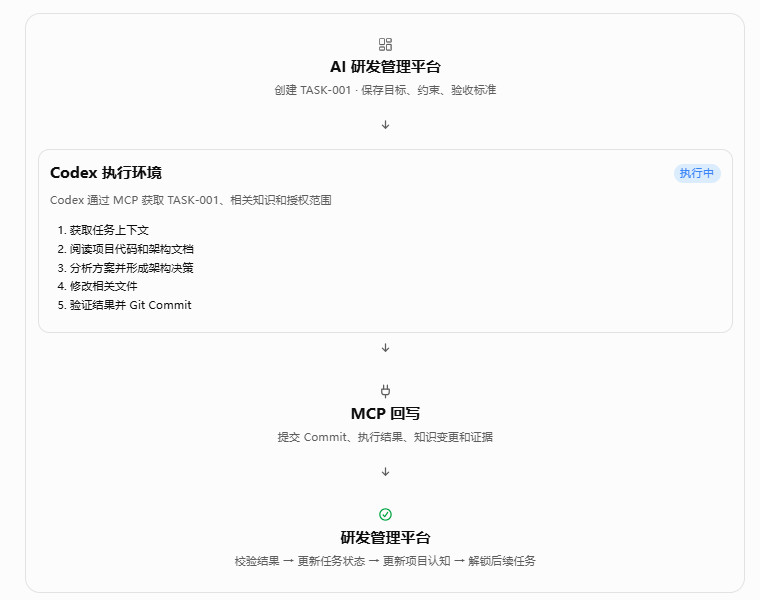
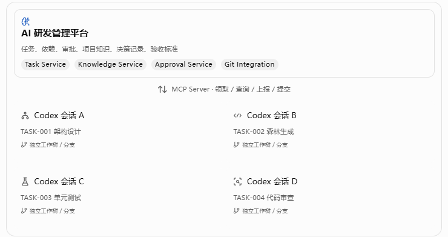
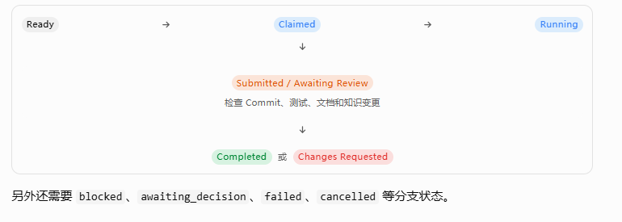

# AI 研发管理平台：AI 执行端 × MCP 定位与范围基线（V1.1 · 讨论记录）

> **标注图例**：〔原文〕= 客户经理讨论结论的直述；〔整理〕= 按讨论内容结构化归纳的补充表述；〔待确认〕= 本稿整理时产生的推断或尚未拍板项，需评审确认。

| 项 | 内容 |
| --- | --- |
| 文档性质 | 需求讨论记录 + 定位/范围基线（非 PRD，未定稿） |
| 版本 | V1.1 |
| 日期 | 2026-10-31 |
| 来源 | 与人类客户经理的架构定位讨论（含 3 张讨论示意图，见附录 A） |
| 记录人 | 司南（产品经理 Agent） |
| 状态 | 待评审 → 确认后作为后续 PRD 的上位约束 |
| 影响范围 | 推翻「平台内置 AI 编程环境」路线；收敛平台职责、MCP 工具面、任务契约与状态机 |

### 变更记录

| 版本 | 日期 | 变更内容 | 触发 |
| --- | --- | --- | --- |
| V1 | 2026-10-31 | 首次记录：定位收敛、职责三分、9 个 MCP 工具、任务契约、状态机、知识两层、MVP | 客户经理讨论 |
| V1.1 | 2026-10-31 | **术语泛化**：原稿把执行方写作「Codex」（单一产品），实为泛指**一切能调用 MCP 工具的 AI 开发工具**；补 §〇.1 术语定义、§3.4 工具无关性约束、§3.5 执行端能力矩阵、§4.4 能力协商，Q 清单扩至 Q11 | 客户经理澄清 |

---

## 〇、一句话结论

> 平台不做「自带 AI 编程助手的项目管理软件」，而是**面向 AI 执行端的研发任务控制中心**：管理 AI 该做什么、为什么做、依据什么做、做到什么程度算完成、完成后如何验证，以及这些工作如何改变项目的长期认知。〔原文，术语已泛化〕

**范围重划（三句话）**〔原文〕：

1. **AI 研发管理平台** —— 负责目标、任务、知识和协作。
2. **AI 执行端** —— 负责在真实代码环境中完成工作（研发执行环境）。*原话举例为 Codex，实指一切 MCP-capable 的 AI 开发工具。*
3. **MCP** —— 负责把两者连接起来（协作协议）。

### 什么是 / 不是什么

| 是 | 不是 |
| --- | --- |
| AI 执行端的任务控制中心 | 在管理平台内部重新实现一套多 Agent 编程环境 |
| 任务契约、项目知识、验收标准的权威源 | 自己执行代码、自己维护代码仓库的 IDE |
| 状态机与审计的唯一裁决方 | 直接控制执行端每一步操作的上位调度器 |
| 项目长期认知（决策/约束/ADR）的沉淀层 | 单纯的 Agent 聊天协作工具 |
| **与执行端产品无关**的中立协作层 | 绑定某一家的编码工具（如只支持 Codex） |

**决策价值**〔整理〕：这条定位把平台从「重造一个编码 Agent 运行时」这个高成本、高不确定性战场撤出，改为占据它真正的差异化位置——**任务契约的质量 + 验收的可信度 + 项目认知的连续性**。这三件事恰是外部执行端天然不具备、且每次会话都会丢失的东西。

---

## 〇.1 名词与术语〔整理 · V1.1 新增〕

| 术语 | 定义 | 与旧表述的差异 |
| --- | --- | --- |
| **AI 执行端**（AI Executor / AI Coding Tool） | 一切能调用 MCP 工具、在真实代码环境中执行研发工作的 AI 开发工具的统称 | **V1 原稿误写为「Codex」**，视为单一产品；实为品类 |
| Codex | 执行端的一个具体实现，本文档中仅作示例与参考实现出现 | 由「唯一对象」降为「示例之一」 |
| 会话（Session） | 执行端的一次运行实例，承载一个任务，持有独立工作树/分支 | 不变 |
| 任务契约（Task Contract） | MCP 返回的结构化任务定义：目标、约束、验收标准、知识引用、产物、git、租约 | 不变 |
| 租约（Lease） | 领取任务时签发的带过期时间的独占凭证，用于崩溃回收与防重复执行 | 不变 |
| 能力声明（Capabilities） | 执行端在领取任务时上报的自身能力集（transport、是否可无人值守、是否自动批准工具调用等） | V1.1 新增概念，见 §4.4 |

**执行端的可能范围**〔待确认〕：Codex CLI、Claude Code、Cursor、Cline、Continue、Windsurf、Zed Agent 等均属此类。首批实际接入清单见 Q9——本文档不对具体产品做能力承诺，只定义「满足什么条件即可接入」。

> **产品含义**：平台的服务对象是一个**增量扩大的品类**，而不是一个固定产品。这条决定后续所有接口设计必须走「最小公共能力集」，任何依赖单一工具专有能力的方案都不能进 V1。

---

## 一、职责三分：谁是权威，谁只是通道

| 维度 | AI 研发管理平台 | AI 执行端会话 | MCP Server |
| --- | --- | --- | --- |
| 核心职责 | 目标、任务、契约、状态机、验收、知识权威源 | 读代码、改文件、跑验证、提交 Commit | 暴露研发管理工具调用接口 |
| 状态权威 | 唯一权威（后端状态机） | 无（只能发起状态变更请求） | 无（只转发 + 鉴权 + 幂等） |
| 是否执行代码 | 否 | 是 | 否 |
| 是否调度会话 | 否（需独立 Runner/Worker，见 §3.2） | 自身单会话 | 否 |
| 是否绑定具体工具 | 否（必须中立） | —— | 否（协议中立） |
| 失败影响面 | 任务流转与认知错乱 | 单任务返工 | 全部会话中断 |

**关键澄清**〔原文〕：执行端可以**主动调用 MCP 工具领取任务**，平台不需要直接控制执行端的每一步操作。平台只需要：定义任务契约、提供项目知识、接收执行事件、校验结果。

> 〔整理〕「主动领取」这一条对执行端是有前提的：该工具必须支持**在没有人类逐步点击的情况下连续调用工具**。这一前提并非所有执行端都成立，直接引出 §3.4 的工具无关性约束。

---

## 二、端到端工作流（以 TASK-001 为例）



> 图 1：AI 研发管理平台创建 TASK-001（保存目标、约束、验收标准）→ 执行端通过 MCP 获取任务与授权范围 → 执行 → MCP 回写 → 平台校验并解锁后续任务。（图中「Codex 执行环境」为讨论原稿用词，泛指任意 MCP-capable 执行端。）

**TASK-001：确定世界地图地形渲染架构** 的七步闭环〔原文 + 整理编号〕：

| 步 | 动作 | 执行方 | 产出/事件 |
| --- | --- | --- | --- |
| 1 | 创建任务，定义目标/约束/验收标准/知识引用 | 平台（人 + AI） | Task 记录，状态 `ready` |
| 2 | 通过 MCP 领取任务（带租约） | 执行端 | `task.claim` → `claimed` + `lease_id` |
| 3 | 获取任务上下文（目标、约束、知识引用、验收标准） | 执行端 | `task.get_context` |
| 4 | 阅读代码与架构文档、分析方案、修改文件、验证、Commit | 执行端 | 任务分支上的 Commit |
| 5 | 提交结果（Commit SHA、产物、验证证据、知识变更提案） | 执行端 | `task.submit_result` → `submitted` |
| 6 | 校验 Commit 存在性/分支归属/验收标准/测试证据/审批 | 平台 | `completed` 或 `changes_requested` / `awaiting_decision` |
| 7 | 更新项目认知索引，解锁依赖任务 | 平台 | 下游任务转 `ready` |

---

## 三、系统架构与四个必要澄清



> 图 2：平台内含 Task Service / Knowledge Service / Approval Service / Git Integration；向下通过 MCP Server 对接多个执行会话（A/B/C/D，各自持有独立工作树与分支）。（图中「Codex 会话」泛指任意执行端的会话实例。）

### 3.1 多 Agent = 多个执行会话，不必自研 LLM 运行时〔原文〕

多个 Agent 本质上可以是多个带有**不同任务、权限和角色指令**的执行会话。不需要为每个 Agent 单独开发一套 LLM 运行时。

| 会话 | 承载任务 | 隔离手段 | 可由谁驱动 |
| --- | --- | --- | --- |
| 会话 A | TASK-001 架构设计 | 独立工作树 / 分支 | 任意执行端 |
| 会话 B | TASK-002 森林生成 | 独立工作树 / 分支 | 任意执行端 |
| 会话 C | TASK-003 单元测试 | 独立工作树 / 分支 | 任意执行端 |
| 会话 D | TASK-004 代码审查 | 独立工作树 / 分支 | 任意执行端（建议用不同实现做交叉审查） |

〔整理〕两条由此推出的设计约束：

1. **Agent 的差异必须落在「任务 + 权限 + 角色指令」三要素上**，而不是落在代码分支上；否则每加一个角色就要改一次产品。
2. **会话之间可以混用不同执行端**。这正是工具无关化的额外收益：审查会话用另一个实现，天然减少"同一个模型自己批自己"的盲区。

### 3.2 MCP 不负责调度〔原文，重要〕

MCP 本身只负责提供工具调用接口，**不会自动启动执行端，也不会持续调度任务**。若希望系统无人值守地执行任务，还需要一个独立的 **Runner / Worker**：启动执行会话、管理进程、处理超时与重试。

| 组件 | 能做 | 不能做 |
| --- | --- | --- |
| MCP Server | 提供工具、鉴权、幂等、返回任务上下文 | 启动会话、保活、超时重试、并发控制 |
| Runner / Worker | 拉起执行端进程、监控、超时、重试、回收 | 决定任务该不该做（那是任务契约与状态机的事） |

〔待确认〕Runner 在第一阶段是否需要落地为独立服务，还是以「人工手动启动执行会话」代替（见 §九 MVP 范围、Q2）。

### 3.3 平台的服务切分〔原文〕

Task Service、Knowledge Service、Approval Service、Git Integration 四个服务域 + MCP Server 作为唯一对外协作边界。任务、依赖、审批、项目知识、决策记录、验收标准是平台侧的数据责任。

### 3.4 工具无关性（Tool-agnostic）设计约束〔整理 · V1.1 新增〕

既然执行端是**一个品类而非一个产品**，平台侧任何能力假设都必须降到公共交集。以下是六条明确禁止的假设：

| # | 禁止假设 | 若假设了会怎样 | 平台侧正确做法 |
| --- | --- | --- | --- |
| A1 | 「执行端能无人值守地连续执行」 | 遇到需人工点确认的工具，任务卡在 `claimed` 直到租约过期 | 支持**两种领取模式**：自动模式（Runner 驱动）/ 人工模式（人在 IDE 内触发），模式由能力声明决定 |
| A2 | 「工具调用会被自动批准」 | 每个 `task.report_progress` 都要人手点一次，进度上报形同虚设 | 进度上报设计为**可批量、可省略**（关键节点才必须），不把细粒度上报当作强制契约 |
| A3 | 「执行端能自己搞工作树隔离」 | 多会话互相踩踏，Commit 落到同一分支 | 隔离由**平台 / Runner / Git 层**负责，写进任务契约的 `git.branch`，不依赖工具自觉 |
| A4 | 「会话可持久化、可恢复」 | 崩溃后误以为能从断点继续 | 一律按**会话可能彻底丢失**设计：状态靠租约回收，恢复靠重新领取 + 读上下文 |
| A5 | 「使用某一种 MCP transport」 | 只能连本地 stdio 的工具无法接入远程平台 | MCP Server 同时提供**本地 stdio 与远程 HTTP** 两种接入方式，或提供本地 bridge |
| A6 | 「上下文窗口足够大」 | 一次性塞全部知识，小窗口工具直接崩 | `task.get_context` 支持**分层返回**（必读 / 可选 / 按需检索），知识靠 `knowledge.search` 二次拉取 |

> **一句话**：平台可以对执行端提要求，但不能对某个具体执行端做假设。凡是「某某工具可以直接做到」的方案，都要再问一句"做不到的那些怎么办"。

### 3.5 执行端能力矩阵〔整理 · V1.1 新增，待研发核实〕

| 能力 | 普遍性判断 | 对产品的影响 |
| --- | --- | --- |
| MCP tools 调用 | 普遍具备 | 可作为平台的最小依赖 |
| 本地 stdio 连接 | 普遍具备 | 本地接入路径可直接依赖 |
| 远程 HTTP/SSE 连接 | 部分具备 | 需本地 bridge 兜底（A5） |
| 无人值守 / 无头执行 | 少数具备 | Runner 无法完全替代人工，Q2 结论受影响 |
| 自动批准工具调用 | 少数具备 | 进度上报必须可省略（A2） |
| 独立工作树 / 分支隔离 | 极少具备 | 隔离责任归平台侧（A3） |
| 会话持久化 / 断点续跑 | 极少具备 | 一律按可能丢失设计（A4） |
| 长上下文 | 差异极大 | 上下文分层返回（A6） |

〔待确认〕上表为基于品类常识的判断，**须由研发对首批目标执行端实测后填入真实结论**；本表的作用是先把"不能假设什么"钉住，而不是给出准确排名。

---

## 四、MCP 工具面 V1

### 4.1 建议提供的 9 个稳定工具〔原文〕

| 工具 | 作用 |
| --- | --- |
| `task.list` | 查询当前可领取任务 |
| `task.claim` | 原子领取任务，防止重复执行 |
| `task.get_context` | 获取任务目标、约束、验收标准和关联知识 |
| `task.report_progress` | 上报进度、阻塞和执行事件 |
| `task.submit_result` | 提交 Commit、产物、验证结果和完成说明 |
| `task.request_decision` | 遇到架构分歧时请求决策 |
| `knowledge.search` | 检索项目知识 |
| `knowledge.propose_change` | 提议更新知识、需求或架构文档 |
| `task.get_review` | 查询验收结果和修改意见 |

〔整理〕这 9 个工具全部是**业务语义工具**（说清"要做什么事"），没有一个是"改字段"的通用写接口——这与工具无关性是同一个设计取向：语义稳定的接口才能跨越不同执行端与不同版本存活。

### 4.2 明确不做：通用 `knowledge.write`〔原文，重要〕

不提供可任意修改项目知识库的写工具。理由：执行端完成任务后，可能**把自己的推断当成正式项目事实**，污染知识库。

**知识写入分级**〔原文〕：

| 写入类型 | 处理方式 |
| --- | --- |
| 普通执行记录、技术发现 | 自动写入 |
| 正式需求、架构决策、项目约束 | 走变更提案（`knowledge.propose_change`） |
| 已授权的低风险文档更新 | 自动应用 |
| 涉及重大决策的变更 | 人工确认 |

〔整理〕这条直接对应平台的安全底线：**知识库的污染成本远高于任务返工成本**——任务错了可以重做，认知错了会污染之后所有任务的输入。因此知识写入的默认姿态必须是"提议优先于直写"。

### 4.3 与既有架构资产的口径差异〔整理，待裁决〕

既有 `docs/ai-pm-architecture-principles.md` §九已定义过一组 `pm_*` 命名的 MCP 工具（查询/提交/工作流三组）。本次讨论的 9 个工具与之语义高度重叠但命名体系不同，需一次收敛：

| 本次提议 | 既有 §九 对应 | 处置建议 |
| --- | --- | --- |
| `task.list` | `pm_list_my_tasks` | 二选一定名（MCP 工具名是对外契约，改名成本高，须一次定死） |
| `task.claim` | 无直接对应（Job 队列的 `claim` 是内部 Worker 机制，非执行端工具） | 新增：面向执行端的任务租约接口 |
| `task.get_context` | `pm_get_task_context` + `pm_get_project_context` + `pm_get_architecture_decisions` | 收敛为**单一打包入口**，避免执行端多次往返 |
| `task.report_progress` | `pm_report_progress` | 沿用语义 |
| `task.submit_result` | `pm_submit_work_result` | 沿用语义，并扩展 `commit_sha` / 验证证据 / 知识变更提案字段 |
| `task.request_decision` | 无直接对应（`pm_respond_to_feedback` 是反向流程） | 新增：执行期主动请求决策 |
| `knowledge.search` | 无（知识空间设计有检索层，但未定义 MCP 工具） | 新增 |
| `knowledge.propose_change` | `pm_propose_change_request`（需求变更） | 复用并扩展至知识/架构文档 |
| `task.get_review` | `pm_get_review_result` | 沿用语义 |
| （不做）`knowledge.write` | 既有设计亦未提供通用写工具 | 一致，无需变更 |

〔待确认〕命名体系：采用 `task.*` / `knowledge.*` 点分命名空间（可读性好、按域分组），还是延续 `pm_*` 前缀（与既有代码一致）。建议采纳点分命名空间并在 V1 一次性冻结（Q1）。

### 4.4 是否需要能力协商〔整理 · V1.1 新增〕

工具无关化的落地手段，是让执行端在领取任务时**主动声明自己能做什么**：

| 方案 | 做法 | 优点 | 代价 |
| --- | --- | --- | --- |
| A. 被动适配 | 平台不感知能力差异，一律按最小集设计 | 实现最简 | 体验吃亏：能做无人值守的工具也享受不到加速 |
| B. 领取时声明 | `task.claim` 请求带 `client_capabilities`（工具名/版本/transport/是否可以无人值守/是否自动批准） | 平台可据此调整租约时长、上报粒度、上下文分层 | 契约复杂度上升 |
| C. 平台预注册 | 接入时人工登记每个执行端的能力档位，MCP 层不做协商 | 契约干净，接入可控 | 新增执行端要改配置；档位判断易过期 |

**建议**：V1 走 C（预注册能力档位，实现成本最低且可控），在 `task.claim` 保留 `client_name` + `client_version` 字段以便后续升级到 B。理由：V1 只有一两个执行端接入，协商成本大于收益；但字段预留不能省，否则以后加字段就是破坏性变更。

---

## 五、任务必须是执行端可执行的契约〔原文〕

MCP 返回的内容不能只是一句「完成地形架构设计」，而应是结构化契约：

```json
{
  "task_id": "TASK-001",
  "title": "确定地形渲染架构",
  "type": "architecture",
  "status": "claimed",
  "goal": "确定 Bevy 2D 地形高度晕渲方案",
  "constraints": {
    "language": "Rust",
    "engine": "Bevy 0.19",
    "platform": "Windows 11",
    "map_scale": "regional"
  },
  "acceptance_criteria": [
    "比较 GPU Shader 和 CPU 预计算",
    "记录性能和维护性风险",
    "形成架构决策文档",
    "完成必要的可行性验证"
  ],
  "knowledge_refs": [
    "architecture/terrain.md",
    "requirements/world-map.md"
  ],
  "deliverables": [
    "docs/adr/001-terrain-rendering.md"
  ],
  "git": {
    "branch": "task/TASK-001",
    "base_branch": "main"
  },
  "lease": {
    "lease_id": "LEASE-001",
    "expires_at": "2026-11-01T12:00:00Z"
  }
}
```

### 字段语义〔整理〕

| 字段 | 作用 | 缺失后果 |
| --- | --- | --- |
| `goal` | 单一可判断的完成目标 | 执行端自由发挥，产出不可验收 |
| `constraints` | 技术栈/平台/规模等硬约束 | 方案与项目现实脱节（如选了引擎不支持的方案） |
| `acceptance_criteria` | 逐条可核对的验收项 | 「做完了」无法判定 |
| `knowledge_refs` | 必读知识的路径引用 | 执行端重造已有决策，产生冲突方案 |
| `deliverables` | 预期产物路径 | 产物散落，无法自动校验 |
| `git` | 工作分支与基线分支 | 多会话提交互相踩踏 |
| `lease` | 领取租约（含过期时间） | 任务永远显示「执行中」，无法回收 |

〔整理 · V1.1〕契约里刻意**没有**任何与具体工具相关的字段（无 tool 名、无 prompt 模板、无 model 名）。角色指令属于平台侧配置、随会话注入，不进入任务契约——否则同一任务无法交给不同执行端。

### 租约机制（Lease）是任务领取的必要条件〔原文〕

任务领取必须具备租约。执行端异常退出或机器断电后，平台才能判断任务是否需要恢复/重新领取，而不是永远显示「执行中」。

| 场景 | 无租约 | 有租约 |
| --- | --- | --- |
| 会话崩溃 | 永久 `running`，人工干预才能解锁 | 到期自动回收为可领取 |
| 双会话并抢 | 重复执行、分支冲突 | 原子领取，第二个会话领取失败 |
| 长任务误判 | 无法区分「在跑」与「已死」 | 续租（heartbeat）即可区分 |
| **需人工确认的工具** | 人一离开就永久卡死 | 租约到期回收，重派给其他会话 |

〔整理 · V1.1〕最后一行是本次泛化新增的现实问题：**部分执行端每调一次工具都要人类批准**，执行速度以"人点确认"为单位，租约默认时长若按无人值守设定，会被大量误回收。因此租约时长需按执行端的自动化档位区分（见 §4.4）。

〔待确认〕租约续期方式（`task.report_progress` 是否自动续租）、单次租约时长与最大续租次数（Q3）。

---

## 六、完成的判定：三个动作必须分开〔原文〕

| # | 动作 | 执行方 | 判定含义 |
| --- | --- | --- | --- |
| 1 | 执行端完成并 Commit | 执行端 | 代码/文档已生成并自验证，落在任务分支 |
| 2 | 通过 MCP 提交任务结果 | 执行端 | 上报 Commit SHA、变更文件、验证结果、知识变更提案、执行摘要 |
| 3 | 平台自动校验 | 平台 | 检查任务归属、Commit 是否存在、分支、验收标准、测试证据、必要审批 |
| 4 | 进入待验收或完成 | 平台 | 满足自动验收策略 → `completed`；否则转人工或独立 Agent 审查 |
| 5 | 知识更新并触发下游 | 平台 | 应用已授权知识变更、更新索引、依赖任务转可领取 |

### 三条不可混同的原则〔原文〕

1. **Commit 成功 ≠ 任务完成。**
2. **任务完成 ≠ 代码已合并到主分支。**
3. **需要人类批准的决策，任务停在 `awaiting_decision`，而不是直接关闭。**

> 例：架构设计任务可能已完成 ADR 文档，但正式技术选型仍需人类批准——此时任务是 `awaiting_decision`，不是 `completed`。

〔整理〕这条原则的落地要求：`task.submit_result` 的成功响应必须**显式返回「已进入哪个状态、还缺什么」**，不能只回 `ok`。否则执行端侧无法知道自己是否还需要追加动作。

---

## 七、任务状态机



> 图 3：Ready → Claimed → Running → Submitted / Awaiting Review → Completed 或 Changes Requested；另需 blocked、awaiting_decision、failed、cancelled 等分支状态。

### 状态清单〔原文 + 整理〕

| 状态 | 含义 | 进入条件 | 是否终态 |
| --- | --- | --- | --- |
| `ready` | 可领取 | 创建完成 / 依赖解除 / 返工回收 | 否 |
| `claimed` | 已领取未开工 | `task.claim` 成功，租约生效 | 否 |
| `running` | 执行中 | 执行端上报开始执行（或首次 `report_progress`） | 否 |
| `submitted` | 已提交待审查 | `task.submit_result` 成功 | 否 |
| `changes_requested` | 需修改 | 审查未通过，附修改意见 | 否 → 回 `ready` 或 `running` |
| `awaiting_decision` | 待人类决策 | `task.request_decision` / 审查发现需人类拍板 | 否 |
| `blocked` | 被阻塞 | 依赖未就绪 / 外部阻塞上报 | 否 |
| `completed` | 完成 | 自动验收策略通过 / 人工验收通过 | 是 |
| `failed` | 失败 | 执行失败且不可重试 / 重试耗尽 | 是 |
| `cancelled` | 取消 | 人为取消 / 目标作废 | 是 |

### 迁移与守卫〔整理，待确认〕

| 迁移 | 触发 | 守卫条件 |
| --- | --- | --- |
| `ready → claimed` | `task.claim` | 事务内原子更新；无有效租约冲突 |
| `claimed → running` | 首次进度上报 | 租约仍有效 |
| `running → submitted` | `task.submit_result` | Commit 存在、分支匹配 `git.branch` |
| `submitted → completed` | 自动验收 | 验收标准逐条有证据；无需人类审批项 |
| `submitted → changes_requested` | 审查不通过 | 必须附具体修改意见（可执行的下一步） |
| `submitted → awaiting_decision` | 审查发现决策缺口 | 必须指明待决策项与建议选项 |
| `running → ready` | 租约过期回收 | 无有效续租；记录中断原因 |
| `any → cancelled` | 人为取消 | 需权限与原因留痕 |

**状态治理红线**〔原文〕：状态由后端状态机维护，执行端通过 MCP 发起状态变更请求，**不能任意修改数据库中的状态**。

〔整理〕推论：MCP 工具面里不应存在「通用状态设置」类接口；每个工具只能触发状态机允许的迁移，非法迁移返回明确错误码而非静默失败。这条在跨执行端场景下更重要——不同工具的异常处理习惯不同，状态机必须自己兜住。

---

## 八、项目知识放在哪里：两层结构〔原文〕

认同既有的 Markdown + PageIndex 思路，但知识分为两层：

| 知识层 | 保存内容 | 更新方式 |
| --- | --- | --- |
| Git 仓库中的 Markdown | 架构、ADR、接口规范、项目约束 | 执行端修改并 Commit，经审查后成为正式版本 |
| 平台项目认知索引 | 摘要、章节树、引用关系、任务关联、决策影响 | 由 Git 事件和 MCP 结果触发更新 |

**核心原则**〔原文〕：Git 中的正式 Markdown 是**版本化事实来源**；PageIndex 风格的索引是**帮助 AI 查找和理解这些事实的工具**。这样执行端在本地工作时可直接阅读文档，管理平台也能结构化检索，**不需要维护两套相互竞争的正式文档**。

**不适合进 Git 的内容用数据库**〔原文〕：任务租约、Agent 运行记录、审批事件、成本统计。

〔整理〕这条与项目既有的「一个信息只有一个权威来源」原则一致，本次讨论的增量是：**把权威源显式指派给 Git 而非平台数据库**，平台只保留派生索引。副作用是索引必须可重建——即「索引丢了能重算」，否则平台就成了隐形的第二权威源。

〔整理 · V1.1〕对执行端泛化的额外好处：**"直接读仓库里的 Markdown"是唯一一个所有执行端都天然具备的能力**。不需要给每个工具做知识注入适配，这层设计天然工具无关。

---

## 九、最小闭环（第一阶段范围）〔原文〕

不必一开始就做 12 个 Agent。第一阶段只需要四件东西：

| 组件 | 数量 | 说明 |
| --- | --- | --- |
| 研发管理平台 | 1 | 含任务/知识/审批/验收 |
| MCP Server | 1 | 9 个工具的子集即可 |
| 执行端会话 | 1 | 单会话，人工或脚本启动 |
| Git 仓库 | 1 | 任务分支 + 主分支 |

### 闭环的七步验收〔原文〕

1. 在管理平台创建 TASK-001。
2. 执行端通过 MCP 领取任务。
3. MCP 返回任务目标、约束、知识引用和验收标准。
4. 执行端完成工作并 Commit。
5. 执行端通过 MCP 提交结果。
6. 平台验证 Commit、更新任务状态。
7. 经适当审核后，知识索引更新，下一个任务变为可领取。

**跑通之后再加**：多会话并行、任务依赖调度、角色模板、独立审查 Agent。

〔整理〕MVP 的判定标准应写成：**「一个任务从创建到解锁下游，全程无人工改数据库」**。只要这条成立，后续扩展都是加法；不成立则说明契约或状态机有缺口。

〔整理 · V1.1〕**建议 MVP 用两个不同执行端各跑一遍同一任务类型**（而非同一工具跑两次）。理由：单实现跑通无法证明工具无关性，等接第二个工具时才发现契约里埋了私有假设，返工成本远高于早期多花半天。若资源只够一个，则在契约评审时专门过一遍 §3.4 的 A1–A6。

---

## 十、与既有资产的对应与影响〔整理〕

本次讨论是**定位层的收敛**，不是新增能力。与既有文档的关系：

| 既有资产 | 与本次结论的关系 | 需处理的差异 |
| --- | --- | --- |
| `docs/ai-pm-architecture-principles.md` §九 MCP 工具 | 语义可复用，命名需收敛 | `pm_*` vs `task.*`；是否新增 claim / request_decision（见 §4.3） |
| 同上 §十一 Job 队列（claim + 租约 + 退避 + 冻结） | **已有实现**（内部 Worker 机制） | 与执行端侧任务租约是两层不同租约，需在文档中显式区分，避免混用 |
| `docs/ai-pm-markdown-knowledge-space.md` | 与本次「Git 为权威、索引为派生」一致 | 需补充 `knowledge.search` / `knowledge.propose_change` 的 MCP 契约 |
| `docs/ai-pm-hybrid-workspace-design.md` §八「多 Agent 可能产生相互冲突的修改」 | 本次给出解法：独立工作树/分支 + 原子领取 + 状态机 | 该风险条目可标记为「已由 MCP 契约层缓解」 |
| `docs/superpowers/plans/2026-10-31-knowledge-space-v1-slice.md` | 已实现（23/23 步完成） | 作为知识层落地的现实基础，不需重做 |

**明确被推翻的路线**：平台内置 AI 编程助手 / 自研多 Agent 运行时 / 由平台逐步控制执行端操作 / 为某一特定编码工具做深度定制。以上方向后续不再进入设计讨论。

> 说明：上表为基于标题与章节的初步映射，定稿前需与原文逐条核对，避免与既有条款冲突。

---

## 十一、待确认问题清单

| # | 问题 | 影响 | 建议 |
| --- | --- | --- | --- |
| Q1 | MCP 工具命名体系：`task.*` / `knowledge.*` 还是 `pm_*` | 对外契约，定错后改名成本高 | 采纳点分命名空间，V1 冻结 |
| Q2 | 第一阶段是否需要独立 Runner/Worker，还是人工启动执行会话 | 决定 MVP 工作量与「无人值守」承诺边界 | MVP 先人工启动，Runner 放第二阶段 |
| Q3 | 租约时长、是否随 `report_progress` 自动续租、最大续租次数 | 崩溃回收与长任务判定 | 需按执行端自动化档位分档设定 |
| Q4 | 自动验收策略的边界：哪些任务类型可免人工 | 决定 `completed` 的可信度 | architecture 类默认需人工；代码类可按测试证据自动 |
| Q5 | `awaiting_decision` 的决策请求如何路由（谁收、多久超时、超时怎么办） | 决定任务会不会卡死 | 需明确责任人与超时回收策略 |
| Q6 | 派生索引的可重建性：Git 事件丢失/乱序时如何重算 | 决定索引是否成为第二权威源 | 提供全量重建入口 |
| Q7 | 多会话并行时的工作树隔离由谁负责（Runner / Git / 平台） | 影响 §3.1 架构落地 | 建议平台侧负责，不依赖执行端（A3） |
| Q8 | 成本统计口径（按会话/按任务/按 token） | 影响 `成本统计` 表结构 | 待确认 |
| **Q9** | **首批接入哪几个执行端？** | 决定"工具无关性"是口号还是事实 | 建议 ≥2 个不同实现（如 Codex CLI + Claude Code），至少一个自动化程度低的，以便暴露 A1/A2 问题 |
| **Q10** | **能力协商走哪条路**：被动适配 / 领取时声明 / 平台预注册 | 影响 `task.claim` 契约是否现在就要留字段 | V1 预注册（§4.4 方案 C），但保留 `client_name`/`client_version` 字段 |
| **Q11** | **自动批准策略矩阵**：任务类型 × 执行端自动化档位 | 决定进度上报粒度与租约时长 | 高风险动作（写正式文档、改主分支）无论执行端能力多强都需人工确认 |

---

## 附录 A：讨论配图与归档路径

| 图 | 内容 | 归档路径 |
| --- | --- | --- |
| 图 1 | TASK-001 端到端流程（平台 → 执行端 → MCP 回写 → 平台） | `docs/figures/executor-mcp-v1-flow-task001.png` |
| 图 2 | 系统架构（四服务域 + MCP Server + 四个执行会话 / 独立工作树分支） | `docs/figures/executor-mcp-v1-architecture.png` |
| 图 3 | 任务状态机（Ready / Claimed / Running / Submitted / Completed / Changes Requested） | `docs/figures/executor-mcp-v1-task-state.png` |

> 原图由讨论方绘制，图中出现的「Codex」字样为原始用词，未做改图；术语以本文 §〇.1 为准。

---

本方案为产品设计参考，具体实施请结合公司合规与法务要求确认。
