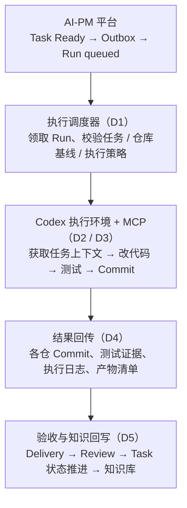
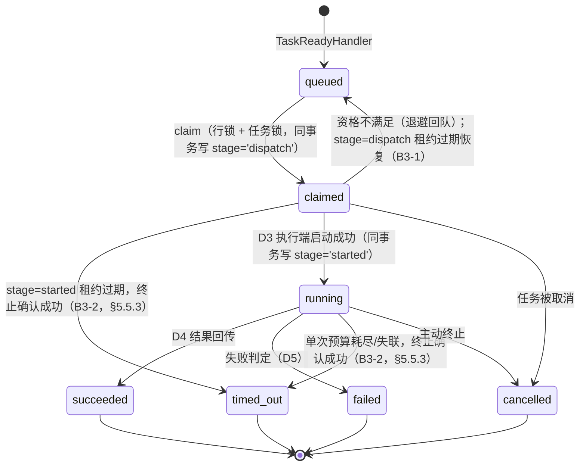
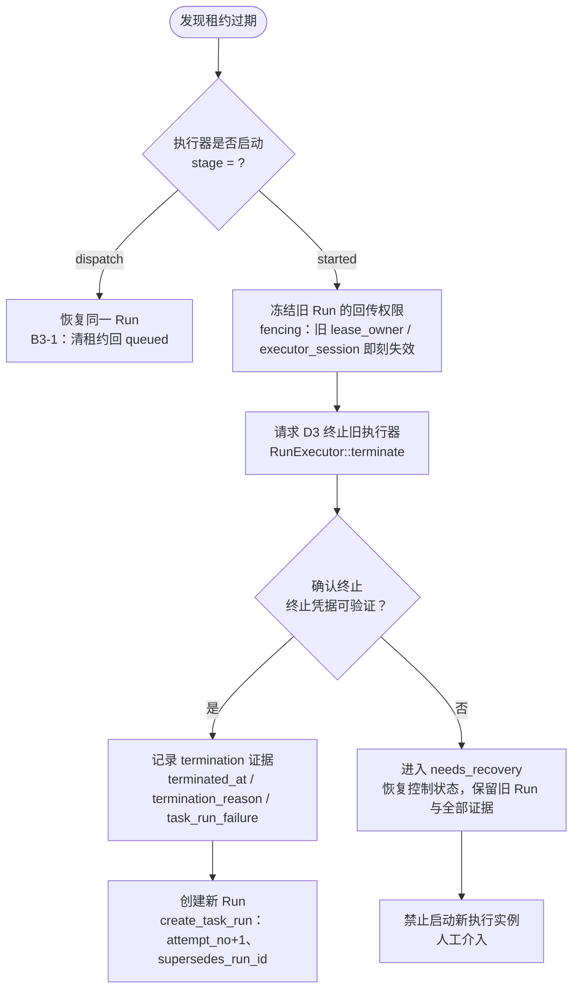

# AI-PM 平台：Slice D 执行链路（V1 · 设计稿）

> 面向：技术评审方 / 实施方（含 Codex 执行端）
> 日期：2026-10-31
> 状态：**设计依据 v1.1（已裁决，可实施）**（本文只定义 D1 的实施范围；D2–D5 仅作范围锚定）
> 裁决记录：B1–B3 / R1–R7 / S1–S6 / Q1–Q10 已全部并入围（正文就地修订，汇总清单见 §十一）；2026-11-01 专家终审：P0-1～P0-4 / P1-1～P1-3 / 数据库 8 项 / T27–T34 已并入围（见 §5.5.3 与 §十一），修订后冻结 D1 设计
> 前置基线：`59a686b`（Outbox 事务端口）、`bd7e4ef`（`TaskReadyHandler`）、`581b0ff`（`GET /v1/pm/task-runs`）
> 依据：`docs/ai-pm-outbox-wiring-review.md`、`docs/ai-pm-task-state-machine-v1.md`（§15 §19 §20）、`docs/ai-pm-multi-repo-model-v1.md`（§2 §4 §6）、`docs/ai-pm-mcp-executor-positioning-v1.md`（§5 §6）

---

## 〇、一句话结论

**Slice C 把「任务可执行」变成了「Run 已排队」，Slice D 要把它变成「Run 被领取、被启动、有产物、被验收」。**
本阶段采用「**平台控制 / Codex 执行 / MCP 通信**」三层分工；**D1 只交付调度与领取**——让 `queued` 的 Run 能被原子领取、租约可回收、上下文（多仓基线）可下发，并把执行器接口留好，但**不启动 Codex**。

D1 落地前必须先解决三处硬缺口，否则会把缺陷写进后续四个任务：

| # | 缺口 | 严重度 | 影响 |
| --- | --- | --- | --- |
| G1 | `delivery.task_run` 无租约/心跳列，`status` CHECK 无「已领取」态 | **P0** | 无法区分「排队 / 已领取 / 已启动」，崩溃不可恢复 |
| G2 | 无 `delivery.task_repository`，任务与仓库无关联关系 | **P0** | 多仓上下文无处落，D2 契约无从生成 |
| G3 | `validate_transition` **只被测试调用**，生产路径未接入 | **P0** | 违反「不得绕过状态机」；领取会变成直写 |

---

## 一、阶段目标与判定标准

### 1.1 从「能排队」到「能交付」

| 维度 | Slice C 交付后 | Slice D 目标 |
| --- | --- | --- |
| 任务 | 13 态状态机、状态迁移审计 | 状态推进由**真实执行结果**驱动，而非人工点按钮 |
| Run | `TaskReady` → 一条 `queued` 记录（真实数据库行） | Run 被原子领取、执行、产出、验收，形成闭环 |
| 执行 | 无执行器，`queued` 永久停留 | Codex 实例可启动、可监控、可终止 |
| 交付 | 无提交记录 | 每仓独立的基线 / Commit / 验证结论 |
| 知识 | 无回写 | 结论回流知识库，可被下一次执行读取 |

### 1.2 阶段判定（三条都要成立，缺一不算完成）

1. **真实执行**：一个 `ready` 任务能被平台领取，由 Codex 实际改代码并提交，平台记录到 Commit SHA——**不接受**只有 Mock executor 的演示。
2. **可审计**：领取、启动、心跳、失败、提交、验收每一步都能在 `governance.audit_log` 与 `delivery.task_run*` 里还原。
3. **可恢复**：杀进程 / 断网 / 超时后，Run 不会永久卡在「执行中」，任务可回到可执行态。

### 1.3 本阶段明确不做

| 不做 | 理由 |
| --- | --- |
| 通用事件总线 / 完整事件溯源 | spec §20.2 已排除 |
| 第二套消息队列或独立调度服务 | D1 要求 10；且已有 `task_run` + Outbox |
| 多执行端并发协调（Lead Agent 拆分） | multi-repo §7，属 P1-3 |
| 自动合并 / 自动发布 | §15 策略未定稿 |
| 前端执行中心的新交互 | 本轮只补数据源（`GET /v1/pm/task-runs` 已存在） |

---

## 二、总体执行流程

### 2.1 五层流水线



| 层 | 唯一职责 | 明确不负责 | 本阶段归属 |
| --- | --- | --- | --- |
| 平台 | 决定**什么任务能执行、由谁执行、什么算完成** | 不执行代码、不碰工作区 | D1 / D5 |
| 调度器 | 原子领取、租约、资格判定、上下文快照 | 不解析代码、不判断质量 | **D1** |
| MCP | 上下文下发、进度上报、证据回传的**唯一通道** | 不做调度（positioning §3.2） | D2 |
| Codex | 实际开发：改、测、提交 | 不写平台状态（只能用 MCP 上报） | D3 |
| 回传 / 验收 | 逐仓对账、状态裁决、知识沉淀 | 不重跑开发 | D4 / D5 |

### 2.2 四条跨层不变量（任何一层都不得绕过）

| # | 不变量 | 落点 |
| --- | --- | --- |
| I1 | 同一任务同一时刻至多 1 条活跃 Run（`queued`/`claimed`/`running`） | 任务行锁 + 部分唯一索引 |
| I2 | 任务状态只能经 `pm-domain::validate_transition` 变更，并留审计 | `pm-application` 唯一写入点 |
| I3 | 执行端不得直写任务或 Run 状态；只能经 MCP 上报，由平台裁决 | D2 接口设计 |
| I4 | 失败不覆盖历史：重试新建 Run，失败记录不可变 | `UNIQUE(task_id, attempt_no)` + `task_run_failure` 触发器 |
| I5 | Task 与 Run 的对应状态迁移必须在**同一事务**内完成；任一迁移失败，整体回滚（`ready→claimed` 由 D1 领取事务保证；`claimed→running` 由 D3 同样遵守） | §5.4.1 / §5.5.3 |

### 2.3 三层状态必须分开（决定 D1 的数据模型）

| 层 | 状态集合 | 语义 | 谁改 |
| --- | --- | --- | --- |
| Task | 13 态（`ready`/`claimed`/`running`/…） | 任务**还能不能继续推进** | 仅平台 |
| Run | `queued`/`claimed`/`running`/`succeeded`/`failed`/`timed_out`/`cancelled` | 一次**执行实例**的生命周期 | 平台（`running` 之后由回传驱动） |
| Delivery | 逐仓：`missing`/`pending_review`/`delivered` | 某仓的**交付**是否达标 | D4/D5 |

> 关键：**`task.claimed` ≠ Codex 已启动**。`claimed` 只表示「租约已签发、上下文已锁定」，`running` 才表示「执行端已实际开始」。这一区分是 D1 的设计核心，也是需求 6 的直接落点。

---

## 三、五个开发任务

### 3.1 拆分

| 任务 | 内容 | 验收标准 | 关键落点 |
| --- | --- | --- | --- |
| **D1** | Run 调度与领取 | 并发领取不会重复执行 | 迁移 `0011`、`pm-application/src/run_dispatch.rs`、worker **第四条循环**（现有已三条：主 `ai_analysis`、`repo_import`、outbox，见 S1） |
| **D2** | MCP 任务上下文接口 | 能读取任务、约束、关联仓库和知识 | `apps/ai-pm-mcp`（或等价服务）、契约 JSON schema |
| **D3** | Codex 执行适配器 | 能启动、监控、终止执行实例 | `pm-application` 执行器端口 + `CodexExecutor` 适配器 |
| **D4** | 多仓库交付与结果回写 | 每个仓库独立记录基线、Commit、验证结果 | `task_run_repository`、`task_repository_commit`、交付清单视图 |
| **D5** | Review、失败恢复及知识回写 | 形成可审计的执行闭环 | 失败判定服务（B4）、评审编排、知识索引写入 |

### 3.2 依赖与顺序

```
D1（领取） ──► D2（发上下文） ──► D3（真启动） ──► D4（收产物） ──► D5（裁决与沉淀）
   │                │                 │                 │
   └ 释放：租约/基线 └ 依赖：契约字段   └ 依赖：claimed→running └ 依赖：基线对账
```

**开发顺序固定为 D1 → D2 → D3 → D4 → D5，不得并行或跳步。** 原因：D2 的契约字段由 D1 的基线快照产出；D3 的状态迁移依赖 D1 的租约语义；D4 的对账以 D1 锁定的 `base_commit` 为唯一基准。跳步会导致「契约字段无来源」或「基线可被事后篡改」。

### 3.3 集成测试门禁

| 规则 | 含义 |
| --- | --- |
| 每阶段必须有**真实数据库集成测试** | 复用 `crates/*/tests/` 现有 `PgPool` 直连模式（如 `tests/outbox_handlers.rs`） |
| 不允许只用 Mock 证明链路完成 | Mock 只能证明**接口形状**，不能证明「并发不重领」「崩溃可恢复」「提交存在性」 |
| 允许 Mock 的位置 | 外部不可控依赖：Codex 进程（D3 可用脚本化假执行端）、Git 远端（D4 可用本地 bare 仓库） |
| 每个任务必须含失败场景 | 只测 happy path 的任务不算通过 |

### 3.4 交付纪律：本次只交 D1

**不要把五个任务一次性交给 Codex。** Codex 单次会话的产出上限（文件数、测试数、上下文）在 D1 已接近边界；D2 之后涉及进程管理与协议设计，一次性交付必然出现「结构对、语义错」的返工。

---

## 四、现状盘点（已逐项核实）

### 4.1 已有能力（可直接复用，不重建）

| 能力 | 位置 | 复用方式 |
| --- | --- | --- |
| `delivery.task_run` 表 | `migrations/0010_task_state_machine.sql:18-41` | **扩列**，不建新表 |
| 失败记录不可变 | 同上 `:47-59` + 触发器 `:61-70` | 直接使用 |
| Run 策略快照字段 | 同上 `:29-35`（`policy_snapshot`/`policy_version`/`policy_hash`/`evaluated_at`/`repository_policy_snapshots`） | **已预留**，D1 填最小快照（完整合成见 §九），无需迁移 |
| `TaskReady → queued Run` 消费 | `crates/pm-infrastructure/src/outbox_handlers.rs` | 保留，不修改语义 |
| 领取 SQL 范式（`FOR UPDATE SKIP LOCKED` + 租约 + 尝试计数） | `crates/pm-infrastructure/src/outbox.rs:83-156` | **照此范式**写 Run 领取 |
| 任务行锁 + revision 守卫 + 审计 + 同事务事件 | `crates/pm-application/src/command_executor.rs:370-464` | 扩展为 Run 领取的事务模板 |
| 系统 actor 约定 | `crates/pm-application/src/pm_write.rs:49-74`（`owner_actor`） | 审计行 `actor_id` 用此约定 |
| 阶段重试参数 | spec §19.4：`max_run_attempts=3`、`max_consecutive_failures=3`、`run_timeout=30min` | D1 读，不硬编码 |

### 4.2 缺口清单

| # | 缺口 | 证据 | 严重度 | D1 处置 |
| --- | --- | --- | --- | --- |
| G1 | `task_run.status` CHECK 仅 6 值，无「已领取」 | `0010:24-25` | P0 | 扩 CHECK（+`claimed`） |
| G2 | 无 `lease_owner`/`lease_expires_at`/`heartbeat_at` | `0010:18-41` 全文 | P0 | `0011` 补列 |
| G3 | 无 `delivery.task_repository` | `grep task_repository migrations/` 仅命中 `0009` 的 `repo_import_source` | P0 | `0011` 建表 |
| G4 | 无 Run 级基线快照表 | 同上 | P0 | `0011` 建 `task_run_repository` |
| G5 | `validate_transition` 未接入生产 | `grep validate_transition`：仅 `pm-domain` 内部与测试 | P0 | 接入 `update_task_status` + 领取路径 |
| G6 | `idx_task_run_active` 非唯一，无法在 DB 层保证 I1 | `0010:43-44` | P1 | 升级为部分唯一索引 |
| G7 | `TaskReadyHandler` 只校验 `status='ready'` + `assignee` 非空，不校验执行端类型；**且活跃 Run 幂等判据为 `queued/running`，漏 `claimed`** | `outbox_handlers.rs:46-53,74-77` | **P0** | 领取侧收紧 + **同步修正 handler 幂等判据为 `queued/claimed/running`**（见 B1/Q6）；创建流程本身不变 |
| G8 | 无租约回收路径（`claimed` 永不过期） | 无相关代码 | P0 | 候选条件 + 同事务修复 |
| G9 | 策略覆盖表 `task_policy_override`、等待表 `task_waiting` **零代码引用** | `grep` 无命中 | P1 | D1 只读 `require_human_approval`，合成交 D2 |
| G10 | Run 无 `executor_kind`/`executor_session` | `0010` 无列 | P2（D3） | D1 先补列，D3 填值 |
| G11 | 无「部署形态」抽象：领取逻辑放 worker 还是 API 未定 | — | P1 | 放 `pm-application`，两个入口都可调用 |

### 4.3 三处文档与实现的口径冲突（必须先对齐，否则 D4 会返工）

| # | 冲突 | 现状（权威） | 文档草案 | 处置 |
| --- | --- | --- | --- | --- |
| C1 | `task_run.status` 取值集合完全不同 | 0010：`queued/running/succeeded/failed/timed_out/cancelled` | multi-repo §4.4：`running/submitted/verified/partial/needs_recovery/aborted` | **以 0010 为准**；multi-repo 的 `task_run` DDL 作废，`partial/needs_recovery` 下沉到 Delivery 层（D4） |
| C2 | 活跃 Run 唯一性 | 0010：部分索引**非唯一** + 应用层判重 | multi-repo §4.4：`UNIQUE ... WHERE status='running'` | 以 0010 为准并**加强**为部分唯一（含 `queued`/`claimed`/`running`） |
| C3 | 仓库身份 | 0008/0009：`integration.project_repository` 即项目内仓库身份（`UNIQUE(project_id,url)`） | multi-repo §4.4：新增全局 `integration.repository` + 改造关联表 | **D1 不做全局仓库实体**，直接用 `project_repository.id` 作仓库身份；全局化留给 D4 评估（见 Q2） |

---

## 五、D1 详细设计

### 5.1 目标与非目标

**目标**：让 `queued` 的 Run 能被**恰好一个** Workers 领取；领取即锁定任务、锁定多仓基线、签发租约；租约过期可按规则回收；全过程可审计；执行器接口就位但不启用。

**非目标（D1 明确不做）**：

- 不启动 Codex 进程（D3）。
- 不生成面向执行端的完整契约 JSON（D2）。
- 不写 `task_workspace` / `task_repository_commit`（D4）。
- 不做失败判定服务与状态裁决（D5）。
- 不改 `TaskReadyHandler` 的语义（它只负责「排队」，不负责「领取」）。

### 5.2 需求 → 设计映射

| # | 实施要求（原文） | D1 设计落点 | 验收 |
| --- | --- | --- | --- |
| 1 | 复用现有表与 Outbox，先检查 `TaskReadyHandler` | 已存在且已注册（`apps/ai-pm-worker/src/main.rs:93`）；**创建流程不变，仅把活跃 Run 判据统一为 `queued/claimed/running`**（B1/Q6） | 重复投递不新建 Run、不产生虚假死信 |
| 2 | 原子领取 `queued` Run，多 Worker 并发不重复 | `SELECT … FOR UPDATE SKIP LOCKED` + 任务行锁 + 部分唯一索引 | T1 / T2 / T14 |
| 3 | 租约、心跳、超时检测、崩溃恢复 | `lease_owner`/`lease_expires_at`/`heartbeat_at` + `recover_expired_leases()` 独立回收（§5.4.2 / §5.9） | T3 / T13 / T19 / T32 |
| 4 | 领取前校验状态、资格、策略、仓库基线 | 可领取性判定清单（§5.6），**全部通过才领取** | T5 / T6 / T7 / T11 |
| 5 | 支持一任务多仓库，不得一对一 | `delivery.task_repository` + `delivery.task_run_repository` | T8 / T9 |
| 6 | 排队 / 领取 / 启动三态区分 | Run 增 `claimed`；Task `ready→claimed→running` 一一对应 | T2 / T11 |
| 7 | 不得绕过 Task 状态机 | **方案 A（R1）**：在既有 `update_task_status` 统一迁移逻辑内接入 `pm-domain::validate_transition`；`run_dispatch` 复用该统一路径，**不新增绕过守卫的第二写入点** | T11 / T12 / T18 |
| 8 | 失败/超时/重跑保留历史 | 复用 `UNIQUE(task_id,attempt_no)` + `task_run_failure` 不可变 | T3 / T19 / T27（已启动失联：终止确认后新建 Run `attempt_no+1` 并留档；终止无法确认 → `needs_recovery`，禁止新建；历史不被覆盖） |
| 9 | 预留执行器接口，不真启动 | `RunExecutor` 端口 + `NoopExecutor`（**不得伪造执行成功**）；**默认不领取** | 开关默认 `off`；测试内开启 `probe`/`on` |
| 10 | 不引入独立队列/第二套调度 | 复用 `task_run` 表 + 同一 worker 进程内**第四条**循环（S1） | 无新增中间件 |

### 5.3 数据模型最小调整（迁移 `0011`）

> 原则：**forward-only 补列 + 两张关联表**，不建平行状态机，不改 0010 已有列语义。

#### 5.3.1 Run 扩列

```sql
-- 0011_run_dispatch: Run 领取所需的租约、心跳与多仓基线快照。
-- 依据：docs/ai-pm-slice-d-execution-pipeline-v1.md §5.3 / §十一（R2 R3 S6）

-- 1) 状态：新增 claimed（已签发租约、执行端尚未启动）。
--    R2：不依赖隐式约束名——按 pg_constraint 元数据识别 status 的 CHECK 并 DROP；
--        终审收紧（DB-1）：仅删除「约束定义以 status 列为 CHECK 目标」的约束
--        （PostgreSQL 规范化输出形如 CHECK ((status = ANY (ARRAY[...])))），
--        其他恰好包含 status 字样的复合约束不受影响；
--        若一个都没找到则显式失败（结构不符合预期，不得静默跳过）。
DO $$
DECLARE c RECORD; dropped INT := 0;
BEGIN
    FOR c IN
        SELECT conname
          FROM pg_constraint
          WHERE conrelid = 'delivery.task_run'::regclass
            AND contype = 'c'
            AND pg_get_constraintdef(oid) ~ 'CHECK\s*\(\s*\(?\s*status\s*=\s*ANY'
    LOOP
        EXECUTE format('ALTER TABLE delivery.task_run DROP CONSTRAINT %I', c.conname);
        dropped := dropped + 1;
    END LOOP;
    IF dropped = 0 THEN
        RAISE EXCEPTION
            '0011: no status CHECK constraint found on delivery.task_run; schema drift, aborting';
    END IF;
END $$;

ALTER TABLE delivery.task_run
    ADD CONSTRAINT task_run_status_check CHECK (status IN (
        'queued', 'claimed', 'running', 'succeeded', 'failed', 'timed_out', 'cancelled'));

-- 2) 租约、执行端身份与执行阶段归因（Q9 / B3）
ALTER TABLE delivery.task_run
    ADD COLUMN IF NOT EXISTS claimed_at          TIMESTAMPTZ,
    ADD COLUMN IF NOT EXISTS lease_owner         TEXT,
    ADD COLUMN IF NOT EXISTS lease_expires_at    TIMESTAMPTZ,
    ADD COLUMN IF NOT EXISTS heartbeat_at        TIMESTAMPTZ,
    ADD COLUMN IF NOT EXISTS dispatch_attempts   INT NOT NULL DEFAULT 0,
    ADD COLUMN IF NOT EXISTS next_dispatch_at    TIMESTAMPTZ NOT NULL DEFAULT now(),
    ADD COLUMN IF NOT EXISTS release_reason      TEXT,
    ADD COLUMN IF NOT EXISTS executor_kind       TEXT,
    ADD COLUMN IF NOT EXISTS executor_session    TEXT,
    -- B3：已启动执行器的 Run 被替代前必须记录旧实例终止结果（隔离/围栏证据）
    ADD COLUMN IF NOT EXISTS supersedes_run_id   UUID REFERENCES delivery.task_run(id),
    ADD COLUMN IF NOT EXISTS terminated_at       TIMESTAMPTZ,
    ADD COLUMN IF NOT EXISTS termination_reason  TEXT,
    -- B3-4 / §5.5.2：基础设施类失败的独立重试计数（独立上限，不并入执行连续失败）
    ADD COLUMN IF NOT EXISTS infrastructure_retry_count INT NOT NULL DEFAULT 0;

-- 3) 领取队列索引：只覆盖可领取集合，避免全表扫描
CREATE INDEX IF NOT EXISTS idx_task_run_dispatch
    ON delivery.task_run(next_dispatch_at, created_at)
    WHERE status IN ('queued', 'claimed');

-- 4) 租约到期扫描（健康检查持续运行，独立于调度开关，见 R4 / Q8）
CREATE INDEX IF NOT EXISTS idx_task_run_lease_expiry
    ON delivery.task_run(lease_expires_at)
    WHERE status = 'claimed' AND lease_expires_at IS NOT NULL;

-- 5) R3：删除语义不一致且无实际用途的旧索引。
--    0010 的 idx_task_run_active 谓词为 queued/running（漏 claimed），且读路径
--    （apps/pm-api/src/pm_runs.rs）与修正后的 handler 计数均不依赖它；
--    改由 uq_task_run_active（同样的部分谓词、但唯一）承担读写两侧。
DROP INDEX IF EXISTS delivery.idx_task_run_active;

-- 6) 把 I1 从"应用层约定"升级为"数据库事实"。
--    S6：冲突必须显式失败，且输出可定位的 task_id / run_id / status / attempt_no，
--        不得自动删除冲突数据。
DO $$
DECLARE r RECORD;
BEGIN
    FOR r IN
        SELECT tr.task_id, tr.id AS run_id, tr.status, tr.attempt_no,
               count(*) OVER (PARTITION BY tr.task_id) AS active_count
          FROM delivery.task_run tr
         WHERE tr.status IN ('queued', 'claimed', 'running')
    LOOP
        IF r.active_count > 1 THEN
            RAISE EXCEPTION
                'I1 violated before 0011: task_id=% run_id=% status=% attempt_no=% (active=%)',
                r.task_id, r.run_id, r.status, r.attempt_no, r.active_count;
        END IF;
    END LOOP;
END $$;

CREATE UNIQUE INDEX IF NOT EXISTS uq_task_run_active
    ON delivery.task_run(task_id) WHERE status IN ('queued', 'claimed', 'running');
```

> **R2 迁移后验证**（写入迁移测试，不在迁移内改数据）：断言 `claimed` 可写入、非法状态仍被拒绝。
> **R3**：`idx_task_run_active` 已显式删除；其职能由部分唯一索引 `uq_task_run_active` 同时承担（读：按任务查活跃 Run；写：拒绝第二条活跃 Run）。

#### 5.3.2 任务 ↔ 仓库（声明）

```sql
CREATE TABLE IF NOT EXISTS delivery.task_repository (
    task_id       UUID NOT NULL,
    project_id    UUID NOT NULL,
    repository_id UUID NOT NULL,
    write_access  BOOLEAN NOT NULL DEFAULT true,
    base_ref      TEXT NOT NULL DEFAULT 'main',
    base_commit   TEXT,            -- 声明/期望基线，可空；实际锁定值见 task_run_repository
    path_scope    TEXT[],
    role          TEXT NOT NULL DEFAULT 'primary'
                  CHECK (role IN ('primary', 'secondary', 'knowledge')),
    created_at    TIMESTAMPTZ NOT NULL DEFAULT now(),
    PRIMARY KEY (task_id, repository_id),
    FOREIGN KEY (project_id, task_id)
        REFERENCES delivery.task(project_id, id) ON DELETE CASCADE,
    -- 组合外键：仓库必须属于同一项目，杜绝跨项目串仓
    FOREIGN KEY (project_id, repository_id)
        REFERENCES integration.project_repository(project_id, id)
);
CREATE INDEX IF NOT EXISTS idx_task_repository_repo
    ON delivery.task_repository(repository_id, created_at DESC);
```

> **级联与更新语义（终审 DB-3）**：
> - `(project_id, task_id) → delivery.task ... ON DELETE CASCADE`：任务删除时级联删除其仓库声明行；
> - `(project_id, repository_id) → integration.project_repository`：**无级联**（默认 `NO ACTION`）——仓库仍被任一任务声明引用时不可删除，必须先解除声明；更新主键同样被拒；
> - 声明表本身可 UPDATE（`write_access`/`base_ref`/`path_scope` 等），但**已领取 Run 的基线以 `task_run_repository` 快照为准**（见 §5.3.3 不可变快照不变量），声明变更不回写历史 Run。

#### 5.3.3 Run ↔ 仓库（事实：本次领取锁定的基线）

```sql
CREATE TABLE IF NOT EXISTS delivery.task_run_repository (
    run_id         UUID NOT NULL REFERENCES delivery.task_run(id) ON DELETE CASCADE,
    project_id     UUID NOT NULL,
    repository_id  UUID NOT NULL,
    base_ref       TEXT NOT NULL,
    base_commit    TEXT NOT NULL,
    write_access   BOOLEAN NOT NULL,
    workspace_path TEXT NOT NULL,
    path_scope     TEXT[],
    created_at     TIMESTAMPTZ NOT NULL DEFAULT now(),
    PRIMARY KEY (run_id, repository_id),
    FOREIGN KEY (project_id, repository_id)
        REFERENCES integration.project_repository(project_id, id)
);
```

> **不可变快照不变量（终审 DB-8）**：`task_run_repository` 是**不可变快照**：
> 1. 仅在领取事务内 INSERT；
> 2. 正常业务流程**不存在任何 UPDATE 路径**（§5.7 各字段「可变=否」即来源于此）；
> 3. Task 的仓库声明事后增删改，**不影响**已领取 Run 的快照；
> 4. 历史 Run 必须能仅凭自身快照独立还原当时的仓库基线。
> D1 由应用层保证（无 UPDATE 代码路径 + 集成测试 T30 断言）；D4 建 `task_workspace` 时追加 DB 触发器禁止 UPDATE 作为最后兜底。

> 为什么 `run_id` 用单列外键而非 `(project_id, run_id)` 组合外键：`delivery.task_run` 目前**没有** `UNIQUE(project_id, id)`（0010 只建了 `UNIQUE(task_id, attempt_no)`），组合外键无法成立。补这个唯一约束属 multi-repo §4.4 的既有意图，但会牵动 D4 的建表顺序，**列入 Q5**，不在 D1 强行加。项目隔离已由 `(project_id, repository_id)` 组合外键保证（终审 DB-4：可接受；D4 补 `UNIQUE(project_id, id)` 后评估是否升级为组合外键，使项目一致性在数据库层闭环）。

#### 5.3.4 兼容性说明

| 项 | 影响 | 回退 |
| --- | --- | --- |
| `status` CHECK 扩值 | 纯放宽，存量行全部仍合法 | 无 |
| 新增列全部可空或有默认值 | 存量 `queued` 行为 `next_dispatch_at=now()`，可被立即领取 | 无 |
| `uq_task_run_active` | 若存量已有重复活跃 Run 会**建索引失败** | 迁移前置核查，失败即中止并输出冲突行 |
| 两张新表 | 新表，不影响既有查询 | `DROP TABLE` 即可（无存量依赖） |

### 5.4 领取协议（事务顺序 + 正确性论证）

#### 5.4.1 顺序（一个事务内完成，共 6 步）

```text
BEGIN
  ① 选候选 Run：按入口二选一（§5.4.2，同一扫描 SQL）
      dispatch_once()            → queued 且 next_dispatch_at <= now()
      recover_expired_leases()   → claimed 且租约已过期
      → SELECT … FOR UPDATE SKIP LOCKED LIMIT 1        （不阻塞其他 Worker）
  ② 锁任务行：SELECT … FROM delivery.task FOR UPDATE  （与 TaskReadyHandler 同一把锁）
  ③ 重新校验该 Run 状态仍可领取                        （行锁只保护 run，任务锁后才可信）
  ④ 可领取性判定（§5.6），任一不过 → 走「不领取」分支
     （回收入口不走本清单，走 §5.5.3 恢复协议分支判定）
  ⑤ 状态推进：validate_transition(ready→claimed) → UPDATE task
               UPDATE run SET status='claimed', 租约…
               INSERT task_run_repository × N
     ※ I5：task 与 run 的状态迁移同事务，任一失败整体回滚；
       run_dispatch 复用 update_task_status 统一路径，不拆分事务边界。
  ⑥ 审计 + COMMIT
```

> 恢复入口（`recover_expired_leases()`）复用同一事务模板（同样的锁序 run→task、同样的审计提交），仅在 ④⑤ 步走 §5.5.3 分支判定，不重复实现第二套事务逻辑。

#### 5.4.2 候选选取（对应 ①，复用 outbox 的 reclaim 范式）

```sql
SELECT r.id, r.task_id, r.project_id, r.status, r.stage,
       r.executor_session, r.dispatch_attempts
FROM delivery.task_run r
WHERE (r.status = 'queued'    AND r.next_dispatch_at <= now())   -- dispatch_once() 入口
   OR (r.status = 'claimed'   AND r.lease_expires_at < now())    -- recover_expired_leases() 入口
ORDER BY r.next_dispatch_at, r.created_at
FOR UPDATE OF r SKIP LOCKED
LIMIT 1;
```

> **两入口共享同一扫描与事务模板（终审 P0-4）**：`dispatch_once()` 与 `recover_expired_leases()` 是两个独立 application 操作（§5.9），前者只取 `queued` 候选且受调度开关控制，后者只取过期租约候选且持续运行；仍复用 `delivery.task_run` 表与同一 worker 进程，**不需要第二套调度系统**（需求 10）。

> **恢复分支判定（终审 P0-2，必须按 stage 二分，不得把所有过期 claimed Run 当成同一种情况处理）**：

| 当前状态 | `stage` | `executor_session` | 恢复方式 | 计数影响 |
| --- | --- | --- | --- | --- |
| `claimed` | `dispatch` | `NULL` | **B3-1**：同一 Run 重置回 `queued`（清空租约字段，`next_dispatch_at=now()`），不新建、不记执行失败，`outcome` 保持 `NULL` | `attempt_no`/`attempt_count` 不变；`consecutive_failure_count` 不变 |
| `claimed` | `started` | 非空 | **B3-2**：执行器隔离协议（§5.5.3）——终止确认成功后才新建替代 Run；终止无法确认 → `needs_recovery`，禁止新建 | 新 Run `attempt_no+1`、`attempt_count+1`；旧 Run 落 `timed_out` + `task_run_failure(category='infrastructure')`；`consecutive_failure_count` 不变（基础设施失败） |
| `running` | `started` | 非空 | **B3-2** 同上（单次预算耗尽或执行端失联） | 同上 |
| `queued` | — | — | 正常领取（走 §5.6 可领取性判定） | 仅「不领取」分支递增 `dispatch_attempts` |

> `stage` 判据优先于 `executor_session`：领取事务写 `stage='dispatch'`；`claimed→running` 同事务写 `stage='started'`（§5.5.2）。`executor_session` 作辅证，两者不一致时以 `stage` 为准并记审计告警。

#### 5.4.3 为什么不会重复领取（三条独立防线）

| 防线 | 机制 | 防的是什么 |
| --- | --- | --- |
| 行锁 | `FOR UPDATE SKIP LOCKED` | 两个 Worker 同时看到同一 Run |
| 任务锁 | `delivery.task FOR UPDATE` | 同一任务的「建 Run」与「领 Run」交错 |
| 唯一索引 | `uq_task_run_active` | 应用逻辑写错时的最后兜底（数据库拒绝第二条活跃 Run） |

**无死锁论证（B2，必须成立）**：全局约定加锁顺序为 **`run(FOR UPDATE OF r SKIP LOCKED) → task(FOR UPDATE)`**，且**任何新建 Run 的 INSERT 都必须发生在取得 `delivery.task` 行锁之后**。

- `TaskReadyHandler` 的顺序是 `task → insert run`，符合约定；
- 领取的顺序是 `run(SKIP LOCKED) → task → 建新 run/快照`，符合约定；
- `SKIP LOCKED` 使领取永不阻塞在 Run 行上，消除「A 持 run 等 task」的环。

> **B2 补充（唯一索引冲突等待，务必覆盖）**：PostgreSQL 中两个事务 INSERT 同一 `uq_task_run_active` 键（同一 `task_id`）时，后到者**等待**前者提交/回滚，而非立即失败。若存在「未取得 task 锁就先 INSERT 新 Run」的代码路径，就会形成：事务 A 已插入新 Run 键并等 task 锁、事务 B 持 task 锁并等 A 的新 Run 键 → **真死锁**。故「先锁 task、再 INSERT Run」是**硬不变量**：代码注释固定该顺序，并由并发测试（T14 / T17）兜住。禁止任何按相反顺序加锁的新代码路径。

#### 5.4.4 「不领取」的两类分支（必须有区别）

| 情形 | Run 处置 | Task 处置 | 理由 |
| --- | --- | --- | --- |
| Task 已终态 / 已取消 / 已被取代 | `status='cancelled'`，`outcome='cancelled'`，`finished_at=now()`，`release_reason='task_terminal'` | **不动**（终态不可迁出） | Run 是死记录，留着只污染队列 |
| Task 仍 `ready` 但不满足资格（缺仓库、仓库未验证、策略拦截、重试耗尽） | 回 `queued`，`dispatch_attempts+1`，`next_dispatch_at = now() + min(2^n, 300)s`，写 `release_reason` | 不动 | 条件可能被修复（补仓库、验证仓库），**退避而非丢弃** |

> 退避上限 300s：避免「仓库未验证」的任务把 CPU 打满，同时保证修复后 5 分钟内可执行。

### 5.5 租约、心跳、超时、崩溃恢复

| 机制 | 规则 | 参数来源 |
| --- | --- | --- |
| 签发 | 领取成功即写 `lease_owner`（`worker_id`）、`lease_expires_at = now() + lease` | `AI_PM_RUN_LEASE_SECS`，默认 **300** |
| 心跳 | 执行端经 MCP 上报进度时续租 `lease_expires_at = now() + lease`，并写 `heartbeat_at` | D2 暴露通道；D1 提供 `renew_lease()` |
| 心跳间隔 | 60s（租约的 1/5），连续 5 次缺失才判死 | D3 定，D1 只提供能力 |
| 超时检测 | 单次 Run 预算独立于租约：`timeout_seconds`（0010 已有列），默认 1800 | spec §19.4 `run_timeout` |
| 崩溃恢复（B3 二分） | ① **执行器尚未启动**（`stage='dispatch'`、`executor_session IS NULL`）：租约过期 → **B3-1 恢复同一 Run**（清租约回 `queued`，不新建、不记执行失败，`outcome` 保持 `NULL`）；② **已启动执行器失联/超时**（`stage='started'`）：**B3-2 执行器隔离协议（§5.5.3）**——冻结旧实例回传权限（fencing）→ 请求 D3 终止旧执行器 → **终止确认成功后**记录旧 Run 终止结果并**新建** Run（`attempt_no+1`、`supersedes_run_id` 指向旧 Run），旧 Run 落 `timed_out` + `task_run_failure(category='infrastructure', reason_code='lease_expired', retryable=true)`；**终止无法确认 → `needs_recovery`（恢复控制状态），保留旧 Run 与全部证据，禁止创建新 Run** | spec §19.2 B4-B / §19.5 + §5.5.1 / §5.5.3 |
| 心跳 vs 超时 | **租约 << 单次预算**（300s vs 1800s）。若两者等长，一次网络抖动会被误判为超时 | 设计约束 |

租约状态迁移：



> 注意四点（并入 B3）：
> 1. `claimed → queued` 用于两类：① 资格不满足后的退避回队（同一行回队列，不新建 Run）；② **执行器尚未启动**（`stage='dispatch'`）时的租约过期恢复（同一 Run 重置租约，**不记执行失败**）。
> 2. 只有**已启动执行器**（`stage='started'`）的 Run 失联/超时才走 `claimed/running → timed_out`，且必须先按 §5.5.3 协议完成隔离与终止确认；同事务先冻结旧实例回传权限、记录终止结果，再新建 `queued` Run（`attempt_no+1`、`supersedes_run_id` 指向旧 Run），旧行永久保留。**终止无法确认时不得迁移、不得新建**（`needs_recovery`，见 §5.5.3）。
> 3. 绝不把「已启动失联」写成「本行回到 queued」，否则 `attempt_no` 与执行失败计数都会失真。
> 4. **`needs_recovery` 不加入 Run 状态集合**（C1 裁决）：它是恢复控制状态，落 Delivery 层（D4 交付状态机）；D1 阶段以 `termination_reason='termination_unconfirmed'` + 审计 `needs_recovery` + 人工介入标记承载。

#### 5.5.1 恢复与计数规则（B3 / Q9）

**B3 规则（七条，强制）**：

1. 未真正启动执行器的租约过期 → **可恢复同一 Run**（不新建、不计执行失败，不递增任何计数）。
2. 已启动执行器的 Run 超时或失联 → 按 **§5.5.3 恢复协议**执行：先冻结旧实例回传权限（fencing）、请求 D3 终止旧执行器并取得终止确认（含凭据），**确认成功后**记录旧 Run 终止结果（`terminated_at`/`termination_reason`/`task_run_failure`）并创建新 Run；**终止无法确认 → 进入 `needs_recovery`，保留旧 Run 与全部证据，禁止创建新 Run**。
3. 只有**真正创建替代 Run** 时才递增 `attempt_no` 与 `task.attempt_count`；未启动恢复（B3-1）不递增任何计数，保留历史 Run。
4. **基础设施故障不计入任务执行的连续失败次数**（`consecutive_failure_count`），但必须有**独立重试上限**（`infrastructure_retry_count`，§5.3.1 已补列）与人工介入机制。
5. `max_run_attempts` 按**执行阶段**计算，不得与整个 Task 生命周期累计次数混用。
6. 创建 Run、递增计数、重试资格判断、审计写入**封装为统一领域操作 `create_task_run(task_id, reason, attempt_policy)`**，由全部调用方复用，禁止复制多套逻辑（见下）。
7. 若现有字段不足以表达执行阶段或基础设施重试次数，**提出最小 Schema 变更**，不得用含糊计数代替（见 §5.5.2）。

**P1-1：统一 Run 创建操作 `create_task_run`（终审，B3-6 落地）**

```text
create_task_run(
    task_id,
    reason,          -- task_ready | lease_expired_started | manual_retry | ...
    attempt_policy,  -- max_run_attempts / max_infrastructure_attempts 等
)
```

至少统一负责：

- 锁定 Task（与全局锁序一致：先 run 后 task 时须先持 task 锁才允许 INSERT）。
- 判断是否存在活跃 Run（`queued/claimed/running`）。
- 校验重试资格（`attempt_count < max_run_attempts`、`retry_exhausted=false`）。
- 计算 `attempt_no`。
- 更新 `attempt_count`。
- 创建 Run（含 `stage='dispatch'` 初始值）。
- 创建必要的失败关联记录（`task_run_failure`、`supersedes_run_id` 指向）。
- 写审计（同事务）。

三个调用方——`TaskReadyHandler`（排队）、D1 领取路径（B3-1 之外的替代 Run 创建）、故障恢复路径（B3-2）——只表达业务意图，不重复实现数据库规则。

尤其需要注意：**`TaskReadyHandler` 的重复事件不能因为 Run 已经 `claimed` 而产生错误死信**——活跃 Run 幂等判据统一为 `queued/claimed/running`（B1/Q6）。这部分 T15 保留为强制回归测试。

**Q9 计数语义（先定名，再实现）**：

| 计数 | 语义 | 归属 |
| --- | --- | --- |
| `attempt_count` | Task 生命周期内 **Run 创建总数** | `delivery.task` |
| `attempt_no` | 单个 Task 内第几次 Run（1 起） | `delivery.task_run` |
| `dispatch_attempts` | **同一 Run** 被"不领取/退避"的次数（资格类） | `delivery.task_run` |
| `consecutive_failure_count` | **仅**任务执行本身的连续失败 | `delivery.task` |
| 基础设施重试计数 | 基础设施类失败（租约失联等）的独立计数 | 见 §5.5.2 |

> `consecutive_failure_count` 只在"任务执行本身失败"时递增、在任务成功执行时重置；基础设施故障走独立计数与独立上限（B3-4）。`max_run_attempts` 按执行阶段判定，不与 `attempt_count`（生命周期总数）混用。

#### 5.5.2 最小 Schema 变更（B3-7 / Q9）

现有 `task_run_failure.category` 含 `'infrastructure'`，但缺少「执行阶段」与「基础设施重试计数」的承载。最小补齐（纳入 `0011`）：

- `delivery.task_run.stage` 已在 0010 预留（当前留空）：D1 明确定义阶段取值（`dispatch` / `started`），恢复规则据此二分（B3-1 vs B3-2）；**领取事务写 `stage='dispatch'`；`claimed→running` 同事务写 `stage='started'`（D3）**。恢复分支以 `stage` 为主判据、`executor_session` 为辅证（§5.4.2）；
- 基础设施重试承载列 `delivery.task_run.infrastructure_retry_count INT NOT NULL DEFAULT 0` **已定义于 §5.3.1（迁移 0011 补列），本节不重复添加**（终审 DB-2：统一定义一次，避免迁移实现重复添加）；
- `max_infrastructure_attempts` 作为配置（读 `AI_PM_*`，不硬编码），与 `max_run_attempts` 分离。

#### 5.5.3 执行器隔离与恢复协议（终审 P0-1，B3-2 的强制顺序）

> **核心区分**：Fencing 与 Isolation 是两个不同的问题——
>
> | 维度 | Fencing（围栏） | Isolation（隔离） |
> | --- | --- | --- |
> | 解决什么 | 拒绝旧实例的**过期写入**（迟到 MCP 回传、迟到结果提交） | 真正**阻止旧实例继续操作资源**（改文件、提交 Git） |
> | D1 责任 | ✅ 回传权限冻结：租约回收即失效旧 `lease_owner`/`executor_session`，T25 按其拒绝迟到回传 | ❌ 不负责进程终止 |
> | D3 责任 | — | ✅ `RunExecutor::terminate()` 启动、监控、**终止**并返回终止凭据 |
>
> **数据库中的租约过期 ≠ 操作系统中的进程已经死亡。** 租约过期只是平台侧的推理依据；在拿到可验证的终止结果之前，必须假设旧 Codex 进程仍在修改代码、仍在提交 Git。因此 **B3-2 的顺序是硬性的**：隔离确认完成之前，不允许创建新 Run——否则两个 Codex 会同时操作同一个项目工作区。

**恢复协议（终审 P0-1）**：



**四条强制要求**：

1. 旧实例的**回传权限必须先失效**（fencing 先于终止请求：冻结后旧实例的任何 MCP 回传按 T25 被拒）。
2. 旧进程必须有**可验证的终止结果**（终止凭据：`terminated_at` + `termination_reason` + D3 `terminate()` 返回的确认证据）。
3. **终止无法确认时，不允许启动新的执行实例**（不创建替代 Run；旧 Run 未终态 + `uq_task_run_active` 在数据库层天然阻止新活跃 Run）。
4. 进入人工恢复状态（`needs_recovery`）时，**保留旧 Run 和相关证据**（审计 `needs_recovery` 行 + 人工介入标记，见 §5.8）。

**`needs_recovery` 的归属（终审明确）**：它是**恢复控制状态或 Delivery 层状态**（C1 裁决：`needs_recovery` 下沉 Delivery 层，D4 交付状态机承载），**不得加入现有 Run 状态集合**（§5.3.1 的 CHECK 七值不变）。D1 阶段的承载方式：旧 Run 保持原状态 + `termination_reason='termination_unconfirmed'` + 审计动作 `needs_recovery` + 人工介入标记；D4 起在 Delivery 层正式建模。

**分期落地**：D1 不启动 Codex（NoopExecutor 不产生已启动实例），因此 D1 实装 **B3-1 全部** + **B3-2 的 fencing 与证据部分**（回传权限冻结、终止请求端口、`needs_recovery` 兜底）；`terminate()` 的真实终止确认由 D3 实装后闭环，D3 接入前 B3-2 的终止确认默认走 `needs_recovery`，**绝不跳过确认直接新建 Run**。

---

**S2（`status` / `outcome` 一致维护）**：领取、执行、成功、失败、超时、取消各路径必须同时维护 `status` 与 `outcome`——新建 `queued`/`claimed`/`running` 时 `outcome=NULL`；终态 `outcome` 与实际结果一致。**单纯租约过期但执行器未启动，不得误记为执行超时**（`outcome` 保持 `NULL`，走 B3-1 恢复）。

---

**S3（D1 最小 `policy_snapshot` 字段，版本口径已统一——终审 P1-2）**：D1 明确并测试以下最小字段，且与现有一行 `policy_snapshot JSONB`（0010:30）兼容。**版本口径唯一**：D2.1 已完成四层合成（迁移 `0016`），canonical 有效策略 SHA256 已就绪，`policy_version` 自领取路径启用起即为**内容寻址 hash 前 12 位，不再写 `NULL`**；本文档其余章节（§九、§十三）与之一致，`snapshot_scope` 统一为 `composed-v1`：

| 字段 | 含义 |
| --- | --- |
| `policy_hash` | 有效策略内容的 SHA256（D2.1 canonical 合成结果） |
| `policy_version` | `policy_hash` 前 12 位（不再写 `NULL`） |
| `captured_at` | 快照生成时刻 |
| `approval_required` | 本次执行是否需人工审批（由 R5 有效合成得出） |
| `approval_status` | 审批证据状态（`approved` / `pending` / `unknown`） |
| `execution_enabled` | 是否允许执行（策略合成结果） |
| `repository_baselines` | 本次锁定的多仓基线摘要 |
| `snapshot_scope` | 快照范围标记（`composed-v1`） |

> **两条强制要求（终审 P1-2）**：
> 1. **Run 领取时必须持久化当时的有效策略快照**，后续策略修改不能改变历史 Run 的策略依据（快照不可变，同 §5.3.3 快照不变量）；
> 2. **策略版本标识不是策略快照本身**——`policy_hash`/`policy_version` 只是寻址与引用，`policy_snapshot` JSONB 必须保存完整、可审计的实际内容，不得只存 hash 而丢失内容。

> **策略未知时不得默认允许执行**：策略读取失败 / 审批状态未知时 `execution_enabled=false`。

### 5.6 可领取性判定清单（全部通过才领取）

| # | 判定 | SQL 要点 | 失败 `release_reason` |
| --- | --- | --- | --- |
| 1 | Task 存在且属于同项目 | `WHERE id=$1 AND project_id=$2` | `task_missing` |
| 2 | Task 状态严格为 `ready` | 并由 `validate_transition(ready→claimed)` 复核 | `task_not_ready` |
| 3 | 未被取代 | `superseded_by_task_id IS NULL` | `task_superseded` |
| 4 | 已指派且是执行端 | `assignee_id IS NOT NULL` 且 `principal.kind='dev_agent'` | `no_executor_assignee` |
| 5 | 无活跃等待 | 不存在 `task_waiting.ended_at IS NULL` | `task_waiting` |
| 6 | 未耗尽重试 | `retry_exhausted = false` 且 `attempt_count < max_run_attempts` | `retry_exhausted` |
| 7 | 至少一个可写仓库 | `task_repository` 中 `write_access` 计数 ≥ 1 | `no_repository_scope` |
| 8 | 全部声明仓库已达 `verified` | `project_repository.status='verified'` | `repository_not_verified` |
| 9 | 基线可解析 | `coalesce(task_repository.base_commit, project_repository.head_commit_sha) IS NOT NULL` | `baseline_unavailable` |
| 10 | **有效审批策略检查**（R5）：不得只读 `task_policy_override`；综合组织 / 项目 / 任务类型 / 任务级限制，低层不得放宽高层的强制审批 | 复用现有策略解析能力合成"是否需要人工审批"；审批状态未知 / 缺批准证据 / 策略读取失败 → **拒绝领取**并记 `release_reason='policy_requires_approval'` | `policy_requires_approval` / `approval_status_unknown` |

> 判定 10 的落地（R5，**已实现**）：新增 `delivery.policy_scope`（迁移 `0013`，`scope ∈ organization/project/task_type`）+ 既有 `delivery.task_policy_override`（task 级）+ 新增 `delivery.task.task_type` 列。解析语义为**更严者胜**：任一层级 `require_human_approval = true` 即要求审批，**任务级 `false` 不得放宽高层 `true`**。需要审批时必须有 `approved` 证据；未决 / 缺证据 / 读取失败 → 拒绝领取。完整能力类 / 约束类合成（§15.6）**已由 D2.1 完成**（迁移 `0016` + `policy_composition`），见 `docs/ai-pm-d2-1-policy-composition-v1.md`。

### 5.7 多仓执行上下文

领取成功后，`task_run_repository` 的行即「本次执行的仓库契约事实」，D2 直接据此生成契约 JSON：

| 字段 | 来源 | 是否可变 |
| --- | --- | --- |
| `repository_id` | `task_repository` | 否 |
| `base_ref` | `task_repository.base_ref` | 否 |
| `base_commit` | `task_repository.base_commit` **优先**，否则 `project_repository.head_commit_sha` | **否**（`base_commit IS NOT NULL` 且 D1 之后无 UPDATE 路径） |
| `write_access` | `task_repository.write_access` | 否 |
| `workspace_path` | **R6 冻结算法（终审 P0-3）：`repos/<repository_id>`**。`repository_id` 为 UUID：天然唯一、稳定、可复现；不存在名称清洗碰撞、同名冲突与路径穿越问题；仓库改名不改变映射。**仓库显示名称与工作区路径分离**——如需友好目录名，另设显示字段，但不参与物理路径计算 | 否（positioning Q7：执行端不得自定布局） |
| `path_scope` | `task_repository.path_scope` | 否 |

不变量：**`write_access=false` 的仓库不得出现任何 Commit**（D4 校验，D1 只保证快照正确）。

**Run workspace 根目录布局（终审 P0-3）**：同一 Run 的多个仓库必须处于**同一个 Run workspace 根目录**之下：

```text
workspace/
  run.json
  repos/
    <repository-id-A>/
    <repository-id-B>/
    <repository-id-C>/
```

这样 D2 下发上下文时，Codex 不需要自行决定目录布局（positioning Q7 的物理承载）。

### 5.8 审计

| 动作 | `action` | `target_type` / `target_id` | `after_data` |
| --- | --- | --- | --- |
| 领取成功 | `claim_task_run` | `task_run` / run_id | `{task_id, attempt_no, lease_owner, lease_expires_at, repositories:[{repository_id, base_commit}]}` |
| 回收（B3-1 未启动恢复） | `reclaim_task_run` | `task_run` / 旧 run_id | `{reason:'lease_expired', stage:'dispatch', outcome:null, new_run_id:null}` |
| 回收（B3-2 已启动隔离） | `supersede_task_run` | `task_run` / 旧 run_id | `{reason, stage:'started', old_executor_session, terminated_at, termination_reason, termination_confirmed, fencing:'revoked', new_run_id, attempt_no}`（终审 DB-8：必须含旧执行器身份、恢复原因与 fencing 结果） |
| 恢复人工介入 | `needs_recovery` | `task_run` / 旧 run_id | `{reason:'termination_unconfirmed', evidence:{old_executor_session, last_heartbeat_at}, manual_intervention:true}` |
| 不领取 | `skip_task_run` | `task_run` / run_id | `{release_reason, dispatch_attempts}` |
| 续租 | `renew_run_lease` | `task_run` / run_id | `{lease_expires_at}` |

`actor_id` 复用 `pm_write::owner_actor`（`pm_write.rs:49`）；无 owner/member 时回退到该函数既有逻辑。**不新造 actor 约定**。

> 审计行与业务变更**同事务**提交：否则「租约签发了但没审计」会出现无法追责的执行。

### 5.9 执行器接口（预留，不实现）

```rust
/// 一次可执行的 Run：平台已锁定任务、基线与策略快照。
pub struct ExecutableRun {
    pub run_id: uuid::Uuid,
    pub task_id: uuid::Uuid,
    pub project_id: uuid::Uuid,
    pub attempt_no: i32,
    pub timeout_seconds: i32,
    /// D1 产出：按仓库锁定的基线（含 workspace_path）
    pub repositories: Vec<RunRepositoryBaseline>,
    /// 0010 已预留列，D1 填值，D2 下发
    pub policy_snapshot: Option<serde_json::Value>,
}

#[async_trait::async_trait]
pub trait RunExecutor: Send + Sync {
    fn kind(&self) -> &'static str;                       // "codex" | "noop" | ...
    /// D3：启动真实进程；D1：NoopExecutor 直接返回 Unsupported
    async fn start(&self, run: &ExecutableRun) -> Result<ExecutorSession, ExecutorError>;
    /// D3：查询存活与阶段进度（驱动心跳续租）
    async fn poll(&self, session: &ExecutorSession) -> Result<ExecutorProgress, ExecutorError>;
    /// D3：收到取消/超时/租约回收时的终止信号
    async fn terminate(&self, session: &ExecutorSession, reason: TerminateReason)
        -> Result<(), ExecutorError>;
}
```

**D1 的接线方式（R4 / R7，关键决策）**：调度器注册 `NoopExecutor`；**领取**由 `AI_PM_RUN_DISPATCH` 控制，**租约健康检查与过期恢复持续运行、不受该开关影响**。

**两个独立的 application 操作（终审 P0-4，必须拆分）**：

```text
dispatch_once()             -- 新 Run 领取：受 AI_PM_RUN_DISPATCH 开关控制
recover_expired_leases()    -- 过期租约恢复：持续运行，不受开关控制
```

同一个 Worker 进程可以运行两个循环，也可以由一个循环调用两个操作；关键是两个操作的**边界必须独立**——各自具备独立的生命周期、独立的错误处理（一个操作崩溃不拖垮另一个）、独立的运行指标（分别计数：领取成功数 / 恢复次数 / needs_recovery 次数）。两者共享同一候选扫描 SQL 与事务模板（§5.4.1 / §5.4.2），不重复实现事务逻辑。

| 操作 | 开关 off | 开关 on |
| --- | --- | --- |
| 新 Run 领取（`dispatch_once`） | **禁止** | 允许 |
| 过期租约检查（`recover_expired_leases`） | **持续运行** | 持续运行 |
| 未启动 Run 恢复（B3-1） | **允许** | 允许 |
| 已启动实例隔离（B3-2） | **允许** | 允许 |
| running 实例监控 | **持续运行** | 持续运行 |

> 不需要第二套调度服务/独立 reaper 进程；但健康检查必须具备**独立的生命周期、错误处理和运行指标**——否则「Worker 调度循环异常退出且无新实例启动」时健康检查会一起停摆（T32 验收）。

| 开关 / 维度 | 行为 | 用途 |
| --- | --- | --- |
| `AI_PM_RUN_DISPATCH=off`（默认） | **不领取**新 Run（`dispatch_once()` 不执行）；**仍持续**做租约健康检查与过期恢复（`recover_expired_leases()` 持续运行） | 生产默认，避免「领取后无人执行」的抖动，同时不让 `claimed` 永久残留 |
| `AI_PM_RUN_DISPATCH=probe` | 领取全流程后立即按 B3-1 释放回 `queued`（写 `release_reason='probe_release'`） | 验证真实链路与并发正确性，不启动执行器 |
| `AI_PM_RUN_DISPATCH=on` | 领取后交给已注册的 `RunExecutor` | D3 接入 Codex 后启用 |

> **R4 要点**：① 关闭调度**不等于**关闭健康检查——`claimed` 的租约过期照常按 §5.5.1 处理；② **已在 `running` 的 Codex 执行实例不因调度关闭而被终止**；③ 启动时做一次存量异常检查，但**不得用启动时的一次性回收代替持续健康检查**。

**NoopExecutor 的边界（R7）**：它只实现接口、**不得在生产中伪造执行成功**——`start()` 返回 `Unsupported` / 保持 `claimed`，绝不写 `succeeded`、绝不写 `running`。

### 5.10 为何不是「第二套调度系统」

| 质疑 | 回答 |
| --- | --- |
| 是否新增中间件 | 否。复用 `delivery.task_run` 作队列，复用同一 worker 进程 |
| 是否与 Outbox 重复 | 不重复。Outbox 解决「事件不丢」，`task_run` 解决「执行不重」。前者是消息语义，后者是资源语义（租约） |
| 是否两套重试 | 同构而非重复：Outbox 重试=`attempts/max_attempts`；Run 重试=`attempt_no/max_run_attempts`，语义不同（一次事件分发 vs 一次执行） |
| 是否有第二个 reaper | 无独立 reaper **进程/服务**。`recover_expired_leases()` 是同一 worker 进程内的独立 application 操作（§5.9，终审 P0-4），与 `dispatch_once()` 共享候选扫描范式与事务模板（§5.4.2），不引入第二套调度系统 |

---

## 六、D1 验收与测试矩阵

### 6.1 验收要求映射（6 条，逐条给证据）

| # | 验收要求（原文） | 证据形式 |
| --- | --- | --- |
| 1 | 并发 Worker 不会领取同一个有效 Run | T1/T2：8 路并发，`count(status='claimed')=1` |
| 2 | Worker 崩溃后 Run 能按租约规则恢复 | T3/T19：**未启动执行器**→ 同一 Run 恢复（B3-1）；**已启动失联**→ 终止确认后旧 Run 终止结果被记录 + 新 Run `attempt_no+1`（B3-2）；**终止无法确认**→ `needs_recovery`、不新建（T27/T34） |
| 3 | 已取消/失效/不满足策略的任务不会被启动 | T4/T5/T6/T7：四类各一条，断言「无 `claimed` 行 + 有 `skip`/`cancel` 审计」 |
| 4 | 多仓库任务能正确关联执行上下文 | T8/T9：3 仓 → 3 行快照，`base_commit` 与仓库 HEAD 一致，`workspace_path` 唯一 |
| 5 | 调度过程产生可追踪审计记录 | T10：每次领取恰 1 行 `claim_task_run`，与 Run 同事务 |
| 6 | 所有测试通过 + 真实数据库集成测试证据 | 全量 `cargo test` 输出 + 测试文件清单 |

### 6.2 集成测试矩阵（真实 PG，不 Mock 数据访问）

| ID | 场景 | 断言 |
| --- | --- | --- |
| T1 | 8 个并发 claim（独立连接） | 恰 1 成功；`task_run` 恰 1 行 `claimed`；task 恰迁移一次（`revision` +1） |
| T2 | 同一 Run 连续 claim 两次 | 第 2 次返回 `None`；`dispatch_attempts` 不变 |
| T3 | **已启动执行器失联后租约过期回收（B3-2，§5.5.3）** | 旧 Run `stage='started'` 落 `status='timed_out'` 且新增 failure 行（`category='infrastructure'`、`retryable=true`）；**终止确认成功前置**（terminated 凭据在案）；同事务**新建** Run（`run_id` 不同、`attempt_no=2`、`supersedes_run_id` 指向旧）；旧行字段不被改写；`consecutive_failure_count` 不变 |
| T4 | task 已 `cancelled` 但 Run 仍 `queued` | 该 Run 落 `cancelled`；task 状态不变；审计 `skip_task_run(task_terminal)` |
| T5 | `assignee` 为 `human` 或为空 | 不领取；`release_reason='no_executor_assignee'` |
| T6 | `retry_exhausted=true` | 不领取；`release_reason='retry_exhausted'` |
| T7 | 仓库 `status='pending'` | 不领取；`release_reason='repository_not_verified'`；退避生效（`next_dispatch_at` 前移） |
| T8 | 3 仓任务领取 | `task_run_repository` 3 行；`base_commit` = 各仓 `head_commit_sha`；`workspace_path` 互不相同 |
| T9 | 其中 1 仓 `write_access=false` | 快照保留该仓且 `write_access=false`；不因只读仓被拒 |
| T10 | 审计 | `audit_log` 恰 1 行 `claim_task_run`，`after_data` 含 repos 数组 |
| T11 | task 处于 `draft`/`submitted` 时强行 claim | 无状态变更；返回 `task_not_ready`（证明 `validate_transition` 已接入） |
| T12 | 注入快照插入失败 | 事务回滚：task 仍 `ready`、无 `claimed`、无审计 |
| T13 | 续租 | owner 续租成功且前移；非 owner 续租被拒 |
| T14 | `TaskReadyHandler` 与 claim 并发 | 同任务不出现 2 条活跃 Run（唯一索引 + 行锁共同保证） |
| T15 | **B1 回归**：领取后重复投递 `TaskReady` | 不产生第 2 条活跃 Run；handler 不报错、事件不死信；`count(status IN queued/claimed/running)=1` |
| T16 | **R2 回归**：旧 status CHECK 处理 | 迁移后旧 status 约束确被替换（`pg_constraint` 实测）；插 `claimed` 成功、插非法值仍被拒 |
| T17 | **B2 回归**：并发建 Run + 领取/回收 | 无 `deadlock detected`、无第 2 条活跃 Run；锁序为 run→task，且新 Run 的 INSERT 在 task 锁之后 |
| T18 | **R1 回归**：统一写入路径 | `run_dispatch` 走 `update_task_status`；`draft`/`submitted` 强行 claim 被 `validate_transition` 拒（同 T11，但覆盖新路径） |
| T19 | **B3 二分**：未启动 vs 已启动恢复（§5.4.2 分支表） | 未启动（`stage='dispatch'`）租约过期 → 同一 `run_id` 重置为 `queued`、`outcome=NULL`、不记执行失败、不递增任何计数；已启动（`stage='started'`）失联 → 终止确认成功后旧 Run `terminated_at` 非空 + `supersedes_run_id` 指向旧、新 Run `attempt_no=2` |
| T20 | **S2**：`status`/`outcome` 一致性 | 新建 `queued/claimed/running` 时 `outcome=NULL`；终态 `outcome` 与实际一致；未启动租约过期**不**写 `outcome='timed_out'` |
| T21 | **R5**：有效审批 | required+pending/unknown → 拒绝领取并记 `release_reason`；approved → 放行；策略读取失败 → 拒绝（不得默认放行） |
| T22 | **R6**：`workspace_path` | 恒为 `repos/<repository_id>`（冻结算法）；同一 Run 内唯一；仓库改名后映射不变；仓库显示名不参与路径计算 |
| T23 | **R4**：开关拆分（§5.9） | `off` 下 `dispatch_once()` 不领取，但 `recover_expired_leases()` **持续**回收过期 `claimed`（B3-1/B3-2 分支正确）；`running` 不被开关终止 |
| T24 | **S3**：`policy_snapshot` | 7 个最小字段齐备；`execution_enabled` 在策略未知时为 `false` |
| T25 | **fencing**：旧执行器迟到回传 | 租约被回收后旧执行器（旧 `executor_session`）回传结果被拒（按 `run_id`+`executor_session` 校验），不污染新 Run |
| T26 | **耗尽**：重试次数耗尽 | 达 `max_run_attempts` / `max_infrastructure_attempts` 后不再新建 Run，置 `release_reason='retry_exhausted'` 并留人工介入标记 |
| T27 | **隔离协议**：旧 Codex 进程未能确认终止（§5.5.3） | **不启动替代 Run**；旧 Run 保留 + `termination_reason='termination_unconfirmed'`；审计 `needs_recovery` + 人工介入标记；`uq_task_run_active` 阻止新活跃 Run |
| T28 | **恢复竞态**：两个 Worker 同时恢复同一过期 Run | 只有一个恢复操作成功（行锁 + `SKIP LOCKED`）；另一方 `SKIP LOCKED` 跳过，无重复新建 |
| T29 | **恢复事务失败**：恢复过程中数据库事务失败 | 整体回滚（I5）：旧 Run 状态、Task 状态、审计保持一致，无半提交 |
| T30 | **快照不可变**：领取后修改 Task 仓库声明 | 历史 Run 的 `task_run_repository` 快照不改变；新领取才使用新声明 |
| T31 | **路径稳定**：仓库改名后再次计算 `workspace_path` | 路径保持 `repos/<repository_id>` 不变（id 基路径，与名称无关） |
| T32 | **健康检查独立**：调度关闭且调度循环异常退出 | `recover_expired_leases()` 仍能独立运行并按 B3-1/B3-2 恢复过期租约（§5.9 两操作边界独立） |
| T33 | **策略快照锚定**：策略在 Run 领取后发生变化 | 历史 Run 使用原 `policy_snapshot`（含 `policy_hash`/`policy_version`），不受后续策略修改影响 |
| T34 | **隔离兜底**：旧执行器终止确认失败 | 禁止新 Run 获得冲突工作区的写权限（不创建替代 Run；工作区不重复分配给两个实例） |

测试文件规划（与现有约定一致）：

| 文件 | 内容 |
| --- | --- |
| `crates/pm-infrastructure/tests/migration_0011.rs` | 迁移可重复执行、动态约束替换（T16）、唯一索引拒绝重复活跃 Run、S6 冲突中止（预置两条活跃 Run 断言 `RAISE`） |
| `crates/pm-application/tests/run_dispatch.rs` | T1–T4、T6–T10、T13–T20、T22–T32、T34 |
| `crates/pm-application/tests/policy_gate.rs`（或并入上者） | T5、T21、T24、T33（R5/S3 有效审批与快照锚定） |
| `crates/pm-application/tests/state_transition_guard.rs` | T11/T12/T18（R1 统一写入路径 + `validate_transition` 守卫） |

### 6.3 门禁

| 项 | 阈值 |
| --- | --- |
| 后端全量测试 | 基线全绿（以 `HEAD` 实测为准）+ T1–T34，**全绿**（T27/T28/T34 为终审必须项） |
| `cargo build` | 通过，无新 warning |
| 依赖方向 | `pm-application` 不新增对 `pm-infrastructure` 的生产依赖（R7：端口在 `pm-application`，`CodexExecutor` 适配器留 `pm-infrastructure`） |
| 迁移可重入 | `0011` 重复执行不报错；动态约束处理幂等（R2） |
| 并发/恢复 | 必含真实 PostgreSQL 并发领取、并发建 Run、租约过期、Worker 崩溃、旧执行器迟到回传、终止确认失败、恢复竞态、事务回滚、死锁风险（T15–T19、T25、T27–T30、T34） |
| 状态转换 | 关键转换经统一路径与 `validate_transition`（T11/T12/T18） |
| **禁用** | 不得以 Mock 数据访问替代真实库；不得降低既有状态机 / Outbox 幂等 / 审计约束 |

---

## 七、D1 交付物清单

| # | 交付物 | 形式 |
| --- | --- | --- |
| 1 | 修改文件清单与 Commit | 提交信息 + 文件列表（含行数增删） |
| 2 | Run 状态与领取流程说明 | 本文 §5.4 §5.5 落实后的最终版（含实际参数值） |
| 3 | 数据库迁移及兼容性说明 | `0011` 全文 + 存量核查 SQL + 回退方案 |
| 4 | 测试结果与失败场景覆盖 | 测试输出 + T1–T14 逐条对应 |
| 5 | 仍需在 D2/D3 解决的问题 | 见 §九 |

---

## 八、D2–D5 范围锚定（本轮不实施）

| 任务 | 入口与落点 | 核心不变量 | 验收锚点 |
| --- | --- | --- | --- |
| D2 | MCP 服务：`task.get_context` / `task.report_progress` / `task.submit_result` | 契约字段全部有来源；执行端不得自定 `workspace_path` | 契约 JSON 通过 schema 校验；`knowledge_refs` 可回溯 |
| D3 | `RunExecutor` 的 `CodexExecutor` | 启动/心跳/终止三动作可观测；`claimed→running` 只由平台写 | 进程可启动、可 kill；超时自动 `timed_out` |
| D4 | `task_workspace` + `task_repository_commit` + 交付清单视图 | 每仓独立 baseline/commit/验证；只读仓出现 commit 即整单驳回 | 2/3 提交 → `partial`；3/3 + 集成失败 → `changes_requested` |
| D5 | 失败判定服务（B4-A~D）+ 评审编排 + 知识索引写入 | `Running→Failed` 必经统一判定；失败记录不可变 | 「Reviewer 成功发现问题」不被记为执行失败 |

---

## 九、仍需在 D2/D3 解决的问题（D1 留口，不越界）

| # | 问题 | 留口方式 |
| --- | --- | --- |
| 1 | 完整策略合成（§15.6 能力类 AND / 约束类累加） | **已由 D2.1 完成**（2026-11-01）：四层合成 + 迁移 `0016`，见 `docs/ai-pm-d2-1-policy-composition-v1.md` |
| 2 | `policy_version` / `policy_hash` 的生成口径 | **已由 D2.1 完成**：内容寻址（canonical 有效策略 sha256，version = 前 12 位），见同上 |
| 3 | 续租的对外通道与鉴权 | D1 只提供 `renew_lease()`；HTTP/MCP 由 D2 定义 |
| 4 | `claimed→running` 的实际触发者 | 必须由 D3 在执行端启动成功后经平台写入，**不得由 MCP 直写** |
| 5 | 取消传播到运行中实例 | D1 只处理 `queued/claimed`；`running` 的 kill 属 D3 |
| 6 | 系统 actor 缺失时的审计降级 | 现依赖 `owner_actor`；若项目无 human 成员，审计会失败——D2 需引入 `service` 类型 principal 固化约定 |
| 7 | `Q9.1` 执行阶段定义（影响连续失败计数） | **已裁决（Q9）**：见 §5.5.1——执行阶段先定名、基础设施失败独立计数、`consecutive_failure_count` 仅统计执行本身 |

---

## 十、待裁问题与裁决结论（Q1–Q10 已全部裁决）

> 下表为最终裁决（Q1–Q5 按复核结论采纳，Q6–Q10 为补充裁决），实施以本表为准。

| # | 问题 | 裁决（已确认） | 影响面 |
| --- | --- | --- | --- |
| Q1 | `task_run.status` 是否新增 `claimed`？ | **采纳**（否则「已领取未启动」只能靠 `lease_owner IS NOT NULL` 反推，查询脆弱且与需求 6 冲突） | 迁移 0011 |
| Q2 | 是否现在抽 `integration.repository` 全局实体？ | **不抽**。D1 用 `project_repository.id` 作仓库身份，避免与 0008 的 `UNIQUE(project_id,url)` 语义冲突；D4 若出现跨项目共享仓库再评估 | 迁移范围 |
| Q3 | 策略校验范围：只做「可领取性」还是含完整合成？ | **只做可领取性**（10 条清单）。完整合成依赖类型化实现，属 D2 | D1 工期 |
| Q4 | 调度器默认开关？ | **默认 `off`**，D3 接入后置 `on`。理由见 §5.9 | 生产行为 |
| Q5 | 是否现在就给 `task_run` 补 `UNIQUE(project_id, id)` 以支持组合外键？ | **暂不加**，D1 用单列外键；D4 建 `task_workspace` 时一并处理 | 迁移 0011/0012 |
| **Q6** | B1（活跃 Run 判据漏 `claimed`）是否必须修？ | **必须修复**。`TaskReadyHandler` **创建流程不变**，活跃 Run 统一按 `queued/claimed/running` 判断；同步检查查询、索引与唯一约束（§5.3.1 第 5-6 步、T15） | 实现 + 测试 |
| **Q7** | `validate_transition` 接入点 | **方案 A**：Task 状态变更必须走统一 `update_task_status` 路径并执行 `validate_transition`；**不允许** `run_dispatch` 形成第二条未经统一校验的写入路径 | 实现 + 测试 |
| **Q8** | 调度开关是否控制回收？ | **只控制新 Run 的领取**，不控制租约健康检查与过期恢复；过期 `claimed` 按恢复规则处理；**不得**因调度关闭而终止正在执行的 Codex；启动时检查存量异常，但**不得**用启动时一次性回收代替持续健康检查 | 实现 + 测试 |
| **Q9** | 执行阶段与故障归因 | **先在文档明确执行阶段与故障归因，再实现计数**：未启动执行器的租约过期**优先重领同一 Run**；已启动的真实失败/超时/丢失按重试规则；基础设施失败用**独立重试上限**；`attempt_count`=生命周期 Run 创建总数，`consecutive_failure_count` **仅**统计执行本身连续失败；创建替代 Run 前必须处理旧执行器隔离与 fencing | 实现 + 测试 |
| **Q10** | 文档入库方式 | **先提交独立 `docs:` 变更**，标注「D1 设计依据 v1」，包含 B1–B3 与 Q1–Q10 裁决；**不与 `0011` 实现放在同一提交** | 提交纪律 |

---

## 十一、统一实施清单（B1–B3 / R1–R7 / S1–S6 / Q1–Q10）

> 本节是 D1 的唯一实施与验收依据；各分项裁决已就地并入正文，若与正文任何段落冲突，以本节为准。

### 11.1 阻塞项（P0，必须先在设计与实现中关闭）

| ID | 裁决要点 | 落点 | 验收 |
| --- | --- | --- | --- |
| B1 | 活跃 Run 统一为 `queued/claimed/running`；同步检查 handler 幂等查询、领取/回收、唯一索引 | `outbox_handlers.rs:74-77`、`run_dispatch.rs`、`uq_task_run_active` | 重复投递不新建 Run、不产生虚假死信（T15） |
| B2 | 全局锁序 `run→task`；**新 Run 的 INSERT 必须在取得 task 行锁之后**；覆盖唯一索引冲突等待 | `run_dispatch.rs`、`outbox_handlers.rs` 注释固定 | 并发无死锁、无第二活跃 Run（T17） |
| B3 | 恢复二分（未启动=重领同一 Run；已启动=隔离旧实例+新建，且**终止确认成功才新建**）；只有真正创建替代 Run 才递增 `attempt_no` 与 `attempt_count`；基础设施失败独立上限；统一创建封装；计数先定名 | §5.5.1 / §5.5.2 / §5.5.3、`create_task_run` 统一封装 | T19/T26/T27/T34 + 计数断言 |
| **P0-1**（终审） | 执行器隔离硬顺序：fencing 先行 → 请求 D3 终止 → **终止确认成功**才记录终止结果并新建 Run；失败走 `needs_recovery`，保留旧 Run 与证据、禁止新建；租约过期 ≠ 进程死亡 | §5.5.3、§5.4.2、§5.8 | T27 / T34 |
| **P0-2**（终审） | `claimed` 租约过期恢复按 `stage` 二分（dispatch/started），状态图与恢复规则一致，消除 T3/T19 冲突；未启动恢复不增计数 | §5.4.2、§5.5、T3/T19 | T19 / T28 |
| **P0-3**（终审） | `workspace_path` 冻结为 `repos/<repository_id>`；显示名称与物理路径分离；同 Run 多仓同根目录 | §5.7、R6 | T22 / T31 |
| **P0-4**（终审） | `dispatch_once()` / `recover_expired_leases()` 两操作拆分；健康检查独立生命周期、错误处理、运行指标 | §5.9、§5.10、R4 | T23 / T32 |

### 11.2 需改项（R1–R7，全部纳入 D1，不留作已知风险）

| ID | 裁决要点 | 落点 | 验收 |
| --- | --- | --- | --- |
| R1 | **方案 A**：`validate_transition` 接入统一 `update_task_status`；不新增绕过守卫的第二写入点 | `command_executor.rs:370-464`、`run_dispatch.rs` | T11/T12/T18 |
| R2 | 不依赖隐式约束名；按 `pg_constraint` 处理旧约束，迁移后验证 `claimed` 可写、非法值被拒；非预期约束显式失败 | `0011` 第 1 步 | T16 |
| R3 | 活跃 Run 统一 `queued/claimed/running`；删除无用途的旧索引 `idx_task_run_active` | `0011` 第 5-6 步 | T17 + 索引存在性 |
| R4 | 调度开关**只控领取**；回收/健康检查持续；`running` 不因开关终止 | worker 第四条循环、`run_dispatch.rs` | T23 |
| R5 | 有效审批策略检查（组织/项目/类型/任务级合成）；未知/缺证据/读取失败 → 拒绝领取并记原因；能力不足先提最小补齐 | 策略解析接入、`run_dispatch.rs` | T21/T24 |
| R6 | `workspace_path` **冻结算法 `repos/<repository_id>`**（终审 P0-3，safe-name 方案废弃）；唯一/稳定/可复现；显示名称与路径分离；同 Run 多仓同根目录 | `run_dispatch.rs` | T22/T31 |
| R7 | 端口在 `pm-application`，`CodexExecutor` 适配器在 `pm-infrastructure` 或独立 crate；`NoopExecutor` 不得伪造成功 | `pm-application` 端口、worker 接线 | 依赖方向门禁 + Noop 行为断言 |
| **P1-1**（终审） | 统一领域操作 `create_task_run(task_id, reason, attempt_policy)`：锁 Task/判活跃/校资格/算 attempt_no/更 attempt_count/建 Run/建失败关联/写审计；三调用方不复写规则；重复事件不死信 | §5.5.1（B3-6 落地） | T15 强制回归 |
| **P1-2**（终审） | 策略快照版本口径统一：`policy_version`=canonical sha256 前 12 位（不再写 `NULL`）；快照存完整可审计内容；领取后不可变 | S3、§九、§十三 | T24 / T33 |
| **P1-3**（终审） | I5：Task 与 Run 对应状态迁移同事务完成，任一失败整体回滚 | §2.2（I5）、§5.4.1 | T29 |
| **测试扩充**（终审） | 新增 T27–T34（T27/T28/T34 必须加入） | §6.2、§6.3 | 全绿 |

### 11.3 细节项（S1–S6，全部纳入文档/实现/测试）

| ID | 裁决要点 | 落点 | 验收 |
| --- | --- | --- | --- |
| S1 | 统一改为**第四条** worker 循环，核对注册与执行顺序 | `apps/ai-pm-worker/src/main.rs` | 循环注册断言 |
| S2 | `status`/`outcome` 一致维护；未启动租约过期不误记超时 | 所有 Run 状态路径 | T20 |
| S3 | D1 最小 `policy_snapshot` 7 字段；策略未知不得默认允许执行 | `policy_snapshot` 写入 | T24 |
| S4 | Run 状态与 Task 状态独立枚举/常量；`claimed` 语义分别注释 | 代码与迁移 | 编译 + 注释审查 |
| S5 | 首次启用 `probe` 前核查存量 queued Run/任务状态/基线/重复活跃记录 | 运维前置脚本/说明 | 启动前核查记录 |
| S6 | 迁移冲突显式 `RAISE EXCEPTION`，输出 task_id/run_id/status/attempt_no；预置两条活跃 Run 断言中止；不自动删数据 | `0011` 第 6 步 | 迁移测试 |

### 11.4 决策项（Q1–Q10）

见 §十；实施与提交按 Q1–Q10 裁决执行，不再逐项确认。

---

## 十二、实施与提交纪律

**顺序固定（Q10）**：

1. **先提交独立 `docs:` 变更**：本文档（标注「D1 设计依据 v1.1」，含 B1–B3、Q1–Q10 及 2026-11-01 终审 P0/P1 修订）与评审记录 `docs/ai-pm-slice-d-execution-pipeline-review.md`；
2. **再提交实现**：`0011` 迁移 + 共享创建封装 + `validate_transition` 接入 + `run_dispatch` + R5/R6/R7 + 开关；
3. 两次提交**不得合并**。

**提交时应提供**：文档提交、实现提交、迁移测试输出、真实 PostgreSQL 并发/恢复测试输出、关键状态转换测试输出、未解决风险清单。

---

## 十三、D1 未解决风险（转 D2/D3，按 §九）

| # | 风险 / 留口 | 归属 | 说明 |
| --- | --- | --- | --- |
| 1 | 完整策略合成（能力类 AND / 约束类累加） | ~~D2~~ **已完成（D2.1）** | D1 只做「可领取性 + 有效审批」，合成由 D2.1 落地（迁移 `0016` + `policy_composition`） |
| 2 | `policy_version` / `policy_hash` 生成口径 | ~~D2~~ **已完成（D2.1）** | 内容寻址：canonical 有效策略 sha256，`policy_version` 取前 12 位；不再写 `NULL` |
| 3 | `claimed→running` 触发者 | D3 | 必须由平台在启动成功后写入，MCP 不得直写 |
| 4 | 取消传播到运行中实例 | D3 | D1 处理 `queued/claimed`；`running` 的 kill 属 D3 |
| 5 | 系统 actor 缺失时审计降级 | D2 | 现依赖 `owner_actor`，D2 引入 `service` 类型 principal |
| 6 | MCP 契约字段（`knowledge_refs` 等） | D2 | D1 只落快照，契约由 D2 生成 |

---

## 附录 A：关键文件索引

| 关注点 | 文件 |
| --- | --- |
| Run / 失败 / Outbox 表 | `migrations/0010_task_state_machine.sql:18-144` |
| 仓库身份与可达性 | `migrations/0008_repositories.sql`、`0009_repo_import.sql:6-24` |
| 状态机边表与守卫 | `crates/pm-domain/src/task_transition.rs:38-120` |
| 任务状态写入（行锁 + revision + 审计 + 事件） | `crates/pm-application/src/command_executor.rs:370-464` |
| Outbox 领取范式 | `crates/pm-infrastructure/src/outbox.rs:83-156` |
| `TaskReadyHandler` | `crates/pm-infrastructure/src/outbox_handlers.rs` |
| Worker 入口与 handler 注册 | `apps/ai-pm-worker/src/main.rs:93` |
| Run 只读列表 API | `apps/pm-api/src/pm_runs.rs` |
| 系统 actor 约定 | `crates/pm-application/src/pm_write.rs:49-74` |

## 附录 B：术语

| 术语 | 定义 |
| --- | --- |
| **领取（claim）** | 平台在单事务内为某 Worker 锁定一条 Run、锁定任务行、锁定多仓基线并签发租约 |
| **租约（lease）** | 有时间上限的执行权；到期未续仅表示平台侧失去租约证据，**不等于持有进程已死亡**——进程终止必须经隔离协议确认（§5.5.3） |
| **回收（reclaim）** | 租约过期后的接管：**未启动执行器**（`stage='dispatch'`）时恢复同一 Run（B3-1）；**已启动失联**（`stage='started'`）时按 §5.5.3 协议冻结回传、请求终止，终止确认成功后旧 Run 落 `timed_out`、记录终止结果并新建 Run（B3-2）；终止无法确认 → `needs_recovery` |
| **围栏（fencing）** | 拒绝被回收/被替代的旧执行实例的**迟到写入**（迟到 MCP 回传，T25）；只解决「拒绝过期写入」，不负责进程终止 |
| **隔离（isolation）** | 真正**阻止旧执行实例继续操作资源**（改文件、提交 Git）：由 D3 `RunExecutor::terminate()` 执行并返回终止凭据；fencing ≠ isolation，前者是平台侧拒绝写入，后者是执行器生命周期终结（§5.5.3） |
| **needs_recovery** | 恢复控制状态：终止无法确认时进入；保留旧 Run 与全部证据、禁止启动新执行实例，等待人工介入。落 Delivery 层（D4），**不加入 Run 状态集合**（C1） |
| **基线（baseline）** | 领取时锁定的每仓 `base_commit`，是后续「提交是否为基线后代」判定的唯一锚点 |
| **就绪（TaskReady）** | 任务满足执行条件、等待调度的语义；在数据上表现为一条 `queued` Run |
