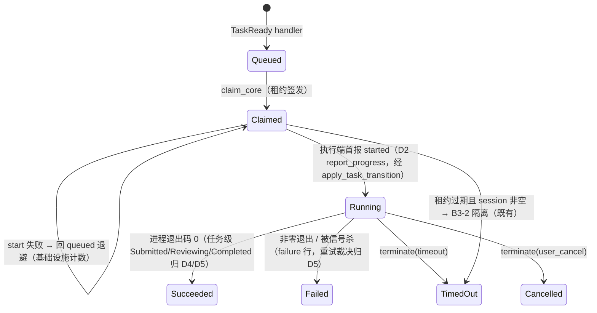

# D3 · Codex 执行引擎适配器 v1（T-030 设计稿）

> 状态：**已实施（T-031 交付，见 §8）**（四节逐节确认，2026-11-01）
> 日期：2026-11-01
> 一句话：平台以**本地子进程**方式 spawn Codex CLI，`RunExecutor` 端口 + `CodexExecutor` 适配器填 D1 预留的全部接缝（`executor_kind`/`executor_session`/租约/失联回收），执行端经 D2 MCP 工具上报与心跳，平台监控循环负责兜底续租、超时强杀与重启 reconcile。
> 上位依据：`target.md` §P4 模块表（RunExecutor / Codex CLI Adapter / Workspace / Git Worktree / Checkout / Process / Log / Timeout / Cancel / Recovery）、`docs/ai-pm-slice-d-execution-pipeline-v1.md` §5.9（预留端口与 R4 接线）、§九（D3 待裁问题 4/5）、`crates/pm-application/src/run_context.rs`（D2 分工：不启动进程、不写交付、不裁决任务）、`0011_run_dispatch.sql:39-40`（`executor_kind`/`executor_session` 已预留）、todo.md T-030。
> 明确不做：不写 `task_workspace`/`task_repository_commit`（D4）；不做失败判定与任务状态裁决（D5）；不实现仓库级策略。

---

## 1. 六项裁定（用户逐项确认）

| # | 裁点 | 结论 |
|---|---|---|
| Q-D3-1 | 启动方式 | **本地子进程**：平台 `tokio::process` spawn Codex CLI，进程内仍通过 D2 MCP 工具上报。D1 的租约 / B3-2 失联回收 / `executor_session` 列直接填值。容器隔离归 P11 |
| Q-D3-2 | 工作区边界 | **不建任何新表**。运行期目录 = `{AI_PM_WORKSPACE_ROOT}/{run_id}/{workspace_path}`（根默认 `./run-workspaces`，可配置）；`task_run_repository.workspace_path`（D1 已写值）继续作唯一路径落点；目录生命周期归 D3。D4 的 `task_workspace` 届时按同一约定回填 |
| Q-D3-3 | 日志落点 | **文件事实源**：`{workspace_root}/{run_id}/logs/stdout.log` / `stderr.log`，路径从 `run_id` 确定性派生，不需新列新表；T-070 前端要展示时再加只读端点 |
| Q-D3-4 | 租约续期责任方 | **双通道**：执行端 MCP 心跳（`report_progress` / `renew_lease_by_token`，正常路径、携带 stage）+ 平台 poll 进程存活时兜底续租（防长编译静默期 > `lease_secs` 300s 被误杀）。租约过期 = 进程也没了 = 真失联 → B3-2 隔离重试 |
| Q-D3-5 | 终止语义 | **统一管线分终态**：一条 `terminate(run, reason)`——Unix SIGTERM → 宽限期（`AI_PM_RUN_KILL_GRACE_SECS`，默认 30s）→ SIGKILL；Windows 无 SIGTERM 直接强杀。终态映射：用户取消 → `cancelled`、超时 → `timed_out`（`termination_reason` 区分）；进程自然退出走正常结束路径，任务级裁决归 D5 |
| Q-D3-6 | 会话标识与假执行端 | **`{kind}:{uuid-v4}`**（如 `codex:8c9e…`，与 `lease_owner` 的 `mcp:{client}:{prefix}` 风格一致）；注入三层：① trait 层 `FakeExecutor`（可配行为：正常退出/非零/挂起/启动即崩）；② 进程管理单测用可配置二进制 `AI_PM_CODEX_BIN`（默认 `codex`，测试指向假脚本）；③ 生产注册表 `AI_PM_RUN_EXECUTOR=codex\|mock\|noop` 选实现（D1 `NoopExecutor` 语义不变：`start()` 返回 `Unsupported`，绝不伪造成功） |

---

## 2. 架构与组件

**分层与落点**：D1 预留的 `RunExecutor` 端口 trait（`run_dispatch/port.rs`）补全类型：`ExecutorSession { run_id, executor_session, workspace_root, … }`、`ExecutorProgress { alive, exit: Option<ExitOutcome> }`、`TerminateReason { UserCancel, Timeout }`、`ExecutorError`。编排器（领取→启动→监控→终止循环）放 `pm-application::run_executor`（只依赖端口，可测）；`CodexExecutor` 适配器（真实进程管理）放 `pm-infrastructure`。

**生产注册表**：`AI_PM_RUN_EXECUTOR=codex|mock|noop` 选实现，缺省 `noop`——保持 R4 语义：未配置执行器时领取即回退，绝不伪造执行成功。

**CodexExecutor 内部四个组件**：

| 组件 | 职责 |
|---|---|
| Workspace Builder | 按裁点 2 建目录 `{AI_PM_WORKSPACE_ROOT}/{run_id}/{workspace_path}`；日志目录同根派生 |
| Git Checkout | 从 `integration.project_ssh_key` 取凭据；首次 clone 到 bare 镜像仓（共享，`{root}/git-mirror/{repo_id}`），每 Run 从镜像建 worktree 并 checkout `base_commit`（镜像复用避免每 Run 全量拉取） |
| Process Manager | `tokio::process` spawn `AI_PM_CODEX_BIN`，环境变量注入 `lease_token` / MCP 地址；`executor_session = "{kind}:{uuid-v4}"` 同事务落库；pid 文件 `{root}/{run_id}/process.json`（pid + session + started_at）供 reconcile 判定 |
| Log Collector | 按裁点 3 落文件，路径确定性派生 |

**与 D1/D2 的接缝**：填 `executor_kind`/`executor_session` 两列（`0011:39-40` 预留）；`claimed→running` 仍由执行端首报 `started` 经 `report_progress` 推进（D2 红线：平台 spawn 只改变「谁启动」，不改变「谁上报」）。

---

## 3. 数据流

**正常路径**：worker（`DispatchMode::On` 且 `AI_PM_RUN_EXECUTOR≠noop`）经 `claim_core` 领取（`claimed` + lease_token）→ 编排器调 `executor.start()`：建目录 → worktree checkout `base_commit` → spawn Codex → `executor_session` 同事务落库 + 审计 `run_started` → 执行期双通道续租（Q-D3-4）→ 进程退出：**退出码 0** → Run `succeeded`；**非 0** → Run `failed` + `task_run_failure(category='execution', reason_code='exit_code', exit_code=…)`。

**平台监控循环**：编排器按心跳间隔巡检活跃 Run 的进程——已退出 → 收尾回写；存活且租约将过期 → 兜底续租；`timeout_secs` 耗尽 → `terminate(timeout)`。

**异常路径**：① 用户取消 → `terminate(user_cancel)` → Run `cancelled`；② 平台重启 reconcile——对 `claimed/running` 且 `executor_session` 非空的 Run 读 `process.json`，进程已不存在 → 走既有 B3-2 `isolate_started_run` 隔离重试；③ 启动失败 → Run 退回 `queued` 退避 + 基础设施失败计数。所有 Run 状态回写单事务 + 审计，任务状态只走 `apply_task_transition`。

---

## 4. 错误处理与恢复

**失败分类与计数**（沿用 `0011` 的两套独立计数）：

| 类别 | 触发 | Run 去向 | 计数 |
|---|---|---|---|
| 基础设施 | checkout 失败（凭据/网络/base_commit 不存在）、spawn 失败（二进制不存在）、目录创建失败 | 退回 `queued` 指数退避 | `infrastructure_retry_count+1`，达 `max_infrastructure_attempts` → Run 落 `failed` 不再重试 |
| 执行 | 进程非零退出 / 被信号杀 / 超时强杀 | 一次落定（`failed`/`timed_out`）+ 对应 failure 行 | **D3 不自动重试**，裁决归 D5 的 B4 |
| 失联 | 租约过期且 `executor_session` 非空 | B3-2 既有：旧 Run `timed_out` + `lease_lost`，新 Run attempt+1 | `infrastructure` 类 |

**竞态与幂等**：`terminate` 前先 `try_wait`（进程已退出则走自然结束路径，不强杀）；Run 终态回写用条件 UPDATE（`WHERE status IN ('claimed','running')`）先到先得；执行端 `submit_result` 与平台终止竞态由同一条件更新兜底，fencing 沿用 `accept_executor_result`。

**Windows 差异**：无 SIGTERM → 直接强杀，`AI_PM_RUN_KILL_GRACE_SECS` 仅 Unix 生效；worktree 清理失败（文件锁/长路径）只告警不阻塞，遗留目录按 `run_id` 可手动清。

**新增环境变量**：

| 变量 | 默认 | 语义 |
|---|---|---|
| `AI_PM_WORKSPACE_ROOT` | `./run-workspaces` | 运行期目录根（裁点 2） |
| `AI_PM_CODEX_BIN` | `codex` | Codex CLI 可执行文件（测试指向假脚本） |
| `AI_PM_RUN_EXECUTOR` | `noop` | 注册表选择：`codex` / `mock` / `noop` |
| `AI_PM_RUN_KILL_GRACE_SECS` | `30` | SIGTERM → SIGKILL 宽限（仅 Unix） |

---

## 5. 验收矩阵（续 C58 → C70）

**第一层 · FakeExecutor（编排逻辑，pm-application）**

| # | 场景 | 期望 |
|---|---|---|
| C59 | 正常闭环：领取→start→首报 started→正常结束 | 任务 `claimed→running`（经既有 `report_progress`）；Run `succeeded` |
| C60 | 挂起→超时 | `terminate(timeout)`；Run `timed_out` + failure(category=execution, reason=timeout) |
| C61 | 执行中用户取消 | Run `cancelled` |
| C62 | 非零退出 | Run `failed` + `exit_code`；**任务状态不被 D3 改动**（归 D5） |
| C63 | start 抛错 | Run 回 `queued` 退避 + 基础设施计数 |
| C64 | 基础设施重试达上限 | Run `failed`，不再重试 |
| C65 | 失联回收回归 | `executor_session` 填值后 B3-2 行为不变 |
| C66 | terminate 与自然退出竞态 | 终态先到先得，只写一次 |

**第二层 · 进程管理（pm-infrastructure，`AI_PM_CODEX_BIN` 指向假脚本）**

| # | 场景 | 期望 |
|---|---|---|
| C67 | spawn→session/pid 落盘→收割退出码 | `executor_session`/`process.json` 存在；退出码正确回收 |
| C68 | 挂起进程→终止管线 | 进程确实死亡（wait 返回） |
| C69 | 目录布局断言 | `{root}/{run_id}/{workspace_path}` + `logs/stdout.log`/`stderr.log` 存在 |
| C70 | git 链路 | 本地 `file://` 裸仓→镜像 clone→worktree checkout→HEAD == `base_commit` |

（Windows 用本地路径，SIGTERM 分支按平台跳过。）

**门禁**：`cargo test --workspace` 全绿；D1/D2 既有用例不回归；默认环境（dispatch=off / executor=noop）下行为与现状完全一致。

---

## 6. 实施顺序（T-031）

1. 端口类型补全（`ExecutorSession`/`ExecutorProgress`/`TerminateReason`/`ExecutorError`）+ `ExecutorRegistry`（`AI_PM_RUN_EXECUTOR`）。
2. `CodexExecutor`：Workspace Builder → Git Checkout（镜像仓 + worktree）→ Process Manager → Log Collector。
3. 编排器 `run_executor`（poll 循环、双通道续租、reconcile、终态回写）。
4. worker 接线（`apps/ai-pm-worker`）：`DispatchMode::On` 时启动执行循环。
5. 终止管线 + 四个环境变量。
6. 用例 C59–C70 + 文档回填，`cargo test --workspace` 全绿。

---

## 7. 明确不做

- 不写 `task_workspace` / `task_repository_commit` 表（D4，T-040/T-041）。
- 不做失败判定与任务状态裁决（D5 的 B4，T-042/T-043）——Run 的 `failed`/`timed_out` 只记录事实，不动任务状态机。
- 不做容器/远程执行隔离（P11 规模化）。
- 不做 SSE 实时日志流（T-070 前端需要时再加）。
- 不改 D2 工具面契约字段；不改 13 态状态机取值。
---

## 8. 实施记录（T-031 交付，2026-11-01）

### 8.1 交付物

| 落点 | 内容 |
|---|---|
| `run_dispatch/port.rs` | 端口补全：`ExecutableRun.timeout_seconds` Option 化；`ExecutorSession{run_id, workspace_root}`；`ExecutorProgress::Done{exit_code}`；`workspace_root_from_env()` 共享派生规则 |
| `pm-application/src/run_executor.rs` | 编排器：`claim_and_start` / `poll_active_runs` / `cancel_run` / `reconcile_orphans`；Run 终态一律条件 UPDATE（`WHERE status IN ('claimed','running')`）先到先得 |
| `run_dispatch/lease.rs` | `recover_lost_run` 共享封装（从 claim.rs B3-2 提取；`claim_core` 与 reconcile 复用） |
| `pm-infrastructure/src/codex_executor.rs` | `CodexExecutor`：镜像仓（`clone --mirror` + `fetch --all`）→ `worktree add --detach <base_commit>` → spawn → pid 文件 → 日志重定向；终止管线 Unix `SIGTERM→宽限→SIGKILL` / Windows 强杀 |
| `apps/ai-pm-worker/src/main.rs` | 第四循环改造：`AI_PM_RUN_EXECUTOR=codex\|mock\|noop` 装配（缺省 noop）+ 启动孤儿 reconcile + `claim_and_start`/`poll_active_runs` 主循环 |

### 8.2 实施期裁定（与设计稿的差异，均有依据）

1. **执行端 MCP 心跳通道 V1 不可用**：`claim_and_start` 走 Model B（D1 裁定 worker 不签发 `lease_token` 明文），spawn 的执行端无 MCP 凭据——租约续期由编排器 poll 兜底通道（Q-D3-4 平台侧）维持；token 下发与 `pm_submit_result`（D4）一起裁。
2. **`claimed→running` 由编排器推进**：start 成功后编排器在 start 的事务里经受守卫入口 `apply_task_transition` 推进任务 + Run `running/stage='started'/started_at`——这正是 D1 §九问题 4 的本意（「D3 在执行端启动成功后经平台写入，不得由 MCP 直写」）；D2 的执行端首报路径保留给 Model A（自拉）场景。
3. **running 失联回收**：`claim_once` 回收候选只覆盖 `claimed`（D1 语义），running 的失联由编排器补齐——租约续不上（过期/被回收）→ `terminate(LeaseReclaimed)` + `recover_lost_run`（B3-2 隔离 + 新 Run 重试）。
4. **start 失败的任务回退**：按 B3-1 语义经 `apply_task_transition` 把任务 `claimed→ready`（失败行受 0010「每 Run 至多一条」唯一约束——首败留痕 `executor_start_failed`，重试只递增 `infrastructure_retry_count`，耗尽证据落 `release_reason='infrastructure_exhausted'` + 审计）。
5. **CLI 参数留白**：`AI_PM_CODEX_ARGS`（空格分割，默认空）+ 环境变量注入 `AI_PM_RUN_ID/TASK_ID/PROJECT_ID/ATTEMPT_NO/WORKSPACE_ROOT`（`AI_PM_LEASE_TOKEN` 留空待 D4）；V1 只保证进程生命周期正确，Codex 编排参数属接入期调优。

### 8.3 实测

- `cargo test --workspace`：退出码 0 —— **72 个 `test result: ok`、456 passed、0 failed**（新增：pm-application `run_executor` 11 例、pm-infrastructure `codex_executor` 4 例）。
- `cargo check --workspace --all-targets`：0 error 0 warning。
- Windows 实机验证：假脚本（`cmd /C`）spawn/收割/强杀、`file://` 裸仓镜像 + worktree checkout 到 `base_commit` 全部通过（C67–C70）。