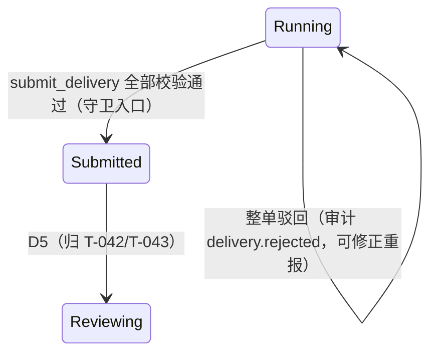

# D4 · 多仓库交付与结果回写 v1（T-040 设计稿）

> 状态：**已过稿**（三节逐节确认，2026-11-01；过稿后进入 T-041 实施）
> 日期：2026-11-01
> 一句话：`delivery.task_repository_commit` 逐仓落「基线 → 结果 commit → 证据」，`pm_submit_result` 契约定稿（只加 `integration_status`），七步校验管线在镜像仓上做双保险（声明比对 + git 祖先校验），只读仓出现 commit 整单驳回；应交付 vs 实交付的对账由聚合视图陈述事实，任务裁决归 D5。
> 上位依据：`target.md` §P5 八模块、`docs/ai-pm-multi-repo-model-v1.md` §3.2/§3.3/§4.4/§4.5、`docs/ai-pm-slice-d-execution-pipeline-v1.md` §三 D4 行 + Q2/Q5 + §15.5（不变量：`write_access=false` 不得出现 Commit）、D2 冻结的 `pm_submit_result` draft 形状（D4 拥有定稿权）、`0011_run_dispatch.sql`（`task_run_repository` 基线快照）、todo.md T-040。

---

## 1. 六项裁定（用户逐项确认）

| # | 裁点 | 结论 |
|---|---|---|
| Q-D4-1 | `task_workspace` 落表与否 | **不建**。D3 已把工作区路径确定性派生（`{root}/{run_id}/{workspace_path}`）且写入 `task_run_repository.workspace_path`；工作区审计由 D3 pid 文件 + 既有列承担。D4 只建 `task_repository_commit` |
| Q-D4-2 | 基线防篡改强度 | **双保险**：① 库层——声明 `base_commit` 必须等于 `task_run_repository` 领取快照，不等即整单驳回；② git 层——在 D3 镜像仓上校验 `commit_sha` 存在且是 `base_commit` 后代（`merge-base --is-ancestor`），回读 author/时间入库 |
| Q-D4-3 | 变更文件清单形态 | **计数 + git 现算**：落 `commit_sha` + `changed_files` 计数（沿用 draft 契约）；文件级清单不要求执行端上报，对账/展示时用镜像仓 `git diff --name-status base..commit` 现算 |
| Q-D4-4 | 测试证据形态 | **draft 原样落 JSONB**：`tests[{name, passed, evidence_ref}]` 落 `task_repository_commit.test_evidence`（含 submit 时间戳与 integration_status）；结论≠证据的区分留给 D5 |
| Q-D4-5 | 交付历史聚合 | **表 + 按 task 聚合视图**：`task_repository_commit` 天然 per-run；视图 `v_task_delivery_manifest` 按 task × 契约仓对账，T-070 直接读 |
| Q-D4-6 | `integration_status` 落点 | **契约补字段 + run 级列 + 视图算整单**：D4 定稿 `pm_submit_result` 补 `integration_status`（`passed/failed/not_run`），落 `task_run` 新列；partial 整单状态由视图计算，D4 不改任务状态机（裁决归 D5） |

---

## 2. 数据模型（迁移 `0022_delivery_manifest.sql`）

> 编号实测后顺移（0022 若已被并行任务占用则取下一空号，提交前核对）。

### 2.1 `delivery.task_repository_commit`

```sql
CREATE TABLE delivery.task_repository_commit (
    id                 UUID PRIMARY KEY DEFAULT gen_random_uuid(),
    tenant_id          UUID NOT NULL,
    project_id         UUID NOT NULL,
    task_run_id        UUID NOT NULL,
    repository_id      UUID NOT NULL,
    commit_sha         TEXT NOT NULL,
    branch             TEXT,
    changed_files      INT  NOT NULL DEFAULT 0,
    test_evidence      JSONB NOT NULL DEFAULT '{}'::jsonb,  -- {integration_status, submitted_at, tests:[{name,passed,evidence_ref}]}
    commit_author      TEXT,
    commit_authored_at TIMESTAMPTZ,
    created_at         TIMESTAMPTZ NOT NULL DEFAULT now(),
    UNIQUE (task_run_id, repository_id),
    UNIQUE (tenant_id, id),
    FOREIGN KEY (tenant_id, project_id) REFERENCES core.project (tenant_id, id),
    FOREIGN KEY (project_id, task_run_id)
        REFERENCES delivery.task_run (project_id, id) ON DELETE CASCADE,
    FOREIGN KEY (project_id, repository_id)
        REFERENCES integration.project_repository (project_id, id)
);
```

- 仓库身份用 `project_repository.id`（C3 裁定：multi-repo 的全局 `integration.repository` 作废）。
- `review_status` / `pr_url` / `merged_sha` **不加**（审查字段归 D5，避免落了没人写的列）。
- 前置：给 `delivery.task_run` 补 `UNIQUE (project_id, id)`（Q5 裁定 D4 一并处理，组合外键得以成立）。

### 2.2 `delivery.task_run.integration_status`

```sql
ALTER TABLE delivery.task_run
    ADD COLUMN integration_status TEXT
        NOT NULL DEFAULT 'not_run'
        CHECK (integration_status IN ('passed', 'failed', 'not_run'));
```

### 2.3 视图 `delivery.v_task_delivery_manifest`

按 task × 契约仓聚合：`task_id / repository_id / repository_name / write_access / base_commit(最新 Run) / commit_sha / changed_files / test_evidence / delivery_state`。

- `delivery_state ∈ {'never_submitted', 'partial', 'delivered'}`：应交付数（契约仓数）vs 实交付数（最新已提交 Run 的 commit 行数）现算——**视图只陈述事实，不改状态机**（`partial/changes_requested` 的任务裁决归 D5）。
- 「最新 Run」= 该任务 `attempt_no` 最大的、已落 commit 行的 Run。

---

## 3. 提交管线（`pm-application::delivery::submit_delivery`，单事务）

| # | 步骤 | 失败 → |
|---|---|---|
| ① | fencing：`verify_lease`（token 正确 + 未过期 + 活跃 Run） | `lease_invalid` / `lease_expired`（409） |
| ② | 行锁 Run + 任务（顺序 run → task，B2） | — |
| ③ | 契约校验：上报仓 ∈ `task_repository` 集合 | `repo_not_in_contract`（409） |
| ④ | 只读仓出现 commit → **整单驳回**（§15.5 不变量） | `readonly_repo_commit`（409） |
| ⑤ | 声明 `base_commit` ≠ 领取快照 → **整单驳回**（Q-D4-2 库层） | `baseline_mismatch`（409） |
| ⑥ | 逐仓 git 校验：镜像仓内 `cat-file -e`（存在）+ `merge-base --is-ancestor`（后代）+ 回读 author/时间 | `commit_not_descendant`（409） |
| ⑦ | 落 commit 行（UNIQUE 冲突 → 幂等返回既有清单，200）+ `task_run.integration_status` + 任务 `running→submitted`（经 `apply_task_transition`）+ 审计 `delivery.submitted` | — |

- **整单原子**：任何驳回不落任何 commit 行，但写 `delivery.rejected` 审计（原因 + 上报摘要），供 D5 失败判定取用；Run 保持 `running`，执行端可修正后重新提交。
- git 校验复用 D3 镜像仓（`{AI_PM_WORKSPACE_ROOT}/git-mirror/{repo_id}`），抽 pm-infrastructure 共享 helper。
- `knowledge_proposals` **收下但只记数不落提案**（知识回写走 D5 的 `KnowledgeBaseWriteRequested`，T-043 落地）。

---

## 4. 契约定稿（`pm_submit_result`）

在 D2 draft 形状上**只加一个字段**，其余原样冻结：

```json
{
  "project_id": "...", "run_id": "...", "lease_token": "...",
  "integration_status": "passed | failed | not_run",   // 新增，缺省 not_run
  "repositories": [
    { "repository_id": "...", "base_commit": "...", "commit_sha": "...",
      "changed_files": 12, "tests": [{ "name": "...", "passed": true, "evidence_ref": "..." }] }
  ],
  "summary": "...",
  "knowledge_proposals": [{ "document_id": "...", "change_summary": "..." }]
}
```

MCP 工具从 shape-first 的 `Unsupported` 变为真实落库；fencing 沿用 `accept_executor_result`（仅当前 Run 的当前执行会话可提交）。

### 4.1 错误码

| code | 触发 |
|---|---|
| `lease_invalid` / `lease_expired` | token 错 / 过期（沿用 D2 语义） |
| `readonly_repo_commit` | `write_access=false` 的仓出现 commit |
| `baseline_mismatch` | 声明 base_commit ≠ 领取快照 |
| `commit_not_descendant` | commit 不存在或不是 base_commit 后代 |
| `repo_not_in_contract` | 上报仓不在任务契约集合 |
| `already_submitted` | 重复提交（幂等 200 返回既有清单，非错误） |
| `integration_status_invalid` | 取值不在三值集合 |

---

## 5. 状态图（新增部分）



---

## 6. 验收矩阵（续 C70 → C84）

| # | 场景 | 期望 |
|---|---|---|
| C71 | 迁移断言 | `integration_status` 列默认 `not_run`；视图存在；tenant_schema 收编新表 |
| C72 | 正常三仓交付 | 3 行 commit + `passed` + 任务 `running→submitted`（守卫入口）+ 审计 `delivery.submitted` |
| C73 | 只读仓出现 commit | 整单驳回 `readonly_repo_commit`；0 行落库 |
| C74 | 基线漂移 | `baseline_mismatch`；0 行 |
| C75 | commit 非后代 | `commit_not_descendant` |
| C76 | commit 不存在 | `commit_not_descendant` |
| C77 | 仓不在契约 | `repo_not_in_contract` |
| C78 | 重复提交 | 幂等 200 返回既有清单；无第二份审计 |
| C79 | integration_status 非法 | 拒绝 |
| C80 | 租约过期 | `lease_expired`；不落行 |
| C81 | not_run 交付 | 落库成功（事实记录；completed 禁令归 D5） |
| C82 | 视图对账三态 | `never_submitted` / `partial`(2/3) / `delivered`(3/3) |
| C83 | 视图历史 | 两次 Run 提交，视图取最新 Run |
| C84 | MCP 端到端 | `pm_submit_result` 真实落库；draft 兼容（缺省 `not_run`） |

---

## 7. 实施顺序（T-041）

1. 迁移 `0022`（表 + run 列 + `UNIQUE(project_id,id)` + 聚合视图）+ tenant_schema 收编。
2. `pm-application::delivery` 模块（七步管线 + 错误类型）。
3. git 校验抽 pm-infrastructure 共享 helper（复用 D3 镜像仓定位）。
4. MCP `pm_submit_result` 定稿实现（去掉 `Unsupported`）。
5. 用例 C71–C84 + 文档回填 + `cargo test --workspace` 全绿。

**门禁**：D1/D2/D3 用例不回归；默认环境行为不变。

---

## 8. 明确不做

- 不做 Review 裁决（D5）：`review_status` / 四值结论 / 验收条目逐条裁决全部归 T-042/T-043。
- 不做自动 merge / 推远端（multi-repo §2.3「禁止整单回滚」的另一半：平台不代写远端）。
- 不追求跨仓原子事务（多仓各自 commit，平台只做「整单一致性」判定）。
- 不建 `task_workspace`（Q-D4-1）；不做文件级清单落库（Q-D4-3）。
- 不做全局仓库实体（C3 裁定维持）。