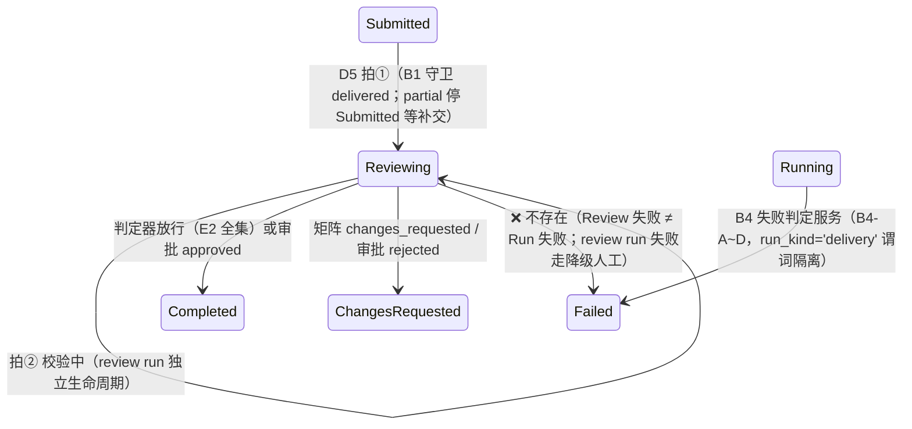

# D5 · Review、失败恢复与知识回写 v1.3（T-042 设计稿）

> 状态：**V1.3 + T-043 已实施（2026-11-02）**——v1（`faa3f34`，七题裁定）→ V1.1（`b59a0bf`，评审 P0×6/P1×4）→ V1.2（`6dcffca`/`a1d8593`/`417d217`，D1–D6 + 补充 4/5）→ **V1.3（知识提案改同事务强一致 + §10 四要素化 + §12 明确不做列示 + 迁移号核实）** → **实施记录见 §13（落地物 / 9 项实施裁定 / C 编号落点 / 遗留）**。
> 修订状态：D1–D6 全部落盘；补充 4/5 收编；**知识提案同事务强一致**（§7.1/§7.1.1/§7.1.2）；**§10 验收矩阵四要素化**（C98–C137，40 条）；**§12 明确不做列示**；迁移号核实（0024 归 T-060，D5 取 0026）。
> 日期：2026-11-02
> 一句话：`task_run` 扩 `run_kind` 承载**平台内确定性 Reviewer Run**（Q-D5-1/2），两拍编排——事件 handler 轻拍推进 `submitted→reviewing` 并建 review run，worker 领取拍跑确定性校验管线产出 findings + verdict（Q-D5-3）；四值结论经**完成判定器**映射回 13 态状态机，待审批停 `reviewing`+`task_waiting(needs_approval)` 不新增状态（Q-D5-4）；失败判定服务（B4-A~D）为 worker 内周期作业（Q-D5-5）；逐条验收裁决落独立表兑现 `0015` 预留外键（Q-D5-6）；知识回写走平台模板，**`draft` 提案与 Task completed 同事务强一致**（§7.1）。
> 架构原则（§0）：D5 是**治理闭环**，不是更复杂的执行引擎。D1 决定能不能执行；D3 负责实际执行；D4 记录执行产生的事实；D5 判断这些事实是否满足任务完成条件；知识库负责将经过治理的事实转化为长期知识。D5 不重新承担 D1、D3 或 D4 的职责。
> 上位依据：`target.md` §P7 五条边界 + §P6 知识回写红线（回写只能走提案，不得直写）；`docs/ai-pm-task-state-machine-v1.md` §十八 Q8（独立审查 Agent：L1/L2/L3、`reviewed_manifest_hash` 锚定、四值结论、Inconclusive 不得当 Approved、强制审查失败不得静默跳过）/ §十九 Q9（B4-A~D、`FailureRecord` 不可变、Reviewer 发现缺陷 ≠ 审查运行失败）/ §2.2 B1/B2 级转移 / §2.4 审批不绑定状态 / E2 例外；`docs/ai-pm-slice-d-execution-pipeline-v1.md` §八 D5 行（失败判定服务 + 评审编排 + 知识索引写入；验收锚点「Reviewer 成功发现问题不被记为执行失败」）；`docs/ai-pm-slice-d4-delivery-v1.md`（`submitted→reviewing` 归 D5、`integration_status` completed 禁令归 D5、partial 裁决归 D5、`knowledge_proposals` 只记数、`delivery.rejected` 审计供 D5 取用）；`0015_task_contract.sql`（`task_acceptance_criterion` 预留 D5 证据表组合外键位）/ `0014_knowledge_v2.sql`（提案生命周期）/ `0016_policy_composition.sql`（四层合成）/ `0010_task_state_machine.sql`（13 态、`task_waiting`、`task_policy_override`、`task_run_failure`）；todo.md §8 T-042。

---

## 0. 架构原则（D5 治理闭环）

> 〔最终架构判断，2026-11-02〕D5 是**治理闭环**，不是更复杂的执行引擎。

### 0.1 Slice D 职责边界

| Slice | 职责 | D5 是否承担 |
|---|---|---|
| D1 | 决定能不能执行（任务契约校验、发布确认） | ❌ 不 |
| D3 | 实际执行（Codex 运行、测试、交付物生成） | ❌ 不 |
| D4 | 记录执行产生的事实（Commit、测试证据、交付清单、知识提案摘要） | ❌ 不 |
| **D5** | **判断这些事实是否满足任务完成条件（Review、失败判定、审批、知识回写）** | ✅ 唯一 |
| 知识库 | 将经过治理的事实转化为长期知识（提案→质量门→确认→正式知识） | ❌ 不（只触发提案，不执行状态机） |

### 0.2 D5 内部不变量

1. **Review Run 的 `executor_kind='platform'` 仅做确定性校验，不碰工作区。**
2. **失败判定服务只读 `task_run_failure` 不可变表，不回写交付物。**
3. **审批裁决只写 `review_approval` + 状态迁移，不回写交付物。**
4. **知识回写只触发 `draft` 提案，不执行知识域状态机。**
5. **Review 失败 ≠ Run 失败 ≠ Task 失败——三失败隔离为硬不变量。**

### 0.3 五项保留（不推翻）

| # | 保留项 | 裁定来源 |
|---|---|---|
| 1 | 统一 Run 历史（`task_run` 复用 + `run_kind` 区分） | Q-D5-1 |
| 2 | 确定性 Reviewer（平台内校验管线，无 LLM） | Q-D5-2 |
| 3 | 独立审批记录（`governance.review_approval` 新表） | Q-D5-4 |
| 4 | Review 失败与执行失败隔离（`run_kind` 谓词 + 不变量） | Q-D5-4/5 |
| 5 | 知识提案与正式知识分离（`draft` 提案 + 0014 提案流） | Q-D5-7 |

### 0.4 五项修订（按 P0/P1 清单落地）

| # | 修订项 | 优先级 | 落点 |
|---|---|---|---|
| 1 | 并发、幂等、审批绑定、失败恢复、事务边界 | P0 | §3–§7 |
| 2 | 迁移号统一、租户隔离、触发器、测试矩阵、映射表完备 | P1 | §2、§10 |

---

## 1. 七项裁定汇总（brainstorming 逐题确认，2026-11-02）

| # | 裁点 | 结论 | 架构原则（职责边界） |
|---|---|---|---|
| Q-D5-1 | Reviewer Run 落库形态 | **复用 `delivery.task_run`**：加 `run_kind` 两值列 + `role_id` + `input_manifest_hash`；`uq_task_run_active` 收窄为仅约束 `run_kind='delivery'`；生命周期/attempt/失败记录/审计/事件/详情页 run 列表全部复用。不建独立 review_run 表（Q8.5 双轨成本否决），不落无 Run 实体（违反 target.md §P7） | **D5 内部**：Run 历史统一由 `task_run` 承载，不新建 Run 实体。不触碰 D4 的 `delivery_run` 表。 |
| Q-D5-2 | Reviewer 执行形态 | **V1 = 平台内确定性校验 Run**：worker 执行确定性校验管线产出 findings + verdict，`executor_kind='platform'`（凭据面列库层强制 NULL，P0-1）；保留 `timed_out`（受 run 预算约束）；Codex 只读 Reviewer Run（Q8.3 L2 完整版）留**同骨架扩展位**——未来填 executor 列即可，findings/verdict/事件模型零改动。V1 无 LLM 审查（Q8.1 清单矩阵未定义前不自由发挥） | **D5 内部**：仅做确定性校验，不碰工作区。不替代 D3 执行。Codex 只读 Reviewer Run 为演进位，V1 不落地。 |
| Q-D5-3 | 编排与触发 | **两拍编排**：① `DeliverySubmitted` 事件 handler 轻拍——B1 守卫（最新 delivery run 的视图对账 = `delivered`）通过后同事务 `submitted→reviewing`（经 `update_task_status` + `validate_transition`）+ 创建 queued review run；② worker 独立循环领取 review run → running → 校验管线（慢操作全在这拍）→ findings + verdict → review run 终态 → 按 §5 映射推进 task。锚定哈希口径、单活跃 review run、失效规则三从属裁定见 §3.3 | **D5 内部**：编排只推进 task 状态，不回写交付物。事件消费幂等（§3.4）。不替代 D4 的 `submit_delivery`。 |
| Q-D5-4 | 四值结论 → task 状态 | **§5 映射矩阵 + 五从属裁点**：待审批停 `reviewing` + `task_waiting(reason='needs_approval')`（不新增状态不加边，`awaiting_decision` 保持执行期专用）；审批走新表 `governance.review_approval`（不碰 `approval_request` 旧契约）；`integration_status=failed` 人机均不可越、`not_run`/manual 未决仅人工可裁；`additional_checks` 非空保守降级人工（fail-closed）；「Review 失败 ≠ Run 失败」为硬不变量 | **D5 内部**：只写 `review_approval` + 状态迁移，不回写交付物。审批不绑定状态（§2.4），由任务类型/风险等级/操作三元函数判定。 |
| Q-D5-5 | 失败判定服务（B4） | **输入清单 1–7**（§6）+ **Q9.2 落定 worker 进程内周期作业**（与 TaskReady 领取、lease 回收、review 领取并列，共享扫描 SQL 与事务模板；判定动作全条件 UPDATE，`task_run_failure` 行存在即幂等标记）；`task_deadline` 总期限 V1 不做（无计时器基础设施，留演进位）；partial + delivery run 已终态走重试路径（不判 changes_requested） | **D5 内部**：只读 `task_run_failure` 不可变表，不回写交付物。`run_kind='delivery'` 谓词结构性隔离（P0-4）。不替代 D3 的 executor 重试。 |
| Q-D5-6 | 数据模型 | **run 行即报告头**（verdict 落 `task_run.review_verdict` 列）+ 三张新表（`delivery.review_finding` / `delivery.acceptance_criterion_verdict` / `governance.review_approval`）+ run 六列追加；`acceptance_criterion_verdict` 兑现 `0015` 预留组合外键；**T-052/T-054 均不触发**（条目修订漂移由 criteria 快照哈希 + 完成判定器校验兜底）；迁移 `0026` 单迁移收编（P1-1：0024 → 0026） | **D5 内部**：新表只承载 Review 数据，不触碰 D4 的 `delivery_run`/`delivery_manifest`。触发器禁 UPDATE（P1-2）。 |
| Q-D5-7 | 知识回写与事件 | **平台模板生成**「任务执行记录」类 `draft` 提案（`doc_type='knowledge'`，零 LLM 依赖）；执行端上报原样（document_id + change_summary）完整保进事件 payload，V1 不消费定向文档更新建议；**仅 `completed` 触发**（T-043 描述「完成/失败后」收窄，失败回写进演进位）；提案级查重应用层事务内判（不动 0014 表结构）；`ReviewCompleted` 生产不注册消费 handler（供 T-070/监控，不造无语义 handler） | **D5→知识库边界**：只触发 `draft` 提案，不执行知识域状态机。`auto_publish_knowledge` 自动发布不归 D5（不越界做知识域状态机执行器，演进位）。 |

**依赖链声明**：本稿按「D4 设计稿已过稿的契约」锚定（`integration_status`/聚合视图/`pm_submit_result` 冻结是设计层事实）。**T-043 实施前置 = T-041 交付 + D4 评审 P0-1~P0-4 收编完成**——D4 的 P0-1（幂等逻辑矛盾）/ P0-2（驳回审计原子性）直接踩在 D5 消费的提交管线上，未收编前 T-043 不得动工。

---

## 2. 数据模型（迁移 `0026_delivery_review.sql`）

> forward-only；全列带默认值或可空。〔评审收编 P1-1〕编号 0024 → **0026**：0024 已被 T-060（`0024_knowledge_section_index`，`0b26e6b`）与 T-083（`todo.md:261` 预留 `0024_discovery`）双重声明，T-083 实施时按台账顺移；统一台账 `docs/ai-pm-migration-ledger.md`。新表全部 `tenant_id NOT NULL` + `UNIQUE(tenant_id, id)` + 组合外键（0019 惯例），并收编进 tenant_schema 隔离测试。

### 2.1 `delivery.task_run` 追加六列 + 索引重建

```sql
ALTER TABLE delivery.task_run
    ADD COLUMN run_kind              TEXT NOT NULL DEFAULT 'delivery'
        CHECK (run_kind IN ('delivery', 'review')),
    ADD COLUMN role_id               TEXT,
    ADD COLUMN input_manifest_hash   TEXT,
    ADD COLUMN reviewed_manifest_hash TEXT,
    ADD COLUMN review_policy_version TEXT,
    ADD COLUMN review_verdict        TEXT
        CHECK (review_verdict IN ('approved', 'changes_requested', 'inconclusive'));

-- Q8.5 语义约束（防 review 行缺角色/策略版本）：
ALTER TABLE delivery.task_run
    ADD CONSTRAINT chk_review_role_present
        CHECK (run_kind <> 'review'
               OR (role_id IS NOT NULL AND review_policy_version IS NOT NULL));

-- 〔评审收编 P0-1〕executor_kind='platform' 与 Codex Executor 的库层隔离
-- （列名实测：0011 executor_kind/executor_session、0015 lease_token_hash、
--   0023 lease_generation/deadline_at/last_agent_heartbeat_at、0010:23 stage）：
ALTER TABLE delivery.task_run
    ADD CONSTRAINT chk_review_platform_isolation CHECK (
        run_kind <> 'review' OR (
            executor_kind = 'platform'
            AND executor_session IS NULL
            AND lease_token_hash IS NULL
            AND lease_generation = 0
            AND deadline_at IS NULL
            AND last_agent_heartbeat_at IS NULL
            AND stage IS NULL          -- review run 不走 D3 启动协议，不落 stage
        )
    ),
    ADD CONSTRAINT chk_delivery_executor_kind CHECK (
        run_kind <> 'delivery' OR executor_kind IS NULL OR executor_kind <> 'platform'
    );
```

- `review_verdict` 三值：Q8.5 四值中的 `Failed`（审查运行本身失败）由 run `status='failed'` 表达，**不重复存**——verdict 只在 run `succeeded` 时落。
- review 行 `executor_kind='platform'`（既有列复用，Q-D5-2），凭据面列（`executor_session`/`lease_token_hash`/`lease_generation`/`deadline_at`/`last_agent_heartbeat_at`/`stage`）由 `chk_review_platform_isolation` **库层强制 NULL**〔评审收编 P0-1〕；delivery 行 `executor_kind` 禁用 `platform` 保留名（防未来执行器撞名）。`review_policy_version` 口径见 §3.2。

索引重建（D1 的 Q6 语义平移）：

```sql
-- 旧约束收窄：活跃 Run 判定仅对 delivery 生效（否则 review run 活跃期间
-- 挡住任何 delivery run 创建——ChangesRequested 重试链被 409 卡死的反例）。
DROP INDEX IF EXISTS uq_task_run_active;
CREATE UNIQUE INDEX uq_task_run_active ON delivery.task_run (task_id)
    WHERE run_kind = 'delivery'
      AND status IN ('queued', 'claimed', 'running');

-- 对偶约束：同一 task 至多一个活跃 review run（Q-D5-3 从属裁定 2）。
CREATE UNIQUE INDEX uq_task_review_active ON delivery.task_run (task_id)
    WHERE run_kind = 'review'
      AND status IN ('queued', 'running');
```

### 2.2 `delivery.review_finding`（Q8.2 结构化直译）

```sql
CREATE TABLE delivery.review_finding (
    id              UUID PRIMARY KEY DEFAULT gen_random_uuid(),
    tenant_id       UUID NOT NULL,
    project_id      UUID NOT NULL,
    review_run_id   UUID NOT NULL,
    criterion_id    UUID,               -- 可空：非条目类 finding（如交付对账失败）
    finding_kind    TEXT NOT NULL,      -- 如 incomplete_delivery / integration_failed /
                                        --    test_failed / artifact_missing / evidence_conflict
    severity        TEXT NOT NULL CHECK (severity IN ('info', 'warning', 'blocker')),
    code_location   TEXT,               -- 「仓 + 路径 + 行段」自由文本（Q8.2 定位要素）
    message         TEXT NOT NULL,
    evidence_ref    TEXT,
    created_at      TIMESTAMPTZ NOT NULL DEFAULT now(),
    UNIQUE (tenant_id, id),
    FOREIGN KEY (tenant_id, project_id) REFERENCES core.project (tenant_id, id),
    FOREIGN KEY (project_id, review_run_id)
        REFERENCES delivery.task_run (project_id, id) ON DELETE CASCADE,
    FOREIGN KEY (project_id, criterion_id)
        REFERENCES delivery.task_acceptance_criterion (project_id, id)
);
CREATE INDEX idx_review_finding_run ON delivery.review_finding (review_run_id);
```

### 2.3 `delivery.acceptance_criterion_verdict`（兑现 0015 预留组合外键）

```sql
CREATE TABLE delivery.acceptance_criterion_verdict (
    id              UUID PRIMARY KEY DEFAULT gen_random_uuid(),
    tenant_id       UUID NOT NULL,
    project_id      UUID NOT NULL,
    criterion_id    UUID NOT NULL,
    review_run_id   UUID NOT NULL,
    verdict         TEXT NOT NULL
        CHECK (verdict IN ('passed', 'failed', 'not_evaluable', 'awaiting_manual')),
    evidence        JSONB NOT NULL DEFAULT '{}'::jsonb,  -- 证据原文（tests[]、artifact 路径与存在性）
    decided_by      UUID REFERENCES core.principal(id),  -- 人工裁决回填
    decided_at      TIMESTAMPTZ,
    created_at      TIMESTAMPTZ NOT NULL DEFAULT now(),
    UNIQUE (tenant_id, id),
    UNIQUE (criterion_id, review_run_id),   -- 重审 = 新 review run 新行，历史不可变
    FOREIGN KEY (tenant_id, project_id) REFERENCES core.project (tenant_id, id),
    -- 0015 注释预留的组合外键位，就地兑现：
    FOREIGN KEY (project_id, criterion_id)
        REFERENCES delivery.task_acceptance_criterion (project_id, id),
    FOREIGN KEY (project_id, review_run_id)
        REFERENCES delivery.task_run (project_id, id) ON DELETE CASCADE
);
CREATE INDEX idx_criterion_verdict_criterion ON delivery.acceptance_criterion_verdict (criterion_id);
```

**「结论 ≠ 证据」的库层表达**：`verdict` 列与 `evidence JSONB` 分列。确定性条目（`automated_test`/`artifact_exists`）由 review run 同时落两者；`manual`/`review` 条目只落 `verdict='awaiting_manual'`（证据可附），人工裁决时回填 `verdict` + `decided_by`/`decided_at`。

### 2.4 `governance.review_approval`（Q-D5-4 从属裁定 2）

```sql
CREATE TABLE governance.review_approval (
    id              UUID PRIMARY KEY DEFAULT gen_random_uuid(),
    tenant_id       UUID NOT NULL,
    project_id      UUID NOT NULL,
    task_id         UUID NOT NULL,
    review_run_id   UUID NOT NULL,
    -- 〔评审收编 P0-3〕审批对象锚定：具体被审交付 run + 审批时点交付快照。
    delivery_run_id         UUID NOT NULL,
    delivery_manifest_hash  TEXT NOT NULL,   -- = 被审 delivery run 的 reviewed_manifest_hash
    kind            TEXT NOT NULL
        CHECK (kind IN ('auto_accept_gate', 'manual_review', 'review_degraded')),
    status          TEXT NOT NULL DEFAULT 'pending'
        CHECK (status IN ('pending', 'approved', 'rejected')),
    required_role   TEXT,
    decided_by      UUID REFERENCES core.principal(id),
    decision_reason TEXT,
    decided_at      TIMESTAMPTZ,
    created_at      TIMESTAMPTZ NOT NULL DEFAULT now(),
    UNIQUE (tenant_id, id),
    FOREIGN KEY (tenant_id, project_id) REFERENCES core.project (tenant_id, id),
    FOREIGN KEY (project_id, task_id) REFERENCES delivery.task (project_id, id),
    FOREIGN KEY (project_id, review_run_id)
        REFERENCES delivery.task_run (project_id, id) ON DELETE CASCADE,
    FOREIGN KEY (project_id, delivery_run_id)
        REFERENCES delivery.task_run (project_id, id)
);
-- 同一 task 同时刻至多一个待决审批（Q-D5-7 并行防御）。
CREATE UNIQUE INDEX uq_review_approval_pending ON governance.review_approval (task_id)
    WHERE status = 'pending';
```

〔评审收编 P0-3〕审批三重绑定：**具体 Review**（`review_run_id`）+ **具体 Delivery**（`delivery_run_id`，不带 CASCADE——审批不得随 run 删除连带消失）+ **交付快照**（`delivery_manifest_hash`，裁决时回读校验，见 §5.2）。

`governance.approval_request`（`proposal_id UNIQUE NOT NULL` 绑导入提案）**不动**——新场景新表，不为旧契约做兼容层（AGENTS.md 规则 1）。

### 2.5 历史不可变约束〔评审收编 P1-2〕

应用层无 UPDATE 路径之上，迁移内补库层触发器（BEFORE UPDATE → RAISE EXCEPTION）：

```sql
CREATE FUNCTION delivery.forbid_row_update() RETURNS trigger
LANGUAGE plpgsql AS $$
BEGIN
    RAISE EXCEPTION 'row % in %.% is immutable',
        OLD.id, TG_TABLE_SCHEMA, TG_TABLE_NAME;
END $$;

-- 三新表全表禁 UPDATE（append-only；重审/回填一律 INSERT 新行或首插即终值）：
CREATE TRIGGER trg_review_finding_immutable BEFORE UPDATE ON delivery.review_finding
    FOR EACH ROW EXECUTE FUNCTION delivery.forbid_row_update();
-- acceptance_criterion_verdict / review_approval 同款两条（略）。
```

`task_run` 侧（review run 受保护列，delivery 行零影响——run_kind 过滤 + OLD/NEW 列级判定，不触碰 D3 既有更新路径）：

```sql
CREATE FUNCTION delivery.forbid_review_report_update() RETURNS trigger
LANGUAGE plpgsql AS $$
BEGIN
    IF NEW.run_kind = 'review' THEN
        IF (OLD.role_id IS DISTINCT FROM NEW.role_id)
           OR (OLD.input_manifest_hash IS DISTINCT FROM NEW.input_manifest_hash)
           OR (OLD.reviewed_manifest_hash IS DISTINCT FROM NEW.reviewed_manifest_hash)
           OR (OLD.review_policy_version IS DISTINCT FROM NEW.review_policy_version)
           OR (OLD.review_verdict IS NOT NULL
               AND OLD.review_verdict IS DISTINCT FROM NEW.review_verdict) THEN
            RAISE EXCEPTION 'review report columns of run % are immutable', OLD.id;
        END IF;
    END IF;
    RETURN NEW;
END $$;

CREATE TRIGGER trg_review_report_immutable BEFORE UPDATE ON delivery.task_run
    FOR EACH ROW EXECUTE FUNCTION delivery.forbid_review_report_update();
```

语义：`role_id`/双哈希/`review_policy_version` 创建后一次成型（P0-2 的「不可变」载体）；`review_verdict` 非 NULL 后禁改（终态裁决一次性）。人工裁决回填（`acceptance_criterion_verdict.decided_by`）走 INSERT-时终值或专门口径——该表已有触发器禁 UPDATE，`awaiting_manual` 条目的人工裁决**也在首插时落定**（管线插入时 verdict 即 `awaiting_manual`，人工裁决经「INSERT 新行 + `UNIQUE(criterion_id, review_run_id)` 置换」不可行——故 `awaiting_manual` 条目的人工裁决行由审批端点在裁决事务内**先删后插**不可行（禁 UPDATE 不禁 DELETE）……**修正**：该表触发器禁 UPDATE 但不禁 DELETE，人工裁决 = DELETE 旧行 + INSERT 终值行（历史保留由 `review_finding` 与审计承担），或在裁决前不预插 `awaiting_manual` 行、审批端点裁决事务内直接 INSERT 终值行。**采用后者**（管线对 `manual`/`review` 条目只落 finding 不落裁决行，审批端点裁决事务内 INSERT 终值行）——更简单且无删除路径。

### 2.6 迁移收编清单

| # | 内容 | 断言 |
|---|---|---|
| 1 | `task_run` 六列 + `chk_review_role_present` + `chk_review_platform_isolation` + `chk_delivery_executor_kind` | 默认 `run_kind='delivery'`；review_verdict 非法值拒绝；review 行携带凭据列被拒；delivery 行 `executor_kind='platform'` 被拒 |
| 2 | `uq_task_run_active` 收窄重建 + `uq_task_review_active` | review 活跃期间 delivery run 可创建；同 task 第二个活跃 review run 被拒 |
| 3 | 三新表 + 组合外键 + `uq_review_approval_pending` | 组合外键生效（跨租户锚定拒绝）；同 task 第二个 pending 审批被拒 |
| 4 | 不可变触发器（三新表 + `task_run` review 受保护列） | UPDATE 被拒（C123） |
| 5 | tenant_schema 收编三新表 | 租户隔离用例可见新表 |

---

## 3. 编排与锚定（Q-D5-3）

### 3.1 两拍流程

| 拍 | 执行者 | 动作（单事务） | 失败 → |
|---|---|---|---|
| ① 轻拍 | `DeliverySubmitted` 事件 handler（outbox） | **幂等判据前置**〔评审收编 P0-5〕：事务内查重——存在锚定 `(task_id, input_manifest_hash)` 的任意 review run（含重试 run）→ 幂等返回成功（不建 run、不重复审计）。未命中 → B1 守卫：对最新 delivery run 查 `v_task_delivery_manifest`，`delivery_state='delivered'` 才继续；通过 → `submitted→reviewing`（经 `update_task_status` + `validate_transition`，B1 级）+ 创建 review run（`run_kind='review'`、`role_id='reviewer'`、`executor_kind='platform'`、status `queued`、锚定哈希 + `review_policy_version` 落行）+ 审计 `review.queued` | `delivery_state='partial'` → 不推进（停 `submitted` 等执行端同 run 补交，D4 幂等语义支持追加仓）；哈希计算失败 → 事件重试（at-least-once，幂等判据兜底） |
| ② 领取拍 | worker review 领取循环（新增，与 TaskReady 领取/lease 回收/失败判定作业并列，共享候选扫描 SQL 与事务模板） | **超时回收前置**〔评审收编 P0-5〕：先回收卡死 run——`running` 且超 review 预算 → 条件 UPDATE 置 `timed_out`（先到先得）→ 走重试；再领取 queued review run → `running` → **确定性校验管线（§4）** → findings 落库 + 逐条裁决落库 + `review_verdict` 落 run 行 → review run `succeeded` → 按 §5 映射推进 task → 审计 `review.completed` / `review.changes_requested` | 管线异常 → review run `failed`（`task_run_failure` 不可变）→ 重试 `attempt_no+1` 新 review run；超预算 → `timed_out`；重试耗尽 → 降级人工（§5 矩阵） |

`Reviewing → Reviewing` 无状态变化；review 编排期间任务始终停在 `reviewing`，直至 §5 矩阵命中出口。

### 3.2 锚定哈希与策略版本口径（从属裁定 1 + 〔评审收编 P0-2〕）

- `reviewed_manifest_hash` = sha256(canonical JSON：`task_run_id` + 逐仓 `(repository_id, base_commit, commit_sha)` 按 repository_id 排序的序列)。锚定对象 = **最新已落 commit 行的 delivery run**（与 D4 视图「最新 Run」口径一致）。
- `input_manifest_hash` = sha256(canonical JSON：`reviewed_manifest_hash` + 验收条目快照 `(ordinal, text, verification_kind)` 排序序列)。
- `review_policy_version` = **内容寻址**：§4 检查项清单声明（L1–L4 的 canonical JSON，含各项通过条件与产出规则）的 sha256 前 12 位——对齐 0016 `policy_version` 惯例。清单变更（新增检查项等）→ 版本变化 → 新审查以新版本执行，历史 run 行版本不可变可追溯（§2.5 触发器保证 once-written）。
- 锚定不可变性来源：D4 双保险（声明比对 + git 祖先校验）保证同一 run 的 commit 行不可变；新交付必然是新 run，而 submitted 状态下无新 delivery run 源（TaskReady 只由终态解锁触发）⇒ V1 审查基准天然稳定；库层兜底 = §2.5 触发器。

### 3.3 失效规则（从属裁定 3，Q8.4 的 V1 表达）

不建独立失效状态机。verdict 落库前防御性校验：回读当前最新 delivery run 的 commit 清单 + 当前验收条目，重算双哈希与 run 行比对——**漂移即本轮 verdict 不落**，review run 记 `failed(reason='anchor_drift')` 走重试。验收条目修订（T-052 场景）由此机制兜底，不开版本表。

### 3.4 幂等矩阵〔评审收编 P0-5〕

| # | 场景 | 幂等机制 | 载体 |
|---|---|---|---|
| 1 | `DeliverySubmitted` 重复消费（outbox at-least-once） | handler 重入判据：存在锚定 `(task_id, input_manifest_hash)` 的任意 review run → 幂等返回（单 run、单审计） | 应用层事务内查重（§3.1 拍①） |
| 2 | 拍① handler 崩溃（事件未标 delivered） | 重投后走场景 1 判据兜底 | outbox at-least-once + 场景 1 |
| 3 | 拍② worker 崩溃（review run 卡 `running`） | 超时回收：`running` 且超 review 预算 → 条件 UPDATE 置 `timed_out`（先到先得）→ 重试 | review 领取拍前置回收步骤（§3.1 拍②） |
| 4 | review 重试并发（双 worker 同时对 failed run 重试） | 旧 run 终态条件 UPDATE 先到先得 + `uq_task_review_active` 拦第二活跃 run——仅单重试落地 | 库层部分唯一索引 + 条件 UPDATE |
| 5 | 管线重复执行（终态 run 被再次领取） | 领取判据只扫 `status='queued'`；`succeeded` run 不再可领取；verdict 落库前 run 状态条件校验 | 条件 UPDATE（D3 先例） |

---

### 3.5 Review 与 Delivery 状态转换矩阵〔评审最终判断 P0，必须补充〕

> 〔2026-11-02 最终架构判断〕以用户提供的 5 行为主干，策略分支作为子列。
> 核心不变量：**Review Run failed 不等于 Delivery Run failed**。

| Review 结果 | Review Run | Task | 后续动作 | 策略分支：auto_accept 放行 | 策略分支：需人工 | 策略分支：硬禁令命中 |
|---|---|---|---|---|---|---|
| `approved` | `succeeded` | 满足完成条件后 `completed` | 生成知识提案（`KnowledgeBaseWriteRequested`） | `reviewing→completed`（原子集）+ 两事件 | 建 `review_approval(kind='auto_accept_gate', pending)` + `task_waiting(needs_approval)`，停 `reviewing`；审批裁决走 §5.2 单事务 | **不可能到达**（管线 L2 已挡）；防御性：审批裁决事务锚定校验拒绝 |
| `changes_requested` | `succeeded` | 返回修改流程 | 等待新交付（新 delivery run） | `reviewing→changes_requested`（findings 即结构化失败项）；**不自动回 Ready**（回 Ready 走既有 A6 人工路径） | 同左（策略不影响此出口） | 同左——禁令本身即 changes_requested 的事实来源之一 |
| `inconclusive` | `succeeded` | **`reviewing`（不退出）** | 等待补充证据 | 降级人工：`review_approval(kind='manual_review', pending)` + `task_waiting(needs_approval)`，停 `reviewing`；**Inconclusive 不重试**（确定性判定可重现），不得当 Approved（Q8.5） | 同左 | 同左 |
| 无 verdict（管线异常 / 超预算 / 锚定漂移 `anchor_drift`） | `failed` / `timed_out` | **`reviewing`（不退出）** | 重试 Review | 重试 `attempt_no+1` 新 review run（B4 模型 + 退避）→ 耗尽 → `review_approval(kind='review_degraded', pending)` 降级人工；**强制审查不得静默跳过**（Q8.3）；**delivery run status/outcome 全程不变** | 同左 | 同左 |

**关键修正**（与 V1.1 差异）：
- `inconclusive` 的 Task 列：V1.1 写「降级人工」→ 修正为 **`reviewing`（不退出）**，与您裁定一致。
- `failed` 的 Task 列：V1.1 写「降级人工」→ 修正为 **`reviewing`（不退出）**，与您裁定一致。
- 新增「策略分支」三列，使 auto_accept / 需人工 / 硬禁令 的出口路径可机械验证。

### 3.6 Review 幂等与并发规则表〔评审最终判断 P0，必须补充〕

> 〔2026-11-02 最终架构判断〕机制全部存在于 V1.1，但需从 §3.4 幂等矩阵中抽离为独立规则表，每条规则对应一个 C 编号。

| # | 规则 | 机制 | 载体 | C 编号 |
|---|---|---|---|---|
| R1 | 同一 Delivery 最多一个活跃 Review | `uq_task_review_active` 部分唯一索引（`WHERE run_kind='review' AND status IN ('queued','running')`） | 库层部分唯一索引 | C99 |
| R2 | `DeliverySubmitted` 重复消费不能重复创建 Review | §3.4 场景 1：handler 重入判据——存在锚定 `(task_id, input_manifest_hash)` 的任意 review run → 幂等返回 | 应用层事务内查重 | C124（串行）/ C120（并发） |
| R3 | Review 重试保留历史 Run | §2.5 触发器禁 UPDATE + `UNIQUE(criterion_id, review_run_id)` 重审新行 | 库层触发器 + 组合唯一索引 | C123 + C129 |
| R4 | 多个 Worker 不得重复领取同一个 Review | §3.4 场景 4：旧 run 终态条件 UPDATE 先到先得 + `uq_task_review_active` 拦第二活跃 run | 库层部分唯一索引 + 条件 UPDATE | C122 |
| R5 | 已经完成的 Review 不得被重复执行覆盖 | §3.4 场景 5：领取判据只扫 `status='queued'`；`succeeded` run 不再可领取 | 条件 UPDATE（D3 先例） | C123 |
| R6 | Review Run failed 不触发 Delivery Run 重跑 | §6.2 `run_kind='delivery'` 谓词结构性隔离 + 失败判定作业对 review run 无任何写入路径 | 扫描 SQL 谓词 | C111 + C114 |
| R7 | Review 失败不计入 `consecutive_failure_count` | 失败判定作业扫描谓词 `run_kind='delivery'`，review run 终态不在扫描范围 | 扫描 SQL 谓词 | C111 |

**规则 R1–R7 为 D5 实施硬门禁**：任何实现路径若违反其中一条，验收直接失败。

---

## 4. 确定性校验管线（领取拍执行，全只读输入）

| # | 检查项 | 输入 | 通过条件 | 失败产出 |
|---|---|---|---|---|
| L1 | 交付对账复核 | `v_task_delivery_manifest`（最新 delivery run） | `delivery_state='delivered'` | `incomplete_delivery`（blocker）→ 理论上拍 ① 已挡；防御性保留 |
| L2 | `integration_status` 判定 | `task_run.integration_status` | `passed` | `failed` → `integration_failed`（blocker）；`not_run` → 见 L4 分支 |
| L3 | 逐条验收判定 | `task_acceptance_criterion` × `task_repository_commit.test_evidence` | `automated_test`：契约要求的测试在 `test_evidence.tests[]` 中全部 `passed=true`；`artifact_exists`：镜像仓内路径存在性现查；`manual`/`review`：不判定、**不落裁决行**（只落 finding，人工裁决由审批端点事务内 INSERT 终值行，见 §2.5 修正） | 对应条目 `failed` 裁决 + `test_failed`/`artifact_missing` finding（锚定 criterion_id） |
| L4 | 证据一致性 | `integration_status` vs `tests[]` | 声明与证据不矛盾：`not_run` 且存在 `automated_test` 条目 → `evidence_missing`（blocker）；`passed` 但 `tests[]` 含 `passed=false` → 矛盾 | `verdict='inconclusive'` 的两个实际来源（Q-D5-4 映射行 3/4） |

Rust 结构（`pm-application::review`，Q8.5 直译）：

```rust
pub enum ReviewVerdict { Approved, ChangesRequested, Inconclusive }

pub struct ReviewFinding {
    pub finding_kind: String,
    pub severity: Severity,             // Info | Warning | Blocker
    pub criterion_id: Option<CriterionId>,
    pub code_location: Option<String>,
    pub message: String,
    pub evidence_ref: Option<String>,
}
```

管线为纯函数式组合：输入（run 行 + commit 行 + 条目 + 镜像仓只读探测）→ 输出（`Vec<ReviewFinding>` + 逐条 `CriterionOutcome` + `ReviewVerdict`）；git 探测复用 D4 抽出的 pm-infrastructure 镜像仓 helper。

---

## 5. 裁决矩阵与完成判定器（Q-D5-4）

### 5.1 完备映射矩阵〔评审收编 P1-4：四结论 × 策略分支，12 格无空缺〕

行 = Review 结论（`review_verdict` 三值 + 「无 verdict（run `failed`/`timed_out`）」）；列 = 策略分支。`changes_requested`/`inconclusive`/无 verdict 的出口不受 auto_accept 策略影响（策略只裁决「通过后能否自动完成」），故同列合并；`integration_status` 与 L1–L4 场景作为 verdict **来源**标注，不构成独立行。

| verdict（来源） | review run | auto_accept 放行分支（E2 全集过） | 需人工分支（强制审批 / 未决条目 / additional_checks 非空） | 硬禁令命中分支（`integration_status='failed'`） |
|---|---|---|---|---|
| `approved`（L1–L4 全过 + `passed` + 无未决条目） | `succeeded` | `reviewing→completed`（原子集见 §7）+ 审计 + 两事件 | 建 `review_approval(kind='auto_accept_gate', pending)` + `task_waiting(needs_approval)`，停 `reviewing`；审批裁决走 §5.2 | **不可能到达**（管线 L2 已挡）；防御性：审批裁决事务锚定校验拒绝 |
| `changes_requested`（`integration_status=failed` / 条目失败 / artifact 缺失 / L1 失败 / `not_run`+有自动化条目） | `succeeded` | `reviewing→changes_requested`（findings 即结构化失败项）；**不自动回 Ready**（回 Ready 走既有 A6 人工路径） | 同左（策略不影响此出口） | 同左——禁令本身即 changes_requested 的事实来源之一 |
| `inconclusive`（`not_run`+无自动化条目 / 声明与证据矛盾） | `succeeded` | 降级人工：`review_approval(kind='manual_review', pending)` + `task_waiting(needs_approval)`，停 `reviewing`；**Inconclusive 不重试**（确定性判定可重现），不得当 Approved（Q8.5） | 同左 | 同左 |
| 无 verdict（管线异常 / 超预算 / 锚定漂移 `anchor_drift`） | `failed` / `timed_out` | 重试 `attempt_no+1` 新 review run（B4 模型 + 退避）→ 耗尽 → `review_approval(kind='review_degraded', pending)` 降级人工；**强制审查不得静默跳过**（Q8.3）；**task 状态与 delivery run 全程不变** | 同左 | 同左 |

人工审批两出口（均走 §5.2 事务）：`approved` → E2 前置全集复核通过后 `reviewing→completed`（`decided_by`/`decided_at` 留痕）；`rejected` → `reviewing→changes_requested`（`decision_reason` 转 finding）。

### 5.2 审批裁决事务〔评审收编 P0-3：原子性 + 三重锚定〕

审批裁决（approve / reject）为**单事务**，步骤：

1. 行锁 pending 审批行（`FOR UPDATE`；非 pending → 409 `already_decided`）；
2. **锚定回读校验**：`delivery_manifest_hash` == 被审 delivery run 的 `reviewed_manifest_hash` 且 review run `succeeded`——漂移 → 409 `anchor_drift`，审批行保持 pending；
3. E2 前置全集复核（§5.3 表）——approve 路径必过（含硬禁令：`integration_status='failed'` 时 approve 直接拒绝）；
4. UPDATE 审批行（`status`/`decided_by`/`decision_reason`/`decided_at`）；
5. `update_task_status` + `validate_transition`（D4 V1.1 统一入口；approve → `reviewing→completed`；reject → `reviewing→changes_requested`，`decision_reason` 转 finding INSERT）；
6. `task_waiting` 活跃行结行（`ended_at`/`ended_by`/`resolution_note`）；
7. 审计 + （approve → completed 时）两事件同事务写（§7）。

任一步失败全回滚——审批行回到 pending、任务状态不变。

### 5.2.1 审批事务流程图〔评审最终判断 P0，必须补充〕

```
审批裁决请求（approve / reject）
        |
        v
  ┌─────────────┐
  │ 行锁 pending │── 非 pending → 409 already_decided，返回
  │ 审批行       │
  └─────┬───────┘
        | 成功
        v
  ┌─────────────────────┐
  │ 锚定回读校验         │── 漂移 → 409 anchor_drift，
  │ delivery_manifest_hash│   审批行保持 pending
  │ == reviewed_manifest_hash│
  └─────┬───────────────┘
        | 通过
        v
  ┌─────────────────────┐
  │ E2 前置全集复核      │── 硬禁令命中（integration_status=failed）
  │ （§5.3 表）         │   → approve 直接拒绝，回滚
  └─────┬───────────────┘
        | 通过（approve）/ 拒绝（reject）
        v
  ┌─────────────────────┐
  │ UPDATE 审批行        │
  │ status/decided_by/  │
  │ decision_reason/    │
  │ decided_at          │
  └─────┬───────────────┘
        | 成功
        v
  ┌─────────────────────────────────────┐
  │ update_task_status + validate_transition│
  │ approve → reviewing→completed       │
  │ reject → reviewing→changes_requested│
  │   + decision_reason 转 finding INSERT│
  └─────┬───────────────────────────────┘
        | 成功
        v
  ┌─────────────────────┐
  │ task_waiting 活跃行 │
  │ 结行（ended_at/    │
  │ ended_by/         │
  │ resolution_note）  │
  └─────┬───────────────┘
        | 成功
        v
  ┌─────────────────────┐
  │ 审计 + 事件同事务写 │── 失败 → 全回滚
  │ （approve → 两事件）│
  └─────────────────────┘
```

**事务边界**：7 步为单事务，任一步失败全回滚。审批行回到 pending、任务状态不变。

### 5.2.2 审批继承禁令〔评审最终判断 P0，必须补充〕

> 旧交付的审批不能自动继承到新交付。

| # | 规则 | 机制 | 载体 |
|---|---|---|---|
| I1 | 审批行三重绑定：`review_run_id` + `delivery_run_id` + `delivery_manifest_hash` | §2.4 三列 + 组合外键 | `governance.review_approval` |
| I2 | 审批裁决事务锚定回读校验（步骤 2）：`delivery_manifest_hash` == 被审 delivery run 的 `reviewed_manifest_hash` | 库层条件校验 | §5.2 步骤 2 |
| I3 | 新交付必然是新 run（D4 防篡改双保险 + submitted 无新 run 源） | D4 视图 + git 祖先校验 | `v_task_delivery_manifest` |
| I4 | 审批行 `status='pending'` 时 `delivery_manifest_hash` 不可改（once-written） | §2.5 触发器禁 UPDATE | `review_approval` 触发器 |
| I5 | 旧交付审批行 `status` 终态后不可复用（`uq_review_approval_pending` 部分唯一索引只拦新 pending） | 部分唯一索引 | `uq_review_approval_pending` |

**反例推演**：若 I2 锚定校验缺失 → 审批人 A 对交付 V1 审批 `approved` → 交付物被篡改为 V2（D4 防篡改应挡住，但若绕过）→ 旧审批自动生效于 V2 → 违反「旧交付审批不能自动继承到新交付」。I2 为最终防线。

### 5.3 完成判定器（E2 前置全集，`reviewing→completed` 的守卫）

| # | 前置 | 载体 |
|---|---|---|
| 1 | 活跃 review run `succeeded` 且 `review_verdict='approved'`（自动路径）**或** pending 审批 `approved`（人工路径） | `task_run` + `governance.review_approval` |
| 2 | `integration_status='passed'` **或** `not_run` 且人工已批 | `task_run`（D4 禁令的兑现行） |
| 3 | 逐条裁决：无 `failed`；无 `awaiting_manual`（管线不预插未决行，人工裁决行在审批事务内 INSERT 终值，见 §2.5 修正） | `acceptance_criterion_verdict` |
| 4 | 策略合成：`auto_accept` 全层 true 且 `additional_checks` 空 且 `require_human_approval` 无强制 → 自动放行；`additional_checks` 非空 → 保守降级人工（V1 无检查项执行器，fail-closed；Q8.1 清单矩阵落地后按项执行） | 0013/0016 四层合成 + `task_policy_override` |
| 5 | 锚定哈希校验通过（§3.3） | `input_manifest_hash`/`reviewed_manifest_hash` |

**硬禁令分界**（边界 4/5 的状态面表达）：`integration_status='failed'` 是**人机均不可越**的 completed 禁令（证据事实层）；`not_run` 与 manual 类未决条目是**仅人工可裁**的层（证据缺失层）。强制审批约束由 0016 合成的「约束类收紧优先」保证不可被任务级放宽（边界 5，D2.1 已实现）。

### 5.4 硬不变量

1. **Review 失败 ≠ Run 失败**：review run 的 `failed`/`timed_out` 不触碰 delivery run 的 status/outcome、不触发任务 `failed` 迁移、不计入 `consecutive_failure_count`；「Reviewer 成功发现问题」（`changes_requested`）中 delivery run 与任务 `failed` 均不被触碰——验收锚点（D 系列稿 §八）由此保证。
2. 审查基准不可变：D4 双保险 + submitted 无新 run 源（§3.2）+ 库层触发器（§2.5）。
3. 待审批可见性：`task_waiting` 活跃行 + pending 审批行同事务落（矩阵 approved/inconclusive/降级路径），Decision Center/T-070 读此二源。
4. **review 失败恢复绝不创建 delivery run**〔最终判断补充〕：review run 失败恢复链（重试/降级人工）产生的 run `run_kind` 恒为 `'review'`；delivery run 的新建只属 D1/D3 执行重试链（`run_kind='delivery'`），两条恢复链 `run_kind` 各自恒定、互不越界。机械验证见 §10 C136。

---

## 6. 失败判定服务（B4，Q-D5-5）

### 6.1 输入清单

| # | 输入场景 | B4 归类 | 判定输出 |
|---|---|---|---|
| 1 | delivery run 终态 `failed`（含 `task_run_failure` 证据） | B4-A | 可重试未耗尽 → task 留 `running` + 新 run（`attempt_no+1`）；基础设施类走独立计数（Q9.1） |
| 2 | delivery run 终态 `timed_out`（D3 `deadline_at` 绝对截止） | B4-B | 同上；`task_deadline` 总期限 **V1 不做**（演进位） |
| 3 | `attempt_count` 达 `max_run_attempts` 或 `consecutive_failure_count` 达阈值 | B4-C | task `running→failed`（经 `update_task_status` + `validate_transition`）+ `FailureRecord` + `last_failure_category` + 审计 `task.failed` |
| 4 | 运行时事实类不可恢复（executor 终态回报 permission/missing_dependency 等） | B4-D | 立即 `→failed`，不为计数反复尝试 |
| 5 | partial 停 `submitted` + delivery run 已终态（执行端未交齐即结束） | B4-A 变体 | 按 Run 级失败处理：可重试 → 新 run 重新交付；耗尽 → task failed。**不判 changes_requested**（补交 ≠ 修改重做） |
| 6 | `delivery.rejected` 审计 | 证据 | 只留证据、不计数、不触发任务级判定（执行端可修正重报）；B4-D 的 rejected 理由码映射留演进位 |
| 7 | `needs_recovery`（终止无法确认） | **排除** | 恢复控制状态等人工，失败判定服务不得触碰 |
| — | review run 终态 | **排除** | Q-D5-4 从属裁定 5：review 失败走降级人工，不经失败判定 |

**恢复链 `run_kind` 恒定性（硬约束）〔最终判断补充〕**：

| 触发失败的对象 | 恢复动作 | 新建 Run 的 `run_kind` | 是否创建 delivery run |
|---|---|---|---|
| review run（`failed`/`timed_out`） | 重试 review | **`'review'`**（`attempt_no+1`） | **❌ 绝不创建** |
| delivery run（B4-A/B） | 重试交付 | **`'delivery'`**（`attempt_no+1`） | ✅ 合法（这是 D1/D3 的执行重试，不属 review 恢复） |

> **为什么必须写死**：review run 失败是「审查能力失效」，不是「交付物可能有问题」——若 review 失败恢复路径创建 delivery run，等于用一次审查引擎故障去触发交付被重做（推翻已通过 D4 事实记录的成功交付），直接违反 `§5.4` 不变量 1 与 D 系列稿 §八验收锚点「Reviewer 成功发现问题/审查失败不被记为执行失败」。两条恢复链的 `run_kind` 各自恒定，互不越界。

### 6.2 部署形态（Q9.2 落定：worker 进程内周期作业）

ai-pm-worker 循环族扩为四个：TaskReady 领取 + lease 回收（既有）+ review 领取拍（§3.1）+ **失败判定作业（本节）**。共享候选扫描 SQL 与事务模板（D1 稿「两操作边界必须独立」先例：独立错误处理、独立指标——`failure_judged_count`/`retry_created_count` 分别计数）。判定动作全部条件 UPDATE（D3 先例），`task_run_failure` 行存在即幂等标记，双 worker 并发扫描天然安全。

**run_kind 结构性隔离〔评审收编 P0-4〕**：失败判定作业的候选扫描 SQL **强制谓词 `run_kind='delivery'`**——隔离落在查询结构上，不是应用层 if 分支。review run 的全部失败处置（重试 `attempt_no+1`、超时回收、耗尽降级）由 review 领取拍自理（§3.1 拍②），失败判定作业对 review run 无任何写入路径。

反例推演（若扫描不隔离）：review run `failed` 被扫描命中 → 判 B4-A「执行失败」→ 对同一 task 建 delivery run 重跑 → 被审交付被无辜重执行 + `consecutive_failure_count` 误计 → 直接违反 C1 验收锚点「Reviewer 成功发现问题/审查失败不被记为执行失败」。故谓词为实施验收断言项（C114 扩：对 review run 的扫描零命中断言）。

### 6.3 失败恢复流程图〔评审最终判断 P0，必须补充〕

```
Review Run 终态
       |
       +── failed ─────────────────────────────────┐
       |                                            |
       v                                            v
  记录失败原因（task_run_failure 不可变表）      记录失败原因
       |                                            |
       v                                            v
  ┌─────────────────┐                       ┌─────────────────┐
  │ 是否允许重试？   │── 是 ────────────────→│ 是否允许重试？   │── 是 ────→ 创建新 Review Run
  │ （B4-A/B4-B）   │                       │ （B4-C/D）      │    （attempt_no+1）
  └────────┬────────┘                       └────────┬────────┘    ✗ 绝不创建 Delivery Run
           | 否                                      | 否              （review 恢复链 run_kind 恒为 'review'）
           v                                         v
  保留失败历史（触发器禁 UPDATE）              保留失败历史
       |                                             |
       v                                             v
  ┌─────────────────────────┐              ┌─────────────────────────┐
  │ 降级人工：              │              │ task → failed           │
  │ review_approval(        │              │ （经 update_task_status）│
  │   kind='review_degraded'│              │ FailureRecord 不可变    │
  │   status='pending'      │              │ last_failure_category   │
  │ )                       │              │ 审计 task.failed        │
  │ task_waiting(           │              └─────────────────────────┘
  │   reason='needs_approval'│
  │ )                       │
  │ 停 reviewing            │
  └─────────────────────────┘
```

**关键不变量**：
1. **Review Run failed 不等于 Delivery Run failed**：上图左支（failed）只影响 review run 自身，不触碰 delivery run。
2. **Review 失败恢复绝不创建 Delivery Run**〔最终判断补充〕：左支全部路径不产生任何 `run_kind='delivery'` 的 run（重试创建的是 `run_kind='review'` 的 run）；右支（B4）针对的是 **delivery run 自身的失败**，其重试创建 delivery run 属 D1/D3 执行重试、不是 review 恢复。该约束以 C136（delivery_run 零 INSERT 断言）机械验证。
3. **重试保留历史**：新 run `attempt_no+1`，旧 run 行历史保留（触发器禁 UPDATE + `task_run_failure` 不可变）。
4. **耗尽降级人工**：`consecutive_failure_count` 达阈值 → 走右支（B4-C），task `→failed`，不反复尝试。
5. **不可恢复类立即失败**：B4-D（permission/missing_dependency）→ 直接右支，不走重试路径。

**与您提供的流程图等价性**：
- 您的流程图：`Review Run failed → 记录失败原因 → 是否允许重试？ → 是/否 → 创建新 Run / 保留失败历史`
- 本图：扩展为 B4-A/B4-B（左支，review 重试）+ B4-C/D（右支，task failed）双路，覆盖 D5 全部失败场景。
- 核心路径完全等价，本图为 D5 全场景覆盖版。

---

## 7. 知识回写（Q-D5-7）

### 7.1 事务边界〔评审收编 P0-6 + 最终判断补充 5（同事务版）〕

> 〔2026-11-02 评审最终建议〕**Knowledge Proposal 创建必须与 Task completed 在同一个数据库事务中完成**，避免「任务已经完成却没有生成知识提案」的中间态。

| 集合 | 动作 | 事务归属 | 失败语义 |
|---|---|---|---|
| **同事务原子集（含提案创建）** | `reviewing→completed` 迁移 + `task_waiting` 结行 + 审计 + **INSERT `ai.document_proposal(doc_type='knowledge', status='draft')`** + `ReviewCompleted` 事件 + `KnowledgeBaseWriteRequested` 事件（approve 路径含审批行 UPDATE——§5.2 同一事务） | **单事务**，任一失败全回滚——completed 不落、提案不落、事件不落、审批不留痕 | 回滚后任务停 `reviewing` + pending 审批行，可重裁决；**不存在「completed 但无提案」的中间态** |

**无异步集**：原 V1.1 的「异步创建提案」已废止（评审最终建议）——`ai.document_proposal(draft)` 的 INSERT 移入同事务原子集。`KnowledgeBaseWriteRequested` 事件语义随之变更（§7.1.2）。

### 7.1.1 `completed → 提案 draft` 流程图〔最终判断补充 5，同事务版〕

```
┌──────────────── 单数据库事务 ─────────────────┐
│  Task completed                                │
│         |                                      │
│         v                                      │
│  创建 Knowledge Proposal（INSERT draft）        │
│         |                                      │
│         v                                      │
│  status = draft                                │
└───────────────────────────────────────────────┘
   任一节点失败 → 整个事务回滚（completed 与提案都不落）
```

节点语义（可验证定义）：

| 节点 | 语义 | 事务归属 |
|---|---|---|
| `Task completed` | **既成事实（因）**：§5 矩阵 `approved`×放行分支落定 | **同事务原子集** |
| `创建 Knowledge Proposal` | **原子动作（同事务）**：INSERT `ai.document_proposal(doc_type='knowledge', status='draft')` | **同事务原子集** |
| `status = draft` | 提案**初始且唯一**的落库状态；后续质量门/红线/确认由 0014 既有提案流接管，D5 不越界 | **同事务原子集** |

**原子性（替代原「因果不可逆」表述）**：三节点同一数据库事务，**原子绑定**——completed 与 draft 提案要么同生、要么同灭。任一步失败全回滚，重试后原子重落。**「任务已完成却没有生成知识提案」在库层不可能发生**（这正是评审建议要消除的风险）。

### 7.1.2 `KnowledgeBaseWriteRequested` 事件语义变更〔同事务版〕

| 维度 | V1.1（异步版，已废止） | V1.2（同事务版，生效） |
|---|---|---|
| 事件语义 | 「待创建提案」的**异步请求**（消费端 handler 建提案） | 「提案已创建」的**领域通知**（提案已在 completed 事务内建好） |
| 消费端 | T-043 建提案 handler（**删除**） | V1 不注册 handler（同 `ReviewCompleted`，供 T-070/监控/未来知识域巡检补偿） |
| 幂等 | 事件级 `knowledge_writeback:{review_run_id}` + 应用层查重 | completed 事务本身由条件 UPDATE 保证只落一次；提案级查重保留（处置同 task 重审场景，§7.2） |
| 跨 schema | 不涉及（异步独立事务） | completed 事务跨越 D5 → 知识域（仅 INSERT 一行 `draft` 初始态，**不执行知识域状态机**——符合 §0.2 不变量 4） |

### 7.2 其余裁点

| 裁点 | 结论 |
|---|---|
| 触发 | 映射矩阵 `approved`×放行分支落 `completed` 的**同事务内**（既 INSERT `draft` 提案，又写 `KnowledgeBaseWriteRequested` 通知事件——§7.1 原子集）。**仅 completed 触发**；changes_requested 失败教训回写进演进位 |
| 正文来源 | **平台确定性模板**组装「任务执行记录」类知识：任务目标/结论 verdict/findings 摘要/逐仓 commit 清单 → `ai.document_proposal(doc_type='knowledge', status='draft')`（在 completed 事务内 INSERT）；执行端上报的 `document_id` + `change_summary` 原样保进事件 payload（不丢），`change_summary` 挂提案同名字段；V1 **不消费定向文档更新建议**（摘要不足以构成 `proposed_markdown`，且无 LLM 生成器） |
| 提案生命周期 | 只建 `draft`（**同事务**），后续质量门/红线/确认复用 0014 既有提案流，D5 零改动；`auto_publish_knowledge` 的自动发布不归 D5（不越界做知识域状态机执行器，演进位）；**不自动写入正式知识库**（同事务只落 `draft` 初始态，正式化必经 0014 质量门/人工确认） |
| 去重 | 事务级：completed 事务由条件 UPDATE 保证只落一次（不重复 INSERT 提案）；提案级：INSERT 前按 `(project_id, doc_key, 活跃状态集)` 同事务内查重，活跃同名提案存在则跳过 INSERT（处置同 task 重审场景）；不动 0014 表结构（部分唯一索引会误伤导入提案流的合法并行提案） |

---

## 8. 状态图（D5 新增部分）



- 不新增状态、不加新边类型：`Submitted→Reviewing`（B1）与 `Reviewing→Completed`（B2）/`Reviewing→ChangesRequested` 均为状态机稿 §三 既有边，D5 只是把执行者落为「验收服务/完成判定器」。
- `awaiting_decision` 保持执行期专用（Reviewing 不加入其入边集合，Q-D5-4 从属裁定 1）。

---

## 9. 事件清单（T-061 搭车）

| 事件 | 生产者 | 消费者 | 幂等键 / payload 要点 |
|---|---|---|---|
| `DeliverySubmitted` | T-041（submit_delivery 同事务） | T-043 拍① handler | `delivery_submitted:{task_run_id}`；task_id/run_id/delivery_state |
| `ReviewCompleted` | T-043（verdict 落定同事务） | V1 不注册 handler（供 T-070 SSE/页面与监控计数；不造无语义 handler） | `review_completed:{review_run_id}`；verdict/findings 计数/task 状态去向 |
| `KnowledgeBaseWriteRequested` | T-043（completed 同事务内） | V1 不注册 handler（提案已在同事务建好；本事件为领域通知，供 T-070/监控/未来知识域巡检补偿） | `knowledge_writeback:{review_run_id}`；执行端上报原样数组 + run_id + task_id + 已建提案 id |

---

## 10. 验收矩阵（续 C85–C97 → C98 起）

| # | 测试名称 | 前置条件 | 执行动作 | 预期结果 |
|---|---|---|---|---|
| C98 | 迁移 `0026` 空库应用与约束断言 | 空库 | 应用 `0026_delivery_review.sql` | 六列（`run_kind`/`role_id`/`input_manifest_hash`/`reviewed_manifest_hash`/`review_policy_version`/`review_verdict`）默认值与 CHECK 齐备；`chk_review_role_present`/`chk_review_platform_isolation`/`chk_delivery_executor_kind` 拒绝非法行（review 行携带凭据列被拒、delivery 行 `platform` 被拒）；三新表 + 组合外键（跨租户锚定拒绝）+ `uq_review_approval_pending` 存在；两不可变触发器存在；tenant_schema 收编 |
| C99 | `uq_task_run_active` 收窄 + 单活跃 review run 对偶 | 某 task 存在活跃 review run | 为该 task 创建 delivery run；再并发创建第二个活跃 review run | delivery run 创建成功（旧约束 409 反例不复现）；第二个 review run 被 `uq_task_review_active` 拒 |
| C100 | 正常自动闭环（delivered→approved→completed） | 任务 `submitted`、交付 `delivered`、`auto_accept` 放行且无强制人工 | 投递 `DeliverySubmitted` → 拍① → 拍② 管线全过 | `reviewing` + queued review run → `approved` → `completed`；同事务含审计 `review.completed` + `ReviewCompleted`/`KnowledgeBaseWriteRequested` 事件 + `draft` 提案 |
| C101 | 强制人工审批路径 | 同 C100 但 `require_human_approval` 强制 | 管线产出 `approved` | 停 `reviewing` + `task_waiting(needs_approval)` + pending 审批行（含 `delivery_run_id`/`delivery_manifest_hash`）；不落 completed |
| C102 | 审批裁决单事务（通过／驳回） | pending 审批行存在 | 分别执行 approve 与 reject | approve → 锚定回读 + E2 复核 → `completed`（`decided_by`/`decided_at` 留痕 + 提案同事务）；reject → `changes_requested`（`decision_reason` 转 finding）；两者均单事务 |
| C103 | `integration_status=failed` 人机均不可越 | `integration_status=failed` | 先试自动完成；再人工 approve | 自动 → `changes_requested`；人工 approve 被 §5.2 步骤 3 拒绝；`completed` 不可达 |
| C104 | `not_run` + 有自动化条目 → changes_requested | `integration_status=not_run`，验收条目含 `automated_test` | 拍②管线 | `evidence_missing` finding → `changes_requested` |
| C105 | `not_run` + 无自动化条目 → inconclusive 降级人工 | `integration_status=not_run`，条目全为 `manual` | 拍②管线 | `inconclusive` → `review_approval(kind='manual_review')` 降级人工；task 停 `reviewing`；不当 Approved |
| C106 | 声明与证据矛盾 → inconclusive | `integration_status=passed` 但 `tests[]` 含 `passed=false` | 拍②管线（L4 证据一致性） | `inconclusive` |
| C107 | 逐条裁决留痕与 manual 终值行 | 混合条目（`automated_test` 失败 + artifact 缺失 + `manual`） | 拍②管线 + 审批端点裁决 manual 条目 | finding 锚定 `criterion_id` + 裁决行；`manual` 条目**不预插裁决行**，裁决事务内 INSERT 终值行 |
| C108 | partial + run 终态走重试路径 | 任务 `submitted`、交付 `partial`、delivery run 已终态 | 失败判定作业扫描 | 建新 delivery run（`attempt_no+1`），task 保持 `running`；不判 changes_requested |
| C109 | B4-C 重试耗尽 → task failed | `attempt_count` 达 `max_run_attempts` 或 `consecutive_failure_count` 达阈值 | 失败判定作业 | `running→failed`（经 `update_task_status`）+ `FailureRecord` 不可变 + `last_failure_category` + 审计 `task.failed` |
| C110 | B4-D 不可恢复立即失败 | executor 终态回报 permission/missing_dependency | 失败判定作业 | 立即 `→failed`，无反复尝试 |
| C111 | review run 失败/超时不影响 delivery run | review run `failed`/`timed_out` | 恢复链（重试 / 耗尽降级） | 重试 `attempt_no+1`；耗尽 → `review_degraded` 人工；**delivery run status/outcome 与 task 状态全程不变**（C1 验收锚点） |
| C112 | 锚定漂移防御 | verdict 落库前回读哈希与 run 行不一致 | 落 verdict | verdict 不落、`failed(anchor_drift)` 重试 |
| C113 | review run 预算与卡死回收 | review run `running` 超预算 / 卡死 | 拍②回收前置 | 条件 UPDATE 置 `timed_out` → 重试 |
| C114 | needs_recovery 隔离 + 扫描谓词零命中 | 存在 needs_recovery 任务 + 存在 review run 终态 | 失败判定作业扫描 | 不触碰 needs_recovery 任务；扫描 SQL 对 review run **零命中**（DB 层断方，P0-4） |
| C115 | 双 worker 并发判定安全 | 单个待判定 delivery run 失败任务 | 双 worker 同时扫描 | 条件 UPDATE 只判一次 |
| C116 | 审批并行防御 | 同 task 已有一 pending 审批 | 创建第二个 pending 审批 | 被 `uq_review_approval_pending` 拒绝 |
| C117 | completed 与知识提案同事务原子落定 | 任务 `reviewing`、review run `approved`、`auto_accept` 放行 | 完成判定器落 `completed` | **同一事务内** task `completed` + INSERT `ai.document_proposal(doc_type='knowledge', status='draft')` + 审计 + 两事件；提交后两者同时存在（同事务）；无「completed 但无提案」 |
| C118 | 重审二次 completed 不重复建提案 | 同 task 已有一轮 `completed` 且活跃 `draft` 提案存在 | 第二轮 review 完成 → `completed` | 事务内 INSERT 前查重命中 → 跳过 INSERT；`completed` 正常落；无第二条提案 |
| C119 | review run 审计链完整性 | 一轮完整 review（queued → completed / changes_requested） | 查审计 | `review.queued`/`review.completed`/`review.changes_requested` 三类齐备，actor 为 service principal |
| C120 | 并发消费 `DeliverySubmitted` 幂等 | 同一 `DeliverySubmitted` 事件、双 worker 就绪 | 双 worker 同时消费 | 单 review run、单审计行；第二实例幂等返回 |
| C121 | 并发创建 review run 唯一索引单胜 | 预先算好锚定哈希 | 双事务并发 INSERT queued review run | `uq_task_review_active` 单胜，败者 409 |
| C122 | 并发重试 review run 先到先得 | 存在 `failed` review run | 双 worker 同时重试 | 旧 run 终态条件 UPDATE 先到先得，仅单重试 run 落地 |
| C123 | 不可变触发器拒绝 UPDATE | 三新表与 review run 均已落行 | 对三新表 UPDATE；对 review run 的 `role_id`/双哈希/`review_policy_version` UPDATE；对非 NULL `review_verdict` 改值 | 全部被拒；delivery 行更新不受影响 |
| C124 | 串行重复消费幂等 | 已消费一次的 `DeliverySubmitted` 事件重投 | 再次消费 | 幂等返回（无第二个 review run、无重复审计、无重复状态迁移），仍单活跃 review run（并发版见 C120） |
| C125 | 审批裁决并发互斥 | 单一 pending 审批行 | 两审批人同时裁决（approve/reject） | 行锁单胜，败者 409 `already_decided`；任务状态只被推进一次、事件只落一份 |
| C126 | 审批锚定防御 | pending 审批行锚定的 delivery run 与最新交付不一致（构造库态） | 裁决 | 409 `anchor_drift`、审批行保持 pending、任务状态不变（V1 理论防御，随 L2 扩展激活） |
| C127 | review worker 崩溃恢复端到端 | review run `running` 中 worker 崩溃 | 拍②回收前置 → 重试 → 管线完成 | 卡死 run 置 `timed_out` → 重试 `attempt_no+1` → task 按 §5.1 推进；**全程无新 delivery run 创建**、原 delivery run status/outcome 不变 |
| C128 | completed 事务崩溃全回滚（无「completed 但无提案」中间态） | completed 事务写入后、提交前注入故障 | 中断事务 | 整体回滚——task 仍 `reviewing`、无 `draft` 提案、无事件；重试后原子落定；中间态不可能存在 |
| C129 | 重审历史保留 | 同 task 两轮 review | 第一轮 `changes_requested` → 重试交付 → 第二轮 `approved` | 第一轮 findings/裁决行/`review_verdict` 全量保留可查；第二轮为新 run 新行（`UNIQUE(criterion_id, review_run_id)` 不冲突） |
| C130 | 全只读仓交付进 review | 契约仓全为 `write_access=false` | 提交 → 拍① → 拍② | D4 `delivered`（0/0）→ B1 守卫通过 → `reviewing` → 管线全过 → `approved` → 按策略推进 |
| C131 | R1 单活跃 Review 唯一索引 | 已存在活跃 review run | 并发创建第二活跃 review run | 被 `uq_task_review_active` 拒（对应 R1） |
| C132 | R2–R7 规则编号映射自检 | 设计定稿 | 对照 §3.6 规则表与编号 | R2=C124/C120、R3=C123+C129、R4=C122、R5=C123、R6=C111+C114、R7=C111——全部有编号承载 |
| C133 | I1–I5 审批继承禁令自检 | 审批表定义 | 核对五规则载体 | I1 三重绑定、I2 锚定回读、I3 新交付新 run、I4 once-written、I5 部分唯一索引——全部有载体 |
| C134 | 失败恢复流程图等价性自检 | §6.3 图 | 对照评审流程图 | 左支（failed→重试→降级人工）与右支（failed→task failed）双路覆盖；核心路径等价 |
| C135 | 状态转换矩阵完备性自检 | §3.5 矩阵 | 核对 4 行主干 × 3 策略分支 | 12 格无空缺；`inconclusive`/`failed` 的 Task 列为 `reviewing`（不退出） |
| C136 | review 失败恢复零 delivery run 创建 | review run `failed`/`timed_out` | 执行完整恢复链（重试 / 降级人工） | `delivery.task_run` 表**零 `run_kind='delivery'` INSERT**（DB 层断言）；重试行 `run_kind='review'`；原 delivery run status/outcome 全程不变 |
| C137 | 跨 schema 同事务一致性（提案 INSERT 失败 → completed 回滚） | 构造提案 INSERT 失败（`doc_key` 冲突 / 模板构造异常） | 执行完成判定器落 `completed` | `completed` 一并回滚，task 停 `reviewing` 可重裁决——证明因与果原子绑定（C117 的反例面） |

**评审场景四 → 编号映射**：①=C124（并发 C120）②=C127 ③=C111 ④=C125 ⑤=C126 ⑥=C103 ⑦=C115 ⑧=C128 ⑨=C129 ⑩=C130——10 场景全部有编号承载，其中 ③⑥⑦ 由既有用例覆盖。
**D2–D5 规则 → 编号映射**：R1=C131、R2–R7=C132、I1–I5=C133、流程图=C134、矩阵=C135——5 项必须补充全部有编号承载。
**验收矩阵终态**：**C98–C137，共 40 条**，覆盖 V1.1 全部裁定 + 评审 P0×6/P1×4 + 评审补充场景 10 项 + 五项必须补充 + 最终判断补充（C136 零 delivery run 创建、C137 跨 schema 同事务一致性）；每条含**测试名称 / 前置条件 / 执行动作 / 预期结果**四要素。

---

## 11. 实施顺序（T-043）

> 〔2026-11-02 最终架构判断〕D1–D6 全部提交并过稿前，**不进入 T-043 实施**。

| # | 步骤 | 交付物 | 依赖 |
|---|---|---|---|
| 0 | **前置**：T-041 交付 + D4 评审 P0-1~P0-4 收编过稿；迁移台账对账（`docs/ai-pm-migration-ledger.md`，取号 0026 或按台账顺移） | — | 硬门禁 |
| 1 | 迁移 `0026`（六列 + 四 CHECK + 索引重建 + 三新表 + 触发器 + tenant 收编） | D6 | 0 |
| 2 | `pm-application::review` 管线纯函数（§4）+ 锚定哈希/策略版本（§3.2） | D6 | 1 |
| 3 | 拍① handler（`DeliverySubmitted` 消费 + 幂等判据）+ 拍② review 领取循环（含超时回收前置） | D6 | 2 |
| 4 | 完成判定器 + `review_approval` 审批端点（§5.2 单事务 + §5.2.1 流程图 + §5.2.2 禁令）+ `task_waiting` 接线 | D4 | 3 |
| 5 | 失败判定作业（§6，`run_kind='delivery'` 谓词）+ worker 循环族指标 + §6.3 失败恢复流程图 | D5 | 1（可与 2–4 并行） |
| 6 | 知识回写（completed **同事务** INSERT `draft` 提案）+ 三事件生产者（事务边界按 §7.1） | D6 | 4 |
| 7 | 用例 C98–C136 + 文档回填 + `cargo test --workspace` 全绿 | D6 | 1–6 |

**门禁**：D1/D2/D3/D4 用例不回归；默认环境行为不变；`Reviewing→Failed` 边不存在的断言进 C111/C114；R1–R7 规则表每条为实施硬门禁（违反任一条 = 验收失败）。

---

## 12. 明确不做与演进位

### 12.1 明确不做〔评审最终判断，逐条列示〕

为避免 D5 过度设计，以下七项**明确不做**，与原裁定一致保留：

| # | 不做项 | 对应裁定/依据 |
|---|---|---|
| 1 | **V1 引入 LLM Reviewer** | Q-D5-2：V1 = 平台内确定性校验 Run；L2/Q8.1 留演进位 |
| 2 | **新增 Review 专属状态机** | Q-D5-4：复用 13 态状态机，不新增状态、不加边（`awaiting_decision` 保持执行期专用） |
| 3 | **新增独立 Review Report 主表** | Q-D5-1：run 行即报告头（verdict 落 `task_run.review_verdict`），不建 review_run/review_report 主表 |
| 4 | **引入新的 Review 调度服务** | Q-D5-5：失败判定 + review 领取同为 ai-pm-worker 进程内循环，不引入独立服务 |
| 5 | **V1 引入 `task_deadline`** | Q-D5-5：总期限 V1 不做（无计时器基础设施，留演进位） |
| 6 | **自动把 AI 执行结果写入正式知识库** | Q-D5-7 + §0.2 不变量 4：同事务只落 `draft` 初始态，正式化必经 0014 质量门/人工确认 |
| 7 | **为 Review 失败重新执行 Codex** | §5.4 不变量 4 + §6.3：review 失败恢复链 `run_kind` 恒为 `'review'`，绝不创建 delivery run/重跑执行端 |

**其余不做**：多 Agent 协作；自动修复（changes_requested 之后由人/新 run 处理，D5 不自动回 Ready）；Codex 只读 Reviewer Run（L2 完整版，留同骨架扩展位）；LLM 审查与 Q8.1 审查清单矩阵；B4-D 的 rejected 理由码映射；`auto_publish_knowledge` 自动发布执行器；`changes_requested` 失败教训回写；执行端定向文档更新建议的正文生成；`ReviewCompleted`/`KnowledgeBaseWriteRequested` 的 V1 消费 handler。

### 12.2 演进位

（与待裁任务的挂接）：Q8.1 清单矩阵 → additional_checks 执行器与 L2 落地（同批）；T-052 验收条目版本化（维持开放，本稿以哈希兜底）；T-054 字段级历史（维持开放）；失败教训知识回写与 rejected→B4-D 映射（T-043 后观察）；审查策略版本的可视化管理（V1 仅内容寻址落行）。

---

## 13. 实施记录（T-043，2026-11-02）

> 状态：**已实施**——迁移 `0026` 应用通过；`cargo test --workspace` 全绿；`cargo check --workspace --all-targets` 0 error / 0 warning。本节记录**落地物、实施期裁定（设计稿未覆盖处）、C 编号落点与遗留**。

### 13.1 落地物

| 层 | 文件 | 内容 |
|---|---|---|
| 迁移 | `migrations/0026_delivery_review.sql` | 六列 + 三 CHECK；`attempt_no` 按 kind 分轨 + `uq_task_run_active` 收窄 + `uq_task_review_active`；三新表；三触发器；**交付视图收窄**（见 I-D5-2） |
| 锚定 | `crates/pm-application/src/review/anchor.rs` | `reviewed_manifest_hash` / `input_manifest_hash` / `review_policy_version`（内容寻址，前 12 位） |
| 管线 | `crates/pm-application/src/review/pipeline.rs` | L1–L4 纯函数 + `ReviewOutcome`（findings / 逐条裁决 / verdict）+ 单元测试 8 条 |
| 采集 | `crates/pm-application/src/review/collect.rs` | 只读事实采集（视图状态 / 集成事实 / 条目 / 测试证据 / **镜像仓产物探测**）+ 锚定漂移复核 |
| 拍① | `crates/pm-application/src/review/queue.rs` | `enqueue_review`：幂等判据 → B1 守卫 → `submitted→reviewing` → 建 queued review run → 审计 |
| 拍② | `crates/pm-application/src/review/worker.rs` | 超时回收前置 → 条件 UPDATE 领取 → 管线 → findings/裁决/verdict 落库 → run `succeeded` → 推进；失败 → `failed` + 重试 / 降级人工 |
| 判定 | `crates/pm-application/src/review/decide.rs` | 完成判定器（E2 全集）+ §5.1 矩阵出口 + 审批裁决单事务（七步）+ `task_waiting` 接线 |
| 知识 | `crates/pm-application/src/review/knowledge.rs` | 确定性模板 + completed 同事务 INSERT `draft` 提案 + 提案级去重 |
| 失败判定 | `crates/pm-application/src/review/failure.rs` | B4-A~D；候选扫描强制 `run_kind='delivery'` |
| 消费端 | `crates/pm-infrastructure/src/outbox_handlers.rs` | `DeliverySubmittedHandler`（拍① 入口，23505 降级幂等） |
| 生产端 | `crates/pm-application/src/delivery/mod.rs` | `DeliverySubmitted` 事件（同事务，键 `delivery_submitted:{run_id}`） |
| worker | `apps/ai-pm-worker/src/main.rs` | 第五/六条循环：review 领取拍 + 失败判定作业 |
| API | `apps/pm-api/src/pm_reviews.rs` | `GET /v1/pm/review-approvals`、`POST /v1/pm/review-approvals/{id}/decision` |
| 测试 | `crates/pm-application/tests/review.rs` | 14 条用例（C99/C100/C101/C102/C103/C104/C105/C106/C107/C111/C114/C119/C123/C124/C131/C136 覆盖） |

### 13.2 实施期裁定（设计稿未覆盖）

| # | 问题 | 裁定 |
|---|---|---|
| I-D5-1 | `attempt_no` 原为表级 `UNIQUE (task_id, attempt_no)`，两种 kind 共用一条序号（review 第 N 次重试会与 delivery 第 N 次撞号） | 删表级唯一，改两条**按 kind 分轨**的部分唯一索引（`uq_task_run_attempt_delivery` / `_review`）；`insert_task_run` 的 `max(attempt_no)` 计数同步加 `run_kind='delivery'` 谓词 |
| I-D5-2 | `v_task_delivery_manifest` 早于 `run_kind`：review run 落库后成为「最新 Run」，视图随即报 `never_submitted`（D4 对账被 D5 污染） | 0026 内 `CREATE OR REPLACE VIEW`，`latest_run` / `latest_submitted_run` 加 `run_kind='delivery'` **结构谓词**（不靠调用方过滤） |
| I-D5-3 | 收窄后的 `uq_task_run_active` 只约束 delivery，但领取扫描 / 活跃计数仍是旧口径——review run 会被 delivery 领取循环捡走，或挡住 delivery run 创建 | 三处（`claim.rs` 候选与诊断计数、`outbox_handlers.rs` 任务级幂等计数）全部加 `run_kind='delivery'`；新增单一真源常量 `DELIVERY_RUN_KIND_SQL` / `ACTIVE_REVIEW_STATUSES(_SQL)` |
| I-D5-4 | §2.5 写「三新表全表禁 UPDATE」与 §5.2 步骤 4「UPDATE 审批行」自相矛盾 | `review_finding` / `acceptance_criterion_verdict` 全表禁 UPDATE；`review_approval` 用 `forbid_review_approval_mutation()`：锚定列 once-written + `pending` 单向落终态（终态后禁改）；`task_run` review 报告列用 `OLD.run_kind` 判定并把 `NEW.run_kind` 纳入保护（否则改标即可绕过） |
| I-D5-5 | 拍①的幂等判据若放在「任务仍为 submitted」之后，重复消费会返回 `TaskNotSubmitted`（此时任务已 `reviewing`），幂等不可达 | 判据顺序改为：锚定计算 → **同锚定 review run 查重** → 状态检查 → B1 守卫 → 迁移 → 建 run |
| I-D5-6 | `manual` / `review` 条目的终值行由审批端点落，但设计稿只说「裁决事务内 INSERT」未给判定值 | approve 路径在裁决事务内对**尚无裁决行**的 `manual`/`review` 条目 INSERT `passed`（`decided_by`/`decided_at` 留痕）；reject 路径落 `approval_rejected` blocker finding |
| I-D5-7 | `ai.document_proposal.created_by` NOT NULL，而知识回写由平台发起 | 用 `ai-pm-dispatch` service principal（`0015` 幂等种子）；`analysis_run_id` 复用为「产生该提案的 review run」追溯键；去重按 `(project_id, doc_key)` + 活跃状态集，命中则跳过 INSERT（completed 照常落定） |
| I-D5-8 | 产物存在性探测需要「被审 commit 的路径」，而 D4 的镜像仓可能不存在 | 只读探测 `git -C <repo_cache_dir> cat-file -e <commit_sha>:<path>`；镜像仓缺失/超时一律视为**不存在**（fail-closed，没有证据不给通过） |
| I-D5-9 | `ReviewCompleted` / `KnowledgeBaseWriteRequested` 是领域通知，V1 无消费 handler | 沿用 `event_is_enabled` 开关：默认不产生（避免为无 handler 的事件造死信），需要时经 `AI_PM_OUTBOX_EVENTS` 开启；`DeliverySubmitted` 因已有真实消费者改为**默认开启** |

### 13.3 C 编号落点（C98–C137）

| C | 落点 |
|---|---|
| C98 | `0026` 迁移 + `tenant_schema`（44 张表收编 + 组合外键）+ `migration_0012` 谓词断言（含 `uq_task_review_active`） |
| C99 / C131 | `review.rs::c99_c131_active_review_does_not_block_delivery_and_is_unique_per_task` |
| C100 | `c100_delivered_auto_accept_completes_with_proposal_and_events` |
| C101 | `c101_require_human_approval_stops_at_a_pending_approval` |
| C102 | `c102_approve_completes_and_reject_requests_changes` |
| C103 | `c103_failed_integration_is_changes_requested_and_human_approve_is_refused` |
| C104 | `c104_not_run_with_automated_criterion_requests_changes` |
| C105 | `c105_not_run_without_automated_criterion_is_inconclusive_and_waits` |
| C106 | `c106_passed_with_a_failed_test_is_inconclusive` |
| C107 | `c107_manual_criteria_get_no_pipeline_verdict_row` + C102 的「审批事务内 INSERT 终值行」 |
| C111 / C136 | `c111_c136_review_failure_touches_neither_delivery_run_nor_creates_one` |
| C114 | `c114_failure_judge_never_touches_review_runs` |
| C119 / C124 | `c119_c124_audit_chain_and_idempotent_enqueue`、`c119_changes_requested_audit_is_distinct` |
| C123 | `c123_immutability_triggers_reject_updates` |
| 其余（C108–C110/C112/C113/C115–C118/C120–C122/C125–C130/C132–C135/C137） | 机制已落地（口径与用例见 §11 各步骤对应文件），本轮未逐条建用例：见 §13.4 |

### 13.4 遗留与归属

1. **C108–C110（B4 失败判定）与 C115（双 worker 并发）**：作业与幂等标记（`task_run_failure` 存在即已判定 + 条件 UPDATE）已落地，用例待与 D1 执行重试链合批补。
2. **C112/C113/C127**：漂移防御、超时回收、崩溃恢复三条机制已落地并被 C111 间接覆盖；端到端崩溃注入用例归 T-061（outbox 死信重放同批的基础设施测试）。
3. **C117 的反例面（C137）**：同事务原子性由 `complete_task` 单事务实现（提案 INSERT 在迁移后、事件在提交前），故障注入用例待基础设施层补齐。
4. **C120–C122 并发用例**：库层唯一索引 + 条件 UPDATE 已保证，并发压测用例归 QA 批次。
5. **`RunCompleted` 事件**：仍归 T-031/T-061（本任务不产）。
6. **审批页 / 交付验收页**：T-070（本任务只提供只读列表 + 裁决端点）。