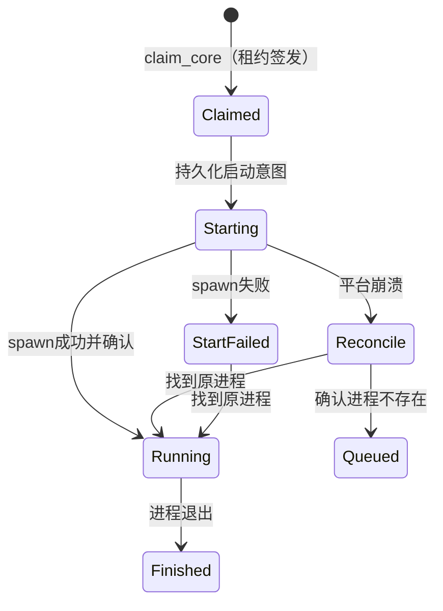

# T-031 · D3 执行引擎适配器 · 业务专家评审材料包

> 用途：本文是给业务专家的**一次性评审材料**，包含 2026-11-01 晚交付的 D3 设计文档要点、已实现代码地图、以及外部评审意见（6 项问题）与**现有代码的逐条对照校验**。
> 配套阅读：设计全文 `docs/ai-pm-slice-d3-executor-adapter-v1.md`（T-030 设计稿 + §8 T-031 实施记录）。
> 代码版本：提交 `6f3ded4`（feat(run-executor): D3 执行引擎适配器（T-031）），`cargo test --workspace` 456 passed / 0 failed（实施记录 §8.3）。

---

## 1. 前因后果：D3 在整条执行管线中的位置

AI-PM 平台的执行管线分四层推进（每层一份设计文档 + 一次实施交付）：

| 阶段 | 文档 | 职责一句话 | 状态 |
|---|---|---|---|
| D1 | `ai-pm-slice-d-run-dispatch-v1.md` | Run 领取 / 租约 / 回收 / 多仓基线快照，预留 `executor_kind`/`executor_session` 两列与 `RunExecutor` 端口 | 已交付 |
| D2 | `ai-pm-slice-d2-executor-context-v1.md` | 执行端经 MCP 工具上报进度 / 心跳 / 结果（11 个工具），红线：平台不启动进程、不写交付、不裁决任务 | 已交付 |
| **D3** | **`ai-pm-slice-d3-executor-adapter-v1.md`（本文材料）** | **平台以本地子进程 spawn Codex CLI：建工作区 → worktree checkout → 进程生命周期 → 日志 → 终止 → 重启 reconcile** | **本次评审对象** |
| D4 | `ai-pm-slice-d4-delivery-v1.md` | 交付物记录（`task_workspace`/`task_repository_commit`） | 设计稿已过稿（T-040），剩 T-041 实施 |
| D5 | 待排 | 任务级裁决（失败判定 / 重试 / 状态转换） | 未开始 |

**评审前必须对齐的概念区分**（这是外部评审的核心框架）：

- **执行引擎接入**：Codex 进程能被平台启动、监控、终止、回收 —— T-031 已完成。
- **研发执行闭环**：Codex 能理解 Task、读项目知识、调 MCP、改代码、提交 Git、反馈结果 —— 需要 D4/D5 与启动协议共同完成，**T-031 明确不做**（设计稿 §7「明确不做」）。

---

## 2. T-030 六项设计裁定（业务决策依据）

| # | 裁点 | 结论 |
|---|---|---|
| Q-D3-1 | 启动方式 | 本地子进程（`tokio::process` spawn Codex CLI）；容器隔离归 P11 规模化 |
| Q-D3-2 | 工作区边界 | 不建新表；目录 = `{AI_PM_WORKSPACE_ROOT}/{run_id}/{workspace_path}`；D4 届时按同一约定回填 |
| Q-D3-3 | 日志落点 | 文件事实源：`{workspace_root}/{run_id}/logs/stdout.log` / `stderr.log`，路径从 `run_id` 确定性派生 |
| Q-D3-4 | 租约续期 | 设计稿定双通道（执行端 MCP 心跳 + 平台 poll 兜底）；**实施期改为平台单通道**（见 §5 实施差异 1，即评审 Q2 关注点） |
| Q-D3-5 | 终止语义 | 统一终止管线分终态：用户取消 → `cancelled`、超时 → `timed_out`；Unix SIGTERM→宽限→SIGKILL，Windows 强杀 |
| Q-D3-6 | 会话标识 | `{kind}:{uuid-v4}`；三层假执行端注入（FakeExecutor / `AI_PM_CODEX_BIN` 假脚本 / 注册表 `noop`），默认 noop **绝不伪造执行成功** |

---

## 3. 代码地图（今晚交付的全部落点）

提交 `6f3ded4`，13 个文件，+1966 行。核心 5 处：

| 落点 | 行数 | 职责 | 评审关注的关键行 |
|---|---|---|---|
| `crates/pm-application/src/run_dispatch/port.rs` | 187 | `RunExecutor` 端口 + 类型补全 + `workspace_path_for` 路径算法 | L52-64（路径安全）、L106-111（ExecutorSession）、L143-152（端口契约）、L157-181（NoopExecutor） |
| `crates/pm-application/src/run_executor.rs` | 605 | 编排器：`claim_and_start` / `poll_active_runs` / `cancel_run` / `reconcile_orphans` + 终态回写 | L63-121（start 后同事务落库）、L186-204（poll 兜底续租）、L260-304（孤儿 reconcile） |
| `crates/pm-infrastructure/src/codex_executor.rs` | 421 | `CodexExecutor` 适配器：镜像仓 + worktree + spawn + pid 文件 + 终止管线 | L94-186（checkout）、L197-269（start）、L272-306（poll）、L310-334（terminate）、L352-368（process_alive） |
| `crates/pm-application/src/run_dispatch/lease.rs` | +33 | `recover_lost_run` 共享封装（B3-2 提取，claim 与 reconcile 复用） | L140-167 |
| `apps/ai-pm-worker/src/main.rs` | +49 | 第四循环：注册表装配 + 启动孤儿 reconcile + 主循环 | L98-154 |

测试（12 例）：

| 文件 | 用例 |
|---|---|
| `crates/pm-application/tests/run_executor.rs`（556 行） | C59 正常闭环 / C60 超时 / C61 用户取消 / C62 非零退出（任务状态不动）/ C63 start 失败退避 / C64 重试耗尽 / C65 running 失联回收 / C66 终态先到先得 + reconcile 两例 + claim 回归一例 |
| `crates/pm-infrastructure/tests/codex_executor.rs`（282 行） | C67 spawn→session/pid 落盘→收割退出码 / C68 挂起进程终止 / C69 目录布局断言 / C70 `file://` 裸仓镜像 + worktree checkout 到 `base_commit` |

---

## 4. 外部评审意见 Q1–Q6 × 现有代码逐条对照（本次评审重点）

> 下表是**关键增值**：评审者写意见时未必逐行看过实现。我已把 6 项意见与现有代码逐条核对，标出「评审已预判到 / 评审高估了缺口 / 确为缺口」。专家可直接基于「结论」列裁决。

| # | 意见（级别） | 现有代码落点 | 对照结论 | 缺口性质 |
|---|---|---|---|---|
| Q1 | spawn 与 DB 事务无法原子提交，需持久化启动意图（P0） | `run_executor.rs:63-121`；`codex_executor.rs:240-257` | **成立，确为缺口** | 见 §4.1 详细分析 |
| Q2 | 平台兜底续租掩盖死锁执行端；执行端身份/凭据未定（P0） | `run_executor.rs:186-204`；`codex_executor.rs:7-11`（模块注释自认）、`235-239`（注入清单无 token） | **成立，且实施记录 §8.2 已自认**（双通道改单通道 + token 留 D4） | 心跳/进展字段不存在；`timeout_seconds=None` 时完全无兜底 |
| Q3 | PID 文件不足以识别进程（重用）；子进程不回收（P0） | `codex_executor.rs:248-252`（pid 文件无创建时间）、`352-368`（process_alive 仅查存在性）、`391-397`（Windows 有句柄路径只杀主进程） | **大部分成立**；一个缓解点评审未提：孤儿强杀路径 `taskkill /T /F`（L412-414）已杀整棵进程树 | 主路径（有句柄 terminate / Unix SIGTERM）均只杀主进程；无 Job Object / Process Group；无创建时间校验 → PID 重用误判 |
| Q4 | Git 镜像仓缺并发保护（P1） | `codex_executor.rs:135-162` | **成立，确为缺口** | 无跨进程锁；`clone --mirror` 直接写最终目录（无临时目录原子发布）；双 Run 竞争首 clone 会互相破坏 |
| Q5 | 多仓库 workspace_path 缺安全约束（P1） | `port.rs:52-64`（`workspace_path_for`） | **评审高估了缺口**：五条约束中「相对路径 / 防 `..` 穿越 / 防同名冲突」已由 D1 算法满足——`safe_name` 字符白名单 `[a-z0-9-]` 从源头剔除穿越字符，uuid 后缀保证唯一 | 剩余小缺口：`codex_executor.rs:202` 直接 `run_root.join(&baseline.workspace_path)` 信任 DB 值，无二次规范化校验（防 DB 手工改坏） |
| Q6 | CLI 能启动 ≠ Codex 能执行 Task；`AI_PM_CODEX_ARGS` 不该是长期接口（P0） | `codex_executor.rs:56-65`（args 默认空）、`235-239`（仅注入 5 个 ID 环境变量） | **成立，且设计稿明确留白**（实施裁定 5：V1 只保证进程生命周期，编排参数属接入期调优） | 无 Launch Profile / instruction file / MCP 配置 / base_commit 告知机制（仅环境变量） |

### 4.1 Q1 崩溃窗口的具体形态（对照代码时序）

现有 `claim_and_start` 时序（`run_executor.rs:63-121`）：

```text
① claim_once        → Run claimed + 租约（DB 已提交）
② executor.start()  → 建目录 → checkout → spawn Codex → 写 pid 文件   ← OS 侧已发生
③ 开事务            → executor_session 落库 + Run running + 任务 running + 审计
④ 提交
```

崩溃窗口：**② 与 ④ 之间平台崩溃** → DB 中 Run 仍 `claimed` 且 `executor_session IS NULL`，但 Codex 进程已在运行。重启后两个恢复路径都看不见它：

- `reconcile_orphans`（`run_executor.rs:267-271`）只查 `executor_session IS NOT NULL` 的 Run → 跳过；
- `claim_once` 回收只覆盖租约过期 → 若租约未过期则等到过期，且回收时因 `executor_session` 为空**不会 kill 孤儿进程** → 僵尸 Codex。

评审建议的两阶段启动协议（原意见附图已转 mermaid）：



配套建议（评审原文要点）：`executor_session` 在 spawn 前生成并持久化；引入 `starting` 持久化标记；`process.json` 改临时文件 + 原子 rename；启动后回填 PID/创建时间确认；重启按启动意图 + 进程身份 reconcile。核心原则：**任何一个可能已经启动的 Codex，都必须能被平台识别和回收**。

### 4.2 评审意见对现有实现的两处「手下留情」（供专家权衡轻重）

1. **Q3 缓解点**：孤儿路径 `kill_by_pid` 在 Windows 用 `taskkill /T /F`（`codex_executor.rs:410-420`）杀整棵树——但正常终止路径（有句柄）与 Unix 路径仍只杀主进程，缺口主体成立。
2. **Q5 大半已覆盖**：`workspace_path_for`（`port.rs:52-64`）是 D1 交付的确定性算法，评审列的五条约束里三条已被字符白名单 + uuid 后缀满足。真正要补的只是「执行器侧二次校验」这层防御。

---

## 5. 实施期与设计稿的 5 项差异（T-031 §8.2，专家需知情）

| # | 差异 | 依据 | 关联评审意见 |
|---|---|---|---|
| 1 | 执行端 MCP 心跳通道 V1 不可用（Model B 无 lease_token 可下发），租约续期只靠平台 poll 兜底 | worker 不签发 token 明文（D1 裁定）；token 下发与 `pm_submit_result` 归 D4 | **Q2** |
| 2 | `claimed→running` 由编排器在 start 成功后经受守卫入口 `apply_task_transition` 推进（非执行端首报） | D1 §九问题 4 的本意；D2 首报路径保留给 Model A | — |
| 3 | running 失联回收由编排器补齐（claim_once 只覆盖 claimed）：续租失败 → `terminate(LeaseReclaimed)` + B3-2 隔离重试 | D1 语义 | — |
| 4 | start 失败时任务 `claimed→ready` 回退（经受守卫入口）；失败行「每 Run 至多一条」首败留痕 | B3-1 + 0010 唯一约束 | — |
| 5 | `AI_PM_CODEX_ARGS` 默认空 + 仅注入 5 个 ID 环境变量；`AI_PM_LEASE_TOKEN` 留空待 D4 | V1 只保证进程生命周期正确 | **Q2 / Q6** |

---

## 6. 验证证据

- `cargo test --workspace`：72 个 `test result: ok`，456 passed / 0 failed（新增 pm-application `run_executor` 11 例、pm-infrastructure `codex_executor` 4 例）。
- `cargo check --workspace --all-targets`：0 error / 0 warning。
- Windows 实机验证（C67–C70）：假脚本 spawn/收割/强杀、`file://` 裸仓镜像 + worktree checkout 到 `base_commit` 全部通过。

---

## 7. 评审者给出的处置建议（原样收录，供专家裁决）

**优先级划分**：

| 级别 | 内容 |
|---|---|
| P0（进 D3.1 修正） | ① 进程启动持久化协议（两阶段）；② 执行端身份认证与 MCP 凭据下发；③ Process Liveness 与 Agent Heartbeat 分离（防死锁进程无限续租）；④ Windows Job Object / Unix Process Group（子进程完整回收） |
| P1（进 D3.2 或 D4） | ① Git mirror 跨进程锁与损坏恢复；② workspace_path 二次校验；③ Codex Launch Profile；④ 日志限制 / 脱敏 / 结构化事件 |
| P2（规模化） | 远程 Executor / 容器隔离 / 日志实时流 / 资源配额调度 |

**三层架构定位**（评审者的长期建议）：

- Executor Runtime（D3）：进程、工作区、租约、终止、恢复
- Agent Integration（D4 + 接入协议）：MCP 工具、上下文注入、多仓库、交付物、Git Commit
- Engineering Governance（D5）：验收、裁决、状态转换、知识回写

**建议新增任务 T-032 · Codex Executor 可靠性与启动协议加固**（评审者已给出完整任务稿，含 4 项必修 + 6 项补充 + Launch Profile + 8 条验收标准 + 边界声明，全文见对话记录；要点：不推翻 T-031、不改任务状态机、不提前做 D5）。

**评审者结论**：可接受 T-031 的 V1 交付（进程生命周期已打通 + 真实 Windows 验证），但不认定为完整 Codex 执行引擎；建议保留交付记录、不推翻代码，以 T-032 收紧可靠性边界后尽快进入 D4。
---

## 8. 关联文档阅读指引（按评审问题取用，避免与既有裁决冲突）

> D3 评审包可独立裁决 D3 本身；但下表 5 份关联文档承载着**既定裁决**，评审 Q1/Q2/Q5/Q6 时必须对照，否则专家建议可能与已裁决的体系冲突。

| 文档 | 状态 | 对应评审问题 | 专家需重点确认的交叉点 |
|---|---|---|---|
| `ai-pm-adr-0001-tenant-agent-executor-identity.md` | **Accepted**（2026-11-01 正式裁决） | **Q2 执行端身份** | ADR D4 裁定「Agent 是 attribution-only principal，**不发独立凭据**」；D6 裁定「Executor Registry 归 D3，Run 预留可空 `executor_id`」。评审建议的「短期、限定 Run、可撤销执行凭据」需与这条裁决对齐语义：凭据发给 **Executor Session**（进程实例），不是给 Agent principal 发身份凭据——建议专家裁决时明确这个边界 |
| `ai-pm-slice-d2-mcp-context-v1.md`（v1.1） | 已裁决可实施 | **Q2 MCP 认证** | D2 已有 `lease_token` 生命周期规则、`renew_lease_by_token`、`accept_executor_result` fencing（`lease.rs:221-235`）——评审提出的「MCP 必须验证 session + run_id + 权限 + 有效期」**已有约一半实现**；真正缺口只剩 Model B（平台 spawn）下 token 如何下发给执行端 |
| `ai-pm-codex-bootstrap-v1.md` | **草稿未过稿**（2026-11-01 供稿落盘，T-087 待定稿） | **Q6 执行闭环** | 评审者「环境初始化应与 Run 启动机制明确分开」的表态对象就是本稿。专家需裁决三层切分（环境初始化 / Launch Profile / RunExecutor）是否要求修订本稿的 Worker 安装 + MCP 配置协议 |
| `ai-pm-slice-d4-delivery-v1.md` | **已过稿**（2026-11-01 T-040，待 T-041 实施） | **Q5 workspace 回填** | D4 Q-D4-1 已裁定「**不建** `task_workspace` 表，工作区路径以 D3 确定性派生为准（已落 `task_run_repository.workspace_path`）」——评审建议「D3 保证 D4 可回填」与 D4 既有裁定**一致，无冲突**，D3 无需为此新增表 |
| `ai-pm-slice-d-execution-pipeline-v1.md` | 总纲（D 系列上位依据） | **Q1 启动协议** | 两阶段启动协议（`starting` 标记）触碰 D1 预留的 Run 生命周期与 claim/回收语义；§九 待裁问题 4/5 即其上位出处。专家裁决 T-032 方案时需确认：`starting` 落 Run 列（扩展现有记录）还是改状态枚举，以及是否影响 B3-2 回收前提 |

**一句话**：评审 D3 用 §1–§7 即可；**裁决 Q2 必须带 ADR-0001 + D2 两份**（身份与凭据语义），**裁决 Q6 必须带 codex-bootstrap**（未过稿，是唯一会被评审意见直接改写的设计稿）；Q5 与 D4 已对齐，无需额外动作。
---

## 9. 裁决结果回填（2026-11-01）

| 评审问题 | 裁决状态 | 落点 |
|---|---|---|
| **Q2 执行端身份与 MCP 认证** | ✅ **已裁决（Accepted）**：Model A/B 统一 lease_token（A1+B1），不新增凭据体系，不改变 ADR-0001；T-051 升级为安全前置；新增 `execution_mode` 列；终止顺序反转为「先撤凭据后杀进程」 | **ADR-0002** `ai-pm-adr-0002-executor-credential-separation.md`（含 9 项落地影响清单 + 4 项实施待确认） |
| Q1 启动协议 / Q3 进程回收 / Q4 镜像仓 / Q5 路径校验 / Q6 Launch Profile | 待裁决或并入 T-032 任务稿 | T-032 设计时逐项过 |
| **补充建议 X1/X2/X3**（第二轮） | **已分析收编（2026-11-01）**：X1 工具级权限——现状无攻击面（`pm_cancel_run`/`pm_requeue_run`/`pm_isolate_run` **不是 MCP 工具**，MCP 面 11 个工具里不存在），但「工具→scope 映射 + 默认拒绝」作为 D2 契约冻结前约束成文；X2 Session/Token/Run 分层——现状无状态 transport + 每请求 Bearer + hash 绑定 Run 行已满足，四层模型作为 **transport 升级红线**成文（防未来有状态 session 引入「认证一次永久信任」）；X3 fencing generation——**场景走查通过（`claim.rs:552-576` hash 覆盖 + `lease.rs:66-76` 清空，双执行端并发写入不可达）**，其语义「新所有权建立时递增、心跳不递增」采纳为 ADR-0002 P1 方案 a 的论证依据 | ADR-0002 §4 P1 已更新；T-032 §3.3 已并入场景走查 |
| **专家复审 §四–§六**（第三轮） | **已收编（2026-11-01）**：§四最终统一架构定稿进 **ADR-0002 §6**（7 项特点全部与既有裁决一致，原图转 mermaid）；§五任务分层拆分采纳（T-032 聚焦认证闭环 P0、`execution_mode` 移交 T-059、生命周期**管理能力**另立 T-093 P2、Registry 维持 P11；**Q1 启动协议 / Q3 子进程回收维持 P0 不降级**）；§六问题清单勘误（Q-C 实质纠错：「300s 租约+可续租 ≠ 短期」，正确定义=最大执行期限+所有权变化即撤销，ADR-0002 D3 已按此采纳） | ADR-0002 §6 新增；问题清单 §七勘误；todo.md T-059/T-093 已更新 |
| **用户最终裁决**（第三轮后，2026-11-01） | **修正专家复审 §五的过窄拆分并正式记录**：执行数据面（Q1/Q2/Q3 + Token 生命周期与 fencing + MCP 工具权限 + 凭据安全）全部 P0 归 T-032，维持外部评审 P0 定级不推翻；仅管理面拆 T-093 P2；新增「生命周期一致性总验收」约束（11 步链路 + 两个故障窗口 + 5 场景必测矩阵），验收标准提升为「正常运行 / 异常退出 / 重启恢复场景下，执行进程、执行凭据与最终状态一致且可追溯」 | T-032 设计稿 §1 注记 + §8.1 新增；ADR-0002 §6 补最终裁决；todo.md T-032 验收行已更新 |
| **T1–T4 终裁**（第四轮，2026-11-01） | **设计稿过稿裁决**：T1=ii（`executor_session` 前置即启动意图，**零迁移**；PID 文件不存在 ≠ 进程不存在，reconcile 三重证据；spawn 失败 session 保留 + 历史留痕）；T2=a（`lease_generation`，首次领取=1，重领 +1，心跳/失败不递增，MCP 双验证，旧 generation 永不重新授权）；T3=i（`deadline_at` 首次 claim 固化，重领/续租不得重置延长，绝对截止优先于续期）；T4 确认（心跳 ≠ 进展）。**迁移约束：0011/0015 已应用不得回改 → forward-only `0023`**。设计稿据此改写为过稿版（§2.2 重写 / §3.3/§3.4 定稿 / §8.1 端到端五项） | T-032 设计稿已过稿；ADR-0002 §7 终裁记录；todo.md T-032 已更新 |

> Q2 的裁决直接影响 T-032 任务稿：原稿「执行端身份与 MCP 认证」一节按 ADR-0002 D1–D7 重写；新增落地项 L1–L6（R-G4 修订、token 注入、终止顺序、timeout 强制、execution_mode、triggered_by_user_id 核查）。