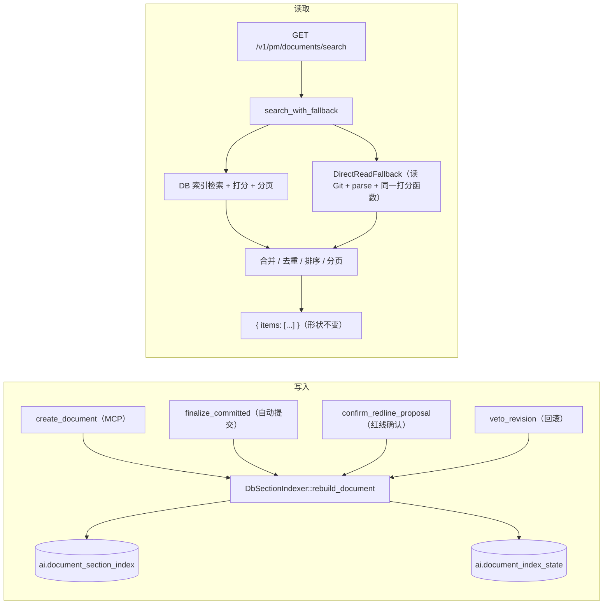

# T-060 · 知识索引层可替换化与完整检索（P6 后半 · 设计稿）

> 状态：**待过稿**（2026-11-02 落盘；Q1–Q4 四项及 A-1~A-6 细节已由用户逐条裁定）
> 日期：2026-11-02
> 一句话：把「每次检索都逐篇读 Git + 全量扫描」换成「落库章节索引 + 可替换端口 + 发布即重建 + 索引不可用时回退直读」，不引入分词扩展、不引入向量库、不改检索响应契约。
> 上位依据：`todo.md` §9 M6（T-060）、`docs/ai-pm-markdown-knowledge-space.md` §九/§十一（A 路径与可替换适配层）、`docs/ai-pm-knowledge-v2-implementation.md` §3（索引现状）、`migrations/0014_knowledge_v2.sql:60-79`、`migrations/0019_tenant.sql`（租户纪律）、`AGENTS.md` 规则 1（新项目无存量数据，直接改契约）。

---

## 0. 裁定摘要（用户逐条确认）

| 编号 | 问题 | 裁定 | 落地位置 |
|---|---|---|---|
| Q1 | 索引产物落在哪里 | **落 DB 派生表**（`ai.document_section_index`），`document_index_state` 保留为状态机 | §4 |
| Q2 | 增量触发点 | **写入后同步重建，事务外、失败降级**（不新增 job / 事件） | §5 |
| A-1 | veto 回滚重建范围 | **只重建生效的新修订**（被否决修订只标 `stale`） | §5.3 |
| A-2 | `create_document` 是否纳入 | **纳入**，四个写入点一条口径 | §5.1 |
| Q3 | 排序与向量 | **关键词 + 结构化加权，零扩展依赖**；不引入向量 | §6.2 |
| A-3 | 引用加成口径 | 只认**锚点存在于当前 published 修订**的 `knowledge_reference` | §6.2 |
| A-4 | 分页 | 响应体**不变**；只新增可选 `limit`/`offset`（缺省 20/0） | §6.3 |
| Q4 | 端口边界与外部依赖 | **trait 扩到「重建 + 检索」两个语义，单一 DB 实现，零外部依赖**；`MarkdownTreeIndexer` 降级为回退直读器 | §3 |
| A-5 | 状态写入 | 同步路径**不写 `pending`**，直接落 `indexed` / `stale` / `failed` | §5.4 |
| A-6 | 索引表内容 | 存章节文本字段，**不存 tsvector** | §4.1 |

---

## 1. 现状与缺口（实测证据）

| # | 事实 | 证据 | 后果 |
|---|---|---|---|
| 1 | 检索端点走内存扫描：`list_documents` → 逐篇 `read_document`（读 Git + 校验哈希）→ 整篇解析标题树 → 子串匹配 | `apps/pm-api/src/documents.rs:57-70`、`knowledge_index.rs:157-203` | 每次查询 O(文档数 × Git 读 × 全文扫描)，文档多了直接不可用 |
| 2 | `KnowledgeIndexer` trait 已存在，但端点没用它；`search_with_fallback` 只有测试在调 | `knowledge_indexer.rs:33-47`、`apps/pm-api/tests/documents.rs:16` | 「可替换端口」只是名义存在 |
| 3 | 重建入口是游离函数 `index_revision`，不在 trait 里 | `knowledge_indexer.rs:179-243` | 换 provider 时重建语义无法替换（「可替换」只有一半） |
| 4 | `ai.document_index_state` 只有状态，**没有任何索引产物**；且只有 `POST /reindex` 与 veto 会写状态 | `migrations/0014_knowledge_v2.sql:60-79`、`documents.rs:339-360`、`knowledge_proposal/veto.rs:210-220` | 正常发布流程下大量修订「无状态行」→ 回退逻辑把它们全判 stale |
| 5 | `RetrievedSection.revision_hash` 恒为空串 | `knowledge_indexer.rs:105` | 证据回溯拿不到版本 |
| 6 | 打分只有标题 +2 / 正文 +1，硬截断 20 条，无分页、无引用加权 | `knowledge_index.rs:176-201` | 排序不可调、无法翻页、`knowledge_reference` 白建 |
| 7 | 迁移中 `CREATE EXTENSION` 只有 `pgcrypto` | `migrations/0001_core.sql:2` | 无 `pg_trgm`/`zhparser`/`pgvector`，中文 `tsvector` 不可用 |

---

## 2. 目标与非目标

**目标**：检索质量与规模可演进——索引产物可重建且幂等、状态与正文哈希一致、哈希漂移即失效、检索接口向后兼容、外部索引器只需实现同一端口。

**非目标**（T-060 原文「不做」+ 本次裁定）：
- 不引入必须在生产运行的向量数据库；不引入中文分词扩展（部署侧未知）；
- 不重写 Markdown 事实源（Git 仍是唯一权威正文）；
- 不新增 `integration.job` 作业类型、不新增 outbox 事件（事件体系归 T-061）；
- 不做重建进度页 / 监控页（T-061 监控范围）；
- 不做读时惰性重建（回退只直读，不写索引）。

---

## 3. 架构与端口

### 3.1 分层



- **端口**在 `pm-application`（与现状一致，application 已依赖 sqlx/tracing），**实现**也在同 crate：`DbSectionIndexer`。
- `knowledge_index.rs` 退化为**纯解析 + 打分纯函数 + 回退直读扫描**，不再承担主检索。
- 回退器保留 Git 权威读路径：`knowledge::read_document`（含 `content_hash` 校验）。

### 3.2 端口契约（改契约，不做兼容分支）

```rust
pub const DB_SECTION_PROVIDER: &str = "db-section";
pub const DB_SECTION_INDEX_VERSION: &str = "v1";

#[derive(Debug, Clone, Copy)]
pub struct SearchPage { pub limit: i64, pub offset: i64 } // 缺省 20 / 0，limit 夹在 1..=100

#[derive(Debug, Clone, Serialize)]
pub enum IndexOutcome {
    Indexed { sections: i64 },
    Stale,                      // 磁盘正文哈希 ≠ 修订哈希
    Failed { message: String }, // 文件缺失 / 无标题 / 解析失败
}

#[async_trait]
pub trait KnowledgeIndexer: Send + Sync {
    fn provider(&self) -> &'static str;
    fn index_version(&self) -> &'static str;
    async fn rebuild_document(&self, project_id: Uuid, revision_id: Uuid)
        -> Result<IndexOutcome, KnowledgeError>;
    async fn search(&self, project_id: Uuid, query: &str, page: SearchPage)
        -> Result<Vec<SearchHit>, KnowledgeError>;
}
```

删除的旧契约（`AGENTS.md` 规则 1：直接改，不留过渡层）：`IndexReference`、`RetrievedSection`、`index_document`、`index_revision`（后者由 `rebuild_document` 取代）、`MARKDOWN_TREE_PROVIDER` / `MARKDOWN_TREE_INDEX_VERSION`。
`SearchHit` 增 `revision_hash: String`（`#[serde(skip_serializing)]`）——供 D5 证据回溯，但对 REST 响应**不可见**（守 A-4）。

---

## 4. 数据模型（迁移 `0024_knowledge_section_index.sql`）

> 编号说明：`0023` 已被 T-032 的未提交文件占用，故本迁移取 `0024`。

### 4.1 DDL 草案

```sql
CREATE TABLE IF NOT EXISTS ai.document_section_index (
    id                   UUID PRIMARY KEY DEFAULT gen_random_uuid(),
    tenant_id            UUID NOT NULL,
    project_id           UUID NOT NULL,
    document_revision_id UUID NOT NULL,
    provider             TEXT NOT NULL,
    section_no           INT  NOT NULL,
    level                SMALLINT NOT NULL,
    title                TEXT NOT NULL,
    anchor               TEXT NOT NULL,
    content              TEXT NOT NULL,
    start_line           INT  NOT NULL,
    created_at           TIMESTAMPTZ NOT NULL DEFAULT now(),
    updated_at           TIMESTAMPTZ NOT NULL DEFAULT now(),
    UNIQUE (document_revision_id, provider, section_no)
);

CREATE INDEX IF NOT EXISTS idx_document_section_project
    ON ai.document_section_index (tenant_id, project_id, provider);
CREATE INDEX IF NOT EXISTS idx_document_section_revision
    ON ai.document_section_index (document_revision_id, provider);

ALTER TABLE ai.document_section_index
    ADD CONSTRAINT fk_document_section_tenant_project
        FOREIGN KEY (tenant_id, project_id) REFERENCES core.project (tenant_id, id);
ALTER TABLE ai.document_section_index
    ADD CONSTRAINT fk_document_section_tenant_revision
        FOREIGN KEY (tenant_id, document_revision_id)
        REFERENCES ai.document_revision (tenant_id, id) ON DELETE CASCADE;
```

要点（A-6）：
- 只存**章节文本**，不存 `tsvector`、不存 embedding；`content` 为 trim 后的章节正文（与 `parse_markdown_tree` 完全一致，保证索引与回退路径同源）。
- `section_no` = 解析顺序（含 `preamble` 的 level 0 章节），重建时连续重排。
- 租户纪律按 `0019`：`tenant_id NOT NULL` + 两条 `(tenant_id, *)` 组合外键（父表唯一键已存在：`uq_document_revision_tenant_id`）。
- `provider` 为维度列：未来 PageIndex / 向量实现共用该表或各自建表，`document_index_state` 已按 `(document_revision_id, provider)` 唯一。
- `tenant_schema.rs` 的 `TENANT_TABLES` 从 40 增至 41 并加 `("ai", "document_section_index")`。

### 4.2 状态机（`ai.document_index_state` 语义不变）

| status | 含义 | 写入点 |
|---|---|---|
| `indexed` | 该修订该 provider 的章节产物齐全，且 `indexed_content_hash = revision.content_hash` | 重建成功 |
| `stale` | 磁盘正文与修订哈希不一致，产物已清空 | 重建遇哈希漂移；读路径发现不一致（仅标记） |
| `failed` | 文件缺失 / 无标题 / 解析失败，产物已清空 | 重建失败 |
| `pending` | **同步路径不再写入**（CHECK 保留，不删枚举，A-5） | 无 |

---

## 5. 重建语义与触发点（Q2 / A-1 / A-2 / A-5）

### 5.1 四个触发点

| # | 位置 | 现状 | 改动 |
|---|---|---|---|
| 1 | `knowledge::create_document`（`knowledge.rs:264-336`） | 返回 `CreatedDocument` 无 `revision_id` | `INSERT ... RETURNING id` 取回修订 id，写入返回值；`tx.commit()` **之后**调 `rebuild_document` |
| 2 | `submit_proposal` 自动提交（`submit.rs:152-178`） | 经 `finalize_committed` 写库 | `finalize_committed` 内**删除** `document_index_state(pending)` 插入；调用方拿到 `ProposalOutcome::Committed.revision_id` 后重建 |
| 3 | `confirm_redline_proposal`（`submit.rs:182-251`） | 同上 | 同上 |
| 4 | `veto_revision`（`veto.rs:5-121`） | tx 内：被否决修订标 stale，上一修订插 `pending` | tx 内：被否决修订标 `stale` + **删除其章节行**；提交后对 `restored_revision_id` 重建（A-1） |

`knowledge_migrate::migrate_requirement_revision` 走 `submit_proposal`，自动获得索引，无需改。

### 5.2 重建流程（`rebuild_document`）

1. 查 `canonical_path` / `content_hash` / `tenant_id`（`document_revision ⋈ project_document`，按 `revision_id + project_id`）→ 不存在返回 `NotFound`。
2. 校验修订状态：只允许 `published`，否则 `Conflict`（手动 `/reindex` 也受此约束）。
3. `safe_join` 读文件；`content_hash(markdown) != revision.content_hash` → **Stale**。
4. `parse_markdown_tree`；无任何 `level > 0` 章节 → **Failed**（`"document has no Markdown heading to index"`，沿用现状语义）。
5. 单事务：
   - `pg_advisory_xact_lock(hashtextextended('ai.document_section_index:' || $revision_id::text, 0))`（与 `task_dependency.rs:97` 同一手法，串行化同一修订的并发重建）；
   - `DELETE FROM ai.document_section_index WHERE document_revision_id = $1 AND provider = $2`；
   - 批量 `INSERT` 章节（`tenant_id` 由 project 子查询推导）；
   - `UPSERT ai.document_index_state`（`indexed` + `indexed_content_hash = revision.content_hash` + `index_version = 'v1'` + `indexed_at = now()` + `last_error = NULL`）。
6. 返回 `IndexOutcome::Indexed { sections }`。

**Stale / Failed 的公共收尾**（同样单事务）：`DELETE` 该修订该 provider 的章节行 + `UPSERT` 状态为 `stale` / `failed` 并写 `last_error` 与 `indexed_content_hash = NULL`。产物一律清空——**绝不把可能过时的章节当事实**。

### 5.3 失败策略（Q2：事务外、失败降级）

- 四个调用点统一调 `rebuild_quietly(...)`：内部 `match` 结果，`Indexed` → `tracing::info!(knowledge_index_rebuilt …)`；`Stale` → `warn`；`Failed` / DB 错误 → `warn`（`knowledge_index_failed`）。
- **发布成功与否只由权威写入决定**：索引失败不阻断、不回滚、不重试；该修订在索引状态中留痕，检索自动走回退直读。
- 幂等：重建 = 「删后插」+ UPSERT，同一修订重复执行结果一致（验收「可重建且幂等」）。

### 5.4 为什么不做后台 job（记录被否方案）

`integration.job` 与 `OutboxWorker` 可用，但新增 `knowledge_index` 作业类型意味着（a）新建 worker 循环、（b）处理「已发布未索引」窗口、（c）事件与作业语义和 T-061 重叠。解析是纯内存操作、唯一 IO 是刚写完的 Git 文件，同步成本以毫秒计——按 YAGNI 否决。

---

## 6. 检索、排序与回退（Q3 / A-3 / A-4）

### 6.1 主路径：单条 SQL

```sql
-- $1 project_id, $2 归一化 needle(lower), $3 provider, $4 limit, $5 offset
WITH latest AS (
  SELECT d.id AS document_id, d.doc_key, d.doc_type, d.canonical_path,
         r.id AS revision_id, r.content_hash
    FROM ai.project_document d
    JOIN LATERAL (
      SELECT id, content_hash FROM ai.document_revision
       WHERE document_id = d.id AND status = 'published'
       ORDER BY revision_no DESC LIMIT 1
    ) r ON true
   WHERE d.project_id = $1
), base AS (
  SELECT l.*, s.section_no, s.level, s.title, s.anchor, s.content, s.start_line,
         (CASE WHEN lower(s.title) = $2 THEN 6
               WHEN strpos(lower(s.title), $2) > 0 THEN 3
               WHEN strpos(lower(s.anchor), $2) > 0 THEN 2
               ELSE 0 END)
       + LEAST(3, (length(lower(s.content)) - length(replace(lower(s.content), $2, '')))
               / greatest(length($2), 1)) AS raw
    FROM ai.document_section_index s
    JOIN latest l ON l.revision_id = s.document_revision_id
    JOIN ai.document_index_state st
      ON st.document_revision_id = l.revision_id
     AND st.provider = $3 AND st.status = 'indexed'
     AND st.indexed_content_hash = l.content_hash          -- 哈希一致才可用
   WHERE s.provider = $3
), scored AS (
  SELECT base.*,
         ((raw * CASE doc_type WHEN 'architecture' THEN 12
                             WHEN 'decision'     THEN 12
                             WHEN 'requirement'  THEN 11
                             ELSE 10 END) + 5) / 10 AS score,
         CASE WHEN EXISTS (
           SELECT 1 FROM ai.knowledge_reference kr
            WHERE kr.document_revision_id = base.revision_id
              AND coalesce(kr.section_anchor, '') = base.anchor
         ) THEN 2 ELSE 0 END AS ref_boost
    FROM base
   WHERE raw > 0
)
SELECT *, score + ref_boost AS total FROM scored
 ORDER BY total DESC, canonical_path, start_line, section_no
 LIMIT $4 OFFSET $5;
```

### 6.2 打分口径

| 项 | 分值 |
|---|---|
| 标题（大小写不敏感）全等 | 6 |
| 标题包含 | 3 |
| 锚点包含 | 2 |
| 正文出现次数 | `min(3, count)` |
| 文档类型权重 | `architecture`/`decision` ×1.2、`requirement` ×1.1、`knowledge` ×1.0（整数落为 `(base*w+5)/10`） |
| 引用加成 | +2（A-3：`knowledge_reference` 的 `document_revision_id` 必须等于**当前 published 修订**且 `section_anchor` 等于该章节锚点） |

- 同分次序：`canonical_path` → `start_line` → `section_no`（与现状一致，保证稳定排序）。
- 回退路径使用 `knowledge_index::score_section(...)` 纯函数，公式与上表一一对应；用例 K-14 钉住「两条路径对同一文档打分一致」。

### 6.3 分页与响应（A-4）

- `SearchQuery` 增 `limit: Option<i64>`、`offset: Option<i64>`；缺省 20 / 0，`limit` 夹在 `1..=100`，`offset` 负值按 0。
- 响应仍是 `{ "items": [ SearchHit… ] }`，`SearchHit` 字段与现在**完全一致**；`revision_hash` 用 `#[serde(skip_serializing)]` 不进 JSON。
- 前端 `frontend/src/api/documents.ts` 无需改动。

### 6.4 回退合并（`search_with_fallback`）

1. 取每篇文档的最新 published 修订 + 该 provider 状态（一次查询）。
2. 分类：`indexed && indexed_content_hash == content_hash` → DB 路径；其余 → 回退候选（同时把状态标 `stale`，**只标记不重建**）。
3. DB 路径：跑 §6.1 SQL（取 `limit + offset` 条）。
4. 回退候选：逐篇 `read_document`（哈希校验失败即丢弃该篇）→ `parse_markdown_tree` → `score_section`，取前 `limit + offset` 条。
5. 合并按 `(document_id, anchor)` 去重（DB 结果优先）→ 统一排序 → 跳过 `offset` → 取 `limit`。
6. 返回 `FallbackSearchResult { used_fallback, stale_revision_ids, hits }`；handler 只序列化 `hits`。

---

## 7. 错误处理与可观测性

| 场景 | 行为 |
|---|---|
| 文件不存在 / IO 失败 | 状态 `failed` + `last_error`；发布不受影响；检索走回退（回退也读不到则该篇缺席） |
| 磁盘哈希 ≠ 修订哈希 | 状态 `stale`，章节清空；检索永不返回旧索引内容（验收「哈希漂移时索引失效」） |
| 无 Markdown 标题 | 状态 `failed`（`last_error` = 无标题），`POST /reindex` 返回对应错误 |
| 手动 `/reindex` 指向非 published 修订 | `Conflict`（不静默索引历史修订） |
| 同一修订并发重建 | advisory lock 串行化；`UNIQUE(document_revision_id, provider, section_no)` 兜底 |
| DB 事务失败（发布后重建） | 仅 `warn`，不重试；下一发布 / 手动 reindex 修正 |
| 跨租户写入 | 组合外键拒绝；检索按 `project_id` 收敛（租户由 project 决定） |
| 空 query / 全空白 | 直接返回空列表（现状语义保留） |

可观测性（本期只做日志，指标/监控页归 T-061）：
- `info!`：`knowledge_index_rebuilt`（provider / revision_id / sections）
- `warn!`：`knowledge_index_failed`（provider / revision_id / outcome / error）
- `info!`：`knowledge_search_fallback`（project_id / stale_count）

---

## 8. 测试矩阵（验收映射）

| ID | 用例 | 断言 | 文件 |
|---|---|---|---|
| K-01 | 解析纯函数回归 | 现有 `parse_markdown_tree` 5 例全绿 | `knowledge_index.rs`（既有） |
| K-02 | 重建落库 + 幂等 | 章节行数 = 标题数（含 preamble）；连跑两次行数不变、`section_no` 连续；状态 `indexed` 且 `indexed_content_hash = revision.content_hash` | `crates/pm-application/tests/knowledge_index_v2.rs` |
| K-03 | 哈希漂移即失效 | 改盘上文件 → 重建 → 状态 `stale` 且章节清零；检索该篇不返回旧内容 | 同上 |
| K-04 | 发布即索引：`create_document` | `pm_submit_document` 路径返回后，章节与 `indexed` 状态已就位（A-2） | 同上 |
| K-05 | 发布即索引：`submit_proposal` 自动提交 | 提交后立即可检索 | 同上 |
| K-06 | 发布即索引：红线确认 | `confirm_redline_proposal` 后索引就位 | 同上 |
| K-07 | veto 回滚 | 被否决修订 `stale` 且章节删除；生效修订被重建；检索只出回滚后正文（A-1） | 同上 |
| K-08 | 打分次序 | 标题全等 > 标题包含 > 锚点 > 仅正文；同分按 path/line | 同上 |
| K-09 | 类型权重 | 同样命中下 `decision` 排在 `knowledge` 前 | 同上 |
| K-10 | 引用加成 | 当前修订被引用的章节 +2；**历史修订引用不加成**（A-3） | 同上 |
| K-11 | 分页 | `limit=5&offset=5` 返回第 6–10 条；缺省 20；`limit>100` 夹紧 | 同上 |
| K-12 | 响应兼容 | REST JSON 字段集合与改造前一致（无 `revision_hash`）（A-4） | `apps/pm-api/tests/documents.rs` |
| K-13 | 回退语义 | 状态缺失/`failed` 时回退直读仍能命中；`used_fallback` 只内部可见 | `knowledge_index_v2.rs` |
| K-14 | 两路径打分一致 | 同一文档「索引态」与「强制回退态」排名与分值相同 | 同上 |
| K-15 | 租户结构不变量 | 新表进 `TENANT_TABLES`（41 张），`tenant_id NOT NULL` + 两条组合外键 | `crates/pm-infrastructure/tests/tenant_schema.rs` |
| K-16 | 迁移可重复 | `0024` 在空库应用成功，表/索引/约束齐备 | `crates/pm-infrastructure/tests/migration_0024.rs` |

T-060 验收四条 ↔ 用例：可重建且幂等 → K-02；`document_index_state` 与正文哈希一致 → K-02/K-03；检索接口向后兼容 → K-12（+ K-11 分页参数）；哈希漂移索引失效 → K-03。

---

## 9. 不做与风险

**不做**：向量检索、中文分词扩展、后台索引作业、outbox 事件、监控页、自动修复索引失败、读时惰性重建、历史修订章节的历史查询视图。

**风险与缓解**：
1. **打分公式两处实现（SQL / Rust）漂移** → K-14 钉住等价；公式集中在 §6.2 单表，改动必须同时改两处并跑 K-14。
2. **同步重建拉长发布请求** → 解析纯内存、插入行数为标题数；失败降级，无网络与外部服务。
3. **回退路径仍是 O(文档数)** → 只在异常状态下触发（正常路径全走 DB）；指标与规模优化随 T-061/后续 provider。
4. **`ILIKE` 级全表扫** → 单项目章节量级可接受；换 FTS 只替换端口实现，不动契约。
5. **迁移号冲突** → `0023` 属 T-032 未提交文件；若先合入，本稿仍用 `0024`。

---

## 10. 实施清单（文件级）

| 文件 | 改动 |
|---|---|
| `migrations/0024_knowledge_section_index.sql` | 新建（§4.1） |
| `crates/pm-application/src/knowledge_indexer.rs` | 端口新契约 + `DbSectionIndexer` + `DirectReadFallback` + `search_with_fallback` + 状态 UPSERT + `rebuild_quietly` |
| `crates/pm-application/src/knowledge_index.rs` | 保留解析；新增 `score_section`；`search_documents` 更名 `scan_documents_direct`（仅回退用）；`SearchHit` 增 `revision_hash`（不序列化） |
| `crates/pm-application/src/knowledge.rs` | `CreatedDocument` 增 `revision_id`；`create_document` 提交后重建 |
| `crates/pm-application/src/knowledge_proposal/{submit,veto}.rs` | 删 `pending` 插入；提交后重建；veto 清章节 + 重建生效修订 |
| `apps/pm-api/src/documents.rs` | `search_handler` 走 `search_with_fallback` + `limit`/`offset`；`reindex_handler` 用 `DbSectionIndexer` |
| `crates/pm-application/src/lib.rs` | 重导出更新（删 `IndexReference`/`RetrievedSection`/`index_revision`） |
| `crates/pm-infrastructure/tests/tenant_schema.rs` | 表清单加新表（40 → 41） |
| `crates/pm-infrastructure/tests/migration_0024.rs` | 新建 |
| `crates/pm-application/tests/knowledge_v2.rs`、`apps/pm-api/tests/documents.rs` | 适配新契约 + K-12 |
| `crates/pm-application/tests/knowledge_index_v2.rs` | 新建（K-02~K-11、K-13、K-14） |
| `docs/ai-pm-knowledge-v2-implementation.md` | 实施完成后回填「索引层 V2」章节 |

**验收命令**：`cargo test --workspace`、`cargo check --workspace --all-targets`（`todo.md` §0.2 通用命令）。

---

## 11. 与后续切片的接口

- **T-061**：本稿不写 outbox 事件；`knowledge_index_failed` 日志与 `document_index_state` 可直接作为后续指标来源。
- **D5（T-042/T-043）**：`SearchHit.revision_hash`（内部字段）与 `locator`（anchor/start_line）即证据回填所需的版本与定位信息。
- **未来 provider（PageIndex / 向量）**：实现同一 trait（`provider` / `index_version` / `rebuild_document` / `search`），`document_index_state` 按 provider 维度已就位；切换不改业务调用点。
