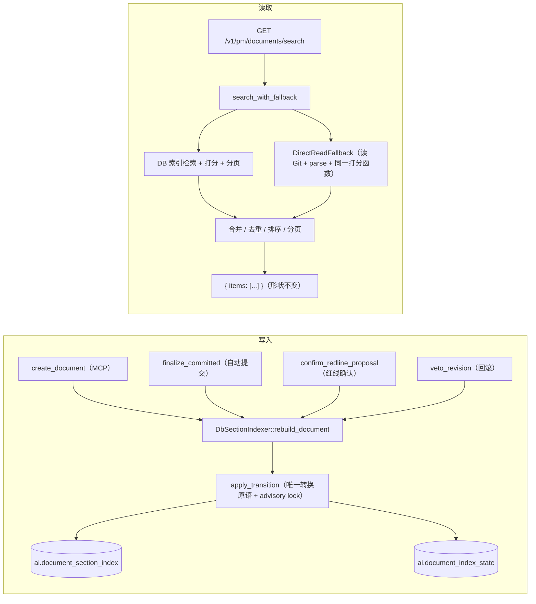

# T-060 · 知识索引层可替换化与完整检索（P6 后半 · 设计稿 v1.1）

> 状态：**修改后过稿（v1.1 已按评审意见修订，待复审）**
> 版本：v1.0（2026-11-02 落盘，Q1–Q4 + A-1~A-6 已裁定）→ **v1.1（2026-11-02 评审修订：并发一致性、版本边界、状态不变量、故障分级、检索正确性、性能验证、K-17~K-25）**
> 评审结论：修改后过稿；**不推翻现有架构，不扩大本期范围**。
> 一句话：把「每次检索都逐篇读 Git + 全量扫描」换成「落库章节索引 + 可替换端口 + 发布即重建 + 索引不可用时回退直读」，不引入分词扩展、不引入向量库、不改检索响应契约。
> 上位依据：`todo.md` §9 M6（T-060）、`docs/ai-pm-markdown-knowledge-space.md` §九/§十一（A 路径与可替换适配层）、`docs/ai-pm-knowledge-v2-implementation.md` §3（索引现状）、`migrations/0014_knowledge_v2.sql:60-79`、`migrations/0019_tenant.sql`（租户纪律）、`AGENTS.md` 规则 1（新项目无存量数据，直接改契约）。

---

## 0. 裁定与评审修订摘要

### 0.1 用户裁定（v1.0）

| 编号 | 问题 | 裁定 | 落地位置 |
|---|---|---|---|
| Q1 | 索引产物落在哪里 | **落 DB 派生表**（`ai.document_section_index`），`document_index_state` 保留为状态机 | §4 |
| Q2 | 增量触发点 | **写入后同步重建，事务外、失败降级**（不新增 job / 事件） | §5 |
| A-1 | veto 回滚重建范围 | **只重建生效的新修订**（被否决修订只标 `stale`） | §5.1 |
| A-2 | `create_document` 是否纳入 | **纳入**，四个写入点一条口径 | §5.1 |
| Q3 | 排序与向量 | **关键词 + 结构化加权，零扩展依赖**；不引入向量 | §6.2 |
| A-3 | 引用加成口径 | 只认**锚点存在于当前 published 修订**的 `knowledge_reference` | §6.2 |
| A-4 | 分页 | 响应体**不变**；只新增可选 `limit`/`offset`（缺省 20/0） | §6.3 |
| Q4 | 端口边界与外部依赖 | **trait 扩到「重建 + 检索」两个语义，单一 DB 实现，零外部依赖**；`MarkdownTreeIndexer` 降级为回退直读器 | §3 |
| A-5 | 状态写入 | 同步路径**不写 `pending`**，直接落 `indexed` / `stale` / `failed` | §4.2 |
| A-6 | 索引表内容 | 存章节文本字段，**不存 tsvector** | §4.1 |

### 0.2 评审修订（v1.1，逐条对应）

| # | 评审意见 | 修订 |
|---|---|---|
| 1 | 并发一致性：`indexed`/`stale`/`failed` 转换须由同一并发控制保护，锁不只保护成功 INSERT | §5.3「唯一状态转换原语」（锁内**重算前置条件**，含过期操作 `Superseded`）；K-17 |
| 2 | `index_version` 必须参与有效性判断；版本升级需全量重建入口 | §4.2 有效性三要素、§6.1 查询条件新增 `index_version`、§5.5 `POST /documents/reindex?project_id=`；K-18 / K-25 |
| 3 | 统一 `indexed`/`stale`/`failed` 与章节产物的约束；读路径漂移同样遵守 | §5.3 INV-1 / INV-2；读路径只经同一原语；K-19 |
| 4 | 故障回退：区分单篇失效与整体不可用，不得伪装成正常空结果 | §6.5 故障分级、§7 错误映射（新增 `KNOWLEDGE_INDEX_UNAVAILABLE` → 503）；K-20 |
| 5 | 检索正确性：空锚点加成保护、租户查询约束、混合分页测试 | §6.1 SQL（空锚点 + `tenant_id` 条件）、§6.5、K-21 / K-22 / K-24 |
| 6 | 性能验证：不假定毫秒级，补大文档重建耗时与章节数测试 | §5.6（删除「毫秒级」论断，改为实测回填 + 上限断言）；K-23 |
| 7 | 补 K-17~K-25 | §8 测试矩阵 |

---

## 1. 现状与缺口（实测证据）

| # | 事实 | 证据 | 后果 |
|---|---|---|---|
| 1 | 检索端点走内存扫描：`list_documents` → 逐篇 `read_document`（读 Git + 校验哈希）→ 整篇解析标题树 → 子串匹配 | `apps/pm-api/src/documents.rs:57-70`、`knowledge_index.rs:157-203` | 每次查询 O(文档数 × Git 读 × 全文扫描) |
| 2 | `KnowledgeIndexer` trait 已存在，但端点没用它；`search_with_fallback` 只有测试在调 | `knowledge_indexer.rs:33-47`、`apps/pm-api/tests/documents.rs:16` | 「可替换端口」只是名义存在 |
| 3 | 重建入口是游离函数 `index_revision`，不在 trait 里 | `knowledge_indexer.rs:179-243` | 「可替换」只有检索一半 |
| 4 | `ai.document_index_state` 只有状态、无索引产物；只有 `POST /reindex` 与 veto 写状态 | `migrations/0014_knowledge_v2.sql:60-79`、`documents.rs:339-360`、`knowledge_proposal/veto.rs:210-220` | 正常发布流程下大量修订「无状态行」 |
| 5 | `RetrievedSection.revision_hash` 恒为空串 | `knowledge_indexer.rs:105` | 证据回溯拿不到版本 |
| 6 | 打分只有标题 +2 / 正文 +1，硬截断 20 条，无分页、无引用加权 | `knowledge_index.rs:176-201` | 排序不可调、无法翻页、`knowledge_reference` 白建 |
| 7 | 迁移中 `CREATE EXTENSION` 只有 `pgcrypto` | `migrations/0001_core.sql:2` | 中文 `tsvector` / 向量扩展均不可用 |

---

## 2. 目标与非目标

**链路定位**（评审建议的架构表述，本稿以此为准）：

> 知识事实源（Git）→ 索引构建协议 → 可替换索引 Provider → 统一检索服务 → 可追溯证据

检索只是这条链路的出口；本切片建立的是**协议与边界**（产物形状、转换原语、有效性判定、回退契约），而不是「把 Markdown 搜索搬进 PostgreSQL」。

**目标**：索引可重建且幂等、状态与正文哈希及版本一致、哈希/版本漂移即失效、检索接口向后兼容、外部 provider 只需实现同一端口、证据可回溯。

**非目标**：不引入向量库、不引入分词扩展、不重写 Git 事实源、不新增后台作业/事件（归 T-061）、不做监控页、不做读时惰性重建。

---

## 3. 架构与端口

### 3.1 分层



- **端口与实现均在 `pm-application`**（与现状一致，该 crate 已依赖 sqlx/tracing）。
- `knowledge_index.rs` 退化为**纯解析 + 打分纯函数 + 回退直读扫描**。
- 回退器保留 Git 权威读路径（`knowledge::read_document`，含 `content_hash` 校验）。

### 3.2 端口契约

```rust
pub const DB_SECTION_PROVIDER: &str = "db-section";
pub const DB_SECTION_INDEX_VERSION: &str = "v1";

#[derive(Debug, Clone, Copy)]
pub struct SearchPage { pub limit: i64, pub offset: i64 } // 缺省 20 / 0，limit ∈ 1..=100

#[derive(Debug, Clone, Serialize)]
pub enum IndexOutcome {
    Indexed { sections: i64 },
    Stale,                          // 磁盘正文哈希 ≠ 修订哈希
    Failed { message: String },     // 文件缺失 / 无标题 / 解析失败
    Superseded,                     // 锁内前置条件已变化，本次操作无任何写入
}

#[async_trait]
pub trait KnowledgeIndexer: Send + Sync {
    fn provider(&self) -> &'static str;
    fn index_version(&self) -> &'static str;
    async fn rebuild_document(&self, project_id: Uuid, revision_id: Uuid)
        -> Result<IndexOutcome, KnowledgeError>;
    async fn search(&self, project_id: Uuid, query: &str, page: SearchPage)
        -> Result<Vec<SearchHit>, KnowledgeError>;
}
```

- `search` 在**索引基础设施不可用**时必须返回 `Err`（新增 `KnowledgeError::IndexUnavailable`），**不得返回空 Vec**（见 §6.5）。
- 删除的旧契约（`AGENTS.md` 规则 1，不留过渡层）：`IndexReference`、`RetrievedSection`、`index_document`、`index_revision`、`MARKDOWN_TREE_PROVIDER` / `MARKDOWN_TREE_INDEX_VERSION`。
- `SearchHit` 增 `revision_hash: String`（`#[serde(skip_serializing)]`）——供 D5 证据回溯，对 REST 响应**不可见**（守 A-4）。

---

## 4. 数据模型（迁移 `0024_knowledge_section_index.sql`）

> 编号说明：`0023` 已被 T-032 的未提交文件占用，本迁移取 `0024`。

### 4.1 DDL 草案

```sql
CREATE TABLE IF NOT EXISTS ai.document_section_index (
    id                   UUID PRIMARY KEY DEFAULT gen_random_uuid(),
    tenant_id            UUID NOT NULL,
    project_id           UUID NOT NULL,
    document_revision_id UUID NOT NULL,
    provider             TEXT NOT NULL,
    section_no           INT  NOT NULL,
    level                SMALLINT NOT NULL,
    title                TEXT NOT NULL,
    anchor               TEXT NOT NULL,
    content              TEXT NOT NULL,
    start_line           INT  NOT NULL,
    created_at           TIMESTAMPTZ NOT NULL DEFAULT now(),
    updated_at           TIMESTAMPTZ NOT NULL DEFAULT now(),
    UNIQUE (document_revision_id, provider, section_no)
);

CREATE INDEX IF NOT EXISTS idx_document_section_project
    ON ai.document_section_index (tenant_id, project_id, provider);
CREATE INDEX IF NOT EXISTS idx_document_section_revision
    ON ai.document_section_index (document_revision_id, provider);

ALTER TABLE ai.document_section_index
    ADD CONSTRAINT fk_document_section_tenant_project
        FOREIGN KEY (tenant_id, project_id) REFERENCES core.project (tenant_id, id);
ALTER TABLE ai.document_section_index
    ADD CONSTRAINT fk_document_section_tenant_revision
        FOREIGN KEY (tenant_id, document_revision_id)
        REFERENCES ai.document_revision (tenant_id, id) ON DELETE CASCADE;
```

要点（A-6）：
- 只存章节文本，不存 `tsvector`、不存 embedding；`content` 与 `parse_markdown_tree` 输出完全一致（保证索引与回退同源）。
- `section_no` = 解析顺序（含 level 0 的 `preamble`），重建时连续重排。
- 租户纪律按 `0019`：`tenant_id NOT NULL` + 两条 `(tenant_id, *)` 组合外键（`uq_document_revision_tenant_id` 已存在）。
- `provider` 为维度列；`(document_revision_id, provider)` 唯一键在 `document_index_state` 上已存在。
- `tenant_schema.rs` 的 `TENANT_TABLES` 从 40 增至 41。

### 4.2 有效性判定（评审项 2）

一条章节行「可用于检索」当且仅当同时满足：

| 条件 | 字段 |
|---|---|
| provider 匹配 | `s.provider = st.provider = 当前 provider` |
| 状态有效 | `st.status = 'indexed'` |
| 版本匹配 | `st.index_version = 当前 index_version` |
| 哈希匹配 | `st.indexed_content_hash = revision.content_hash` |

任一不匹配 → 该修订**不可用索引**，进入回退路径（§6.5）。**不允许**「版本旧但哈希对」仍用旧产物。

### 4.3 状态机

| status | 含义 | 章节产物 | 写入点 |
|---|---|---|---|
| `indexed` | 产物齐全、哈希与版本均匹配 | 必须 > 0 行 | 重建成功（唯一原语） |
| `stale` | 磁盘正文与修订哈希不一致 | **必须为 0 行** | 重建遇漂移；读路径发现漂移（同一原语） |
| `failed` | 文件缺失 / 无标题 / 解析失败 | **必须为 0 行** | 重建失败（唯一原语） |
| `pending` | 同步路径**不再写入**（CHECK 保留，不删枚举） | — | 无 |

---

## 5. 重建语义与触发点

### 5.1 四个触发点（Q2 / A-1 / A-2）

| # | 位置 | 现状 | 改动 |
|---|---|---|---|
| 1 | `knowledge::create_document`（`knowledge.rs:264-336`） | 返回 `CreatedDocument` 无 `revision_id` | `INSERT ... RETURNING id`；`tx.commit()` 后调 `rebuild_document` |
| 2 | `submit_proposal` 自动提交（`submit.rs:152-178`） | 经 `finalize_committed` 写库 | 删除 `document_index_state(pending)` 插入；调用方取 `revision_id` 后重建 |
| 3 | `confirm_redline_proposal`（`submit.rs:182-251`） | 同上 | 同上 |
| 4 | `veto_revision`（`veto.rs:5-121`） | tx 内：被否决修订标 stale，上一修订插 `pending` | tx 内仅改业务状态；提交后：被否决修订 `apply_transition(Stale)`（清空产物），生效修订 `rebuild_document`（A-1） |

`knowledge_migrate` 走 `submit_proposal`，自动获得索引。

### 5.2 重建流程（`rebuild_document`）

1. 按 `project_id + revision_id` 查 `canonical_path` / `content_hash` / `tenant_id` / `status` → 缺失 `NotFound`；非 `published` → `Conflict`（手动 reindex 同受此约束）。
2. 读文件（`safe_join`）、算哈希、解析标题树，构造 `Transition`（`Indexed{sections}` / `Stale` / `Failed`）。
3. 交给 `apply_transition`（§5.3）：锁内**重算**前置条件（可能降级为 `Stale`/`Failed`，或返回 `Superseded`）；`rebuild_document` 自身**不写**状态与产物。

### 5.3 唯一状态转换原语（评审项 1、3）

```rust
enum Transition {
    Indexed { sections: Vec<SectionRow> }, // 章节由解析结果给出
    Stale { reason: String },
    Failed { message: String },
}

/// 唯一写入索引产物与状态的入口；任何路径（发布 / 手动 reindex / 读路径漂移 / veto）都只能调它。
async fn apply_transition(
    pool: &PgPool, tenant_id: Uuid, project_id: Uuid,
    revision_id: Uuid, provider: &str, t: Transition,
) -> Result<IndexOutcome, KnowledgeError>
```

单事务内步骤：

1. **取得锁**：`SELECT pg_advisory_xact_lock(hashtextextended('ai.document_section_index:' || $revision_id || ':' || $provider, 0))`（与 `task_dependency.rs:97` 同一手法）。锁粒度 = `(revision, provider)`，成功重建、`stale` 清理、`failed` 清理**共用同一把锁**。
2. **锁内重算前置条件**（关键：不信任锁外观测，避免「旧操作删掉新产物」）：
   - 重读修订行：仍为 `published`、属于 `project_id` / `tenant_id`；
   - 重读磁盘文件并计算哈希 `h_disk`；
   - 若 `t = Indexed` 且 `h_disk ≠ revision.content_hash` → **就地降级**为 `Stale`，继续执行清理；
   - 若 `t = Indexed` 且解析无标题 → **就地降级**为 `Failed`；
   - 若 `t = Stale` 且 `h_disk = revision.content_hash`（别人刚修好）→ **`Superseded`**：不写状态、不删产物，直接返回；
   - 若 `t = Failed` 且当前状态已是 `indexed` 且哈希/版本匹配 → `Superseded`。
3. **按最终 transition 执行（同一事务）**：
   - `Indexed`：`DELETE` 该 `(revision, provider)` 旧产物 → 批量 `INSERT` 新产物 → `UPSERT state(indexed, indexed_content_hash = revision.content_hash, index_version = 当前版本, indexed_at = now(), last_error = NULL)`。
   - `Stale` / `Failed`：`DELETE` 该 `(revision, provider)` **全部**产物 → `UPSERT state(status = stale|failed, indexed_content_hash = NULL, last_error = reason)`。
4. 提交后返回 `IndexOutcome`；`tracing` 记录。

**不变量（K-19 全路径断言）**：
- **INV-1**：`status ≠ 'indexed'` ⇒ 该 `(revision, provider)` 章节行数 = 0。
- **INV-2**：`status = 'indexed'` ⇒ `indexed_content_hash = revision.content_hash` ∧ `index_version = 当前版本` ∧ 章节行数 > 0。
- 读路径发现哈希漂移时**必须**走 `apply_transition(Stale)`（清空产物），**禁止**直接 `UPDATE status`。
- 本表不引入触发器：不变量由「唯一原语 + 锁内重算」保证，并由 K-17/K-19 在全部路径验证（含并发交错）。

### 5.4 失败策略

- 四个调用点统一调 `rebuild_quietly(...)`：`Indexed` → `info!(knowledge_index_rebuilt)`；`Stale` / `Superseded` → `warn`/`debug`；`Failed` / DB 错误 → `warn!(knowledge_index_failed)`。
- **发布成功与否只由权威写入决定**：索引失败不阻断、不回滚、不重试；状态留痕，检索自动回退。
- 幂等：同一修订重复执行结果一致（删后插 + UPSERT + 锁内前置条件重算）。

### 5.5 版本升级与全量重建入口（评审项 2）

- 单修订：保留 `POST /v1/pm/documents/revisions/{revision_id}/reindex`（只允许 `published`）。
- **项目级全量**：新增 `POST /v1/pm/documents/reindex?project_id=` → 顺序遍历该项目**全部 published 修订**，逐个 `rebuild_document`；响应 `{ reindexed, stale, failed, superseded }`（只返回计数，不返回逐条明细）。
- `index_version` 上调（如 `v1` → `v2`）后的**既定动作**：改常量 → 全部行自动失效（§4.2）→ 调项目级全量重建 → 恢复直查。不做自动后台触发，不做双版本并存（`AGENTS.md` 规则 1）。
- 项目级入口带 `project_in_tenant` 边界校验，与其余端点一致。

### 5.6 性能验证（评审项 6）

- 本稿**撤回 v1.0 中「毫秒级」的论断**：重建成本 = 解析 + 章节行插入 + 锁等待，随章节数线性增长，具体值必须实测。
- 验证方式（K-23）：构造 ≥ 200 个标题、≥ 200 KB 的 Markdown，在测试库执行一次重建，断言（a）章节行数与标题数一致、（b）`indexed` 状态与哈希一致、（c）耗时不超过 **10 s**（防病态退化的宽松上限，不是 SLA）；耗时同时 `info!` 输出并在实施后回填本节实测值。
- 回归保护：该用例随 `knowledge_index_v2.rs` 常态运行（不 `#[ignore]`），保证任何让重建退化为秒级以上的改动都会被看见。

### 5.7 为什么不做后台 job（被否方案记录）

`integration.job` 与 `OutboxWorker` 可用，但新增作业类型意味着（a）新建 worker 循环、（b）处理「已发布未索引」窗口、（c）与 T-061 事件语义重叠。发布点唯一的额外 IO 是刚写完的 Git 文件，失败已降级处理；按 YAGNI 否决。**若 K-23 实测显示发布请求不可接受**，再单独开切片改为异步——不在本稿内预留开关。

---

## 6. 检索、排序与回退（Q3 / A-3 / A-4）

### 6.1 主路径：单条 SQL

```sql
-- $1 project_id, $2 归一化 needle(lower), $3 provider, $4 limit, $5 offset,
-- $6 当前 index_version, $7 tenant_id
WITH latest AS (
  SELECT d.id AS document_id, d.doc_key, d.doc_type, d.canonical_path,
         d.tenant_id, r.id AS revision_id, r.content_hash
    FROM ai.project_document d
    JOIN LATERAL (
      SELECT id, content_hash FROM ai.document_revision
       WHERE document_id = d.id AND status = 'published'
       ORDER BY revision_no DESC LIMIT 1
    ) r ON true
   WHERE d.project_id = $1 AND d.tenant_id = $7          -- 租户显式约束（评审项 5）
), base AS (
  SELECT l.*, s.section_no, s.level, s.title, s.anchor, s.content, s.start_line,
         (CASE WHEN lower(s.title) = $2 THEN 6
               WHEN strpos(lower(s.title), $2) > 0 THEN 3
               WHEN strpos(lower(s.anchor), $2) > 0 THEN 2
               ELSE 0 END)
       + LEAST(3, (length(lower(s.content)) - length(replace(lower(s.content), $2, '')))
               / greatest(length($2), 1)) AS raw
    FROM ai.document_section_index s
    JOIN latest l ON l.revision_id = s.document_revision_id
    JOIN ai.document_index_state st
      ON st.document_revision_id = l.revision_id
     AND st.provider = $3
     AND st.status = 'indexed'
     AND st.index_version = $6                            -- 版本参与有效性（评审项 2）
     AND st.indexed_content_hash = l.content_hash         -- 哈希一致
   WHERE s.provider = $3
), scored AS (
  SELECT base.*,
         ((raw * CASE doc_type WHEN 'architecture' THEN 12
                             WHEN 'decision'     THEN 12
                             WHEN 'requirement'  THEN 11
                             ELSE 10 END) + 5) / 10 AS score,
         CASE WHEN EXISTS (
           SELECT 1 FROM ai.knowledge_reference kr
            WHERE kr.document_revision_id = base.revision_id
              AND base.anchor <> ''                       -- 空锚点不参与加成（评审项 5）
              AND kr.section_anchor IS NOT NULL
              AND kr.section_anchor <> ''                 -- 空引用锚点不参与加成
              AND kr.section_anchor = base.anchor
         ) THEN 2 ELSE 0 END AS ref_boost
    FROM base
   WHERE raw > 0
)
SELECT *, score + ref_boost AS total FROM scored
 ORDER BY total DESC, canonical_path, start_line, section_no
 LIMIT $4 OFFSET $5;
```

### 6.2 打分口径

| 项 | 分值 |
|---|---|
| 标题全等（大小写不敏感） | 6 |
| 标题包含 | 3 |
| 锚点包含 | 2 |
| 正文出现次数 | `min(3, count)` |
| 文档类型权重 | `architecture`/`decision` ×1.2、`requirement` ×1.1、`knowledge` ×1.0（整数落为 `(base*w+5)/10`） |
| 引用加成 | +2；仅当 `document_revision_id` = 当前 published 修订、`section_anchor` 与章节 `anchor` 均**非空**且相等（A-3 + 评审项 5） |

- 同分次序：`canonical_path` → `start_line` → `section_no`。
- 回退路径用 `knowledge_index::score_section(...)` 纯函数，公式逐项对应（含空锚点保护）；K-14 钉住两路径等价。

### 6.3 分页与响应（A-4）

- `SearchQuery` 增 `limit`/`offset`（缺省 20 / 0；`limit` 夹在 `1..=100`，`offset` 负数按 0）。
- 响应仍是 `{ "items": [ SearchHit… ] }`，字段集合与改造前**完全一致**；`revision_hash` 不进 JSON。
- 前端 `frontend/src/api/documents.ts` 无需改动。

### 6.4 回退合并（`search_with_fallback`）

1. 取每篇文档最新 published 修订 + 该 provider 状态（一次查询，带 `tenant_id`）。
2. 分类：满足 §4.2 四要素 → DB 路径；否则 → 回退候选。
3. DB 路径：跑 §6.1（取 `limit + offset` 条）。
4. 回退候选：逐篇 `read_document`（哈希校验失败 → 该篇作废并 `apply_transition(Stale)`）→ `parse_markdown_tree` → `score_section`，取前 `limit + offset` 条。
5. 合并按 `(document_id, anchor)` 去重（DB 优先）→ 统一排序 → 跳过 `offset` → 取 `limit`。
6. 返回 `FallbackSearchResult { used_fallback, stale_revision_ids, hits }`；handler 只序列化 `hits`。

### 6.5 故障分级（评审项 4）

| 故障 | 判定 | 行为 |
|---|---|---|
| **单篇索引不可用**（`stale` / `failed` / 无状态 / 版本不符 / 哈希不符） | 该修订 | 仅该篇走回退直读；其余篇正常出结果；`used_fallback = true`（内部可见） |
| **单篇回退也失败**（文件缺失 / IO 错误） | 该篇 | 该篇缺席，`warn!` 记录；请求整体仍 `200` |
| **索引基础设施故障**（查状态/查章节 SQL 失败、连接池耗尽、`document_index_state` 不可读） | 全局 | 返回 `Err(KnowledgeError::IndexUnavailable)` → **HTTP 503** `KNOWLEDGE_INDEX_UNAVAILABLE`；**绝不**返回 `200 { items: [] }` |
| **Git 根不可读**（`KnowledgeRoot` 缺失 / 权限错误） | 全局 | 同上 `503` |
| **确无匹配** | — | `200 { items: [] }`（唯一允许空结果的场景） |

判定原则：**只有「查询确实没命中」才允许空结果**；任何基础设施层失败都必须以非 2xx 暴露，避免前端把故障当「没数据」。

---

## 7. 错误处理与可观测性

| 场景 | 错误 | HTTP |
|---|---|---|
| 文件不存在 / IO 失败（重建） | `IndexOutcome::Failed` → 状态 `failed` | 发布不受影响；手动 reindex 返回 500 `KNOWLEDGE_INTERNAL` |
| 磁盘哈希 ≠ 修订哈希（重建） | `IndexOutcome::Stale` → 状态 `stale`，产物清空 | 手动 reindex → 409 `KNOWLEDGE_DOCUMENT_STALE`（沿用既有映射） |
| 无 Markdown 标题 | `IndexOutcome::Failed` | reindex → 409 `KNOWLEDGE_CONFLICT` |
| 锁内前置条件已变化 | `IndexOutcome::Superseded` | reindex → 409（提示「状态已变化，请重试」） |
| 手动 reindex 指向非 published 修订 | `KnowledgeError::Conflict` | 409 |
| 同一修订并发转换 | advisory lock 串行化；`UNIQUE(document_revision_id, provider, section_no)` 兜底 | — |
| 索引/状态查询或连接池故障 | `KnowledgeError::IndexUnavailable` | **503** `KNOWLEDGE_INDEX_UNAVAILABLE` |
| 跨租户 | 组合外键拒绝；所有查询显式带 `tenant_id` | 404 / 403 由 `project_in_tenant` 处理 |

日志（本期只做日志；指标/监控页归 T-061）：
- `info!` `knowledge_index_rebuilt`（provider / revision_id / sections / elapsed_ms）
- `warn!` `knowledge_index_failed`（provider / revision_id / outcome / error）
- `warn!` `knowledge_index_superseded`（provider / revision_id）
- `info!` `knowledge_search_fallback`（project_id / stale_count / infra=false）
- `error!` `knowledge_search_unavailable`（project_id / error）

---

## 8. 测试矩阵

> 评审项 7：实现可合并测试，但每条不变量必须有断言。

| ID | 用例 | 断言 | 文件 |
|---|---|---|---|
| K-01 | 解析纯函数回归 | 现有 `parse_markdown_tree` 5 例全绿 | `knowledge_index.rs`（既有） |
| K-02 | 重建落库 + 幂等 | 章节行数 = 标题数（含 preamble）；连跑两次行数不变、`section_no` 连续；`indexed` 且哈希/版本一致 | `crates/pm-application/tests/knowledge_index_v2.rs` |
| K-03 | 哈希漂移即失效 | 改盘上文件 → 重建 → `stale` 且章节清零；检索不出旧内容 | 同上 |
| K-04 | 发布即索引：`create_document` | 返回后章节与 `indexed` 状态就位 | 同上 |
| K-05 | 发布即索引：`submit_proposal` 自动提交 | 提交后立即可检索 | 同上 |
| K-06 | 发布即索引：红线确认 | 确认后索引就位 | 同上 |
| K-07 | veto 回滚 | 被否决修订 `stale` 且章节删除；生效修订被重建；检索只出回滚后正文 | 同上 |
| K-08 | 打分次序 | 标题全等 > 标题包含 > 锚点 > 仅正文；同分按 path/line | 同上 |
| K-09 | 类型权重 | 同样命中下 `decision` 排在 `knowledge` 前 | 同上 |
| K-10 | 引用加成 | 当前修订被引用章节 +2；历史修订引用不加成 | 同上 |
| K-11 | 分页 | `limit=5&offset=5` 返回第 6–10 条；缺省 20；`limit>100` 夹紧 | 同上 |
| K-12 | 响应兼容 | REST JSON 字段集合与改造前一致（无 `revision_hash`） | `apps/pm-api/tests/documents.rs` |
| K-13 | 回退语义 | 状态缺失/`failed` 时回退直读仍能命中；`used_fallback` 只在内部 | `knowledge_index_v2.rs` |
| K-14 | 两路径打分一致 | 同一文档「索引态」与「强制回退态」排名与分值相同 | 同上 |
| K-15 | 租户结构不变量 | 新表进 `TENANT_TABLES`（41 张），`tenant_id NOT NULL` + 两条组合外键 | `crates/pm-infrastructure/tests/tenant_schema.rs` |
| K-16 | 迁移可重复 | `0024` 空库应用成功，表/索引/约束齐备 | `crates/pm-infrastructure/tests/migration_0024.rs` |
| **K-17** | **并发一致性（评审 1）** | 对同一 `(revision, provider)` 并发执行「重建」与「漂移清理」：两者串行化；后到旧操作返回 `Superseded` 且**不删除**新产物；结束后 INV-1/INV-2 成立 | `knowledge_index_v2.rs` |
| **K-18** | **版本参与有效性（评审 2）** | 把 state 的 `index_version` 改为 `v0` → 检索走回退、不返回旧索引内容；全量重建后恢复 DB 直查 | 同上 |
| **K-19** | **状态-产物不变量（评审 3）** | 遍历全部路径（成功 / 哈希漂移 / 无标题 / veto / 读路径漂移）：`status ≠ indexed ⇒ 章节=0`；`indexed ⇒ 章节>0 ∧ 哈希 ∧ 版本一致` | 同上 |
| **K-20** | **故障不伪装空结果（评审 4）** | 注入状态/章节查询失败 → `KNOWLEDGE_INDEX_UNAVAILABLE`（503），响应不是 `200 {items:[]}`；真无匹配时才 200 空 | `apps/pm-api/tests/documents.rs` |
| **K-21** | **空锚点保护（评审 5）** | 章节 `anchor=''` 与 `section_anchor=NULL/''` 的引用均不产生 +2；非空相等才 +2 | `knowledge_index_v2.rs` |
| **K-22** | **租户约束（评审 5）** | 构造两租户同构数据，检索只出本租户结果；SQL 显式 `tenant_id` 条件生效 | 同上 |
| **K-23** | **大文档性能（评审 6）** | ≥200 标题、≥200 KB：章节行数正确、状态一致、耗时 ≤ 10 s（宽松上限），并输出实测值 | 同上 |
| **K-24** | **混合分页（评审 5）** | 部分文档走 DB、部分走回退：合并后 `limit/offset` 无重复、无缺口，顺序稳定（复跑两次一致） | 同上 |
| **K-25** | **版本升级全量入口（评审 2）** | `POST /documents/reindex?project_id=` 覆盖全部 published 修订，返回 `{reindexed, stale, failed, superseded}` 计数正确 | 同上 |

T-060 验收四条 ↔ 用例：可重建且幂等 → K-02；状态与正文哈希一致 → K-02/K-03/K-19；接口向后兼容 → K-12（+K-11）；哈希漂移索引失效 → K-03/K-19。评审七项 ↔ K-17~K-25 如上。

---

## 9. 不做与风险

**不做**：向量检索、中文分词扩展、后台索引作业、outbox 事件、监控页、自动修复索引失败（只在读路径标记 + 回退）、读时惰性重建、历史修订章节的历史查询视图、双版本索引并存。

**风险与缓解**：
1. **打分公式两处实现（SQL / Rust）漂移** → K-14 钉住等价；公式只在 §6.2 维护，改动必须双改并跑 K-14/K-21。
2. **同步重建拉长发布请求** → 实测由 K-23 守卫（10 s 上限）；失败降级；若实测不可接受，另开切片改异步（本稿不预留开关）。
3. **回退路径仍是 O(文档数)** → 只在异常状态触发；正常路径全走 DB。
4. **`ILIKE` 级全表扫** → 单项目章节量级可接受；换 FTS 只替换端口实现，不动契约。
5. **版本升级需要全量重建** → 由 §5.5 项目级入口承接；旧版本产物自动失效（不会误用），退化为回退直读（不会丢结果）。
6. **迁移号冲突** → `0023` 属 T-032；本稿用 `0024`。

---

## 10. 实施清单（文件级）

| 文件 | 改动 |
|---|---|
| `migrations/0024_knowledge_section_index.sql` | 新建（§4.1） |
| `crates/pm-application/src/knowledge_indexer.rs` | 端口新契约 + `DbSectionIndexer` + `apply_transition`（锁内重算前置条件）+ `DirectReadFallback` + `search_with_fallback` + `rebuild_quietly` |
| `crates/pm-application/src/knowledge_index.rs` | 保留解析；新增 `score_section`（含空锚点保护）；`search_documents` 更名 `scan_documents_direct`（仅回退用）；`SearchHit` 增 `revision_hash`（不序列化） |
| `crates/pm-application/src/knowledge.rs` | `CreatedDocument` 增 `revision_id`；`create_document` 提交后重建；`KnowledgeError` 增 `IndexUnavailable` |
| `crates/pm-application/src/knowledge_proposal/{submit,veto}.rs` | 删 `pending` 插入；提交后重建；veto 用 `apply_transition(Stale)` + 重建生效修订 |
| `apps/pm-api/src/documents.rs` | `search_handler` 走 `search_with_fallback` + `tenant_id` + `limit`/`offset`；`reindex_handler` 改 `DbSectionIndexer`；新增项目级 `reindex_project_handler`；`error_response` 增 503 映射 |
| `apps/pm-api/src/routes.rs` | 新增 `POST /v1/pm/documents/reindex`（§5.5） |
| `crates/pm-application/src/lib.rs` | 重导出更新 |
| `crates/pm-infrastructure/tests/tenant_schema.rs` | 表清单加新表（40 → 41） |
| `crates/pm-infrastructure/tests/migration_0024.rs` | 新建 |
| `crates/pm-application/tests/knowledge_v2.rs`、`apps/pm-api/tests/documents.rs` | 适配新契约 + K-12 / K-20 |
| `crates/pm-application/tests/knowledge_index_v2.rs` | 新建（K-02~K-11、K-13、K-14、K-17~K-25） |
| `docs/ai-pm-knowledge-v2-implementation.md` | 实施完成后回填「索引层 V2」章节与 K-23 实测耗时 |

**验收命令**：`cargo test --workspace`、`cargo check --workspace --all-targets`（`todo.md` §0.2 通用命令）。

---

## 11. 与后续切片的接口

- **T-061**：本稿不写 outbox 事件；`knowledge_index_failed` / `knowledge_search_unavailable` 日志与 `document_index_state` 可直接作为后续指标来源。
- **D5（T-042/T-043）**：`SearchHit.revision_hash`（内部字段）与 `locator`（anchor/start_line）即证据回填所需的版本与定位信息。
- **未来 provider（PageIndex / 向量）**：实现同一 trait（`provider` / `index_version` / `rebuild_document` / `search`），并复用 §4.2 四要素有效性判定与 §5.3 转换原语；切换不改业务调用点。
