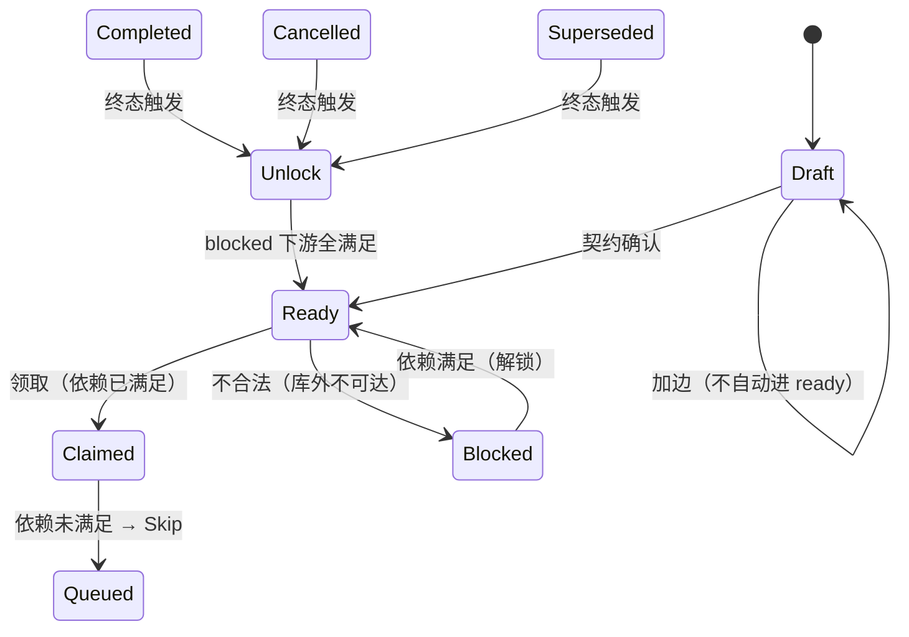

# Task 依赖与解锁 v1（T-023 设计稿）

> 状态：**已实施（T-024 交付，见 §10）**
> 日期：2026-11-01
> 一句话：用独立边表 `delivery.task_dependency` 表达「任务 → 前置任务」，写边时用递归 CTE 拒绝环，上游进入终态时在同一事务里解锁下游并投递 `TaskReady`。
> 上位依据：`target.md` §P1「Task 依赖」、`docs/ai-pm-task-state-machine-v1.md`（13 态与 B3 `Blocked→Ready`）、`docs/ai-pm-slice-d-execution-pipeline-v1.md`（D1 领取与 outbox）、`todo.md` T-023。
> 用户已裁定四项：独立边表 / 写边时检环 / 禁止跨项目 / 终态发 `TaskReady`。

---

## 1. 问题与实测现状

| # | 事实 | 证据 |
|---|---|---|
| F1 | 全库**零依赖载体**：没有 `task_dependency` / `depends_on` / `blocked_by` 任何表或列 | `grep -r "task_dependency\|depends_on\|blocked_by" migrations crates` 无命中 |
| F2 | `delivery.task_waiting` 只表达「这个任务此刻在等什么原因」，不是可持久化的任务间关系 | `0010_task_state_machine.sql:90-107`：`reason IN (needs_info, needs_decision, needs_approval, external_dependency)`，同一任务只允许一条活跃行 |
| F3 | 调度侧只按 Run 状态选候选，不检查任务依赖 | `run_dispatch/claim.rs:230-262`（候选 = `queued` 到期 / `claimed` 租约过期） |
| F4 | 消费侧只有 `TaskReady` 一个 handler，创建流程不关心依赖 | `pm-infrastructure/src/outbox_handlers.rs:39-124` |
| F5 | 进入 `ready` 时命令通道已经会投递 `TaskReady`（幂等键 `task:<id>:TaskReady:rev<revision>`） | `command_executor/executor.rs:229-238`、`command_executor/guards.rs:9-15` |
| F6 | `Blocked → Ready` 是合法边；`Ready → Blocked` **不合法** | `pm-domain/src/task_transition.rs:41`、边表 36-57 |

结论：依赖关系需要新载体；调度侧要一个「依赖满足」判定；解锁必须复用既有 outbox 幂等通道，不能旁路插 Run。

---

## 2. 四项裁定（用户已确认）

| # | 决策 | 结论 |
|---|---|---|
| D1 | 载体 | 独立边表 `delivery.task_dependency`；`task_waiting` 维持原语义 |
| D2 | 环检测 | 写边事务内递归 CTE 检测，有环 → `409` |
| D3 | 跨项目 | 禁止；同一 `project_id` 由两条复合外键保证，API 预检给 `409` |
| D4 | 解锁 | 上游进入终态时，同事务把满足依赖的 `blocked` 下游迁到 `ready`，并写 `TaskReady` 事件 |

补充裁定（设计需要，明确记录为「本稿决定」）：

- **D5 状态语义**：前置「已满足」= 上游状态 ∈ `{completed, cancelled, superseded}`。三者都是终态，`cancelled/superseded` 若不算满足会让下游永久阻塞。
- **D6 建边时机**：只允许给 `draft` / `blocked` 任务加边；`ready` 及之后的状态返回 `409 task_not_pending`。理由：`Ready → Blocked` 不是合法边，已就绪任务再加未满足依赖无法回退。
- **D7 建边不自动改状态**：`draft` 任务加边后仍是 `draft`；是否进 `ready` 由用户/命令通道决定。`blocked` 任务加边后若依赖已全满足则立即解锁（见 §5）。
- **D8 删边不级联改状态**：删边后同样做一次解锁判定（可能使 `blocked` 下游变为 `ready`）。

---

## 3. 数据模型

### 3.1 DDL 草案（`migrations/0021_task_dependency.sql`）

```sql
-- 0021_task_dependency: Task 前置依赖（T-023/D1）
-- 依据：docs/ai-pm-task-dependency-v1.md §3
-- 原则：forward-only；新表；同项目由复合外键保证。

CREATE TABLE delivery.task_dependency (
    id                  UUID PRIMARY KEY DEFAULT gen_random_uuid(),
    tenant_id           UUID NOT NULL,
    project_id          UUID NOT NULL,
    task_id             UUID NOT NULL,          -- 下游（依赖方）
    depends_on_task_id  UUID NOT NULL,          -- 上游（被依赖方）
    created_by          UUID NOT NULL REFERENCES core.principal(id),
    created_at          TIMESTAMPTZ NOT NULL DEFAULT now(),

    UNIQUE (task_id, depends_on_task_id),
    UNIQUE (tenant_id, id),
    CHECK (task_id <> depends_on_task_id),

    FOREIGN KEY (tenant_id, project_id) REFERENCES core.project (tenant_id, id),
    -- 两条外键共用同一个 project_id：跨项目边在库层不可表示（D3）
    FOREIGN KEY (project_id, task_id)
        REFERENCES delivery.task (project_id, id) ON DELETE CASCADE,
    FOREIGN KEY (project_id, depends_on_task_id)
        REFERENCES delivery.task (project_id, id) ON DELETE CASCADE
);

CREATE INDEX idx_task_dependency_upstream
    ON delivery.task_dependency (project_id, depends_on_task_id);
```

要点：

- `(tenant_id, id)` 唯一键满足 T-021b 的组合外键目标要求（ADR-0001 I5）。
- 边表自身是租户业务表：`tenant_id NOT NULL` + `(tenant_id, project_id) → core.project`。
- `ON DELETE CASCADE` 与 `task_acceptance_criterion` 同款；任务删除（当前无入口）时不留悬空边。

### 3.2 不变量

1. 同一对 `(task_id, depends_on_task_id)` 至多一条边。
2. 边两端必须同项目（库层保证）。
3. 不允许自依赖（`CHECK`）。
4. 不允许有向环（应用层写时保证，见 §4.2）。

---

## 4. 写边/删边接口

### 4.1 端点

| 方法 | 路径 | 语义 |
|---|---|---|
| GET | `/v1/pm/tasks/{task_id}/dependencies` | 返回 `{task_id, upstream: [...], downstream: [...]}`，元素为 `{id, title, status}` |
| POST | `/v1/pm/tasks/{task_id}/dependencies` | body `{depends_on_task_id}`；为 `task_id` 增加一条**指向前置**的边 |
| DELETE | `/v1/pm/tasks/{task_id}/dependencies/{depends_on_task_id}` | 删除边；幂等（不存在也返回 204） |

- 可见性：三条端点都先走 T-022 的 `project_visible`（成员才可见）；不可见即 `404`，不泄露存在性。
- 审计：`governance.audit_log` 写 `action = 'task.dependency.add' / 'task.dependency.remove'`，`target_type='task'`，`target_id = task_id`，`after_data` 带 `depends_on_task_id`。
- 事务：建边/删边各自单事务；写审计与解锁判定同事务。

### 4.2 建边校验顺序（同一事务）

1. 锁下游任务行（`FOR UPDATE`）→ 不存在/不可见 `404`。
2. 白名单校验 `depends_on_task_id`（同项目、存在、可见）→ 不满足 `404`。
3. 自依赖 → `409 SELF_DEPENDENCY`。
4. 下游状态必须 ∈ `{draft, blocked}` → 否则 `409 TASK_NOT_PENDING`。
5. 重复边（唯一键预检）→ `409 DUPLICATE_DEPENDENCY`。
6. **环检测**（递归 CTE）：若「新上游」沿现有边能回到 `task_id`，则拒绝 `409 DEPENDENCY_CYCLE`。
7. 插边 + 审计 + 解锁判定（D7/D8）。

环检测 SQL：

```sql
WITH RECURSIVE ancestors AS (
    SELECT $upstream::uuid AS id
    UNION
    SELECT d.depends_on_task_id
      FROM delivery.task_dependency d
      JOIN ancestors a ON d.task_id = a.id
     WHERE d.project_id = $project
)
SELECT EXISTS (SELECT 1 FROM ancestors WHERE id = $task);
```

### 4.3 错误码

| code | HTTP | 触发 |
|---|---|---|
| `task_not_found` | 404 | 任务不存在 / 非成员 |
| `SELF_DEPENDENCY` | 409 | `task_id == depends_on_task_id` |
| `TASK_NOT_PENDING` | 409 | 下游状态不在 `draft/blocked` |
| `DUPLICATE_DEPENDENCY` | 409 | 边已存在（含并发唯一键冲突） |
| `DEPENDENCY_CYCLE` | 409 | 递归 CTE 命中 |

---

## 5. 依赖满足判定与解锁

### 5.1 单一判定函数

应用层提供**唯一**判定：

```rust
/// 任务的全部前置是否都已满足（D5：completed / cancelled / superseded）。
pub(crate) async fn dependencies_satisfied(
    tx: &mut Transaction<'_, Postgres>, project_id: Uuid, task_id: Uuid,
) -> Result<bool, sqlx::Error>;
```

SQL：

```sql
SELECT NOT EXISTS (
    SELECT 1 FROM delivery.task_dependency d
      JOIN delivery.task u ON u.id = d.depends_on_task_id
     WHERE d.project_id = $1 AND d.task_id = $2
       AND u.status NOT IN ('completed', 'cancelled', 'superseded')
);
```

调度、解锁、建边/删边后的判定全部复用它，禁止各写一套谓词。

### 5.2 领取判定（`claim_core`）

候选 Run 锁住之后（`claim.rs` 候选选择与 fencing 之间）插入：

1. `dependencies_satisfied(&mut tx, project_id, task_id)`。
2. 若为 `false`：把该 Run 释放回 `queued`，`release_reason = 'dependency_unmet'`，`dispatch_attempts + 1`，指数退避（复用现有 `release_back`），返回 `ClaimKind::Skipped`。
3. Model A（指定 task 领取）与 Model B（worker 扫描）走**同一条**判定，不复制逻辑。

> 注意：Unmet 依赖不把 Run 判失败、不改任务状态、不写 `task_run_failure`——它只是「此刻还不能执行」。

### 5.3 解锁触发

在**唯一受守卫的状态迁移入口** `apply_task_transition`（`command_executor/transition.rs`）末尾追加：

- 目标状态 ∈ `{completed, cancelled, superseded}`（D5 的终态集合）时，调用 `unlock_downstream(tx, ctx.project_id, 上游 task_id)`。

`unlock_downstream` 的行为（同一事务）：

1. 查询所有 `depends_on_task_id = 上游` 的下游任务，`ORDER BY task_id` 加锁（固定顺序防死锁）。
2. 对每个下游：
   - 若 `status = 'ready'`：**什么都不做**。该任务进 `ready` 时已经投递过 `TaskReady`，`queued` Run 仍在；依赖满足后领取自然通过。
   - 若 `status = 'blocked'` 且 `dependencies_satisfied`：调用 `apply_task_transition(downstream, Ready, for_dispatch, system_context)`（`Blocked→Ready` 合法），随后用 `PgOutboxAppend` 在**同一事务**写 `TaskReady`。
   - 其他状态（`draft/claimed/running/…`）：不动作。
3. 幂等键：`task:<downstream>:TaskReady:rev<resulting_revision>`，与命令通道约定一致；重复解锁不会产生第二条事件。

> 是否需要在解锁时额外投递 `TaskReady` 给已 `ready` 的下游？**不需要**，也不再重复投递——避免同一语义事件出现两个键。
>
> 为什么不在 `TaskReadyHandler` 里加依赖判定？现有 handler 的语义是「排队」，执行资格由领取侧负责（D1 既有裁定）。若 handler 判依赖，`ready` 且依赖未满足的任务会**永远**拿不到 Run，解锁侧必须再补一条「补投递」逻辑，复杂度高于在领取侧跳过。

### 5.4 解锁后的可观测性

- 解锁迁移写 `audit_log`（`update_task_status`，actor = `ai-pm-dispatch` service principal，`source = System`），与被锁 Run 的领取审计可串联。
- `TaskReady` 事件进入既有 outbox 监控视图（T-061 完善），本切片只保证事件真实产生。

---

## 6. 状态图（新增部分）



（`Queued` 是 Run 状态，不是任务状态；图中用它表达「Run 被释放回队列」。）

---

## 7. 验收矩阵（续 C42 编号）

| # | 场景 | 期望 |
|---|---|---|
| C43 | 给 `draft` 任务建边成功 | 201/200；GET 能看到 upstream/downstream；审计落 `task.dependency.add` |
| C44 | 自依赖 | 409 `SELF_DEPENDENCY`，库内无行 |
| C45 | 两跳成环（A→B，再 B→A） | 409 `DEPENDENCY_CYCLE`，库内无第二行 |
| C46 | 跨项目依赖 | 409；库层外键也会拒绝（双保险） |
| C47 | 重复边 | 409 `DUPLICATE_DEPENDENCY` |
| C48 | 给 `ready` 任务加边 | 409 `TASK_NOT_PENDING` |
| C49 | 前置未完成时领取 | `ClaimKind::Skipped`；Run 回 `queued`；`release_reason='dependency_unmet'`；无失败记录 |
| C50 | 前置 `completed` 后领取 | 正常 `claimed`，签发租约 |
| C51 | 上游 `completed` 解锁 `blocked` 下游 | 下游 `blocked→ready`；同事务产生一条 `TaskReady`；后续领取成功 |
| C52 | 两个上游只完成一个 | 下游仍 `blocked`；无 `TaskReady` |
| C53 | 上游 `cancelled / superseded` | 同样解锁下游（D5） |
| C54 | 重复投递 `TaskReady` | 不产生第二个活跃 Run（既有幂等） |
| C55 | `blocked` 任务加一条已满足前置 | 立即 `blocked→ready` + `TaskReady` |
| C56 | 删除边后依赖全满足 | `blocked` 下游解锁 |
| C57 | 非成员访问依赖端点 | 404（T-022 语义） |
| C58 | 同一事务回滚 | 边、审计、事件全部不落库 |

---

## 8. 实施顺序（T-024）

1. `0021_task_dependency.sql`（§3.1）。
2. `pm-application::task_dependency` 模块：`dependencies_satisfied`、`add_dependency`、`remove_dependency`、`list_dependencies`、`unlock_downstream`。
3. `apply_task_transition` 末尾接入解锁（终态集合）。
4. `claim_core` 接入领取判定与 `release_back(reason='dependency_unmet')`。
5. `pm-api` 三条端点 + T-022 可见性 + 审计。
6. 迁移/用例/文档回填，`cargo test --workspace` 全绿。

---

## 9. 明确不做

- 不做子任务树/工作项分解（P9）。
- 不做甘特排期、关键路径、自动排期。
- 不做跨项目依赖（D3）。
- 不改 13 态状态机取值；不新增任务状态。
- 不做「依赖变更后自动重排 Run」——领取时的动态判定已经覆盖。
---

## 10. 实施记录（T-024 交付，2026-11-01）

### 10.1 交付物

| 落点 | 内容 |
|---|---|
| `migrations/0021_task_dependency.sql` | §3.1 DDL 原样落地（边表 + 双复合外键 + `(tenant_id,id)` 唯一键 + upstream 索引） |
| `crates/pm-application/src/task_dependency.rs` | `dependencies_satisfied`（唯一判定）、`add_dependency`、`remove_dependency`、`list_dependencies`、`unlock_downstream` / `unlock_task_if_ready`、常量 `SATISFIED_STATUSES(_SQL)`、`unlocks_downstream` |
| `command_executor/transition.rs` | `apply_task_transition` 末尾：终态 ∈ D5 集合时同事务 `unlock_downstream`（`Box::pin` 打断 async 互递归） |
| `run_dispatch/claim.rs` | `claim_core` 在「任务必须 ready」判定之后、策略门之前插入依赖判定；未满足 → `requeue_with_backoff("dependency_unmet")` + `ClaimKind::Skipped` |
| `pm_write/task.rs` | UI 直写终态的历史路径（`update_task` 的裸 UPDATE）同样接入解锁（见 §10.2 偏差 1） |
| `apps/pm-api/src/task_dependencies.rs` | §4.1 三端点 + `project_in_tenant` / `require_project_visible` 前置（T-022）+ 审计经 `pm_write::append_audit_with_after` |
| `pm-infrastructure/tests/tenant_schema.rs` | `task_dependency` 收编进租户表清单（39 → 40，XT-3 机械断言覆盖） |

### 10.2 与设计稿的偏差（实施期裁定，均有依据）

1. **`pm_write::update_task` 也接入解锁**：设计稿 §5.3 只写了「唯一受守卫入口 `apply_task_transition`」，但实测 UI 的 `PATCH /v1/pm/tasks/{id}` 走的是 `pm_write::update_task` 的**历史直写路径**（不走受守卫入口）。若不接入，「人在 UI 上完成任务」不会解锁下游，语义出现双源。解锁函数与命令通道路径共用同一个 `unlock_downstream`，不引入第二套谓词。
2. **Model A 遇到依赖未满足**：设计稿 §5.2 只规定了 Model B 的退避语义。Model A（指定任务领取）沿用 D1 既有「前置失败回滚不退避」约定：`rollback` + `RunDispatchError::TaskNotReady("dependency_unmet")`，不改变无人值守队列的节奏。
3. **`superseded` 触发暂无端到端写入方**：应用层尚无取代命令（`TransitionInput.supersede` 恒为 `None`，`grep SupersedeIntent` 无命中），C53 的 `superseded` 分支无法端到端驱动。以 `cancelled` 端到端验证 + D5 集合单元测试（`unlocks_downstream` 覆盖 `completed/cancelled/superseded`、排除 `failed`）兜底；取代命令落地时无需再改本切片。

### 10.3 验收矩阵 → 用例映射

| 场景 | 用例 |
|---|---|
| C43 建边 + 双向查询 + 审计 | `pm-api/tests/task_dependencies.rs::c43_add_edge_lists_both_directions_and_audits` |
| C44 自依赖 409 | `::c44_self_dependency_is_rejected` |
| C45 两跳成环 409 | `::c45_two_hop_cycle_is_rejected` |
| C46 跨项目 409 | `::c46_cross_project_dependency_is_rejected` |
| C47 重复边 409 | `::c47_duplicate_edge_is_rejected` |
| C48 非待办状态 409 | `::c48_ready_task_cannot_gain_an_edge` |
| C49 前置未满足 → Skip | `pm-application/tests/task_dependency.rs::c49_unmet_dependency_requeues_the_run_without_failure` |
| C50 前置满足可领取 | `::c50_satisfied_dependency_allows_claim` |
| C51 终态解锁 + TaskReady + 领取 | `::c51_terminal_upstream_unlocks_blocked_downstream` |
| C52 多上游只完成一个不解锁 | `::c52_one_of_two_upstreams_completed_keeps_downstream_blocked` |
| C53 cancelled 解锁（superseded 见 §10.2 偏差 3） | `::c53_cancelled_upstream_also_unlocks` + `::d5_satisfied_set_excludes_failed` |
| C54 重复 TaskReady 单 Run | `::c54_repeated_task_ready_consumption_creates_a_single_run` |
| C55 加已满足边立即解锁 | `::c55_adding_an_already_satisfied_edge_unlocks_immediately` |
| C56 删边解锁 | `::c56_removing_an_edge_unlocks_the_downstream` |
| C57 非成员 404 | `pm-api/tests/task_dependencies.rs::c57_non_member_gets_404` |
| C58 事务回滚无残留 | `pm-application/tests/task_dependency.rs::c58_rejected_edge_leaves_no_partial_rows_or_audit` |

### 10.4 实测

- `cargo test --workspace`（`DATABASE_URL=postgres://…5433/aipm`）：退出码 0 —— **70 个 `test result: ok`、441 passed、0 failed**（新增：pm-application `task_dependency` 10 例、pm-api `task_dependencies` 8 例 + 1 例单元测试）。
- `cargo check --workspace --all-targets`：0 error 0 warning。
