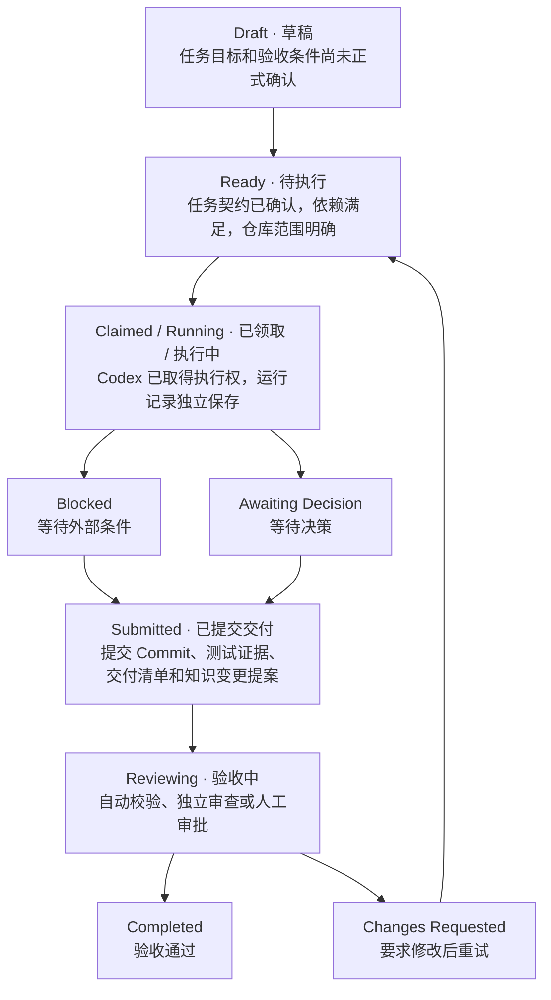
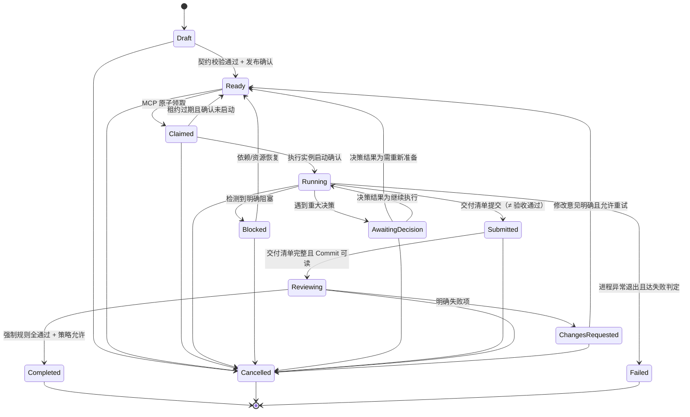
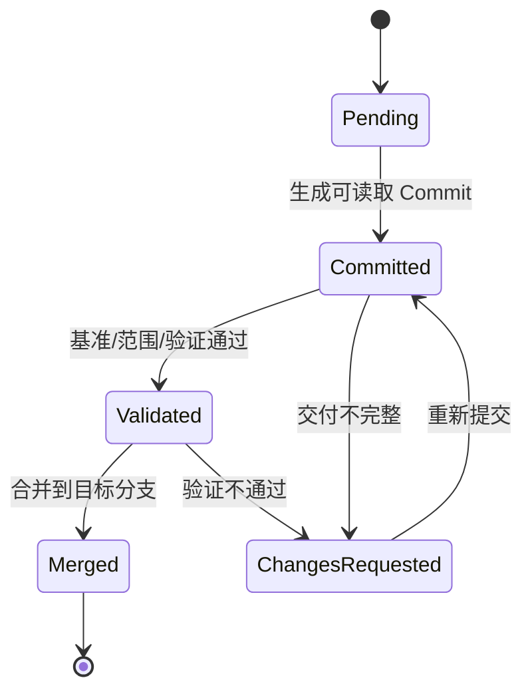
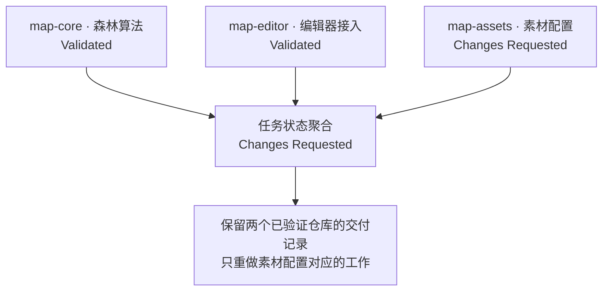
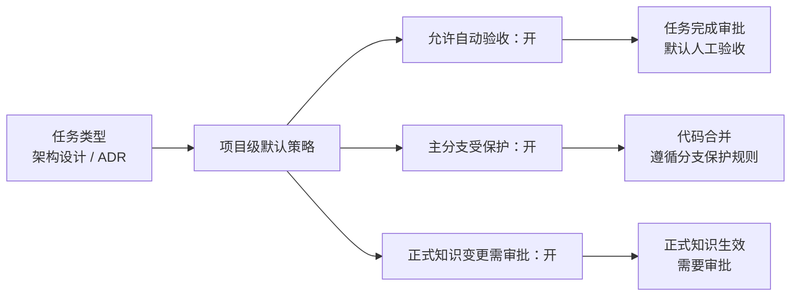

# 任务状态体系：服务端状态机 · 自动化优先 · 关键决策人工审批（V1 · 供稿记录）

> **记录说明**
> - 记录日期：2026-10-31
> - 性质：需求方供稿的结构化记录稿。**只做记录与格式转换，未做任何评审、批准或裁决动作**
> - 供稿含 3 张示意图（状态机 / 跨仓库交付 / 审批策略原型），已全部转为 Mermaid 并附逐元素校验
> - 本稿是 `ai-pm-task-detail-page-v1.md` 的上位规格：该稿定义**页面与契约**，本稿定义**状态机与审批规则**

| 项 | 内容 |
| --- | --- |
| 文档性质 | 状态体系规格（非 PRD，未定稿） |
| 版本 | V1 |
| 日期 | 2026-10-31 |
| 来源 | 需求方供稿：任务状态机 + 三级权限 + 转移规则表 + 交付状态机 + 审批策略引擎 + Rust 落地结构 |
| 状态 | 记录完成，**未评审** |
| 影响范围 | 任务状态由现有 5 值扩展为 13 值；引入仓库级交付状态机（5 态）；引入任务类型 × 风险 × 操作的审批策略；与现有 `TaskStatus` 迁移、`policy_engine` 粒度、命令集均有关联 |
| 前置文档 | `ai-pm-architecture-principles.md`、`ai-pm-mcp-executor-positioning-v1.md`、`ai-pm-multi-repo-model-v1.md`、`ai-pm-task-detail-page-v1.md`、`policies/ai-pm-ai-lead-v2.yaml` |

### 标注图例

| 标注 | 含义 |
| --- | --- |
| 〔原文〕 | 需求方结论直述，不改写语义 |
| 〔整理〕 | 结构化归纳，不引入新决策 |
| 〔待确认〕 | 本稿推断或尚未拍板 |
| 〔实测〕 | 本次对现有代码核对得到的事实（附文件位置） |

### 变更记录

| 版本 | 日期 | 变更内容 |
| --- | --- | --- |
| V1 | 2026-10-31 | 首次成型：13 态状态机转 Mermaid、A/B/C 三级权限、16 条转移规则、仓库级交付状态机、五类人工审批、策略引擎原型、Rust 结构与伪代码、五条规则；附 5 值→13 值迁移映射与现有实现对账 |

---

## 〇、设计理念〔原文〕

> 采用一套以**服务端状态机为核心、自动化优先、关键决策人工审批**的任务状态体系。

核心约束〔原文〕：

> **AI 可以自主推进执行流程，但不能自行改变任务的目标、验收规则和正式架构决策，也不能通过一句"我完成了"就让任务变成已完成。**

不采用单一流程（`待办 → 进行中 → 已完成`）的理由〔原文〕：平台有多个代码仓库、多个 Codex 执行实例、Markdown 项目知识库，因此必须把四类状态区分开——

| 状态维度 | 归属 |
| --- | --- |
| 业务状态 | 任务本身（§一 的 13 态） |
| 执行状态 | `task_runs`（每次 Codex 运行） |
| 交付状态 | 仓库级（§四 的 5 态） |
| 审批状态 | 审批策略引擎（§六） |

---

## 一、任务状态机〔原文〕

图源：[`figures/state-machine-v1-overview.png`](figures/state-machine-v1-overview.png)

### 1.1 图面转录

标题：任务状态机（原图无标题，按内容命名）

| 节点 | 副标题（原文） |
| --- | --- |
| Draft · 草稿 | 任务目标和验收条件尚未正式确认 |
| Ready · 待执行 | 任务契约已确认，依赖满足，仓库范围明确 |
| Claimed / Running · 已领取 / 执行中 | Codex 已取得执行权，运行记录独立保存 |
| Blocked | 等待外部条件 |
| Awaiting Decision | 等待决策 |
| Submitted · 已提交交付 | 提交 Commit、测试证据、交付清单和知识变更提案 |
| Reviewing · 验收中 | 自动校验、独立审查或人工审批 |
| Completed | 验收通过 |
| Changes Requested | 要求修改后重试 |

图注〔原文〕：

> Failed、Cancelled 和 Superseded 是异常或终止分支，不应与正常完成混为一谈。

### 1.2 Mermaid（布局照录）



> 〔整理〕原图中 Blocked 与 Awaiting Decision 是挂在主链两侧的分支节点，主链只有一条居中的 ↓。上图按「分支汇入 Submitted」还原；**精确的迁移边以 §三 规则表为准**（例如原图未画 `CR → Ready`，规则表有）。

### 1.3 Mermaid（按规则表补全，规范版）〔整理〕



> 图中 `Superseded` 未展开：原图仅在图注中提及，规则表未给迁移边。列入 §十 Q1。

### 1.4 关键细节：三态是业务状态，运行记录另有归属〔原文〕

> Claimed、Running、Submitted 是任务推进过程中的**业务状态**；而每次 Codex 的启动、退出、崩溃、重试，都应**单独记录在 `task_runs` 中**。这样即使某次 Run 失败，任务也不必丢失历史或被迫重新创建。

〔整理〕这解释了为什么状态机里没有「重试中」这类状态：**重试不是任务状态，是新 Run**。与 `ai-pm-task-detail-page-v1.md` §6.8.1 原则一一致。

---

## 二、状态转移的三个权限等级〔原文〕

### 2.1 A 级：允许系统或 Agent 自动推进

判据〔原文〕：不改变已批准的目标和约束，且操作可验证、可恢复。

| # | 转移 | 条件（原文） |
| --- | --- | --- |
| A1 | Draft → Ready | 任务契约通过规则校验，且任务创建者已确认或授权自动发布 |
| A2 | Ready → Claimed | MCP 原子领取成功 |
| A3 | Claimed → Running | Codex 执行实例启动并确认 |
| A4 | Running → Blocked | 检测到明确阻塞，并记录原因 |
| A5 | Running → Submitted | 交付清单已提交，但**尚未代表验收通过** |
| A6 | Changes Requested → Ready | 修改意见已明确、重试条件满足，且任务允许自动重试 |

### 2.2 B 级：满足策略后自动执行

判据〔原文〕：必须有客观证据、明确的自动化授权和可审计的规则。

| # | 转移 | 条件（原文） |
| --- | --- | --- |
| B1 | Submitted → Reviewing | 交付清单完整，所有必需仓库的 Commit 可读取 |
| B2 | Reviewing → Completed | 所有强制验收规则通过，且任务类型允许自动验收 |
| B3 | Blocked → Ready | 依赖已满足、缺失资源已恢复 |
| B4 | Running → Failed | 进程异常退出且已达到失败判定条件 |
| B5 | 知识索引更新 | 正式 Markdown 版本确定后自动重建索引 |

### 2.3 C 级：必须由有权限的人审批

判据〔原文〕：涉及目标变更、不可逆操作、正式决策或重大风险。

| # | 事项 |
| --- | --- |
| C1 | 修改已批准的需求、验收标准或任务范围 |
| C2 | 正式批准重大架构决策、技术选型或 ADR |
| C3 | 将高风险任务的交付标记为最终验收通过 |
| C4 | 合并到受保护的主分支，或执行生产发布 |
| C5 | 取消已有重要交付、覆盖正式知识，或执行其他高影响操作 |

### 2.4 审批不绑定状态〔原文〕

> 「必须人工审批」不应该简单绑定到某一个任务状态。例如，普通文档任务可能自动验收，而正式架构决策即使所有测试都通过，也仍然需要决策人批准。
>
> 因此，建议将审批策略**绑定到任务类型、风险等级和具体操作**，而不是硬编码为「所有任务都必须人工验收」。

〔整理〕这条否定了「在状态迁移边上一刀切加审批」的做法：同一条 `Reviewing → Completed` 边，对文档任务可自动、对架构任务必须人工。因此审批判定必须是 `(任务类型, 风险等级, 操作) → 策略` 的三元函数，而不是状态图的属性。

---

## 三、转移规则表（第一版默认规则）〔原文〕

| 当前状态 | 目标状态 | 默认执行者 | 审批要求 |
| --- | --- | --- | --- |
| Draft | Ready | 创建者 / 系统 | 发布前确认任务契约 |
| Ready | Claimed | MCP Server | 不需要人工审批 |
| Claimed | Running | Runner / Codex | 不需要人工审批 |
| Claimed | Ready | 系统 | 租约过期且确认未启动 |
| Running | Blocked | Codex / 系统 | 记录原因即可 |
| Running | Awaiting Decision | Codex | 重大决策由人批准 |
| Blocked | Ready | 系统 / 负责人 | 依赖恢复后可自动 |
| Awaiting Decision | Ready / Running | 决策服务 | 依据决策结果和授权执行 |
| Running | Submitted | Codex / MCP | 需要完整交付记录 |
| Submitted | Reviewing | 验收服务 | 自动校验交付清单 |
| Reviewing | Completed | 验收服务 / 审批人 | 取决于任务风险策略 |
| Reviewing | Changes Requested | 审查者 / 验收服务 | 需要明确失败项 |
| Changes Requested | Ready | 系统 / 负责人 | 符合重试规则即可 |
| 任意非终态 | Cancelled | 有权限的用户 / 策略服务 | 依风险决定是否确认 |
| 任意适用状态 | Failed | 系统 / Runner | 记录错误与重试信息 |

### 3.1 两个必须特殊处理的例外〔原文〕

| # | 例外 | 原文 |
| --- | --- | --- |
| E1 | Running → Submitted | **不能只依据 Codex 的文字声明**。必须验证 Commit、文件变更、测试结果和交付清单 |
| E2 | Reviewing → Completed | **不能只依赖测试全部通过**。还要确认任务的验收标准和审批策略均已满足 |

〔整理〕E1 与 E2 分别封堵两条最容易被绕过的路径：

| 例外 | 若不加约束会怎样 | 对应契约校验（`task-detail-page-v1.md` §6.7.1） |
| --- | --- | --- |
| E1 | Codex 说「做完了」即进入已提交态，交付物不存在 | `task_submit`：Commit、基准版本、证据完整性 |
| E2 | 测试绿即完成，验收标准里未被测试覆盖的条款被跳过 | `task_accept`：验收权限、证据与状态机规则 |

---

## 四、多仓库交付状态机〔原文〕

> 「这是你的平台区别于普通任务管理工具的地方。」

### 4.1 仓库级五态〔原文〕

| 状态 | 含义 |
| --- | --- |
| Pending | 尚未开始交付 |
| Committed | 已经生成可读取的 Commit |
| Validated | 基准版本、变更范围和相关验证通过 |
| Changes Requested | 需要修改 |
| Merged | 已经合并到目标分支 |



> 〔整理〕迁移边未在供稿中逐条给出，上图按五态语义补全，标〔待确认〕。

### 4.2 任务级聚合〔原文〕

**不能把三个仓库的状态简单压缩成一个「已提交」。** 每个仓库各自记录，任务层聚合。

图源：[`figures/state-machine-v1-cross-repo.png`](figures/state-machine-v1-cross-repo.png)

图面转录：

| 仓库 | 承担 | 仓库状态 | 进度条 |
| --- | --- | --- | --- |
| map-core | 森林算法 | `Validated`（绿） | 满格 |
| map-editor | 编辑器接入 | `Validated`（绿） | 满格 |
| map-assets | 素材配置 | `Changes Requested`（橙） | 约 40% |

聚合结果〔原文〕：

> ⚠ **任务状态：Changes Requested** —— 保留两个已验证仓库的交付记录，只重做素材配置对应的工作。



〔整理〕聚合的**默认规则**（图中隐含，未明示）：取最差态。三仓二比一，任务仍不能 Completed。这与 `ai-pm-multi-repo-model-v1.md` §7.4 父任务状态聚合表一致，但该表针对「父任务 + 子任务」，本图针对「单任务 + 多仓储」，两者需统一（§十 Q3）。

### 4.3 交付验收与集成合并是两件事〔原文〕

| # | 区分 |
| --- | --- |
| 1 | **交付验收**：各仓库的提交是否满足本任务的要求 |
| 2 | **集成与合并**：这些提交是否已经兼容，并进入目标分支 |

> 它们不一定发生在同一时刻。如果三个仓库已验证，但尚未合并，任务可以完成「交付验收」，而合并工作流继续运行。若业务要求合并后才能算完成，则可以通过项目策略将**合并设为完成条件**。

〔整理〕这是本稿引入的第二个可配置维度：

| 策略 | 完成条件 |
| --- | --- |
| 默认（宽松） | 所有仓库达到 `Validated` 即可完成交付验收 |
| 严格 | 所有仓库达到 `Merged` 才可完成 |

### 4.4 base_commit 与过期重评〔原文〕

> 建议为每个仓库记录 `base_commit`。如果任务执行期间主分支发生变化，平台应**重新评估基准版本是否过期**；涉及冲突或接口变化时，要求重新验证，而不是悄悄覆盖新代码。

〔整理〕这给出了三种处置语义，且**禁止**第四种：

| 情形 | 处置 |
| --- | --- |
| 主分支未变 | 正常继续 |
| 主分支已变、无冲突 | 重评基准，允许继续（需记录重评事件） |
| 主分支已变、有冲突或接口变化 | 要求**重新验证**，不得静默合并 |
| ~~主分支已变~~ | ~~悄悄覆盖新代码~~（明确禁止） |

---

## 五、哪些审批应该由人来做〔原文〕

> 不建议把人变成每一步的审批员。否则 Codex 只是加快了编码速度，却让人陷入不断点击「批准」的工作。

### 5.1 五类人工决策

| # | 类别 | 示例（原文） |
| --- | --- | --- |
| 1 | 目标与范围变更 | 原本只做地形晕渲，Codex 发现需重写地形数据模型 → 属任务范围变更，应先提出方案，不能擅自扩大任务 |
| 2 | 正式架构决策 | GPU Shader 还是 CPU 预计算作为长期架构：可调研、比较、给建议，正式决策由授权人员确认 |
| 3 | 高风险代码交付 | 公共 API 变更、数据库迁移、跨仓库破坏性修改 → 可要求独立审查或人工批准 |
| 4 | 正式知识生效 | 架构/需求/设计约束等正式 Markdown 的重大变更需审批；一般实现笔记与已验证运行记录可自动写入 |
| 5 | 不可逆或外部影响操作 | 生产发布、删除关键资源、改变权限、向外部系统发送重要操作 → 按风险单独授权 |

### 5.2 提出者不得自批〔原文〕

> **提出决策的 Agent 不应独自批准自己的高风险决策。** 可以让另一个独立 Agent 做技术审查，但真正的重大架构决策仍由具备相应权限的人批准。

〔整理〕这条是 §2.4 之外的**第二条正交约束**：即使策略允许自动，也禁止「同一主体既提案又批准」。因此 `task_accept` 的调用方限制（`task-detail-page-v1.md` §6.7.2 R1）在此获得第二重依据。

---

## 六、可配置审批策略引擎〔原文〕

> 不要把「架构任务必须审批」这类规则散落在 Rust 代码的各个 if 分支里。应当把审批策略集中配置，让不同项目、任务类型和仓库使用不同规则。

### 6.1 策略配置原型

图源：[`figures/state-machine-v1-policy-prototype.png`](figures/state-machine-v1-policy-prototype.png)

图面转录：

**任务类型**（单选，四项）

| 选项 | 状态 |
| --- | --- |
| 普通文档 / 实现说明 | 未选 |
| 普通功能开发 | 未选 |
| **架构设计 / ADR** | **已选** |
| 破坏性变更 / 数据迁移 | 未选 |

**策略开关**（三项，均处于开启态）

| 开关 | 说明（原文） |
| --- | --- |
| 允许自动验收 | 全部强制检查通过后，由系统完成验收 |
| 主分支受保护 | 禁止 Codex 绕过分支保护直接写入 |
| 正式知识变更需要审批 | 适用于需求、正式架构与项目约束 |

**当前策略结果**

| 项 | 结果 | 视觉 |
| --- | --- | --- |
| 任务完成审批 | 默认人工验收 | 橙（需注意） |
| 代码合并 | 遵循分支保护规则 | 灰（中性） |
| 正式知识生效 | 需要审批 | 橙（需注意） |

**底部说明**〔原文〕：

> 架构任务应允许自动调研和生成 ADR 草案，但不能因文档生成成功就自动批准架构决策。

〔整理〕这张原型图有一处需要澄清的合成关系：**三个开关全部开启，但架构任务的「任务完成审批」结果仍是「默认人工验收」**。这说明开关表达的是「允许的上限」，不是「结果」——结果由任务类型的默认值决定，开关只能在类型允许的范围内放宽或收紧。合成规则未明示，列入 §十 Q4。



### 6.2 五条优先级规则〔原文〕

| # | 规则 |
| --- | --- |
| P1 | 项目级策略是默认值 |
| P2 | 任务级策略可以收紧要求，但**不能绕过**项目的强制限制 |
| P3 | 仓库保护规则和安全策略具有更高优先级 |
| P4 | 任何审批策略变更都应记录修改人、时间、旧值和新值 |
| P5 | 已经开始执行的任务，应明确使用哪个版本的审批策略，避免执行中途规则悄悄变化 |

〔整理〕P2 的措辞值得注意：任务级只能**收紧**不能放宽——即策略继承是「向下取严」，这与排序系统常见的「子级覆盖父级」相反。P5 则要求策略**版本钉住**（policy version pinning），否则同一任务在不同时刻判定不同。

### 6.3 与现有 policy_engine 的对照〔实测〕

| 项 | 现状 | 与本稿要求的差距 |
| --- | --- | --- |
| 位置 | `policies/ai-pm-ai-lead-v2.yaml` + `crates/pm-application/src/policy_engine.rs` | 已集中配置，符合「不散落 if 分支」 |
| 模型 | 黑名单：`defaults.effect: auto_apply` + `red_lines` 白名单（7 条命令 → `required_role`） | 与「自动化优先」思路一致 |
| 已有红线 | `sign_acceptance` → `authorized_acceptor` | **已覆盖 C3 的一部分** |
| 升级条件 | `escalate.when`：`confidence: low`、`blast_radius_above: 10`、`unresolved_conflict` | 是「风险等级」维度的雏形，但只有 3 个固定信号 |
| 粒度 | 命令级（command → role） | **缺「任务类型」维度**，无法表达「架构任务 vs 文档任务」 |
| 版本 | `policy_id: ai-pm-ai-lead-v2`（单个全局值） | **无任务级版本钉住**（P5 要求） |
| 变更留痕 | 未见 | P4 要求记录修改人/时间/旧值/新值 |
| 执行后 | `veto_window` 4h / 24h 按命令类型 | 已有，可复用 |

〔整理〕结论：现有引擎的**形状是对的**（集中配置 + 黑名单 + 红线角色），缺的是三个维度——任务类型、任务级策略、版本钉住与变更留痕。这三项不需要重写引擎，而是扩展配置模型。

---

## 七、Rust 后端如何实现〔原文〕

### 7.1 建议目录结构

```text
crates/
├── domain/
│   ├── task.rs
│   ├── task_state.rs
│   ├── task_transition.rs
│   ├── approval_policy.rs
│   ├── task_run.rs
│   └── delivery_manifest.rs
├── application/
│   ├── claim_task.rs
│   ├── submit_task.rs
│   ├── request_changes.rs
│   ├── accept_task.rs
│   └── decide_approval.rs
├── infrastructure/
│   ├── postgres/
│   ├── git/
│   └── codex/
└── interfaces/
    ├── http/
    └── mcp/
```

核心思想〔原文〕：**所有状态变化都经过统一的 `task_transition` 规则。**

### 7.2 与现有 crate 布局的映射〔实测〕

| 建议路径 | 现状 | 差异 |
| --- | --- | --- |
| `domain/task.rs` | `crates/pm-domain/src/task.rs` | 已有，但仅含 `TaskStatus` 五值枚举 |
| `domain/task_state.rs` | 无 | 需新增（13 态） |
| `domain/task_transition.rs` | 无 | **核心缺口**：迁移规则表无载体 |
| `domain/approval_policy.rs` | `pm-domain/src/policy.rs`（命令级红线） | 需扩展为「类型 × 风险 × 操作」三元 |
| `domain/task_run.rs` | 无 | 对应 `0009` 草案的 `task_run` 表 |
| `domain/delivery_manifest.rs` | 无 | 对应 `0009` 草案的交付清单 |
| `application/claim_task.rs` 等 5 个 | `command_executor.rs`（通用执行器）+ `supervision.rs`（决策） | 现有为**通用命令执行器**，非按用例拆分 |
| `infrastructure/git/`、`codex/` | `pm-infrastructure` 仅 `job_queue` | 无 Git 适配器、无执行端适配器 |
| `interfaces/http/`、`mcp/` | `apps/pm-api`、`crates/pm-mcp` | 现有为独立 app/crate，非 `interfaces` 目录 |

〔整理〕布局差异属于**组织方式**而非能力缺口：现有 `pm-*` 前缀分层（domain / application / infrastructure / mcp / api）与建议的 `domain / application / infrastructure / interfaces` 是同一套分层的不同命名。真正的缺口是 6 个领域模块中的 5 个、以及 Git / 执行端适配器。

### 7.3 伪代码（结构示意）〔原文〕

```rust
pub async fn accept_task(
    task_id: TaskId,
    actor: Actor,
) -> Result<Task, TransitionError> {
    let mut tx = repository.begin_transaction().await?;
    let task = tx.lock_task(task_id).await?;
    policy.require_accept_permission(&actor, &task)?;
    let evidence = tx.load_acceptance_evidence(task_id).await?;
    let decision = state_machine.evaluate_acceptance(&task, &evidence)?;
    if !decision.allowed {
        return Err(TransitionError::AcceptanceFailed);
    }
    let updated = tx.transition_task(task_id, TaskState::Completed).await?;
    tx.append_audit_event(/* 状态变更证据 */).await?;
    tx.commit().await?;
    Ok(updated)
}
```

> 原文明确：这段代码是**结构示意，不是可以直接编译的完整实现**。正式实现还需：审批记录校验、并发版本控制、事务错误处理、Outbox 事件写入。

#### 7.3.1 五步骨架与现有实现的对照〔实测〕

| 伪代码步骤 | 现有实现 | 状态 |
| --- | --- | --- |
| `begin_transaction` + `lock_task` | `command_executor::update_task_status` 已用 `SELECT … FOR UPDATE` + 显式 `tx.begin()` | ✅ 已有 |
| `policy.require_accept_permission` | `policy_engine` 有 `sign_acceptance → authorized_acceptor` 红线 | ⚠️ 部分（命令级，非任务类型级） |
| `load_acceptance_evidence` | 无 | ❌ 缺（§四 交付状态机未落库） |
| `state_machine.evaluate_acceptance` | 无（只有 `expected_revision` 乐观锁） | ❌ **核心缺口** |
| `transition_task` | 已实现（`UPDATE … status, revision+1`） | ✅ 已有 |
| `append_audit_event` | 已实现，且**与状态更新在同一事务**，并写入补偿快照 `CompensationSpec::Restore` | ✅ 已有 |
| `tx.commit` + 返回 receipt | 已实现（`ExecutionReceipt { audit_id, command_kind, target_id, resulting_revision }`） | ✅ 已有 |

〔整理〕这是一项**有利结论**：伪代码的 7 步里，事务、行锁、乐观锁、审计、回执 5 步已经存在且质量良好（审计与状态同事务、带补偿快照可回滚）。真正要补的只有两件事：**权限判定升级为三元策略**、**证据校验与状态机规则**。

### 7.4 硬约束〔原文〕

> 数据库中的任务状态不能由 MCP 工具或前端直接写入。所有变更必须经过领域规则、权限验证与审计记录。

〔实测〕现状与该约束存在一处冲突：`PATCH /v1/pm/tasks/{task_id}` → `pm_write::update_task` **直接改库**，不经命令通道。此项已在 `ai-pm-task-detail-page-v1.md` §6.3 记为 C1，本稿再次确认其为**规格级冲突**而非实现细节。

---

## 八、五条必须坚持的规则〔原文〕

| # | 规则 |
| --- | --- |
| 1 | **自动执行不等于自动批准。** Codex 可以自主工作，但任务是否完成由平台根据证据判定 |
| 2 | **任务目标与执行实例分离。** 每次重试产生新 Run，历史不可覆盖 |
| 3 | **跨仓库结果整体核验。** 各仓库独立交付，任务统一验收 |
| 4 | **知识变更有等级。** 普通事实和实现记录可以自动沉淀，正式决策需要授权 |
| 5 | **审批由风险决定。** 不要所有事情都要求人工点击，也不要让 Agent 自己批准所有事情 |

### 8.1 首版范围建议〔原文〕

> 第一版先实现一个**固定的状态机 + 可配置的审批策略 + 不可变的事件审计**，不要一开始就做过于复杂的工作流引擎。

原文给出的扩展目标〔原文〕：既能支持一个 Codex 独立完成任务，也能自然扩展到多个 Codex 并行、多仓库协作、独立审查 Agent 和长期项目知识治理。

〔整理〕首版范围的三个组件与现状的对应：

| 组件 | 现状 | 首版工作量判断 |
| --- | --- | --- |
| 固定状态机 | 仅 5 值枚举，无迁移规则 | **主要工作量**：13 态 + 16 条迁移规则 + 守卫 |
| 可配置审批策略 | 已有引擎骨架（黑名单 + 红线角色） | 中等：扩展「任务类型」维度 + 版本钉住 |
| 不可变事件审计 | 已有（同事务写入 + 补偿快照） | 低：基本满足 |

---

## 九、现有 5 值到 13 值的迁移映射〔实测 + 整理〕

| 现有 `TaskStatus` | 新状态机对应 | 说明 |
| --- | --- | --- |
| `backlog` | `Draft` | 语义近似，但 Draft 强调「验收条件尚未确认」 |
| `in_progress` | `Claimed` / `Running` | **一拆二**：需按是否有 Run 在跑决定 |
| `blocked` | `Blocked` | 一致 |
| `needs_info` | **无对应** | 可能被 `Awaiting Decision` 吸收，需裁 |
| `done` | `Completed` | 一致，但新机要求证据支撑 |
| — | `Ready` | 新增（契约已确认、依赖满足） |
| — | `AwaitingDecision` | 新增 |
| — | `Submitted` | 新增 |
| — | `Reviewing` | 新增 |
| — | `ChangesRequested` | 新增 |
| — | `Cancelled` | 新增 |
| — | `Failed` | 新增 |
| — | `Superseded` | 新增（原图仅图注提及） |

〔整理〕迁移要点：

| # | 要点 |
| --- | --- |
| M1 | `in_progress` 一拆二 → 迁移时必须回填「是否存在活跃 Run」，否则无法判定 Claimed 还是 Running |
| M2 | `needs_info` 无对应 → 必须逐条人工归类到 `Draft` 或 `Awaiting Decision`，不能默认映射 |
| M3 | `done` → `Completed` 需检查是否有验收证据；无证据的历史任务属于「历史遗留完成」，建议单列标记而非静默迁移 |
| M4 | 状态值存为 lowercase snake_case TEXT，新值需与前端徽标同源（`ai-pm-task-detail-page-v1.md` §6.3 C2） |

---

## 十、待确认清单

> 只记录，不裁决。

| # | 待确认项 | 影响 |
| --- | --- | --- |
| Q1 | `Superseded` 的定义与迁移边（原图仅图注提及，规则表无此状态） | 状态机完整性 |
| Q2 | `needs_info` 如何处置：并入 `Awaiting Decision`、保留、还是废弃 | 迁移 |
| Q3 | 任务级聚合规则是否统一为「取最差态」（§4.2 隐含 vs `multi-repo` §7.4 父任务聚合表） | 聚合算法 |
| Q4 | 策略开关（如「允许自动验收」）与任务类型默认值的**合成规则**：取最严？还是类型优先、开关仅在类型允许范围内生效？（§6.1 原型中三开关全开但结果仍为人工验收） | 策略引擎语义 |
| Q5 | 策略是否需要**任务级覆盖**（P2 只许收紧），其存储与生效范围 | 数据模型 |
| Q6 | 「合并设为完成条件」是项目策略还是任务类型策略 | 完成判定 |
| Q7 | 风险等级如何计算（现有 `blast_radius_above: 10` 是否即为风险等级来源） | 策略输入 |
| Q8 | 独立审查 Agent 的角色定义（是执行端的一种，还是平台内置） | 五类审批第 3 项 |
| Q9 | 失败判定条件（B4「达到失败判定条件」具体指什么：退出码？超时？连续失败次数？） | 自动迁移可靠性 |
| Q10 | Outbox 事件写入是否纳入首版（伪代码注明需补，但首版范围未提） | 首版范围 |
| Q11 | 13 态与前端徽标的一对一映射（页面现用「待验收/已提交/待审核」，需重对齐） | 前端契约 |

---

## 附录 A：图源归档

| 图 | 文件 | 用途 |
| --- | --- | --- |
| 任务状态机 | `figures/state-machine-v1-overview.png` | §1.2 布局照录 |
| 跨仓库交付示例 | `figures/state-machine-v1-cross-repo.png` | §4.2 聚合 |
| 审批策略配置原型 | `figures/state-machine-v1-policy-prototype.png` | §6.1 策略结果 |

## 附录 B：转换校验

### B.1 状态机图 → Mermaid

| 原图元素 | Mermaid 节点 | 校验 |
| --- | --- | --- |
| Draft · 草稿 / 任务目标和验收条件尚未正式确认 | `D` | 一致 |
| Ready · 待执行 / 任务契约已确认，依赖满足，仓库范围明确 | `R` | 一致 |
| Claimed / Running · 已领取 / 执行中 / Codex 已取得执行权，运行记录独立保存 | `C` | 一致（两态合一节点，按原图保留） |
| Blocked / 等待外部条件 | `B` | 一致 |
| Awaiting Decision / 等待决策 | `W` | 一致 |
| Submitted · 已提交交付 / 提交 Commit、测试证据、交付清单和知识变更提案 | `S` | 一致 |
| Reviewing · 验收中 / 自动校验、独立审查或人工审批 | `V` | 一致 |
| Completed / 验收通过（绿） | `OK` | 一致 |
| Changes Requested / 要求修改后重试（橙） | `CR` | 一致 |
| 居中的 ↓（6 处） | 见 §1.2 边集 | 布局近似，规范边集见 §1.3 |

### B.2 跨仓库图 → Mermaid

| 原图元素 | 校验 |
| --- | --- |
| 三行仓库（map-core / map-editor / map-assets）+ 副标题 + 状态徽标 + 进度条 | 三节点 + 状态标签一致；**进度条为视觉元素，不转**（40% 无法从图推定精确值，不编造） |
| 底部「任务状态：Changes Requested」+ 说明 | `T` + `N` 两节点，说明文字照录 |

### B.3 策略原型图 → Mermaid

| 原图元素 | 校验 |
| --- | --- |
| 任务类型单选四项，选中「架构设计 / ADR」 | §6.1 表格 + 流程图首节点 |
| 三个开关（均开） | 三个 `S` 节点 |
| 当前策略结果三行 | `R` / `R2` / `R3` |
| 底部说明 | 原文照录于 §6.1 |

---

（记录截止此处。本稿未做任何评审、批准或裁决动作；后续变更以追加方式记录，不改写既有条目。）
