# 任务状态体系：服务端状态机 · 自动化优先 · 关键决策人工审批（V1 · 供稿记录）

> **记录说明**
> - 记录日期：2026-10-31
> - 性质：需求方供稿的结构化记录稿。**只做记录与格式转换，未做任何评审、批准或裁决动作**
> - 供稿含 3 张示意图（状态机 / 跨仓库交付 / 审批策略原型），已全部转为 Mermaid 并附逐元素校验
> - 本稿是 `ai-pm-task-detail-page-v1.md` 的上位规格：该稿定义**页面与契约**，本稿定义**状态机与审批规则**

| 项 | 内容 |
| --- | --- |
| 文档性质 | 状态体系规格（非 PRD，未定稿） |
| 版本 | V1 |
| 日期 | 2026-10-31 |
| 来源 | 需求方供稿：任务状态机 + 三级权限 + 转移规则表 + 交付状态机 + 审批策略引擎 + Rust 落地结构 |
| 状态 | V12：§十 主清单 Q1–Q11 **全部关闭**（裁决记录见 §十一–§二十一）；**整体仍未评审**，详情页稿 §七 Q1–Q18 及衍生待确认项待落 |
| 影响范围 | 任务状态由现有 5 值扩展为 13 值；引入仓库级交付状态机（5 态）；引入任务类型 × 风险 × 操作的审批策略；与现有 `TaskStatus` 迁移、`policy_engine` 粒度、命令集均有关联 |
| 前置文档 | `ai-pm-architecture-principles.md`、`ai-pm-mcp-executor-positioning-v1.md`、`ai-pm-multi-repo-model-v1.md`、`ai-pm-task-detail-page-v1.md`、`policies/ai-pm-ai-lead-v2.yaml` |

### 标注图例

| 标注 | 含义 |
| --- | --- |
| 〔原文〕 | 需求方结论直述，不改写语义 |
| 〔整理〕 | 结构化归纳，不引入新决策 |
| 〔待确认〕 | 本稿推断或尚未拍板 |
| 〔实测〕 | 本次对现有代码核对得到的事实（附文件位置） |

### 变更记录

| 版本 | 日期 | 变更内容 |
| --- | --- | --- |
| V1 | 2026-10-31 | 首次成型：13 态状态机转 Mermaid、A/B/C 三级权限、16 条转移规则、仓库级交付状态机、五类人工审批、策略引擎原型、Rust 结构与伪代码、五条规则；附 5 值→13 值迁移映射与现有实现对账 |
| V2 | 2026-10-31 | 追加 §十一：§十 Q1 裁决落地——`Superseded` 定名「已被取代」，**终态**；6 条迁入边（Draft / Ready / Blocked / Running / Submitted / Reviewing）+ 分级审批规则；`SupersededRelation` 关联模型与数据库约束；执行中取代五步流程与停止守卫；页面展示要求。Q1 关闭，衍生 Q1.1–Q1.3 |
| V3 | 2026-10-31 | 追加 §十二：§十 Q2 裁决落地——`needs_info` 从任务状态枚举**废弃**，语义保留为 `WaitingReason::NeedsInfo`；`AwaitingDecision` 统一承载四类等待原因（needs_info / needs_decision / needs_approval / external_dependency）+ `WaitingContext` 结构化上下文；迁移规则与恢复校验、MCP/Codex 五条约束。Q2 关闭，衍生 Q2.1–Q2.2；§九 M2 迁移口径以本节为准 |
| V4 | 2026-10-31 | 追加 §十三：§十 Q3 裁决落地——否决「取最差态」，任务级聚合统一为**基于必需交付门槛的确定性聚合**（Deterministic Delivery-Gate Aggregation）；五步判定顺序、九行聚合表、optional 子任务与交付门槛两例外、与 multi-repo §7.4 的统一口径、`AggregationInput` 显式输入与职责三分（状态机 / 聚合器 / 交付验证器）。Q3 关闭，衍生 Q3.1–Q3.3；§4.2「取最差态」〔整理〕推断被本裁决替代 |
| V5 | 2026-10-31 | 追加 §十四：§十 Q4 裁决落地——策略合成采用「**类型定义能力上限，开关仅在允许范围内生效，强制约束优先，执行证据决定是否通过**」；四层优先级（强制安全约束 > 类型上限 > 项目/任务开关 > 执行证据）、七行合成示例、三开关定义为独立能力（不互推、不可越权）、`PolicyContext`/`EffectivePolicy` 实现建议、§6.1 原型增补「有效策略预览」区（图1 归档）。Q4 关闭，衍生 Q4.1–Q4.2 |
| V6 | 2026-10-31 | 追加 §十五：§十 Q5 裁决落地——**支持任务级策略覆盖，P2 仅允许收紧**；L0–L3 四层模型、八类策略项覆盖边界表、差异存储（`TaskPolicyOverride`，只存覆盖不复制完整策略）、任务/Run/仓库/审批四层生效范围与 Run 不可变策略快照（含 policy_hash 与逐仓库快照）、能力类/约束类两分合成、任务页「执行策略」区与「查看策略来源」（图1 归档）、P2 六项范围。Q5 关闭，衍生 Q5.1–Q5.2 |
| V7 | 2026-10-31 | 追加 §十六：§十 Q6 裁决落地——拆分「合并是否属于完成条件」（项目默认 + 类型约束 + 任务要求）与「任务何时算完成」（统一完成判定器）；`MergeRequirement` 三态枚举 + 项目 Flexible/Mandatory 模式、六项配置归属表、多仓判定公式（交付 ∧ 合并 ∧ 验证 ∧ 审批）、`auto_merge_enabled ≠ merge_required_for_completion`。Q6 关闭，无新增衍生项 |
| V8 | 2026-10-31 | 追加 §十七：§十 Q7 裁决落地——`blast_radius_above: 10` 是规则阈值**不是风险等级本身**；四概念区分（blast_radius / risk_score / risk_level / approval_requirements）、影响范围五指标、混合计算（规则触发 + 加权评分 R = 0.25B+0.25C+0.20I+0.15V+0.15U）、四级映射（Low/Medium/High/Critical）、七条强制规则不依赖评分、三时点评估与多仓聚合不取均值、`RiskAssessment`/`EffectivePolicy`/`ApprovalRecord` 三概念分立、现有规则五步处理。Q7 关闭，衍生 Q7.1–Q7.3；Q4.2 部分落定 |
| V9 | 2026-10-31 | 追加 §十八：§十 Q8 裁决落地——Reviewer Agent 定义为**平台内置职责角色**（非固定执行端、非任务状态）；三概念区分（角色 / 执行端 / 人工审批者）、六项审查职责与动态清单、独立性三级（L1 逻辑 / L2 实例 / L3 主体，P2 至少 L1+L2）、审查独立生命周期接入（图1）、AgentRole/AgentRun/ReviewReport 分离存储与四值结论（Inconclusive 不得当 Approved）、平台内置规范 + 执行端可插拔（图2）、P2 六项。Q8 关闭，衍生 Q8.1–Q8.3 |
| V10 | 2026-10-31 | 追加 §十九：§十 Q9 裁决落地——B4 定义为**一套可判定、可审计、可恢复的失败分类规则**（非单一退出码/超时/连续失败）；Run/Task/Delivery 三层失败层级、B4-A 至 B4-D 四类终止性失败规则、八行事件判定表（Reviewer 发现缺陷 ≠ 审查运行失败）、P2 重试参数五项（max_run_attempts=3 等）与计数规则（成功归零、按执行阶段统计）、`RunOutcome`/`FailureCategory`/`FailureRecord` 结构化失败模型（不可变）、Running 六分支与 B4 正式定义（Running→Failed 必须经统一失败判定服务）。Q9 关闭，衍生 Q9.1–Q9.2 |
| V11 | 2026-10-31 | 追加 §二十：§十 Q10 裁决落地——**Outbox 纳入首版**（最小可靠版本，否决「列二期」方案）；八行首版范围表（表/写入/消费/重试/幂等/死信必须，事件总线/事件溯源暂不纳入）、四步最小流程（图1）、`OutboxEvent` 结构与预留字段（idempotency_key / locked_until / schema_version）、六类必进事件、七条正式条款 + 验收标准（重启可恢复、重复投递幂等）。Q10 关闭，无新增衍生项 |
| V12 | 2026-10-31 | 追加 §二十一：§十 Q11 按推荐默认值关闭（来源：需求方指示「没有问题就开搞」）——13 态与前端徽标一对一映射、徽标与枚举同源、DB 存 lowercase snake_case TEXT、文案表（含 waiting_reason 派生文案与 Superseded「已被取代」+ 查看替代任务链接）在实施 spec 定稿。**§十 主清单全部关闭**；如需调整以追加记录方式变更 |

---

## 〇、设计理念〔原文〕

> 采用一套以**服务端状态机为核心、自动化优先、关键决策人工审批**的任务状态体系。

核心约束〔原文〕：

> **AI 可以自主推进执行流程，但不能自行改变任务的目标、验收规则和正式架构决策，也不能通过一句"我完成了"就让任务变成已完成。**

不采用单一流程（`待办 → 进行中 → 已完成`）的理由〔原文〕：平台有多个代码仓库、多个 Codex 执行实例、Markdown 项目知识库，因此必须把四类状态区分开——

| 状态维度 | 归属 |
| --- | --- |
| 业务状态 | 任务本身（§一 的 13 态） |
| 执行状态 | `task_runs`（每次 Codex 运行） |
| 交付状态 | 仓库级（§四 的 5 态） |
| 审批状态 | 审批策略引擎（§六） |

---

## 一、任务状态机〔原文〕

图源：[`figures/state-machine-v1-overview.png`](figures/state-machine-v1-overview.png)

### 1.1 图面转录

标题：任务状态机（原图无标题，按内容命名）

| 节点 | 副标题（原文） |
| --- | --- |
| Draft · 草稿 | 任务目标和验收条件尚未正式确认 |
| Ready · 待执行 | 任务契约已确认，依赖满足，仓库范围明确 |
| Claimed / Running · 已领取 / 执行中 | Codex 已取得执行权，运行记录独立保存 |
| Blocked | 等待外部条件 |
| Awaiting Decision | 等待决策 |
| Submitted · 已提交交付 | 提交 Commit、测试证据、交付清单和知识变更提案 |
| Reviewing · 验收中 | 自动校验、独立审查或人工审批 |
| Completed | 验收通过 |
| Changes Requested | 要求修改后重试 |

图注〔原文〕：

> Failed、Cancelled 和 Superseded 是异常或终止分支，不应与正常完成混为一谈。

### 1.2 Mermaid（布局照录）

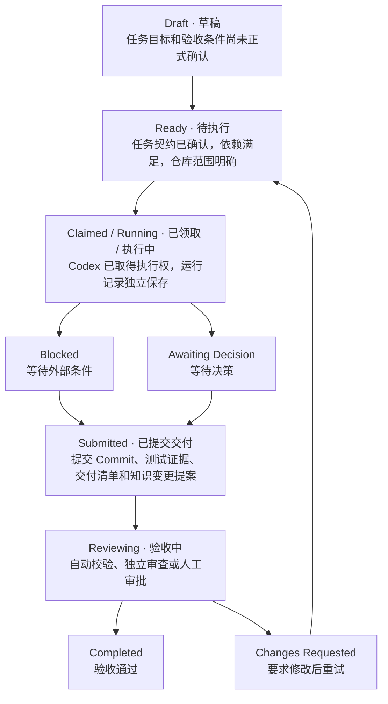

> 〔整理〕原图中 Blocked 与 Awaiting Decision 是挂在主链两侧的分支节点，主链只有一条居中的 ↓。上图按「分支汇入 Submitted」还原；**精确的迁移边以 §三 规则表为准**（例如原图未画 `CR → Ready`，规则表有）。

### 1.3 Mermaid（按规则表补全，规范版）〔整理〕

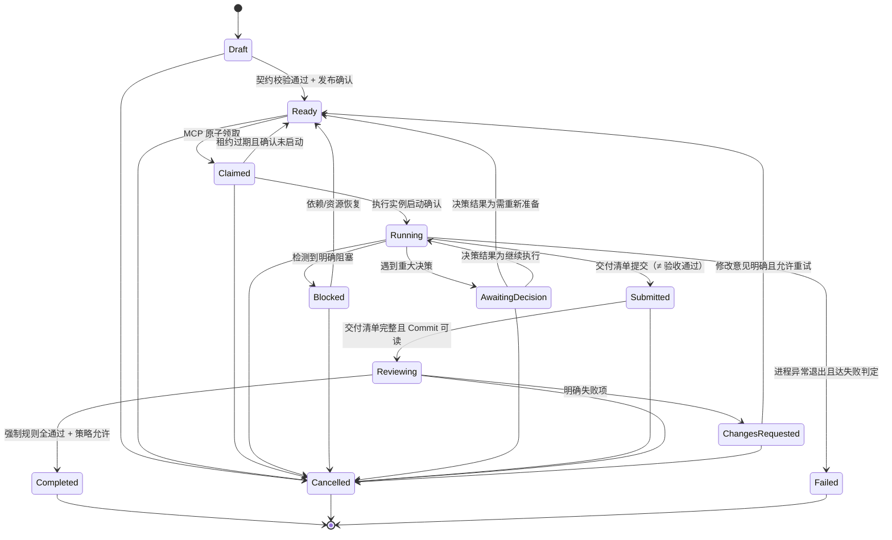

> 图中 `Superseded` 未展开：原图仅在图注中提及，规则表未给迁移边。列入 §十 Q1。

### 1.4 关键细节：三态是业务状态，运行记录另有归属〔原文〕

> Claimed、Running、Submitted 是任务推进过程中的**业务状态**；而每次 Codex 的启动、退出、崩溃、重试，都应**单独记录在 `task_runs` 中**。这样即使某次 Run 失败，任务也不必丢失历史或被迫重新创建。

〔整理〕这解释了为什么状态机里没有「重试中」这类状态：**重试不是任务状态，是新 Run**。与 `ai-pm-task-detail-page-v1.md` §6.8.1 原则一一致。

---

## 二、状态转移的三个权限等级〔原文〕

### 2.1 A 级：允许系统或 Agent 自动推进

判据〔原文〕：不改变已批准的目标和约束，且操作可验证、可恢复。

| # | 转移 | 条件（原文） |
| --- | --- | --- |
| A1 | Draft → Ready | 任务契约通过规则校验，且任务创建者已确认或授权自动发布 |
| A2 | Ready → Claimed | MCP 原子领取成功 |
| A3 | Claimed → Running | Codex 执行实例启动并确认 |
| A4 | Running → Blocked | 检测到明确阻塞，并记录原因 |
| A5 | Running → Submitted | 交付清单已提交，但**尚未代表验收通过** |
| A6 | Changes Requested → Ready | 修改意见已明确、重试条件满足，且任务允许自动重试 |

### 2.2 B 级：满足策略后自动执行

判据〔原文〕：必须有客观证据、明确的自动化授权和可审计的规则。

| # | 转移 | 条件（原文） |
| --- | --- | --- |
| B1 | Submitted → Reviewing | 交付清单完整，所有必需仓库的 Commit 可读取 |
| B2 | Reviewing → Completed | 所有强制验收规则通过，且任务类型允许自动验收 |
| B3 | Blocked → Ready | 依赖已满足、缺失资源已恢复 |
| B4 | Running → Failed | 进程异常退出且已达到失败判定条件 |
| B5 | 知识索引更新 | 正式 Markdown 版本确定后自动重建索引 |

### 2.3 C 级：必须由有权限的人审批

判据〔原文〕：涉及目标变更、不可逆操作、正式决策或重大风险。

| # | 事项 |
| --- | --- |
| C1 | 修改已批准的需求、验收标准或任务范围 |
| C2 | 正式批准重大架构决策、技术选型或 ADR |
| C3 | 将高风险任务的交付标记为最终验收通过 |
| C4 | 合并到受保护的主分支，或执行生产发布 |
| C5 | 取消已有重要交付、覆盖正式知识，或执行其他高影响操作 |

### 2.4 审批不绑定状态〔原文〕

> 「必须人工审批」不应该简单绑定到某一个任务状态。例如，普通文档任务可能自动验收，而正式架构决策即使所有测试都通过，也仍然需要决策人批准。
>
> 因此，建议将审批策略**绑定到任务类型、风险等级和具体操作**，而不是硬编码为「所有任务都必须人工验收」。

〔整理〕这条否定了「在状态迁移边上一刀切加审批」的做法：同一条 `Reviewing → Completed` 边，对文档任务可自动、对架构任务必须人工。因此审批判定必须是 `(任务类型, 风险等级, 操作) → 策略` 的三元函数，而不是状态图的属性。

---

## 三、转移规则表（第一版默认规则）〔原文〕

| 当前状态 | 目标状态 | 默认执行者 | 审批要求 |
| --- | --- | --- | --- |
| Draft | Ready | 创建者 / 系统 | 发布前确认任务契约 |
| Ready | Claimed | MCP Server | 不需要人工审批 |
| Claimed | Running | Runner / Codex | 不需要人工审批 |
| Claimed | Ready | 系统 | 租约过期且确认未启动 |
| Running | Blocked | Codex / 系统 | 记录原因即可 |
| Running | Awaiting Decision | Codex | 重大决策由人批准 |
| Blocked | Ready | 系统 / 负责人 | 依赖恢复后可自动 |
| Awaiting Decision | Ready / Running | 决策服务 | 依据决策结果和授权执行 |
| Running | Submitted | Codex / MCP | 需要完整交付记录 |
| Submitted | Reviewing | 验收服务 | 自动校验交付清单 |
| Reviewing | Completed | 验收服务 / 审批人 | 取决于任务风险策略 |
| Reviewing | Changes Requested | 审查者 / 验收服务 | 需要明确失败项 |
| Changes Requested | Ready | 系统 / 负责人 | 符合重试规则即可 |
| 任意非终态 | Cancelled | 有权限的用户 / 策略服务 | 依风险决定是否确认 |
| 任意适用状态 | Failed | 系统 / Runner | 记录错误与重试信息 |

### 3.1 两个必须特殊处理的例外〔原文〕

| # | 例外 | 原文 |
| --- | --- | --- |
| E1 | Running → Submitted | **不能只依据 Codex 的文字声明**。必须验证 Commit、文件变更、测试结果和交付清单 |
| E2 | Reviewing → Completed | **不能只依赖测试全部通过**。还要确认任务的验收标准和审批策略均已满足 |

〔整理〕E1 与 E2 分别封堵两条最容易被绕过的路径：

| 例外 | 若不加约束会怎样 | 对应契约校验（`task-detail-page-v1.md` §6.7.1） |
| --- | --- | --- |
| E1 | Codex 说「做完了」即进入已提交态，交付物不存在 | `task_submit`：Commit、基准版本、证据完整性 |
| E2 | 测试绿即完成，验收标准里未被测试覆盖的条款被跳过 | `task_accept`：验收权限、证据与状态机规则 |

---

## 四、多仓库交付状态机〔原文〕

> 「这是你的平台区别于普通任务管理工具的地方。」

### 4.1 仓库级五态〔原文〕

| 状态 | 含义 |
| --- | --- |
| Pending | 尚未开始交付 |
| Committed | 已经生成可读取的 Commit |
| Validated | 基准版本、变更范围和相关验证通过 |
| Changes Requested | 需要修改 |
| Merged | 已经合并到目标分支 |

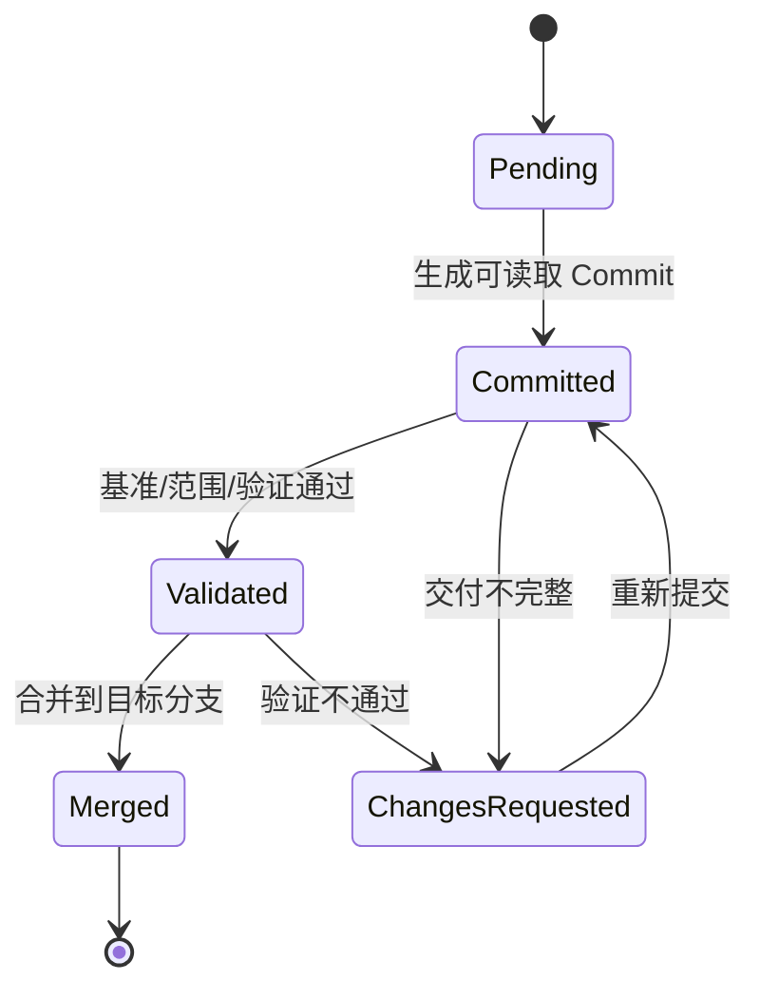

> 〔整理〕迁移边未在供稿中逐条给出，上图按五态语义补全，标〔待确认〕。

### 4.2 任务级聚合〔原文〕

**不能把三个仓库的状态简单压缩成一个「已提交」。** 每个仓库各自记录，任务层聚合。

图源：[`figures/state-machine-v1-cross-repo.png`](figures/state-machine-v1-cross-repo.png)

图面转录：

| 仓库 | 承担 | 仓库状态 | 进度条 |
| --- | --- | --- | --- |
| map-core | 森林算法 | `Validated`（绿） | 满格 |
| map-editor | 编辑器接入 | `Validated`（绿） | 满格 |
| map-assets | 素材配置 | `Changes Requested`（橙） | 约 40% |

聚合结果〔原文〕：

> ⚠ **任务状态：Changes Requested** —— 保留两个已验证仓库的交付记录，只重做素材配置对应的工作。

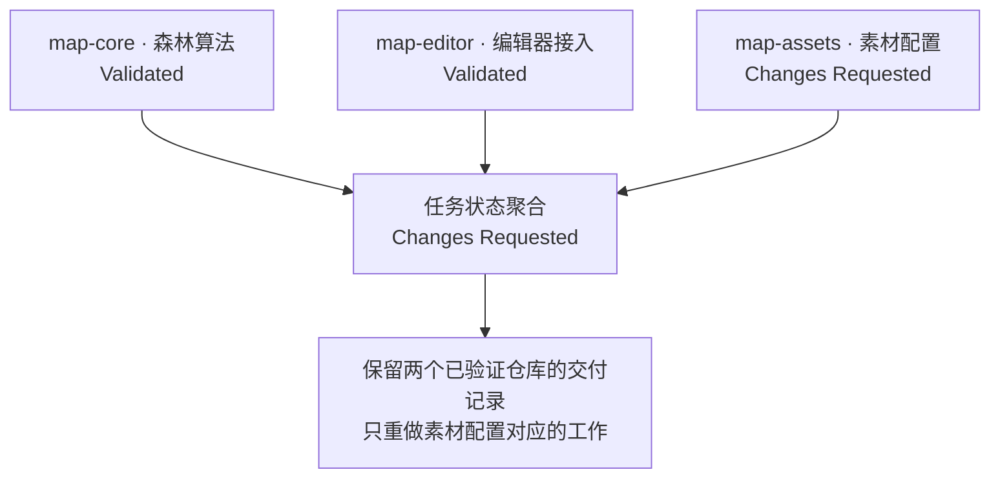

〔整理〕聚合的**默认规则**（图中隐含，未明示）：取最差态。三仓二比一，任务仍不能 Completed。这与 `ai-pm-multi-repo-model-v1.md` §7.4 父任务状态聚合表一致，但该表针对「父任务 + 子任务」，本图针对「单任务 + 多仓储」，两者需统一（§十 Q3）。

### 4.3 交付验收与集成合并是两件事〔原文〕

| # | 区分 |
| --- | --- |
| 1 | **交付验收**：各仓库的提交是否满足本任务的要求 |
| 2 | **集成与合并**：这些提交是否已经兼容，并进入目标分支 |

> 它们不一定发生在同一时刻。如果三个仓库已验证，但尚未合并，任务可以完成「交付验收」，而合并工作流继续运行。若业务要求合并后才能算完成，则可以通过项目策略将**合并设为完成条件**。

〔整理〕这是本稿引入的第二个可配置维度：

| 策略 | 完成条件 |
| --- | --- |
| 默认（宽松） | 所有仓库达到 `Validated` 即可完成交付验收 |
| 严格 | 所有仓库达到 `Merged` 才可完成 |

### 4.4 base_commit 与过期重评〔原文〕

> 建议为每个仓库记录 `base_commit`。如果任务执行期间主分支发生变化，平台应**重新评估基准版本是否过期**；涉及冲突或接口变化时，要求重新验证，而不是悄悄覆盖新代码。

〔整理〕这给出了三种处置语义，且**禁止**第四种：

| 情形 | 处置 |
| --- | --- |
| 主分支未变 | 正常继续 |
| 主分支已变、无冲突 | 重评基准，允许继续（需记录重评事件） |
| 主分支已变、有冲突或接口变化 | 要求**重新验证**，不得静默合并 |
| ~~主分支已变~~ | ~~悄悄覆盖新代码~~（明确禁止） |

---

## 五、哪些审批应该由人来做〔原文〕

> 不建议把人变成每一步的审批员。否则 Codex 只是加快了编码速度，却让人陷入不断点击「批准」的工作。

### 5.1 五类人工决策

| # | 类别 | 示例（原文） |
| --- | --- | --- |
| 1 | 目标与范围变更 | 原本只做地形晕渲，Codex 发现需重写地形数据模型 → 属任务范围变更，应先提出方案，不能擅自扩大任务 |
| 2 | 正式架构决策 | GPU Shader 还是 CPU 预计算作为长期架构：可调研、比较、给建议，正式决策由授权人员确认 |
| 3 | 高风险代码交付 | 公共 API 变更、数据库迁移、跨仓库破坏性修改 → 可要求独立审查或人工批准 |
| 4 | 正式知识生效 | 架构/需求/设计约束等正式 Markdown 的重大变更需审批；一般实现笔记与已验证运行记录可自动写入 |
| 5 | 不可逆或外部影响操作 | 生产发布、删除关键资源、改变权限、向外部系统发送重要操作 → 按风险单独授权 |

### 5.2 提出者不得自批〔原文〕

> **提出决策的 Agent 不应独自批准自己的高风险决策。** 可以让另一个独立 Agent 做技术审查，但真正的重大架构决策仍由具备相应权限的人批准。

〔整理〕这条是 §2.4 之外的**第二条正交约束**：即使策略允许自动，也禁止「同一主体既提案又批准」。因此 `task_accept` 的调用方限制（`task-detail-page-v1.md` §6.7.2 R1）在此获得第二重依据。

---

## 六、可配置审批策略引擎〔原文〕

> 不要把「架构任务必须审批」这类规则散落在 Rust 代码的各个 if 分支里。应当把审批策略集中配置，让不同项目、任务类型和仓库使用不同规则。

### 6.1 策略配置原型

图源：[`figures/state-machine-v1-policy-prototype.png`](figures/state-machine-v1-policy-prototype.png)

图面转录：

**任务类型**（单选，四项）

| 选项 | 状态 |
| --- | --- |
| 普通文档 / 实现说明 | 未选 |
| 普通功能开发 | 未选 |
| **架构设计 / ADR** | **已选** |
| 破坏性变更 / 数据迁移 | 未选 |

**策略开关**（三项，均处于开启态）

| 开关 | 说明（原文） |
| --- | --- |
| 允许自动验收 | 全部强制检查通过后，由系统完成验收 |
| 主分支受保护 | 禁止 Codex 绕过分支保护直接写入 |
| 正式知识变更需要审批 | 适用于需求、正式架构与项目约束 |

**当前策略结果**

| 项 | 结果 | 视觉 |
| --- | --- | --- |
| 任务完成审批 | 默认人工验收 | 橙（需注意） |
| 代码合并 | 遵循分支保护规则 | 灰（中性） |
| 正式知识生效 | 需要审批 | 橙（需注意） |

**底部说明**〔原文〕：

> 架构任务应允许自动调研和生成 ADR 草案，但不能因文档生成成功就自动批准架构决策。

〔整理〕这张原型图有一处需要澄清的合成关系：**三个开关全部开启，但架构任务的「任务完成审批」结果仍是「默认人工验收」**。这说明开关表达的是「允许的上限」，不是「结果」——结果由任务类型的默认值决定，开关只能在类型允许的范围内放宽或收紧。合成规则未明示，列入 §十 Q4。

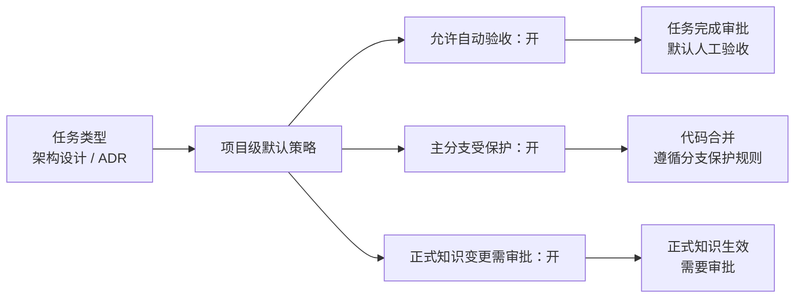

### 6.2 五条优先级规则〔原文〕

| # | 规则 |
| --- | --- |
| P1 | 项目级策略是默认值 |
| P2 | 任务级策略可以收紧要求，但**不能绕过**项目的强制限制 |
| P3 | 仓库保护规则和安全策略具有更高优先级 |
| P4 | 任何审批策略变更都应记录修改人、时间、旧值和新值 |
| P5 | 已经开始执行的任务，应明确使用哪个版本的审批策略，避免执行中途规则悄悄变化 |

〔整理〕P2 的措辞值得注意：任务级只能**收紧**不能放宽——即策略继承是「向下取严」，这与排序系统常见的「子级覆盖父级」相反。P5 则要求策略**版本钉住**（policy version pinning），否则同一任务在不同时刻判定不同。

### 6.3 与现有 policy_engine 的对照〔实测〕

| 项 | 现状 | 与本稿要求的差距 |
| --- | --- | --- |
| 位置 | `policies/ai-pm-ai-lead-v2.yaml` + `crates/pm-application/src/policy_engine.rs` | 已集中配置，符合「不散落 if 分支」 |
| 模型 | 黑名单：`defaults.effect: auto_apply` + `red_lines` 白名单（7 条命令 → `required_role`） | 与「自动化优先」思路一致 |
| 已有红线 | `sign_acceptance` → `authorized_acceptor` | **已覆盖 C3 的一部分** |
| 升级条件 | `escalate.when`：`confidence: low`、`blast_radius_above: 10`、`unresolved_conflict` | 是「风险等级」维度的雏形，但只有 3 个固定信号 |
| 粒度 | 命令级（command → role） | **缺「任务类型」维度**，无法表达「架构任务 vs 文档任务」 |
| 版本 | `policy_id: ai-pm-ai-lead-v2`（单个全局值） | **无任务级版本钉住**（P5 要求） |
| 变更留痕 | 未见 | P4 要求记录修改人/时间/旧值/新值 |
| 执行后 | `veto_window` 4h / 24h 按命令类型 | 已有，可复用 |

〔整理〕结论：现有引擎的**形状是对的**（集中配置 + 黑名单 + 红线角色），缺的是三个维度——任务类型、任务级策略、版本钉住与变更留痕。这三项不需要重写引擎，而是扩展配置模型。

---

## 七、Rust 后端如何实现〔原文〕

### 7.1 建议目录结构

```text
crates/
├── domain/
│   ├── task.rs
│   ├── task_state.rs
│   ├── task_transition.rs
│   ├── approval_policy.rs
│   ├── task_run.rs
│   └── delivery_manifest.rs
├── application/
│   ├── claim_task.rs
│   ├── submit_task.rs
│   ├── request_changes.rs
│   ├── accept_task.rs
│   └── decide_approval.rs
├── infrastructure/
│   ├── postgres/
│   ├── git/
│   └── codex/
└── interfaces/
    ├── http/
    └── mcp/
```

核心思想〔原文〕：**所有状态变化都经过统一的 `task_transition` 规则。**

### 7.2 与现有 crate 布局的映射〔实测〕

| 建议路径 | 现状 | 差异 |
| --- | --- | --- |
| `domain/task.rs` | `crates/pm-domain/src/task.rs` | 已有，但仅含 `TaskStatus` 五值枚举 |
| `domain/task_state.rs` | 无 | 需新增（13 态） |
| `domain/task_transition.rs` | 无 | **核心缺口**：迁移规则表无载体 |
| `domain/approval_policy.rs` | `pm-domain/src/policy.rs`（命令级红线） | 需扩展为「类型 × 风险 × 操作」三元 |
| `domain/task_run.rs` | 无 | 对应 `0009` 草案的 `task_run` 表 |
| `domain/delivery_manifest.rs` | 无 | 对应 `0009` 草案的交付清单 |
| `application/claim_task.rs` 等 5 个 | `command_executor.rs`（通用执行器）+ `supervision.rs`（决策） | 现有为**通用命令执行器**，非按用例拆分 |
| `infrastructure/git/`、`codex/` | `pm-infrastructure` 仅 `job_queue` | 无 Git 适配器、无执行端适配器 |
| `interfaces/http/`、`mcp/` | `apps/pm-api`、`crates/pm-mcp` | 现有为独立 app/crate，非 `interfaces` 目录 |

〔整理〕布局差异属于**组织方式**而非能力缺口：现有 `pm-*` 前缀分层（domain / application / infrastructure / mcp / api）与建议的 `domain / application / infrastructure / interfaces` 是同一套分层的不同命名。真正的缺口是 6 个领域模块中的 5 个、以及 Git / 执行端适配器。

### 7.3 伪代码（结构示意）〔原文〕

```rust
pub async fn accept_task(
    task_id: TaskId,
    actor: Actor,
) -> Result<Task, TransitionError> {
    let mut tx = repository.begin_transaction().await?;
    let task = tx.lock_task(task_id).await?;
    policy.require_accept_permission(&actor, &task)?;
    let evidence = tx.load_acceptance_evidence(task_id).await?;
    let decision = state_machine.evaluate_acceptance(&task, &evidence)?;
    if !decision.allowed {
        return Err(TransitionError::AcceptanceFailed);
    }
    let updated = tx.transition_task(task_id, TaskState::Completed).await?;
    tx.append_audit_event(/* 状态变更证据 */).await?;
    tx.commit().await?;
    Ok(updated)
}
```

> 原文明确：这段代码是**结构示意，不是可以直接编译的完整实现**。正式实现还需：审批记录校验、并发版本控制、事务错误处理、Outbox 事件写入。

#### 7.3.1 五步骨架与现有实现的对照〔实测〕

| 伪代码步骤 | 现有实现 | 状态 |
| --- | --- | --- |
| `begin_transaction` + `lock_task` | `command_executor::update_task_status` 已用 `SELECT … FOR UPDATE` + 显式 `tx.begin()` | ✅ 已有 |
| `policy.require_accept_permission` | `policy_engine` 有 `sign_acceptance → authorized_acceptor` 红线 | ⚠️ 部分（命令级，非任务类型级） |
| `load_acceptance_evidence` | 无 | ❌ 缺（§四 交付状态机未落库） |
| `state_machine.evaluate_acceptance` | 无（只有 `expected_revision` 乐观锁） | ❌ **核心缺口** |
| `transition_task` | 已实现（`UPDATE … status, revision+1`） | ✅ 已有 |
| `append_audit_event` | 已实现，且**与状态更新在同一事务**，并写入补偿快照 `CompensationSpec::Restore` | ✅ 已有 |
| `tx.commit` + 返回 receipt | 已实现（`ExecutionReceipt { audit_id, command_kind, target_id, resulting_revision }`） | ✅ 已有 |

〔整理〕这是一项**有利结论**：伪代码的 7 步里，事务、行锁、乐观锁、审计、回执 5 步已经存在且质量良好（审计与状态同事务、带补偿快照可回滚）。真正要补的只有两件事：**权限判定升级为三元策略**、**证据校验与状态机规则**。

### 7.4 硬约束〔原文〕

> 数据库中的任务状态不能由 MCP 工具或前端直接写入。所有变更必须经过领域规则、权限验证与审计记录。

〔实测〕现状与该约束存在一处冲突：`PATCH /v1/pm/tasks/{task_id}` → `pm_write::update_task` **直接改库**，不经命令通道。此项已在 `ai-pm-task-detail-page-v1.md` §6.3 记为 C1，本稿再次确认其为**规格级冲突**而非实现细节。

---

## 八、五条必须坚持的规则〔原文〕

| # | 规则 |
| --- | --- |
| 1 | **自动执行不等于自动批准。** Codex 可以自主工作，但任务是否完成由平台根据证据判定 |
| 2 | **任务目标与执行实例分离。** 每次重试产生新 Run，历史不可覆盖 |
| 3 | **跨仓库结果整体核验。** 各仓库独立交付，任务统一验收 |
| 4 | **知识变更有等级。** 普通事实和实现记录可以自动沉淀，正式决策需要授权 |
| 5 | **审批由风险决定。** 不要所有事情都要求人工点击，也不要让 Agent 自己批准所有事情 |

### 8.1 首版范围建议〔原文〕

> 第一版先实现一个**固定的状态机 + 可配置的审批策略 + 不可变的事件审计**，不要一开始就做过于复杂的工作流引擎。

原文给出的扩展目标〔原文〕：既能支持一个 Codex 独立完成任务，也能自然扩展到多个 Codex 并行、多仓库协作、独立审查 Agent 和长期项目知识治理。

〔整理〕首版范围的三个组件与现状的对应：

| 组件 | 现状 | 首版工作量判断 |
| --- | --- | --- |
| 固定状态机 | 仅 5 值枚举，无迁移规则 | **主要工作量**：13 态 + 16 条迁移规则 + 守卫 |
| 可配置审批策略 | 已有引擎骨架（黑名单 + 红线角色） | 中等：扩展「任务类型」维度 + 版本钉住 |
| 不可变事件审计 | 已有（同事务写入 + 补偿快照） | 低：基本满足 |

---

## 九、现有 5 值到 13 值的迁移映射〔实测 + 整理〕

| 现有 `TaskStatus` | 新状态机对应 | 说明 |
| --- | --- | --- |
| `backlog` | `Draft` | 语义近似，但 Draft 强调「验收条件尚未确认」 |
| `in_progress` | `Claimed` / `Running` | **一拆二**：需按是否有 Run 在跑决定 |
| `blocked` | `Blocked` | 一致 |
| `needs_info` | **无对应** | 可能被 `Awaiting Decision` 吸收，需裁 |
| `done` | `Completed` | 一致，但新机要求证据支撑 |
| — | `Ready` | 新增（契约已确认、依赖满足） |
| — | `AwaitingDecision` | 新增 |
| — | `Submitted` | 新增 |
| — | `Reviewing` | 新增 |
| — | `ChangesRequested` | 新增 |
| — | `Cancelled` | 新增 |
| — | `Failed` | 新增 |
| — | `Superseded` | 新增（原图仅图注提及） |

〔整理〕迁移要点：

| # | 要点 |
| --- | --- |
| M1 | `in_progress` 一拆二 → 迁移时必须回填「是否存在活跃 Run」，否则无法判定 Claimed 还是 Running |
| M2 | `needs_info` 无对应 → 必须逐条人工归类到 `Draft` 或 `Awaiting Decision`，不能默认映射 |
| M3 | `done` → `Completed` 需检查是否有验收证据；无证据的历史任务属于「历史遗留完成」，建议单列标记而非静默迁移 |
| M4 | 状态值存为 lowercase snake_case TEXT，新值需与前端徽标同源（`ai-pm-task-detail-page-v1.md` §6.3 C2） |

---

## 十、待确认清单

> 只记录，不裁决。

| # | 待确认项 | 影响 |
| --- | --- | --- |
| Q1 | `Superseded` 的定义与迁移边（原图仅图注提及，规则表无此状态） | 状态机完整性 |
| Q2 | `needs_info` 如何处置：并入 `Awaiting Decision`、保留、还是废弃 | 迁移 |
| Q3 | 任务级聚合规则是否统一为「取最差态」（§4.2 隐含 vs `multi-repo` §7.4 父任务聚合表） | 聚合算法 |
| Q4 | 策略开关（如「允许自动验收」）与任务类型默认值的**合成规则**：取最严？还是类型优先、开关仅在类型允许范围内生效？（§6.1 原型中三开关全开但结果仍为人工验收） | 策略引擎语义 |
| Q5 | 策略是否需要**任务级覆盖**（P2 只许收紧），其存储与生效范围 | 数据模型 |
| Q6 | 「合并设为完成条件」是项目策略还是任务类型策略 | 完成判定 |
| Q7 | 风险等级如何计算（现有 `blast_radius_above: 10` 是否即为风险等级来源） | 策略输入 |
| Q8 | 独立审查 Agent 的角色定义（是执行端的一种，还是平台内置） | 五类审批第 3 项 |
| Q9 | 失败判定条件（B4「达到失败判定条件」具体指什么：退出码？超时？连续失败次数？） | 自动迁移可靠性 |
| Q10 | Outbox 事件写入是否纳入首版（伪代码注明需补，但首版范围未提） | 首版范围 |
| Q11 | 13 态与前端徽标的一对一映射（页面现用「待验收/已提交/待审核」，需重对齐） | 前端契约 |

---

## 附录 A：图源归档

| 图 | 文件 | 用途 |
| --- | --- | --- |
| 任务状态机 | `figures/state-machine-v1-overview.png` | §1.2 布局照录 |
| 跨仓库交付示例 | `figures/state-machine-v1-cross-repo.png` | §4.2 聚合 |
| 审批策略配置原型 | `figures/state-machine-v1-policy-prototype.png` | §6.1 策略结果 |

## 附录 B：转换校验

### B.1 状态机图 → Mermaid

| 原图元素 | Mermaid 节点 | 校验 |
| --- | --- | --- |
| Draft · 草稿 / 任务目标和验收条件尚未正式确认 | `D` | 一致 |
| Ready · 待执行 / 任务契约已确认，依赖满足，仓库范围明确 | `R` | 一致 |
| Claimed / Running · 已领取 / 执行中 / Codex 已取得执行权，运行记录独立保存 | `C` | 一致（两态合一节点，按原图保留） |
| Blocked / 等待外部条件 | `B` | 一致 |
| Awaiting Decision / 等待决策 | `W` | 一致 |
| Submitted · 已提交交付 / 提交 Commit、测试证据、交付清单和知识变更提案 | `S` | 一致 |
| Reviewing · 验收中 / 自动校验、独立审查或人工审批 | `V` | 一致 |
| Completed / 验收通过（绿） | `OK` | 一致 |
| Changes Requested / 要求修改后重试（橙） | `CR` | 一致 |
| 居中的 ↓（6 处） | 见 §1.2 边集 | 布局近似，规范边集见 §1.3 |

### B.2 跨仓库图 → Mermaid

| 原图元素 | 校验 |
| --- | --- |
| 三行仓库（map-core / map-editor / map-assets）+ 副标题 + 状态徽标 + 进度条 | 三节点 + 状态标签一致；**进度条为视觉元素，不转**（40% 无法从图推定精确值，不编造） |
| 底部「任务状态：Changes Requested」+ 说明 | `T` + `N` 两节点，说明文字照录 |

### B.3 策略原型图 → Mermaid

| 原图元素 | 校验 |
| --- | --- |
| 任务类型单选四项，选中「架构设计 / ADR」 | §6.1 表格 + 流程图首节点 |
| 三个开关（均开） | 三个 `S` 节点 |
| 当前策略结果三行 | `R` / `R2` / `R3` |
| 底部说明 | 原文照录于 §6.1 |

---

## 十一、裁决记录：§十 Q1 · Superseded（V2 · 2026-10-31）

> **裁决说明**
> - 裁决日期：2026-10-31；裁决人：需求方
> - 供稿原文直录，〔整理〕仅做结构化归纳，不引入新决策
> - 本节为裁决记录，**追加生效**：§一、§三、§九 中与 Superseded 相关的留白以本节为准，既有条目不改写
> - §十 Q1 关闭；衍生子待确认 Q1.1–Q1.3（见 §11.8）

### 11.1 状态定义〔原文〕

| 项目 | 规则 |
| --- | --- |
| 状态名称 | `Superseded` |
| 中文名称 | 已被取代 |
| 状态性质 | **终态，不允许恢复执行** |
| 触发原因 | 需求更新、任务拆分或合并、方案调整、重复任务合并 |
| 是否保留历史 Run | 必须保留 |
| 是否保留 Git Commit | 必须保留，**不自动回滚** |
| 是否允许重新执行 | 不允许；应在新任务上创建新的 Run |
| 必填信息 | `superseded_by_task_id`、原因、操作者、时间 |

核心语义〔原文〕：任务已被更新的任务正式取代，因此不再继续执行，但保留历史记录、执行记录和已有交付物。**它不是失败状态，也不等于取消**——旧任务的目标或执行依据已被新任务替代，继续执行已没有意义。

与相邻状态的边界〔原文〕：如果只是暂时不做，应使用 `Cancelled`；如果执行遇到问题，应使用 `Blocked` 或 `Failed`，不能把这些情况混入 `Superseded`。

### 11.2 状态机规则（供稿 YAML）〔原文〕

```yaml
Superseded:
  terminal: true
  resumable: false
  retryable: false

  allowed_from:
    - Draft
    - Ready
    - Blocked
    - Running
    - Submitted
    - Reviewing

  required:
    - superseding_task_id
    - reason
    - actor_id
    - timestamp

  constraints:
    - replacement_task_must_exist
    - no_self_supersession
    - no_supersession_cycles
    - preserve_all_runs_and_commits
    - stop_active_run_before_finalization
    - audit_transition
```

### 11.3 迁移边（图1 转 Mermaid）

图源：[`figures/superseded-v1-transitions.png`](figures/superseded-v1-transitions.png)

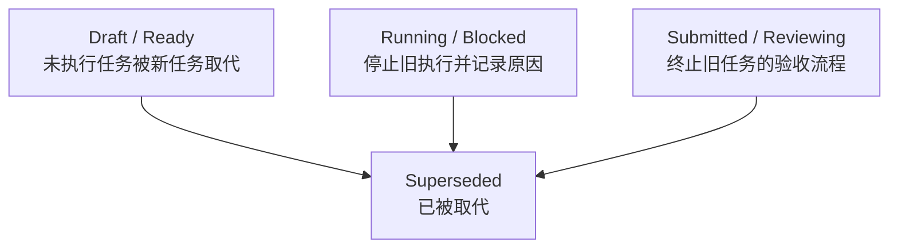

逐元素校验〔整理〕：

| 原图元素 | Mermaid | 校验 |
| --- | --- | --- |
| Draft / Ready → Superseded，副标题「未执行任务被新任务取代」 | `DR → S` | 一致 |
| Running / Blocked → Superseded，副标题「停止旧执行并记录原因」 | `RB → S` | 一致 |
| Submitted / Reviewing → Superseded，副标题「终止旧任务的验收流程」 | `SR → S` | 一致 |
| 底注：Completed / Failed / Cancelled / Superseded 默认不允许迁入 Superseded；已完成任务如需后续修改，应创建新任务并关联原任务 | 照录于 §11.7 | 一致 |

### 11.4 迁移审批规则〔原文〕

| 迁移场景 | 自动 / 人工 | 约束 |
| --- | --- | --- |
| Draft → Superseded | 可自动 | 已明确新任务及替代关系 |
| Ready → Superseded | 可自动 | 尚未开始执行，且替代关系已确认 |
| Running → Superseded | **需授权确认** | 先请求停止 Run，确认停止或记录停止失败 |
| Blocked → Superseded | 可自动或按策略审批 | 确认不再需要解决阻塞问题 |
| Submitted → Superseded | **建议人工审批** | 防止绕过交付验收 |
| Reviewing → Superseded | **建议人工审批** | 终止审核并记录未完成的审查项 |

〔整理〕「人工审批」不一定每次由项目负责人点击，可按任务风险设置策略：普通文档任务允许授权负责人直接取代；架构、数据库迁移、跨仓库接口变更等高风险任务要求明确审批。该口径与 §2.4（审批绑定 任务类型 × 风险 × 操作）及 §六 策略引擎同向。

### 11.5 取代关系模型〔原文〕

显式双向可追溯关系，不依赖备注说明：

```rust
struct SupersededRelation {
    old_task_id: TaskId,
    new_task_id: TaskId,
    reason: String,
    created_by: ActorId,
    created_at: DateTime<Utc>,
}
```

数据库要求〔原文〕：

| # | 要求 |
| --- | --- |
| 1 | 旧任务保存 `superseded_by_task_id` |
| 2 | 新任务可通过关联表查询 `supersedes_task_id`，支持**一个新任务取代多个旧任务** |
| 3 | 记录取代原因、操作人、审批记录及时间 |
| 4 | 禁止任务取代自身；禁止形成循环关系 |
| 5 | **新任务必须先存在，才能正式完成取代操作** |

拆分场景〔原文〕：一个旧任务拆成多个新任务时，通过关联表记录多个后继任务，而不是只保存一个 `superseded_by_task_id`。

### 11.6 执行中任务的取代流程〔原文〕

推荐顺序：

| 步 | 动作 |
| --- | --- |
| 1 | 创建或确认替代任务，保存替代关系 |
| 2 | 请求旧任务的 Codex 执行实例停止 |
| 3 | 收集旧 Run 的日志、当前提交、工作区状态及已产生的交付物 |
| 4 | 确认旧任务不再接受新的执行或提交操作 |
| 5 | 将旧任务迁移至 Superseded，记录审计事件 |

执行实例无法立即停止时〔原文〕：任务应暂时保持在停止处理中，或进入单独的 `Stopping` 状态；**不能因为用户点击了「取代」就假定执行已经结束**。若不想增加 Stopping，至少应在数据库记录停止请求状态，避免旧 Run 继续提交新的交付。

〔整理〕第 5 步与 YAML `stop_active_run_before_finalization` 约束互为印证：**停止 Run 是迁入终态的前置守卫，不是事后补偿**。

Git Commit 处置〔原文〕：已产生的 Commit 不因任务被取代而自动消失。新任务应重新校验仓库基准版本，决定**复用、移植还是放弃**旧任务的成果。（与 §4.4 base_commit 过期重评规则衔接）

### 11.7 图1 底注〔原文〕

> Completed、Failed、Cancelled、Superseded 默认不允许迁移到 Superseded。已完成任务如需后续修改，应创建新任务并关联原任务。

### 11.8 页面展示与衍生待确认

页面展示〔原文〕：`Superseded` 展示为「已被取代」，并提供「查看替代任务」链接。它是任务生命周期的正式终态，**不能只作为图注或备注存在**。

衍生待确认（只记录，不裁决）：

| # | 子项 | 说明 | 影响 |
| --- | --- | --- | --- |
| Q1.1 | `Claimed`、`AwaitingDecision`、`ChangesRequested` 未列入 `allowed_from`（文字与图1 一致）。Claimed 是否需先经「租约过期回 Ready」再取代？后两态是否允许直接取代？ | 供稿未述 | 迁移边完整性 |
| Q1.2 | 执行实例无法立即停止时：新增 `Stopping` 状态，还是仅记录停止请求状态（供稿给出两案，未选定） | 两案并存 | 状态总数（13/14 值）、并发控制 |
| Q1.3 | 图1 底注「**默认**不允许」是否意味存在策略豁免路径；按 §11.1 终态定义倾向硬禁止 | 措辞歧义 | 终态语义 |

---

## 十二、裁决记录：§十 Q2 · needs_info（V3 · 2026-10-31）

> **裁决说明**
> - 裁决日期：2026-10-31；裁决人：需求方
> - 供稿原文直录，〔整理〕仅做结构化归纳，不引入新决策
> - 本节为裁决记录，**追加生效**：§九 M2 的迁移口径以本节为准，既有条目不改写
> - §十 Q2 关闭；衍生子待确认 Q2.1–Q2.2（见 §12.6）

### 12.1 三方案比较与结论〔原文〕

| 方案 | 优点 | 缺点 | 建议 |
| --- | --- | --- | --- |
| 并入 Awaiting Decision | 状态机更精简，统一暂停与恢复逻辑 | 如果不记录原因，容易混淆决策与信息缺失 | **推荐**，增加等待原因字段 |
| 保留 needs_info | 含义直观，Agent 易理解 | 与其他等待状态重复，迁移规则容易膨胀 | 不建议作为独立任务状态 |
| 完全废弃，不保留语义 | 状态最少 | 无法区分缺少信息、等待审批、等待外部依赖 | 不推荐 |

最终结论〔原文〕：**needs_info 从任务状态枚举中废弃，作为 `WaitingReason::NeedsInfo` 保留**。既减少状态机复杂度，又不丢失 Agent 与人协作时最重要的语义。

### 12.2 一个状态，多个等待原因（图1 转 Mermaid）

图源：[`figures/waiting-reason-v1-awaiting-decision.png`](figures/waiting-reason-v1-awaiting-decision.png)

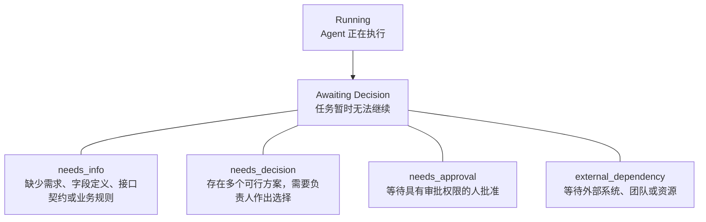

逐元素校验〔整理〕：

| 原图元素 | Mermaid | 校验 |
| --- | --- | --- |
| Running（副标题「Agent 正在执行」）→ Awaiting Decision（「任务暂时无法继续」） | `R → W` | 一致 |
| 四张等待原因卡：needs_info / needs_decision / needs_approval / external_dependency，含副标题 | `W1–W4` | 一致 |
| 底注「上面是同一任务状态下的等待原因示例，不是四个新的任务状态」 | 照录于本节下方 | 一致 |

底注〔原文〕：**上面是同一任务状态下的等待原因示例，不是四个新的任务状态。**

### 12.3 迁移规则〔原文〕

| 当前状态 | 事件 | 目标状态 | 处理规则 |
| --- | --- | --- | --- |
| Running | Agent 发现关键信息缺失 | Awaiting Decision | 设置 `waiting_reason=needs_info`，列出具体问题 |
| Awaiting Decision | 用户补充信息 | Ready 或 Running | 校验信息是否完整，再恢复执行 |
| Awaiting Decision | 用户选择方案 | Ready 或 Running | 保存决策记录，再继续执行 |
| Awaiting Decision | 用户批准 | Ready 或 Running | 校验审批权限和审批结果 |
| Awaiting Decision | 等待超时 | 按策略处理 | 提醒、升级、取消或保持等待，**不应默认视为失败** |

关键约束〔原文〕：**不要在收到任何回复后就自动恢复任务。** Agent 应先检查回复是否回答了所有必需问题；如果仍缺少关键约束，任务应继续处于 Awaiting Decision，更新尚未解决的问题列表。

### 12.4 数据模型〔原文〕

「状态」和「等待上下文」分开存储：

```rust
enum TaskStatus {
    Draft,
    Ready,
    Claimed,
    Running,
    AwaitingDecision,
    Blocked,
    Submitted,
    Reviewing,
    Completed,
    ChangesRequested,
    Failed,
    Cancelled,
    Superseded,
}

enum WaitingReason {
    NeedsInfo,
    NeedsDecision,
    NeedsApproval,
    ExternalDependency,
}

struct WaitingContext {
    reason: WaitingReason,
    questions: Vec<String>,
    requested_from: Option<ActorId>,
    since: DateTime<Utc>,
    deadline: Option<DateTime<Utc>>,
}
```

生产实现要求〔原文〕：还应记录恢复执行所需的证据、回答记录、审批记录以及每次状态变化的审计事件。`WaitingContext` 可以为空；任务离开等待状态时，**保留历史等待记录，而不是直接删除**。

### 12.5 对 MCP 和 Codex 的约束〔原文〕

| # | 约束 |
| --- | --- |
| 1 | Codex 可以提出 needs_info 请求，但**不能自行认定用户已回答** |
| 2 | MCP 收到补充信息后，应先记录回答，再调用统一的恢复校验逻辑 |
| 3 | **needs_info 不是审批**：补充信息不代表用户批准了架构方案或高风险操作 |
| 4 | 如果信息补充改变了需求范围或验收标准，应触发需求变更流程，而不是直接恢复旧任务 |
| 5 | UI 展示「等待补充信息」「等待方案决策」「等待审批」等用户可读文案；内部任务状态保持统一 |

### 12.6 关联影响与衍生待确认〔整理〕

| # | 关联影响 | 说明 |
| --- | --- | --- |
| L1 | §九 M2 迁移口径更新 | 原口径「needs_info 必须逐条人工归类到 Draft 或 Awaiting Decision」以本节为准：历史 `needs_info` 统一迁入 `AwaitingDecision`（`waiting_reason=NeedsInfo`），逐条核对的是等待原因与未决问题列表，不再做状态二选一 |
| L2 | 详情页稿 §七 Q6 获得裁决依据 | 本节数据模型给出 **13 值 `TaskStatus` 枚举**，确认「扩展枚举」路径（否决子状态方案与前端派生映射）；DB 存储命名格式（§九 M4 倾向 lowercase snake_case TEXT）在实施 spec 中落实 |
| L3 | 前端徽标 | 徽标文案按等待原因展示可读文案（「等待补充信息」等），内部状态单一来源不变（呼应详情页稿 W2） |

衍生待确认（只记录，不裁决）：

| # | 子项 | 说明 | 影响 |
| --- | --- | --- | --- |
| Q2.1 | `WaitingReason::NeedsApproval` 与 §六 审批策略引擎的衔接：触发人工审批时，任务是先置 `AwaitingDecision(NeedsApproval)`、还是先经红线 W5 路径创建 `approval_request`，二者时序与归属供稿未述 | 状态机与审批链路的接缝 | 状态机与审批引擎衔接 |
| Q2.2 | 等待超时策略的具体规则与默认值（提醒 / 升级 / 取消 / 保持等待的触发条件与时限） | 「按策略处理」未展开 | 超时处置自动化 |

---

## 十三、裁决记录：§十 Q3 · 任务级聚合规则（V4 · 2026-10-31）

> **裁决说明**
> - 裁决日期：2026-10-31；裁决人：需求方
> - 供稿原文直录，〔整理〕仅做结构化归纳，不引入新决策
> - 本节为裁决记录，**追加生效**：§4.2 的「取最差态」〔整理〕推断被本裁决替代，既有条目不改写；multi-repo 稿 §7.4 聚合表以 V1.1 追加注记方式指向本节
> - §十 Q3 关闭；衍生子待确认 Q3.1–Q3.3（见 §13.7）

### 13.1 结论与术语〔原文〕

**不要把任务级聚合规则统一定义为简单的「取最差态」**，而应统一为「基于交付门槛的确定性聚合规则」。所有单仓库、多仓库任务都使用同一套聚合引擎，但根据父任务的完成条件，判断是否可以进入 Completed。

理由〔原文〕：任务状态不完全是线性优劣关系。比如一个子任务处于 Blocked，另一个已经 Completed，不能简单地通过状态排序得到正确的父任务状态。

统一聚合原则〔原文〕：

> 父任务的状态由子任务状态、交付完整性、未解决阻塞及审批结果共同决定。聚合结果必须**确定、可解释、可追溯**，不得仅依赖状态枚举的优先级排序。

术语统一〔原文〕：规范中正式术语为——

> **任务级聚合：基于必需交付门槛的确定性聚合（Deterministic Delivery-Gate Aggregation）。**
> 不要称为「取最差态」。后者可以作为简单场景下的直觉描述，却不能作为正式算法。

### 13.2 聚合判定顺序〔原文〕

| 序 | 判定 | 规则 |
| --- | --- | --- |
| 1 | 是否已被取代或取消？ | 父任务自身已进入 `Superseded` 或 `Cancelled` 时，**保留该终态**，不再根据子任务覆盖 |
| 2 | 是否存在未解决的决策或信息请求？ | 有明确的人工决策门槛时，进入 `AwaitingDecision` |
| 3 | 是否存在阻塞？ | 存在影响父任务继续推进的未解决阻塞时，进入 `Blocked` |
| 4 | 是否所有必要交付均已完成？ | 子任务、仓库交付、验证和必需审批**全部满足**，才允许进入 `Completed` |
| 5 | 其余情况根据执行进度聚合 | 执行中为 `Running`；等待执行为 `Ready`；交付已提交、待统一验收为 `Submitted` 或 `Reviewing` |

〔原文〕以上是判定框架，不是说每个状态都必须在聚合时无条件覆盖其他状态。父任务被取消、被取代等情况必须优先处理；等待、阻塞和验收则必须结合其**影响范围与具体策略**。

### 13.3 父任务聚合表〔原文〕

前提：父任务要求所有必需子任务和仓库交付均完成。

| 子任务或交付情况 | 父任务聚合状态 | 说明 |
| --- | --- | --- |
| 所有必需子任务均完成，交付和审批齐全 | `Completed` | 全部完成门槛满足 |
| 任一必需子任务等待人工决策 | `AwaitingDecision` | 需要决策才能继续推进 |
| 任一必需子任务被关键依赖阻塞 | `Blocked` | 存在影响整体交付的阻塞 |
| 任一必需子任务正在执行 | `Running` | 整体工作尚未完成 |
| 所有子任务均已提交，父级验收尚未完成 | `Submitted` / `Reviewing` | 等待统一验收 |
| 部分子任务完成，其余尚未开始 | `Ready` 或 `Running` | 根据是否已有实际执行决定 |
| 任一必需子任务失败且无法自动恢复 | `Failed` 或 `Blocked` | 依赖失败处理策略及是否允许重试 |
| 可选子任务失败，但所有必需交付已满足 | **可继续完成** | 失败需保留记录，但不应阻止父任务完成 |
| 任一子任务被取代 | **不直接决定父任务状态** | 先判断它是否已由有效替代任务承接 |

### 13.4 两个必须明确的例外〔原文〕

**例外 A：不是所有子任务都必须完成。** 如果子任务明确标记为 `optional`，它失败或被取消不一定影响父任务完成。**聚合依据应该是任务的必需交付清单，而不是子任务数量。**

**例外 B：子任务完成不等于仓库交付完成。** 例如两个仓库的 Codex 执行都成功，但其中一个仓库的提交没有通过基准版本校验，父任务仍然不能进入 `Completed`。

### 13.5 与 multi-repo §7.4 的统一〔原文〕

建议将本稿 §4.2 和 multi-repo §7.4 **统一引用同一个规范**，而不是各自维护聚合算法：

| 文档位置 | 职责 |
| --- | --- |
| 本稿 §4.2 | 定义通用任务状态与聚合原则 |
| multi-repo §7.4 | 定义多仓库特有的交付门槛：每个必需仓库的基准版本、Commit、验证结果及集成状态 |
| 统一规范（本节） | 定义聚合判定顺序、终态处理、可选子任务、失败恢复及父子任务一致性约束 |

〔原文〕**多仓库只是增加了更多交付条件，不应另有一套父任务状态优先级算法。**

〔整理〕multi-repo 稿已按此裁决追加 V1.1 注记：其 §7.4 父任务状态聚合表（旧词汇 `completed / partial / needs_recovery / changes_requested`）不再作为独立算法维护，仅保留多仓库交付门槛条件。

### 13.6 Rust 实现建议〔原文〕

不推荐——通过状态枚举优先级决定父任务状态：

```rust
// 不推荐：通过状态枚举优先级决定父任务状态
let parent_status = children
    .iter()
    .map(|task| task.status)
    .max_by_key(|status| status.priority());
```

推荐——显式聚合输入：

```rust
struct AggregationInput {
    child_tasks: Vec<ChildTaskSummary>,
    required_deliveries: Vec<DeliverySummary>,
    unresolved_decisions: usize,
    blocking_dependencies: usize,
    required_approvals_satisfied: bool,
}

fn aggregate_task(
    input: &AggregationInput,
) -> Result<TaskStatus, AggregationError> {
    // 1. 检查父任务自身的终态和取消策略
    // 2. 检查未解决决策与关键阻塞
    // 3. 检查必需子任务和仓库交付
    // 4. 检查验收及审批门槛
    // 5. 根据剩余执行进度确定状态
    todo!()
}
```

职责边界〔原文〕：父任务自身的 `Cancelled` 和 `Superseded` 应由**父任务命令及状态机**负责，不应被普通聚合计算覆盖。上面的代码只是展示输入与职责边界。

〔整理〕裁决给出的职责三分：

| 组件 | 职责 |
| --- | --- |
| 状态机 | 单个任务的合法迁移 |
| 聚合器 | 父任务状态计算 |
| 交付验证器 | 多仓库交付是否真正满足完成条件 |

### 13.7 关联影响与衍生待确认〔整理〕

| # | 关联影响 | 说明 |
| --- | --- | --- |
| L1 | §4.2「取最差态」推断作废 | §4.2 〔整理〕曾按图隐含语义推断聚合默认规则为「取最差态」，本裁决以交付门槛聚合替代；该图的语义（保留已验证仓库交付、只重做未通过部分）改由**交付状态机 + 交付门槛**承载 |
| L2 | 子任务 `optional` 标记需落库 | 例外 A 依赖「必需 / 可选」标记，任务与交付清单模型需增加该字段（默认必需） |
| L3 | multi-repo §7.4 已挂注记 | 其聚合表停用为独立算法，仅保留多仓库交付门槛条件（见该稿 V1.1 变更记录） |

衍生待确认（只记录，不裁决）：

| # | 子项 | 说明 | 影响 |
| --- | --- | --- | --- |
| Q3.1 | 聚合表未含 `ChangesRequested` 情形：仓库交付被要求修改时（如 §4.2 三仓示例中 map-assets 处于 ChangesRequested），父任务聚合到哪个状态 | 九行表无此行 | 聚合完备性 |
| Q3.2 | 聚合表第 5 行「Submitted / Reviewing」二选一的判定条件（父级验收是否已开始的区分依据） | 两态并列未给选择规则 | 聚合确定性 |
| Q3.3 | 聚合重算的触发时机与一致性保证（子任务状态变化时事件驱动同步重算，还是异步；父子状态短暂不一致是否允许） | 供稿未述 | 「可追溯」的落地方式 |

---

## 十四、裁决记录：§十 Q4 · 策略合成规则（V5 · 2026-10-31）

> **裁决说明**
> - 裁决日期：2026-10-31；裁决人：需求方
> - 供稿原文直录，〔整理〕仅做结构化归纳，不引入新决策
> - 本节为裁决记录，**追加生效**：§6.1–§6.2 的原型与 P1–P5 规则保持有效，本节为其提供合成算法；§6.1 原型界面需按 §14.5 增补与 §14.3 修订
> - §十 Q4 关闭；衍生子待确认 Q4.1–Q4.2（见 §14.6）

### 14.1 最终决策与合成规则〔原文〕

最终决策：采用「**类型定义能力上限，开关仅在允许范围内生效，强制约束优先，执行证据决定是否通过**」的合成规则。既保留项目级自动化配置的灵活性，又避免用户通过几个开关意外绕过人工审批。

两个原则并不矛盾〔原文〕：

| 原则 | 含义 |
| --- | --- |
| 类型优先 | 决定某类任务是否有**资格**自动验收 |
| 取最严 | 综合任务级配置、项目策略、仓库保护规则和风险条件，得出最终结果 |
| 开关不能越权 | 用户打开「允许自动验收」，不代表架构决策、受保护分支合并等操作可以绕过人工审批 |

〔整理〕这解释了 §6.1 原型中三个开关全开、结果仍为人工验收的情况：**开关表示允许尝试自动验收，而不是授予自动验收资格。**

合成优先级（从高到低）〔原文〕：

| 优先级 | 层 | 说明 |
| --- | --- | --- |
| ① | 强制安全约束 | 法律、组织策略、权限限制、受保护分支规则。**不可由任务开关覆盖** |
| ② | 任务类型策略上限 | 决定文档、普通功能、架构变更、数据库迁移等任务是否允许自动验收 |
| ③ | 项目及任务策略开关 | 只能进一步收紧限制，**不能突破上限** |
| ④ | 本次执行证据 | 测试、交付清单、基准版本校验、审查结果**全部满足**，才有资格执行自动验收 |

注意〔原文〕：任务类型策略上限不能高于强制安全约束；任务执行证据也不能抵消强制人工审批要求。

### 14.2 合成示例〔原文〕

「允许自动验收」为任务级开关，类型策略规定该任务是否具备自动验收资格：

| 任务类型 | 类型允许自动验收 | 开关 | 强制人工审批 | 最终结果 |
| --- | --- | --- | --- | --- |
| 文档修改 | 是 | 开 | 否 | 满足验证条件后自动验收 |
| 文档修改 | 是 | 关 | 否 | 人工验收 |
| 普通功能开发 | 是 | 开 | 否 | 满足验证条件后自动验收 |
| 架构决策 | 否 | 开 | 是 | 人工审批、人工验收 |
| 数据库迁移 | 否 | 开 | 是 | 人工审批、人工验收 |
| 普通功能开发 | 是 | 开 | 是 | 人工验收 |
| 文档修改 | 是 | 开 | 否，但**测试失败** | **不得自动验收** |

〔原文〕最后一行说明：策略允许自动验收，**不等于本次执行必然通过自动验收**。

### 14.3 三个开关的定义〔原文〕

原型中的三个开关**不要作为同一层级的布尔值直接参与运算**，应明确它们分别控制什么：

| 开关 | 推荐语义 | 能否覆盖任务类型限制 |
| --- | --- | --- |
| 允许自动验收 | 允许策略引擎尝试自动验收 | 不能 |
| 允许自动合并 | 允许满足条件的交付自动合并 | 不能 |
| 允许知识自动生效 | 允许符合知识治理规则的变更自动生效 | 不能 |

〔原文〕这三者是**三个独立能力，不能相互推导**。例如：任务可以自动验收，但仍需要人工合并；代码可以自动合并，但 ADR 架构决策仍需人工批准。

### 14.4 Rust 实现建议〔原文〕

把策略计算和任务状态迁移分开：

```rust
struct PolicyContext {
    task_type: TaskType,
    auto_accept_enabled: bool,
    auto_merge_enabled: bool,
    auto_knowledge_publish_enabled: bool,
    protected_branch: bool,
    requires_human_approval: bool,
}

struct EffectivePolicy {
    can_auto_accept: bool,
    can_auto_merge: bool,
    can_auto_publish_knowledge: bool,
    requires_human_approval: bool,
}
```

核心逻辑示例：

```rust
fn resolve_policy(ctx: &PolicyContext) -> EffectivePolicy {
    let type_allows_auto_accept =
        ctx.task_type.allows_auto_accept();

    let requires_human_approval =
        ctx.requires_human_approval
        || ctx.task_type.requires_human_approval();

    EffectivePolicy {
        can_auto_accept:
            type_allows_auto_accept
            && ctx.auto_accept_enabled
            && !requires_human_approval,

        can_auto_merge:
            ctx.auto_merge_enabled
            && !ctx.protected_branch
            && !requires_human_approval,

        can_auto_publish_knowledge:
            ctx.auto_knowledge_publish_enabled
            && ctx.task_type.allows_auto_knowledge_publish()
            && !requires_human_approval,

        requires_human_approval,
    }
}
```

〔原文〕这是简化示例。生产实现还应检查组织级策略、仓库权限、分支规则、风险等级和本次执行证据；其中任何强制限制都必须参与合成。实际的验收、合并和知识发布还应**各自使用独立的策略判定**，不能只依赖同一个 `requires_human_approval` 标志。

### 14.5 §6.1 原型修订：有效策略预览（图1）

图源：[`figures/policy-synthesis-v1-effective-preview.png`](figures/policy-synthesis-v1-effective-preview.png)

〔原文〕建议增加一块明确的**策略解释区域**，避免用户误以为打开所有开关就能自动完成所有操作。示例为静态展示，重点是让用户看到**开关配置与最终生效策略之间的区别**。

图面转录〔整理〕：

| 区域 | 内容 |
| --- | --- |
| 卡片标题 | 有效策略预览 |
| 任务类型 | 架构决策 |
| 自动验收开关 | 已开启（绿色徽标） |
| 类型策略上限 | 仅允许人工验收（红色徽标） |
| 最终生效 | 人工验收（盾形图标 + 结论行） |
| 解释文案 | 任务类型不允许自动验收。打开开关不会覆盖此限制。策略引擎将在执行完成后生成验收材料，等待授权人员确认。 |

### 14.6 关联影响与衍生待确认〔整理〕

| # | 关联影响 | 说明 |
| --- | --- | --- |
| L1 | §6.2 P1–P5 保持有效 | 本节为五条优先级规则提供合成算法：P1（项目默认值）落在第③层，P2「只能收紧」扩展适用于项目/任务开关层，P3（仓库保护/安全策略）即第①层，P4/P5（留痕与版本钉住）不受影响 |
| L2 | 开关三语义极性与 §6.1 原型相反 | §6.1 原型开关为「正式知识变更需要审批」（开启 = 需审批）；本节推荐语义为「允许知识自动生效」（开启 = 允许自动生效）。**配置模型与界面文案以本节推荐语义为准**，§6.1 原型开关注释需相应修订 |
| L3 | 策略配置按三能力独立建模 | `auto_accept` / `auto_merge` / `auto_knowledge_publish` 三个能力各自独立判定，不再是同层布尔运算；`protected_branch` 直接禁用自动合并（呼应 §2.3 C4） |

衍生待确认（只记录，不裁决）：

| # | 子项 | 说明 | 影响 |
| --- | --- | --- | --- |
| Q4.1 | 任务类型 × 三能力（auto_accept / auto_merge / auto_knowledge_publish）**默认上限矩阵**的正式定义 | 合成示例表给出 auto_accept 维度部分默认值（文档/普通功能 = 允许，架构/迁移 = 不允许）；auto_merge、auto_knowledge_publish 维度未给全 | 策略默认值配置 |
| Q4.2 | `requires_human_approval` 的输入源清单与设置时机 | 风险等级（§十 Q7 待裁）、红线命中、审批中记录等如何进入 `PolicyContext` | 策略引擎输入 |

---

## 十五、裁决记录：§十 Q5 · 任务级策略覆盖（V6 · 2026-10-31）

> **裁决说明**
> - 裁决日期：2026-10-31；裁决人：需求方
> - 供稿原文直录，〔整理〕仅做结构化归纳，不引入新决策
> - 本节为裁决记录，**追加生效**：§6.2 P2「只许收紧」由本节给出数据模型与生效范围；§6.2 P5「版本钉住」由 Run 策略快照落地
> - §十 Q5 关闭；衍生子待确认 Q5.1–Q5.2（见 §15.7）

### 15.1 最终决策〔原文〕

**支持任务级策略覆盖，但 P2 阶段只允许收紧，不允许放宽。** 不在每个任务上复制一份完整策略：项目策略提供默认值，任务只保存**显式覆盖项**，运行时统一计算最终生效策略，并将计算结果**快照到每次 Run**。

〔原文〕这样既能满足特殊任务的审批要求，又不会让任务配置逐渐演变成难以管理的第二套策略系统。

### 15.2 策略覆盖的四层边界〔原文〕

| 层 | 内容 | 约束 |
| --- | --- | --- |
| L0 · 组织强制策略 | 安全、权限、强制审批 | **任何下层都不能放宽** |
| L1 · 仓库策略 | 受保护分支、合并规则、代码所有权及仓库验证要求 | — |
| L2 · 项目策略与任务类型默认值 | 定义普通功能、文档、架构决策等任务的默认自动化能力 | — |
| L3 · 任务级覆盖 | 只能**增加限制**：关闭自动验收、增加人工审批、提高验证要求 | — |

细节〔原文〕：任务类型默认值和项目策略**分别存储**——类型默认值定义「允许什么」，项目策略定义「本项目实际启用什么」，任务覆盖定义「本任务需要额外收紧什么」。

### 15.3 哪些策略允许任务级覆盖〔原文〕

P2 先只开放以下几类：

| 策略项 | 任务级是否允许 | P2 规则 |
| --- | --- | --- |
| 自动验收 | 是 | 可以关闭，**不可开启**类型或项目未允许的能力 |
| 自动合并 | 是 | 可以关闭，**不可绕过**仓库保护规则 |
| 知识自动生效 | 是 | 可以关闭，**不可绕过**知识审批要求 |
| 强制人工审批 | 是 | 可以**增加**审批要求，不可取消已有要求 |
| 验证要求 | 是 | 可以**增加**测试、审查、仓库校验，**不可降低基线** |
| 允许修改的仓库范围 | 有条件 | 可以**缩小**范围，不能超出任务授权范围 |
| 允许修改的目录或文件范围 | 有条件 | 可以**缩小**范围，不能扩大授权范围 |
| 权限、组织安全策略 | **否** | 任务级不可覆盖 |

特别建议〔原文〕：仓库范围和文件范围不只是策略开关，它们还涉及**实际授权**。即使任务策略允许某项操作，也不能因此授予 Agent 本来没有的 Git 或文件系统权限。

### 15.4 存储方式：只保存差异，不复制完整策略〔原文〕

三个概念：**策略定义、任务覆盖、Run 生效快照**。

```rust
struct TaskPolicyOverride {
    task_id: TaskId,

    // None 表示继承项目策略
    auto_accept: Option<bool>,
    auto_merge: Option<bool>,
    auto_publish_knowledge: Option<bool>,

    // 只能增加要求
    require_human_approval: Option<bool>,
    additional_checks: Vec<CheckRequirement>,

    updated_by: ActorId,
    updated_at: DateTime<Utc>,
}
```

示例：

```json
{
  "task_id": "TASK-1042",
  "auto_accept": false,
  "auto_merge": null,
  "auto_publish_knowledge": false,
  "require_human_approval": true,
  "additional_checks": ["architecture_review"]
}
```

〔原文〕这表示该任务禁止自动验收、禁止知识自动生效，并额外要求架构审查；合并策略仍继承项目与仓库的规则。

存储落地〔原文〕：数据库中使用独立的 `task_policy_overrides` 表；如果项目现阶段以 Markdown 为主要知识源，也可以在任务 Markdown 中记录任务级策略意图，但**最终生效策略、审批记录和状态变更仍应由可靠的事务存储负责。Markdown 不应成为并发状态迁移的唯一协调机制。**

### 15.5 生效范围：必须区分任务、Run 和仓库〔原文〕

| 范围 | 生效规则 | 变更时的处理 |
| --- | --- | --- |
| 任务级 | 对整个任务的默认执行约束生效 | 新增或修改覆盖后，重新计算策略 |
| Run 级 | 每次执行使用**独立策略快照** | 已开始的 Run **不静默改变**原快照 |
| 仓库级 | 对该 Run 涉及的对应仓库**分别校验** | 每个仓库的合并与保护规则单独生效 |
| 审批级 | 对具体审批动作和授权范围生效 | **不允许通过重新执行绕过审批** |

多仓库示例〔原文〕：任务涉及三个仓库——仓库 A 允许自动合并；仓库 B 使用受保护分支，必须人工合并；仓库 C 只允许提交，不允许 Agent 自动发布。**即使任务级 `auto_merge = true`，也不能将三个仓库统一视为允许自动合并，最终权限必须逐仓库计算。**

Run 快照字段〔原文〕，每次 Run 创建时保存：

| 字段 | 内容 |
| --- | --- |
| `policy_snapshot` | 完整的有效策略 |
| `policy_version` | 所引用的项目及组织策略版本 |
| `override_version` | 任务覆盖版本 |
| `policy_hash` | 规范化策略内容的哈希 |
| `evaluated_at` | 策略计算时间 |
| `repository_policy_snapshots` | 各仓库适用规则的快照或版本引用 |

变更规则〔原文〕：任务覆盖变更后，历史 Run 保留原快照；新 Run 使用新策略。对于正在运行的任务，如果**安全策略被紧急收紧**，则必须**重新校验敏感操作**，不能因为旧快照而继续执行已不再被允许的动作。

### 15.6 策略合成：能力类与约束类两分〔原文〕

不要所有字段都简单取 AND，区分两种运算：

| 类别 | 示例 | 运算规则 |
| --- | --- | --- |
| 能力类字段 | 自动验收、自动合并 | 所有适用层**都必须允许** |
| 约束类字段 | 必须人工审批、额外验证要求 | 只能**增加**，不能减少 |

```rust
fn resolve_auto_accept(
    organization_allows: bool,
    project_allows: bool,
    task_type_allows: bool,
    task_override: Option<bool>,
    requires_human_approval: bool,
) -> bool {
    let task_allows = task_override.unwrap_or(true);

    organization_allows
        && project_allows
        && task_type_allows
        && task_allows
        && !requires_human_approval
}
```

〔原文〕`unwrap_or(true)` 只表示任务没有明确关闭自动验收时，不额外增加限制；它**不代表绕过其他层级的授权**。

〔原文〕生产实现中，建议进一步使用类型化策略与独立的 `resolve_auto_merge`、`resolve_knowledge_publish` 函数，避免不同动作错误共用同一个审批判断。（与 §14.4「各自使用独立的策略判定」一致）

### 15.7 UI、P2 范围与衍生待确认

UI 呈现〔原文〕：任务详情页增加「**执行策略**」区域，只显示继承值、覆盖值与最终结果；提供「**查看策略来源**」功能，让用户能追溯某项限制来自组织、仓库、项目、任务类型还是任务覆盖，而不是只显示最终的开关状态。

图源：[`figures/policy-override-v1-task-panel.png`](figures/policy-override-v1-task-panel.png)

图面转录〔整理〕（TASK-1042 · 执行策略，静态原型）：

| 策略项 | 项目默认 | 任务覆盖（徽标） |
| --- | --- | --- |
| 自动验收 | 允许 | **本任务：关闭**（红） |
| 自动合并 | 继承项目策略 | 未覆盖（灰） |
| 知识自动生效 | 允许 | **本任务：关闭**（红） |
| 人工审批 | 项目默认要求 | **额外要求**（橙） |
| 最终生效策略行 | 人工验收；禁止自动知识生效；合并策略按各仓库规则分别判定 | — |

底注〔原文〕：静态原型示例，不代表已连接真实策略引擎。

P2 最终范围〔原文〕（不需要复杂的通用策略引擎）：

| # | 范围项 |
| --- | --- |
| 1 | 任务级差异覆盖，缺省继承 |
| 2 | 自动化能力只能关闭，审批和验证要求只能增加 |
| 3 | 创建 Run 时生成**不可变的有效策略快照** |
| 4 | 多仓库任务**逐仓库**校验保护规则 |
| 5 | 策略变更写入审计日志，并明确作用于后续 Run |
| 6 | 组织安全策略紧急收紧时，对敏感操作执行**实时复核** |

最终决策〔原文〕：**支持任务级覆盖，但 P2 仅允许收紧；存储差异，Run 保存快照，操作执行前再校验强制安全约束。** 这套规则足以支撑后续的 MCP、Codex 多 Run 重试和多仓库交付，而不需要一开始就引入复杂的策略 DSL。

关联影响〔整理〕：

| # | 影响 |
| --- | --- |
| L1 | §6.2 P5（策略版本钉住）由 Run 快照（`policy_version` + `policy_hash`）落地；P4（变更留痕）由审计日志（范围项 5）落地——P1–P5 全部闭环 |
| L2 | §14.4 `PolicyContext` 增加输入源：`task_override`（`TaskPolicyOverride`）与逐仓库规则；`resolve_policy` 拆分为类型化的 `resolve_auto_accept` / `resolve_auto_merge` / `resolve_knowledge_publish` |
| L3 | Run 快照与 §1.4/详情页稿原则一（Task 与 Run 分离）同构：策略配置也遵循「Run 只追加、历史不可覆盖」 |

衍生待确认（只记录，不裁决）：

| # | 子项 | 说明 | 影响 |
| --- | --- | --- | --- |
| Q5.1 | `CheckRequirement` 的类型集与验证基线定义（`additional_checks` 引用该类型，供稿未给出枚举结构与各任务类型的验证基线） | 与 §14.2 第④层「执行证据」衔接 | 验证要求建模 |
| Q5.2 | 本平台（DB 为主）以 `task_policy_overrides` 表为唯一权威存储；「任务 Markdown 记录策略意图」是否启用为辅助视图，二者一致性如何维护 | 供稿给出两案并存，已裁定事务存储为权威 | 存储实现 |

---

## 十六、裁决记录：§十 Q6 · 合并完成条件（V7 · 2026-10-31）

> **裁决说明**
> - 裁决日期：2026-10-31；裁决人：需求方
> - 供稿原文直录，〔整理〕仅做结构化归纳，不引入新决策
> - 本节为裁决记录，**追加生效**：§4.3 的宽松/严格两行策略表由本节给出可执行细化
> - §十 Q6 关闭；本节无新增衍生待确认

### 16.1 最终决策与概念拆分〔原文〕

明确拆成两个概念：

| 概念 | 归属 | 说明 |
| --- | --- | --- |
| 「合并是否属于完成条件」 | 项目策略决定默认值，任务类型策略可规定或限制 | 配置问题 |
| 「任务何时算完成」 | 统一的**完成判定器**执行 | 判定问题 |

〔原文〕任务级覆盖在 P2 阶段只能增加限制，不能取消已有的合并要求。

关键区分〔原文〕：**允许自动合并 ≠ 必须合并才能完成。它们是两个完全不同的策略。**

### 16.2 配置项归属〔原文〕

| 配置项 | 归属 | 作用 |
| --- | --- | --- |
| `merge_required_for_completion` | 项目策略 | 定义项目默认要求：合并是否是任务完成的必要条件 |
| `task_type_merge_requirement` | 任务类型策略 | 规定特定任务类型是否必须合并，或允许采用项目默认值 |
| `auto_merge_enabled` | 项目策略 / 任务覆盖 | 控制是否**允许自动执行**合并 |
| `required_deliveries` | 任务交付定义 | 明确本任务涉及哪些仓库、哪些交付必须完成 |
| `completion_policy_snapshot` | Run 级 | 记录本次执行所采用的完成条件及其版本 |
| `completion_evaluator` | 应用层领域服务 | 根据交付状态、合并状态、验证证据及审批结果判定能否完成 |

示例〔原文〕：项目默认要求代码任务合并后才能完成，但架构设计任务只需通过评审并提交 ADR。**两种任务不应被同一个项目级布尔值强行处理。**

### 16.3 完成判定规则〔原文〕

注意：**即使所有仓库已经合并，也不代表任务必然完成。** 如果集成测试失败、必需审批未完成或交付清单不完整，仍然不能进入 Completed。

### 16.4 项目默认与任务类型合成〔原文〕

任务类型不使用简单的 true/false，而是三态枚举：

```rust
enum MergeRequirement {
    InheritProjectDefault,
    Required,
    NotRequired,
}
```

| 取值 | 含义 |
| --- | --- |
| `InheritProjectDefault` | 采用项目默认策略 |
| `Required` | 任务类型要求合并 |
| `NotRequired` | 该类型不以合并作为完成条件，**但不能绕过其他强制约束** |

为避免策略冲突，增加项目级模式：

| 项目模式 | 类型策略的权限 |
| --- | --- |
| `Flexible` | 任务类型可以覆盖项目默认值 |
| `Mandatory` | **所有适用任务都必须满足合并条件，类型不能豁免** |

〔原文〕这样可以同时支持普通研发项目和严格的发布流水线项目。

### 16.5 多仓库任务判定〔原文〕

| 仓库 | 是否为必需交付 | 是否要求合并 | 当前状态 |
| --- | --- | --- | --- |
| map-core | 是 | 是 | 已合并 |
| map-ui | 是 | 是 | 已提交，未合并 |
| project-docs | 是 | 否 | 已验证 |

父任务**不能完成**，因为 map-ui 仍未满足必需合并条件。

聚合规则：

> `Completed = AllRequiredDeliveriesSatisfied ∧ AllRequiredMergesSatisfied ∧ AllRequiredChecksPassed ∧ AllRequiredApprovalsSatisfied`

〔原文〕其中，不要求合并的仓库，其 merge 条件视为满足；但仍须满足它自己的验证与交付要求。

### 16.6 完成判定流程（图1 转 Mermaid）

图源：[`figures/merge-completion-v1-decision.png`](figures/merge-completion-v1-decision.png)

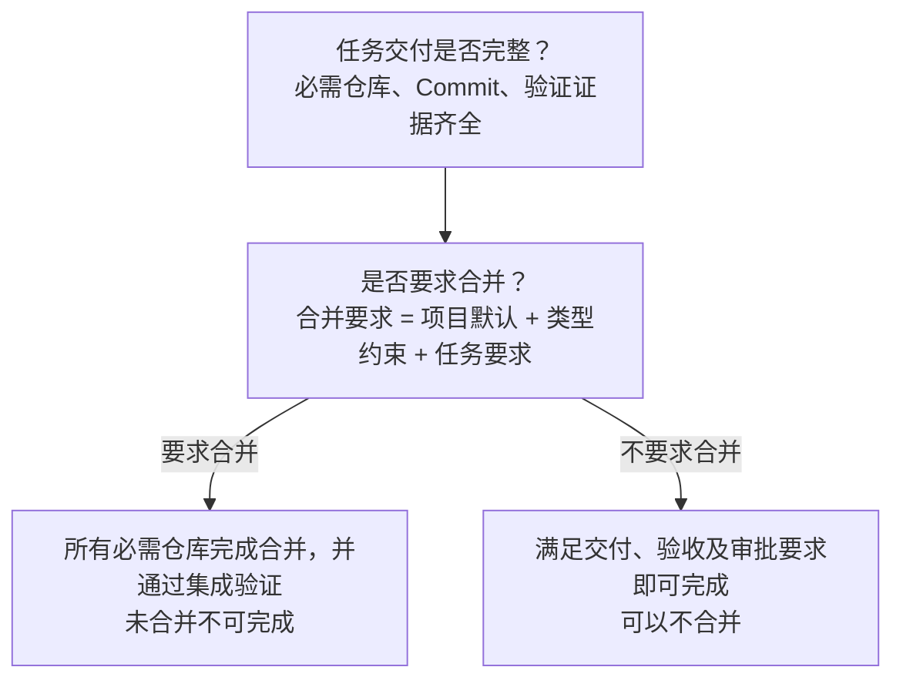

逐元素校验〔整理〕：

| 原图元素 | Mermaid | 校验 |
| --- | --- | --- |
| 「任务交付是否完整？」+ 副标题「必需仓库、Commit、验证证据齐全」 | `Q1` | 一致 |
| 「是否要求合并？」+ 副标题「合并要求 = 项目默认 + 类型约束 + 任务要求」 | `Q2` | 一致 |
| 左分支「要求合并」：所有必需仓库完成合并并通过集成验证，徽标「未合并不可完成」（橙红） | `Q2 → M1` | 一致 |
| 右分支「不要求合并」：满足交付、验收及审批要求即可完成，徽标「可以不合并」（绿） | `Q2 → M2` | 一致 |
| 图底注 | 被图幅截断〔原文模糊〕，可见开头「本图只判定……」，不转录语义 | 留待核对原图 |

### 16.7 最终规范建议〔原文〕

将相关章节拆成三条：

| 章节 | 内容 |
| --- | --- |
| 项目策略章节 | 定义 `merge_required_for_completion` 的项目默认值及 Flexible / Mandatory 模式 |
| 任务类型策略章节 | 定义任务类型如何继承、要求或豁免合并 |
| 完成判定章节 | 统一实现完成门槛计算，逐个检查必需仓库、合并状态、验证和审批证据 |

最后强调〔原文〕：**`auto_merge_enabled = true` 只表示系统有权在满足条件时自动合并；它绝不表示 `merge_required_for_completion = true`。前者是自动化权限，后者是任务完成条件。**

### 16.8 关联影响〔整理〕

| # | 影响 |
| --- | --- |
| L1 | §4.3 宽松/严格两行策略表被本节细化：宽松 ≈ `Flexible` + 类型可 `NotRequired`；严格 ≈ `Mandatory`；完成判定由 `completion_evaluator` 统一承担 |
| L2 | 与 §13.6 职责三分衔接：交付验证器产出验证结论 → `completion_evaluator` 消费证据判定完成门槛 → 聚合器据此计算父任务状态；§13.2 判定顺序第 4 步「所有必要交付均已完成」由此获得可执行定义 |
| L3 | Run 级 `completion_policy_snapshot` 与 §15.5 `policy_snapshot` 同构，遵循「Run 只追加、历史不可覆盖」 |
| L4 | 与 §15.3 一致：任务覆盖对合并要求只能收紧（`Flexible` 下任务仍可要求合并，`Mandatory` 下不可豁免） |

---

## 十七、裁决记录：§十 Q7 · 风险等级计算（V8 · 2026-10-31）

> **裁决说明**
> - 裁决日期：2026-10-31；裁决人：需求方
> - 供稿原文直录，〔整理〕仅做结构化归纳，不引入新决策
> - 本节为裁决记录，**追加生效**：§6.3「升级条件」对照行按 §17.7 处理
> - §十 Q7 关闭；衍生子待确认 Q7.1–Q7.3（见 §17.8）；§14.6 Q4.2 部分落定

### 17.1 核心结论与四个概念〔原文〕

**`blast_radius_above: 10` 是风险规则中的一个阈值，不是风险等级本身。** 风险等级应由影响范围、变更性质、可恢复性、验证可信度和安全敏感度共同决定；同时，某些条件应**直接触发强制审批，不能被低分抵消**。

四个概念区分：

| 概念 | 含义 | 示例 |
| --- | --- | --- |
| `blast_radius` | 潜在影响范围 | 修改了多少模块、仓库、服务或下游接口 |
| `risk_score` | 综合风险分数 | 0–100 |
| `risk_level` | 风险分级 | Low、Medium、High、Critical |
| `approval_requirements` | 必须满足的审批要求 | 架构师审批、人工验收、发布负责人批准 |

关系链〔原文〕：**影响因素 → 风险评估 → 风险等级 → 策略决策**。但风险等级和审批要求**不是简单的一一映射**——一个影响范围很小的凭证权限变更，也可能需要强制人工审批。

### 17.2 blast_radius_above: 10 的口径〔原文〕

首先要定义这个 10 的单位，否则同一条规则在不同任务中会产生完全不同的结果。**不要直接使用修改文件数**作为影响范围——修改 20 个测试文件与修改 2 个公共接口的风险可能完全不同。

影响范围拆为五个指标：

| 指标 | 计算方式示例 | 说明 |
| --- | --- | --- |
| `affected_repositories` | 受影响仓库数 | 跨仓库协调成本 |
| `affected_components` | 受影响模块或组件数 | 变更扩散范围 |
| `downstream_dependencies` | 受影响的下游依赖数 | 潜在连锁影响 |
| `public_contract_changes` | 公共 API、数据格式、接口契约变更数 | 兼容性风险 |
| `critical_components` | 涉及的关键组件数量 | 核心业务、权限、持久化等 |

原规则迁移示例〔原文〕：

```yaml
risk_rules:
  - id: broad_component_impact
    condition:
      metric: affected_components
      operator: gt
      value: 10
    effect:
      minimum_risk_level: high
      require_human_review: true
```

〔原文〕这只是示例：这里的 10 表示**超过 10 个受影响组件**，而不是 10 个文件、10 个仓库或风险分数 10。阈值应通过实际项目的历史任务校准。如果现有规则里的 blast_radius 已有正式定义，就应沿用其定义，**关键是明确计算单位和口径**。

### 17.3 风险等级计算：规则触发 + 综合评分〔原文〕

采用混合方式，而不是纯加权求和。

第一步，综合风险分数（可解释的初版模型）：

> `R = 0.25B + 0.25C + 0.20I + 0.15V + 0.15U`（各项归一化到 0–100）

| 项 | 含义 |
| --- | --- |
| `B` | 影响范围风险（Blast Radius） |
| `C` | 变更复杂度（Complexity） |
| `I` | 不可逆性与恢复难度（Irreversibility） |
| `V` | 验证不足风险（Validation Gap） |
| `U` | 不确定性（Uncertainty） |

〔原文〕权重只是 P2 的初始建议，不是经过历史数据验证的行业标准。

第二步，映射到风险等级：

| 分数区间 | 等级 | 含义 | 处理 |
| --- | --- | --- | --- |
| 0–24 | Low | 低风险 | 标准自动验证，满足策略后可以自动验收 |
| 25–49 | Medium | 中风险 | 增加测试与审查要求，自动验收取决于项目策略 |
| 50–74 | High | 高风险 | 要求人工审查；通常不允许自动验收或自动合并 |
| 75–100 | Critical | 严重风险 | 强制审批、专项验证；必要时**禁止执行直到风险被消除** |

〔原文〕分数负责给出风险级别的**基线**，后续再应用强制规则。即使计算结果是 Low，如果任务涉及密钥泄露风险或未经授权的生产数据修改，也必须触发相应的强制约束。

### 17.4 强制规则（不依赖评分）〔原文〕

以下条件作为**独立的强制规则**，而不是仅仅给风险分数加几分：

| 条件 | 建议处理 |
| --- | --- |
| 修改认证、授权或安全边界 | 强制安全审查 |
| 破坏公共接口或跨服务契约 | 至少要求兼容性验证和人工审查 |
| 数据库破坏性迁移 | 强制迁移审查与恢复方案验证 |
| 修改受保护分支或发布规则 | 遵循仓库及组织的审批规则 |
| 缺少关键验证证据 | 禁止自动验收 |
| 无法确认仓库基准版本 | 暂停交付验收 |
| 存在高影响、不可逆的外部操作 | 强制授权或禁止自动执行 |

〔原文〕这样可以避免「综合分数不高，所以危险操作被自动放行」的问题。

### 17.5 评估时点〔原文〕

在**三个时点**评估，而不是只在创建任务时算一次：

| 时点 | 评估内容 | 效果 |
| --- | --- | --- |
| 1. 任务创建时（初始评估） | 根据任务描述、任务类型、预期仓库及已知影响范围计算初始风险 | 决定是否允许自动领取和执行 |
| 2. 执行过程中（增量重评估） | Codex 发现额外仓库、公共接口变更、关键文件或新的依赖时更新 | 风险越过策略门槛时，**暂停受影响的操作并重新授权** |
| 3. 提交交付时（最终评估） | 根据实际 Diff、修改文件、仓库数量、验证结果和交付清单重新计算 | 最终风险高于原先授权范围时，**不能直接沿用旧的自动验收许可** |

多仓库〔原文〕：还应计算**每个仓库的风险**以及**整个任务的聚合风险**。任务级风险**不能只取平均值**，否则一个关键仓库的严重风险可能被其他低风险仓库稀释。

### 17.6 Rust 实现与三概念分立〔原文〕

风险计算放在**独立领域模块**中，不散落在 MCP 接口、前端按钮或 Codex 回调中：

```rust
pub struct RiskAssessment {
    pub score: u8, // 0..=100
    pub level: RiskLevel,
    pub triggered_rules: Vec<String>,
    pub requires_human_review: bool,
    pub assessed_at: DateTime<Utc>,
    pub evidence_hash: String,
}

pub enum RiskLevel {
    Low,
    Medium,
    High,
    Critical,
}
```

〔原文〕`triggered_rules` 应记录类似 `broad_component_impact`、`destructive_migration` 这样的规则 ID，方便审计和解释风险来源。

三个概念需要特别区分，**不能混为一个字段，也不能只保存最终 risk_level 而丢失计算依据**：

| 概念 | 内容 |
| --- | --- |
| `RiskAssessment` | 某个时点的风险评估**结果** |
| `EffectivePolicy` | 根据风险、任务类型、项目策略和组织约束计算出的**有效策略** |
| `ApprovalRecord` | 实际的**审批结果** |

### 17.7 现有规则的处理与最终原则〔原文〕

对 `blast_radius_above: 10`：**暂时不删除，也不直接把它解释为 High 风险等级**。

| # | 步骤 |
| --- | --- |
| 1 | 查明 blast_radius 当前的定义与单位 |
| 2 | 将其明确为风险规则的一个条件 |
| 3 | 为规则增加显式效果，如 `minimum_risk_level: high`、`require_human_review: true` |
| 4 | 保留规则触发原因、计算依据与证据摘要 |
| 5 | 在实际任务数据积累后，再校准阈值和评分权重 |

最终设计原则〔原文〕：

> **风险评分负责衡量，强制规则负责兜底，策略引擎负责决定权限，审批记录负责证明谁批准了什么。**

### 17.8 关联影响与衍生待确认〔整理〕

| # | 关联影响 | 说明 |
| --- | --- | --- |
| L1 | §6.3「升级条件」对照更新 | 现有 `escalate.when`（confidence: low / blast_radius_above: 10 / unresolved_conflict）中，`blast_radius_above: 10` 按 §17.7 五步处理：暂留、明确口径、增显式效果 |
| L2 | §14.6 Q4.2 部分落定 | `requires_human_approval` 的输入源之一为 `RiskAssessment`（level + triggered_rules → §17.4 强制规则表）；且 `RiskAssessment` / `EffectivePolicy` / `ApprovalRecord` 三者分立存储 |
| L3 | 强制规则表与既有审批类别对齐 | §17.4 七条强制规则分别落入 §2.3 C 级事项与 §五 五类人工决策（如认证授权变更 → 第 5 类不可逆/外部影响；公共接口破坏 → 第 3 类高风险交付） |

衍生待确认（只记录，不裁决）：

| # | 子项 | 说明 | 影响 |
| --- | --- | --- | --- |
| Q7.1 | 五项影响指标的**采集来源与计算时机**（任务声明 + 交付 Diff 分析？由谁计算：平台侧评估器还是执行端上报？） | 供稿给出指标定义，未给采集器 | 风险评估器实现 |
| Q7.2 | 权重与阈值的**校准机制**（供稿指出「通过实际项目的历史任务校准」，校准流程与数据来源待定） | 初版权重为 P2 建议 | 长期维护 |
| Q7.3 | 任务级**聚合风险的正向算法**（已裁定「不能只取平均值」，但取最差仓、加权还是 max + 修正未给） | 多仓聚合 | 多仓风险评估 |

---

## 十八、裁决记录：§十 Q8 · 独立审查 Agent（V9 · 2026-10-31）

> **裁决说明**
> - 裁决日期：2026-10-31；裁决人：需求方
> - 供稿原文直录，〔整理〕仅做结构化归纳，不引入新决策
> - 本节为裁决记录，**追加生效**：§五 5.2「提出者不得自批」与本节互为印证
> - §十 Q8 关闭；衍生子待确认 Q8.1–Q8.3（见 §18.8）

### 18.1 最终结论与三概念区分〔原文〕

**独立审查 Agent 应定义为平台内置的审查角色，由执行端负责运行，而不是把它定义成某一种固定的执行端。** 平台负责规定「谁来审查、审查什么、什么情况下必须审查、如何判定通过」；Codex 等执行端负责真正运行审查 Agent。既保持审查规则统一，又不把平台绑定到某一种 AI 编码工具。

三个概念**不要合并成一个「Agent 类型」字段**——角色是职责定义，执行端是运行环境，人工审批者是具有明确授权的主体：

| 概念 | 职责 | 备注 |
| --- | --- | --- |
| 平台内置角色：Reviewer Agent | 定义审查职责、输入、输出格式、风险规则、独立性要求和审查流程 | **推荐** |
| 执行端：Codex / 其他 Agent Runtime | 创建隔离执行实例、提供代码和工具访问、运行审查提示词、返回结构化结果 | 运行环境 |
| 人工审批者：Human Approver | 处理需要授权的架构决策、高风险变更、发布和强制人工审批事项 | 授权主体 |

### 18.2 Reviewer Agent 的职责〔原文〕

定义为一个**独立的、可追踪的审查工作单元**，而不只是执行 Agent 提交前调用的一段提示词：

| 职责 | 具体内容 |
| --- | --- |
| 需求符合性审查 | 检查实现是否符合任务目标、验收标准和需求约束 |
| 代码质量审查 | 检查潜在缺陷、异常处理、边界条件和回归风险 |
| 架构审查 | 检查设计约束、模块边界和跨仓库契约 |
| 测试证据审查 | 核验测试结果是否真实、充分，是否存在未验证范围 |
| 多仓库一致性审查 | 检查 API、数据结构、版本依赖和跨仓库调用是否匹配 |
| 风险审查 | 检查实际变更是否超过原任务授权或风险等级 |

〔原文〕不需要每个任务都运行全部审查项。平台根据任务类型、风险等级、变更范围和仓库规则**选择审查清单**。示例：普通 Markdown 文档任务只做内容与链接校验；Rust + Bevy 地形渲染功能需要代码审查、测试审查和架构约束检查；跨仓库接口变更增加契约兼容性审查。

### 18.3 审查独立性三级〔原文〕

这是整个设计中最重要的部分：如果 Reviewer 和执行 Agent 共用同一个上下文，甚至直接沿用执行 Agent 自己的结论，就**不能充分称为独立审查**。

| 级别 | 运行方式 | 适用场景 |
| --- | --- | --- |
| L1：逻辑独立 | 同一执行端，独立会话、独立提示词，重新读取变更 | 低风险任务 |
| L2：执行实例独立 | 新建 Reviewer Run，独立上下文、**只读仓库访问**，不继承执行 Agent 的推理结论 | 中高风险任务 |
| L3：主体独立 | 独立执行环境、不同模型或不同提供方，并结合人工审查 | 高风险、架构或安全敏感变更 |

〔原文〕不必强制不同模型——不同模型并不自动意味着审查可靠；**独立上下文、真实证据访问、权限隔离和不可自行批准**通常更重要。P2 至少支持 L1 和 L2，并为 L3 保留扩展点。

### 18.4 与任务状态机的接入（图1 转 Mermaid）

〔原文〕**不把 Reviewing 当作 Reviewer Agent 的运行状态**——它是任务生命周期状态，审查 Agent 自己有独立生命周期。

图源：[`figures/reviewer-agent-v1-lifecycle.png`](figures/reviewer-agent-v1-lifecycle.png)

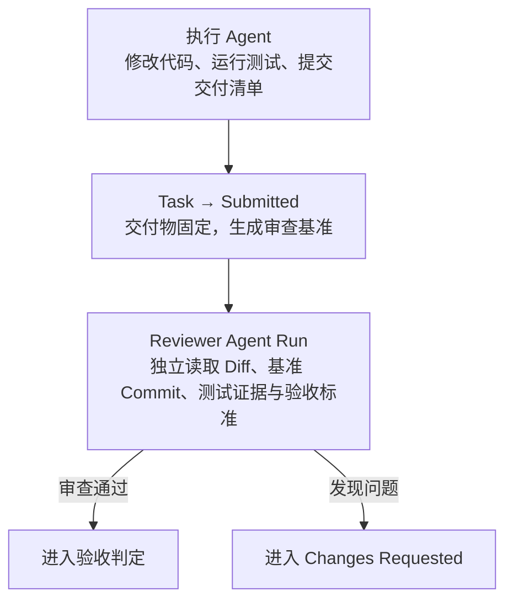

逐元素校验〔整理〕：

| 原图元素 | Mermaid | 校验 |
| --- | --- | --- |
| 执行 Agent（修改代码、运行测试、提交交付清单） | `E` | 一致 |
| Task → Submitted（交付物固定，生成审查基准） | `S` | 一致 |
| Reviewer Agent Run（独立读取 Diff、基准 Commit、测试证据与验收标准，高亮框） | `R` | 一致 |
| 审查通过（绿勾）→ 进入验收判定 | `R → P` | 一致 |
| 发现问题（橙警示）→ 进入 Changes Requested | `R → C` | 一致 |
| 底注「审查通过不等于任务完成。仍需满足风险策略、必要人工审批和交付完成条件」 | 照录于本节下方 | 一致 |

底注〔原文〕：**审查通过不等于任务完成。仍需满足风险策略、必要人工审批和交付完成条件。**

失效规则〔原文〕：如果审查发现新的高风险变更，或者交付物在审查期间发生变化，应**使原审查结果失效**，并针对新的交付版本重新审查。

### 18.5 数据模型〔原文〕

角色定义、运行实例、审查结果**分开存储**：

```rust
struct AgentRole {
    role_id: String,       // reviewer
    role_version: String,
    responsibilities: Vec<String>,
    review_policy_id: String,
}

struct AgentRun {
    run_id: RunId,
    task_id: TaskId,
    role_id: String,
    runtime_id: String,    // codex / other runtime
    input_manifest_hash: String,
    status: AgentRunStatus,
}

struct ReviewReport {
    review_id: ReviewId,
    task_id: TaskId,
    reviewer_run_id: RunId,
    reviewed_manifest_hash: String,
    findings: Vec<ReviewFinding>,
    verdict: ReviewVerdict,
}
```

〔原文〕`reviewed_manifest_hash` 很关键：它证明审查结果针对**哪一版交付物**，而不是仅仅关联到一个可能持续变化的任务 ID。

审查结论至少有四值：

| 结论 | 含义 |
| --- | --- |
| `Approved` | 未发现阻止通过的问题 |
| `ChangesRequested` | 存在必须修复的问题 |
| `Inconclusive` | 证据不足，无法得出可靠结论 |
| `Failed` | 审查运行本身失败，例如执行端异常或无法访问必要证据 |

约束〔原文〕：**Inconclusive 不能自动当作 Approved。** 对于强制审查任务，审查运行失败也**不能被静默跳过**。

### 18.6 平台内置程度（图2 转 Mermaid）

〔原文〕采用「**平台内置规范、执行端可插拔**」的架构。

图源：[`figures/reviewer-agent-v1-orchestrator.png`](figures/reviewer-agent-v1-orchestrator.png)

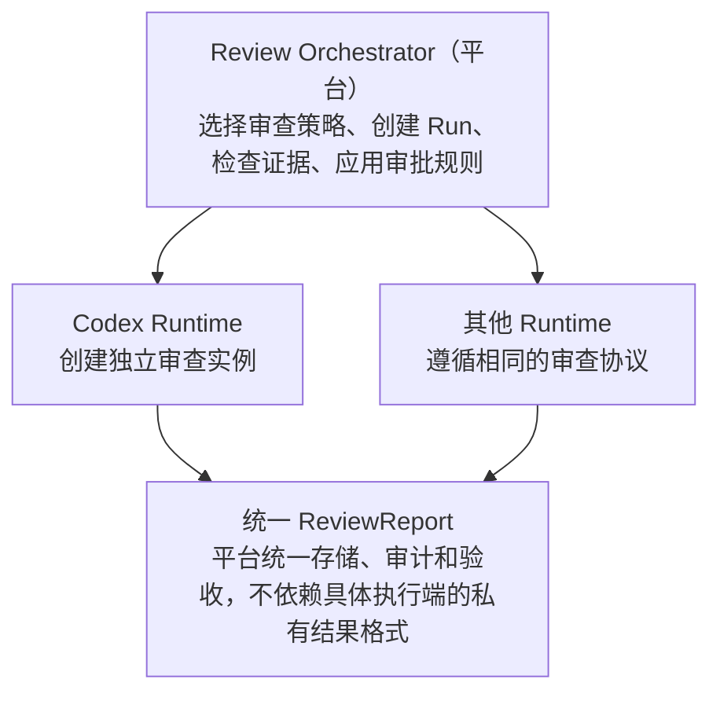

逐元素校验〔整理〕：

| 原图元素 | Mermaid | 校验 |
| --- | --- | --- |
| Review Orchestrator（平台）：选择审查策略、创建 Run、检查证据、应用审批规则 | `O` | 一致 |
| Codex Runtime：创建独立审查实例 | `R1` | 一致 |
| 其他 Runtime：遵循相同的审查协议 | `R2` | 一致 |
| 统一 ReviewReport：平台统一存储、审计和验收，不依赖具体执行端的私有结果格式 | `U` | 一致 |

〔原文〕执行端可以返回自己的原始输出，但必须转换成平台统一的**结构化审查报告**。平台**不能仅因为模型回复了「通过」就认定审查成功**，还要检查报告完整性、审查基准是否匹配、强制检查是否执行，以及策略是否允许自动验收。

### 18.7 P2 实施建议〔原文〕

| # | 能力项 |
| --- | --- |
| 1 | 内置 reviewer 角色定义和版本管理 |
| 2 | 通过现有 MCP/Codex 执行基础设施创建独立 Reviewer Run |
| 3 | Reviewer 默认**只读访问**交付内容，不允许自行修改交付或批准自己的结论 |
| 4 | 统一保存审查报告、问题清单和交付物哈希 |
| 5 | 高风险任务强制审查；低风险任务根据策略决定是否运行 |
| 6 | 审查通过后仍由统一的完成判定器决定能否进入 Completed |

最终结论〔原文〕：**Reviewer Agent 是平台内置的职责角色，不是 Codex 专属功能，也不是一个任务状态。** 平台管理审查规则、权限与结果；Codex 或其他执行端提供隔离运行环境；人工审批继续作为独立的授权机制。

### 18.8 关联影响与衍生待确认〔整理〕

| # | 关联影响 | 说明 |
| --- | --- | --- |
| L1 | 详情页稿 §6.7.2 R1（自证边界）获得结构闭环 | Reviewer「不可自行批准自己的结论」（P2 第 3 项）+ §5.2「提出者不得自批」+ task_accept 不对执行端暴露（待裁 Q15），三者共同封堵自证路径 |
| L2 | ReviewReport 进入证据链 | verdict 与 findings 作为 Reviewing 阶段证据进入 §14.2 第④层执行证据；`ChangesRequested` 结论为 `task_request_changes` 提供结构化失败项来源（衔接详情页稿 Q17） |
| L3 | 图1 底注与完成判定衔接 | 「审查通过 ≠ 任务完成」与 §16.3、§13.2 第 4 步一致：审查通过后进入验收判定（completion_evaluator） |
| L4 | 哈希锚定延续 Run 只追加原则 | `reviewed_manifest_hash` / `input_manifest_hash` 与 §4.4 base_commit、§15.5 policy_hash 同构：审查绑定具体版本，交付物变更即失效 |

衍生待确认（只记录，不裁决）：

| # | 子项 | 说明 | 影响 |
| --- | --- | --- | --- |
| Q8.1 | 各任务类型 / 风险档位的**默认审查清单矩阵**（供稿给出三示例：文档 / 功能 / 跨仓接口，正式矩阵未给） | 与 §14.6 Q4.1 同类 | 审查策略配置 |
| Q8.2 | `ReviewFinding` 的结构化字段（问题类型、严重度、代码定位、修复建议） | 供稿未展开，影响 `task_request_changes` 失败项结构化（详情页稿 Q17） | 契约字段设计 |
| Q8.3 | Reviewer Run 的**租约、超时与失败重试策略**（审查运行 Failed 后：重试次数、是否降级为人工审查） | 强制审查任务失败不得静默跳过，正向处置未给 | 审查可靠性 |

---

## 十九、裁决记录：§十 Q9 · 失败判定条件（V10 · 2026-10-31）

> **裁决说明**
> - 裁决日期：2026-10-31；裁决人：需求方
> - 供稿原文直录，〔整理〕仅做结构化归纳，不引入新决策
> - 本节为裁决记录，**追加生效**：§2.2 B4「达到失败判定条件」以本节定义为准；§三 规则表「任意适用状态 → Failed」行的执行细则以本节为准
> - §十 Q9 关闭；衍生子待确认 Q9.1–Q9.2（见 §19.7）

### 19.1 核心建议与三层失败层级〔原文〕

把 B4「达到失败判定条件」明确为**一套可判定、可审计、可恢复的失败分类规则**，而不是单看退出码、超时或连续失败次数中的某一项。三者回答的是不同问题：

| 信号 | 回答的问题 |
| --- | --- |
| 退出码 | 本次执行是否正常结束？ |
| 超时 | 本次执行是否在允许的时间内完成？ |
| 连续失败次数 | 系统是否应该停止自动重试并升级处理？ |

〔原文〕还需区分：Agent 执行失败、任务交付失败、审查失败、基础设施故障——它们**不应全部直接导致任务进入 Failed**。

失败层级（避免一次命令失败就把整个任务判死）：

| 层级 | 示例状态 | 含义 |
| --- | --- | --- |
| Run 级 | `Succeeded` / `Failed` / `TimedOut` / `Cancelled` | 一次执行实例的结果 |
| Task 级 | `Running` / `Blocked` / `Failed` 等 | 整个任务是否还能继续推进 |
| Delivery 级 | `Pending` / `Validated` / `ChangesRequested` 等 | 某个仓库的交付是否满足要求 |

〔原文〕例如：Codex 一次运行因网络问题失败，属于 **Run 失败**；如果允许重试，Task 应继续保持可执行状态，而不是直接进入 Failed。

### 19.2 B4 的失败判定条件（B4-A 至 B4-D）〔原文〕

B4 定义为：**任务已满足某一条终止性失败规则，且自动恢复策略无法继续推进，或明确禁止重试。**

| 规则 | 层级 | 条件 | 备注 |
| --- | --- | --- | --- |
| B4-A 执行失败 | Run 级 | 进程非预期退出、执行端返回明确失败、必要工具调用失败且无法恢复 | 退出码非零是**证据之一**，不应单独作为任务失败的充分条件 |
| B4-B 超时 | Run 级 | 超过单次 Run 的时间预算，或超过任务的总执行期限 | 单次超时通常允许重试；总期限耗尽则停止自动重试，转人工处理或任务失败 |
| B4-C 重试耗尽 | 任务级 | 达到最大重试次数，或连续失败达到策略规定的阈值 | 以同一任务的重试策略为准，区分瞬时故障和代码缺陷 |
| B4-D 不可恢复失败 | 任务级 | 权限被拒绝、必需仓库不存在、交付基准无法恢复，或触发明确禁止自动重试的安全规则 | **立即停止**相关执行，不必为达到连续失败次数而反复尝试 |

### 19.3 事件判定表〔原文〕

| 事件 | Run 判定 | Task 判定 | 自动重试 |
| --- | --- | --- | --- |
| 进程退出码为 0，且结果与交付验证均通过 | `Succeeded` | 继续后续验收流程 | 不需要 |
| 退出码非零，属于临时网络故障 | `Failed` | 保持可重试 | 允许，采用退避策略 |
| 退出码非零，明确是代码编译错误 | `Failed` | 可重试，或转 Changes Requested | 根据执行阶段决定 |
| 单次执行超时 | `TimedOut` | 保持可重试或暂停 | 允许，但应限制次数 |
| 连续失败达到阈值 | `Failed` | 按任务策略进入 Failed 或人工介入 | 停止自动重试 |
| 权限不足、越权或安全策略拒绝 | `Failed` 或 `Cancelled` | 通常 Blocked，严重违规按安全策略终止 | 不允许盲目重试 |
| 用户主动取消 | `Cancelled` | 按取消流程处理 | 不允许自动重试 |
| Reviewer 发现代码缺陷 | Reviewer Run 可为 `Succeeded` | Task 进入 Changes Requested | 由执行 Agent 修复，**不算审查运行失败** |

关键区别〔原文〕：**Reviewer 成功地发现问题，并不是 Reviewer 执行失败。** 同理，Codex 正常退出但没有产出符合要求的交付物，也**不能仅凭退出码 0 认定任务成功**。

### 19.4 重试参数与计数规则〔原文〕

P2 使用一组简单、可配置的默认参数：

| 参数 | 建议初始值 | 说明 |
| --- | --- | --- |
| `max_run_attempts` | 3 | 一个执行阶段最多尝试 3 次，**包含首次执行** |
| `max_consecutive_failures` | 3 | 连续失败 3 次后停止自动重试 |
| `run_timeout` | 30 分钟 | 普通任务单次执行预算示例 |
| `task_deadline` | 2 小时 | 普通任务总执行期限示例 |
| `retry_backoff` | 递增退避 | 防止临时故障导致快速重复调用 |

〔原文〕这些只是 P2 的起始配置，不是所有任务的固定标准。大型 Rust 编译、跨仓库重构和架构任务应允许采用不同的执行预算。

计数规则〔原文〕：`max_run_attempts` 与 `max_consecutive_failures` 同时设置，但**不是两个完全独立、可能互相矛盾的失败判定器**——任意一个达到阈值都可停止自动重试；发生一次成功的 Run 后，**连续失败计数归零**；总尝试次数是否重置，由**执行阶段是否发生变化**决定。

〔原文〕例如：第 1 次因网络故障失败，第 2 次成功完成编译，第 3 次在测试阶段失败。**不能把这三次机械地认定为连续失败 3 次**，应按执行阶段或重试序列分别统计。

### 19.5 数据模型〔原文〕

失败判定基于**结构化的 FailureReason**，而不是从日志文本中搜索 "error"：

```rust
enum RunOutcome {
    Succeeded,
    Failed,
    TimedOut,
    Cancelled,
}

enum FailureCategory {
    Infrastructure,
    Execution,
    Validation,
    Permission,
    PolicyViolation,
    MissingDependency,
    Unknown,
}

struct FailureRecord {
    run_id: RunId,
    category: FailureCategory,
    retryable: bool,
    reason_code: String,
    exit_code: Option<i32>,
    timeout_seconds: Option<u64>,
    evidence_ref: Option<String>,
}
```

〔原文〕任务级再维护重试计数和终止原因：`attempt_count`、`consecutive_failure_count`、`last_failure_category`、`retry_exhausted`。实际的失败记录应**不可变**；重试时创建新的 Run，而不是覆盖旧 Run 的错误信息。

### 19.6 Running 的失败分支与 B4 正式定义〔原文〕

B4 应作为**失败判定条件**，而不是新增一个任务状态：

```text
Running
  ├─ Run 成功，验证通过 ──────> Submitted
  ├─ 临时故障，仍可重试 ──────> Running（创建新 Run）
  ├─ 需要外部处理 ───────────> Blocked
  ├─ 需要人工决策 ───────────> Awaiting Decision
  ├─ 达到失败终止条件 ───────> Failed
  └─ 用户主动取消 ───────────> Cancelled
```

〔原文〕从 Running 到 Failed **必须经过统一的失败判定服务**；不能由 MCP、前端或 Agent 根据一条日志直接写入状态。

B4 正式定义〔原文〕：

> **当执行阶段发生不可恢复失败、任务总期限耗尽，或自动重试策略达到终止阈值，且不存在允许继续执行的恢复路径时，判定任务满足失败终止条件。单次 Run 失败、非零退出码或单次超时本身不自动等同于任务失败。**

### 19.7 关联影响与衍生待确认〔整理〕

| # | 关联影响 | 说明 |
| --- | --- | --- |
| L1 | §2.2 B4 与 §三 规则表落定口径 | 「任意适用状态 → Failed」的执行细则以本节为准：迁移前必须经统一失败判定服务，满足 B4-A 至 B4-D 之一 |
| L2 | §18.8 Q8.3 部分回答 | Reviewer Run 自身的失败处置沿用本节模型：`FailureRecord`（`category=Infrastructure/Execution` 等）+ 不变式「失败记录不可变、重试新建 Run」；「是否降级为人工审查」仍待定 |
| L3 | 命令通道硬约束的延伸 | 「Running→Failed 必须经统一失败判定服务，不得由 MCP/前端/Agent 直写」与 §7.4 硬约束、详情页稿 W1 同源 |
| L4 | Run 四值与原则一闭环 | `RunOutcome` 四值 + `FailureRecord` 不可变 = 详情页稿 §6.8.1「失败的 Run 不覆盖历史」的落地载体；阶段化计数与 §1.4「重试不是任务状态，是新 Run」互证 |

衍生待确认（只记录，不裁决）：

| # | 子项 | 说明 | 影响 |
| --- | --- | --- | --- |
| Q9.1 | 「执行阶段」的正式定义与判定方式（编译 / 测试 / 交付等阶段如何划分与识别——计数重置依赖阶段判定，供稿给出原则未给阶段清单） | 影响连续失败统计的正确性 | 重试引擎实现 |
| Q9.2 | 统一失败判定服务的部署归属（独立服务 / `command_executor` 内判定器 / worker 作业） | 与详情页稿 Q11（交付校验服务部署形态）同类 | 部署形态 |

---

## 二十、裁决记录：§十 Q10 · Outbox 首版范围（V11 · 2026-10-31）

> **裁决说明**
> - 裁决日期：2026-10-31；裁决人：需求方
> - 供稿原文直录，〔整理〕仅做结构化归纳，不引入新决策
> - 本节为裁决记录，**追加生效**：§7.3 伪代码注明「正式实现还需 Outbox 事件写入」由此落定为**首版必需**；§十 Q10 的推荐选项「列二期」被本裁决否决
> - §十 Q10 关闭；本节无新增衍生待确认

### 20.1 最终结论〔原文〕

**首版就纳入 Outbox 事件写入，但只实现最小可靠版本，不做完整的事件总线基础设施。**

〔原文〕对 AI 研发管理平台，这项能力尤其重要：Task 状态变更、Run 创建、Codex 执行、MCP 回写知识库等操作横跨数据库、外部执行环境和 Markdown 文件。若首版只修改状态、不可靠地记录待处理事件，就可能出现「**任务已经变更，但 MCP 没有收到事件**」的问题。

### 20.2 首版范围界定〔原文〕

| 能力 | 首版要求 | 说明 |
| --- | --- | --- |
| Outbox 数据表或持久化记录 | **必须** | 与业务状态变更使用同一事务 |
| 事件写入 | **必须** | 状态变更与事件记录原子提交 |
| 事件消费与分发 | **必须，最小实现** | 后台 Worker 定时扫描待处理事件 |
| 失败重试 | **必须** | 指数退避或固定间隔，限制最大次数 |
| 幂等处理 | **必须** | 避免重复创建 Codex Run 或重复回写 |
| 事件死信与人工重放 | 简化实现 | 记录最终失败原因，支持手动重试 |
| 通用事件总线、复杂路由 | **暂不纳入** | 首版不需要 Kafka 等基础设施 |
| 完整事件溯源 | **暂不纳入** | Outbox 不替代业务审计日志 |

### 20.3 首版核心流程（图1 转 Mermaid）

图源：[`figures/outbox-v1-minimal-flow.png`](figures/outbox-v1-minimal-flow.png)

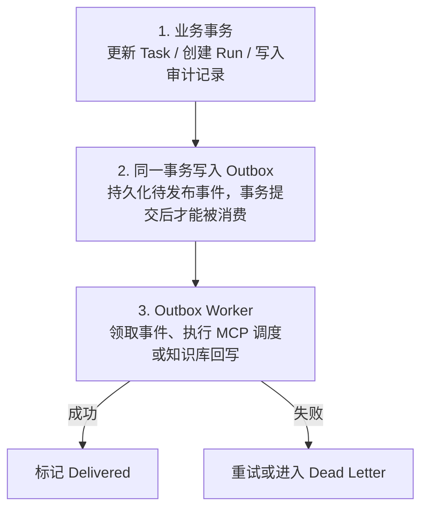

逐元素校验〔整理〕：

| 原图元素 | Mermaid | 校验 |
| --- | --- | --- |
| 业务事务（更新 Task / 创建 Run / 写入审计记录） | `T` | 一致 |
| 同一事务写入 Outbox（持久化待发布事件，事务提交后才能被消费，高亮框） | `O` | 一致 |
| Outbox Worker（领取事件、执行 MCP 调度或知识库回写） | `W` | 一致 |
| 成功（绿勾）→ 标记 Delivered | `W → S` | 一致 |
| 失败（循环箭头）→ 重试或进入 Dead Letter | `W → F` | 一致 |

关键点〔原文〕：**业务事务只负责保证事件不会丢，Worker 负责最终执行。不要在业务事务中直接调用 MCP 或 Codex。**

### 20.4 首版数据结构〔原文〕

```rust
struct OutboxEvent {
    id: Uuid,
    event_type: String,
    aggregate_type: String, // Task / Run / Project
    aggregate_id: String,
    payload: serde_json::Value,

    status: OutboxStatus,   // Pending / Processing / Delivered / DeadLetter
    attempts: u32,
    next_attempt_at: DateTime<Utc>,
    created_at: DateTime<Utc>,
    delivered_at: Option<DateTime<Utc>>,
    last_error: Option<String>,
}
```

〔原文〕建议额外预留 `idempotency_key`、`locked_until` 和 `schema_version`，用于幂等处理、Worker 崩溃恢复及事件结构演进。若首版采用 PostgreSQL，可以直接用数据库表实现，**无需额外引入消息队列**。

### 20.5 哪些事件必须进入 Outbox〔原文〕

首版至少覆盖以下事件：

| 事件 | 触发的异步工作 |
| --- | --- |
| `TaskReady` | 任务满足执行条件，等待调度 |
| `RunRequested` | 请求创建或启动新的 Codex 执行实例 |
| `RunCompleted` | 执行结束，需要收集结果和验证交付 |
| `DeliverySubmitted` | 交付已提交，需要触发 Review |
| `ReviewCompleted` | 评审结束，需要推进任务状态 |
| `KnowledgeBaseWriteRequested` | 需要将执行结果、决策和相关信息回写知识库 |

〔原文〕不必把所有 UI 操作都变成 Outbox 事件。重点是那些**必须触发异步工作，且不能因进程崩溃而丢失**的动作。

### 20.6 首版正式条款与验收标准〔原文〕

```text
### Outbox 事件持久化与异步分发（首版必需）

1. 对于需要触发异步执行的业务操作，必须在同一数据库事务中完成业务状态变更与 Outbox 事件写入。
2. 首版提供最小 Outbox Worker，负责领取、分发、重试及更新事件处理状态。
3. 事件分发采用至少一次投递语义；消费者必须支持幂等处理，不得假设事件只会执行一次。
4. Worker 崩溃、进程重启或外部执行服务暂时不可用时，未完成事件必须能够恢复处理。
5. 超过重试上限的事件进入 Dead Letter 状态，保留失败原因，并提供查询和人工重放能力。
6. Outbox 用于保障异步任务可靠触发，不替代 Task/Run 状态机、审计日志及交付记录。
7. 首版不要求引入独立消息队列、通用事件总线或完整事件溯源系统。

验收标准：业务事务提交后，即使应用立即重启，待处理事件仍可被发现和恢复；同一事件重复投递不会导致重复创建执行实例或重复应用同一交付结果。
```

最终结论〔原文〕：**首版应纳入 Outbox 的持久化、最小消费、重试和幂等能力。** 如果伪代码已经注明需要 Outbox，就应同步把它列入首版范围与验收标准，避免实现阶段被误判为后续优化项。

### 20.7 关联影响〔整理〕

| # | 影响 |
| --- | --- |
| L1 | §7.3 伪代码缺口补齐：Outbox 事件写入由「伪代码注明需补」升级为**首版必需**，并带验收标准 |
| L2 | §8.1 首版三组件更新：「不可变事件审计」之外新增「最小可靠 Outbox」为第四个首版组件（同事务写入 + Worker 分发 + 幂等 + 死信） |
| L3 | 六类事件与状态机迁移边对齐：`TaskReady`（Draft→Ready）、`RunRequested`（Ready→Claimed）、`RunCompleted`（Run 结束）、`DeliverySubmitted`（Running→Submitted）、`ReviewCompleted`（Reviewing 推进）、`KnowledgeBaseWriteRequested`（§2.2 B5 知识索引更新）——状态迁移与异步分发的一一对应关系在实施 spec 中成表 |
| L4 | 与详情页稿 Q11 衔接：Outbox Worker 与交付校验服务、失败判定服务的部署归属可一并裁定（均为平台侧后台作业形态候选） |

---

## 二十一、裁决记录：§十 Q11 · 前端徽标映射（V12 · 2026-10-31）

> **裁决说明**
> - 裁决日期：2026-10-31；裁决方式：需求方指示「**没有问题就开搞**」，对 §十九 后剩余的 Q11 采纳整理方推荐默认值；如需调整，以追加记录方式变更
> - §十 Q11 关闭；**至此 §十 主清单（Q1–Q11）全部关闭**，本稿进入实施阶段；详情页稿 §七 与各衍生子项随实施 spec 一并处理

### 21.1 裁决内容〔整理 · 按推荐默认值〕

| # | 内容 |
| --- | --- |
| 1 | 13 态与前端徽标**一对一映射**，徽标与枚举同源（详情页稿 W2 状态单一来源，否决前端派生） |
| 2 | DB 存储 lowercase snake_case TEXT（§九 M4 口径）；Rust 枚举变体命名按 §12.4 供稿（PascalCase） |
| 3 | 徽标文案表在实施 spec 定稿：含 `AwaitingDecision` 按 `waiting_reason` 派生文案（等待补充信息 / 等待方案决策 / 等待审批 / 等待外部依赖，§12.5 第 5 条）、`Superseded` 展示「已被取代」+「查看替代任务」链接（§11.8） |

影响范围：前端契约与展示层；后端域模型不受影响。

---

（V1 记录截止说明保留：本稿 V1 部分未做任何评审、批准或裁决动作。V2 起新增裁决记录章节：裁决内容以需求方供稿原文直录，整理方仅做记录与格式转换，不做裁决。后续变更以追加方式记录，不改写既有条目。）
