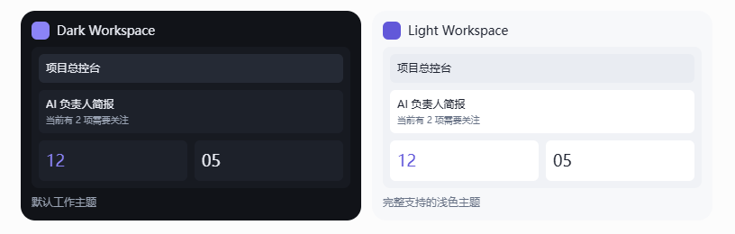
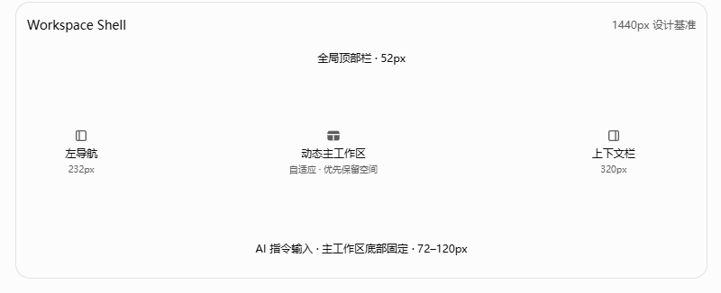
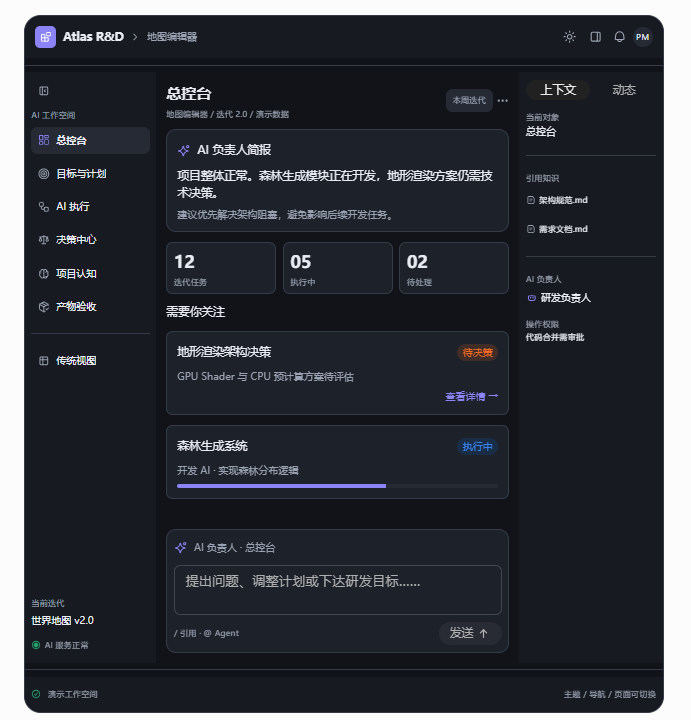

# AI R&D Workspace — 高保真设计系统 V1.0（供稿记录）

> **记录说明**
> - 记录日期：2026-10-31
> - 性质：用户直接供稿的高保真设计规范，按原文记录，随供稿继续增补；分析须待用户明示「分析」后才进行
> - 前情：此前的口述 UI 设计讨论稿已由用户放弃，未落盘，本文档为其替代
> - 目标读者：UI/UX 设计师与前端团队，可直接实施；同时提供可切换页面、主题和工作模式的交互原型

---

**专业克制型 · 紧凑专业型 · 三栏工作空间 · 桌面端优先**

方案定位：一套可以直接交给 UI/UX 设计师与前端团队实施的设计规范，同时提供可切换页面、主题和工作模式的交互原型。

核心设计理念：**像 IDE 一样高效，像 Linear 一样清晰，但以 AI 的目标、认知、决策和执行为中心。**

## 一、视觉设计定稿

（图1：正文提及，图像未随文附带）

### 1.1 设计令牌（Design Tokens）

| 用途 | 深色主题 | 浅色主题 |
|---|---|---|
| Canvas | #111318 | #F7F8FA |
| Sidebar | #171A21 | #F0F2F6 |
| Surface | #1D212A | #FFFFFF |
| Elevated | #252A35 | #E9ECF2 |
| Border | #353B48 | #DDE2EA |
| Text Primary | #E9ECF3 | #202532 |
| Text Secondary | #99A2B2 | #697386 |
| AI Accent | #8B83F6 | #6258D9 |

语义色分别使用绿色表示成功、蓝色表示执行中、琥珀色表示待处理、红色表示失败或危险。颜色必须同时搭配文字和图标，不能只靠颜色区分状态。

### 1.2 字体、密度和形状

| 元素 | 规格 |
|---|---|
| 字体 | 系统 UI 字体；代码使用等宽字体 |
| 页面标题 | 20–22px / 600 |
| 区块标题 | 14–16px / 600 |
| 业务正文 | 13px / 400 |
| 辅助文字 | 12px / 400 |
| 表格行高 | 36px，支持 44px 舒适模式 |
| 导航项高度 | 34–36px |
| 按钮 | 32px / 36px 两档 |
| 输入框 | 36px |
| 卡片圆角 | 8px |
| 弹窗圆角 | 12px |
| 基础间距 | 4px，常用 8 / 12 / 16 / 24px |

整体避免大面积渐变、发光边框和多余的机器人装饰。AI 的存在主要通过指令栏、执行状态、证据和决策能力来体现。

## 二、桌面布局定稿

推荐以 1440×900 为主要设计基准。



（随文图像记录：Dark Workspace / Light Workspace 两张主题预览卡，卡内示例为「项目总控台」「AI 负责人简报（当前有 2 项需要关注）」与 12 / 05 指标；图注为「默认工作主题 / 完整支持的浅色主题」。）

### Workspace Shell 布局图（随文图像）



图面标注文字照录（标题「Workspace Shell」，右上角标注「1440px 设计基准」）：

| 区域 | 标注 |
|---|---|
| 顶部 | 全局顶部栏 · 52px |
| 左栏 | 左导航 · 232px |
| 中栏 | 动态主工作区 · 自适应 · 优先保留空间 |
| 右栏 | 上下文栏 · 320px |
| 底部 | AI 指令输入 · 主工作区底部固定 · 72–120px |

### 布局规则（用户提前确定的两条）

1. **右侧上下文栏不是第二个聊天窗口。** 它默认显示当前对象、引用知识、Agent 状态、关联任务与操作权限。用户可以切换为 AI 对话面板。
2. **AI 指令栏应该属于当前工作上下文。** 用户在架构决策页面提问时，系统默认引用当前决策；在执行详情页面提问时，默认关联当前 AgentRun。用户应能查看并移除这些引用。

---

## 三、高保真交互原型：统一桌面工作空间

下面的原型采用同一套模拟项目数据，支持主题切换、AI/传统视图切换、六个工作页面、上下文面板折叠，以及在不同任务间切换。

### 原型截图：总控台页（深色主题）



图面记录（文字照录）：

- **顶部栏**：面包屑「Atlas R&D › 地图编辑器」；右侧为主题切换、视图切换、通知、账户（PM）图标
- **左侧导航**（分组「AI 工作空间」）：总控台（选中态）、目标与计划、AI 执行、决策中心、项目认知、产物验收；分组外另有「传统视图」；左下角：当前迭代「世界地图 v2.0」、「AI 服务正常」（绿点）
- **中央主工作区**「总控台」（副题：地图编辑器 / 迭代 2.0 / 演示数据；右上按钮「本轮迭代」）：
  - AI 负责人简报：「项目整体正常。森林生成模块正在开发，地形渲染方案仍需技术决策。建议优先解决架构阻塞，避免影响后续开发任务。」
  - 指标卡：12 迭代任务 / 05 执行中 / 02 待决策
  - 「需要你关注」：地形渲染架构决策（待决策标签）「GPU Shader 与 CPU 预计算方案待评估」查看详情→；森林生成系统（执行中标签）「开发 AI 实现森林分布逻辑」带进度条
  - 底部 AI 指令栏：「AI 负责人 · 总控台」；输入占位「提出问题、调整计划或下达研发目标……」；「/ 引用 · @ Agent」；「发送 ↑」
- **右侧上下文栏**（页签：上下文 / 动态）：当前对象=总控台；引用知识=架构概述.md、需求文档.md；AI 负责人=研发负责人；操作权限=代码合并待审批
- **底部状态栏**：「演示工作空间」；「主题 / 导航 / 页面可切换」

### 原型数据与验证目标

这个原型中的项目、执行进度和审批均为模拟数据；审批按钮只更新本地演示状态，不会触发真实研发操作。

这个原型的重点不是装饰，而是验证三个体验：用户能否快速定位工作、AI 上下文是否清晰、传统与 AI 工作方式能否自然衔接。

---

## 四、页面级设计规范

虽然所有页面共享三栏框架，但中央工作区不能全部采用同一种卡片布局。

| 页面 | 主布局 | 右侧上下文默认内容 |
|---|---|---|
| 总控台 | 简报 + 重点事项 + 任务动态 | 项目目标、近期事件 |
| 目标计划 | 可编辑任务树 + 依赖关系 | 约束、验收标准 |
| AI 执行 | 时间线 + 工具结果 | Agent、执行环境、日志 |
| 决策中心 | 双方案对比 + 证据区 | 历史决策、影响范围 |
| 项目认知 | 文档树 + 阅读器 | 来源、版本、知识关系 |
| 产物验收 | 文件树 + Diff/预览 | 测试结果、评论、审批 |

对于代码 Diff、长文档阅读和大型依赖图，主工作区应该自动建议隐藏右栏，但必须让用户决定是否接受。

---

## 五、组件规格：先统一交互，再开发业务组件

建议采用三级组件体系。

### 基础组件

Button、Input、Select、Tabs、Dialog、Popover、Badge、Tooltip、DataTable、TreeView。

所有组件应具有统一的 hover、focus、disabled、loading 和 error 状态。

### 研发业务组件

RequirementCard、TaskTree、DependencyGraph、CodeDiff、DocumentViewer、ApprovalForm、ArtifactPreview。

这些组件由业务对象 ID 加载数据，不依赖 AI 聊天消息来维护正式状态。

### AI 原生组件

AICommandBar、ContextInspector、PlanEditor、AgentTimeline、DecisionComparison、EvidencePanel、KnowledgeCorrection。

AI 负责组合这些受控组件，不能直接注入任意前端代码。

### 特别重要的交互细节

| 场景 | 推荐行为 |
|---|---|
| AI 正在分析 | 显示当前阶段和可取消操作 |
| AI 请求审批 | 显示影响、风险和批准对象 |
| 组件数据过期 | 提示刷新，保留用户当前输入 |
| AI 修改计划 | 显示修改前后差异 |
| 用户切换页面 | 保留草稿、对象上下文与滚动位置 |
| 工具执行失败 | 显示错误摘要和可恢复操作 |
| 知识存在冲突 | 展示两个来源及其版本 |
| 右栏被隐藏 | 主工作区自动扩展 |
| 网络断开 | 显示连接状态，不伪装执行成功 |

### 键盘交互

键盘交互也需要从第一版开始设计。建议支持 Ctrl+K 打开全局命令面板，Ctrl+/ 聚焦 AI 指令栏，Esc 关闭浮层，并提供可见的键盘焦点样式。快捷键允许用户重新配置，避免与浏览器或编辑器冲突。

---

## 六、前端工程落地

推荐的项目结构：参考

```text
src/
  app/
    router/
    providers/
    theme/

  workspace/
    shell/
      TopBar.tsx
      LeftSidebar.tsx
      MainWorkspace.tsx
      ContextSidebar.tsx
      AICommandBar.tsx

    layouts/
      OverviewLayout.tsx
      SplitLayout.tsx
      TimelineLayout.tsx
      ExplorerLayout.tsx

    registry/
      component-registry.ts
      workspace-schema.ts
      workspace-renderer.tsx

    state/
      workspace-store.ts

  features/
    dashboard/
    goals/
    agent-runs/
    decisions/
    knowledge/
    artifacts/
    classic/

  components/
    ui/
    domain/
    ai/

  styles/
    tokens.css
    typography.css
    density.css
```

### 主题令牌示例

```css
:root {
  --canvas: #F7F8FA;
  --sidebar: #F0F2F6;
  --surface: #FFFFFF;
  --surface-raised: #E9ECF2;
  --border: #DDE2EA;

  --text-primary: #202532;
  --text-secondary: #697386;
  --accent: #6258D9;

  --space-unit: 4px;
  --radius-sm: 6px;
  --radius-md: 8px;
  --radius-lg: 12px;

  --sidebar-width: 232px;
  --context-width: 320px;
  --topbar-height: 52px;
}

[data-theme="dark"] {
  --canvas: #111318;
  --sidebar: #171A21;
  --surface: #1D212A;
  --surface-raised: #252A35;
  --border: #353B48;

  --text-primary: #E9ECF3;
  --text-secondary: #99A2B2;
  --accent: #8B83F6;
}

.workspace-shell {
  display: grid;
  grid-template-columns:
    var(--sidebar-width)
    minmax(0, 1fr)
    var(--context-width);
  height: calc(100dvh - var(--topbar-height));
  background: var(--canvas);
  color: var(--text-primary);
}

.workspace-main {
  min-width: 0;
  overflow: auto;
}

.workspace-shell[data-context-open="false"] {
  grid-template-columns:
    var(--sidebar-width)
    minmax(0, 1fr);
}
```

实际工程中还应增加 1280px、1024px 等断点，在可用空间不足时自动折叠上下文栏，并为代码审查等特殊场景提供主区域全屏模式。

---

## 七、验收标准

第一版设计系统可以按照下面的检查表验收。

### 设计系统验收清单（0 / 10）

- [ ] 深浅主题覆盖所有基础和业务组件
- [ ] 1440px 桌面布局无横向溢出
- [ ] 左侧导航和右侧上下文栏可独立折叠
- [ ] 六个 AI 页面使用一致的视觉语言
- [ ] AI 与传统视图切换保留业务对象上下文
- [ ] 所有 AI 建议能打开证据或来源
- [ ] 所有审批操作都有确认和结果反馈
- [ ] 执行中、等待中、失败和完成状态可明确区分
- [ ] 键盘导航和焦点样式完整
- [ ] 正文、状态文字与关键操作达到 WCAG AA 对比度目标

---

## 八、我对最终视觉效果的建议

这套设计应该追求一种感觉：打开后像进入一间专业研发控制室，而不是进入一个聊天网站。

用户首先看到的是项目当前真实状态，随后可以通过 AI 指令快速改变工作焦点；主工作区负责承载专业内容，右侧上下文负责解释 AI 的理解和依据。

---

（记录截止此处，待续）
