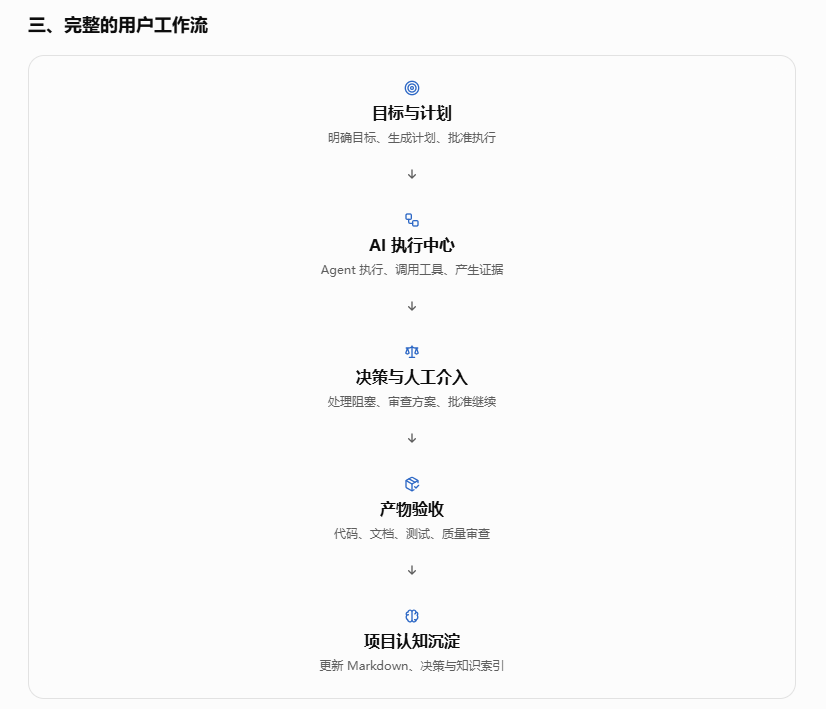

# AI 研发管理平台 · 其他核心页面设计 V1.2（供稿记录）

> **记录说明**
> - 记录日期：2026-10-31
> - 性质：用户直接供稿的五个核心页面深化设计，按原文记录；分析须待用户明示「分析」后才进行
> - 关联：设计系统基线 [ai-pm-ui-design-system-v1.md](ai-pm-ui-design-system-v1.md) · 总控台 V1.1 [ai-pm-ui-console-v1-1.md](ai-pm-ui-console-v1-1.md)
> - 配图：[figures/pages-v1-2-workflow.png](figures/pages-v1-2-workflow.png)（完整用户工作流）· [figures/pages-v1-2-prototype-goals.png](figures/pages-v1-2-prototype-goals.png)（目标与计划原型截图）
> - 实施备注：本稿在 /goal「完成所有相关页面（mock 数据先行）」执行期间收到，五页深化按本稿实施（mock 级），深化中与 V1.1 供稿的口径差异（如导航构成）未擅自裁决，见文末「待裁决」
> - 裁决更新（2026-11-01）：文末「待裁决」第 1 条「导航构成」已裁决并落地（传统 9 项 + V1.2 五项，同壳内切换导航集）；第 2、3 条仍待裁

---

接下来沿用已经确定的 专业克制型、紧凑专业型、三栏布局，把其余五个核心页面设计成一套连贯的工作空间。

这里有一个重要原则：**不是六个 Dashboard，而是六种不同的研发工作模式。**

| 页面 | 用户最需要完成的事情 | 中央主工作区 |
|---|---|---|
| 目标与计划 | 确定做什么、谁来做、何时验收 | 目标树、计划、依赖 |
| AI 执行中心 | 知道 AI 正在做什么、是否需要介入 | 执行时间线、工具调用、日志 |
| 决策中心 | 比较方案、核对证据、批准决策 | 方案对比、风险、决策记录 |
| 项目认知中心 | 管理 AI 对项目的长期理解 | 知识树、Markdown、引用关系 |
| 产物验收中心 | 判断 AI 交付物是否合格 | 文件 Diff、测试、验收结论 |

所有页面共享顶部项目切换器、左侧导航、底部 AI 指令栏和右侧上下文栏，但**右侧展示的信息会随着中央工作对象变化**。

## 一、五个页面的交互原型

（原型截图：见 figures/pages-v1-2-prototype-goals.png，图为「目标与计划」页：左栏项目分组含「迭代 v2.0」「代码仓库」；目标卡 GOAL-001 · 世界地图地形系统（运行中徽标）+「示例进度 50% · 基于计划权重」；任务分解 3 个任务（1 地形渲染架构/架构 Agent/待决策、2 森林生成模块/开发 Agent/执行中-选中态、3 高度数据处理/测试 Agent/待验收）；依赖关系块「地形架构决策 → 地形渲染实现 → 系统集成测试」+「查看阻塞的架构决策」按钮；指令栏「AI 研发负责人 · 目标与计划」+「当前页面已关联」；右栏页签 上下文/证据：当前工作区=目标与计划、当前任务=森林生成模块、负责人=开发 Agent、权限=高风险操作需要人工审批。）

## 二、五个页面各自还需要深化什么？

### 1. 目标与计划：不能只是任务列表

正式版本应该提供三种可切换视图：**目标树、依赖图、时间线**。

AI 负责人生成计划后，用户应看到新增、删除、修改了哪些任务，哪些任务之间存在依赖，以及调整计划会影响哪些 Agent。

建议将 **「AI 提议的计划」和「已经批准执行的计划」明确分离**。未批准的修改只能作为草案显示。

### 2. AI 执行中心：这是最重要的技术页面

执行中心需要比原型更专业。建议采用**中央区域内部的双栏结构：左侧执行步骤，右侧当前步骤的工具调用、日志、代码变化和产物**。

尤其要区分**四类事件：AI 思考摘要、工具执行记录、真实业务状态变化、人工审批请求**。不能把它们全部混在聊天气泡中。

另外，**执行进度不能随意由 AI 估算百分比**。正式系统应优先显示可验证的阶段状态、已完成检查点和剩余工作；只有具备明确权重的计划才显示百分比。

### 3. 决策中心：建议作为平台的核心竞争力

决策中心不应仅保存"选择了方案 A"。

一条正式决策至少应该包含：**问题背景、候选方案、比较维度、引用证据、AI 推荐理由、风险、决策人、批准时间、影响范围以及后续验证结果**。

更重要的是，**当需求变化导致历史决策可能失效时，系统应主动提示重新评估**，而不是继续让 Agent 按旧决策执行。

### 4. 项目认知中心：建议使用 PageIndex 风格的层级检索

这个页面最适合你之前提出的 Markdown 项目认知体系。

建议把它设计成**三层：左侧项目知识树、中间 Markdown 阅读和编辑区域、右侧证据与引用关系**。

AI 负责人可以持续维护需求摘要、决策记录、变更原因和项目约束，但必须**保留原始来源、版本与审核状态**。**AI 生成的总结不应该自动覆盖人工批准的正式事实**。

### 5. 产物验收：应该接近专业代码审查工具

这个页面不能只是展示"测试通过"和一个验收按钮。

正式设计应包括**文件树、统一或左右对比 Diff、行级评论、测试报告、需求验收标准、关联任务和 Agent 执行记录**。

如果代码通过了功能测试，但性能验证尚未完成，系统应清楚区分 **「部分检查通过」和「整个交付物符合验收标准」**，不能混为一谈。

## 三、完整的用户工作流

图面记录（文字照录）：

1. **目标与计划** — 明确目标、生成计划、批准执行
2. **AI 执行中心** — Agent 执行、调用工具、产生证据
3. **决策与人工介入** — 处理阻塞、审查方案、批准继续
4. **产物验收** — 代码、文档、测试、质量审查
5. **项目认知沉淀** — 更新 Markdown、决策与知识索引

这不是必须逐步经过的线性流程。执行过程中可以随时进入决策中心，验收失败可以退回执行中心，项目知识更新也可以触发计划重新评估。

---

## 待裁决（与既有供稿的口径差异，未擅自裁决）

1. **导航构成（✅ 2026-11-01 已裁决）**：V1.2 原型左栏「工作空间」组仅五项（目标与计划/AI 执行中心/决策中心/项目认知/产物验收），未含 V1.1 的 项目总控/AI 团队/项目动态；V1.2 另有「项目」组（迭代 v2.0、代码仓库）。
   - **裁决**：两套导航都保留、不二选一——在同一 `WorkspaceShell`（`/workspace/:projectId/*`）内用顶栏「AI 模式 / 传统模式」段控件切换左栏导航集，不跳壳、不重载。
   - **传统 9 项**：项目总控、AI 团队、目标计划、项目动态、需求管理、决策中心、项目知识、产物验收、模型配置。
   - **AI 模式（V1.2）5 项**：目标与计划、AI 执行中心、决策中心、项目认知（与「项目知识」同一 slug）、产物验收。
   - **实现口径**：默认传统模式、不持久化；切模式时当前页在目标模式也存在（goals/decisions/knowledge/artifacts）则原地不动，否则回退目标模式默认页（传统→console，AI→goals）；原「传统视图」组/「概览」（→/dashboard）入口移除，模式切换不再跳 `/dashboard`。V1.2 的「项目」组未纳入本期。
2. **总控台与五页关系（仍待裁）**：V1.2 称"其余五个核心页面"，总控台保留；总控台/团队/动态是否长期并存待裁。
3. **右栏随页变化（仍待裁）**：V1.2 明确右栏随中央工作对象变化（含「证据」页签）——本次按页配置了轻量版（当前工作区/当前任务/权限），完整页签版待裁。

（记录截止此处，待续）
