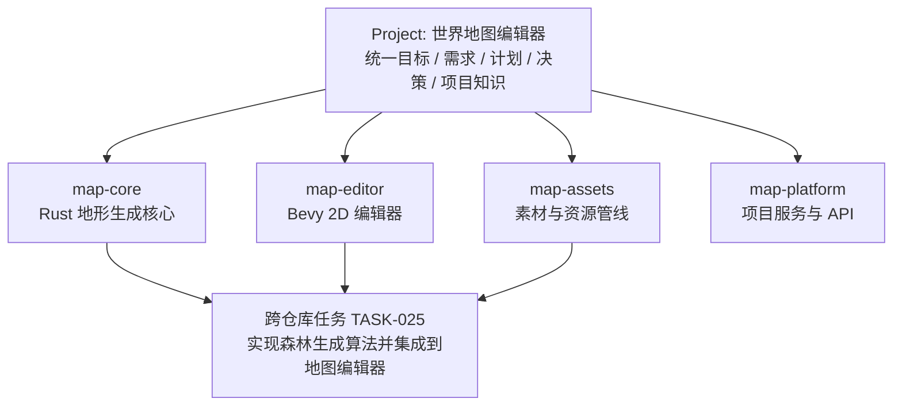
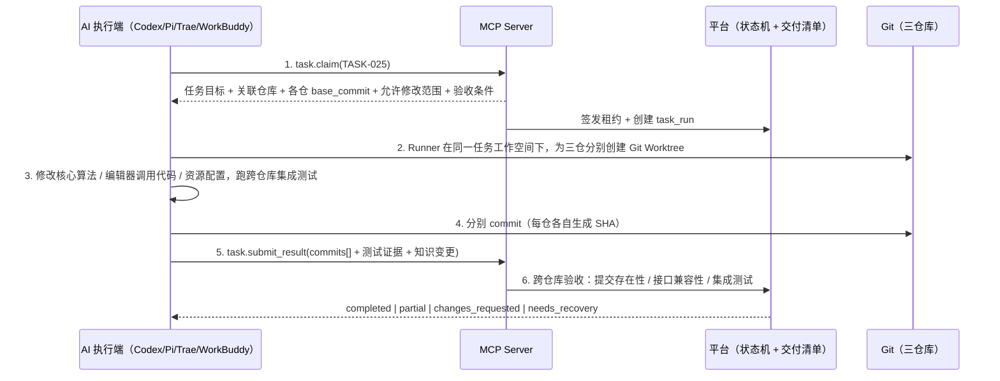
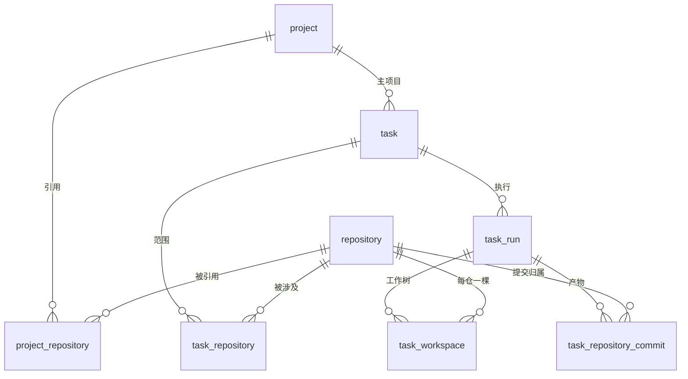

# AI 研发管理平台：多仓库项目基础模型（V1 · 设计稿）

> **标注图例**：〔原文〕= 需求方结论的直述；〔整理〕= 按结论结构化归纳的补充表述；〔待确认〕= 本稿推断或尚未拍板项，需评审确认。

| 项 | 内容 |
| --- | --- |
| 文档性质 | 基础数据模型设计稿（非 PRD，未定稿） |
| 版本 | V1 |
| 日期 | 2026-10-31 |
| 来源 | 需求方多仓库架构讨论（含 4 张示意图，见附录 B） |
| 状态 | 待评审 → 确认后作为 `projects / repositories / tasks` 与 MCP 任务契约的上位约束 |
| 影响范围 | **推翻**「一个项目 = 一个 Git 仓库」的隐含假设；改写 tasks 归属、任务契约、结果契约、知识归属、并发协调、页面结构；涉及迁移 `0009_*` |
| 前置文档 | `docs/architecture/ai-pm-architecture-principles.md`、`docs/architecture/ai-pm-mcp-executor-positioning-v1.md`、`docs/architecture/knowledge-services/ai-pm-markdown-knowledge-space.md`、迁移 `0002_delivery.sql`、`0008_repositories.sql` |

### 变更记录

| 版本 | 日期 | 变更内容 |
| --- | --- | --- |
| V1 | 2026-10-31 | 首次成型：四概念分层、跨仓库交付清单、契约结构、DB 重构、知识两层、冲突协调、拆分策略、页面影响、实施切片 |
| V1.1 | 2026-10-31 | §7.4 追加注记：父任务状态聚合表（旧词汇 `completed / partial / needs_recovery / changes_requested`）不再作为独立算法维护，统一引用 `docs/tasks/ai-pm-task-state-machine-v1.md` §十三（§十 Q3 裁决：基于必需交付门槛的确定性聚合）；本稿 §7.4 仅保留多仓库特有交付门槛条件 |

---

## 〇、一句话结论

> **一个项目 → 多个代码仓库 → 多个工作空间 → 多个执行会话；一个任务可以横跨多个仓库，因此平台必须管理「统一的任务交付清单」，而不是单个 `commit_sha`。**〔原文〕

这条结论不是「给 `tasks` 表加一列 `repository_id`」，而是**把仓库从任务的归属字段，降级为任务的关联集合**。三个直接后果：

| 后果 | 说明 |
| --- | --- |
| 完成判定变复杂 | Git 没有跨仓库原子提交，三仓提交成功 ≠ 任务完成，必须由平台裁决 |
| 失败语义变复杂 | 三仓中两仓完成时，不允许整单回滚，必须支持**部分交付**与**可恢复** |
| 项目不再依赖单一仓库 | 项目在没有任何 Git 仓库时也必须能建需求、做架构决策、沉淀知识 |

### 名词：Codex 在此文档中的含义〔整理〕

需求方原文以「Codex」指代执行方。本文沿用 `docs/architecture/ai-pm-mcp-executor-positioning-v1.md` §〇.1 的泛化口径：

| 术语 | 含义 |
| --- | --- |
| **AI 执行端**（AI Executor） | 一切能调用 MCP 工具、在真实代码环境中读文件/改文件/跑验证的 AI 开发工具统称：**Codex、Pi、Trae、WorkBuddy**、Claude Code、Cursor、Cline 等均属此类 |
| Codex | 执行端的一个具体实现，本文中**仅作示例**；凡写「Codex 领取任务」，等价于「任一执行端会话领取任务」 |
| 会话（Session） | 执行端的一次运行实例，承载一个任务，持有自己的工作空间 |
| 工作空间（Workspace） | 执行端实际读写的文件环境；多仓库场景下由多个 Git Worktree 组成 |

> **设计约束**：交付清单、契约结构、状态机、冲突检测**均不得依赖任何单一执行端的专有能力**。任何执行端只要能 ①连续调用 MCP 工具 ②读写本地文件 ③执行 `git commit`，就必须能完整参与跨仓库任务。

---

## 一、四个概念的分工〔原文〕

必须先分清四个概念，它们的失效模式完全不同：

| 概念 | 职责 | 一句话判据 | 生命周期 | 失效后果 |
| --- | --- | --- | --- | --- |
| **Project** | 业务与研发目标的管理边界 | 「这件事为什么做」 | 长（跨年），**不依赖任何 Git 仓库存在** | 目标漂移、决策无溯源 |
| **Repository** | Git 版本控制边界 | 「代码在哪、按什么分支策略演进」 | 长（跨项目复用） | 提交无法定位、权限错配 |
| **Workspace** | 执行端实际读取和修改文件的工作环境 | 「这一次执行在哪个目录里干活」 | 短（一次 task_run） | 并发互相踩文件 |
| **Task** | 可验收的工作单元，可关联多个仓库 | 「做完什么算完成」 | 中（天/周级） | 验收失真、交付不可信 |

### 1.1 各自不是什么

| 概念 | 不是 | 典型误用 |
| --- | --- | --- |
| Project | 不是仓库的容器，不是 `git remote` 的包装 | 「项目必须有 `.git` 才能创建」 |
| Repository | 不是项目的子目录，不是权限单元的全部 | 「仓库 = 项目专属，不能被两个项目引用」 |
| Workspace | 不是数据库里的项目空间，不是仓库本身 | 把 Workspace 当成「项目工作台」写进 `projects` 表 |
| Task | 不是一次执行，不是一次 Commit | `task.commit_sha TEXT` 单列字段 |

### 1.2 关键不变量（Invariants）

以下五条必须在代码层强制，不能只写在文档里：

| # | 不变量 | 强制点 |
| --- | --- | --- |
| I1 | **Project 可以零仓库存在** | `core.project` 不持有任何 `repository_id`；`project_repository` 允许为空集 |
| I2 | **Repository 可被多个 Project 引用** | 仓库身份（url/默认分支）全局唯一，项目关系单独建表 |
| I3 | **Task 必须属于且仅属于一个主 Project** | `delivery.task.project_id NOT NULL` |
| I4 | **Task 的仓库集合由 `task_repository` 表达，不由 `task` 列表达** | `delivery.task` 中不存在 `repository_id` 字段 |
| I5 | **一次执行（task_run）的产物是「提交集合」** | 结果契约 `commits: []`，不存在单一 `commit_sha` 顶层字段 |

### 1.3 层级图



> 图 A（附录 B.1）：Project 是管理边界，四个 Repository 是版本控制边界，TASK-025 同时挂在三个仓库上。

**注意图中未画出的两件事**〔整理〕：

1. `map-platform` 挂在项目下但**不在** TASK-025 的范围内 —— 项目关联仓库集合 ≠ 任务的仓库范围，这是两个不同的集合，必须分开建模。
2. 项目知识仓库 `project-knowledge`（见 §五）同样是项目关联仓库，但**默认对所有任务只读**。

---

## 二、跨仓库任务如何执行〔原文 + 整理〕

以 **TASK-025：实现森林生成并接入地图编辑器** 为例，涉及三个仓库：

| 仓库 | 承担的改动 | 是否可写 |
| --- | --- | --- |
| `map-core` | 森林生成核心算法 | 可写 |
| `map-editor` | 编辑器调用与渲染接入 | 可写 |
| `map-assets` | 素材配置与资源映射 | 可写 |

### 2.1 六步流程



| 步 | 动作 | 执行方 | 关键约束 |
| --- | --- | --- | --- |
| 1 | 领取任务，拿到多仓契约 | 执行端 → MCP | 契约必须含每仓 `base_commit`，锁定起点 |
| 2 | 准备多仓 Workspace | Runner / 执行端 | **一个任务一个工作空间目录**，内部分仓 Worktree，禁止跨任务共用目录 |
| 3 | 完成跨仓改动 | 执行端 | 允许跨仓读写，但只能改契约声明的 `path_scope` |
| 4 | 分别 Commit | 执行端 | 每仓独立分支 + 独立 SHA；**禁止**强推、禁止改写 base |
| 5 | 一次性提交结果 | 执行端 → MCP | 必须提交**完整集合**；允许集合不完整但必须如实申报 |
| 6 | 跨仓库验收 | 平台 | 提交存在性 → 接口兼容 → 集成测试 → 状态裁决 |

### 2.2 为什么必须引入「交付清单」

〔原文〕**Git 没有原生的跨仓库原子 Commit。三个仓库分别提交成功，不代表整个跨仓库任务已经完成。**

因此平台必须维护一份**统一的任务交付清单（Delivery Manifest）**，它的职责是：

| 职责 | 说明 |
| --- | --- |
| 完整性 | 声明本次任务**应该**产生几个仓库提交（来自任务契约），与实际提交集合对账 |
| 可恢复 | 记录已完成部分，崩溃/中断后能告诉下一个会话「哪些已提交、哪些没做」 |
| 可裁决 | 平台而非执行端决定 `completed / partial / needs_recovery` |
| 可审计 | 每个仓库提交绑定测试证据、审查记录、接口版本 |

### 2.3 部分完成的语义（禁止整单回滚）

〔原文〕如果三个仓库中只有两个完成，平台应**保留已完成的工作**，并把任务标记为**部分交付**或**需要恢复**，而不是简单回滚所有内容。

| 场景 | 处置 | 理由 |
| --- | --- | --- |
| 3/3 提交 + 集成通过 | `completed` | 正常完成 |
| 3/3 提交 + 集成失败 | `changes_requested`（保留全部分支） | 有东西可改，不必重来 |
| 2/3 提交（缺 1 仓） | `partial` + 交付清单保留 2 条 | 已完成的工作有独立价值（如核心算法可先行合并） |
| 1/3 提交且有阻塞 | `needs_recovery` + 阻塞原因写入清单 | 下个会话从断点继续 |
| 0/3 提交 + 租约超时 | 回 `ready`，清空工作空间 | 无产物可保留 |

> **反设计**（明确禁止）：任何「提交集合不全 → `git reset --hard` 全部仓库 + 任务回 backlog」的实现。这条会摧毁长任务的中间成果，是 AI 执行端最不能接受的惩罚。

---

## 三、任务契约与结果契约〔原文 + 整理〕

### 3.1 领取时返回（`task.claim` / `task.get_context`）

```json
{
  "task_id": "TASK-025",
  "project_id": "PROJECT-001",
  "title": "实现森林生成并集成到编辑器",
  "repositories": [
    {
      "repository_id": "repo-core",
      "name": "map-core",
      "base_ref": "main",
      "base_commit": "<core-base-sha>",
      "workspace_path": "repos/map-core",
      "write_access": true
    },
    {
      "repository_id": "repo-editor",
      "name": "map-editor",
      "base_ref": "main",
      "base_commit": "<editor-base-sha>",
      "workspace_path": "repos/map-editor",
      "write_access": true
    },
    {
      "repository_id": "repo-assets",
      "name": "map-assets",
      "base_ref": "main",
      "base_commit": "<assets-base-sha>",
      "workspace_path": "repos/map-assets",
      "write_access": true
    }
  ],
  "acceptance_criteria": [
    "森林生成接口符合架构规范",
    "编辑器能够调用新算法",
    "素材引用完整",
    "跨仓库集成测试通过"
  ]
}
```

### 3.2 结果提交（`task.submit_result`）

```json
{
  "task_id": "TASK-025",
  "commits": [
    { "repository_id": "repo-core",   "commit_sha": "<core-result-sha>" },
    { "repository_id": "repo-editor", "commit_sha": "<editor-result-sha>" },
    { "repository_id": "repo-assets", "commit_sha": "<assets-result-sha>" }
  ],
  "integration_status": "passed"
}
```

### 3.3 字段语义与校验规则

| 字段 | 语义 | 平台校验 |
| --- | --- | --- |
| `repository_id` | 仓库身份，**全局稳定** | 必须 ∈ 任务契约的 `repositories` 集合 |
| `base_ref` / `base_commit` | 契约锁定起点 | 结果提交必须是 `base_commit` 的后代（`git merge-base --is-ancestor`） |
| `workspace_path` | 该仓在工作空间内的相对路径 | 由平台分配，执行端只读；不得自行改变布局 |
| `write_access` | 该仓是否允许写 | `false` 的仓库出现 commit → 整单驳回 |
| `acceptance_criteria` | 可验收条目 | 至少一条需绑定可执行证据（测试/命令输出/截图/文档 diff） |
| `commits[].commit_sha` | 每仓结果提交 | 必须存在、必须在新分支上、必须属于该仓库 |
| `integration_status` | 跨仓集成结论 | `passed / failed / not_run`；`not_run` 不得判 `completed` |

### 3.4 契约扩展建议〔整理〕

原结构满足最小可用，但跨仓库执行还缺三类信息，建议在 V1 契约中一并纳入：

```json
{
  "task_id": "TASK-025",
  "repositories": [
    {
      "repository_id": "repo-core",
      "name": "map-core",
      "base_ref": "main",
      "base_commit": "<core-base-sha>",
      "workspace_path": "repos/map-core",
      "write_access": true,
      "path_scope": ["crates/terrain/**", "docs/api/forest.md"],
      "knowledge_refs": ["project-knowledge/architecture/terrain.md"]
    }
  ],
  "cross_repo_contracts": [
    {
      "from_repository_id": "repo-core",
      "to_repository_id": "repo-editor",
      "kind": "api",
      "interface": "terrain::forest::generate_v2",
      "pinned_commit": "<core-base-sha>"
    }
  ],
  "integration_checks": [
    { "name": "跨仓库集成测试", "command": "cargo test -p integration-forest" }
  ],
  "delivery_expectation": { "commit_count": 3 }
}
```

| 新增字段 | 解决的问题 | 缺失时的后果 |
| --- | --- | --- |
| `path_scope` | 限定每仓可改范围 | 执行端可能顺手重构无关模块，评审成本失控 |
| `knowledge_refs` | 指明该任务依据的项目知识 | 执行端靠猜架构约束，产出不合规 |
| `cross_repo_contracts` | 声明仓库间接口依赖与版本锚点 | 并行场景下基于过期接口开发（§六） |
| `integration_checks` | 跨仓验收的可执行定义 | `integration_status` 只能靠执行端自述，不可信 |
| `delivery_expectation.commit_count` | 交付清单对账基准 | 无法区分「漏做一仓」与「本就只需改两仓」 |

---

## 四、数据库模型重构

### 4.1 目标关系〔原文〕

| 关系 | 基数 | 说明 |
| --- | --- | --- |
| `projects ↔ repositories` | 多对多 | 同一仓库可被多个项目引用（如共享基础库） |
| `tasks → projects` | 多对一 | 一个任务属于**一个主项目** |
| `tasks ↔ repositories` | 多对多 | 任务涉及哪些仓库、读写权限、基准版本 |
| `task_runs → task_workspaces` | 一对多 | 每次执行关联自己的工作空间 |
| `task_runs → task_repository_commits` | 一对多 | 一次执行产生**零到多个**仓库提交 |

### 4.2 ER 图



> 图 C（附录 B.3）为需求方原稿示意：`projects → project_repositories / tasks → task_repositories → task_workspaces / task_repository_commits`。本 ER 图在其上补齐了**独立 `repository` 实体**，因为同一仓库可能被多个项目引用。

### 4.3 表清单

| schema | 表 | 性质 | 关键职责 |
| --- | --- | --- | --- |
| `core` | `project` | 已有 | 项目基本信息、目标、知识空间 |
| `integration` | `repository` | **新增** | 仓库全局身份：url、provider、默认分支、可见性 |
| `integration` | `project_repository` | 已有（0008），**改造** | 项目 ↔ 仓库关联：用途、权限、知识范围 |
| `delivery` | `task` | 已有（0002），**约束收敛** | 项目级任务，**不绑定单仓库** |
| `delivery` | `task_repository` | **新增** | 任务 ↔ 仓库多对多：读写、`base_commit`、`path_scope` |
| `delivery` | `task_run` | **新增** | 一次执行：租约、执行端身份、集成结论 |
| `delivery` | `task_workspace` | **新增** | 执行环境与工作树：每仓一棵 Worktree |
| `delivery` | `task_repository_commit` | **新增** | 各仓提交与审查结果 |
| `delivery` | `task_dependency` | **新增** | 父任务拆分 / 跨任务接口依赖（§七） |
| `delivery` | `task_delivery_manifest` | **新增（视图或表）** | 交付清单对账：应交付 vs 实交付 |

### 4.4 DDL 草案（`migrations/0009_multi_repo.sql`）

> 说明：现有 `0008_repositories.sql` 已落地 `integration.project_repository`（含 `project_ssh_key`），本节按 **append-only** 原则新增 `0009`，不改写 0008 内容。

```sql
-- 0009_multi_repo: 仓库升为独立实体；任务 ↔ 仓库多对多；执行产物为提交集合。
-- 原则：project 不持有 repository 外键；task 不持有 repository 外键；
--       task_run 的一次执行对应 N 个工作树 + N 个提交。

-- 1) 仓库全局身份（移除"仓库隶属于唯一项目"的隐含假设）
CREATE TABLE integration.repository (
    id             UUID PRIMARY KEY DEFAULT gen_random_uuid(),
    name           TEXT NOT NULL,                     -- 短名：map-core
    url            TEXT NOT NULL,
    provider       TEXT NOT NULL DEFAULT 'git'
                   CHECK (provider IN ('git', 'github', 'gitlab', 'gitea', 'other')),
    default_branch TEXT NOT NULL DEFAULT 'main',
    -- 仓库在项目中的默认用途（与 project_repository.role 语义对齐）
    knowledge_role TEXT NOT NULL DEFAULT 'code'
                   CHECK (knowledge_role IN ('code', 'knowledge', 'infra')),
    description    TEXT,
    revision       BIGINT NOT NULL DEFAULT 1,
    created_at     TIMESTAMPTZ NOT NULL DEFAULT now(),
    updated_at     TIMESTAMPTZ NOT NULL DEFAULT now(),
    UNIQUE (url),
    UNIQUE (name)                                      -- 平台内短名唯一，便于工作空间定址
);

-- 2) project_repository 改造：从"仓库表"降级为"关联表"
ALTER TABLE integration.project_repository
    ADD COLUMN repository_id UUID REFERENCES integration.repository(id);

-- 回填：按 (url, name) 建仓库身份，再把关联指过去（细节见 §4.6 收敛路径）
-- UPDATE / INSERT ... （由迁移脚本按 0008 存量数据生成，见 4.6）

ALTER TABLE integration.project_repository
    ALTER COLUMN repository_id SET NOT NULL;

-- 同一项目内，同一仓库不得重复关联
CREATE UNIQUE INDEX uq_project_repository
    ON integration.project_repository(project_id, repository_id);

-- 3) 任务 ↔ 仓库：范围、权限、基准版本
CREATE TABLE delivery.task_repository (
    task_id         UUID NOT NULL,
    project_id      UUID NOT NULL,
    repository_id   UUID NOT NULL REFERENCES integration.repository(id),
    write_access    BOOLEAN NOT NULL DEFAULT true,
    base_ref        TEXT NOT NULL DEFAULT 'main',
    base_commit     TEXT,                              -- 领取时锁定；创建任务时可为空
    path_scope      TEXT[],                            -- 允许修改的路径 glob
    role            TEXT NOT NULL DEFAULT 'primary'
                    CHECK (role IN ('primary', 'secondary', 'knowledge')),
    created_at      TIMESTAMPTZ NOT NULL DEFAULT now(),
    PRIMARY KEY (task_id, repository_id),
    FOREIGN KEY (project_id, task_id)
        REFERENCES delivery.task(project_id, id) ON DELETE CASCADE
);

CREATE INDEX idx_task_repository_repo
    ON delivery.task_repository(repository_id, created_at DESC);

-- 4) 一次执行
CREATE TABLE delivery.task_run (
    id                 UUID PRIMARY KEY DEFAULT gen_random_uuid(),
    project_id         UUID NOT NULL,
    task_id            UUID NOT NULL,
    executor_kind      TEXT NOT NULL DEFAULT 'unknown',   -- codex | pi | trae | workbuddy | ...
    executor_session   TEXT,                              -- 执行端会话标识（可为空）
    lease_id           UUID,
    lease_expires_at   TIMESTAMPTZ,
    status             TEXT NOT NULL DEFAULT 'running'
                       CHECK (status IN ('running', 'submitted', 'verified',
                                         'partial', 'needs_recovery', 'aborted')),
    integration_status TEXT NOT NULL DEFAULT 'not_run'
                       CHECK (integration_status IN ('not_run', 'passed', 'failed')),
    started_at         TIMESTAMPTZ NOT NULL DEFAULT now(),
    finished_at        TIMESTAMPTZ,
    UNIQUE (project_id, id),
    FOREIGN KEY (project_id, task_id)
        REFERENCES delivery.task(project_id, id) ON DELETE CASCADE
);

-- 一个任务同一时刻只允许一个活跃 run（其余为历史）
CREATE UNIQUE INDEX uq_task_run_active
    ON delivery.task_run(task_id) WHERE status = 'running';

-- 5) 工作空间 / 工作树：一次 run 内每仓一棵
CREATE TABLE delivery.task_workspace (
    id             UUID PRIMARY KEY DEFAULT gen_random_uuid(),
    project_id     UUID NOT NULL,
    task_run_id    UUID NOT NULL,
    repository_id  UUID NOT NULL REFERENCES integration.repository(id),
    root_path      TEXT NOT NULL,                 -- 工作空间根（一次性目录）
    workspace_path TEXT NOT NULL,                 -- 仓内相对路径：repos/map-core
    worktree_path  TEXT NOT NULL,                 -- 实际 Worktree 绝对路径
    branch         TEXT NOT NULL,                 -- task/TASK-025/repo-core
    base_commit    TEXT NOT NULL,
    created_at     TIMESTAMPTZ NOT NULL DEFAULT now(),
    UNIQUE (task_run_id, repository_id),
    FOREIGN KEY (project_id, task_run_id)
        REFERENCES delivery.task_run(project_id, id) ON DELETE CASCADE
);

-- 6) 提交集合：一次 run 产生零到多个仓库提交
CREATE TABLE delivery.task_repository_commit (
    id             UUID PRIMARY KEY DEFAULT gen_random_uuid(),
    project_id     UUID NOT NULL,
    task_run_id    UUID NOT NULL,
    repository_id  UUID NOT NULL REFERENCES integration.repository(id),
    commit_sha     TEXT,
    branch         TEXT,
    pr_url         TEXT,
    review_status  TEXT NOT NULL DEFAULT 'pending'
                   CHECK (review_status IN ('pending', 'approved', 'rejected', 'merged')),
    test_evidence  JSONB NOT NULL DEFAULT '{}'::jsonb,
    merged_sha     TEXT,
    created_at     TIMESTAMPTZ NOT NULL DEFAULT now(),
    UNIQUE (task_run_id, repository_id),
    FOREIGN KEY (project_id, task_run_id)
        REFERENCES delivery.task_run(project_id, id) ON DELETE CASCADE
);

-- 7) 任务依赖：父任务拆分 / 跨任务接口依赖
CREATE TABLE delivery.task_dependency (
    project_id          UUID NOT NULL,
    task_id             UUID NOT NULL,
    depends_on_task_id  UUID NOT NULL,
    kind                TEXT NOT NULL DEFAULT 'blocks'
                        CHECK (kind IN ('blocks', 'interface', 'integration')),
    interface_ref       TEXT,          -- kind=interface 时的接口契约标识
    pinned_commit       TEXT,          -- 依赖方锁定的接口版本锚点
    PRIMARY KEY (task_id, depends_on_task_id),
    FOREIGN KEY (project_id, task_id)            REFERENCES delivery.task(project_id, id),
    FOREIGN KEY (project_id, depends_on_task_id) REFERENCES delivery.task(project_id, id),
    CHECK (task_id <> depends_on_task_id)
);
```

### 4.5 交付清单：表还是视图？〔整理〕

交付清单**不建议再建一张事实表**，否则会与 `task_repository` / `task_repository_commit` 形成双写不一致。正确做法是**对账视图**：

```sql
-- 应交付（任务范围）× 实交付（本次 run 的提交）
CREATE VIEW delivery.v_task_delivery_manifest AS
SELECT
    t.project_id,
    t.id                AS task_id,
    r.repository_id,
    r.base_commit       AS expected_base_commit,
    c.commit_sha,
    c.review_status,
    CASE
        WHEN c.commit_sha IS NULL           THEN 'missing'
        WHEN c.review_status = 'approved'   THEN 'delivered'
        ELSE 'pending_review'
    END                 AS delivery_state
FROM delivery.task t
JOIN delivery.task_repository r
  ON r.task_id = t.id
LEFT JOIN delivery.task_run run
  ON run.task_id = t.id AND run.status IN ('submitted', 'verified', 'partial', 'needs_recovery')
LEFT JOIN delivery.task_repository_commit c
  ON c.task_run_id = run.id AND c.repository_id = r.repository_id;
```

状态裁决规则（平台侧，唯一裁决点）：

| 条件 | 任务状态 |
| --- | --- |
| 全部 `delivered` 且 `integration_status='passed'` | `completed` |
| 全部 `delivered` 但 `integration_status='failed'` | `changes_requested` |
| 部分 `delivered`，其余 `missing` | `partial` |
| 部分 `delivered` 且 run 已中止/租约过期 | `needs_recovery` |
| 全部 `missing` 且 run 中止 | 回 `ready` |

### 4.6 与现有 0008 的收敛路径

现有 `integration.project_repository` 是「一个项目一条仓库记录」，`UNIQUE (project_id, url)`。收敛为多对多的三步，**不破坏存量**：

| 步 | 动作 | 风险 |
| --- | --- | --- |
| 1 | `INSERT INTO integration.repository` 按存量 `(url, name)` 去重生成仓库身份 | 低；同名不同 url 需人工合并 |
| 2 | 回填 `project_repository.repository_id`（按 url 匹配） | 低 |
| 3 | `SET NOT NULL` + 建 `UNIQUE (project_id, repository_id)` | 低；原 `UNIQUE (project_id, url)` 可保留作冗余防护 |

〔待确认〕`project_repository.role`（`main/docs/service/infra`）与新 `repository.knowledge_role`（`code/knowledge/infra`）语义重叠。建议：**`role` 保留为「项目内用途」，`knowledge_role` 表达「全局知识属性」**，两者不合并，避免同一仓库在不同项目里被赋予不同知识地位时无处表达。

### 4.7 反设计清单

| 反模式 | 为何禁止 |
| --- | --- |
| `delivery.task.repository_id UUID` | 一任务只能一仓库，跨仓任务被迫拆碎或造假 |
| `delivery.task.commit_sha TEXT` | 抹掉「提交集合」语义，部分交付无法表达 |
| `delivery.task.workspace_path TEXT` | 工作空间是 run 级资源，写进 task 会被后续 run 覆盖 |
| `project.repository_id` | 项目被单一仓库绑架，无法零仓库立项 |
| 把 `task_repository_commit` 合并进 `task_repository` | 范围（声明）与产物（事实）混表，重跑即覆盖历史 |

---

## 五、项目知识库应该放在哪个仓库？〔原文〕

### 5.1 结论：两层结构

〔原文〕采用**项目级知识 + 仓库级知识**两层，**项目级正式知识放在独立 Git 仓库 `project-knowledge`**，不随意挑选某个代码仓库充当知识中心。

| 层 | 位置 | 内容 | 变更节奏 | 谁能写 |
| --- | --- | --- | --- | --- |
| **项目级知识** | 独立仓库 `project-knowledge` | 需求、产品目标、跨仓库架构、决策、研发计划、系统约束 | 慢，需评审 | 人 + 平台（AI 提案需审批） |
| **仓库级知识** | 各代码仓库内 | 模块接口、实现细节、构建规范、测试说明、仓库专属 `AGENTS.md` | 快，随代码走 | 该仓库的写入任务 |

```
project-knowledge/                 # 独立仓库，项目级唯一权威
├── requirements/
├── architecture/
├── decisions/
└── project-context.md

map-core/                          # 各代码仓库自带仓库级知识
├── AGENTS.md                      # 仓库专属执行端指令
├── docs/architecture.md
└── docs/api.md
```

### 5.2 为什么不选「挑一个代码仓库当知识中心」

| 风险 | 具体后果 |
| --- | --- |
| 技术栈更替 | 换前端/后端/地图引擎时，知识被绑死在将被替换的仓库里 |
| 权限耦合 | 知识库读写权限被迫跟随某个代码仓库的权限模型 |
| 生命周期错配 | 代码仓库可能归档，但项目知识必须长期存活 |
| 依赖倒置 | 项目级知识本应是代码仓库的上位约束，放在其中会变成「某仓的文档」 |

> **一句话**：项目级知识是**跨仓库的上位约束**，它不能寄生在被约束对象内部。

### 5.3 检索：逻辑知识树

〔原文〕PageIndex 风格的检索服务负责统一索引所有仓库中的 Markdown，形成一棵**逻辑知识树**。

| 索引维度 | 说明 |
| --- | --- |
| `project_id` | 树的根，决定可见边界 |
| `repository_id` + `knowledge_role` | 一级分支：`project-knowledge` / 各代码仓库 |
| `path` | 二级分支：目录结构即树结构 |
| `commit_sha` | 叶子版本锚点：检索结果必须可回溯到具体提交 |

对应的落地约束：

1. 索引键**必须含 `commit_sha`**，否则检索结果无法与任务 `base_commit` 对齐，会导致「按最新文档写，但提交基于旧代码」。
2. 任务契约的 `knowledge_refs` 指向 `repository_id + path + commit`，不允许只给 path。
3. 项目级知识仓库对所有任务**默认只读**（`write_access=false`），知识变更走「提案 → 审批 → 独立提交」，与代码提交解耦。

### 5.4 知识归属判定表〔整理〕

新知识该写哪里，用这张表判定，避免知识碎片化：

| 知识类型 | 归属 | 判据 |
| --- | --- | --- |
| 产品目标、需求变更 | 项目级 | 换掉任何代码仓库都仍然成立 |
| 跨仓库架构决策（ADR） | 项目级 | 涉及 ≥2 个仓库的接口/边界 |
| 仓库内部模块设计 | 仓库级 | 只对该仓库的维护者有意义 |
| 模块 API 契约 | **仓库级 + 项目级摘要** | 契约本体随代码走，摘要进 `architecture/` 供跨仓任务引用 |
| 仓库专属执行端指令 | 仓库级 `AGENTS.md` | 与工具无关的通用做法，不放项目级 |
| 构建/测试规范 | 仓库级 | 随构建系统版本走 |

---

## 六、多执行端并行时的仓库冲突〔原文〕

### 6.1 冲突场景

同一个项目中可能出现：

| 会话 | 修改范围 | 风险 |
| --- | --- | --- |
| 会话 A | `map-core` | — |
| 会话 B | `map-editor` | — |
| 会话 C | `map-core` **和** `map-editor` | **可能基于过期接口开发** |

〔原文〕如果没有资源协调机制，会话 C 可能基于过期的接口进行开发。

### 6.2 三层防护（按必需性排序）

| 层 | 机制 | 必需性 | 理由 |
| --- | --- | --- | --- |
| L1 | **工作目录隔离** | 必需 | 每 run 独立工作空间 + 每仓独立 Worktree + 独立分支，物理上不互相踩文件 |
| L2 | **依赖版本校验** | 必需 | 提交/合并时校验 `base_commit` 是否为当前目标分支祖先，接口契约是否一致 |
| L3 | **仓库级互斥锁** | **仅必要时** | 只在真正互斥的写操作上短期加锁（如改 schema 迁移、批量重命名） |

〔原文〕**不建议默认把整个仓库锁住**，否则一个大仓库只能运行一个 Agent，严重影响并行效率。

### 6.3 更合理的协调方式

〔原文〕记录任务涉及的**模块、文件范围、接口依赖**，在提交或合并时检测冲突，并要求跨仓库集成验证。

| 手段 | 落点 | 说明 |
| --- | --- | --- |
| 模块/文件范围 | `task_repository.path_scope` | 创建任务时声明，领取时下发给执行端 |
| 接口依赖 | `task_dependency (kind='interface', interface_ref, pinned_commit)` | 声明「我依赖 core 的 `generate_v2`，锚定 sha」 |
| 冲突检测（提交前） | `submit_result` 时计算范围交集 | **advisory**：只告警不阻断，允许人工确认后放行 |
| 冲突检测（合并前） | 目标分支 HEAD 已前移时 | **blocking**：要求 rebase 或重新集成验证 |
| 跨仓库集成验证 | `integration_checks` + `task_repository_commit.test_evidence` | 没有通过证据 → 不得 `completed` |

### 6.4 锁的正确粒度〔整理〕

如果确实需要锁，锁的对象**不是仓库**，而是：

| 锁粒度 | 示例 | 持有时间 |
| --- | --- | --- |
| 路径前缀 | `crates/terrain/schema/**` | 分钟级（一次提交窗口） |
| 迁移文件序列 | `migrations/0009_*` | 分钟级 |
| 接口契约 | `terrain::forest::generate_v2` | 到接口冻结/发布为止 |

> 判断标准：**锁的粒度应该等于「改了就必须所有人一起改」的最小集合**。整仓加锁几乎总是过度。

### 6.5 过期基线的处置

| 情形 | 处置 |
| --- | --- |
| `base_commit` 仍是 HEAD 的祖先 | 正常，直接可提交 |
| 目标分支已前移但无范围交集 | 允许提交，提示 rebase |
| 目标分支已前移且**有范围交集** | `changes_requested`：要求 rebase 后重跑集成检查 |
| 依赖的接口 `pinned_commit` 已被改动 | `needs_recovery`：契约失效，需重新执行或由平台刷新契约 |

---

## 七、跨仓库任务是否应该拆分？〔原文〕

### 7.1 结论：两种模式并存

〔原文〕不是所有跨仓库工作都应该交给一个执行会话；也**不应该强制每个任务只能属于一个仓库**。

| 模式 | 形态 | 适用 | 实现 |
| --- | --- | --- | --- |
| **模式一：单任务多仓库**（fat task） | 一个任务、一个 run、N 个提交 | 必须同时改多仓才能保持一致的小规模改动 | `task_repository` 多行，`task_run` 一行，`commits` N 行 |
| **模式二：父任务拆分为仓库级子任务**（thin tasks） | 父任务 + N 个子任务 + 1 个集成任务 | 各仓工作可独立验收、可并行 | `task_dependency (kind='blocks')` + 父任务状态由子任务聚合 |

### 7.2 示例：森林生成系统

| 任务 | 仓库 | 依赖 |
| --- | --- | --- |
| TASK-025A 森林生成核心算法 | `map-core` | 无 |
| TASK-025B 编辑器森林渲染接入 | `map-editor` | 025A 的**接口契约** |
| TASK-025C 素材配置与映射 | `map-assets` | 无 |
| TASK-025D 跨仓库集成验证 | 多仓库 | 025A、025B、025C |

> 关键细节：**025B 依赖的是 025A 的「接口契约」，不是 025A 的「完成」**。因此 025A 一旦冻结接口（哪怕实现未完成），025B 即可并行启动 —— 这正是 `task_dependency (kind='interface', interface_ref, pinned_commit)` 存在的意义。

### 7.3 拆分判定表

| 判断 | 倾向拆分（模式二） | 倾向单任务多仓（模式一） |
| --- | --- | --- |
| 改动规模 | 各仓改动大（>数百行/多模块） | 各仓改动小（几十行/单文件） |
| 验收独立性 | 每仓可独立验收 | 必须合并后才可验证 |
| 接口是否稳定 | 接口需先设计冻结 | 接口已存在，只改字段/签名 |
| 并行收益 | 多会话可同时开工 | 拆了反而增加协调成本 |
| 一致性要求 | 允许短暂不一致 | **必须原子一致**（如 API 字段重命名） |
| 回滚语义 | 单仓可独立回滚 | 半途回滚会造成编译失败 |

〔原文〕**对于必须同时修改多个仓库才能保持一致的小规模改动（例如一次 API 字段重命名），也应允许一个执行端在多仓库 Workspace 中完成。**

### 7.4 Lead Agent 的职责

〔原文〕由 **Lead Agent 根据依赖关系、接口稳定性和冲突风险提出拆分建议**，而不是强制。

| 职责 | 说明 | 约束 |
| --- | --- | --- |
| 提出拆分建议 | 输出「建议拆为 025A/B/C/D」+ 依赖图 + 理由 | **建议权，非决定权** |
| 识别接口冻结点 | 标出哪些接口必须先冻结才能并行 | 写回 `task_dependency.interface_ref` |
| 标注冲突风险 | 哪些仓范围会重叠 | 写入任务说明，供人评估 |
| 聚合父任务状态 | 子任务全 `completed` 且 025D 通过 → 父任务 `completed` | 父任务**不产生自己的提交** |

父任务状态聚合规则〔整理〕：

| 子任务状态 | 父任务状态 |
| --- | --- |
| 全部 `completed` + 集成任务通过 | `completed` |
| 部分 `completed` + 集成任务未通过 | `partial` |
| 存在 `needs_recovery` | `needs_recovery` |
| 存在 `changes_requested` | `changes_requested` |

> **V1.1 追加注记（2026-10-31，源自 `docs/tasks/ai-pm-task-state-machine-v1.md` §十 Q3 裁决）**
> 上表〔整理〕为早期推断稿，**不再作为独立聚合算法维护**。任务级聚合已统一裁决为「**基于必需交付门槛的确定性聚合**（Deterministic Delivery-Gate Aggregation）」：不采用状态枚举优先级排序（含本表的隐含优先级），聚合判定顺序、终态处理、可选子任务、失败恢复与父子一致性约束以 [docs/tasks/ai-pm-task-state-machine-v1.md §十三](docs/tasks/ai-pm-task-state-machine-v1.md) 为准。本稿 §7.4 仅保留**多仓库特有的交付门槛条件**：每个必需仓库的基准版本（base commit）、Commit 可读性、验证结果及集成状态。多仓库只是增加交付条件，不另设父任务状态优先级算法。

---

## 八、对页面设计的影响〔原文〕

〔原文〕多仓库模型确定之后，平台应增加三个能力，并且**作为整个系统的基础模型，而不是后期补丁**。

### 8.1 项目仓库管理

| 项 | 内容 |
| --- | --- |
| 位置 | 项目设置 → 仓库（`/projects/:id/repositories`） |
| 列表字段 | 仓库短名、url、默认分支、项目内用途（`role`）、知识属性（`knowledge_role`）、默认读写权限、最近提交、关联任务数 |
| 操作 | 关联已有仓库 / 新建仓库登记 / 调整用途 / 设默认只读 / 解除关联（有活跃任务时禁止） |
| 空态 | **必须支持零仓库**：显示「尚未关联代码仓库，可先进行需求与架构规划」 |
| 反模式 | 不允许把「新增仓库」做成项目创建向导的必填步 |

### 8.2 任务仓库范围

| 项 | 内容 |
| --- | --- |
| 位置 | 任务创建/编辑表单 → 「涉及的仓库」区块 |
| 交互 | 多选项目仓库 → 每行设置：可写/只读、基准分支、路径范围（可选） |
| 默认值 | 从项目仓库继承默认权限；`project-knowledge` 默认只读且不可改 |
| 校验 | 至少一个可写仓库；同一任务不可重复选同一仓库；只读仓库不得出现在 `commits` 里 |
| 提示 | 选中 ≥2 个仓库时提示「跨仓库任务将生成多个提交，验收需跨仓集成验证」 |
| 拆分建议 | 检测到 ≥3 仓或范围过大时，展示 Lead Agent 的拆分建议（可忽略） |

### 8.3 跨仓库交付验收

| 项 | 内容 |
| --- | --- |
| 位置 | 任务详情 → 「交付清单」页签 |
| 主视图 | 按仓库分行的清单：仓库名 / 期望 base / 实际 commit / PR / 测试状态 / 审查状态 / 交付态（已交付/缺失/待审） |
| 顶部汇总 | `2/3 已交付 · 集成验证: failed` + 任务状态徽标（`partial`） |
| 操作 | 逐仓查看 diff / 逐仓批准 / 触发集成验证 / 标记需恢复（保留已完成分支） |
| 关键约束 | **不提供「一键回滚全部仓库」**；只提供「放弃某仓提交」和「标记任务需恢复」 |
| 审计 | 每个提交可追溯：哪个执行端、哪次 run、哪棵 Worktree、哪份测试证据 |

### 8.4 全局一致性要求〔整理〕

| 要求 | 说明 |
| --- | --- |
| 术语一致 | 页面统一用「仓库 / 工作空间 / 执行 / 交付清单」，不使用「项目空间」「代码库」（易与 Workspace 混淆） |
| 状态一致 | 任务状态机新增 `partial` / `needs_recovery`，前端徽标与后端枚举同源 |
| 空态完整 | 零仓库项目、单仓任务、多仓任务、部分交付，四种空态都必须有设计，不能只做「理想态」 |

---

## 九、实施切片

| 切片 | 内容 | 依赖 | 交付判据 |
| --- | --- | --- | --- |
| **P0-1** | 迁移 `0009`：`repository` 实体 + `project_repository.repository_id` 回填 | 0008 | 存量数据零丢失，`cargo test` 全绿 |
| **P0-2** | `task_repository` + `task_run` + `task_workspace` + `task_repository_commit` 建表 | P0-1 | 可插入一条三仓任务的完整链路 |
| **P0-3** | 契约扩展：`task.get_context` 返回 `repositories[]`、`path_scope`、`integration_checks` | P0-2 | 契约 JSON schema 通过校验测试 |
| **P0-4** | 结果契约：`submit_result(commits[])` + 交付清单视图 + 状态裁决 | P0-3 | 2/3 提交 → `partial`；3/3 + 集成失败 → `changes_requested` |
| **P1-1** | 项目仓库管理页 + 任务仓库范围表单 | P0-1 | 零仓库项目可正常创建并规划 |
| **P1-2** | 跨仓库交付验收页（含逐仓批准、集成验证触发） | P0-4 | `partial` 任务可在页面完整处置 |
| **P1-3** | `task_dependency`：父子拆分 + 接口依赖 + 父任务状态聚合 | P0-4 | 025A~D 全链路状态正确聚合 |
| **P2-1** | 多仓 Workspace 生成器（每仓 Worktree + 分支命名约定） | P0-2 | 一个 run 产出 3 棵 Worktree，互不干扰 |
| **P2-2** | 冲突检测：范围交集（advisory）+ 基线过期（blocking） | P1-3 | 会话 C 的过期接口场景可被拦截 |
| **P2-3** | 知识索引：`(repository_id, path, commit_sha)` + `knowledge_refs` 下发 | P0-3 | 契约中的知识引用可回溯到提交 |

### 验收场景（必须全绿）

| # | 场景 | 期望 |
| --- | --- | --- |
| S1 | 零仓库项目创建需求 + ADR | 成功，无 Git 依赖 |
| S2 | 单仓任务 | 与现网行为一致（向后兼容） |
| S3 | 三仓任务全部提交 + 集成通过 | `completed`，交付清单 3/3 |
| S4 | 三仓任务 2/3 提交 | `partial`，已完成分支保留，不清空 |
| S5 | 只读仓库出现提交 | 整单驳回，`changes_requested` |
| S6 | `base_commit` 非目标分支祖先 | 驳回并提示 rebase |
| S7 | 父任务 + 4 子任务 | 子任务独立并行，父任务聚合正确 |
| S8 | 同一仓库被两个项目引用 | 两项目各自可见，互不影响权限 |

---

## 十、待确认问题

| # | 问题 | 本稿倾向 |
| --- | --- | --- |
| Q1 | `project_repository.role` 与 `repository.knowledge_role` 是否合并 | 不合并，语义不同（§4.6） |
| Q2 | 交付清单用视图还是物化表 | 视图（§4.5），避免双写 |
| Q3 | `partial` 是否算终态 | 否，是可继续推进的中间态；但需要人工决定「补做」还是「拆出」 |
| Q4 | 任务完成后分支是否自动合并 | 不自动。平台只记录 `merged_sha`，合并由人/PR 流程决定 |
| Q5 | 一仓多分支（同任务需改两个分支） | V1 不支持，一任务一仓一分支；需求出现再议 |
| Q6 | 仓库短名 `name` 全局唯一是否过严 | 倾向允许重复，改用 `provider + url` 唯一；`name` 仅展示 |
| Q7 | 执行端如何得知工作空间布局 | 由平台下发 `workspace_path`，执行端**不得**自行决定（§3.3） |
| Q8 | 集成测试由谁执行 | 优先由执行端跑并提交证据；平台可选做二次校验 |
| Q9 | 跨项目仓库的权限模型 | 待定，需与 `project_ssh_key`（0008）的「一项目一钥」口径对齐 |
| Q10 | 知识仓库的提交是否也走 `task_run` | 建议走独立 run（`role='knowledge'`），与代码提交解耦 |

---

## 附录 A：术语对照

| 本稿术语 | 需求方原表述 | 说明 |
| --- | --- | --- |
| AI 执行端 | Codex | 泛化，含 Pi / Trae / WorkBuddy 等 |
| 工作空间 Workspace | 工作空间 | 一次执行的文件环境，含 N 个 Worktree |
| 工作树 Worktree | Git Worktree | 每仓在本次执行中的独立检出 |
| 交付清单 Delivery Manifest | 统一的任务交付清单 | 应交付 × 实交付的对账结果 |
| 部分交付 `partial` | 部分交付 | 保留已完成工作，不整单回滚 |
| 任务范围 `task_repository` | 多对多关联 | 声明「涉及哪些仓库、哪些可写」 |

## 附录 B：讨论示意图

| 图 | 文件 | 内容 |
| --- | --- | --- |
| B.1 | `figures/multi-repo-v1-project-tree.png` | Project → 四仓库 → 跨仓库任务 TASK-025 |
| B.2 | `figures/multi-repo-v1-flow.png` | 六步流程：领取 → 准备 Workspace → 改动 → 分别 Commit → 提交结果 → 跨仓验收 |
| B.3 | `figures/multi-repo-v1-schema.png` | 表关系：`projects / project_repositories / tasks / task_repositories / task_workspaces / task_repository_commits` |
| B.4 | `figures/multi-repo-v1-knowledge.png` | 知识两层：项目级 `project-knowledge/` + 仓库级 `map-core/docs` |
