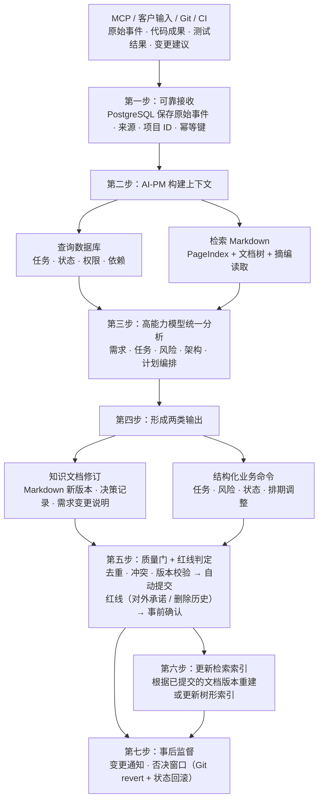
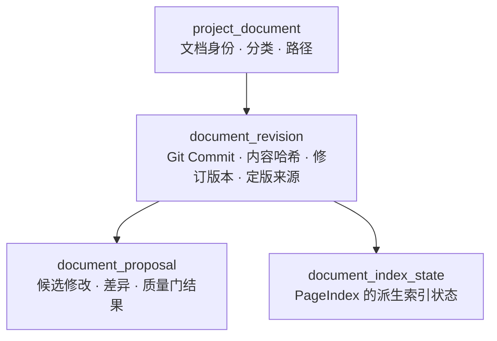

# AI-PM 的 Markdown 知识空间与 PageIndex 检索层设计（V2 · AI 主导）

> 关联文档：[docs/architecture/ai-pm-architecture-principles.md](docs/architecture/ai-pm-architecture-principles.md)（AI-PM 总体架构，V2 · AI 主导）。
> 本文档记录项目知识空间的存储形态：AI-PM 用 Markdown 维护需求、变更、决策等长期知识，落库前先经过可靠接收，检索层采用 [VectifyAI/PageIndex](https://github.com/VectifyAI/PageIndex) 的树形索引模式。
>
> V2 对齐说明：主架构稿的信任模型已翻转为「AI 默认执行 + 红线事前确认 + 事后监督」。对知识空间的影响是——AI-PM 从「Markdown 草稿维护者」升级为「知识正文的主维护者与定版者」；写入前的检查从「审批关卡」变为「质量门」（去重、冲突、版本校验），红线类知识动作（对外承诺、删除历史）仍需人类确认。

---

## 〇、原始需求

> ai 管理读 markdown 比读数据库是不是更好呢？ai 负责人自己维护一套 markdown 文档，一般是需求，需求变更，一些决策，决策的过程之类的，不是全部管，但是需要从中提取关键信息的，可以写 markdown。我是计划采用 github <https://github.com/VectifyAI/PageIndex> 那种模式。我们落盘的东西先经过它，然后它先写 md 文件，然后新数据库。

---

## 一、先核实 PageIndex 在这个架构里的实际作用

PageIndex 很适合承担项目知识的检索工作，但有一个需要调整的地方：**它是文档索引与检索引擎，不是 Markdown 创作引擎，也不是项目数据库。**

根据它的官方介绍，PageIndex 的核心工作是先为文档生成树形索引，再通过模型推理检索相关内容；它特别强调保留文档结构以及检索结果的可追溯性。

还有一个与技术选型直接相关的限制：截至目前的官方 SDK 文档，Local 模式明确支持 PDF，Cloud 模式列出的文件格式是 PDF、PPTX 和 Word，**并没有明确列出 Markdown 原生支持**。

因此各组件的定位如下：

| 组件 | 应该负责什么 | 不应该负责什么 |
| --- | --- | --- |
| Markdown + Git | 保存项目知识、需求描述、决策过程及历史版本 | 承担所有实时任务状态和事务 |
| PostgreSQL | 身份、权限、任务状态、需求版本元数据、事件、关联关系与人类干预记录 | 把所有项目知识都压成字段 |
| AI-PM | 理解 MCP 信息，提取知识，**直接维护并定版**知识文档，同时产生结构化业务命令 | 触碰红线（对外承诺、删除历史、改写已签署版本）而不经确认 |
| PageIndex | 为长文档建立结构化检索入口，帮助 AI 找到相关内容 | 决定哪个版本是当前权威版本 |
| Markdown Index Adapter | 将 Markdown 转换为可检索的树结构，或适配 PageIndex 支持的输入方式 | 成为另一份权威数据源 |

官方仓库：<https://github.com/VectifyAI/PageIndex>。

因此，**不建议让所有写入都先经过 PageIndex**。先可靠接收数据，再由 AI-PM 整理并提交 Markdown，同时通过 PageIndex 检索已有知识，才是更稳妥的做法。

---

## 二、推荐的完整数据流



这里有三个容易忽略的设计点。

第一，数据库首先保存的是原始事件和工作流状态，而不是要求 AI 立刻决定一切应该归档到哪里。这样即使模型暂时不可用，也不会丢失开发者提交的信息。

第二，PageIndex 索引是**可重建的数据**。Markdown 文档发生变化后，不要假设旧索引会自动同步；应由单独的索引队列跟踪文档版本和内容哈希，确保 AI 不会在不知情的情况下读取旧版本。

第三（V2 新增），知识文档的提交走的是与业务命令相同的信任模型：质量门通过即自动提交并推送变更通知，人类通过否决窗口回滚（Git revert + 修订状态回退），而不是事前逐篇审批。AI 是知识空间的主维护者，这正是「AI 负责人维护一套 markdown」在 V2 下的完整含义。

---

## 三、Markdown 是 AI-PM 的项目知识空间

建议给每个项目建立一套有明确分类的知识目录。AI-PM 是主要维护者与定版者；项目经理、产品负责人仍可通过同一工作流提交修改（他们的修改同样留痕、同样可被审计）。

例如：

```text
projects/
└── MAP-001/
    ├── README.md
    ├── project-charter.md
    ├── glossary.md
    │
    ├── requirements/
    │   ├── REQ-001.md
    │   ├── REQ-002.md
    │   └── changes/
    │       ├── CR-001.md
    │       └── CR-002.md
    │
    ├── decisions/
    │   ├── ADR-001.md
    │   └── ADR-002.md
    │
    ├── architecture/
    │   ├── overview.md
    │   ├── module-boundaries.md
    │   └── constraints.md
    │
    ├── planning/
    │   ├── roadmap.md
    │   └── milestone-rationale.md
    │
    ├── knowledge/
    │   ├── confirmed-facts.md
    │   ├── open-questions.md
    │   ├── risks.md
    │   └── lessons-learned.md
    │
    └── ai-pm/
        ├── analysis/
        └── decisions/          ← AI 决策报告与自检结论的归档
```

这个结构并非要求每个项目一开始就有所有文件。空项目可以只创建 README.md、需求目录和架构决策目录，其余根据实际需要生成。

### 哪些内容适合 Markdown？

| 内容 | 推荐保存方式 | 原因 |
| --- | --- | --- |
| 客户原始需求及业务背景 | Markdown / 原始附件 | 保留原话、语境、例子与出处 |
| 正式需求正文 | 版本化 Markdown | 便于阅读、审查、比较和长期维护 |
| 需求变更的原因及影响 | Markdown | 适合说明前因后果和权衡过程 |
| 技术决策与替代方案 | Markdown | 记录为什么这样选择，而不只是选择了什么 |
| 架构约束和项目约定 | Markdown | 适合作为跨任务共享的知识 |
| AI 的决策与分析过程 | 决策报告 Markdown + 结构化记录 | 可审计、可回看；决策报告归档后本身就是监督材料 |
| 正式任务的状态、负责人、截止时间 | 数据库 | 需要精确查询、并发更新和事务 |
| 审批结果、权限、运行队列、人类干预 | 数据库 | 必须受到确定性的业务规则控制 |

**不要把每条聊天消息都塞进项目知识库。** 项目知识库应该是经过筛选和归纳的长期资产，而原始消息、分析历史和正式知识文档需要分开保存。

---

## 四、最重要的设计：一个信息只能有一个权威来源

如果 Markdown 和 PostgreSQL 都完整保存一份需求内容，并且两边都允许修改，系统迟早会出现不一致。

例如：

- REQ-032.md 说地图最大尺寸为 100,000 × 100,000。
- PostgreSQL 中的需求 JSON 仍然保存 10,000 × 10,000。
- PageIndex 的索引还是上一个版本。
- AI-PM 恰好读取了旧索引，于是又生成一份过期的变更建议。

这条原则与自动化级别无关，V2 完整保留，并且因为 AI 写入频率更高而更加吃重。建议明确划分所有权：

### Markdown：需求和知识的权威正文

保存正式需求的文本内容、业务解释、技术决策理由、架构约束和经过确认的项目知识。Git 保存修订历史。AI-PM 是主要写入者，每次修订走质量门自动提交。

### PostgreSQL：业务状态的权威来源

保存需求 ID、当前正式版本引用、任务状态、分配人、审批状态、权限、里程碑日期、项目关联关系，以及红线确认与人类干预记录。

### PageIndex：派生检索索引

保存可重建的文档树和检索定位信息。不是新的权威副本，也不能决定哪个需求版本已经定版。

### 需求内容应该放在哪里？

例如，正式需求 REQ-032 的正文存储在：

```text
projects/MAP-001/requirements/REQ-032.md
```

PostgreSQL 只需要记录：

```json
{
  "requirement_id": "REQ-032",
  "project_id": "MAP-001",
  "current_approved_revision": 3,
  "document_path": "requirements/REQ-032.md",
  "document_commit": "a83f1d7...",
  "content_hash": "sha256:...",
  "status": "approved",
  "approved_by_kind": "ai_pm"
}
```

这里，`current_approved_revision` 和 `status` 是数据库管理的权威状态；需求正文由对应 Git 修订版本提供。V2 语义：`approved_by_kind` 标注定版主体是 AI-PM 还是人类——对外承诺类需求由人类定版（红线），其余默认 AI-PM 定版。上面 JSON 中的提交号和哈希是示例。

当 AI-PM 修改需求时，它生成新文档版本与变更说明，质量门通过后直接提交为新修订版本，同时更新数据库指针——不再生成「等待人类合并」的排队队列。

数据库不必保存一份完整、可独立编辑的正式需求 JSON。如果为了查询或分析而提取了结构化验收条件，应明确标记为**派生数据**，并能追溯回 Markdown 的具体版本和章节。

---

## 五、AI-PM 如何决定是否写入 Markdown

这是「AI 负责人维护一套 Markdown」最关键的部分。

建议把 AI-PM 接收到的信息划分为四种处理结果：

### A. 新增长期知识 —— 质量门通过即自动提交

例如新发现的项目约束、架构风险、开发者确认的技术事实。AI-PM 生成 Markdown 修订，通过质量门（去重、来源、版本检查）后直接提交，并推送变更通知。

### B. 修改现有需求或决策 —— 新版本自动定版，红线除外

生成新修订版本，保留原文、变更理由、来源以及影响分析。质量门通过后直接定版为新版本，旧版本标记 superseded 但内容不可改写。涉及对外承诺的需求签署、删除历史文档、改写已交付客户的版本，属于红线，转事前确认。

### C. 结构化的业务状态 —— 走业务命令通道

例如任务已进入代码审核、里程碑延期、某个任务关联新需求。AI-PM 生成业务命令，经命令通道执行（遵循主架构稿的自检闸与红线规则）。

### D. 不需要沉淀的临时信息 —— 只保留事件记录

例如普通进度说明、一次性查询、无新增知识的重复提交。保留必要的审计和原始记录即可，不必反复写入项目知识。

特别建议让 AI-PM 判断的是「**有没有新的、值得长期保留的信息**」，而不是每次收到事件都重写整个 README.md 或 project-context.md。

这能显著降低文档重复、过度总结、旧事实被新摘要覆盖等问题。

### 一个具体例子

开发 Agent 通过 MCP 提交：

> 目前地图的远景层和近景层共享同一套缓存接口，远景层在快速缩放时出现重复加载。

AI-PM 应该先读取：

- 现有缓存架构决策。
- 相关任务状态与测试结果。
- 最近是否已经有人报告过同一问题。
- 当前需求中对缩放流畅度的要求。

然后做出判断：

1. 这是一个新的风险观察，值得保存——直接写入 risks.md 并提交。
2. 关联已有地图缓存任务，直接补上关联关系（业务命令）。
3. 目前没有足够证据证明架构决策错误——不修改 ADR。
4. 把「远景层快速缩放重复加载」作为已确认的技术观察补入 confirmed-facts.md（附来源事件），不修改正式需求基线。

如果之后经验证确定这是架构缺陷，AI-PM 直接生成 ADR 修订版本或独立的新 ADR，走质量门定版；若该决策涉及对客户的性能承诺，则走红线确认。

这样 Markdown 才会逐渐成为项目的知识资产，而不是不断增长的 AI 聊天日志。

---

## 六、需求与决策文档应该有固定模板

Markdown 不意味着随意写作。为了让 AI-PM 能准确维护和检索，最好对重要文档定义模板、元数据和章节结构。

### 6.1 需求文件模板

`requirements/REQ-032.md`：

```md
---
id: REQ-032
type: requirement
project: MAP-001
tags:
  - rendering
  - performance
source_events:
  - EVT-1028
---

# 支持超大世界地图的多级 LOD 渲染

## 1. 业务目标

允许用户在大范围地图中查看整体地形，
并在放大时逐步查看更详细的内容。

## 2. 功能要求

- 支持按视野加载地图分块。
- 支持多级细节表示。
- 地图缩放时不能出现明显的加载抖动。

## 3. 非功能要求

- 具体帧率和内存目标尚待确认。

## 4. 验收条件

- [ ] 不同缩放级别能够切换对应的地图表示。
- [ ] 加载和卸载地图分块不会导致数据丢失。
- [ ] 通过约定的性能测试。

## 5. 待确认问题

- 整体地图大小的正式上限是什么？
- 性能验收目标是多少？

## 6. 关联对象

- TASK-128
- ADR-008

## 7. 变更说明

本版本建立在已定版的需求基线上。
```

建议 front matter 只放稳定标识、分类、标签和来源等辅助元数据。当前定版状态、定版主体、正式基线版本等权威字段由数据库维护，避免两个地方都能修改。

模板还应明确区分客户已经表达的内容、AI 提出的假设和已经被确认的要求——V2 中「确认者」经常是 AI-PM 自己的验证流程（如测试证据、来源核对），模板里要给这三类信息各自的位置。

### 6.2 架构决策记录 ADR 模板

`decisions/ADR-008.md`：

```md
---
id: ADR-008
type: architecture_decision
project: MAP-001
related_requirements:
  - REQ-032
---

# ADR-008：采用地图分块与多级 LOD

## 背景

大型世界地图需要在不同缩放级别呈现不同细节，
并控制可见内容和资源占用。

## 需要解决的问题

现有的单一细节层级无法同时满足远景显示
与近景编辑的需求。

## 候选方案

### 方案 A：仅缩放原始地图

优点：实现简单。

缺点：远景下细节密集，资源效率较差。

### 方案 B：分块加载 + 多级 LOD

优点：可按视野和缩放层级管理资源。

缺点：需要处理层级转换、缓存和边界一致性。

## 决策

当前采用方案 B。

本章节是否构成已定版的架构决策，
以数据库中的定版记录为准。

## 决策依据

- REQ-032
- TASK-128
- 相关性能测试报告

## 后果与风险

- 必须明确分块边界的处理规则。
- 需要设计缓存的生命周期。
- 需要覆盖多个缩放级别的测试。

## 历史变更

后续调整记录新版本和变更理由，旧版本保留不改写。
```

注意，上述内容是示范模板，不表示这个技术决策已经在项目中定版。

决策文档里最有价值的并不只是「最后选择了什么」，还包括候选方案、未选择它们的原因、依据、假设和后果。这也是普通任务数据库很难自然表达的内容。

---

## 七、怎样把 Markdown、数据库和 PageIndex 关联起来

建议新增一个知识文档管理子系统，但不要把它做成另一套独立的项目管理数据库。

### 7.1 新增的核心表

在 PostgreSQL 设计中，可以增加以下表：

| 表 | 作用 |
| --- | --- |
| project_document | 记录每个知识文档的 ID、项目、路径和文档类型 |
| document_revision | 记录每个 Markdown 修订的 Git Commit、内容哈希、来源和状态 |
| document_proposal | 记录 AI-PM 生成的 Markdown 修改及其质量门结果（默认自动合并，红线类转确认） |
| document_index_state | 记录 PageIndex 索引对应的文档版本及索引处理状态 |
| knowledge_reference | 记录决策结论引用了哪些文档、章节和版本 |

可以理解为：



### 7.2 推荐的表结构

```sql
CREATE TABLE ai.project_document (
    id UUID PRIMARY KEY DEFAULT gen_random_uuid(),
    project_id UUID NOT NULL REFERENCES core.project(id),

    doc_key TEXT NOT NULL,
    doc_type TEXT NOT NULL,
    canonical_path TEXT NOT NULL,
    canonical_format TEXT NOT NULL DEFAULT 'markdown',

    lifecycle_state TEXT NOT NULL DEFAULT 'active',
    created_at TIMESTAMPTZ NOT NULL DEFAULT now(),

    UNIQUE(project_id, doc_key),
    UNIQUE(project_id, canonical_path),
    UNIQUE(project_id, id)
);

CREATE TABLE ai.document_revision (
    id UUID PRIMARY KEY DEFAULT gen_random_uuid(),
    project_id UUID NOT NULL,
    document_id UUID NOT NULL,

    revision_no BIGINT NOT NULL,
    git_commit_sha TEXT,
    content_hash TEXT NOT NULL,
    status TEXT NOT NULL DEFAULT 'draft',

    source_event_id UUID,
    analysis_run_id UUID,
    change_summary TEXT,

    redline_confirmed_by UUID
        REFERENCES core.principal(id),

    created_at TIMESTAMPTZ NOT NULL DEFAULT now(),
    created_by UUID NOT NULL REFERENCES core.principal(id),

    UNIQUE(document_id, revision_no),
    UNIQUE(document_id, id),

    FOREIGN KEY (project_id, document_id)
        REFERENCES ai.project_document(project_id, id),

    FOREIGN KEY (project_id, source_event_id)
        REFERENCES integration.inbound_event(project_id, id),

    FOREIGN KEY (project_id, analysis_run_id)
        REFERENCES ai.analysis_run(project_id, id)
);

CREATE TABLE ai.document_index_state (
    id UUID PRIMARY KEY DEFAULT gen_random_uuid(),
    project_id UUID NOT NULL,
    document_revision_id UUID NOT NULL,

    provider TEXT NOT NULL,
    external_document_id TEXT,
    indexed_content_hash TEXT,
    index_version TEXT,

    status TEXT NOT NULL DEFAULT 'pending',
    last_error TEXT,
    indexed_at TIMESTAMPTZ,

    FOREIGN KEY (document_revision_id)
        REFERENCES ai.document_revision(id),

    UNIQUE(document_revision_id, provider)
);
```

这是一份核心结构示例，生产环境还需要加入文档提案细节、质量门结果、相关索引以及对应的 CHECK 约束。

这里特别注意四个字段：

- `canonical_path`：真正的 Markdown 文件位置。
- `content_hash`：确认某个修订对应的实际内容。
- `indexed_content_hash`：确认 PageIndex 处理的是哪一版内容。
- `redline_confirmed_by`（V2 新增）：该修订若属红线（对外承诺、删除历史），记录事前确认的人类主体；常规修订此字段为空，`created_by` 通常就是 AI-PM。

当两个哈希不匹配时，系统就知道检索索引可能过时，不能把旧检索结果直接当成当前事实。

另外，`document_revision.status` 用于修订生命周期（草稿、已发布、已拒绝、已回滚）。正式需求是否定版，仍以数据库中的定版记录为准。**这两个状态不能混为一谈。** V2 中修订默认路径是 draft → published（自动），被否决窗口回滚的修订标记 rolled_back 并触发 Git revert。

---

## 八、Markdown 文件究竟应该怎样保存？

推荐使用一个专用的 Git 知识仓库，让每个项目有独立目录，文档修订由 Git 负责追踪。

例如：

```text
pm-knowledge/
├── projects/
│   ├── MAP-001/
│   │   ├── requirements/
│   │   ├── decisions/
│   │   ├── architecture/
│   │   └── knowledge/
│   └── MAP-002/
│       ├── requirements/
│       ├── decisions/
│       └── knowledge/
└── templates/
    ├── requirement.md
    ├── change-request.md
    └── adr.md
```

### 推荐的写入方式

AI-PM 是主维护者，但仍不应直接在正式分支上随手编辑。V2 的三种写入路径：

1. **常规知识维护（默认路径）**：AI-PM 生成修订，通过质量门（去重、来源、版本、冲突检查）后自动提交到正式知识库，推送变更通知。
2. **红线类修改**：涉及对外承诺、删除历史文档、改写已交付版本的内容，生成修改提案等待人类事前确认，确认后合并。
3. **开发 Agent 提供的未经确认信息**：先保存在分析记录或草稿文件里。只有 AI-PM 验证其具备长期价值，才纳入正式知识文档。

这意味着每次 Markdown 变化都有：

- 原始来源事件。
- 修改前的内容哈希。
- AI 分析运行 ID 与自检结论。
- 修改差异和修改理由。
- 执行主体（通常是 AI-PM 的 principal）。
- 红线确认记录（如适用）。
- 最终 Git Commit。

Git 能提供可靠的内容差异和历史版本，但不会自动保证 PostgreSQL 的业务状态与 Git 同步。因此需要专门的提交工作流。

### Git 与数据库如何避免不一致？

**不要试图用一个跨 Git 和 PostgreSQL 的数据库事务来解决这个问题。它们不是同一个事务资源。**

建议使用一个可恢复的文档发布状态机：

```text
draft → quality_gates_passed → commit_pending → committed → projection_synced → indexed
                ↘ redline_pending → confirmed ↗
                        ↘ rejected
rolled_back（否决窗口或人工回滚后进入，触发 Git revert）
```

实际可以把这几个状态保存在工作流记录中，而不必在每张表里重复一遍。

如果 Git Commit 成功，但数据库暂时不可用：

1. 保留 commit_pending 的工作流记录。
2. 后续重试时识别已存在的 Commit。
3. 补齐数据库的版本引用和业务状态。
4. 再由索引队列处理 PageIndex 更新。

如果索引失败，文档仍然可以正常阅读；重建索引不应该影响正式需求或任务状态。

如果人类在否决窗口内否决了一次文档修订：系统执行 Git revert 生成反向提交，修订状态置为 rolled_back，派生的数据库指针回退到上一修订，索引队列重新跟进。整个回滚本身也留审计——这与主架构稿的补偿命令机制完全同构。

---

## 九、如何实际接入 PageIndex

这是实现时最需要做一次技术验证的部分。

因为官方文档目前没有明确把 Markdown 列为 SDK 支持的输入文件类型，不能假定只要把 `.md` 路径传给 `submit_document()` 就能工作。

建议抽象一个内部接口：

```rust
use async_trait::async_trait;
use serde_json::Value;

#[async_trait]
pub trait KnowledgeIndexer: Send + Sync {
    async fn index_document(
        &self,
        path: &str,
        content_hash: &str,
    ) -> anyhow::Result<IndexReference>;

    async fn search(
        &self,
        project_id: &str,
        question: &str,
    ) -> anyhow::Result<Vec<RetrievedSection>>;
}

pub struct IndexReference {
    pub document_id: String,
    pub content_hash: String,
}

pub struct RetrievedSection {
    pub document_path: String,
    pub title: String,
    pub content: String,
    pub revision_hash: String,
    pub locator: Value,
}
```

这是接口示意，具体字段需要根据选用的 PageIndex SDK 或 API 适配。

### 推荐的三条实现路径

**A. 先自建 Markdown 树索引适配层（推荐先实现）**

直接解析 Markdown 标题、front matter、链接和章节关系，建立文档树。由高能力模型根据树与章节内容完成推理式检索。这样可以最先验证知识管理流程，不被文件格式限制卡住。

**B. 适配 PageIndex 支持的文档输入**

可以评估把 Markdown 渲染成 PDF 等受支持格式后建立索引。但这是适配方案，会增加格式转换、章节定位和重新索引的复杂性。

**C. 使用 PageIndex 提供的检索服务**

先验证所选服务版本是否直接支持你的 Markdown 输入形式、文件组织、增量更新和项目隔离，再将它接入 KnowledgeIndexer，不把外部服务 API 直接散布在业务代码中。

对于本 PM 软件，优先考虑 A 的可控性，同时保持 B 或 C 可替换。

原因是这里的文档不是 PDF 报告，而是持续被 AI-PM 增量编辑的结构化 Markdown。既然已明确采用高能力模型做分析，就没有必要为了接入一种检索实现而改变权威文档的格式。

另外，由于平台存储客户需求和架构信息，若使用 PageIndex Cloud 或其他外部服务，还需要单独评估客户数据是否允许离开本地环境。外部索引应遵循与原始 Markdown 相同的项目权限和数据保留政策。

---

## 十、AI-PM 每次分析时，怎样读取 Markdown？

建议实现一个统一的 ProjectKnowledgeService，不要让五个 Skills 分别自行搜索文件。

例如，开发 Agent 提交了 TASK-128 的技术方案，AI-PM 可以这样工作：

1. 从数据库读取 TASK-128 当前状态、关联需求和任务依赖。
2. 从 Markdown 知识库检索与 LOD、缓存、地图分块有关的知识。
3. 获取具体的需求修订版本和 ADR 正文，而不只是读取摘要。
4. 验证索引对应的内容哈希；如索引过期，回退到直接读取权威文件。
5. 把检索结果、来源路径、版本和章节定位交给高能力模型。
6. 要求模型输出结论和证据引用，明确区分事实、推断和待确认问题。
7. 保存决策结果及引用关系，自动执行知识修订与结构化业务命令。

例如最终的 AI 决策记录：

```md
# 决策：TASK-128 的 LOD 技术方案

## 决策结论

新方案与现有地图缓存职责重叠，
驳回当前方案，要求补充兼容性说明。
已调整任务依赖，新增调研阻塞。

## 证据

- requirements/REQ-032.md
  - 第 3 节：性能要求
- decisions/ADR-008.md
  - 决策依据与架构后果
- knowledge/confirmed-facts.md
  - 现有缓存模块的职责

## 确认程度

- 已确认：现有项目有缓存模块。
- 推断：新方案可能引入重复职责。
- 待确认：是否能够复用现有缓存实现。

## 已执行的操作

- 新增风险观察（risks.md）。
- TASK-128 状态置为待补充，生成补充问题。
- TASK-128 新增对缓存调研任务的依赖。
- 里程碑 M2 计划微调，进入否决窗口。

## 未触碰的红线

- 不修改对外承诺，不发布，不签验收。
```

上述文件路径是示例。实际引用最好附带 Git Commit、文档修订 ID 和具体标题或行范围，保证日后仍能找到当时的证据。

这里要强调：**PageIndex 帮助找到证据，AI-PM 负责理解证据并做出决策，红线清单决定哪些修改必须先问人，否决窗口保证错了能撤。** 不要把检索排名当成事实可靠性的证明。

---

## 十一、怎样防止 Markdown 知识库越变越乱？

V2 中写入没有人工审批把关，这一节从「好习惯」升级为**必守的质量门**：它承担了原审批流程的防错职责。

在需求分析、任务分析、风险识别、架构一致性和计划编排之外，另设一套基础的文档维护规则，不一定需要单独使用模型。

每次准备写入 Markdown 前，先做：

| 检查 | 目的 |
| --- | --- |
| 重复检查 | 相同事实是否已经存在于其他文档 |
| 来源检查 | 新信息来自客户、开发 Agent、测试还是 AI 推断 |
| 版本检查 | 修改基于的文档版本是否仍然有效 |
| 冲突检查 | 新结论是否与正式需求或已定版的 ADR 冲突 |
| 归档检查 | 内容应进入正式知识、分析记录还是仅保留原始事件 |
| 引用检查 | 是否保留了原始事件和具体文档的引用 |
| 红线检查 | 是否涉及对外承诺、删除历史或已交付版本改写 |
| 索引检查 | 修改后是否需要重建 PageIndex 索引 |

建议文档发布也遵循幂等原则。同一份提案重复执行，不应该生成多份重复内容；内容没有变化时，不应无意义地产生新版本。

对项目知识还可以设置生命周期：

- 草稿：AI 或开发者提出，未经确认。
- 已确认：有足够证据支持，可作为项目知识引用。
- 已定版：适用于需要固定基线的需求、架构决策（V2 中定版者通常是 AI-PM，红线类是人类）。
- 已取代：被新版本替代，但仍保留历史记录。
- 已回滚：被否决窗口或人工回滚，保留原因与决策记录。
- 已归档：不再作为当前上下文重点，但可追溯。

这些生命周期保存在数据库中，由对应的知识类型决定使用哪些状态。不要要求所有 Markdown 文件都使用同一套生命周期规则。

---

## 十二、最终建议：V1 就按这个架构实施

把 AI-PM 架构升级为以下组合：

**Markdown + Git**

项目知识、需求正文、需求变更解释、决策过程、架构约束及历史文档版本。AI-PM 是主维护者与定版者。

**PostgreSQL**

项目管理、任务与里程碑状态、定版元数据、原始事件、AI 决策及审计、红线确认与人类干预。

**PageIndex + Markdown Index Adapter**

负责文档树索引、相关章节检索和证据定位；可替换、可重建，不保存第二份权威业务状态。

**高能力模型驱动的 AI-PM**

理解 MCP 输入、提取关键信息、维护知识、识别冲突、执行决策；默认自动执行，红线事前确认，全程可回滚。

建议实施时按以下顺序：

1. 首先建立 Git 知识仓库、Markdown 模板和项目文档管理表。
2. 让 MCP 入站事件先可靠写入 PostgreSQL，再由 AI-PM 生成 Markdown 修订和结构化命令。
3. 实现质量门、Markdown 版本管理、Git Commit 与数据库状态的可恢复同步，以及否决回滚（Git revert）路径。
4. 用 KnowledgeIndexer 抽象检索能力，再验证 PageIndex 对 Markdown 输入场景的适配方式。
5. 将文档检索、数据库查询和证据校验整合到 AI-PM 的统一上下文构建器中。

核心建议是：**Markdown-first 指项目知识的维护方式，而不是所有数据的接收顺序；AI 是这套知识的主维护者，质量门与红线取代了事前审批。**

目标是让 AI 负责人像真正的项目负责人一样，持续维护一套对人和 AI 都有价值的项目知识，并且每一次维护都可追溯、可否决、可回滚。只要把 Markdown 的版本权威性、数据库的事务权威性、PageIndex 的检索职责划分清楚，它就能自然融入主架构稿 V2 的命令通道、自检闸、红线清单与事后监督体系。
