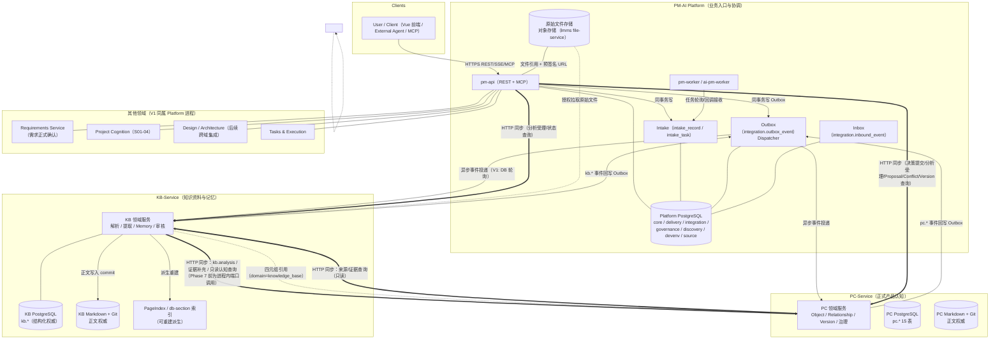
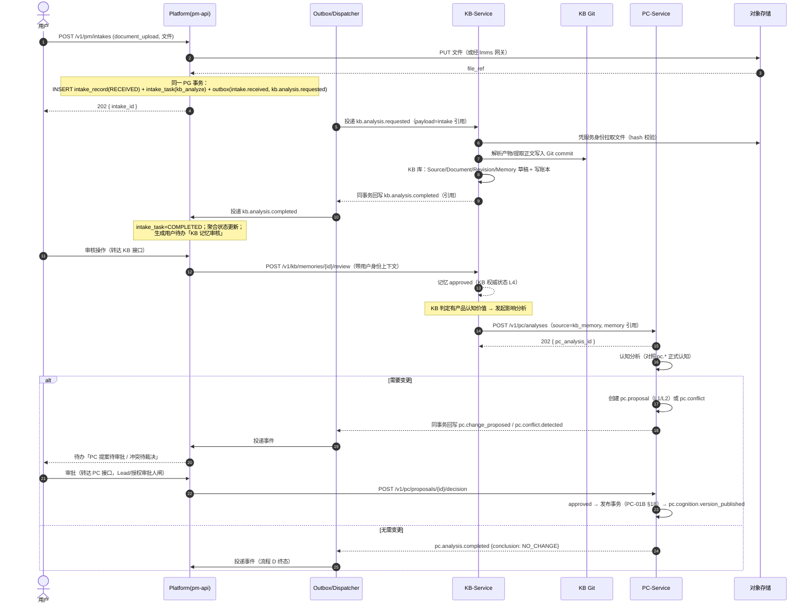
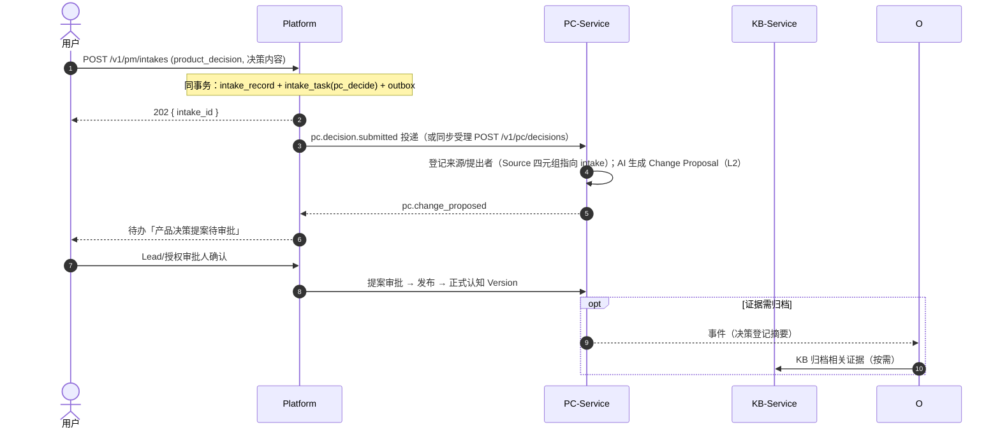
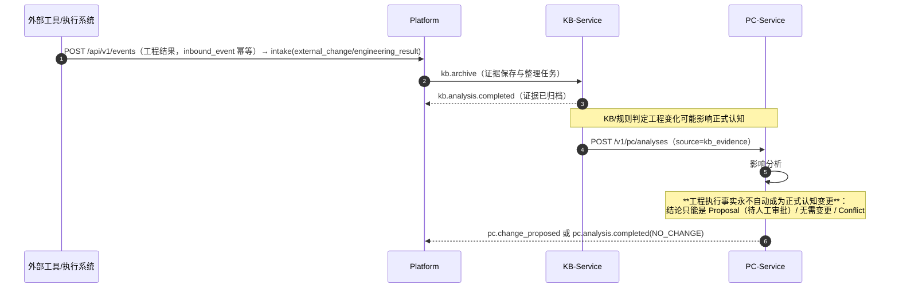
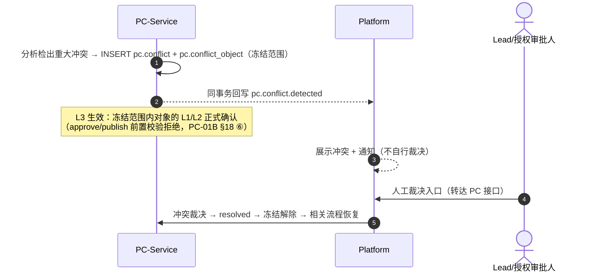
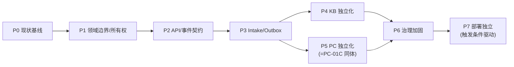

# KB-Service / PC-Service 独立服务化总体架构设计 V1.0

| 项 | 值 |
|---|---|
| 文档版本 | V1.0 |
| 状态 | 总体架构设计草案，待评审与正式裁决（全部 ADR 为建议，未获用户批准前不得实施） |
| 日期 | 2026-11-07 |
| 任务类型 | 总体架构设计（纯文档交付；未修改任何业务代码、数据库、Migration、PC-01A/01B 文档） |
| 现状调查基线 | 仓库 HEAD `36801388` 后的当前工作区（只读调查）；PC-01A 评审基线 HEAD `36801388` 代码事实沿用有效 |
| 上游输入 | ① KB/PC 独立服务化总体架构设计任务书 V1.0；② Q-PC-01～Q-PC-13 产品裁决；③ PC-01A V1.1（`pc-phase1-current-review-and-plan-v1.1.md`）；④ PC-01B V1.0（含 V1.1 评审修订，`pc-01b-data-model-and-database-design-v1.0.md`）；⑤ PC Gate 0 Schema 核查；⑥ PC 阶段 1 领域模型基线 V1.0；⑦ KB 定义与总体架构 V1.0（`product-cognition-knowledge-base-definition-architecture-v1.md`）；⑧ 当前代码与数据库事实（只读核实） |
| 下游 | 总体架构评审 → 架构裁决 → 详细设计（Intake/Outbox 实施设计、服务认证设计、KB schema 归属设计） |

**标注体系**（沿用 PC-01A 口径）：〔裁决〕= 已确认产品/架构裁决或任务书最高优先级约束；〔事实〕= 代码/Schema 证据；〔推导〕= 本任务技术设计建议（非裁决，待评审）；〔待决〕= 待裁决事项；〔待验证〕= 尚未从代码/配置证实，不得当作已实现。

**本文与既有文档的关系**：本文不修改、不推翻 PC-01A V1.1 与 PC-01B 的任何裁决；PC 侧领域与数据模型以 PC-01A/01B 为准，本文只回答「服务化边界如何叠加在其上」。与 PC-01A/01B 冲突之处一律以 PC-01A/01B 为准并视为本文缺陷。

---

# 1. 执行摘要

| # | 结论 | 性质 |
|---|---|---|
| 1 | **三服务边界确立**：PM-AI Platform（业务接收与流程协调）、KB-Service（知识资料与记忆）、PC-Service（正式产品认知）为三个并列一级服务；领域独立（独立模型/数据所有权/业务规则/API/版本治理/权限边界）为硬性架构要求 | 〔裁决〕任务书 §三/§四 |
| 2 | **部署策略推荐方案 A（先领域独立，后部署独立）**：先以 crate 边界 + 数据所有权 + 服务契约（API/事件）建立严格服务边界，物理拆分（独立进程/数据库/发布）作为后续能力按触发条件实施；禁止因部署暂不分拆而共享业务表或跨写数据 | 〔推导〕ADR-01/ADR-10 |
| 3 | **现状关键事实**：当前系统为 Cargo workspace 模块化单体（pm-api / pm-worker / ai-pm-worker 三进程共享单一 PostgreSQL），无 MQ；Transactional Outbox + Inbox 去重 + SKIP LOCKED 租约消费 + 死信重放已完整实现；KB 文档域（Git 正文 + PG 状态 + 写幂等账本）已落地；PC 目标实体零实现（现有 cognition/baseline 属 S01-04/05 技术认知域）；PC-01B 的 pc schema 15 表设计完成、Migration 未实施 | 〔事实〕§4 |
| 4 | **协作模式**：Platform 编排 Intake 分发与状态聚合；KB→PC 点对点协作（KB 审核通过后按需发起影响分析）；全程事件可观测。同步走服务端口（V1 进程内调用，物理拆分后替换为 HTTP，契约不变），异步走 Transactional Outbox 事件 | 〔推导〕ADR-02/ADR-03 |
| 5 | **数据所有权**：三服务数据物理边界 = schema 集合（Platform: core/delivery/integration/governance/discovery/devenv/source；KB: kb.*（新）与 ai 文档域七表逻辑归属；PC: pc.* 15 表）；Markdown+Git 为正文唯一权威、PG 为结构化权威、PageIndex 为可重建派生索引——三权威分工在三个服务内一致成立 | 〔裁决〕+〔推导〕ADR-06 |
| 6 | **统一 Intake 模型**：Platform 持有 intake_record + intake_task，八类输入路由到 KB/PC 或仅登记；Intake 接收状态、单服务任务状态、整体流程状态、人工审批状态、正式知识/认知状态五层状态严格分离 | 〔推导〕§9/§10 |
| 7 | **可靠性**：Transactional Outbox + Inbox 幂等 + Idempotency-Key + 指数退避 + DLQ + 人工 replay；「至少一次投递 ≠ 恰好一次执行」，业务幂等由 KB 写账本（现有 knowledge_write_operation）与 PC 写账本（PC-01B §12 write_operation）保证 | 〔推导〕§14 |
| 8 | **Git-PG 一致性**：统一采用「写幂等账本 + 状态机 + reconcile 对账」协议；PC 侧以 PC-01B §12 为基线（零修改），KB 侧同构推广（现状实现与该协议天然同构） | 〔推导〕§15 / ADR-09 |
| 9 | **与 PC-01A/01B 衔接结论**：PC-01B pc schema 15 表、双维度 Version Member、Relationship 端点闭合、发布事务、L0-L3 治理全部保留且不受服务化削弱；服务化只叠加「数据所有权归 PC-Service + 跨服务引用契约」两层，无强制调整项 | 〔推导〕§19 |
| 10 | **实施路径**：Phase 0 契约冻结 → Phase 1 数据所有权与 schema 归属 → Phase 2 API/事件契约 → Phase 3 Intake/Outbox 落地 → Phase 4/5 KB/PC 领域补全（对齐 PC-01C~01F 台账）→ Phase 6 治理加固（DB role 隔离、服务认证、可观测）→ Phase 7 物理拆分（触发条件驱动，非时间驱动） | 〔推导〕§20 |

---

# 2. 设计背景和目标

## 2.1 背景

PM-AI 正在建设 Knowledge Base（KB）与 Product Cognition（PC）两个并列一级知识能力。既有裁决（Q-PC-01～13、PC-01A V1.1、PC-01B）已明确两者的领域权威、版本模型与治理规则。随着系统发展，需要进一步明确 KB 与 PC 的**服务化边界**：PM-AI Platform 作为业务入口与项目管理平台，不应成为 KB/PC 的知识正文权威；KB 与 PC 需要成为可独立部署、独立演进、独立扩容的服务。

## 2.2 目标

本设计必须回答任务书 §二 的九个问题：

| # | 问题 | 本文落点 |
|---|---|---|
| 1 | Platform / KB-Service / PC-Service 分别负责什么 | §6 |
| 2 | 每个服务拥有什么数据和权威 | §7/§8 |
| 3 | 一份资料从提交到 KB 分析、PC 分析、人工确认的完整流程 | §11（流程 A～E） |
| 4 | 服务间通过什么接口和事件交互 | §12/§13 |
| 5 | 异步任务如何不丢失、不重复、不跨项目污染 | §14/§16 |
| 6 | 服务失败、重试、超时和恢复 | §14/§17 |
| 7 | KB/PC 如何独立部署、升级和扩容 | §18 |
| 8 | PC-01A/01B 既有设计如何与服务化兼容 | §19 |
| 9 | 后续实施如何分阶段 | §20 |

## 2.3 明确不做的（任务书 §十六 禁令承接）

本任务为纯架构设计：不修改业务代码、不修改数据库、不新建或执行 Migration、不改写 PC-01A/01B、不设计历史数据迁移/回填/双写、不以共享数据库代替服务接口、不改变 Q-PC-01～13。本文档中所有落库/建服务的设计均为**后续实施任务的建议输入**，不构成实施授权。

---

# 3. 既有架构决策与不可变约束

以下约束为最高优先级，本文全部设计以其为前提，不重新讨论。

## 3.1 领域权威（〔裁决〕）

| 领域 | 权威职责 |
|---|---|
| PM-AI Platform / Project Management | Team、Project、Project Goal、项目管理、业务流程协调 |
| KB | 原始资料、文档解析、知识提取、Shallow/Deep Memory、来源与证据、浅层记忆审核及版本、来源-记忆追溯 |
| PC | Product Vision、产品业务领域、能力/模块/Feature、产品角色、场景与流程、页面与交互、业务对象与规则、正式产品决策、认知对象及关系、正式认知版本、冲突与变更治理 |
| Requirements | 需求正文、需求生命周期、需求正式确认（唯一责任方） |
| Design / Architecture | Design、Design Revision、ADR 正文与审批 |
| Tasks & Execution | 任务、执行过程、执行记录 |
| Project Cognition（S01-04） | 技术架构、技术约定、仓库结构、技术实现约束 |
| Project Baseline（S01-05） | 项目初始化与项目基线 |
| Product Reality / Engineering | 代码、测试、部署、发布等工程实际证据 |

核心原则：**KB 知道团队有哪些资料、讨论和证据；PC 管理团队最终确认了什么产品认知。KB 审核通过 ≠ PC 正式确认；PC 分析完成 ≠ 正式认知改变。**

补充硬约束：Project Goal 属项目管理领域，PC 不直接修改 Goal；Product Vision 属 PC；Product Plan 不属于 PC（Q-PC-13），PC 只做影响分析；Roadmap 边界未定，本文不裁决；PC 不直接审批 Requirement；Requirements 统一服务是需求正式确认唯一责任方。

## 3.2 正文与数据库权威（〔裁决〕）

| 存储/能力 | 权威职责 |
|---|---|
| Markdown + Git | 知识正文的唯一权威存储 |
| PostgreSQL | 身份、状态、权限、版本引用、审批、状态机、审计、事件等结构化权威 |
| PageIndex | 可重建的派生索引，不得成为不可替代的正式内容来源 |

禁止：PG JSONB 正文副本作为内容权威；Platform 数据库成为第二套正文权威；多服务维护同一份正式正文；双写多权威。

## 3.3 PC 治理（〔裁决〕）

L0-L3 变更权限矩阵原样保持；V1 审批人同权（Lead 与授权审批人）；普通成员无自动审批权；正式认知变更必须人工确认、版本化、审计；Proposal/Approval 复用既有治理机制（PC-01B 已裁决 PC 专属 pc.proposal/pc.approval 结构，八项技术原则）；AI 不得绕过人工审批。

## 3.4 零历史数据迁移（〔裁决〕任务书 + AGENTS.md）

新项目无存量数据负担：任何设计不得引入迁移脚本、兼容分支、双写、回退开关。服务化改造同样适用——**服务边界的建立采取「直接改契约 / 直接重建」方式，不设计过渡层**。PC-01A 的零迁移硬边界六条对服务化同样有效。

---

# 4. 当前系统现状调查

> 调查方法：两个并行代码勘察（服务架构/KB/异步/PageIndex/文件存储 + PC/Schema/认证/审计/领域/前端）+ 既有设计文档研读。每项标注实现程度。代码证据均给出 `file:line`。

## 4.1 总体架构现状

| 调查项 | 结论 | 实现程度 | 证据 |
|---|---|---|---|
| 进程形态 | Cargo workspace 多进程单体：`pm-api`（axum REST+MCP）、`pm-worker`（outbox 消费）、`ai-pm-worker`（六条 tokio 轮询循环），共享单一 PostgreSQL | 已实现 | `Cargo.toml:3-67`、`apps/pm-api/src/main.rs:14-86`、`apps/ai-pm-worker/src/main.rs:34-218` |
| HTTP 框架 | axum 0.8 + tokio + sqlx 0.8（禁 `query!` 宏）+ rmcp 3.8（MCP 嵌套 `/mcp`，19 工具） | 已实现 | `Cargo.toml:32-67` |
| 分层 | handler（apps/pm-api）→ application（crates/pm-application，54 文件）→ domain（crates/pm-domain）/ infrastructure（crates/pm-infrastructure）；无独立 repository 层，sqlx 直写 | 已实现 | `crates/pm-application/src/lib.rs:18-104` |
| 路由 | `build_router()` 单函数逐域 `.merge()`（30+ 子路由模块） | 已实现 | `apps/pm-api/src/routes.rs:166-289` |

## 4.2 KB 现状

| 调查项 | 结论 | 实现程度 | 证据 |
|---|---|---|---|
| KB 实体 | `ai.project_document` / `ai.document_revision`（只存身份/路径/revision_no/**git_commit_sha**/content_hash，无正文列）/ `ai.document_proposal`（八态提案）/ `ai.knowledge_reference` / `ai.document_section_index` / `ai.document_index_state` / `ai.knowledge_write_operation` | 已实现 | `migrations/0006:7-39`、`0014:21-104`、`0024:11-64` |
| KB API | 14 个 handler：documents CRUD/search/proposals/veto/reindex/references/index-state + MCP 5 工具 | 已实现 | `apps/pm-api/src/documents.rs`、`routes.rs:238-287` |
| Markdown+Git | 独立知识根 `AI_PM_KNOWLEDGE_ROOT`（自动 git init+模板）；git CLI 子进程写路径：写文件→`git add`→`git commit`，commit sha 与 content_hash **同事务**入 `ai.document_revision`；历史读 `git show`；否决回滚 `git revert --no-commit` | 已实现 | `crates/pm-application/src/knowledge.rs:129-211,572-598,709-738` |
| 写并发协调 | Project 级 advisory lock + `operation_id` 幂等 + `base_revision` CAS | 已实现 | `knowledge_write_coordinator.rs` |
| Shallow/Deep Memory | 无任何代码实体（全仓 rs/sql 零命中）；仅文档设计（definition-architecture §5.3） | 仅文档设计 | `docs/product-cognition-knowledge-base/...-v1.md:410-442` |
| 知识治理流 | knowledge_proposal（质量门→红线→否决）在 pm-application | 已实现 | `crates/pm-application/src/knowledge_proposal/` |

## 4.3 PC 现状

| 调查项 | 结论 | 实现程度 | 证据 |
|---|---|---|---|
| PC 目标实体 | **零实现**：Vision/Capability/Module/Actor/Scenario/Process/Page/Business Object/Business Rule/Product Decision/Relationship/Revision/Version 等 14 类词边界搜索全 0 命中；无 PC 领域模型、无 PC API、无 PC 前端 | 尚未实现 | PC-01A V1.1 §3（评审基线 `36801388`） |
| 现有 cognition/baseline | 属 **S01-04 技术认知 / S01-05 项目基线**，非 PC 不完整实现：`ai.cognition_run/item`、`ai.project_knowledge`、`ai.baseline_proposal/item/project_baseline`，API+前端齐备；V1 同步派生（无 LLM 编排）、Edit&Confirm 覆盖正文、版本头不钉条目集合 | 已实现（另一领域） | `migrations/0036/0037/0038`、`apps/pm-api/src/pm_cognition.rs`、`pm_baseline.rs` |
| PC 数据模型设计 | PC-01B V1.0（含 V1.1 评审修订）已完成：pc schema 15 表、双维度 Version Member、端点闭合三层防线、发布事务十四步、Git-PG 协议、PC-D-01~06/09 全关闭 | 仅文档设计（Migration 未实施） | `docs/architecture/product-cognition/pc-01b-data-model-and-database-design-v1.0.md` |

## 4.4 异步机制与存储现状

| 调查项 | 结论 | 实现程度 | 证据 |
|---|---|---|---|
| 消息队列 | 未引入（todo.md 明确裁决不引入）；全数据库轮询 | 有意不做 | `todo.md:226/785` |
| Transactional Outbox | `integration.outbox_event`（attempts/dead_letter/locked_until）+ 端口 `OutboxAppend::append(&mut tx)` 同事务写入 + 幂等键 `ON CONFLICT DO NOTHING` | 已实现 | `0010:123-144`、`crates/pm-application/src/outbox.rs:28-78` |
| 事件目录 | EventCatalog 单一真源 13 项（5 项有效 + 8 项 requirement 族留位），目录优先、env 只能收窄 | 已实现 | `outbox.rs:100-218` |
| 消费 Worker | claim（SKIP LOCKED+租约）→ handler → complete/fail（退避）/dead_letter；死信运维 API（list/replay/stats） | 已实现 | `crates/pm-infrastructure/src/outbox_worker.rs:38-172`、`apps/pm-api/src/outbox_ops.rs` |
| 入站事件 | `POST /api/v1/events` → `integration.inbound_event` 幂等（Inbox 语义已存在） | 已实现 | `routes.rs:168` |
| 后台任务 | 两个 worker 进程 + `integration.job` 租约队列（FOR UPDATE SKIP LOCKED，ai_analysis/repo_import 两类）；无 cron | 已实现 | `job_queue.rs:29-60` |
| PageIndex | 本体未实现；代位 = `DbSectionIndexer`（provider 可替换端口 + 状态机 apply_transition + 发布即重建 + 手动/全量 reindex + 读路径哈希漂移回退直读 Git）；0024 注释明示未来 PageIndex 自带派生表 | 部分实现（代位） | `knowledge_indexer.rs:26-150`、`knowledge_search.rs:95-234`、`migrations/0024:9` |
| 原始文件 | KB 正文=文件系统独立 Git 仓库；文本来源=DB `source.source_input.content TEXT`（0045）；**pm-api 无 multipart 上传路由**——通用文件上传仅前端→lmms 基座 file-service（`/gw`→对象存储 RustFS，预签名下载），服务端实现不在本仓，无法验证 | 部分实现 | `knowledge.rs:129-150`、`0045:16-30`、`ai-frontend/src/api/base/file.ts:4-9` |

## 4.5 身份、权限与审计现状

| 调查项 | 结论 | 实现程度 | 证据 |
|---|---|---|---|
| 认证 | RS256 JWT（lmms token-service 签发）+ pm-api JWKS 本地验签 fail-closed；`AI_PM_AUTH_MODE=off` 仍注入固定 dev 主体不移除门禁 | 已实现 | `apps/pm-api/src/auth.rs:1-43` |
| 授权 | 非集中 RBAC：auth 中间件管身份（require_bearer→resolve_principal→require_active）+ handler 逐点调用 `require_project_visible`（非成员 404 防探测）/ `pm-application/src/authz.rs` / `TenantRole` 每请求查库（token roles 不参与授权，ADR-0001 D5） | 已实现 | `routes.rs:338-388`、`support.rs:153-164` |
| 身份模型 | `core.principal`（human/dev_agent/ai_pm/service）+ `principal_identity` + `tenant/tenant_member`（owner/admin/member）+ `project_member`（owner/member/ai_pm/architect/developer/tester）+ `approver_grant` | 已实现 | `0001:31`、`0018`、`0019:21-39`、`0030`、`0040:23-38` |
| 审计 | `governance.audit_log`（before/after+补偿命令列+actor 三元组）+ `tenant_audit_log` + `notify_audit_insert()` pg_notify→SSE；写路径 60+ 文件接入。**注意**：cognition/baseline 事务内无审计写入（S01-04/05 自身缺陷，不阻塞本文） | 已实现 | `0003:188-202`、`0004`、`0005`、`0019:51-63`、`pm_write/audit.rs:40-102` |
| Schema/Migrations | 45 个迁移（0001-0045，缺 0029）；8 schema（core/delivery/integration/ai/governance/discovery/devenv/source）；UUID 主键+TIMESTAMPTZ+snake_case+uq_/idx_ 前缀基本符合（个别索引名漂移）；0019 组合 FK `(tenant_id, id)` 租户化 | 已实现 | `migrations/` 全量 |
| 前端 | Vue 3.5 + TS + Vite + Pinia + reka-ui；axios 统一实例（`/api`→pm-api:8090、`/gw`→lmms:3000）+ SSE；33 个 API 模块、14 个业务视图目录 | 部分实现 | `ai-frontend/package.json`、`src/api/base/client.ts` |
| 服务间认证基建 | **不存在**：当前三进程同仓库同部署，无网络级服务间调用，无服务身份 token/mTLS 基建（`core.principal.kind` 有 `service` 取值但未用于服务间调用认证） | 尚未实现 | 〔待验证〕全仓搜索 |

## 4.6 现状结论（对架构设计的直接含义）

1. **Outbox/Inbox/租约/死信基建可直接复用**——服务化不需要新建投递基建，只需扩展事件目录与消费端。
2. **KB 的「Git 正文 + PG 状态 + 写幂等账本」实现与 PC-01B §12 协议天然同构**——统一协议以现有实现为蓝本，成本低。
3. **PC 是「设计先行」**：pc schema 15 表未实施，PC-Service 的领域内核=PC-01C 交付物。服务化不应等待 PC 内核建成才开始——契约先行。
4. **服务间认证是空白**——Phase 6 必须补齐，方案待裁决（§16/§23）。
5. **通用文件上传通道在 lmms 基座**（本仓不可验证）——Intake 的原始文件持久化策略需衔接该现状（ADR-05）。

---

# 5. 目标总体架构

## 5.1 架构图



连线语义说明：

| 连线 | 语义 | V1 形态 | Phase 7 形态 |
|---|---|---|---|
| User→API | HTTPS 同步请求 / SSE 订阅 | 不变 | 不变 |
| API→Intake→Outbox | 同一 PG 事务写入接收记录与事件 | 同库事务 | Platform 库内事务 |
| Outbox→KB/PC | 异步事件（任务分发） | 同库 outbox 表轮询投递 | 独立库 outbox + Broker 转发（或每服务 Dispatcher） |
| API→KB / API→PC / KB↔PC | 同步服务调用（受理、查询） | **进程内端口调用**（契约不变） | HTTP + 服务认证 |
| KB/PC→Outbox | 领域事件回写（kb.analysis.completed 等） | 同库 outbox 表 | 各自独立库 outbox |
| KB→KGIT / PC→PCGIT | 正文写入（唯一权威） | 各自独立 Git 根 | 不变 |
| KB→PageIndex | 派生索引重建（可丢弃重建） | db-section 代位 | PageIndex 本体 |
| FS→KB | 原始文件授权拉取 | lmms 对象存储 + 预签名 URL | 不变 |
| Platform→OtherDomains | 领域内调用（Requirements/Tasks 等仍在 Platform 边界内） | 进程内 | 保留在 Platform |

## 5.2 服务关系原则

1. **Platform 是唯一用户入口**：用户/前端/外部 Agent 只访问 Platform API；KB/PC API 仅服务间可达（V1 进程内，Phase 7 网络隔离）。
2. **Platform 编排接收与聚合，不编排领域治理**：Intake 分发、状态聚合、用户待办展示归 Platform；KB 审核、PC 提案审批等治理动作的**执行**在 KB/PC，Platform 只通过事件与查询感知结果。
3. **KB→PC 点对点协作**：KB 审核通过的记忆/证据对产品认知的影响分析由 KB 主动请求 PC（任务书流程 A/§7.1），不绕道 Platform 中转业务内容；Platform 通过事件感知分析结论。
4. **PC→KB 只读回查**：PC 分析需要来源/证据原文时向 KB 发起只读查询或资料补充请求；PC 不缓存 KB 正文副本作为权威。
5. **任何服务不得直写其他服务的数据库**（V1 以代码规约 + Phase 6 DB role 隔离强制；Phase 7 物理隔离天然强制）。
6. **工程事实不自动成为产品认知**：工程执行结果进入 KB 归档整理，PC 只做「是否影响正式认知」的分析，产出止步于 Proposal（流程 C）。

## 5.3 领域独立 vs 部署独立

| 维度 | 领域独立（硬要求，Phase 0-3 达成） | 部署独立（目标能力，Phase 7 按触发条件） |
|---|---|---|
| 领域模型 | 独立 crate（kb-service / pc-service），编译期隔离 | 不变 |
| 数据所有权 | 独立 schema 集合 + 归属矩阵 + 禁止跨写 | 独立数据库实例 |
| 业务规则 | 独立领域服务（禁止 handler 直操他域表） | 不变 |
| API | 独立 API 契约（/v1/kb、/v1/pc 前缀）+ 端口 trait | HTTP 化，契约不变 |
| 版本治理 | 事件 event_version + API /v1 | 独立发布节奏 |
| 权限边界 | 授权在各服务内自校验 | 网络层隔离 + 服务认证 |
| 进程 | V1 嵌于现有三进程（模块化单体） | 独立进程/容器/实例 |
| 扩容 | 无 | 独立扩容（KB 解析重负载优先受益） |

**不得因为部署暂时在一起就让服务共享业务表或直接写入彼此的数据**——本设计的强制机制：① crate 边界（跨 crate 引用必须走契约 crate 定义的端口）；② 数据所有权矩阵（§7）作为 code review 检查单；③ Phase 6 落 DB role GRANT 隔离（库层强制）；④ 事件目录作为跨服务交互唯一登记处。

---

# 6. 三个服务的领域职责

## 6.1 PM-AI Platform

**负责**（〔裁决〕任务书 §4.1 A + 〔推导〕落位）：

| 职责 | 现状落点 |
|---|---|
| 用户/团队交互入口（REST/MCP/SSE） | pm-api（已有） |
| Team、Project、权限上下文 | core schema + auth 中间件（已有） |
| 文档、判定、工程资料等输入接收；Intake 接收记录 | 新增 intake_record/intake_task（§9） |
| 原始资料持久化位置及引用管理 | 对象存储引用 + hash（ADR-05） |
| 处理任务登记、Outbox 事件、异步调度 | integration.outbox_event（已有，扩展事件目录） |
| 服务调用与回调接收、处理状态聚合 | 端口调用 + intake_task 状态聚合（§9.4） |
| 用户待处理事项展示（KB 审核 / PC 提案审批 / 冲突） | 事件驱动聚合查询 |
| Requirements、Design、Tasks 等业务模块协调 | 现有 delivery/requirement 模块（已有） |

**不负责**：KB/PC 正式知识/认知正文维护；替代 KB/PC 内容治理；直写 KB/PC 业务数据库。

## 6.2 KB-Service

**负责**：

| 职责 | 现状落点 |
|---|---|
| KB 领域模型（Source / Document / Revision / Memory / Evidence / 追溯关系） | 文档域七表（已有）；Memory 体系未建（待建） |
| 原始资料解析、内容抽取与知识提取 | 解析管线（待建，衔接 ai_analysis job 先例） |
| Shallow / Deep Memory 管理 | 待建（definition-architecture §5.2/5.3） |
| Source / Evidence 追溯、浅层记忆审核及版本 | 待建 |
| KB 正文版本管理（Markdown+Git 权威） | 已实现（knowledge.rs 写路径） |
| KB 领域内状态与审计 | knowledge_write_operation（已有）+ audit_log 挂接 |
| 向外提供受控知识查询与输入接口 | §12 API（待建） |

**不负责**：正式产品认知（PC）；需求正式确认；工程执行。

## 6.3 PC-Service

**负责**（〔裁决〕PC-01A/01B 衔接）：

| 职责 | 现状落点 |
|---|---|
| PC 领域模型：Cognition Object / Object Revision / Relationship / Relationship Revision / Cognition Version / Version Member | pc schema 15 表设计（PC-01B，待实施） |
| Source / Evidence 引用（四元组协议） | pc.source / pc.evidence（PC-01B §9） |
| Change Proposal / Approval / Conflict（L0-L3 治理） | pc.proposal / pc.approval / pc.conflict（PC-01B §10） |
| 正式认知版本发布与审计（发布事务、snapshot_hash、lineage） | PC-01B §18 十四步 |
| 向外提供受控认知查询、分析与影响评估接口 | §12 API（待建） |

**不负责**：需求审批（Requirements 唯一确认方）；Project Goal / Product Plan 修改；ADR 正文（Design 域，后续跨域集成）；KB 记忆审核。

## 6.4 服务职责对照总表

| 能力 | Platform | KB-Service | PC-Service |
|---|---|---|---|
| 原始文件接收/存储引用 | ✅（权威） | 拉取解析（副本） | — |
| 原始资料登记/解析 | 接收 | ✅（权威） | — |
| 知识/记忆提取与审核 | 接收+展示 | ✅（权威） | — |
| 正式产品认知 | — | — | ✅（权威） |
| 认知变更审批 | 展示待办 | — | ✅（权威） |
| 冲突治理（L3） | 展示+通知 | — | ✅（权威） |
| 需求正式确认 | 协调 | — | 提供规则/冲突检查（不审批） |
| 工程执行 | 协调 | 证据归档 | 影响分析（止步 Proposal） |
| 用户待办聚合 | ✅ | 提供状态 | 提供状态 |

---

# 7. 数据所有权矩阵

## 7.1 所有权总表

「所有权」= 该服务是唯一写入权威；其他服务只能经服务接口只读查询或接收事件引用。

| 数据域 | 表/schema 落点 | 所有权 | 现状 | 说明 |
|---|---|---|---|---|
| Team / Tenant / Project / Membership / Role | core.* | Platform | 已实现 | KB/PC 只经调用上下文获得 tenant/project |
| Project Goal | ai.project_document(doc_key='project-goal') | Platform（项目管理领域） | 已实现 | PC 引用不修改（Q-PC-04） |
| Requirement / Revision / Confirmation | delivery.requirement* / requirement_confirmation | Platform（Requirements 领域） | 已实现 | PC 四元组引用钉 Revision（Q-PC-03） |
| Task / Run / Delivery / Review | delivery.task* / task_run / review_approval 等 | Platform（Tasks & Execution） | 已实现 | — |
| **Intake 接收与任务路由** | integration.intake_record / intake_task | **Platform** | 待建（§9） | 唯一接收权威 |
| **Outbox / Inbox** | integration.outbox_event / inbound_event | **Platform 拥有基建；三服务共用写入口** | 已实现 | 各服务经端口同事务追加 |
| 平台审计 | governance.audit_log / tenant_audit_log | Platform 基建；各服务写自己领域 source_kind | 已实现 | 词表见 §17.4 |
| **KB：Document / Document Revision / Document Proposal / Knowledge Reference** | ai.project_document 等 7 表（Phase 1 建议迁入 kb.*，见 ADR-06） | **KB-Service** | 已实现 | 其他模块（含 PC、Requirements）只读引用 |
| **KB：Source / Memory / Evidence / 追溯** | kb.source / kb.memory / kb.memory_revision / kb.evidence（待建） | **KB-Service** | 尚未实现 | Memory 体系与 PC-01C 无耦合 |
| **KB：章节索引** | ai.document_section_index / document_index_state | **KB-Service** | 已实现 | 派生索引，可重建 |
| **PC：全部 15 表** | pc.*（object_type / relationship_type / cognition_object / cognition_revision / relationship / relationship_revision / cognition_version / version_member / proposal / proposal_member / approval / conflict / conflict_object / source / evidence / write_operation） | **PC-Service** | 仅文档设计（PC-01B） | 服务化不改变表设计与归属 |
| S01-04 / S01-05 | ai.cognition_* / ai.baseline_* | Platform（各自领域） | 已实现 | 与 PC 零数据通道（PC-01A §6.7/6.8） |
| LLM Provider / Discovery / Devenv | ai.llm_provider 等 | Platform | 已实现 | — |

## 7.2 跨服务数据访问规则

1. **读**：跨服务读取一律走所有者的查询 API（V1 端口调用 / Phase 7 HTTP）+ 租户上下文校验；禁止跨 schema SELECT（Phase 6 起 DB role 强制）。
2. **写**：跨服务写入禁止。业务变更只能向所有者发起命令请求（同步受理）或事件（异步任务）。
3. **引用**：跨服务引用采用 §7.3 统一引用契约，引用≠权威转移。
4. **事件**：跨服务状态感知一律经事件（payload 只含引用与摘要），不扫对方表。
5. **迁移/回填**：三服务间禁止任何历史数据迁移、双写、回填（〔裁决〕任务书 §十六 + AGENTS.md 规则 1）。

## 7.3 统一跨服务引用契约（ADR-07）

与 PC-01B §13 四元组（target_domain/type/id/revision_id）**兼容并扩展 service 维度**：

```text
CrossServiceRef {
  service      : "platform" | "kb" | "pc"        -- 新增：服务定位
  domain       : string                          -- 领域标识（同 PC-01B target_domain）
  type         : string                          -- 领域内对象类型
  id           : UUID                            -- 稳定身份
  revision_id  : UUID | null                     -- Revision 级引用；有 Revision 机制的对象必填
}
```

- 映射：PC-01B 的 `target_domain` 四元组 = 本契约去掉 service 字段的实例（service 可由 domain 值域推导：requirement→platform、knowledge_base→kb、pc 内部→pc）。**PC-01B 文档无需修改**；本契约为服务间交互层契约，PC 表内四元组列保持 PC-01B 设计。
- 反向引用（Platform→KB 记录「该 intake 派生了 KB 哪个文档」）采用对称结构：`source_service/source_type/source_id/source_revision_id` + `target_service/target_type/target_id/target_revision_id`（任务书 §5.4 字段全集，revision 字段按目标对象是否有 Revision 机制决定必填/空缺+原因）。
- 禁止数据库跨库 JOIN 作为集成机制（Phase 7 后物理不可能；V1 起即禁止跨 schema JOIN 于业务查询）。

## 7.4 原始文件引用模型

| 项 | 设计 | 依据 |
|---|---|---|
| 存储权威 | 对象存储（lmms file-service / RustFS，现状唯一可用通道）+ 预签名 URL；文本类输入可直接内联（source_input.content TEXT 先例） | 〔事实〕§4.4 + ADR-05 |
| 引用记录 | intake_record 保存 `file_ref`（存储 URI）+ `content_hash`（SHA-256）+ size + mime | 〔推导〕 |
| 访问授权 | KB/PC 解析时凭服务身份向 Platform 申请短时效预签名 URL（或经 Platform 代理拉取）；禁止凭裸 URL 越权 | 〔推导〕§16.3 |
| 完整性校验 | KB 拉取后重算 hash，与 intake content_hash 比对，不一致 → 任务失败 + 审计 | 〔推导〕§14.5 |
| 生命周期 | intake 记录与审计同寿命；原始文件保留策略为 Team 级配置（期限〔待用户裁决〕；删除前校验无未完成引用） | 〔待决〕§23 |

---

# 8. Markdown / Git / PostgreSQL / PageIndex 职责

三服务内部存储分工一致（〔裁决〕三层权威存储约束的逐服务落位）：

| 能力 | Platform | KB-Service | PC-Service |
|---|---|---|---|
| Markdown+Git 正文权威 | 不持有知识正文 | ✅ KGIT（现状 AI_PM_KNOWLEDGE_ROOT，独立 Git 根） | ✅ PCGIT（独立 Git 根，与 KGIT 物理分离） |
| PG 结构化权威（身份/状态/审批/版本引用/审计） | ✅（own schema 集） | ✅ kb.* | ✅ pc.*（PC-01B 15 表） |
| PageIndex 派生索引 | — | ✅（现状 db-section 代位；本体未实现，provider 端口可替换） | V1 不建（PC 检索按 PC-01B §16 索引设计；PageIndex 本体后续评估） |
| JSONB 正文副本 | 禁止 | 禁止（提案期 proposed_markdown 除外——提案候选正文，非正式权威） | 禁止（同 PC-01B 口径） |

关键约束：

1. **PG 不凭空宣称 Git Revision 已落盘**：git_commit_sha 只能在 commit 成功后写入（KB 现状实现即如此：write_and_commit 成功才同事务落 revision）；跨存储一致性协议见 §15。
2. **Git 不可被 PG 状态倒逼改写历史**：正文修订=新 commit+新 Revision（append-only）；否决回滚走 revert 新 commit（KB 现状 `git revert --no-commit` 先例）。
3. **PageIndex 可随时重建**：索引损坏/漂移→标记 stale→回退直读 Git（现状已实现该降级）→全量重建。删除 PageIndex 不丢失任何正式内容。
4. **两套 Git 根（KGIT / PCGIT）独立**：KB 与 PC 正文权威物理分离，互不依赖；各自的 commit 语义、模板、write 账本独立。

---

# 9. Intake 模型

## 9.1 设计原则

1. Intake 是 **Platform 的接收领域**：权威记录「谁、何时、提交了什么、路由给了谁、处理到什么程度」；**不是** KB/PC 业务状态的镜像。
2. 不同输入类型不强行同质化：统一接收壳（intake_record）+ 类型化路由（intake_task 按类型派生不同目标与动作）。
3. 五层状态严格分离（§9.4）：Intake 状态 ≠ 单服务任务状态 ≠ 整体流程状态 ≠ 人工审批状态 ≠ 正式知识/认知状态。
4. 接收与分发同一 PG 事务（intake_record INSERT + outbox event INSERT），保证「接收成功⇒事件必已入账」。

## 9.2 表设计（建议 DDL 形态，实施归后续任务）

```sql
-- schema: integration（Platform 拥有）
CREATE TABLE integration.intake_record (
    id                UUID PRIMARY KEY DEFAULT gen_random_uuid(),   -- intake_id
    tenant_id         UUID NOT NULL REFERENCES core.tenant(id),
    project_id        UUID NOT NULL,
    intake_type       TEXT NOT NULL CHECK (intake_type IN (
                        'document_upload','meeting_notes','product_fact',
                        'product_decision','engineering_artifact',
                        'engineering_result','external_change','analysis_request')),
    channel           TEXT NOT NULL CHECK (channel IN ('web','mcp','agent_api','system')),
    submitted_by      UUID NOT NULL REFERENCES core.principal(id),
    source_ref        JSONB NOT NULL,        -- {kind:'object_storage'|'inline_text', uri?, content_hash, size, mime}
    content_hash      TEXT,                  -- 文本类 = sha256(content)；文件类 = sha256(bytes)
    title             TEXT,
    intake_status     TEXT NOT NULL DEFAULT 'RECEIVED',
    created_at        TIMESTAMPTZ NOT NULL DEFAULT now(),
    updated_at        TIMESTAMPTZ NOT NULL DEFAULT now(),
    FOREIGN KEY (tenant_id, project_id) REFERENCES core.project (tenant_id, id)
);

CREATE TABLE integration.intake_task (
    id                UUID PRIMARY KEY DEFAULT gen_random_uuid(),
    tenant_id         UUID NOT NULL,
    project_id        UUID NOT NULL,
    intake_id         UUID NOT NULL REFERENCES integration.intake_record(id),
    target_service    TEXT NOT NULL CHECK (target_service IN ('kb','pc')),
    task_type         TEXT NOT NULL,         -- kb_analyze / pc_analyze / pc_decide / kb_archive ...
    task_status       TEXT NOT NULL DEFAULT 'PENDING',
    attempt           INT NOT NULL DEFAULT 0,
    idempotency_key   TEXT NOT NULL,
    result_ref        JSONB,                 -- CrossServiceRef（§7.3）
    last_error        TEXT,
    created_at        TIMESTAMPTZ NOT NULL DEFAULT now(),
    updated_at        TIMESTAMPTZ NOT NULL DEFAULT now(),
    UNIQUE (tenant_id, project_id, idempotency_key),
    FOREIGN KEY (tenant_id, project_id) REFERENCES core.project (tenant_id, id)
);
```

（字段/约束为设计建议；最终 DDL 归实施任务评审。）

## 9.3 接收流程（任务书 §6.2 十步落位）

```text
1. Platform 接收请求（REST/MCP/Agent API）
2. 验证用户身份（JWT fail-closed）——已有 middleware
3. 验证 Team/Project 归属（require_project_visible 等价校验）——已有
4. 生成 intake_id（UUID）
5. 原始文件/内容可靠持久化：
   a. 文件类：对象存储 PUT 成功 → 拿到 file_ref（失败则整体 4xx，不入库）
   b. 文本类：内容随请求体进入事务
6. 生成 content_hash（文件=对象存储侧/网关计算后随引用提交；文本=服务端计算）
7. 同一 PG 事务：INSERT intake_record + INSERT intake_task(s) + INSERT outbox_event(s)
8. COMMIT；返回 202 + intake_id（同步受理语义）
9. Dispatcher（outbox worker，已有）可靠投递到 KB/PC
10. 各服务处理后回写事件 → Platform 聚合状态 + 回调记录
```

## 9.4 五层状态分离

| 状态层 | 载体 | 权威 | 状态值（研究基线，可调） |
|---|---|---|---|
| L1 Intake 接收状态 | intake_record.intake_status | Platform | RECEIVED → PERSISTED → ROUTED → CLOSED / FAILED / CANCELLED |
| L2 单服务任务状态 | intake_task.task_status | Platform（针对任务执行） | PENDING → DISPATCHED → PROCESSING → COMPLETED / FAILED / NEEDS_HUMAN_REVIEW / SKIPPED |
| L3 整体流程状态 | 派生（查询时由 L2 聚合计算，不落列，避免双写漂移） | Platform 计算 | PROCESSING / PARTIALLY_COMPLETED / COMPLETED / NEEDS_HUMAN_REVIEW / FAILED |
| L4 人工审批状态 | KB：kb 记忆审核状态；PC：pc.proposal / pc.approval | **KB / PC**（Platform 只展示） | 各自领域状态机（KB 审核八态先例 / PC proposal 状态机 PC-01B §10.1） |
| L5 正式知识/认知状态 | KB：document_revision/审核版本；PC：cognition_version | **KB / PC** | 不可变版本，事件通知 |

**禁止混合**：Platform 不持有「KB 审核状态」「PC Proposal 状态」的权威副本，仅保留事件摘要与 result_ref 引用；用户看到审批待办时，操作直达 KB/PC 接口（经 Platform 网关转发身份上下文）。

## 9.5 关键失败场景与恢复（任务书 §6.2 重点分析）

| # | 失败场景 | 影响 | 恢复机制 |
|---|---|---|---|
| 1 | 文件存储成功、DB 事务失败 | 对象存储留孤儿文件 | intake 记录不存在 → 无业务后果；对象存储生命周期任务定期清理无引用孤儿（引用=幂等键命名约定，〔待验证〕对象存储支持 tag/前缀清理） |
| 2 | DB 提交成功、消息未投递 | 无（Outbox 语义保证不丢） | Dispatcher 持续扫描未投递行；locked_until 租约超时自动重投（已有机制） |
| 3 | 消息重复投递 | 服务可能重复处理 | Inbox/idempotency_key 去重 + 服务业务幂等（§14）→ 重复结果为零副作用 |
| 4 | 服务暂时不可用 | 任务滞留 | 重试+指数退避（§14.3）；Dispatcher 不阻塞其他任务；超 MAX → dead_letter |
| 5 | Platform 重启 | 内存态丢失 | 全部状态在 PG；Outbox/Intake 天然崩溃安全（同事务落库）；worker 重启续扫 |
| 6 | 服务处理成功但回调/回写事件失败 | Platform 状态滞后 | 服务事件与业务变更同一 PG 事务落 outbox（服务侧同库时）→ 不存在「成功但无事件」；Phase 7 拆库后改为「业务事务内写服务本地 outbox + 转发器」，Platform 侧另有对账：intake_task 长期 PROCESSING 超 lease → 主动向服务查询真实状态校正（§17.3） |

---

# 10. 输入类型和路由策略

## 10.1 八类输入路由矩阵（任务书 §6.1）

| # | intake_type | 主路由 | 次路由（条件触发） | 依据 |
|---|---|---|---|---|
| 1 | document_upload | KB（解析/提取/记忆草稿） | KB 审核通过且判定有产品认知价值 → KB→PC 影响分析 | 流程 A |
| 2 | meeting_notes | KB（同上） | 同上 | 流程 A |
| 3 | product_fact | KB（登记为来源资料+知识提取）→ 或按提交者意图直送 KB/PC 双目标 | PC 影响分析 | 派生任务矩阵 |
| 4 | product_decision | **PC 直达**（pc_decide，不强制经 KB） | 如需证据归档 → 事件通知 KB 归档 | 流程 B（〔裁决〕不得强制先过 KB） |
| 5 | engineering_artifact | KB（证据归档整理） | PC 影响分析（按规则/AI 判定） | 流程 C |
| 6 | engineering_result | KB（同上） | 同上 | 流程 C；工程事实不自动成认知变更 |
| 7 | external_change | KB（变更登记与影响初筛） | PC 影响分析 | 流程 C 变体 |
| 8 | analysis_request | PC（认知问题/分析请求，只读分析，不产生变更）或 KB（知识问答）——按请求目标域路由 | — | 用户直接提问 |

路由规则登记为 **Routing Table**（Platform 配置，事件目录的一部分）；新增输入类型=扩表+扩契约评审，不写死在代码分支。

## 10.2 条件触发规则（KB→PC 的触发判断权）

- 触发判断权归 **KB**（KB 拥有知识语义）：KB 在解析/审核完成后，依据提取结果（是否含产品事实/规则/决策线索）决定是否请求 PC 影响分析；判定规则（关键词/AI 分类/人工标记）为 KB 领域内部策略，V1 允许保守策略（宁多触发，PC 分析结论可为「无需变更」）。
- **禁止**为让每份资料都过 PC 而强制创建认知变更（〔裁决〕流程 D）：PC 分析的输出只有三种——Proposal（待审批）/ Conflict 登记 / 无需变更结论；「无需变更」是合法终态。
- PC 对「用户明确提交的产品决策」走 L2 治理（AI 提案→Lead/授权审批人确认），不因来源是用户直达而跳过审批（〔裁决〕L0-L3 矩阵）。

---

# 11. 端到端时序图

> 统一图例：实线=同步调用（V1 进程内端口 / Phase 7 HTTP）；虚线=异步事件（Outbox→Inbox）。所有事件 payload 仅含引用（§13.2）。

## 11.1 流程 A：用户上传普通文档（含 KB→PC 协作）



## 11.2 流程 B：用户直接提交产品决策（不强制经 KB）



## 11.3 流程 C：外部工具回传工程资料



## 11.4 流程 D：KB 处理完成、PC 不需要变更

KB 正常完成（解析/提取/记忆草稿入库+待审核）；KB 判定无产品认知价值 → **不触发 PC**（intake_task 只有 kb_analyze 一条，COMPLETED 即整体 COMPLETED）；或 PC 被触发后返回 `NO_CHANGE` 合法结论。两种路径都不创建任何 Proposal / Revision / Version。验收：强制「每份资料必过 PC」的规则不存在。

## 11.5 流程 E：PC 发现重大冲突（L3）



Platform 职责边界：只展示与通知；**裁决动作在 PC**，Platform 不改写 pc.conflict 任何字段。

---

# 12. API 契约草案

## 12.1 通用约定

| 项 | 约定 |
|---|---|
| API Version | URL 前缀 `/v1`；不兼容变更升 `/v2`，`/v1` 保留过渡窗口（§ADR-11 同策略） |
| 认证 | 请求头 `Authorization: Bearer <用户JWT>`（用户上下文端到端透传）+ `X-Service-Token: <服务身份凭据>`（服务调用方身份；V1 进程内调用此头由端口层隐式注入，Phase 7 强制） |
| 权限 | 接收方自校验：校验服务身份 → 校验用户 JWT → 校验 tenant/project 归属 → 校验角色/审批权。**禁止只凭请求参数中 team_id/project_id 判断权限**（〔裁决〕任务书 §9.1） |
| 幂等 | 写操作必须带 `Idempotency-Key` header；服务端 `UNIQUE(tenant_id, project_id, idempotency_key)` 约束；重放返回首次结果（`Idempotency-Replayed: true`） |
| 错误码 | HTTP 标准码 + 业务错误体：`400 INVALID_ARGUMENT` / `401 UNAUTHENTICATED` / `403 PERMISSION_DENIED` / `404 NOT_FOUND`（含防探测：非成员一律 404，沿用现状） / `409 CONFLICT`（幂等键冲突但参数不一致、状态冲突） / `422 UNPROCESSABLE`（业务规则拒绝，如 L3 冻结） / `429 RATE_LIMITED` / `500 INTERNAL` / `503 SERVICE_UNAVAILABLE`（依赖 Git/存储不可用，沿用 knowledge_search 503 先例） |
| 超时 | 同步读 ≤ 3s；受理类写 ≤ 5s（超时=受理失败，调用方凭 Idempotency-Key 安全重试）；分析执行一律异步（202） |
| 异步受理 | 返回 `202 Accepted` + `{ "<resource>_id", "status": "PENDING" }`；进度经状态查询 API 或事件 |
| payload 纪律 | 请求/响应均以稳定资源引用（CrossServiceRef §7.3）为主，不内联大正文 |

## 12.2 Platform → KB

| # | Method + URL | 用途 | Request | Response | 幂等 |
|---|---|---|---|---|---|
| K1 | `POST /v1/kb/analyses` | 提交资料分析请求 | `{ intake_ref: CrossServiceRef, intake_type, file_ref?, inline_content?, content_hash, title?, priority? }` | `202 { kb_analysis_id, status: "PENDING" }` | Idempotency-Key = `kb_analyze:{intake_id}` |
| K2 | `GET /v1/kb/analyses/{kb_analysis_id}` | 查询处理状态 | — | `200 { status, source_id?, document_ref?, memory_draft_refs[], failure? }` | 读 |
| K3 | `GET /v1/kb/documents/{document_id}/revisions/{revision_id}` | 获取结果引用/元数据 | — | `200 { document_id, revision_id, git_commit_sha, content_hash, section_index_state }`（不含正文；正文经专有文档读接口或 Git） | 读 |
| K4 | `POST /v1/kb/memories/{memory_id}/review` | 用户审核操作转达（Platform 网关转发） | `{ action: "approve"\|"reject"\|"revise", note?, base_memory_revision_id }` | `200 { memory_id, review_status }` | CAS：base_memory_revision_id |
| K5 | `GET /v1/kb/sources?project_id=&evidence_of=` | PC 来源/证据查询（只读） | query | `200 { items: [SourceSummary] }` | 读 |

## 12.3 Platform → PC

| # | Method + URL | 用途 | Request | Response | 幂等 |
|---|---|---|---|---|---|
| P1 | `POST /v1/pc/analyses` | 提交认知分析请求 | `{ intake_ref, analysis_kind: "product_fact"\|"evidence_impact"\|"question", content_ref, source_ref }` | `202 { pc_analysis_id, status }` | `pc_analyze:{intake_id}` |
| P2 | `POST /v1/pc/decisions` | 提交用户明确产品决策 | `{ intake_ref, decision: { title, statement, rationale?, source_refs[] }, proposed_by }` | `202 { pc_decision_id, proposal_ref }`（AI 生成提案后返回引用） | `pc_decide:{intake_id}` |
| P3 | `GET /v1/pc/analyses/{pc_analysis_id}` | 查询分析状态/结论 | — | `200 { status, conclusion?: "PROPOSED"\|"NO_CHANGE"\|"CONFLICT", proposal_ref?, conflict_ref? }` | 读 |
| P4 | `GET /v1/pc/proposals/{proposal_id}` | 获取 Proposal 引用与状态 | — | `200 { proposal_id, status, governance_level(L0-L3), members[], content_hash, approval_ref? }` | 读 |
| P5 | `POST /v1/pc/proposals/{proposal_id}/decision` | 审批转达（审批闸在 PC） | `{ action: "approve"\|"reject", note?, expected_version_no }` | `200 { proposal_id, status, published_version_ref? }` | CAS expected_version_no |
| P6 | `GET /v1/pc/conflicts/{conflict_id}` | 冲突详情 | — | `200 { conflict_id, status, frozen_objects[], frozen_relationships[] }` | 读 |
| P7 | `GET /v1/pc/versions/{version_id}` | 正式版本引用 | — | `200 { version_id, version_no, snapshot_hash, predecessor_version_id, published_at }` | 读 |

## 12.4 KB → PC

| # | Method + URL | 用途 | Request | Response | 幂等 |
|---|---|---|---|---|---|
| KP1 | `POST /v1/pc/analyses` | 提交已审核记忆/证据的影响分析 | `{ analysis_kind: "kb_memory_impact", source_service: "kb", source_refs: [CrossServiceRef], memory_refs[], evidence_refs[] }`（source_refs 钉 revision） | `202 { pc_analysis_id }` | `pc_kbimpact:{memory_id}:{revision_id}` |
| KP2 | `GET /v1/pc/objects?type=&status=active&project_id=` | 查询正式认知（只读，供 KB 分析对照） | query | `200 { objects: [ {object_id, object_type, current_revision_id, lifecycle_status} ] }` | 读 |
| KP3 | `GET /v1/pc/versions/current` | 当前正式版本头（只读） | — | `200 { version_id, version_no, snapshot_hash }` | 读 |

## 12.5 PC → KB

| # | Method + URL | 用途 | Request | Response | 幂等 |
|---|---|---|---|---|---|
| PK1 | `GET /v1/kb/documents/{document_id}/revisions/{revision_id}` | 查询来源与证据原文/元数据（只读） | — | 同 K3 | 读 |
| PK2 | `POST /v1/kb/evidence-requests` | 请求资料补充（异步） | `{ pc_analysis_ref, requested_about: CrossServiceRef[], reason }` | `202 { kb_request_id }` | `kb_evidreq:{pc_analysis_id}` |

## 12.6 状态查询与回调替代

Phase 7 拆分后，服务间「处理完成」的首选通知通道是**事件**（§13）；HTTP 回调仅为可选优化（省去事件轮询延迟），若启用必须：① 携带服务身份 + 请求签名（§16.3）；② 接收方按 idempotency_key 去重；③ 事件仍是权威事实源，回调丢失不丢状态（事件为准）。

---

# 13. 事件契约草案

## 13.1 事件信封（所有事件统一）

```json
{
  "event_id": "0193f2a1-7c2d-7e11-9f3a-2f6c8b1d4e01",
  "event_type": "kb.analysis.completed",
  "event_version": 1,
  "occurred_at": "2026-11-07T08:30:00Z",
  "producer": "kb-service",
  "tenant_id": "…uuid…",
  "project_id": "…uuid…",
  "correlation_id": "…intake_id 或业务链起点 id…",
  "causation_id": "…触发本事件的上级 event_id 或任务 id，可为 null…",
  "idempotency_key": "kb-service:kb.analysis.completed:{kb_analysis_id}",
  "payload": { "…仅引用与摘要，见 §13.2…" }
}
```

| 字段 | 约束 |
|---|---|
| event_id | UUID，全局唯一 |
| event_type | `"<domain>.<subject>.<past_tense_verb>"` 点分小写（新事件族规范）；现有 EventCatalog 13 项内部事件保留原名不迁移（〔事实〕outbox.rs:100-218），新族并存，ADR-11 |
| event_version | 整数递增；消费者必须容忍未知 version（跳过+告警）与 additive 新字段 |
| tenant_id | 即核心模型 tenant；任务书中 team_id 语义 = tenant_id（Team↔Tenant 语义对齐〔待用户确认〕§23） |
| correlation_id / causation_id | 链路追踪：同一 Intake 派生链共享 correlation_id；直接上游=causation_id |
| idempotency_key | `producer:event_type:业务键`；消费端 Inbox UNIQUE 去重 |

## 13.2 payload 纪律

**不得把文档正文或大量知识内容塞进事件**。payload 只含：稳定资源引用（CrossServiceRef）、状态/结论枚举、摘要（≤256 字符）、hash。正文获取走所有者只读 API。

## 13.3 事件目录（十个核心事件）

| 事件 | producer | consumer | 触发 | payload 要点 | 幂等键业务部分 |
|---|---|---|---|---|---|
| `intake.received` | platform | （登记/通知用；V1 无外部消费者） | intake 事务内 | intake_ref, intake_type, title, content_hash | intake_id |
| `kb.analysis.requested` | platform | kb | intake 路由出 KB 任务 | intake_ref, task_ref, file_ref, content_hash | intake_task_id |
| `kb.analysis.completed` | kb | platform | KB 分析/归档完成 | kb_analysis_ref, source_ref, document_ref, memory_draft_refs, conclusion | kb_analysis_id |
| `kb.memory.approved` | kb | platform（+pc 触发判断的输入） | 记忆审核通过（KB 权威 L4 状态变更，与业务同事务） | memory_ref(revision 钉定), reviewed_by, approval_state | memory_revision_id |
| `pc.analysis.requested` | platform 或 kb | pc | 认知分析任务派发 | intake_ref 或 kb source_refs, analysis_kind | request 幂等键 |
| `pc.analysis.completed` | pc | platform | 分析完成 | pc_analysis_ref, conclusion(PROPOSED/NO_CHANGE/CONFLICT), refs | pc_analysis_id |
| `pc.change_proposed` | pc | platform | Proposal 创建（与业务同事务） | proposal_ref, governance_level(L1/L2), member 摘要, content_hash | proposal_id |
| `pc.conflict.detected` | pc | platform | Conflict 登记与冻结生效 | conflict_ref, frozen 范围摘要 | conflict_id |
| `pc.cognition.version_published` | pc | platform | 发布事务成功（PC-01B §18 ⑫ 同点） | version_ref, version_no, snapshot_hash, proposal_ref | version_id |
| `processing.failed` | 任意 producer | platform | 任务最终失败（进 DLQ 或 NEEDS_HUMAN_REVIEW） | failed_ref(service/type/id), error_code, retry_count, recoverable | 失败任务幂等键+`:failed` |

补充规则：① 领域内状态流转事件（如 pc.proposal.approved）属于 PC 内部事件目录，可登记到同一 Outbox 但 V1 不跨服务消费；② 事件 schema 变更走 event_version（ADR-11）；③ 每个新事件入目录需评审（目录=单一真源，沿现状机制）。

## 13.4 事件 JSON 示例（kb.analysis.completed）

```json
{
  "event_id": "0193f2a2-4e88-7a33-8b1c-9d2e4f6a8b02",
  "event_type": "kb.analysis.completed",
  "event_version": 1,
  "occurred_at": "2026-11-07T08:31:12Z",
  "producer": "kb-service",
  "tenant_id": "0193f1a0-0000-7000-8000-0000000000a1",
  "project_id": "0193f1a0-0000-7000-8000-0000000000b2",
  "correlation_id": "0193f2a1-1000-7000-8000-0000000000c3",
  "causation_id": "0193f2a1-2000-7000-8000-0000000000d4",
  "idempotency_key": "kb-service:kb.analysis.completed:0193f2a1-3000-7000-8000-0000000000e5",
  "payload": {
    "kb_analysis": { "service": "kb", "domain": "knowledge_base", "type": "kb_analysis", "id": "0193f2a1-3000-7000-8000-0000000000e5", "revision_id": null },
    "source": { "service": "kb", "domain": "knowledge_base", "type": "source", "id": "0193f2a1-4000-…", "revision_id": null },
    "document": { "service": "kb", "domain": "knowledge_base", "type": "document_revision", "id": "0193f2a1-5000-…", "revision_id": "0193f2a1-5000-…" },
    "memory_draft_count": 4,
    "content_hash": "sha256:9f2c…",
    "conclusion": "EXTRACTED"
  }
}
```

---

# 14. 幂等与可靠投递

## 14.1 核心原则（〔裁决〕任务书 §7.3）

**消息至少一次投递 ≠ 业务恰好一次执行。** 重复创建 Memory、Proposal、Revision、Cognition Version 一律由**业务约束与幂等账本**阻止，不依赖 MQ/投递层语义。

## 14.2 投递链可靠性（Transactional Outbox，现状已实现）

| 环节 | 机制 | 现状 |
|---|---|---|
| 生产 | 业务状态变更与事件**同一 PG 事务**写入 outbox_event；`ON CONFLICT (tenant_id, idempotency_key) DO NOTHING` | 已实现（`outbox.rs:28-78`） |
| 投递 | Dispatcher claim（`FOR UPDATE SKIP LOCKED` + locked_until 租约）→ 投递 → complete/fail | 已实现（`outbox_worker.rs:38-172`） |
| 失败 | attempts+1、指数退避 fail、超限 dead_letter | 已实现 |
| 死信运维 | list / replay / stats API | 已实现（`outbox_ops.rs`） |
| 入站幂等 | integration.inbound_event（Inbox） | 已实现（`routes.rs:168`） |

扩展（〔推导〕）：① 消费端 Inbox 去重升级为标准件——每服务消费表 `UNIQUE(consumer, idempotency_key)`，重复投递零副作用；② 乱序处理：事件携带 occurred_at + causation_id，消费端按聚合根校验状态前置条件（非法前置→暂存重投，不静默丢弃）；③ 租约回收：locked_until 超时的 claim 自动失效（已有）。

## 14.3 重试策略（〔推导〕建议值，实施可调）

| 参数 | 建议值 | 说明 |
|---|---|---|
| 初始退避 | 2s | 指数退避 base |
| 退避上限 | 5min | 单次最大等待 |
| 最大自动重试 | 8 次（约 40min 窗口） | 与 PC-01B MAX_AUTO_RETRY(5) 口径协调：**跨服务投递层 8 次；服务内 Git 写账本 5 次**（两层独立计数） |
| 超限处置 | dead_letter + `processing.failed` 事件 + Platform 待办 | 人工 replay（已有 API）或 intake 人工重试端点（待建） |
| 同步调用超时 | 读 3s / 受理 5s | 超时方凭 Idempotency-Key 重试 |

## 14.4 业务幂等矩阵（重复投递/重复提交的零副作用保证）

| 业务动作 | 幂等机制 | 现状/设计 |
|---|---|---|
| KB 文档/Revision 写入 | `ai.knowledge_write_operation` 账本 `UNIQUE(project_id, operation_id)` + 写协调器 advisory lock + base_revision CAS | 已实现 |
| KB 记忆审核 | 状态机前置校验 + CAS（base_revision） | 已有先例（八态提案管线/CAS 双令牌） |
| PC Revision 写入 | `pc.write_operation` 账本（pending→git_committed→completed/failed/abandoned，单向触发器） | PC-01B §12（仅文档设计） |
| PC Proposal 创建 | 幂等键 + `uq_*_pending` 部分唯一先例 | PC-01B §10 |
| PC Version 发布 | 发布事务内 write_operation 幂等键 + `UNIQUE(tenant,project,version_no)` + CAS expected_version_no | PC-01B §18 |
| Intake 重复提交 | `UNIQUE(tenant_id, project_id, idempotency_key)` on intake_task | §9.2 |

## 14.5 内容完整性

KB/PC 拉取原始文件后重算 sha256 与 intake.content_hash 比对（§7.4）；Git commit 的 blob hash 与账本 expected_content_hash 比对（PC-01B §12.5 reconcile）；不一致→任务失败+审计，不静默采用。

## 14.6 人工重试与故障恢复入口

| 入口 | 动作 | 现状 |
|---|---|---|
| 死信 replay | `POST /v1/pm/outbox/dead-letters/events/{id}/replay` | 已实现 |
| intake 人工重试 | `POST /v1/pm/intakes/{id}/tasks/{task_id}/retry`（重置 PENDING+审计） | 待建 |
| 服务内写账本 reconcile | 周期对账任务（§15.3） | PC 待实施 / KB 已有等价机制 |
| 状态校正 | intake_task 长期 PROCESSING 超 lease → Platform 主动查询服务真实状态校正 | 待建（§17.3） |

---

# 15. Git-PG 一致性和恢复机制

## 15.1 统一协议（ADR-09）

两服务（KB/PC）统一采用「**写幂等账本 + 状态机 + Git trailer 反查 + reconcile 对账**」协议。PC 侧协议以 **PC-01B §12 为唯一基线（零修改引用）**；KB 侧现状实现（write_and_commit 同事务落 sha + knowledge_write_operation 账本 + 写协调器）与该协议同构，补齐账本状态机即可对齐。

协议要点（引用 PC-01B §12，不重复展开）：

1. Git 与 PG **无跨存储原子事务**（〔裁决〕基线 §12.3）；一致性由幂等账本+状态机+对账恢复达成。
2. 账本状态机：`pending → git_committed → completed`；`failed`（独立事务补标）/ `abandoned` 终态；四态收敛保证（pending/git_committed/failed/abandoned → 必然收敛，不出现永久不可判定）。
3. 正常时序：`BEGIN; INSERT write_operation(pending); git commit（trailer: <Service>-Operation-Id）; UPDATE git_committed+sha; COMMIT;` → 第二事务 Revision 落库+completed。
4. **PG 不得凭空宣称 Git Revision 已落盘**：sha 只在 commit 成功后写入；reconcile 以 Git trailer（Operation-Id）反查 commit 为对账锚。

## 15.2 失败场景矩阵（沿 PC-01B §12.4，两服务通用）

| 故障点 | Git | PG 账本 | 恢复 |
|---|---|---|---|
| commit 前 | 无 commit | pending | 重试原路径（同 operation_id） |
| commit 后、sha 回填前（进程崩溃） | commit 已存在 | pending | reconcile 按 trailer 反查→回填 git_committed→续跑 |
| sha 回填后、Revision 落库前 | commit 存在 | git_committed | reconcile 校验 blob hash=expected→补落 Revision |
| Revision 落库失败 | commit 存在 | failed（独立事务标记） | 排查修复→重放；不可恢复→abandoned（孤儿 commit 留存无害，登记对账） |
| 历史改写/revert 漂移 | 与 sha 不符 | completed | 对账报 git_drift + 审计；不改写历史 Revision，按新 Revision 流程处置 |

## 15.3 KB 侧对齐清单（〔推导〕）

| 项 | 现状 | 对齐动作 |
|---|---|---|
| commit sha 同事务落库 | 已实现（`knowledge.rs:572-598`） | 无 |
| 写幂等账本 | 已实现（knowledge_write_operation，0024） | 补状态机字段对齐（pending/git_committed/…）——**设计建议，实施归后续任务** |
| trailer 反查 | 未实现（reconcile 未建） | 待建 reconcile 任务（复用 PC-01B §12.5 伪代码，Operation-Id 前缀 `KB-`/`PC-` 区分服务） |
| 并发写协调 | advisory lock + operation_id + CAS 已实现 | 无 |

## 15.4 正式版本一致性要求（〔裁决〕PC-01B §18 承接）

正式版本（PC Cognition Version）发布必须满足：正文 commit、Revision、审批锚点（approval.proposal_content_hash）、审计记录四者一致，由发布事务十四步保证（审批锚点核验→成员完整性断言→snapshot_hash 先算后插→闭合断言→审计→提案单向状态）。服务化**不改变该事务**——发布事务完全在 PC-Service 内部（单 PG 事务，跨服务无参与）。Platform 仅消费 `pc.cognition.version_published` 事件。

## 15.5 并发编辑与版本冲突

| 场景 | 机制 |
|---|---|
| 同对象并发 Revision | 对象行锁（FOR UPDATE）推号 + UNIQUE(revision_no)；Git 多 commit 天然不冲突，落库顺序=Revision 号顺序（PC-01B §12.6） |
| 同文档并发提交（KB） | 写协调器 Project 级 advisory lock 串行化（现状已实现） |
| 用户并发编辑（CAS） | base_revision / expected_version_no 双令牌（A6 范式） |
| 历史还原 | 只读 git show + Revision 链；还原=新 Revision 引用历史内容，不改写历史 |
| Snapshot Hash | PC：sha256(成员集合规范序列化)（PC-01B §18 ⑦）；KB：content_hash 逐 Revision |

# 16. 权限与租户隔离

## 16.1 身份模型（双通道）

| 通道 | 载体 | 说明 | 现状 |
|---|---|---|---|
| 用户身份 | 原始用户 JWT（lmms RS256）端到端透传：User→Platform→KB/PC | KB/PC 用 JWKS 自行验签（不信任 Platform 转述）；`AI_PM_AUTH_MODE=off` 仅限开发 | 已有基建（auth.rs JWKS fail-closed）；透传机制待建 |
| 服务身份 | `X-Service-Token`（服务凭据，标识调用方=platform/kb/pc） | V1 进程内调用由端口层隐式注入；Phase 7 网络调用强制 | **不存在，待建**（〔事实〕§4.6；`core.principal.kind='service'` 取值已预留） |

调用方声明 ≠ 权限事实：KB/PC 收到请求后**自行**执行：① 服务身份核验 → ② 用户 JWT 验签 → ③ `require_project_visible` 等价校验（tenant/project 归属，非成员 404 防探测）→ ④ 动作级授权（审批走 approver_grant 等价闸）。禁止只凭请求参数中的 team_id/project_id 判断权限（〔裁决〕任务书 §9.1）。

## 16.2 数据隔离

| 要求 | 机制 |
|---|---|
| Team（tenant）间隔离 | 全部表 `tenant_id NOT NULL` + `UNIQUE(tenant_id, id)` + 组合 FK `(tenant_id, project_id)→core.project`（0019 模式，PC-01B §14 已全表声明） |
| 同 Team 项目间授权 | 每查询双键过滤 + require_project_visible；跨服务查询 API 同样执行（KB/PC 查询接口内校验，不信任调用方） |
| 服务间引用不绕过权限 | 引用解析走所有者 API 并执行 ①-④ 校验；引用本身只存 ID 不授权 |
| 回调不伪造 | 回调/结果回写凭服务身份 + 幂等键 + hash 校验；Platform 校验 producer 身份后才更新 intake_task（§16.3） |
| 日志/审计不泄正文 | 事件 payload 与日志仅引用+摘要（§13.2）；audit_log after_data 存元数据不存正文（现状惯例） |
| Phase 7 物理隔离 | 独立数据库实例 + 网络层仅开放服务间白名单端口 |

## 16.3 回调验证与服务安全

| 项 | V1（进程内） | Phase 7（网络化） |
|---|---|---|
| 调用认证 | 端口层显式传 service 枚举（类型系统保证） | mTLS 或内部服务 token（HMAC-SHA256 请求签名 + 时间戳防重放）——**方案待裁决**（§23），现有系统无先例〔待验证〕 |
| 凭据管理 | 无 | 服务凭据经环境注入，不入库不入代码；轮换策略待裁决 |
| 最小权限 | crate 边界：Platform 代码不可 import kb/pc 内部模块，仅契约 crate 端口 | DB role：kb_service/pc_service/platform_service 独立 GRANT（Phase 6，ADR-06） |
| 文件访问 | 对象存储预签名 URL 短时效 + hash 校验 | 不变 |
| 权限撤销与在途任务 | 用户被移除项目/降权：已发出的异步任务**继续执行**（任务以提交时刻快照授权为准，结果仍需后续人工操作时的实时权限）；进行中的审批操作实时校验当前权限 | 不变 |
| TLS | V1 进程内无网络段 | 全链 TLS 1.2+（Phase 7 实施细节归部署设计） |

## 16.4 跨项目数据污染防护（任务书 §二.5）

1. 组合 FK 强制同租户同项目（PC-01B §14 已声明 15 表全量）；
2. 事件 payload 携带 tenant_id/project_id，消费端校验任务归属一致才处理；
3. 跨服务引用解析时校验引用双方同 tenant 同 project（PC-01B §13.3 双轨完整性同口径）；
4. 回归防线：隔离负向测试（越权 404、跨项目引用拒绝）纳入各服务验收（PC-01B §20 T-17~19 先例）。

---

# 17. 故障处理与可观测性

## 17.1 故障分类与处置

| 故障 | 检测 | 自动处置 | 人工兜底 |
|---|---|---|---|
| 服务进程崩溃 | 租约超时/健康检查失败 | 任务租约自动回收重投（已有 SKIP LOCKED 机制）；进程重启续扫 | 反复崩溃→dead_letter+待办 |
| 依赖不可用（Git/对象存储/LLM） | 调用失败/503 | 指数退避重试（§14.3） | 超 MAX→dead_letter；人工 replay |
| 幂等键冲突 | UNIQUE 冲突 | 读既有结果幂等返回（§14.4） | 参数不一致型 409→人工核对 |
| Git-PG 漂移 | reconcile 对账（§15.2） | trailer 反查自动恢复 | content_hash_mismatch→人工介入清单（PC-01B §12.5） |
| L3 冻结误伤 | PC 发布事务前置校验拒绝（422） | 无自动绕过（〔裁决〕） | 冲突裁决入口（流程 E） |
| 事件风暴/重复 | Inbox 去重计数指标 | 零副作用吸收 | 异常放大→目录评审 |
| 数据不一致（Platform 状态滞后） | intake_task 超时未终态 | 状态校正查询（§9.5-6） | 人工重试端点 |

## 17.2 可观测性设计（〔推导〕）

| 能力 | 设计 |
|---|---|
| 链路追踪 | correlation_id/causation_id 全链透传（事件信封 §13.1 + 日志 MDC + 同步调用 header） |
| 指标 | outbox 投递延迟/积压/dead_letter 数（已有 stats API）；intake 任务各状态计数与滞留时长；KB/PC 各 API p99；Git-PG reconcile 结果计数 |
| 审计 | 三服务统一写 governance.audit_log，source_kind 词表：`intake.*` / `kb_*`（对齐现有文档域词表）/ `pc_*`（PC-01B §19.1 点号式词表）；审计事件经 pg_notify→SSE 可订阅（现状已有） |
| 健康检查 | 每进程 /healthz（Phase 7 独立部署必备；V1 随 pm-api 已有部署实践〔待验证〕） |
| 告警锚点 | dead_letter>0 持续 10min；reconcile failed 增长；intake_task PROCESSING 超 1h |

## 17.3 状态校正协议

intake_task 停留 PROCESSING 超过 lease 上限（建议 30min）→ Platform 主动调用对应服务状态查询 API（K2/P3）→ 以服务返回的权威状态更新 intake_task（附校正审计 `intake.state_corrected`）。服务不可达则保持 PROCESSING 并告警，**不臆测终态**。

---

# 18. 服务部署方案比较

## 18.1 两方案对比

| 维度 | 方案 A：先领域独立，后部署独立 | 方案 B：立即完全独立部署 |
|---|---|---|
| 开发复杂度 | 低：契约先行（crate+端口+事件目录），V1 进程内调用无网络编程/序列化成本 | 高：三套部署编排、服务发现、网络容错、跨库一致性从第一天进入关键路径 |
| 部署复杂度 | 低：延续现有三进程+单 PG 运维形态 | 高：3 服务×(进程+DB+Git 根+监控) 共 12+ 部署单元 |
| 数据一致性 | 单 PG 强事务（Intake+Outbox 同事务；PC 发布事务单库）；Outbox 语义即终态 | Intake→服务分发跨库，只能最终一致；PC 发布事务不受影响（PC 内部），但 Platform 聚合与 PC 状态必然异步 |
| 故障隔离 | 弱：进程级共享（一个进程崩溃影响所有域）——但 worker 已按职责分进程，且任务租约机制提供任务级隔离 | 强：KB 解析崩溃不影响 Platform API |
| 性能 | 进程内调用零网络开销；单库锁竞争共享 | 网络往返；独立资源（KB 解析/LLM 负载可独立扩容） |
| 可维护性 | 中：代码库仍一处（workspace），但边界清晰可审计 | 高：独立发布节奏、独立回滚 |
| 未来扩展性 | 契约与数据所有权已按独立服务设计，拆分是搬运而非重写 | 天然分布式 |
| 实施成本 | 低（复用 Outbox/Inbox/审计/认证全部现状基建） | 高（服务认证、mTLS、每库 Outbox 转发、跨库对账均需新建） |

## 18.2 推荐与理由（ADR-10，〔推导〕待裁决）

**推荐方案 A**。理由：

1. **PC 领域内核尚未建成**（PC-01C 未实施）：先物理拆分会把「建设中的领域」锁进分布式复杂度，违反「不为未来可能的拆分提前付出确定性成本」的工程判断；契约先行即可锁住拆分能力。
2. **现状基建与方案 A 完全同构**：Outbox/Inbox/租约/死信/审计/认证全部直接复用；方案 B 则全部要为跨库场景重造。
3. **数据一致性收益**：Intake+Outbox 同事务、状态校正、reconcile 在单库下成本最低；跨库后这些全部变成跨服务 saga。
4. **零历史包袱前提（AGENTS.md 规则 1）**：方案 A 的边界（crate+schema+契约）一旦定型，未来拆分是「换 transport + 拆库」，无兼容层、无数据搬运争议（每服务的表整体随服务走）。
5. **方案 B 的真正收益（独立扩容/独立发布）当前无触发需求**：KB 解析重负载可通过 V1 内「独立 worker 循环 + 独立并发配置」先行缓解；物理拆分留给 Phase 7 触发条件。

**Phase 7 拆分触发条件**（满足任一即启动拆分评估）：① KB/PC 独立发布节奏成为实际需求（发布互锁>每月 2 次）；② KB 解析负载使 Platform API 出现资源竞争且纵向扩容失效；③ 合规/部署形态要求物理隔离；④ 团队规模使单一 workspace 协作成为瓶颈。

## 18.3 拆分预案（方案 A→B 的迁移路径，零数据搬运）

| 步骤 | 动作 | 数据处理 |
|---|---|---|
| 1 | 端口 transport 替换：进程内实现→HTTP 实现（契约不变） | 无 |
| 2 | schema 整体随服务迁至独立 PG 实例（逻辑 dump/restore，一次性基建操作，非业务数据迁移） | 表结构原样，数据随迁（各服务自己的数据，无跨服务搬运） |
| 3 | 各服务本地 outbox + Dispatcher；事件改经 Broker/转发器投递 | outbox 历史随所属服务 |
| 4 | 服务认证（§16.3）与网络隔离启用 | — |
| 5 | 可观测性拆分（每服务指标/审计仍统一词表） | — |

---

# 19. 与 PC-01A / PC-01B 的衔接

## 19.1 与 PC-01A V1.1 的衔接（逐条检查任务书 §10.1 十项约束）

| # | 既有约束 | 服务化衔接结论 |
|---|---|---|
| 1 | 零历史业务数据迁移/兼容/回填/双写 | **保持**：服务化不引入任何历史迁移；拆分预案（§18.3）为基建操作非业务迁移 |
| 2 | S01-05 Project Baseline ≠ PC | **保持**：两域均在 Platform 边界内（V1），PC-Service 不接管 baseline |
| 3 | Relationship 一等对象 | **保持**：pc.relationship/relationship_revision 全部归 PC-Service，服务化不改变其地位 |
| 4 | Relationship Revision 独立存在 | **保持**：PC-01B §6.4 结构原样 |
| 5 | Cognition Version 固定双维度 Revision | **保持**：version_member 双维度固定在 PC-Service 内部成立；服务化不参与发布事务 |
| 6 | 四元组跨域引用 | **保持并扩展**：PC 表内四元组零修改；服务间交互层叠加 service 维度（§7.3），domain↔service 映射明确 |
| 7 | 不用 document_revision(doc_type='architecture') 伪装 Design/ADR | **保持**：Design/ADR 维持「后续跨域集成」；服务化不提前实体化 |
| 8 | Product Plan 不属于 PC | **保持**：Plan 相关输入类型（external_change 等）进入 PC 的只有影响分析请求 |
| 9 | KB/PC 领域权威边界不因服务化改变 | **保持且强化**：服务边界=领域边界的物理化表达 |

## 19.2 与 PC-01B 的衔接（逐项检查任务书 §10.2 清单）

| PC-01B 设计项 | 服务化影响 | 结论 |
|---|---|---|
| pc schema 15 表（object_type/relationship_type/cognition_object/cognition_revision/relationship/relationship_revision/cognition_version/version_member/proposal/proposal_member/approval/conflict/conflict_object/source/evidence/write_operation） | 归属声明：全部为 PC-Service 独占数据所有权 | **零修改**；pc schema 即 PC-Service 数据边界（ADR-06） |
| 双维度 Version Member（互斥 CHECK+四复合 FK+双部分唯一） | PC 内部结构 | 零修改 |
| **Relationship Revision 端点闭合**（三层防线+DEFERRED 触发器：同一 Version 内源/目标端点必有对应 Object Revision，关系快照可完整还原） | PC 内部约束；服务化不引入跨服务端点 | **零修改，约束不削弱**（端点对象仅限 PC 内部对象；跨域端点走四元组列而非 FK，PC-01B §6.1 已定） |
| 版本发布事务十四步（§18.1） | 完全在 PC-Service 单库事务内执行；Platform/KB 不参与 | 零修改；⑫ 审计后追加「同事务回写 outbox（pc.cognition.version_published）」——属服务化叠加项，不改事务语义（见 §19.4） |
| Git-PG 一致性协议（§12） | 服务化统一协议的 PC 侧基线 | 零修改引用（§15.1） |
| Approval（A2 范式+八项原则）、CAS、审计、隔离（§14 矩阵） | PC 内部治理 | 零修改 |
| 跨域引用四元组（§13） | 通道状态表 V1 可用项（requirement/project_goal/knowledge_base）经服务接口实现；Design/ADR 后续集成 | 零修改 |
| H-13（0044 同号双文件）、H-4（Git 事务顺序验证） | 不因服务化改变；H-4 验证场景增加「进程内端口调用」路径 | 零修改 |

## 19.3 服务化对 PC-01B 的强制调整项

**无。**（检查结论：任务书 §10.3 要求的「原设计/影响/原因/对既有裁决影响/建议方案/是否重新评审」六元组不需要启用——未发现必须调整 PC-01B 的问题。）

## 19.4 服务化对 PC-01C（后续实施）的叠加要求（建议，非 PC-01B 修改）

| # | 叠加要求 | 性质 |
|---|---|---|
| 1 | PC 领域服务代码落位 `pc-service` 专属 crate（或 crates 内 pc 模块边界），终结 handler 直操 SQL；PC 内部模块禁止被 Platform 直接 import，交互走契约端口 | 〔推导〕实施建议 |
| 2 | PC-01B §18 ⑫ 审计步骤所在事务内追加 outbox 回写（事件目录新增 `pc.cognition.version_published` 等 4 项 pc 事件） | 〔推导〕叠加项 |
| 3 | PC 查询/受理 API 按 §12.3/§12.4 契约实现（先服务内复用，后网关暴露） | 〔推导〕 |

## 19.5 与 PC 建设台账的关系

服务化 Phase 0-3 与 PC-01B 差异复核、PC-01C 实施可**并行推进**：Phase 1-3 的产出（契约 crate、事件目录扩展、Intake 表）不依赖 PC 表落地；PC-Service 领域内核=PC-01C 交付物（§18.2 理由 1 的具体化）。**M3 前禁开正式认知写入的既有裁决不因服务化改变。**

# 20. 实施阶段和依赖关系

## 20.1 阶段定义

| Phase | 名称 | 主要工作 | 前置依赖 | 验收条件 |
|---|---|---|---|---|
| 0 | 现状基线确认 | 本文 §4 现状调查经评审确认；契约 crate 位置与命名裁决 | 无 | 现状调查表逐项签字；与 PC-01A 代码事实无冲突 |
| 1 | 领域边界与数据所有权 | 数据所有权矩阵评审冻结；KB schema 归属设计（ai 文档域七表是否迁 kb.*，ADR-06 收尾）；契约 crate（service-contracts）建立 | P0 | 所有权矩阵成为 code review 检查单；契约 crate 落位且三服务边界可编译期表达 |
| 2 | API/事件契约 | §12 API 契约、§13 事件目录扩展评审冻结；端口 trait 定义 | P1 | 契约文档冻结版；事件目录单一真源更新 |
| 3 | Intake/Outbox/异步处理 | intake_record/intake_task DDL 实施；十事件生产/消费接线；Routing Table；状态校正协议 | P2 | 流程 A/B/C/D/E 五时序的集成测试全绿；幂等矩阵（§14.4）逐项有测试 |
| 4 | KB-Service 独立化 | KB 领域代码收编专属边界；Memory 体系（Shallow/Deep）按 KB 独立计划建设；§15.3 KB 对齐清单 | P3（Memory 部分按 KB 自身计划并行） | KB 内部无 Platform 代码依赖；KB API 契约测试；Git-PG reconcile 可用 |
| 5 | PC-Service 独立化 | 与 PC-01C 同体推进：pc schema Migration 实施（PC-01B 过稿+0044 修复后）+ 领域服务落位 pc-service 边界 + §19.4 三项叠加要求 | P3 + PC-01B 差异复核通过 | PC-01C 验收五条全绿 + 版本完整还原四问测试 + 服务化叠加项测试 |
| 6 | 跨服务治理加固 | DB role 隔离（GRANT 强制）；服务认证方案实施（裁决后）；审计词表全量接挂；可观测性（§17.2） | P4/P5 核心 | 跨 schema 直写被 DB role 拒绝的负向测试；审计覆盖三服务全部正式变更动作 |
| 7 | 部署独立（触发条件驱动） | §18.3 拆分预案执行 | 触发条件（§18.2）满足 + 全量契约测试回归 | 拆分后全量集成/契约测试回归绿；零业务数据搬运（各服务数据随迁） |

依赖图：



## 20.2 与既有工作线的关系

| 既有线 | 关系 |
|---|---|
| PC-01B 差异复核 | 不阻塞本文各 Phase（P1/P2 与其并行）；P5 以其通过为前置 |
| PC-01C | 即 Phase 5 的领域内核建设（同一交付物两个视角，不重复建设） |
| KB Memory 体系 | Phase 4 承接；其领域设计归 KB 独立任务线，本文只定边界与接口 |
| 0044 修复（已授权，归 01C） | Phase 5 的迁移前置，非本文范围 |

---

# 21. 架构决策清单（ADR-01～12）

> 全部 ADR 为**建议裁决**，未经用户批准不实施。状态标记：〔推荐〕=本文建议待批；〔已有裁决〕=任务书/既有文档已定；〔待用户确认〕；〔待进一步验证〕。

## ADR-01：KB / PC 是否作为独立一级服务

| 项 | 内容 |
|---|---|
| 问题 | KB/PC 是独立服务还是 Platform 内模块 |
| 选项 | A. 独立一级服务（领域独立硬要求+部署分阶段）；B. Platform 内部模块；C. 立即独立部署 |
| 推荐 | **A**（〔推荐〕） |
| 理由 | KB/PC 有独立领域权威（〔裁决〕任务书 §三）；模块化会重蹈「handler 直操他域表」覆辙（PC-01A M-5/M-7 教训）；C 的成本当前无对应收益（§18.2） |
| 对现有架构影响 | 契约 crate + schema 归属 + API 前缀三层边界；现有 knowledge_* 模块收编 |
| 实施成本 | 低（边界声明+收编）；中（若含 KB Memory 体系建设） |
| 风险 | 边界规约靠自觉（V1 阶段）——以 Phase 6 DB role 强制兜底 |
| 待确认 | 无 |

## ADR-02：Platform 与知识服务的协作模式

| 项 | 内容 |
|---|---|
| 问题 | 集中编排 / 编舞 / 混合 |
| 选项 | A. Platform 全编排（KB→PC 也经 Platform 中转）；B. 纯编舞（全事件驱动）；C. 混合：Platform 编排 Intake 分发与聚合 + KB→PC 领域点对点 + 全程事件可观测 |
| 推荐 | **C**（〔推荐〕） |
| 理由 | 接收/聚合/待办天然归 Platform（任务书 §4.1）；KB→PC 中转会让 Platform 变成知识内容的搬运工（违反「Platform 不替代 KB/PC 执行内容治理」）；KB→PC 直连保留领域判断权（触发判断归 KB，§10.2）；事件可观测补齐编舞的可追踪性 |
| 影响 | KB/PC 需要能直接互调（端口互指）；Platform 通过事件感知 KB→PC 交互结果 |
| 成本 | 低 |
| 风险 | KB→PC 链路的失败恢复需要两端各自幂等（§14 已覆盖） |
| 待确认 | 无 |

## ADR-03：是否采用异步消息机制

| 项 | 内容 |
|---|---|
| 问题 | MQ（Kafka/NATS） vs DB Outbox 轮询 vs 全同步 |
| 选项 | A. 引入 MQ；B. Transactional Outbox + DB 轮询（现状基建）；C. 全同步调用 |
| 推荐 | **B**，V1/Phase 7 前不引入 MQ；Phase 7 拆分时再评估（〔推荐〕） |
| 理由 | B 已完整实现且经 D5 等工作线验证；任务书既有裁决「不引入消息队列」（todo.md）；C 无法满足异步任务可靠性要求；A 的运维成本与当前规模不匹配 |
| 影响 | 事件吞吐上限=PG 写入能力；超大规模需 Phase 7 评估 |
| 成本 | 低（扩展事件目录即可） |
| 风险 | 轮询延迟（60ms 级，内部系统可接受） |
| 待确认 | Phase 7 时 MQ 选型（若触发拆分） |

## ADR-04：Intake 的权威归属

| 项 | 内容 |
|---|---|
| 问题 | Intake 记录归 Platform 还是 KB/PC 自建接收 |
| 选项 | A. Platform 统一 Intake；B. 各服务自建接收 |
| 推荐 | **A**（〔推荐〕；任务书 §5.1 已把 Intake 数据划归 Platform，属〔已有裁决〕方向） |
| 理由 | 统一接收壳避免三处重复实现鉴权/去重/审计；处理状态聚合与用户待办需要单一任务视图；KB/PC 专注领域逻辑 |
| 影响 | 新增 intake_record/intake_task；KB/PC 只消费任务事件 |
| 成本 | 低 |
| 风险 | Intake 沦为第二业务权威——以「五层状态分离」（§9.4）防止 |
| 待确认 | intake_type 八类取值是否需增补（产品侧确认） |

## ADR-05：原始文件的持久化与访问模式

| 项 | 内容 |
|---|---|
| 问题 | 原始文件存对象存储 / Platform 文件系统 / DB bytea |
| 选项 | A. 对象存储（lmms file-service，现状唯一通道）+ Platform 持引用；B. 自建文件服务；C. DB 存储 |
| 推荐 | **A**（〔推荐〕） |
| 理由 | 现状事实：pm-api 无上传路由，前端已走 lmms 对象存储（§4.4）；自建重复造轮子；DB 存二进制违反职责分离 |
| 影响 | KB 解析需经授权拉取（预签名 URL）+ hash 校验；引用完整性依赖 intake_record |
| 成本 | 低 |
| 风险 | 对象存储实现不在本仓，可靠性/清理能力〔待验证〕；lmms 依赖耦合 |
| 待确认 | 原始文件保留期限策略；是否需要 Platform 侧副本兜底 |

## ADR-06：KB / PC 各自的数据库和 Git 存储边界

| 项 | 内容 |
|---|---|
| 问题 | schema 归属与 Git 根划分 |
| 选项 | A. PC=pc.*（既定），KB=维持 ai.* 混布；B. PC=pc.*，KB 迁入 kb.* 独立 schema；C. 三服务三库 |
| 推荐 | **B**（〔推荐〕）：PC=pc.*（〔已有裁决〕PC-01B）；KB 逻辑归属即刻声明，kb.* schema 在 Phase 1 设计、Phase 4 实施重建（新项目无存量负担，直接改契约，AGENTS.md 规则 1）；C 留给 Phase 7 |
| 理由 | B 使 schema 边界=服务数据边界，是 DB role 隔离（Phase 6）与 Phase 7 拆库的前提；ai schema 现混布 Platform（cognition_run/llm_provider）与 KB（project_document）两类领域，边界不可审计 |
| 影响 | KB 七表 DDL 重建至 kb.*（含 document_id 等引用字段改名评估）；跨域引用（requirement→document_revision 四元组）domain 值不变 |
| 成本 | 中（重建 DDL+代码改 schema 前缀+索引重放） |
| 风险 | 遗漏引用点——以全仓 schema 前缀搜索兜底 |
| 待确认 | kb schema 迁移的窗口与顺序（Phase 1 设计任务裁决） |

## ADR-07：跨服务引用协议

| 项 | 内容 |
|---|---|
| 问题 | 自由文本引用 / 单一 ID / 结构化五元组 |
| 选项 | A. 沿 PC-01B 四元组不加维度；B. service+四元组五元组统一契约（§7.3）；C. 各服务自定义 |
| 推荐 | **B**（〔推荐〕；PC 表内四元组〔已有裁决〕不动，B 仅作用于服务交互层） |
| 理由 | 服务定位需要 service 维度（Phase 7 拆库后 domain→服务映射可能变化）；与 PC-01B 四元组单射兼容（§7.3 映射规则），无双标准 |
| 影响 | 事件 payload/Intake result_ref/回调统一用五元组 |
| 成本 | 低 |
| 风险 | 两套结构并存需防漂移——映射规则写入契约 crate 文档 |
| 待确认 | domain 值域注册表归属（建议契约 crate 内枚举+评审） |

## ADR-08：服务间身份与权限传递

| 项 | 内容 |
|---|---|
| 问题 | 服务间如何传递/校验用户与服务身份 |
| 选项 | A. 只传 user_id 声明（禁止）；B. 用户 JWT 端到端透传+服务身份 token 双通道（§16.1）；C. Platform 代理全部鉴权（服务信任 Platform） |
| 推荐 | **B**（〔推荐〕） |
| 理由 | C 使 KB/PC 无法独立校验审批权（approver 闸必须贴近领域）；B 让每个服务自证权限（〔裁决〕禁止只凭参数判权限）；JWT 验签基建三服务共用零新增成本 |
| 影响 | KB/PC 引入 JWKS 验签中间件；服务 token 基建待建 |
| 成本 | 中（服务认证基建为 Phase 6 主要工作） |
| 风险 | 服务 token 方案无现状先例〔待验证〕 |
| 待确认 | 服务认证选型：mTLS vs HMAC 签名 vs 内部 token（§23） |

## ADR-09：Markdown / Git 与 PostgreSQL 一致性协议

| 项 | 内容 |
|---|---|
| 问题 | 两存储无原子事务，一致性如何保证 |
| 选项 | A. 先 Git 后 PG（无恢复设计）；B. 先 PG 后 Git；C. 幂等账本+状态机+trailer 反查+reconcile（PC-01B §12） |
| 推荐 | **C**（〔推荐〕；PC 侧〔已有裁决〕PC-D-09=PC-01B §12） |
| 理由 | A/B 均有不可恢复窗口（任务书 §八明令禁止只给顺序不给恢复）；C 四态收敛+对账兜底；KB 现状实现与 C 同构（§15.3），对齐成本低 |
| 影响 | KB 补账本状态机+reconcile 任务 |
| 成本 | 低-中 |
| 风险 | reconcile 的 Git trailer 依赖 git log 查询性能（commit 量大后需按路径/时间过滤优化） |
| 待确认 | 无（H-4 验证归 PC-01C） |

## ADR-10：部署独立策略

| 项 | 内容 |
|---|---|
| 问题 | 立即完全独立部署 vs 先领域独立后部署独立 |
| 选项 | 方案 A / 方案 B（§18.1 全维度比较） |
| 推荐 | **方案 A**（〔推荐〕，理由见 §18.2 五条） |
| 影响 | Phase 7 触发条件驱动拆分；拆分预案零数据搬运 |
| 成本 | A 低；B 高 |
| 风险 | 触发条件判断主观化——触发条件已量化（§18.2） |
| 待确认 | 触发条件阈值是否需调整 |

## ADR-11：事件版本兼容策略

| 项 | 内容 |
|---|---|
| 问题 | 事件 schema 演进如何兼容 |
| 选项 | A. 不版本化（禁止）；B. event_version 递增+additive-only+新旧并存窗口；C. schema registry 强校验 |
| 推荐 | **B**（〔推荐〕） |
| 理由 | 无 registry 基建（不引 MQ 的连带结论）；B 与 API /v1、/v2 策略同构；消费者容忍未知 version+additive 字段覆盖绝大多数演进 |
| 影响 | 事件目录登记时必须声明 version；破坏性变更=新 event_type 或 version+2 |
| 成本 | 低 |
| 风险 | 消费者漏适配新 version——目录评审+集成测试双保险 |
| 待确认 | 并存窗口时长（建议 ≥2 个发布周期） |

## ADR-12：失败重试和人工恢复机制

| 项 | 内容 |
|---|---|
| 问题 | 重试策略与人工恢复入口 |
| 选项 | A. 无限自动重试；B. 指数退避+上限+DLQ+人工 replay+状态校正+写账本 reconcile（§14/§15/§17） |
| 推荐 | **B**（〔推荐〕；组成部分多为〔已有裁决〕/已实现） |
| 理由 | A 会掩盖需人工判断的故障（content_hash_mismatch 等）；B 的每个构件已有现状先例或 PC-01B 设计 |
| 影响 | 运维 SOP 需覆盖 DLQ replay/intake retry/reconcile 介入 |
| 成本 | 低 |
| 风险 | 两层重试（投递层 8 次/账本层 5 次）计数独立可能造成复合延迟——监控指标覆盖 |
| 待确认 | 建议值（2s/5min/8 次）是否调整 |

---

# 22. 风险清单

| 级别 | # | 风险 | 类别 | 缓解 |
|---|---|---|---|---|
| P0 | R-1 | 服务间认证基建完全缺失，Phase 7 拆分被阻塞 | 已证实问题（§4.6-4） | Phase 6 前置裁决+实施（ADR-08） |
| P0 | R-2 | PC-Service 建设与 PC-01C 双线视角产生「两套计划」混乱 | 设计风险 | §20.2 明确同一交付物两个视角；台账唯一性沿用 PC-01A §7 原则 |
| P1 | R-3 | KB 七表 ai.* 混布导致边界不可审计、DB role 隔离无法落地 | 已证实问题（§4.5） | ADR-06 方案 B：Phase 1 设计/Phase 4 重建 |
| P1 | R-4 | 原始文件通道依赖 lmms 基座（本仓不可验证其可靠性与清理能力） | 未验证事实 | ADR-05 待确认项；验收前做可靠性实测 |
| P1 | R-5 | 事件目录扩张失控（服务化新增 10+ 事件）造成消费者负担 | 设计风险 | 目录=单一真源+评审准入；payload 引用纪律（§13.2） |
| P1 | R-6 | Intake 聚合状态与 KB/PC 权威状态漂移 | 设计风险 | 五层状态分离（§9.4）+状态校正协议（§17.3）+对账 |
| P2 | R-7 | PageIndex 本体未实现，检索能力为代位实现 | 已证实问题（§4.4） | provider 端口可替换；正文权威不受影响 |
| P2 | R-8 | KB→PC 触发判断策略保守导致 PC 分析过载 | 设计风险 | 触发策略可配置+PC 无需变更终态合法（流程 D）+指标观测 |
| P2 | R-9 | reconcile 依赖 Git trailer 查询，commit 量大后性能退化 | 设计风险 | 按时间窗+路径过滤；必要时引入 commit 索引文件 |
| P3 | R-10 | 0044 同号双文件（已授权修复，归 01C） | 已证实问题 | 既有授权修复，非本文范围 |
| P3 | R-11 | tenant↔Team 语义最终对齐未裁决 | 待用户裁决 | §23；V1 按 tenant=Team 使用（现状事实） |

---

# 23. 待确认问题

| # | 问题 | 建议 | 影响范围 |
|---|---|---|---|
| Q1 | 服务间认证选型（mTLS / HMAC 请求签名 / 内部服务 token） | 内部 token 起步（成本低），Phase 7 升级 mTLS | ADR-08、Phase 6 |
| Q2 | Team 与 tenant 语义对齐（现状 tenant≈Team） | 维持等价，产品文档显式声明 | 事件信封字段命名 |
| Q3 | 原始文件保留期限与清理策略 | Team 级配置，默认永久保留+手动清理 | ADR-05 |
| Q4 | intake_type 八类取值是否覆盖全部业务（如外部系统主动推送的需求变更） | 建议保留扩展位，新增走目录评审 | ADR-04 |
| Q5 | KB schema 迁移（ai→kb）的窗口与顺序 | Phase 1 设计专项裁决 | ADR-06 |
| Q6 | Phase 7 触发条件阈值（§18.2）是否认可 | 认可后在架构基线登记 | ADR-10 |
| Q7 | 事件并存窗口时长（ADR-11） | ≥2 个发布周期 | ADR-11 |
| Q8 | MQ 引入评估时点（Phase 7 拆分时） | 届时按吞吐实测评估 | ADR-03 |
| Q9 | 同步受理超时值（5s）与重试参数（§14.3 建议值） | 实施 Phase 压测后定稿 | §12/§14 |

---

# 24. 验收标准

## A. 领域边界

- [ ] Platform/KB/PC 责任矩阵（§6.4）逐项无歧义；每项能力只有一个权威归属。
- [ ] 无任何多服务共同拥有同一正文权威的设计（§8 矩阵）。
- [ ] KB 与 PC 独立一级领域地位成立（ADR-01）。
- [ ] Requirements / Project Cognition / Design / Tasks / Baseline / Reality 边界未被破坏（§3.1 全表 + PC-01A §6.8 四域归属保持）。

## B. 数据权威

- [ ] Markdown+Git 正文权威、PG 结构化权威、PageIndex 派生索引三分工逐服务声明（§8）。
- [ ] 跨服务引用统一五元组契约且与 PC-01B 四元组兼容（§7.3）。
- [ ] 无跨服务直写数据库设计；DB role 隔离列入 Phase 6（ADR-06）。
- [ ] 禁止双写/迁移/回填条款全文贯彻（§3.4）。

## C. 业务流程

- [ ] 流程 A（文档→KB→人工审核→KB→PC→提案/无需变更→审批→版本）完整（§11.1）。
- [ ] 流程 B：产品决策直达 PC，不强制经 KB（§11.2）。
- [ ] KB 审核状态与 PC 正式确认五层分离（§9.4）；PC 分析与正式发布分离（流程 D/E）。
- [ ] L0-L3 治理、V1 审批人同权、L3 冻结、AI 不越审批全部保持（§3.3）。

## D. 可靠性

- [ ] Intake+Outbox 同事务接收（§9.3）；六类失败场景有恢复方案（§9.5）。
- [ ] 幂等矩阵（§14.4）覆盖 Memory/Proposal/Revision/Version/Intake 五类重复场景。
- [ ] 重试/退避/DLQ/人工恢复入口明确（§14.3/§14.6）。
- [ ] Git-PG 一致性协议含故障矩阵与 reconcile（§15）；正式版本四要素一致性引用 PC-01B §18（§15.4）。
- [ ] 审计与可观测性设计完整（§17）。

## E. 安全性

- [ ] Team/Project 隔离机制明确（§16.2）；跨项目污染防护四条（§16.4）。
- [ ] 用户权限不因服务调用被绕过：KB/PC 四步自校验（§16.1）。
- [ ] 服务身份与用户身份双通道分离（§16.1）。
- [ ] 回调真实性校验设计（§16.3）。

## F. 兼容性

- [ ] PC-01A V1.1 十项约束逐条保持（§19.1）。
- [ ] PC-01B 数据模型约束逐项保持、端点闭合不削弱、发布事务零修改（§19.2）；Q-PC-01～13 全部未触碰。
- [ ] 无历史数据迁移/回填/双写设计；服务化调整项清单为空（§19.3）。

## G. 可实施性

- [ ] API 契约含 Method/URL/Schema/认证/权限/幂等/错误码/超时/版本（§12）。
- [ ] 事件契约含完整信封与十事件定义（§13）。
- [ ] 实施阶段依赖明确、与既有台账衔接（§20）。
- [ ] 未验证事实全部标记〔待验证〕（§4/§16/§22）。

---

# 附：本任务禁止事项遵守声明

本设计全程未修改任何业务代码、未修改任何数据库、未新建或执行 Migration、未修改现有数据库 Schema、未实施服务拆分、未改写 PC-01A/PC-01B、未改变 Q-PC-01～13、未设计历史数据迁移/回填/跨服务双写、未以共享数据库代替服务接口、未虚构已实现能力（全部现状结论附代码证据并标注实现程度）。文中发现的实施层问题（R-1/R-3/R-7/R-10）仅记录，未执行修复。

---

（文档完）