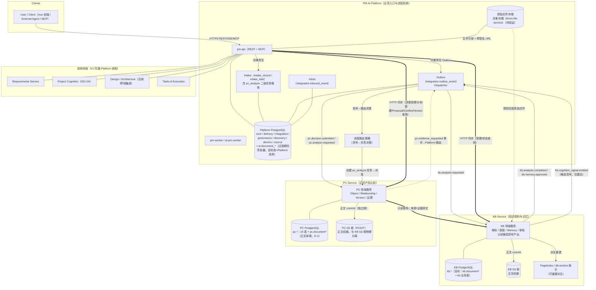
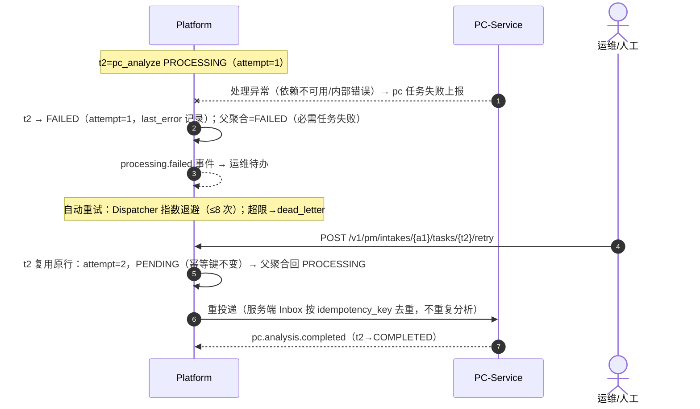
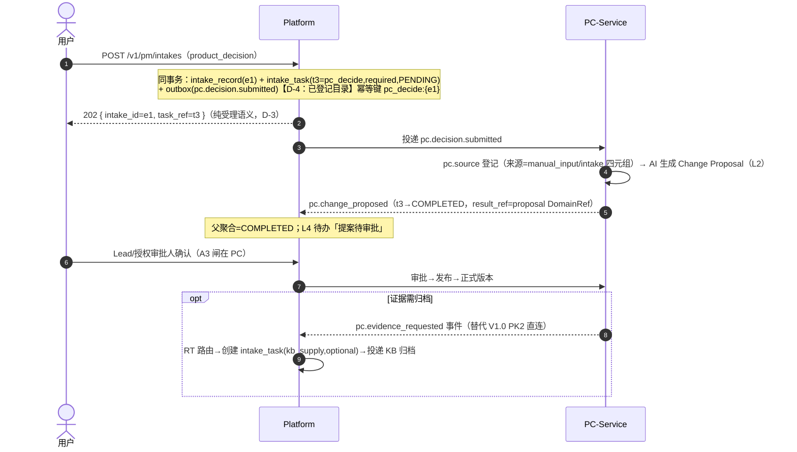
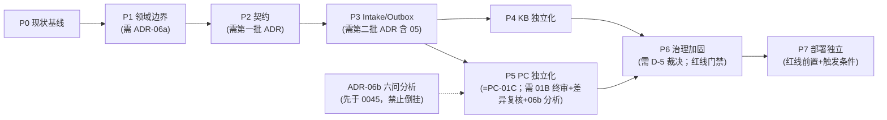

# KB-Service / PC-Service 独立服务化总体架构设计 V1.1

| 项 | 值 |
|---|---|
| 文档版本 | V1.1（V1.0 增量修订版：修复 P0×2 + P1 台账全项 + 七项修订共识落实） |
| 状态 | 总体架构设计修订稿，**13/13 ADR 已获用户批准（2026-11-07 逐条裁决）**；架构评审已通过（2026-11-07）；Phase 1-3 已实施并回填（§0-28，2026-11-07）；**服务形态复核维持方案 A（2026-11-08，见 §21.11 复核裁决记录）**；Phase 4-7 未授权 |
| 日期 | 2026-11-07 |
| 修订依据 | ①《KB-Service / PC-Service 总体架构 V1.1 修订与验收任务书》V1.0；② V1.0 独立架构评审报告（结论：有条件通过，P0×2 + P1×5 + P2×6）；③ 产品负责人六项审查意见与 ADR 三批裁决顺序指示；④ PC-01A V1.1 / PC-01B V1.1（拆分件）既有裁决；⑤ 代码事实复核（2026-11-07，只读，见 §4 与附录 A 证据列） |
| 修订对象 | `kb-pc-independent-services-architecture-v1.0.md`（V1.0 原文保留不覆盖；本文件为唯一 V1.1 权威版本） |
| 现状调查基线 | 仓库当前工作区（只读核实）；PC-01A 评审基线 HEAD `36801388` 代码事实沿用有效 |
| 上游输入 | 与 V1.0 相同（Q-PC-01~13、PC-01A V1.1、PC-01B V1.1 拆分件、Gate 0、KB 定义架构、代码事实），另加 ③④⑤ |
| 下游 | 总体架构评审 → 用户 ADR 正式裁决（三批）→ 详细设计 → 实施 |
| 任务边界 | 仅修改架构设计文档；未修改任何业务代码、数据库、Migration、运行配置、PC-01A/01B 正式基线（§15 禁止事项全程遵守） |

**标注体系**：〔裁决〕= 已确认裁决或任务书最高优先级约束；〔事实〕= 代码/Schema 证据（附 `file:line`）；〔推导〕= 本文档技术设计建议（非裁决，待评审）；〔待决〕= 待裁决事项；〔待验证〕= 尚未证实，不得当作已实现。

**四状态区分声明**（防混用，任务书 §十七）：

| 状态 | 本文档达到与否 |
|---|---|
| 文档修订完成 | ✅ 本交付物 |
| 架构评审通过 | ✅ **独立架构评审通过**（2026-11-07：有条件通过 → 4 条条件全部闭合——① N-1 §8.2 补项目级身份键×2；② N-2 批准后残留群清除 16 处；③ N-3 时长二次勘误 510s≈8.5min；④ §0 修复轮登记 + 附录 B 复跑声明；非阻塞建议 N-4~N-11 已随闭合轮处理或登记） |
| ADR 正式批准 | ✅ **13/13 全部批准**（2026-11-07，用户逐条裁决：第一批 ADR-01/02/04/06a + 第二批 ADR-05/03/07/08/09/11/12 + 第三批 ADR-06b 框架批准 / ADR-10） |
| 允许进入实施 | ⚠️ 部分：Phase 1-3 已按任务书实施并回填（§0-28）；Phase 4-7 未授权 |

---

# 0. V1.1 Change Log（修订记录）

> 逐项列出 V1.0 → V1.1 的全部修改：章节、原因、对应缺陷/ADR、是否改变架构语义、对 PC-01A/01B 的影响。缺陷关闭证据见附录 A；PC-01B 差异复核矩阵见 §19.3。

| # | 修改章节 | 修改内容 | 原因 / 对应项 | 语义变化 | PC-01A/01B 影响 |
|---|---|---|---|---|---|
| 1 | 头部 | 版本、修订依据、四状态区分声明 | 任务书 §十四.2 | 无 | 无 |
| 2 | §1 执行摘要 | 结论 2~10 更新（协作三分法/所有权三分家/自治原则/安全红线/ADR-06 拆分） | 修订共识 + D-1/D-2 | 是 | §19.3 矩阵 |
| 3 | §4.7（新增） | `ai.project_document`/`ai.document_revision` 引用点全集代码核实（5 方使用 + 6 个迁移文件涉及：0006/0014/0015/0019/0024/0025） | D-1 证据补全 | 事实补充 | C-1 证据 |
| 4 | §5.1/§5.2 | 架构图修订：删除无效自环节点（D-10）；KB→PC 业务调用线删除，改为「KB 信号→Platform 路由→PC」；PC→KB 只读查询保留；PC 异步资料补充改事件路由 | ADR-02 修订 / D-10 | 是（协作拓扑） | 无 |
| 5 | §5.4（新增） | 服务自治原则（核心原则/数据自治/共享基建例外/领域操作矩阵） | 用户要求 + 修订共识⑤ | 是（新原则，待裁决） | 无 |
| 6 | §6 | Platform 职责增加「流程路由决策与 PC 二级任务载体」；KB 职责改为「产出认知候选信号」，移除触发判断权 | ADR-02 修订 | 是 | 无 |
| 7 | §7.1 | 所有权矩阵大修：`ai.document_*` 定性为跨领域共享容器 → 三域分家（KB=kb.document\*（目标）/ PC=pc.document\*（新）/ Goal+Discovery+Task Contract=Platform 保留）；kb 七表归属表述修正 | D-1 修复 | 是（所有权重构） | C-1/C-2/C-4 |
| 8 | §7.3 | CrossServiceRef 从五元组改为**四元组唯一持久化本体 + 传输信封级 service 元数据**；删除 result_ref 内嵌 service | ADR-07 修订 | 是 | 与 PC-01B §13 单一同构（兼容性增强） |
| 9 | §7.4 | ADR-05 提前后强化：source_ref 唯一身份/Hash 校验/生命周期/降级方案十项 | ADR-05 提前 | 部分 | 无 |
| 10 | §8 | PC 正文独立承载（pc.document/pc.document_revision + PCGIT）；KBGIT/PCGIT/Platform 文档承载三分 | D-1 修复 | 是 | C-1/C-3 |
| 11 | §9.2/§9.6（新增）/§9.4 | intake_task 增强为统一子任务载体（phase 必需/可选、活跃唯一约束）；新增 PC 二级分析任务模型（含实例化数据示例）；父 Intake 聚合规则表重写 | D-2 修复 | 是 | 无 |
| 12 | §10.2 | 触发规则重写：KB 产出信号（契约字段定义）→ Platform 路由策略 → PC 判断；多信号去重 | ADR-02 修订 / D-2 | 是 | 无 |
| 13 | §11 | 时序图全部重绘：流程 A~F 六条（A 含 pc.source 登记步骤——D-13；B 纯受理——D-3；C 失败重试；D Proposal 待审批；E 决策直达；F 父状态聚合）；删除「或同步受理」二义 | D-2/D-3/D-4/D-13 | 是 | 无 |
| 14 | §12 | KP 组（KB→PC）接口移除（改 Platform 路由）；PK1 只读保留、PK2 改事件路由；P1/P2/P3 响应改纯受理语义；状态查询接口补任务维度 | ADR-02/D-3 | 是 | 无 |
| 15 | §13.3 | 事件目录：新增 `kb.cognition_signal.emitted`、`pc.decision.submitted`（D-4）；`kb.memory.approved` consumer 语义修正（D-8）；共 13 项跨服务事件 | D-4/D-8 | 是 | 无 |
| 16 | §14.3/§14.4 | 重试时长勘误（D-9：8 次指数退避实算累计 510s ≈ 8.5 分钟，修正「约 40min」）；幂等矩阵补 intake_task 活跃唯一约束 | D-9 / D-2 | 表述修正 | 无 |
| 17 | §15.3 | KB 对齐清单更新：目标表前缀随 ADR-06a（kb.document\*） | D-1 联动 | 部分 | 无 |
| 18 | §16.1/§16.3 | 安全红线条款正式立法（网络边界调用三验通过前不得进生产，十项覆盖清单）；R-1 定级修订（阻塞 Phase 6/7，不阻塞 0-5）；D-5 权限事实来源列为待裁决（三方案） | 修订共识④⑥ / D-5 | 是 | 无 |
| 19 | §17.3 | 状态校正协议补 DB Role 白名单引用（D-7 详录于 §16.4） | D-7 | 部分 | 无 |
| 20 | §19.2/§19.3 | §19.2 检查表补 PC-D-02 行；**§19.3「无强制调整项」撤销**，改为 PC-01B 差异复核矩阵（C-1~C-4 逐项结论 + 逐处核实表 + 建议调整项登记） | D-1 / 修订共识⑥ | 是 | C-1~C-4（待 PC-01B 差异复核流程确认，不直接改其基线） |
| 21 | §19.5 | 补「服务化叠加项从属于 PC-01C 既有验收门（M3 五条+版本还原四问）」从属声明 | 用户审查意见 6 | 表述澄清 | 无 |
| 22 | §20 | Phase 依赖图与门禁更新：ADR-05 提前第二批、ADR-06b 先于 Phase 5/0045、Phase 6 门禁=安全红线负向测试、R-1 门禁标注 | ADR-05/06b / R-1 | 部分 | 无 |
| 23 | §21 | ADR 全量修订：ADR-02/05/06（拆 06a+06b）/07/08 重写；ADR 状态总表（13 项，全部「修订候选/待裁决」） | 任务书 §十二 | 是（决策内容） | 无 |
| 24 | §22/§23 | 风险表更新（R-1 定级、新增 R-12 共享容器迁移面）；待确认问题更新（新增信号契约/Goal 承载/D-5 选型/ADR-05 保留策略/06b 六问） | 全局一致性 | 无 | 无 |
| 25 | §24/附录 A/B | 验收标准对齐任务书 §十六 A~G；附录 A 缺陷关闭矩阵（D-1~D-13 全项+证据）；附录 B 全文一致性检查结果 | 任务书 §十四/§十三 | 无 | 无 |
| 26 | §21/头部/§16.1/§23-Q11/Q12/§5.4.4 | **ADR 逐条批准落盘（13/13）**：三批用户裁决（2026-11-07）——§21 各节裁决记录（结论/生效/不生效/风险）、§21.0 状态表 ✅、头部四状态、关联段落状态同步 | 用户 ADR 逐条裁决 | 是（状态与决策生效） | 无 |
| 27 | 全文 | **架构评审条件闭合轮**：① §8.2 DDL 补项目级身份键×2（评审 N-1/N-2，P1）；② 批准后残留群清除（§1-1/§1-9/§1-10/§3.5/§5.4/§5.4.4/§16.1/§16.3/§23-Q6/Q7/附录 A.4/B.1/B.5/§24.B/E 等 16 处状态同步）；③ §14.3/§21.13 时长二次勘误（510s≈8.5min，修正倍增序列）；④ §9.2 隔离范式补齐（UNIQUE(tenant_id,id)+组合 FK）；⑤ §19.1 十项→九项勘误；⑥ 事件计数口径统一（净增+3）；⑦ §10.2 同事务原子性声明（N-9） | V1.1 独立架构评审（有条件通过）条件闭合 | 部分（DDL 修正+状态同步+勘误） | C-2 证据修正（复核后已闭合） |
| 28 | §9.2/§14.4 | **Phase 1-3 实施回填（2026-11-07，实施批 feat/kb-pc-services-phase-1-3）**——实施偏差登记八项（小偏差直接改，未动架构语义）：① `intake_record` 增 `idempotency_key` 列 + `UNIQUE(tenant_id, project_id, idempotency_key)`——§9.5-7（D-12）「调用方凭 Idempotency-Key 安全重试」的落地载体，V1.0 §9.2 原稿未列；② 状态机写点定案：`DISPATCHED`=请求事件消费方经 Platform 应用服务确认（`intake::mark_task_dispatched`），`PROCESSING`=服务开始处理确认，终态=Platform 消费端 CAS（活跃态集合→COMPLETED/FAILED），全部经 `pm-application::intake` 唯一写入面；③ `kb_supply` 派发复用 `kb.analysis.requested` 事件（目录 13 项内自洽；K6 fulfil 转达归 Phase 4）；④ `pc.conflict.detected` 与 `pc.change_proposed` 同规则→任务 COMPLETED + result_ref 钉冲突/提案 DomainRef（§11.1「t2→COMPLETED」注记的操作化；L3/L4 分离维持）；⑤ 信号后到（任务终态）默认 `RecordTodo`（§9.4.3-3〔待决〕→ 保守默认，`AI_PM_RT_AFTER_TERMINAL=create_follow_up` 可切换）；⑥ §12.2/12.3 契约路由骨架挂 501（未接线 ≠ 404；真实落点 Phase 4/5）；⑦ 事件信封 `correlation_id` 在 outbox 表无独立列，由 `aggregate_id` 承载锚定（intake_task/intake_record id），Phase 7 拆库时随 transport 评审补列；⑧ intake_ref/task_ref 的 target_domain 暂取 `requirement`（Platform 域命名空间，注册表已登记值）——是否增设专职 `intake` domain 值随 Phase 4 目录评审定（§7.3 domain 词表可扩展） | Phase 1-3 编码实施（任务书 V1.0 执行） | 否（实现细节，不改架构决策） | 无 |
| 29 | §21.11 / §23-Q1 | **服务形态复核裁决（2026-11-08，用户裁决）**：针对「pc_kb 是否单独成为一个服务、由 pm-ai 通过内部 Web API 访问」的复核——**不采纳**，维持 ADR-10 方案 A。① **不设合并式「pc_kb」单服务**：KB/PC 为两个独立一级领域（ADR-01），正文权威（KGIT/PCGIT）、数据所有权（kb.* / pc.*）、治理级别（PC L0~L3）与发布事务均须域内闭环，合并会使 §5.4.4 自治验收矩阵失去载体；部署上若需同进程只能 co-location（保留双 crate/双 API 前缀/双 schema 所有权）。② **不提前独立部署 + 内部 Web API**：该形态即 §18.1 方案 B（已否决）；§18.2 四触发条件均未满足（PC 内核 PC-01C 未建成、KB 负载有独立 worker 退路、无合规强制、单 workspace 未成瓶颈）；且 §16.3 红线前置未落地——服务认证选型（Q1）仍待裁决，「内部网络/私有部署/可信服务」明文不得豁免三验。③ **现状事实**：KB/PC 现为 pm-api 进程内（`crates/kb-pc-contracts` + 进程内端口；§12 契约路由为 501 骨架），无独立部署单元。④ **重开条件**：四触发条件任一成立，且 Q1 裁决 + 服务认证实施 + 越权负向测试全绿后，按 §18.3 五步预案执行（transport swap，零业务数据搬运）。 | 服务形态复核（用户提问，2026-11-08） | 否（维持既有裁决） | 无 |

---

# 1. 执行摘要

| # | 结论 | 性质 |
|---|---|---|
| 1 | **三服务边界确立**：PM-AI Platform（业务接收、流程路由、任务调度、状态聚合）、KB-Service（知识资料与记忆）、PC-Service（正式产品认知）为三个并列一级服务；领域独立（独立模型/数据所有权/业务规则/API/版本治理/权限边界）为硬性架构要求；**服务自治原则**正式纳入架构（§5.4，✅ 已批准，2026-11-07 随 ADR-01 确立为硬性架构要求） | 〔裁决〕任务书 + 〔裁决〕自治原则（ADR-01） |
| 2 | **部署策略维持方案 A（先领域独立，后部署独立）**：契约先行，物理拆分（Phase 7）触发条件驱动；V1 同步=进程内端口调用、业务处理一律异步；禁止因部署暂不分拆而共享业务表或跨写数据 | 〔裁决〕ADR-01/ADR-10（2026-11-07 已批准） |
| 3 | **协作模式修订为三分法**（ADR-02 V1.1）：**KB 产出认知候选信号（建议）→ Platform 流程路由决策（创建/调度 PC 二级任务）→ PC 判断认知变更有效性**（Proposal/Conflict/NO_CHANGE）。KB 不拥有 PC 触发决定权；用户决策等上游直达 PC 的通道全部经 Platform 路由登记；KB→PC 业务调用直连取消 | 〔裁决〕ADR-02（2026-11-07 已批准）；修复 D-2 |
| 4 | **数据所有权三分家（D-1 修复核心）**：`ai.project_document`/`ai.document_revision` 经代码核实为**跨领域共享容器**（KB 文档 + Project Goal + Discovery 提案红线 + Task Contract FK + Requirement Projection 五方使用，§4.7）；目标态消解——KB 正文= `kb.document*`（目标）、PC 正文= `pc.document*` 独立承载（配套 PCGIT 独立 Git 根）、Goal/Discovery/Task Contract 归 Platform 保留 `ai.document_*`；过渡期以所有权声明 + ADR-06b 迁移框架渐进落地 | 〔事实〕§4.7 + 〔裁决〕ADR-06a（2026-11-07 已批准） |
| 5 | **PC-01B 兼容性口径修正**：撤销 V1.0 §19.3「无强制调整项」；建立差异复核矩阵 C-1~C-4（§19.3）——PC-D-02 正文承载需经 PC-01B 差异复核流程确认调整（PC-D-02 建议修订为「PC 独立正文承载」，登记为建议调整项，不直接改 PC-01B 基线）；其余约束（双维度 Member、端点闭合、发布事务、L0-L3）全部保持 | 〔推导〕+〔事实〕§4.7 |
| 6 | **统一 Intake 模型**：intake_record + intake_task（统一子任务载体，含 PC 二级分析任务 `pc_analyze`）；五层状态分离不变；**父子聚合规则明确**——父 Intake 不得在必需子任务非终态时 COMPLETED；可选阶段 SKIPPED 不阻塞 | 〔推导〕§9；修复 D-2 |
| 7 | **可靠性维持**：Transactional Outbox + Inbox + Idempotency-Key + 指数退避 + DLQ + 人工 replay；业务幂等由 KB/PC 写账本与 intake_task 活跃唯一约束保证；投递层与账本层重试计数独立 | 〔推导〕§14 |
| 8 | **Git-PG 一致性**：统一「写幂等账本 + 状态机 + trailer 反查 + reconcile」协议；PC 侧以 PC-01B §12 为基线（正文表迁址属差异复核登记项），KB 侧同构推广 | 〔推导〕§15 / ADR-09 |
| 9 | **安全红线立法**：网络边界上的 KB/PC 调用在用户认证、服务身份验证、Team/Project 权限校验全部通过前不得进入生产；R-1 定级=阻塞 Phase 6/7、不阻塞 Phase 0-5；权限事实来源（D-5）=Platform 鉴权 API | 〔裁决〕§16.3/§16.1（2026-11-07 ADR-08 已批准） |
| 10 | **跨服务引用**：四元组（domain/type/id/revision_id）是唯一持久化引用本体（与 PC-01B §13 完全同构）；service 仅作传输信封级元数据，不进入任何持久化引用结构 | 〔裁决〕§7.3 / ADR-07（2026-11-07 已批准） |
| 11 | **实施路径**：Phase 0~7 维持；ADR 裁决批次调整——第一批 ADR-01/02/04/06a；第二批 ADR-05/03/07/08/09/11/12；第三批 ADR-06b/10；ADR-06b 分析与裁决必须先于 Phase 5 / PC 0045 Migration（禁止依赖倒挂）；Phase 6 门禁=安全红线负向测试 | 〔推导〕§20 |

---

# 2. 设计背景和目标

## 2.1 背景

（沿 V1.0 §2.1：PM-AI 建设 KB 与 PC 两个并列一级知识能力；既有裁决明确领域权威与治理规则；需明确服务化边界。V1.0 设计经独立评审「有条件通过」：方向成立，但存在 2 项 P0 缺陷（D-1 所有权冲突、D-2 二级任务载体缺失）与 1 项 P0 实质冲突（C-1，D-1 的 PC-01B 面），消解前不得冻结 Phase 1/2 契约。本 V1.1 为针对性修订，不推翻已成立设计。）

## 2.2 目标

回答任务书九问的落点与 V1.0 一致（§2.2 表），V1.1 追加四项目标：

| # | 追加目标 | 落点 |
|---|---|---|
| 1 | 修复 D-1：正文权威三分家，消除 `ai.project_document` 跨领域共享容器状态 | §4.7/§7/§8/§19.3 |
| 2 | 修复 D-2：PC 二级分析独立任务载体 + 父子状态聚合 + 六流程验证 | §9/§10/§11 |
| 3 | 补齐自治原则、安全红线、事件目录、DB Role 白名单约束 | §5.4/§16/§13 |
| 4 | 建立缺陷关闭证据链（附录 A）与全文一致性检查（附录 B） | 附录 |

## 2.3 明确不做的

沿 V1.0 §2.3（不修改代码/数据库/Migration、不改写 PC-01A/01B、不设计历史迁移/回填/双写、不改变 Q-PC-01~13）。**V1.1 追加**：不将任何 ADR 标记为已批准；不因服务化绕过 PC 人工正式确认流程；不把服务自治简化为代码目录分离。

---

# 3. 既有架构决策与不可变约束

沿 V1.0 §3 全部内容（领域权威表 / 正文与数据库权威 / PC 治理 L0-L3 / 零历史数据迁移），V1.1 补充与澄清三点：

1. **§3.1 补充**：正文权威归属进一步细化为「四分」（V1.1 修订，源自 D-1）：Project Goal 正文权威=Platform（项目管理领域）；原始资料与知识记忆正文权威=KB-Service；正式产品认知正文权威=PC-Service；技术项目认知（S01-04）不属于 PC 正文权威（其现状内容存 PG 属该域自身演进问题，不因服务化强制修复——沿 PC-01A M-9 口径）。
2. **§3.4 澄清**：零迁移禁令针对**历史业务数据**；「架构演进引起的 Schema 重建/表迁址」（如 kb.* 迁移、pc.document 新建）属「直接改契约」范畴，其实施方案必须经 **ADR-06b 迁移工程六问**单独分析并获得批准后方可执行——本 V1.1 不批准任何迁移实施（〔裁决〕任务书 §六.2 硬约束）。
3. **§3.5（新增）服务自治原则（✅ 已批准立法，2026-11-07 随 ADR-01）**：全文见 §5.4；其效力层级为「架构约束」，与 §3.1~3.4 同级。

---

# 4. 当前系统现状调查

> V1.0 §4 全部调查结论维持有效（总体架构/KB/PC/异步/身份权限/原始文件的勘察结果与实现程度标注不变）。V1.1 补充 §4.7：针对 D-1 的专项代码核实。全部引用为只读核查（2026-11-07）。

## 4.1~4.6 （沿 V1.0，无变化）

总体架构（三进程共享单 PG、axum/sqlx、handler→application→domain 分层）、KB 文档域七表闭环与 Git 写路径、PC 零实现与 PC-01B 设计状态、Outbox/Inbox/租约/死信、PageIndex 代位、原始文件通道（前端→lmms 对象存储、pm-api 无上传路由、服务端不在本仓〔待验证〕）、认证（JWKS fail-closed）/授权（handler 级）/审计（audit_log+SSE）——结论与证据引用同 V1.0 §4.1~4.6，此处不重复。

## 4.7 D-1 专项核实：`ai.project_document` / `ai.document_revision` 引用点全集〔事实〕

> V1.0 将这两张表归入「KB 七表」。本次全仓检索（生产代码 + migrations，排除测试）证实其为**跨领域共享容器**——这是 D-1 的实证基础，也修正了修复方案的设计前提。

### 4.7.1 生产代码使用方（写入或读取）

| # | 使用方 | 领域归属 | 证据 | 用法 |
|---|---|---|---|---|
| 1 | KB 文档域 | KB | `crates/pm-application/src/knowledge.rs`（13 处）、`knowledge_write_coordinator.rs`（2）、`knowledge_proposal/submit.rs`（4）、`knowledge_proposal/veto.rs`（11）、`knowledge_quality.rs`（2）、`knowledge_index.rs`（1）、`knowledge_indexer.rs`（8）、`knowledge_search.rs`（5）、`knowledge_migrate.rs`（2） | 读写主体：文档身份/修订/提案/索引/检索 |
| 2 | **Project Goal** | **Platform（项目管理领域）** | `crates/pm-application/src/project_goal.rs`（5 处；V1.0 已引 `project_goal.rs:8-14` doc_key='project-goal'）；测试 `apps/pm-api/tests/project_goal.rs`、`project_goal_archive.rs`（5 处） | 读写：Goal 正文（doc_key='project-goal'） |
| 3 | **Discovery 提案红线** | **Platform（S01 域）** | `crates/pm-application/src/discovery/proposal.rs`（3 处，doc_key='discovery-note'，propose-only 红线不建行）；`crates/pm-mcp/src/tools.rs:950,963`；测试 `pm-mcp/tests/discovery.rs:319,363,371` | 写入（红线回填时）/读校验 |
| 4 | **Task Contract** | **Platform（delivery 域）** | `migrations/0015_task_contract.sql:50`：`FOREIGN KEY (project_id, document_id) REFERENCES ai.project_document(project_id, id)` | FK 引用（任务契约钉文档） |
| 5 | **Requirement Projection / Command Center / Run Context / pm_write.task** | Platform（S02/delivery） | `crates/pm-application/src/requirement_projection.rs`（7 处）、`command_center.rs`（4）、`run_context.rs`（2）、`pm_write/task.rs`（1）、`command_executor/executor.rs`（1） | 读取/引用投影 |

> **回填（2026-11-19，历史漏登记非新增接入）**：上表核实于 2026-11-07，其后 SEC-P2
> 修复包（bb33ea6，2026-11-16）新增跨域引用链目标校验层 `crates/pm-application/src/
> reference_targets.rs`——`ProjectGoal => ("ai.project_document", true)`（:61）+ `probe()`
> 对容器的 `SELECT EXISTS` 存在性/同租户同项目读。该文件是 #2 Project Goal 使用方的
> 安全校验机械（不引入新业务域读写），属守卫白名单登记遗漏：文件晚于白名单末次更新
> （d62710b，2026-11-12）落地而未同步登记，2026-11-19 由存量测试断裂修复微批补登
> `guard_ai_container_users` 白名单并在此回填。非新增使用方，ADR-06a 红线不受影响。

### 4.7.2 迁移层 FK 依赖

| 迁移 | 位置 | 依赖 |
|---|---|---|
| 0006 | `0006_knowledge_documents.sql:7,22,38,42` | 表定义本体 + revision→document FK |
| 0014 | `0014_knowledge_v2.sql:10,17,25,31,46,63,85,86` | document_proposal（base/resulting FK）、knowledge_reference（FK CASCADE）、document_section_index（FK） |
| 0015 | `0015_task_contract.sql:50` | **task_contract → ai.project_document FK（delivery 域）** |
| 0019 | `0019_tenant.sql`（13 处） | 租户化改造（组合键/组合 FK） |
| 0024 | `0024_knowledge_section_index.sql:1` | 索引层引用 |
| 0025 | `0025_discovery.sql`（3 处） | discovery 域 FK |

### 4.7.3 核实结论

1. 〔事实〕`ai.project_document` / `ai.document_revision` 被 **5 个领域使用**（KB、项目管理 Goal、S01 Discovery、delivery Task Contract、S02 需求投影），其中 3 方写入（KB、Goal、Discovery 红线）。V1.0「七表归 KB-Service」的归属声明与代码事实不符。
2. 〔事实〕**不存在**「KB 专属七表」这一物理边界——七表中仅 `ai.document_proposal`、`ai.knowledge_reference`、`ai.document_section_index`、`ai.knowledge_write_operation`、`ai.document_index_state` 为 KB 业务专属；`ai.project_document`/`ai.document_revision` 为共享容器。
3. 〔推导〕D-1 修复必须在「共享容器消解」前提下设计（§7.1/§8），任何「保留共享 + 声明所有权」的折中都无法通过 Phase 7 拆库检验（共享表只能归一个库）。

## 4.8 PC-01B 设计基线现状

〔事实〕PC-01B V1.1 已按用户指令拆分为 7 份文件（`docs/architecture/product-cognition/pc-01b/`，章节编号保持 §1~§24）；原路径为索引占位页。本 V1.1 引用 PC-01B 章节时指向对应拆分件：

| PC-01B 章节 | 拆分件 | 与 D-1 相关内容 |
|---|---|---|
| §5.3（cognition_revision DDL） | 拆分件 02 | **FK 处 ①**：`FOREIGN KEY (tenant_id, document_id) REFERENCES ai.project_document (tenant_id, id)`、`FOREIGN KEY (tenant_id, document_revision_id) REFERENCES ai.document_revision (tenant_id, id)` |
| §9.2（pc.source DDL） | 拆分件 04 | **FK 处 ②**：document/document_revision 双 FK（kb_document 来源定位） |
| §9.3（pc.evidence DDL） | 拆分件 04 | **FK 处 ③**：document/document_revision 双 FK（document_section 类证据） |
| §22.2-4（Migration 要点） | 拆分件 06 | **doc_type 扩值 ALTER**：`ai.project_document` 的 doc_type CHECK 追加 'pc_object'（R9/F-09） |
| §11.2（PC-D-02 详录） | 拆分件 00 | PC 正文承载复用 ai 双表的裁决本体 |

---

# 5. 目标总体架构

## 5.1 架构图



连线语义说明（V1.1 修订处加粗）：

| 连线 | 语义 | V1 形态 | Phase 7 形态 |
|---|---|---|---|
| User→API | HTTPS 同步请求 / SSE 订阅 | 不变 | 不变 |
| API→Intake→Outbox | 同一 PG 事务写入接收记录与事件 | 同库事务 | Platform 库内事务 |
| Outbox→KB / Outbox→PC | 异步事件（任务分发） | 同库 outbox 轮询投递 | 独立库 outbox + Broker 转发 |
| API→KB / API→PC | 同步服务调用（受理、查询） | 进程内端口调用（契约不变） | HTTP + 服务认证 |
| **KB 信号→RT→PC** | **KB 产出认知候选信号（事件）→ Platform 路由策略决策 → 创建 pc_analyze 任务并派发 PC**（**取消 V1.0 的 KB→PC 点对点业务调用**） | 进程内事件+端口 | 事件经 Broker |
| **PC→KB 只读查询** | PC 分析需要来源/证据原文时的**只读**回查（无任务语义、无写入；领域协作场景，经任务书 §五.7 允许保留） | 进程内端口 | HTTP 只读 |
| **PC 补充资料请求→OUT** | PC 异步资料补充不再点对点派任务，改发事件由 Platform 路由创建 KB 任务 | 事件 | 事件 |
| KB→KGIT / PC→PCGIT | 正文写入（各自唯一权威；**PC 正文独立承载后 PCGIT 有专属 PG 表 pc.document\***） | 两个独立 Git 根 | 不变 |
| KB→PageIndex | 派生索引重建 | db-section 代位 | PageIndex 本体 |
| FS→KB | 原始文件授权拉取 | 对象存储 + 预签名 URL | 不变 |

## 5.2 服务关系原则（V1.1 修订）

1. **Platform 是唯一用户入口**：用户/前端/外部 Agent 只访问 Platform API；KB/PC API 仅服务间可达。
2. **Platform 编排接收、路由与聚合，不编排领域治理**：Intake 分发、**跨服务流程路由决策（含 PC 二级分析触发）**、状态聚合、用户待办展示归 Platform；KB 审核、PC 提案审批等治理动作的执行在 KB/PC，Platform 只通过事件与查询感知结果。
3. **（V1.1 修订，取代 V1.0 原则 3）认知候选信号流**：KB 完成分析/审核后产出结构化「认知候选信号」（仅建议，含 relevance/confidence/引用）；Platform 依路由策略决定是否创建 `pc_analyze` 任务并派发 PC；PC 独立判断输入是否构成有效认知变更（Proposal/Conflict/NO_CHANGE）。KB 不拥有 PC 触发决定权；Platform 不代替 PC 判断认知有效性。
4. **PC→KB 只读回查保留**：PC 分析需要来源/证据原文时向 KB 发起只读查询（不产生写入、不创建任务、不绕过流程治理——任务书允许的领域协作场景）；PC 异步资料补充请求改经事件由 Platform 路由。
5. **任何服务不得直写其他服务的业务数据库**；共享基础设施表（Outbox/Inbound Event）例外，见 §5.4.3 与 §16.4 白名单。
6. **工程事实不自动成为产品认知**：工程执行结果进入 KB 归档整理，PC 只做「是否影响正式认知」的分析，产出止步于 Proposal（流程 C）。
7. **服务自治原则**（V1.1 新增，§5.4 专章）。

## 5.3 领域独立 vs 部署独立

沿 V1.0 §5.3 全表（领域独立=Phase 0-3 硬要求：独立 crate/所有权/规则/API/版本治理/权限边界；部署独立=Phase 7 触发条件：独立进程/实例/扩容/发布）。强制机制四条不变（crate 边界/所有权矩阵/Phase 6 DB role/事件目录），**V1.1 补充第五条：自治原则（§5.4）作为所有权矩阵的上位原则，code review 以「领域操作矩阵」（§5.4.4）为检查单**。

## 5.4 服务自治原则（✅ 已批准立法，2026-11-07 随 ADR-01）

### 5.4.1 核心原则

**KB-Service 与 PC-Service 是两个独立一级业务领域，各自拥有领域自治。** Platform 负责接收、登记、流程路由、任务调度、状态聚合和用户交互；KB-Service 与 PC-Service 分别负责各自领域的业务分析、知识治理、正文权威和领域状态。**Platform 不得成为知识服务正常运行所依赖的正文权威或内部业务协调中心。**

### 5.4.2 数据自治要求

1. KB 不直接写 PC 领域业务表；PC 不直接写 KB 领域业务表；Platform 不直接写 KB/PC 领域业务正文。
2. 跨领域操作只能通过契约（API/事件）完成；每个领域拥有唯一明确的业务数据写入责任方。
3. Git 正文权威与 PG 元数据权威在各域内保持一致边界（KB：KGIT+kb.*；PC：PCGIT+pc.*；Platform 文档：Platform 存储承载，见 §7.1）。
4. 自治≠代码目录分离：crate 边界只是手段，本质是数据写入责任与运行依赖的唯一性。

### 5.4.3 共享基础设施例外（受限）

允许共享的基础设施表仅限：`integration.outbox_event`、`integration.inbound_event`，及经明确批准的其他消息投递/接收机制。约束：

1. 共享的是**基础设施机制**，不是业务数据所有权；
2. 每张共享表有唯一的基础设施责任方（integration 域基建，Platform 运维）；
3. KB/PC 不得通过共享表直接修改对方领域业务状态（事件是唯一跨域状态影响通道）；
4. 共享表不构成跨领域业务查询接口（禁止「从 outbox 反查他域业务」）;
5. 访问受 DB Role 白名单约束（§16.4，D-7：写/读/确认投递三类权限逐 role 声明）;
6. 该例外不得成为访问其他服务领域 Schema 的依据。

### 5.4.4 领域操作矩阵（自治验收检查单）

| # | 领域操作 | 责任服务 | 业务数据写入者 | 调用方式 | 依赖的他人数据 |
|---|---|---|---|---|---|
| 1 | KB 独立分析 | KB | KB（kb.\*） | 事件任务（kb.analysis.requested） | 原始文件（对象存储，经 Platform 授权引用） |
| 2 | PC 独立认知分析 | PC | PC（pc.\*） | 事件任务（pc.analyze.requested） | KB 来源/证据（只读查询 PK1） |
| 3 | Platform 创建 Intake | Platform | Platform（integration.intake_\*） | 用户请求 | 无 |
| 4 | KB 输出候选信号 | KB | 事件（不写他域） | outbox 事件 kb.cognition_signal.emitted | 自身分析结果 |
| 5 | Platform 调度 PC | Platform | intake_task 行 | 路由决策→任务派发 | KB 信号内容 |
| 6 | PC 输出 Proposal | PC | PC（pc.proposal） | 事件回写 pc.change_proposed | 自身分析 |
| 7 | PC 正式认知确认 | PC | PC（pc.approval/version） | 用户操作经 Platform 网关转达（审批闸在 PC） | approver 权限事实（**经 Platform 鉴权 API，D-5 已裁决=方案 B，控制面依赖**） |
| 8 | KB Memory 更新 | KB | KB（kb.memory） | 用户审核经 Platform 网关转达 | 无 |
| 9 | Git-PG 一致性恢复 | 各自域 | KB/PC 各自账本 | 各域 reconcile 任务 | 自身 Git 根与 PG |

结论：全部 9 项正常业务操作中，无任何一项依赖对他人领域数据库的**写入**；跨域读取仅第 2 项（PC 读 KB 来源，只读）与第 7 项（权限事实，经 Platform 鉴权 API——D-5 已裁决=方案 B，控制面依赖）。

---

# 6. 三个服务的领域职责

## 6.1 PM-AI Platform（V1.1 修订）

**负责**：

| 职责 | 落点 |
|---|---|
| 用户/团队交互入口（REST/MCP/SSE） | pm-api（已有） |
| Team、Project、权限上下文 | core schema + auth 中间件（已有） |
| 输入接收；Intake 接收记录与**统一子任务载体**（含 PC 二级分析任务） | intake_record/intake_task（§9） |
| **跨服务流程路由决策**：依据 KB 候选信号与路由策略，决定是否创建/调度 PC 分析任务 | §10.2（新增职责，ADR-02 V1.1） |
| 原始资料持久化位置及引用管理 | 对象存储引用 + hash（§7.4） |
| 处理任务登记、Outbox 事件、异步调度 | outbox（已有，扩展目录） |
| 服务调用与回调接收、处理状态聚合（**含父子任务聚合规则**） | §9.4 |
| 用户待处理事项展示 | 事件驱动聚合 |
| Requirements、Design、Tasks 等业务模块协调；**Project Goal 正文权威（D-1 分家归属）** | 现有模块；Goal 承载见 §7.1 |
| **过渡期共享文档容器 `ai.document_*` 的基础设施责任方**（目标态=Platform 自用：Goal/Discovery/Task Contract） | §7.1（ADR-06a） |

**不负责**：KB/PC 正文与认知维护；替代 KB/PC 内容治理；**代替 PC 判断认知变更有效性**；直写 KB/PC 业务数据库。

## 6.2 KB-Service（V1.1 修订）

**负责**：KB 领域模型（Source/Document/Revision/Memory/Evidence/追溯）；解析与知识提取；Shallow/Deep Memory；来源追溯与浅层记忆审核及版本；KB 正文版本管理（KGIT 权威）；KB 领域内状态与审计；**产出认知候选信号（结构化建议，§10.2）**；向外提供受控知识查询接口与**只读来源/证据查询（供 PC 回查）**。

**不负责**：正式产品认知；**PC 分析触发决定权（不直接调用 PC 发起业务流程）**；需求正式确认；工程执行。

## 6.3 PC-Service

沿 V1.0 §6.3（pc 15 表 + **pc.document\* 正文承载（D-1）** + 四元组引用 + L0-L3 治理 + 发布与审计 + 受控查询/分析接口），**补充**：PC 独立判断输入是否构成有效认知变化（识别已有/缺失认知/冲突/候选变更，生成草稿或 Proposal）；不绕过人工确认机制。

## 6.4 服务职责对照总表（V1.1 修订版）

| 能力 | Platform | KB-Service | PC-Service |
|---|---|---|---|
| 原始文件接收/存储引用 | ✅（权威） | 拉取解析（副本） | — |
| 原始资料登记/解析 | 接收 | ✅（权威） | — |
| 知识/记忆提取与审核 | 接收+展示 | ✅（权威） | — |
| **认知候选信号产出** | 路由消费 | ✅（产出方，仅建议） | — |
| **跨服务流程路由决策** | ✅（权威） | — | — |
| 正式产品认知 | — | — | ✅（权威） |
| **认知变更有效性判断** | — | — | ✅（权威） |
| 认知变更审批 | 展示待办 | — | ✅（权威） |
| 冲突治理（L3） | 展示+通知 | — | ✅（权威） |
| 需求正式确认 | 协调 | — | 提供规则/冲突检查（不审批） |
| 工程执行 | 协调 | 证据归档 | 影响分析（止步 Proposal） |
| 用户待办聚合 | ✅ | 提供状态 | 提供状态 |
| **Project Goal 正文** | ✅（权威，D-1） | — | 四元组只读引用 |

---

# 7. 数据所有权矩阵（V1.1 大修）

## 7.0 修订说明（D-1）

V1.0 §7.1 将「KB 七表」整体划归 KB-Service，与代码事实（§4.7：`ai.project_document`/`ai.document_revision` 五方共用）冲突。V1.1 按「**正文权威四分 + 共享容器消解**」重构所有权：

- **`ai.project_document` / `ai.document_revision` 不再被视为任何单一服务的业务表，而是过渡期共享容器**——目标态按使用方分家消解（KB→kb.document\*；PC→pc.document\*；Platform 保留自用部分）；
- KB 业务专属五表（document_proposal / knowledge_reference / document_section_index / document_index_state / knowledge_write_operation）归 KB；
- 分家实施全部经 **ADR-06b 迁移工程六问**单独分析批准；本 V1.1 只做**目标归属声明**与**过渡期规约**。

## 7.1 表级所有权矩阵（ADR-06a 载体，任务书 §六.1 要求的逐表声明）

| 表/存储 | 当前 Schema/表名 | 当前实际写入方〔事实〕 | 目标 Schema/表名 | 目标唯一写入方 | 允许读取方 | 共享基建？ | 涉及 Migration？ | 证据 |
|---|---|---|---|---|---|---|---|---|
| Team/Tenant/Project/Membership/Role | core.\* | Platform | core.\*（不变） | Platform | 三服务经校验/调用上下文 | 否 | 否 | 0001/0018/0019/0030/0040 |
| Project Goal | ai.project_document(doc_key='project-goal') | Platform（project_goal.rs） | **保留 ai.document\***（G-1=a' 已批准：终态共址，与 Discovery 红线共用 Platform 文档基建，doc_key 区分，零额外迁移） | Platform | PC/KB 四元组只读 | 过渡期是→目标否（归 Platform 自用） | 无（06b 仅评估表名，不迁 Goal） | project_goal.rs:8-14；§4.7.1-2 |
| Requirement/Revision/Confirmation | delivery.requirement\* | Platform（Requirements 域） | 不变 | Platform | PC 四元组引用钉 Revision | 否 | 否 | 0002/0039 |
| Task/Run/Delivery/Review | delivery.\* | Platform | 不变 | Platform | 三服务经事件 | 否 | 否 | 0002/0010/0026 |
| Task Contract（文档钉定） | delivery.task_contract | Platform | 不变；其 FK 目标随容器消解适配 | Platform | — | 否 | 06b 评估 | 0015:50 |
| **Intake** | integration.intake_record / intake_task | Platform | 不变（增强子任务能力 §9） | Platform | 事件引用 | 否 | Phase 3 新建 | V1.0 §9 |
| **Outbox/Inbox** | integration.outbox_event / inbound_event | 三服务经端口写；Platform 运维 | 不变 | **共享基建**（责任方=Platform 基建；白名单 §16.4） | 禁止业务反查 | **是** | 否 | 0010:123-144 |
| 平台审计 | governance.audit_log / tenant_audit_log | 各服务写自己 source_kind；Platform 运维 | 不变 | 各域写入+Platform 词表管理 | 可观测 | 基建 | 否 | 0003/0004/0018 |
| **KB：文档身份与修订** | ai.project_document / ai.document_revision（KB 使用部分） | KB（knowledge*.rs） | **kb.document / kb.document_revision**（目标；过渡期继续用 ai.document\* 直至 06b 批准迁移） | KB | PC（只读，四元组）/Platform 展示 | **过渡期是→目标否** | **06b 必答**（kb.* 迁移主体） | §4.7.1-1 |
| KB：提案/引用/索引/账本 | ai.document_proposal / knowledge_reference / document_section_index / document_index_state / knowledge_write_operation | KB | kb.\* 同名（目标） | KB | — | 否 | 06b | 0014/0024 |
| **KB：Source/Memory/Evidence/追溯** | （待建） | — | kb.source / kb.memory / kb.memory_revision / kb.evidence | KB | PC 只读（四元组） | 否 | KB 独立计划 | KB 定义 §5 |
| **PC：正文承载（D-1 新增）** | （现状：拟复用 ai.document\*，PC-01B PC-D-02） | —（未实施） | **pc.document / pc.document_revision**（新；PCGIT 承载正文） | **PC** | Platform 展示（事件摘要） | 否（域内闭环） | **PC-01B 差异复核 C-1~C-4**（§19.3） | PC-01B §5.3/§11.2（拆分件 02/00） |
| **PC：领域 15 表** | （未实施） | — | pc.\*（PC-01B 设计不变） | PC | Platform（事件/查询 API） | 否 | PC-01C（前置=01B 终审+差异复核） | PC-01B §15.2 |
| S01-04 / S01-05 | ai.cognition_\* / ai.baseline_\* | Platform（各自领域） | 不变 | Platform | PC 只读引用 | 否 | 否 | 0036/0037 |
| LLM/Discovery/Devenv | ai.llm_provider 等 | Platform | 不变 | Platform | — | 否 | 否 | 0007/0025/0027 |
| **Discovery 提案红线/需求投影**（容器使用方） | ai.document\*（discovery-note 等） | Platform | 随容器消解归 Platform 保留 | Platform | — | 过渡期是 | 06b 评估 | §4.7.1-3/5 |

**过渡期规约**（自 V1.1 发布至 ADR-06b 实施完成）：

1. `ai.document_*` 定性为「Platform 持有的共享文档基础设施」，其写入方维持现状（KB/Goal/Discovery）；**禁止新增使用方**（PC 禁止接入——PC 正文走 pc.document\*，C-1 结论）；
2. 所有权声明以本表为准；Phase 6 DB role 落地时按「共享基建白名单」给 kb_service role 授予 ai.document\* 读写（业务必要），并禁止 kb_service 读 Platform 其他业务表；
3. 06b 批准迁移后：KB 迁 kb.document\*；ai.document\* 缩减为 Platform 自用（Goal/Discovery/Task Contract 引用部分），是否改名 platform.document 由 06b 一并裁决（不强制）。

## 7.2 跨服务数据访问规则

沿 V1.0 §7.2 五条（读走 API/写禁止/引用契约/事件感知/禁迁移回填双写），V1.1 补充第 6 条：**共享基建例外按 §5.4.3 六条约束执行**。

## 7.3 统一跨服务引用契约（ADR-07 V1.1 修订：四元组唯一本体）

**唯一持久化引用结构**（与 PC-01B §13.2 完全同构）：

```text
DomainRef {
  target_domain      : string      -- 领域标识（requirement / project_goal / knowledge_base / pc / ...）
  target_type        : string      -- 领域内对象类型
  target_id          : string      -- 稳定身份（TEXT 容纳跨域非 UUID 形态；域内 UUID）
  target_revision_id : string|null -- Revision 级引用；有 Revision 机制的对象必填，空缺必须记录原因
}
```

**service 维度 = 传输信封级元数据，禁止进入任何持久化引用结构**：

| 载体 | service 信息承载 | 说明 |
|---|---|---|
| 事件信封 | 顶层 `producer` 字段（已有，V1.0 §13.1） | 不下放进 payload 引用对象 |
| Intake 台账 | `intake_task.target_service` 列（已有） | `result_ref` 存 DomainRef（**删除 V1.0 的 service 字段**） |
| HTTP 寻址 | URL 前缀 /v1/kb、/v1/pc + 服务路由配置 | 引用≠寻址：解析引用走所有者 API + 当前路由表 |

规则：1) domain→归属服务的映射由路由配置/服务发现承载（Phase 7 后映射可变，引用不随之改写）；2) 裸引用（脱离信封的审计存档）按 domain 注册表解析归属，解析失败→审计告警（不臆测）；3) 禁止数据库跨库 JOIN 作为集成机制；4) 历史引用稳定还原到对象 Revision（引用列不可变，服务位置变化不影响）。反向引用（来源侧）采用对称四元组 `source_domain/type/id/revision_id`（revision 按目标对象 Revision 机制决定必填/空缺+原因）。

**V1.0 五元组残留清理承诺**：全文搜索 `CrossServiceRef`、`source_service`、`service` 字段嵌套引用——清理结果见附录 B.3（结论：V1.1 文本内无五元组持久化残留）。

## 7.4 原始文件引用模型（ADR-05 提前后强化）

| 项 | 设计 | 状态 |
|---|---|---|
| 存储权威 | 对象存储（lmms file-service / RustFS）+ 预签名 URL；文本类输入内联（source_input.content TEXT 先例 0045:16-30） | 推荐方案；对象存储服务端不在本仓〔待验证〕 |
| **Source Reference 唯一身份** | `source_ref = {kind, uri|inline_ref, content_hash, size, mime}`；`content_hash` 为跨服务对账锚；同一 hash+uri 幂等复用（intake 去重） | 〔推导〕 |
| 引用记录 | intake_record.source_ref（JSONB） | Phase 3 实施 |
| 访问授权 | KB/PC 凭服务身份申请短时效预签名 URL（或 Platform 代理拉取）；禁止裸 URL 越权 | 〔推导〕 |
| 完整性校验 | 拉取后重算 sha256 与 intake.content_hash 比对；不一致→任务失败+审计 | 〔推导〕 |
| 生命周期 | intake 记录与审计同寿命；文件保留策略=Team 级配置（默认永久+手动清理）；删除前校验无未完成引用 | 保留期限〔待用户裁决〕 |
| 失败与恢复 | 文件不可用/Hash 不匹配/对象丢失：任务 FAILED（可重试）→ 超限 DLQ + `processing.failed`；对象存储不可验证时的**降级方案**：文本类输入改内联通道（source_input 先例），文件类输入要求提交方重传（Intake 侧重新接收，不阻塞其他任务） | 〔推导〕 |
| Team/Project 隔离 | 预签名 URL 绑定 tenant/project 作用域；KB/PC 拉取凭据经 Platform 签发并审计 | 〔推导〕 |
| 与追溯链关系 | intake.source_ref 是 KB `kb.source`/PC `pc.source` 的**上游引用**（DomainRef 指向 intake），不替代领域 Source 实体（KB/PC 各自的 source 携带领域语义定位） | 〔推导〕 |

**ADR-05 已有条件批准（2026-11-07）**：A 方案为既定设计；附加前置=lmms 可靠性实测（上传/下载/预签名过期/清理四项）列 Phase 3 验收项，不达标启动降级方案；保留策略（Q3）随 Phase 3 前裁决。本节设计内容除已裁决项外保留〔推导〕/〔待验证〕标注。

# 8. Markdown / Git / PostgreSQL / PageIndex 职责（V1.1 修订：正文权威三分）

## 8.1 正文权威归属（D-1 修复落点）

| 正文类别 | 权威领域 | PG 结构化承载 | Git 根 | 状态 |
|---|---|---|---|---|
| Project Goal | **Platform（项目管理领域）** | ai.project_document(doc_key='project-goal')（**G-1=a' 已批准：终态共址**，该表三分家后归 Platform 自用，与 Discovery 共用文档基建） | ai.document\*（Platform 文档基建，与 Discovery 共用） | 〔事实〕现状 + 〔裁决〕目标（2026-11-07） |
| 原始资料、知识记忆（KB） | **KB-Service** | kb.document / kb.document_revision（目标；过渡期 ai.document\*） | **KB Git 根（KGIT）**（现状 `AI_PM_KNOWLEDGE_ROOT`） | 〔事实〕现状 + 〔推导〕目标 |
| 正式产品认知（PC） | **PC-Service** | **pc.document / pc.document_revision（新建，域内闭环）** | **PC Git 根（PCGIT）**，与 KGIT 物理分离 | 〔推导〕D-1 修复方案（待 PC-01B 差异复核 C-1~C-4） |
| 技术项目认知（S01-04） | Project Cognition（Platform 域） | ai.cognition_\*（该域自身，正文存 PG 属其自身演进问题，沿 PC-01A M-9 口径不强制修复） | — | 〔事实〕 |

**`ai.project_document` 不再承担 KB、PC、Platform 三方正文权威**：过渡期作为共享容器仅维持既有使用方（§4.7.1），目标态消解（§7.1）；**禁止 PC 接入该容器**（C-1 结论）；**禁止新增任何使用方**。

## 8.2 PC 正文承载模型（新增，D-1 修复的设计核心）

```sql
-- 建议形态（设计草案，最终 DDL 归 PC-01B 差异复核后修订；本任务不实施）
CREATE TABLE pc.document (
    id            UUID PRIMARY KEY DEFAULT gen_random_uuid(),
    tenant_id     UUID NOT NULL REFERENCES core.tenant(id),
    project_id    UUID NOT NULL,
    doc_key       TEXT NOT NULL,              -- PC 域内文档键（如 'pc:object:{object_key}'）
    canonical_path TEXT NOT NULL,             -- PCGIT 内路径（如 'pc/{object_type}/{object_key}.md'）
    created_at    TIMESTAMPTZ NOT NULL DEFAULT now(),
    UNIQUE (tenant_id, id),
    UNIQUE (tenant_id, project_id, id),              -- 项目级身份键（PC-01B §14.2 双键范式；cognition_revision 组合 FK 引用锚，评审复核补）
    UNIQUE (tenant_id, project_id, doc_key),
    FOREIGN KEY (tenant_id, project_id) REFERENCES core.project (tenant_id, id)
);

CREATE TABLE pc.document_revision (
    id             UUID PRIMARY KEY DEFAULT gen_random_uuid(),
    tenant_id      UUID NOT NULL REFERENCES core.tenant(id),
    project_id     UUID NOT NULL,
    document_id    UUID NOT NULL,
    revision_no    INT NOT NULL CHECK (revision_no >= 1),
    git_commit_sha TEXT NOT NULL,             -- PCGIT commit（正文权威锚）
    content_hash   TEXT NOT NULL,             -- sha256(markdown)
    created_by     UUID NOT NULL REFERENCES core.principal(id),
    created_at     TIMESTAMPTZ NOT NULL DEFAULT now(),
    UNIQUE (tenant_id, id),
    UNIQUE (tenant_id, project_id, document_id, revision_no),
    UNIQUE (tenant_id, project_id, document_id, id),  -- 项目级身份键（revision 级组合 FK 引用锚，评审复核补）
    FOREIGN KEY (tenant_id, project_id) REFERENCES core.project (tenant_id, id),
    FOREIGN KEY (tenant_id, project_id, document_id) REFERENCES pc.document (tenant_id, project_id, id)
);
-- append-only 触发器沿 pc.forbid_row_update()（PC-01B §15.3 范式，拆分件 06）
```

与 PC-01B 的对应关系（差异复核输入，§19.3）：

| PC-01B 原设计（PC-D-02） | V1.1 建议调整 | 语义影响 |
|---|---|---|
| PC 正文复用 ai.project_document/ai.document_revision（doc_type='pc_object'） | pc.document/pc.document_revision 域内承载；PCGIT 专属 | 文档身份模型（doc_key/canonical_path/git_commit_sha/content_hash）**保持同构**；领域 Revision 语义不变 |
| pc.cognition_revision 的 document 双 FK → ai 表 | → pc.document\*（域内 FK，可项目级组合 FK——比原租户级 FK 更强） | 引用完整性增强（原受 0019 无项目级组合键限制，PC-01B §13.3 双轨说明可简化） |
| pc.source / pc.evidence 的 document 双 FK → ai 表 | **撤销 FK，升级为四元组跨域引用**（target_domain='knowledge_base'，服务层组合键校验+对账，沿 PC-01B §13.3 双轨机制）——KB 是独立服务，KB 文档引用属跨域 | 引用协议从「同库 FK 便利」回归「跨域四元组」正轨；与 §13.2「PC 内端点走专用列、跨域走四元组列」原则一致 |
| §22.2-4 doc_type 扩值 ALTER（'pc_object'） | **取消**（ai 表不再承载 PC 正文） | Migration 清单减项 |

## 8.3 关键约束（沿 V1.0 §8 四条，维持）

1. PG 不凭空宣称 Git Revision 已落盘（commit 成功才写 sha）；2. append-only（修订=新 commit+新 Revision；回滚=revert 新 commit）；3. PageIndex 可随时重建（损坏→stale→回退直读 Git）；4. KGIT/PCGIT 两根独立互不依赖。V1.1 补充第 5 条：**pc.document_revision.git_commit_sha 必须指向 PCGIT**（不得指向 KGIT 或其他根）；对账协议（§15）按 Git 根分别配置 trailer 前缀（KB-/PC-）。

---

# 9. Intake 模型（V1.1 修订：统一子任务载体）

## 9.1 设计原则

沿 V1.0 §9.1 四条（Platform 接收领域/类型化路由/五层状态分离/同事务落库），**补充第 5 条**：Intake 与子任务是**父子关系**——子任务（intake_task）是各服务处理阶段的唯一执行身份；父 Intake 的整体状态由子任务聚合派生（§9.4），父完成不得先于必需子任务终态。

## 9.2 表设计（建议 DDL，实施归 Phase 3）

```sql
-- integration.intake_record：沿 V1.0 §9.2 基础上增补（评审 N-8 隔离范式补齐）：
--   + UNIQUE (tenant_id, id)   -- 0019 租户级身份键（intake_task 组合 FK 目标锚）
-- 其余字段不变（id/tenant/project/intake_type/channel/submitted_by/source_ref/content_hash/title/intake_status/时间戳/组合 FK）

CREATE TABLE integration.intake_task (
    id                UUID PRIMARY KEY DEFAULT gen_random_uuid(),
    tenant_id         UUID NOT NULL,
    project_id        UUID NOT NULL,
    intake_id         UUID NOT NULL,
    target_service    TEXT NOT NULL CHECK (target_service IN ('kb','pc')),
    task_type         TEXT NOT NULL CHECK (task_type IN
                        ('kb_analyze','pc_analyze','pc_decide','kb_archive','kb_supply')),
    phase             TEXT NOT NULL DEFAULT 'required' CHECK (phase IN ('required','optional')),
                        -- 必需阶段：父 Intake 完成的前置；可选阶段：SKIPPED 不阻塞（§9.4）
    task_status       TEXT NOT NULL DEFAULT 'PENDING' CHECK (task_status IN
                        ('PENDING','DISPATCHED','PROCESSING','COMPLETED','FAILED',
                         'NEEDS_HUMAN_REVIEW','SKIPPED','CANCELLED')),
                        -- 大写枚举为有意选择：沿任务书 §6.3 Intake 状态机惯例（L1/L2 层状态机），
                        -- 与仓库小写 CHECK 惯例（PC-01B §15.1，领域数据枚举）分属不同层级（评审 N-8 声明）
    attempt           INT NOT NULL DEFAULT 0,
    idempotency_key   TEXT NOT NULL,
    signal_ref        JSONB,                -- 触发来源（如 kb.cognition_signal 摘要：relevance/confidence/引用）
    result_ref        JSONB,                -- DomainRef 四元组（§7.3；禁止内嵌 service 字段）
    last_error        TEXT,
    created_at        TIMESTAMPTZ NOT NULL DEFAULT now(),
    updated_at        TIMESTAMPTZ NOT NULL DEFAULT now(),
    UNIQUE (tenant_id, project_id, idempotency_key),
    FOREIGN KEY (tenant_id, project_id) REFERENCES core.project (tenant_id, id),
    FOREIGN KEY (tenant_id, intake_id) REFERENCES integration.intake_record (tenant_id, id)  -- 0019 组合模式（评审 N-8 补齐）
);

-- 同一 Intake 下同类型任务至多一个活跃实例（防多信号/重试重复创建，D-2 配套）
CREATE UNIQUE INDEX uq_intake_task_active
    ON integration.intake_task (intake_id, task_type)
    WHERE task_status IN ('PENDING','DISPATCHED','PROCESSING');
-- 终态任务不受限：FAILED 后人工重试 = 复用原行（attempt+1 重置 PENDING），不建新行
```

## 9.3 接收流程

沿 V1.0 §9.3 十步（接收→身份→归属→intake_id→文件持久化→hash→同事务三写→202 受理→Dispatcher 投递→服务处理回写）。V1.1 修订第 7 步明细：同事务写 intake_record + **intake_task(s)（含 phase 标注）** + outbox_event(s)。

## 9.4 状态模型

### 9.4.1 五层状态分离（沿 V1.0 表，不变）

L1 Intake 接收状态 / L2 单服务任务状态 / L3 整体流程状态（派生计算不落列）/ L4 人工审批状态（KB/PC 权威）/ L5 正式知识认知状态（KB/PC 权威）。

### 9.4.2 父子状态聚合规则（V1.1 新增，D-2 修复）

子任务状态机：`PENDING → DISPATCHED → PROCESSING → COMPLETED | FAILED | NEEDS_HUMAN_REVIEW | SKIPPED | CANCELLED`（FAILED 可人工重试回 PENDING；状态迁移由任务责任方写入：Platform 写 PENDING/DISPATCHED/CANCELLED/SKIPPED，服务结果经事件由 Platform 消费端写 PROCESSING 后续终态）。

**父 Intake 聚合规则**（L3 整体状态 = 查询时由 intake_task 集合派生，不落列避免双写漂移）：

| 条件（按优先级） | 父 Intake 状态 |
|---|---|
| 存在任务 NEEDS_HUMAN_REVIEW | NEEDS_HUMAN_REVIEW |
| 存在必需任务 FAILED（且重试耗尽/人工停止） | FAILED（其余任务结果保留展示） |
| 存在必需任务非终态（PENDING/DISPATCHED/PROCESSING） | PROCESSING |
| 必需任务全部 COMPLETED；可选任务任意（COMPLETED/SKIPPED/FAILED 均不阻塞） | **COMPLETED** |
| intake_status 独立规则：RECEIVED→PERSISTED→ROUTED→CLOSED/FAILED/CANCELLED（接收壳自身生命周期，L1） | — |

强制不变式：**父 Intake 不得在存在必需子任务非终态时标记 COMPLETED**（聚合为派生计算，物理上不可能违反）；「KB COMPLETED ≠ 整体 COMPLETED」由该规则保证。「分析完成但无需变更」是 pc_analyze 的合法 COMPLETED（result_ref 携带 NO_CHANGE 结论），不产生 NEEDS_HUMAN_REVIEW。

### 9.4.3 多信号与重试防重

1. 同一 Intake 多个候选信号（如一次会议记录产出多条信号）：`uq_intake_task_active` 部分唯一索引保证同 (intake_id, task_type) 仅一个活跃任务；后到信号合并进既有任务的 signal_ref（数组追加），不建新行。
2. 重试：FAILED 任务人工重试=原行 attempt+1 重置 PENDING（幂等键不变，服务端 Inbox 按 idempotency_key 去重）；禁止「新建任务行重试」。
3. 信号在任务终态后到达：按新事实评估——若同 (intake_id, task_type) 已有 COMPLETED 任务且信号内容实质更新，路由策略可创建补充任务（task_type 同、新幂等键 `pc_analyze:{intake_id}:{signal_hash}`）或登记为人工待办（策略配置，〔待决〕§23）。

## 9.5 关键失败场景与恢复

沿 V1.0 §9.5 六场景表，**补第 7 行**：

| # | 失败场景 | 影响 | 恢复机制 |
|---|---|---|---|
| 7 | 同步调用网络超时（Phase 7 形态；V1 进程内不适用） | 调用方不知道受理是否成功 | 调用方凭 Idempotency-Key 安全重试（服务端幂等去重）；D-12 关闭 |

（场景 1~6 沿 V1.0：孤儿文件清理/Outbox 不丢/重复投递去重/服务不可用退避/Platform 重启崩溃安全/回调失败对账校正。）

## 9.6 PC 二级分析任务模型（V1.1 新增，D-2 修复主体）

**任务载体**：intake_task（task_type='pc_analyze'），满足任务书 §四.3 十项要求：

| # | 要求 | 落实 |
|---|---|---|
| 1 | 独立稳定任务 ID | intake_task.id（UUID） |
| 2 | 关联原始 Intake | intake_id FK |
| 3 | 明确任务类型 | task_type='pc_analyze'（CHECK 枚举） |
| 4 | 独立状态 | task_status 独立状态机（§9.4.2） |
| 5 | 幂等创建 | idempotency_key=`pc_analyze:{intake_id}`（首信号）/`:signal_hash`（补充信号）+ UNIQUE + 活跃部分唯一 |
| 6 | 独立尝试/错误/超时重试记录 | attempt / last_error / Dispatcher 租约 |
| 7 | 关联 KB 输出与 Source/Evidence 引用 | signal_ref（信号摘要）+ result_ref（KB 侧 DomainRef） |
| 8 | 追踪 PC 输出 | result_ref 更新为 PC 产出 DomainRef（proposal/conflict/analysis conclusion） |
| 9 | 人工恢复 | FAILED→人工重试端点（§14.6） |
| 10 | 不因 KB 完成而自动完成 | 聚合规则（§9.4.2）：pc_analyze 为 required 阶段 |

**实例化数据示例**（一次文档上传触发 PC 二级分析）：

```json
// integration.intake_record
{ "id": "0193f4a0-0000-7000-8000-0000000000a1", "intake_type": "document_upload",
  "intake_status": "ROUTED", "content_hash": "sha256:9f2c…", "submitted_by": "…user…" }

// integration.intake_task 行 1（KB 阶段）
{ "id": "…t1", "intake_id": "…a1", "target_service": "kb", "task_type": "kb_analyze",
  "phase": "required", "task_status": "COMPLETED", "attempt": 1,
  "idempotency_key": "kb_analyze:0193f4a0-…a1",
  "result_ref": { "target_domain": "knowledge_base", "target_type": "document_revision",
                  "target_id": "…doc…", "target_revision_id": "…rev…" } }

// integration.intake_task 行 2（PC 二级分析，由信号触发）
{ "id": "…t2", "intake_id": "…a1", "target_service": "pc", "task_type": "pc_analyze",
  "phase": "required", "task_status": "PROCESSING", "attempt": 1,
  "idempotency_key": "pc_analyze:0193f4a0-…a1",
  "signal_ref": { "event": "kb.cognition_signal.emitted", "relevance": "PRODUCT_CANDIDATE",
                  "confidence": "medium", "evidence_refs": [ {"target_domain": "knowledge_base",
                  "target_type": "memory_revision", "target_id": "…m…", "target_revision_id": "…mr…"} ] },
  "result_ref": null }
// 此时父 Intake 聚合状态 = PROCESSING（行 2 必需任务非终态）
```

---

# 10. 输入类型和路由策略（V1.1 修订）

## 10.1 八类输入路由矩阵

沿 V1.0 §10.1（八类 intake_type → 主路由/次路由），V1.1 修订「次路由」列：所有条件触发的 PC 分析统一改为「KB 信号 → Platform 路由决策 → pc_analyze 任务」（不再由 KB 直接发起）；product_decision 直达 PC 通道不变（经 Platform 受理登记）。

## 10.2 认知候选信号契约与路由策略（ADR-02 V1.1 配套）

**KB 候选信号契约**（事件 `kb.cognition_signal.emitted` payload 最小字段）：

| 字段 | 类型 | 说明 |
|---|---|---|
| relevance | enum | `PRODUCT_CANDIDATE` / `NO_PRODUCT_RELEVANCE`（枚举可扩展，additive） |
| confidence | enum | high / medium / low（KB 语义判断置信度） |
| rationale | string≤256 | 信号理由摘要 |
| subject_refs | DomainRef[] | 信号主体（memory_revision/document_revision 等，四元组钉 Revision） |
| evidence_refs | DomainRef[] | 支撑证据引用 |

**Platform 路由策略**（配置化， Routing Table 的一部分；不含语义理解）：

1. relevance 过滤：`NO_PRODUCT_RELEVANCE` → 不创建任务（登记信号留痕）；
2. 阈值：confidence ≥ 配置阈值（默认 medium）→ 创建 pc_analyze；低于阈值 → 可选任务（phase='optional'，人工可提升）或忽略（策略配置）；
3. 频控/去重：活跃任务存在→信号合并（§9.4.3）；同 Intake 信号风暴→聚合为单任务；
4. 上游统一：product_decision（直达）、kb 信号、external_change 规则触发、analysis_request——**全部经 Platform 路由创建任务**，多上游地位平等；
5. 阈值与策略变更走配置评审（事件目录同机制）；信号契约标准为待确认项（§23）；
6. **同事务原子性**：路由决策创建 pc_analyze 任务行与派发事件（pc.analyze.requested）在同一 PG 事务内写入（任务行 + outbox 行同 COMMIT），保证「任务已创建 ⇒ 事件必已入账」（评审 N-9 补）。

**PC 侧判断**（不受信号绑定）：PC 收到 pc_analyze 任务后独立分析，输出 Proposal / Conflict 登记 / NO_CHANGE 三种合法结论之一；信号 confidence 不影响 PC 治理等级判定（L1/L2 由对象类型与变更内容决定，PC-01B §10.1 等级一致性契约）。

---

# 11. 端到端时序图（V1.1 全量重绘，六流程）

> 图例：实线=同步（V1 进程内端口/Phase 7 HTTP）；虚线=异步事件。每图标注：任务创建者 / 状态写入者 / 任务 ID / 幂等键 / 失败恢复责任方 / 父子聚合。

## 11.1 流程 A：文档上传 → KB 分析 → 信号 → Platform 路由 → PC 二级分析（含 Proposal）

```mermaid
sequenceDiagram
    autonumber
    actor U as 用户
    participant P as Platform（pm-api/Dispatcher/路由策略 RT）
    participant K as KB-Service
    participant PC as PC-Service

    U->>P: POST /v1/pm/intakes（document_upload）
    Note over P: 同事务：intake_record(a1,ROUTED) + intake_task(t1=kb_analyze,required,PENDING)<br/>+ intake_task(t2=pc_analyze?否——t2 此时不存在，由信号触发) + outbox(kb.analysis.requested)<br/>幂等键：kb_analyze:{a1}
    P-->>U: 202 { intake_id=a1 }
    P->>K: 投递 kb.analysis.requested（任务 t1）
    K->>K: 解析/提取/记忆草稿 + KB Git commit + 写账本
    K-->>P: kb.analysis.completed（t1 → COMPLETED，状态写入者=Platform 消费端）
    Note over P: 聚合：t1 完成，但无其他任务→ 若信号不产生 pc_analyze 则 COMPLETED（流程 B）
    K-->>P: kb.cognition_signal.emitted（relevance=PRODUCT_CANDIDATE, confidence=medium, 四元组引用）
    Note over P: RT 路由决策：阈值通过 → 创建 intake_task(t2=pc_analyze,required,PENDING)<br/>幂等键 pc_analyze:{a1}；活跃唯一索引防重
    P->>PC: 投递 pc.analyze.requested（任务 t2，payload=信号+四元组引用）
    PC->>PC: pc.source 登记（Q-PC-12 通道，D-13 补）→ 认知分析
    alt 需要变更
        PC->>PC: 创建 pc.proposal（L1/L2）或 pc.conflict
        PC-->>P: pc.change_proposed / pc.conflict.detected（t2 result_ref←proposal DomainRef；t2→COMPLETED）
        P-->>U: 待办「PC 提案待审批」（聚合状态=NEEDS_HUMAN_REVIEW 由 PC proposal 状态驱动展示，L4/L5 在 PC）
        U->>P: 审批操作（网关转达，审批闸在 PC：A3 + L3 冻结前置）
        P->>PC: 提案审批 → 发布事务（PC-01B 十四步）→ pc.cognition.version_published
    else 无需变更
        PC-->>P: pc.analysis.completed{NO_CHANGE}（t2→COMPLETED，result_ref=结论）
    end
    Note over P: 流程 F：父聚合（§11.6）
    失败恢复：t2 FAILED→人工重试（原行 attempt+1）；责任方=Platform 运维+PC 排查
```

## 11.2 流程 B：KB 分析完成、无 PC 分析

同 A 步骤 1~6；KB 信号为 `NO_PRODUCT_RELEVANCE`（或不发信号）→ RT 不创建 pc_analyze → t1 COMPLETED 且无必需未终态任务 → **父 Intake 聚合=COMPLETED**（合法终态；流程 D V1.0 语义由本流程覆盖）。禁止为「每份资料必过 PC」创建强制任务（〔裁决〕不变）。

## 11.3 流程 C：PC 分析失败并重试



## 11.4 流程 D：PC 分析产出待人工确认 Proposal

同 A 的「需要变更」分支独立成图：t2 COMPLETED（PC 侧工作完成）→ **父 Intake=COMPLETED（处理流程完成）**； Proposal 审批是 **L4 治理状态**（pc.proposal 状态机，权威在 PC），不回灌父 Intake 状态——但 Platform 持续展示待办直到 proposal 终态（applied/rejected/…）。区分：**业务处理完成（L3）与治理待办（L4）分离**（任务书 §四.4「分析未产生变更/处理失败/等待人工」三分由此保证：分析失败=L3 FAILED；待审批=L3 COMPLETED + L4 pending；无变更=L3 COMPLETED 无待办）。

## 11.5 流程 E：用户明确提交产品决策直达 PC



## 11.6 流程 F：父 Intake 状态聚合（汇总规则演示）

以流程 A 结束时刻为例：t1=COMPLETED(required)、t2=COMPLETED(required)、proposal pending（L4）→ **父 L3=COMPLETED**；用户待办区展示 L4 提案待审批；版本发布后 L5 事件 pc.cognition.version_published 归档展示。对照：若 t2=FAILED 且重试耗尽 → 父 L3=FAILED（t1 结果保留）；若 t2 从未创建（信号 NO_RELEVANCE）→ 父 L3=COMPLETED（流程 B）。

---

# 12. API 契约（V1.1 修订）

## 12.1 通用约定

沿 V1.0 §12.1（/v1 版本/双通道认证/接收方自校验四步/Idempotency-Key/错误码表），V1.1 修订：

1. **超时适用阶段注明**：同步读 3s / 受理写 5s 适用于 **Phase 7 网络调用形态**；V1 进程内端口调用为函数调用，无网络超时概念（但受理语义与幂等契约相同）。
2. **受理语义（D-3 修订）**：全部受理类响应（202）仅代表「请求已登记、任务已创建」，不代表分析完成、不代表服务已成功执行、不代表业务结果已产生；响应必须携带可追踪标识（intake_id / task_id / 资源 id + status）；业务结果一律经状态查询 API 或事件获取。

## 12.2 Platform → KB

| # | Method + URL | 用途 | Request | Response | 幂等 |
|---|---|---|---|---|---|
| K1 | `POST /v1/kb/analyses` | 提交资料分析 | `{ intake_ref: DomainRef, intake_type, source_ref, content_hash, title?, priority? }` | `202 { kb_task_id, intake_id, status: "PENDING" }` | `kb_analyze:{intake_id}` |
| K2 | `GET /v1/kb/analyses/{kb_analysis_id}` | 查询状态 | — | `200 { status, source_id?, document_ref?, memory_draft_refs[], failure? }` | 读 |
| K3 | `GET /v1/kb/documents/{document_id}/revisions/{revision_id}` | 结果引用/元数据 | — | `200 { document_id, revision_id, git_commit_sha, content_hash, index_state }` | 读 |
| K4 | `POST /v1/kb/memories/{memory_id}/review` | 审核转达 | `{ action, note?, base_memory_revision_id }` | `200 { memory_id, review_status }` | CAS |
| K5 | `GET /v1/kb/sources?project_id=&evidence_of=` | 来源查询（Platform/PC 共用只读） | query | `200 { items: [SourceSummary] }` | 读 |
| K6 | `POST /v1/kb/supply-requests/{request_id}/fulfil` | 资料补充任务执行转达（kb_supply 任务） | `{ result_ref }` | `202 { status }` | `kb_supply:{request_id}` |

## 12.3 Platform → PC

| # | Method + URL | 用途 | Request | Response | 幂等 |
|---|---|---|---|---|---|
| P1 | `POST /v1/pc/analyses` | 提交认知分析任务受理 | `{ intake_ref, task_ref, analysis_kind, signal?, content_refs[] }` | `202 { pc_task_id, intake_id, status: "PENDING" }`（**纯受理**，D-3） | `pc_analyze:{intake_id}` |
| P2 | `POST /v1/pc/decisions` | 用户明确产品决策受理 | `{ intake_ref, task_ref, decision: {...}, proposed_by }` | `202 { pc_task_id, intake_id, status: "PENDING" }`（**纯受理：响应不含任何业务结果**；proposal 引用后续经 P4 查询或 pc.change_proposed 事件获取） | `pc_decide:{intake_id}` |
| P3 | `GET /v1/pc/analyses/{pc_analysis_id}` | 分析状态/结论 | — | `200 { status, conclusion?: PROPOSED/NO_CHANGE/CONFLICT, proposal_ref?, conflict_ref? }` | 读 |
| P4 | `GET /v1/pc/proposals/{proposal_id}` | Proposal 详情 | — | `200 { proposal_id, status, governance_level, members[], content_hash, approval_ref? }` | 读 |
| P5 | `POST /v1/pc/proposals/{proposal_id}/decision` | 审批转达 | `{ action, note?, expected_version_no }` | `200 { proposal_id, status, published_version_ref? }` | CAS |
| P6 | `GET /v1/pc/conflicts/{conflict_id}` | 冲突详情 | — | `200 { conflict_id, status, frozen[] }` | 读 |
| P7 | `GET /v1/pc/versions/{version_id}` | 版本引用 | — | `200 { version_id, version_no, snapshot_hash, predecessor_version_id }` | 读 |

## 12.4 PC → KB（只读保留 + 异步改事件）

| # | Method + URL | 用途 | 说明 |
|---|---|---|---|
| PK1 | `GET /v1/kb/documents/{document_id}/revisions/{revision_id}`、`GET /v1/kb/sources` | **只读**查询来源/证据原文与元数据 | 保留点对点（任务书 §五.7 允许的领域协作场景：只读、无写入、无任务语义、不绕过流程治理）；四步自校验照常执行 |
| ~~PK2~~ | ~~POST /v1/kb/evidence-requests~~ | **移除**——异步资料补充改经 `pc.evidence_requested` 事件 → Platform 路由创建 kb_supply 任务（流程 E） | ADR-02 V1.1 一致性 |

## 12.5 KB → PC（移除）

V1.0 KP1/KP2/KP3 全部移除：KB→PC 的影响分析请求改经「kb.cognition_signal.emitted 事件 → Platform 路由」（§10.2）；KB 对正式认知的只读对照需求（原 KP2/KP3）若实施，经 Platform 聚合查询提供（KB 不直连 PC）。全文无 KB→PC 业务调用残留（附录 B.2 核验）。

## 12.6 状态查询与回调

沿 V1.0 §12.6（事件为权威事实源；HTTP 回调可选优化须签名+去重，回调丢失不丢状态），补充：状态查询按任务维度（intake_task.id）与资源维度（kb_analysis_id/pc_analysis_id）双入口，二者以 result_ref 关联。

---

# 13. 事件契约（V1.1 修订）

## 13.1 事件信封

沿 V1.0 §13.1（event_id/event_type/event_version/occurred_at/producer/tenant_id/project_id/correlation_id/causation_id/idempotency_key/payload）。补充：**payload 内引用对象一律 DomainRef 四元组（§7.3），禁止内嵌 service 字段**；信封顶层 `producer` 即服务来源元数据。

## 13.2 payload 纪律

沿 V1.0 §13.2（不塞正文、只引用+摘要≤256+hash）。

## 13.3 事件目录（V1.1：13 项；**目录=单一真源，新增/变更走评审**）

| 事件 | producer | consumer | 触发 | payload 要点 | 幂等键业务部分 | V1.1 变更 |
|---|---|---|---|---|---|---|
| `intake.received` | platform | 登记/通知 | intake 事务内 | intake_ref, intake_type, content_hash | intake_id | 不变 |
| `kb.analysis.requested` | platform | kb | intake 路由 | intake_ref, task_ref, source_ref | intake_task_id | 不变 |
| `kb.analysis.completed` | kb | platform | KB 分析/归档完成 | kb_analysis_ref, source_ref, document_ref, memory_draft_refs, conclusion | kb_analysis_id | 语义收窄为「执行完成」（触发判断移除，D-8） |
| **`kb.cognition_signal.emitted`** | kb | platform（路由策略 RT） | KB 产出认知候选信号（分析/审核完成后） | relevance, confidence, rationale, subject_refs[], evidence_refs[]（全四元组） | signal_hash(intake_id+内容) | **新增**（ADR-02 V1.1） |
| `kb.memory.approved` | kb | platform | 记忆审核通过（与业务同事务） | memory_ref（钉 Revision）, reviewed_by, approval_state | memory_revision_id | **consumer 修正**：仅 platform（状态感知与待办）；**不作为 PC 触发输入**——PC 触发唯一入口=kb.cognition_signal 经 Platform 路由（D-8 关闭） |
| `pc.analyze.requested` | platform | pc | RT 创建 pc_analyze 任务后派发 | intake_ref, task_ref, signal?, content_refs[] | intake_task_id | **新增**（原 V1.0 表中 pc.analysis.requested 更名，语义=Platform 路由产物） |
| **`pc.decision.submitted`** | platform | pc | product_decision intake 受理（与任务创建同事务） | intake_ref, task_ref, decision 摘要 | intake_task_id | **新增登记**（D-4：V1.0 流程使用但目录遗漏，关闭） |
| `pc.analysis.completed` | pc | platform | 分析完成 | pc_analysis_ref, conclusion(PROPOSED/NO_CHANGE/CONFLICT), refs | pc_analysis_id | 不变 |
| `pc.change_proposed` | pc | platform | Proposal 创建（同事务） | proposal_ref, governance_level, member 摘要, content_hash | proposal_id | 不变 |
| `pc.conflict.detected` | pc | platform | Conflict 登记与冻结 | conflict_ref, frozen 摘要 | conflict_id | 不变 |
| `pc.cognition.version_published` | pc | platform | 发布事务成功 | version_ref, version_no, snapshot_hash, proposal_ref | version_id | 不变 |
| **`pc.evidence_requested`** | pc | platform（路由） | PC 请求资料补充 | pc_analysis_ref, requested_about[], reason | request_id | **新增**（替代 V1.0 PK2 直连接口） |
| `processing.failed` | 任意 | platform | 任务最终失败 | failed_ref, error_code, retry_count, recoverable | 失败任务键+`:failed` | 不变 |

补充规则沿 V1.0（领域内事件可入目录不跨服务消费；schema 变更走 event_version；新事件入目录需评审）。**全文事件登记核查**：V1.1 时序/流程/正文提及的全部跨服务事件均在目录内（核查记录见附录 B.2）。

## 13.4 事件 JSON 示例（kb.cognition_signal.emitted）

```json
{
  "event_id": "0193f4a3-…", "event_type": "kb.cognition_signal.emitted", "event_version": 1,
  "occurred_at": "2026-11-07T09:00:00Z", "producer": "kb-service",
  "tenant_id": "…", "project_id": "…",
  "correlation_id": "…intake_id…", "causation_id": "…kb.analysis.completed event_id…",
  "idempotency_key": "kb-service:kb.cognition_signal.emitted:{signal_hash}",
  "payload": {
    "relevance": "PRODUCT_CANDIDATE", "confidence": "medium",
    "rationale": "提取到 2 条业务规则候选与 1 条决策线索",
    "subject_refs": [
      { "target_domain": "knowledge_base", "target_type": "memory_revision",
        "target_id": "0193f4a0-…", "target_revision_id": "0193f4a1-…" }
    ],
    "evidence_refs": []
  }
}
```

# 14. 幂等与可靠投递（V1.1 微修）

## 14.1 核心原则

沿 V1.0 §14.1（〔裁决〕**消息至少一次投递 ≠ 业务恰好一次执行**；重复创建由业务约束与幂等账本阻止）。

## 14.2 投递链可靠性

沿 V1.0 §14.2 全表（Outbox 同事务写/SKIP LOCKED 租约/退避/死信/Inbox 幂等——均已实现），扩展三项不变（消费端 Inbox 标准件 `UNIQUE(consumer, idempotency_key)`、乱序按聚合前置条件暂存重投、租约回收）。

## 14.3 重试策略（V1.1 勘误，D-9）

| 参数 | 值 | 说明 |
|---|---|---|
| 初始退避 / 上限 | 2s / 5min | 指数退避 |
| 投递层最大自动重试 | 8 次 | **实算累计 = 2+4+8+16+32+64+128+256 = 510s ≈ 8.5 分钟**（纯倍增序列；5min=300s 封顶在 8 次内不触发；V1.0「约 40min」为计算错误，D-9 关闭） |
| 账本层最大自动重试 | 5 次（MAX_AUTO_RETRY） | PC-01B §12.5，与投递层**独立计数、独立语义**（账本层重试发生在服务内部写路径，不消耗投递层次数） |
| 超限处置 | dead_letter + `processing.failed` + 待办 | 人工 replay / intake 人工重试 |
| 同步超时 | 读 3s / 受理 5s（Phase 7 形态） | 超时方凭 Idempotency-Key 重试 |

## 14.4 业务幂等矩阵

沿 V1.0 §14.4（KB 写账本/KB 审核 CAS/PC write_operation/PC Proposal/PC Version 发布/Intake 提交），**V1.1 补一行**：

| 业务动作 | 幂等机制 |
|---|---|
| **PC 二级分析任务创建（D-2 配套）** | `UNIQUE(tenant_id, project_id, idempotency_key)` + 活跃部分唯一 `uq_intake_task_active(intake_id, task_type)`（§9.2）——多信号合并、重试复用原行 |

## 14.5 内容完整性

沿 V1.0 §14.5（拉取重算 hash 比对 / Git blob hash 与账本 expected 比对 / 不一致失败+审计）。

## 14.6 人工重试与故障恢复入口

沿 V1.0 §14.6 表（死信 replay 已实现；intake 人工重试端点待建——**语义修订**：重试复用原任务行 attempt+1，不新建行；服务内 reconcile；状态校正），补 kb_supply 任务同规则。

---

# 15. Git-PG 一致性和恢复机制（V1.1 微修）

## 15.1 统一协议（ADR-09，维持）

沿 V1.0 §15.1：写幂等账本 + 状态机（pending→git_committed→completed；failed 独立事务补标；四态收敛）+ Git trailer 反查 + reconcile 对账。PC 侧以 **PC-01B §12（拆分件 05）为唯一基线**；KB 侧现状实现同构、补状态机字段与 reconcile 任务。**V1.1 补充**：trailer 前缀按 Git 根区分（KGIT 用 `KB-Operation-Id`、PCGIT 用 `PC-Operation-Id`），reconcile 任务按根配置；PC 正文表迁址（pc.document\*）不改变协议本体（账本 command 语义不变，产出回填列指向域内表）。

## 15.2 失败场景矩阵

沿 PC-01B §12.4 五行矩阵（commit 前后崩溃/sha 回填后 Revision 前/Revision 落库失败/Git 历史漂移），两服务通用，全文见拆分件 05，此处不重复。

## 15.3 KB 侧对齐清单（V1.1 更新）

| 项 | 现状 | 对齐动作 |
|---|---|---|
| commit sha 同事务落库 | 已实现（knowledge.rs:572-598） | 无 |
| 写幂等账本 | 已实现（knowledge_write_operation，0024） | 补状态机字段——实施随 ADR-06b（目标表 kb.write_operation 或保留原名迁 kb.\*，06b 裁决） |
| trailer 反查 / reconcile | 未实现 | 待建（伪代码沿拆分件 05 §12.5，前缀 KB-） |
| 并发写协调 | advisory lock + operation_id + CAS 已实现 | 无 |

## 15.4 正式版本一致性（维持 + 登记说明）

正式版本（Cognition Version）四要素一致（正文 commit/Revision/审批锚点/审计）由 PC-01B §18 发布事务十四步保证，**完全在 PC-Service 内部单库事务**，Platform/KB 不参与；服务化叠加项仅为 ⑫ 审计后同事务回写 outbox（additive，登记 §19.3 C-4 附带项）。pc.document\* 迁址后，发布事务步骤⑤ content_hash 核验对象由 ai.document_revision 改为 pc.document_revision（语义不变，登记差异复核）。

## 15.5 并发编辑与版本冲突

沿 V1.0 §15.5 全表（对象行锁推号/写协调器/CAS 双令牌/历史还原只读/Snapshot Hash 规范）。

---

# 16. 权限与租户隔离（V1.1 修订：安全红线立法）

## 16.1 身份模型（双通道 + D-5 已裁决：方案 B）

| 通道 | 载体 | 现状 |
|---|---|---|
| 用户身份 | 用户 JWT 端到端透传（KB/PC JWKS 自行验签） | 基建已有；透传机制待建 |
| 服务身份 | X-Service-Token | 待建（V1 进程内由端口层类型系统隐式保证） |

KB/PC 四步自校验（服务身份→JWT→tenant/project 归属→动作级授权）不变。**D-5 权限事实来源（✅ 已裁决：方案 B，2026-11-07 用户裁决，详见 §21.9 裁决记录）**：

- **方案 B（采纳）**：**Platform 鉴权 API**——V1 进程内直接调用 Platform application 层鉴权函数（同一实现，零网络）；Phase 7 后 HTTP 化随 Platform 高可用；KB/PC **不直读 core.\***。
- ~~方案 A（否决）~~：直读 core.\*——Phase 7 拆库后跨库 GRANT 不可行（必返工），且与自治原则字面冲突（core.\* 不在共享基建白名单）。
- ~~方案 C（否决）~~：凭证化权限断言+抽验——撤销延迟=断言有效期，实现复杂度不成比例。
- 定性：鉴权 API 为**控制面依赖**（非业务数据依赖）；权限校验仅发生在同步调用路径，异步任务以系统身份执行。Team/Project 校验强制要求不变。

## 16.2 数据隔离

沿 V1.0 §16.2 全表（tenant 组合 FK/项目授权/引用不绕过权限/回调不伪造/日志不泄正文/Phase 7 物理隔离）。

## 16.3 网络边界安全红线（✅ 已批准立法，2026-11-07 随 ADR-08）

> **KB-Service / PC-Service 的网络边界调用，在用户身份认证、服务身份验证以及 Team / Project 权限校验全部通过之前，不得进入生产环境。**

覆盖清单（Phase 6 实施门禁，缺一不可）：

1. 用户身份认证（JWT fail-closed）；
2. 服务身份认证（服务凭据/mTLS/token，选型待裁 §23-Q1）；
3. 服务间调用授权（调用方→接口最小授权）；
4. Team 隔离校验；5. Project 隔离校验；
6. 服务调用方身份追踪（审计记录调用方服务身份）；
7. 用户与服务双身份审计（audit actor 双列）；
8. 凭证轮换与撤销机制；
9. 失败拒绝策略（任一校验失败即拒绝，fail-closed，无旁路）；
10. 越权访问负向测试（无凭据/错租户/错项目/降权四类用例进 CI）。

**「内部网络」「私有部署」「可信服务」不得作为免除认证与授权的理由。** 该红线同步写入 §20 Phase 6 验收门与 §24.E。

## 16.4 DB Role 白名单（D-7 关闭）

Phase 6 落地三个服务 DB Role，权限矩阵（设计声明，实施归 Phase 6）：

| Role \ 对象 | 各自领域 schema（kb.\*/pc.\*/platform 域） | 对方领域 schema | integration.outbox_event | integration.inbound_event | governance.audit_log | core.\*（权限事实） | ai.document\*（过渡期共享容器） |
|---|---|---|---|---|---|---|---|
| platform_service | 全权 | 无 | INSERT+UPDATE（投递）+SELECT | INSERT+SELECT | INSERT+SELECT | 读写 | 读写 |
| kb_service | 全权 | **无（含 SELECT）** | INSERT+SELECT+UPDATE（仅自己消息的投递确认列） | INSERT+SELECT | INSERT | 按 D-5 裁决（只读 GRANT 或 API） | **读写（业务必要，过渡期白名单）** |
| pc_service | 全权 | **无（含 SELECT）** | 同 kb（仅自己消息） | INSERT+SELECT | INSERT | 按 D-5 裁决 | **无** |

验证方式：负向测试——kb_service 直查 pc.\* 任意表必须 permission denied；越权用例进 CI（对应 §16.3-10）。共享容器白名单随 ADR-06b 迁移完成后收回（kb_service 不再需要 ai.document\*）。

## 16.5 跨项目数据污染防护

沿 V1.0 §16.5 四条（组合 FK/事件归属校验/引用双方同项目/隔离负向测试）。

---

# 17. 故障处理与可观测性（沿 V1.0，微调）

## 17.1 故障分类与处置

沿 V1.0 §17.1 全表，补一行：**同步调用网络超时（Phase 7）**：检测=客户端超时；自动处置=凭 Idempotency-Key 重试；兜底=对账校正（§9.5-7）。

## 17.2 可观测性

沿 V1.0 §17.2（correlation/causation 全链、指标四类、审计词表 intake.\*/kb_\*/pc_\*、健康检查、告警锚点）。

## 17.3 状态校正协议

沿 V1.0 §17.3（PROCESSING 超租约→主动查询权威状态校正→不臆测终态），补充：校正查询走所有者状态 API（受 §16.4 白名单约束，不直查库）。

---

# 18. 服务部署方案比较（维持 V1.0）

方案 A（先领域独立后部署独立）对方案 B（立即完全独立）的八维比较与五条推荐理由**全部维持**（V1.0 §18.1/§18.2）；Phase 7 拆分四触发条件维持；拆分预案五步（transport 替换→schema 随服务迁库→本地 outbox+Broker→服务认证→观测拆分）维持，「数据随服务走 ≠ 历史业务数据迁移」口径维持。**V1.1 补充**：Phase 7 启动前置=§16.3 安全红线全部落地（D-5 已裁决、服务认证已实施、越权测试全绿）。

---

# 19. 与 PC-01A / PC-01B 的衔接（V1.1 大修）

## 19.1 与 PC-01A V1.1 的九项约束（逐条维持，沿 V1.0 §19.1 表）

九项（零迁移/S01-05≠PC/Relationship 一等/Relationship Revision 独立/Version 双维度固定/四元组/不以 document_revision 冒充 Design/Product Plan 不属于 PC/权威边界不因服务化改变）**全部保持**；其中第 6 项四元组经 §7.3 修订后**兼容性增强**（服务化叠加层与 PC 表内协议完全同构）。〔评审 N-4 勘误：V1.0 标题误作「十项」，任务书 §10.1 实列九项，随本版修正〕

## 19.2 与 PC-01B 的衔接检查表（V1.1 修订：补 PC-D-02 行）

| PC-01B 设计项 | 服务化影响 | 结论 |
|---|---|---|
| pc schema 15 表归属 | 全部归 PC-Service 独占 | 零修改；pc schema 即服务数据边界 |
| 双维度 Version Member | PC 内部 | 零修改 |
| Relationship Revision 端点闭合（三层防线） | PC 内部约束；跨域端点走四元组列 | **零修改，约束不削弱** |
| **PC-D-02 正文承载（§11.2，拆分件 00）** | **与 ai.document\* 所有权冲突（D-1）** | **见 §19.3 C-1~C-4 差异复核矩阵**——建议修订为 PC 独立正文承载 |
| PC-D-01/03/04/05/09 | PC 内部 | 零修改 |
| 版本发布事务十四步（§18.1，拆分件 06） | PC 单库事务 | 事务语义零修改；⑫ 后追加 outbox 回写（additive，C-4 附带登记） |
| Git-PG 协议（§12，拆分件 05） | 服务化统一协议 PC 侧基线 | 协议零修改；产出回填列随正文表迁址指向 pc.document\*（登记） |
| Approval/CAS/审计/隔离矩阵 | PC 内部 | 零修改 |
| 跨域四元组（§13，拆分件 05） | V1 通道经服务接口实现 | 零修改；§13.3 双轨机制在 pc.source/evidence 撤 FK 后成为唯一机制（C-4） |
| H-13/H-11 | 不变 | 零修改 |

## 19.3 PC-01B 差异复核矩阵（C-1~C-4；✅ **差异复核已执行闭合（2026-11-07）**：独立复核裁定「有条件通过、全部采纳」，条件全部满足，用户裁决按推荐执行 + C-4 撤列修正，**已落版 PC-01B V1.2**（拆分件 00/02/04/05/06 同步修订））

### 19.3.1 总表

| 差异编号 | PC-01B 原设计 | V1.1 服务化设计 | 影响范围 | 适配方式 | 是否改变 PC-01B 语义 |
|---|---|---|---|---|---|
| **C-1** | PC-D-02：PC 正文复用 ai.project_document/ai.document_revision（doc_type='pc_object'）（拆分件 00 §11.2） | **PC 独立正文承载**：pc.document/pc.document_revision + PCGIT（§8.2）；ai 容器禁止 PC 接入（§7.1 过渡期规约） | 表所有权；正文身份与修订链 | PC-D-02 建议修订（登记为建议调整项，待 PC-01B 差异复核流程裁决） | **语义调整**：文档身份模型同构保留（doc_key/canonical_path/git_commit_sha/content_hash），承载位置改变；「一 Object 一文档」1:1 关系不变 |
| **C-2** | pc.cognition_revision 的 document 双 FK 为**租户级**（因 ai.document_revision 无项目级组合键，拆分件 02 §5.3 注记） | FK 改指 pc.document\* 后**可升级为项目级组合 FK** `(tenant_id, project_id, document_id[, document_revision_id])`（新表自带组合唯一键） | FK 强度 | 适配候选——**已核实（评审复核后补键）**：pc.document 含 `UNIQUE(tenant_id, project_id, id)`、pc.document_revision 含 `UNIQUE(tenant_id, project_id, document_id, id)`（§8.2；FK 引用锚为 id 键，初稿误引 doc_key/revision_no 键，评审 N-1/N-2 已补齐）；**不改变实体身份与 Revision 语义**（id/revision_no/content_hash 语义原样） | 否（约束增强，语义不变） |
| **C-3** | §22.2-4 doc_type 扩值 ALTER：ai.project_document CHECK 追加 'pc_object'（R9/F-09） | **取消**——ai 表不再承载 PC 正文，无需扩值 | Migration 清单 | 从 PC-01C Migration 清单删除该项；**连带影响**：PC-01C 前置项之一消失（其余前置不变） | 否（减项） |
| **C-4** | pc.source/pc.evidence 对 ai.document\* 的 4 个租户级 FK（拆分件 04 §9.2 ×2、§9.3 ×2）——「KB 文档域引用」 | **撤销 FK 并撤销 document\* 定位列，pc.evidence 增 target_\* 四元组 4 列**（target_domain='knowledge_base'，沿 PC-01B §13.3 双轨机制：服务层组合键校验 + 对账任务周期核对）——KB 为独立服务，KB 文档引用属跨域，同库 FK 便利不再成立；**用户终裁（2026-11-07）：无历史数据不留兼容列**（修正评审初稿「保留定位列」推荐） | 引用协议；Evidence 判别器 CHECK（document_section 类证据改指四元组列，target_domain='knowledge_base' + target_revision_id NOT NULL）；pc.source kb_document CHECK 收窄堵逃逸口 | 逐处复核结论：**非纯机械调整**——判别器 CHECK 的列指向同步改写（已落版拆分件 04 §9.2/§9.3）；跨域校验从 FK 降级为服务层+对账，**存在校验时窗**（写入时服务层即时校验 vs 存续期漂移对账周期），PC-01C 以对账任务补偿并登记残留风险（§22 R-13） | **部分**：完整性保障机制改变（库层即时→服务层+对账），引用语义（指向 KB 文档 Revision）不变 |

### 19.3.2 逐处核实记录（任务书 §三.4 要求）

| # | PC-01B 位置（拆分件） | 原文内容 | 核实结论 | 影响实体 |
|---|---|---|---|---|
| F-① | 拆分件 02 §5.3 cognition_revision DDL（document_id/document_revision_id 双 FK → ai 表） | `FOREIGN KEY (tenant_id, document_id) REFERENCES ai.project_document (tenant_id, id)` 等 | 改指 pc.document\*（域内），FK 强度可升级项目级（C-2）；content_hash 核验语义不变（=pc.document_revision.content_hash） | pc.cognition_revision：document_id/revision_id/content_hash 三列语义保持，指向改变 |
| F-② | 拆分件 04 §9.2 pc.source DDL（document 双 FK） | kb_document 来源定位 FK | 撤 FK→四元组（C-4）；source_kind='kb_document' 的 CHECK（document_revision_id NOT NULL）改指四元组 revision 列 | pc.source：定位列语义保持 |
| F-③ | 拆分件 04 §9.3 pc.evidence DDL（document 双 FK + 判别器） | document_section 类证据 FK + CHECK | 撤 FK→四元组（C-4）；判别器 CHECK 列指向同步改写；**完整性时窗残留→对账补偿+R-13** | pc.evidence：定位协议语义保持 |
| F-④ | 拆分件 06 §22.2-4（doc_type ALTER） | ai.project_document CHECK 扩值 'pc_object' | 取消（C-3） | Migration 清单 |
| F-⑤ | 拆分件 06 §18.1 十四步（⑫ 审计步骤） | 发布事务内审计 | 追加同事务 outbox 回写（additive；事务语义不变） | pc 事件目录 |
| F-⑥ | 拆分件 05 §12.7 H-1（Knowledge Git root 布局） | 单知识根假设 | PCGIT 独立根（服务化既有裁决）；H-1 验证范围扩为双根布局 | 01C 实施环境项 |

### 19.3.3 处置声明

1. C-1/C-3/C-4 涉及 PC-01B 基线调整，**必须经 PC-01B 差异复核流程裁决后方可落入 PC-01B 文档升版**；本 V1.1 不直接改写 PC-01B 任何文件。
2. C-2 经核实为语义不变的约束增强（机械适配成立）；C-3 为减项；二者仍随 C-1 一并走复核流程。
3. PC-01C Migration 前置条件**不被削弱**：01B 终审 + 差异复核闭合 + 0044 修复（已授权）+ 本矩阵裁决完成。
4. 若差异复核否决 C-1（维持 PC 复用 ai 容器），则服务化所有权矩阵须回退修订（ai.document\* 定性改为「KB+PC 双写共享」）并重新评估自治原则冲突——该回退路径登记为 §23-Q15（防止单点裁决锁死）。
5. **✅ 闭合记录（2026-11-07）**：独立差异复核裁定「有条件通过、全部采纳」（条件：C-1/C-2 补项目级身份键 ✅、C-4 列去留显式裁定 ✅、升版清单 25+ 项 ✅）；用户终裁**按推荐执行 + C-4 撤列修正**（无历史数据不留兼容列）；**PC-01B 已升版 V1.2**（拆分件 00/02/04/05/06 同步修订，拆分件 01/03 不涉及）；Q15 回退预案作废（C-1 未被否决）。

## 19.4 服务化对 PC-01C 的叠加要求（更新）

| # | 叠加要求 | 状态 |
|---|---|---|
| 1 | PC 领域服务落位 pc-service 专属边界（crate/模块），Platform 禁止直接 import，交互走契约端口 | 维持 |
| 2 | §18.1 ⑫ 审计所在事务内追加 outbox 回写（4 项 pc 事件入目录） | 维持 |
| 3 | PC 查询/受理 API 按 §12.3/§12.4 契约实现 | 维持 |
| 4 | **pc.document/pc.document_revision DDL 纳入 0045 Migration**（随 C-1 裁决；替代原 doc_type ALTER 项） | V1.1 新增 |
| 5 | pc.source/pc.evidence 四元组化改造 + 对账任务（随 C-4 裁决） | V1.1 新增 |

## 19.5 与 PC 建设台账的关系（补从属声明）

Phase 0-3 与 PC-01B 差异复核、PC-01C 实施可并行推进（契约/Intake 不依赖 pc 表落地）；**服务化叠加项（§19.4）的实施从属于 PC-01C 既有验收门（M3 五条 + 版本完整还原四问），不改变其验收标准**；M3 前禁开正式认知写入的既有裁决不因服务化改变（〔裁决〕维持）；服务化总体架构不构成提前修改 PC-01B 的理由——一切 PC-01B 调整经 §19.3 差异复核流程。

---

# 20. 实施阶段和依赖关系（V1.1 修订）

## 20.1 阶段定义

| Phase | 名称 | 主要工作 | 前置依赖 | 验收条件（V1.1 增补加粗） |
|---|---|---|---|---|
| 0 | 现状基线确认 | V1.0 §4 + V1.1 §4.7 现状经评审确认；契约 crate 裁决 | 无 | **V1.1 评审通过** |
| 1 | 领域边界与数据所有权 | **ADR-06a 裁决（第一批）后**：所有权矩阵冻结；契约 crate 建立；kb.\*/pc.document\* 目标形态设计稿 | P0 + **ADR-06a 裁决** | 所有权矩阵成为检查单；**容器消解路径（§7.1 过渡期规约）评审通过** |
| 2 | API/事件契约 | §12/§13 契约冻结；端口 trait；Routing Table（含信号阈值策略） | P1 + **第一批 ADR（01/02/04/06a）裁决** | 契约冻结版；目录单一真源更新 |
| 3 | Intake/Outbox/异步处理 | intake 两表 DDL 实施；13 事件接线；**pc_analyze 子任务载体与父子聚合**；状态校正 | P2 + **第二批 ADR（含 ADR-05）裁决** + **lmms 可靠性实测通过（ADR-05 有条件批准附加前置）** | 流程 A~F 集成测试全绿；幂等矩阵逐项有测试 |
| 4 | KB-Service 独立化 | KB 边界收编；Memory 体系；§15.3 对齐；**kb.document\* 迁移设计稿（06b 输入）** | P3（Memory 按 KB 计划并行） | KB 无 Platform 业务代码依赖；reconcile 可用 |
| 5 | PC-Service 独立化 | 与 PC-01C 同体：0045 Migration（**含 pc.document\*（C-1 裁决后）；不含 doc_type ALTER（C-3 取消后）**）+ 领域服务 + 叠加要求 §19.4 | P3 + **PC-01B 终审 + 差异复核（C-1~C-4）闭合** + 0044 修复 + **ADR-06b 分析完成（不必实施，但引用点结论必须先于 0045）** | PC-01C 验收五条 + 版本还原四问 + 叠加项测试 |
| 6 | 跨服务治理加固 | DB Role 白名单（§16.4 矩阵落地）；**服务认证实施（D-5 裁决后）+ 安全红线十项（§16.3）**；审计全挂；可观测 | P4/P5 + **D-5/服务认证裁决** | **红线十项全绿 + 越权负向测试 CI 化；跨 schema 直写被 DB role 拒绝** |
| 7 | 部署独立（触发条件驱动） | §18.3 拆分预案 | 触发条件 + **§16.3 红线全部落地** | 拆分后全量回归绿；零业务数据搬运 |

依赖图：



## 20.2 与既有工作线的关系

沿 V1.0 §20.2（PC-01B 差异复核不阻塞 P1/P2；PC-01C=Phase 5 内核；KB Memory 按自身计划；0044 修复归 01C），补充：**ADR-06b 的分析与必要裁决必须先于 Phase 5 / PC 0045 Migration 实施**（其引用点全集结论是 0045 的输入；实施批准可后置）——禁止「先 Migration 再定所有权」的依赖倒挂（〔裁决〕任务书 §六.3）。

---

# 21. 架构决策清单（ADR，V1.1 全量修订）

## 21.0 ADR 状态总表（13 项；**✅ 全部已获用户批准，2026-11-07 逐条裁决**）

| ADR | 主题 | V1.0 状态 | V1.1 状态 | 裁决批次 | 关键待裁点 |
|---|---|---|---|---|---|
| 01 | KB/PC 独立一级服务 | 推荐 | **✅ 已批准（用户裁决 2026-11-07，批准推荐 A）** | 第一批 | 无 |
| 02 | 协作模式与流程路由权 | 推荐（旧） | **✅ 已批准（用户裁决 2026-11-07，批准推荐 C 三分法）** | 第一批 | 附属待确认：信号契约字段（Q10）/阈值默认值（Q9） |
| 03 | 异步机制（不引 MQ） | 推荐 | **✅ 已批准（用户裁决 2026-11-07，批准推荐 B）** | 第二批 | Phase 7 拆库时 MQ 选型再评估（届时实测） |
| 04 | Intake 权威归属 | 推荐 | **✅ 已批准（用户裁决 2026-11-07，批准推荐 A）** | 第一批 | 附属待确认：intake_type 枚举增补（Q4，走目录评审） |
| 05 | 原始文件与 Source Reference | 推荐（旧） | **✅ 有条件批准（用户裁决 2026-11-07：A 方案 + 降级方案；附加前置=lmms 可靠性实测列为 Phase 3 验收项）** | 第二批 | 附属待确认：保留策略/副本兜底（Q3） |
| 06a | 目标领域归属与 Schema 所有权 | （原 06 一部分） | **✅ 已批准（用户裁决 2026-11-07：容器三分家 + G-1=a' 终态共址 + 授权启动 PC-01B 差异复核）** | 第一批 | kb.\* 目标形态细节随 06b |
| 06b | 迁移工程六问 | （原 06 一部分） | **✅ 已批准框架（用户裁决 2026-11-07：六问框架+时序硬约束；批准≠批准迁移实施）** | 第三批 | 六问最终答案随 06b 正式分析另行审批 |
| 07 | 跨服务引用 | 推荐（五元组） | **✅ 已批准（用户裁决 2026-11-07，批准推荐 B 四元组本体）** | 第二批 | 无 |
| 08 | 认证与授权 | 推荐 | **✅ 已批准（用户裁决 2026-11-07：主项双通道+四步自校验 + D-5=方案 B Platform 鉴权 API）** | 第二批 | 服务认证凭据选型（Q1，Phase 6 实施设计裁决） |
| 09 | Git-PG 一致性 | 推荐 | **✅ 已批准（用户裁决 2026-11-07，批准推荐 C）** | 第二批 | H-4 验证归 01C |
| 10 | 部署策略 | 推荐 | **✅ 已批准（用户裁决 2026-11-07，批准方案 A；触发条件阈值随批锁定）** | 第三批 | 无 |
| 11 | 事件版本兼容 | 推荐 | **✅ 已批准（用户裁决 2026-11-07，批准推荐 B）** | 第二批 | 并存窗口时长（Q7，建议 ≥2 发布周期随批确认） |
| 12 | 重试与人工恢复 | 推荐 | **✅ 已批准（用户裁决 2026-11-07，批准推荐 B；D-9 勘误随批确认）** | 第二批 | 参数终稿（Q9，Phase 3 压测定稿） |

## 21.1 ADR-01：KB / PC 独立一级服务（✅ 已批准）

沿 V1.0 §ADR-01 全项（问题/选项/推荐 A/理由/影响/成本/风险）。V1.1 变更：仅状态与批次登记；**自治原则（§5.4）为其提供上位原则支撑**。待确认：无。

**裁决记录（2026-11-07，用户逐条裁决）**：

- **结论：批准推荐 A**——KB-Service 与 PC-Service 确立为两个独立一级服务；领域独立（契约 crate 边界 + schema 归属 + API 前缀 + 自治原则）为硬性架构要求；部署独立（独立进程/数据库/发布）为 Phase 7 目标能力，由触发条件驱动（ADR-10 管辖）。
- **生效范围**：三服务一级架构单元确立；§5.4 服务自治原则获上位原则支撑；ADR-04/ADR-06a 以其为前提可裁决。
- **不生效范围**：物理部署形态变更（ADR-10）；具体协作契约（ADR-02）与引用契约（ADR-07）；**任何代码/数据库实施**（本 ADR 批准不构成实施授权）。
- **持久风险与缓解**：V1 边界靠规约与 code review——Phase 6 DB Role 硬化兜底（§16.4）。

## 21.2 ADR-02：协作模式与跨服务流程路由权（✅ 已批准）

| 项 | 内容 |
|---|---|
| 问题 | Platform/KB/PC 三者间谁拥有流程路由与 PC 触发决策权；KB→PC 是否直连 |
| 选项 | A. V1.0 旧案（Platform 编排 Intake + KB→PC 点对点业务调用，触发判断权归 KB）；B. 纯编舞（全事件、无集中路由）；C. **三分法**：KB 产出认知候选信号（建议）→ Platform 流程路由决策（任务创建/调度/聚合）→ PC 认知有效性判断 |
| **V1.1 推荐** | **C**（修订候选） |
| 理由 | ① 旧案触发规则隐藏在 KB 内部，跨服务流程决策不可观测、不可配置（用户质疑+内部评审确认）；② 旧案产生台账缺口 D-2（KB 发起的 PC 分析无任务行，整体状态提前 COMPLETED）；③ C 案下 Platform 路由只需执行策略（阈值/去重/频控），不需语义理解；④ C 案多上游统一（决策直达/信号/工程/外部全部经 Platform 登记任务），KB 不成为 PC 唯一上游；⑤ payload 纪律下 Platform 中转的是引用不是正文，不构成「内容搬运工」（旧案反对理由在 C 案下不成立） |
| 点对点调用评估（任务书 §五.7） | **KB→PC 业务调用：取消**（改事件+路由）。**PC→KB 只读查询：保留**（PK1；无写入、无任务语义、不绕过 Intake 记录与流程治理，属允许的领域协作场景）。**PC 异步资料补充：改事件**（pc.evidence_requested → Platform 创建 kb_supply 任务） |
| 影响 | KB 增加信号产出职责；Platform 增加路由策略与 pc_analyze 载体（§9.6）；KB→PC API 组删除；事件目录净增 +3（kb.cognition_signal.emitted 新增 / pc.analyze.requested 由 pc.analysis.requested 更名 / pc.evidence_requested 新增；pc.decision.submitted 属 D-4 补登，不计入本 ADR） |
| 成本 | 低-中（Routing Table 配置化+信号事件） |
| 风险 | 信号阈值不当导致 PC 过载（§22 R-8 沿用+指标观测）；多跳延迟（事件本已异步，增量小） |
| 待确认 | 信号契约字段终稿（§23-Q10）；阈值默认值（§23-Q9） |

**裁决记录（2026-11-07，用户逐条裁决）**：

- **结论：批准推荐 C（三分法）**——KB 产出认知候选信号（仅建议）→ Platform 流程路由决策（创建/调度 pc_analyze 任务）→ PC 判断认知变更有效性（Proposal / Conflict / NO_CHANGE 合法终态）。
- **点对点裁定**：KB→PC 业务调用取消（改事件 + Platform 路由）；PC→KB 只读查询保留（PK1，无写入/无任务语义/不绕过治理）；PC 异步资料补充改 `pc.evidence_requested` 事件经 Platform 路由。
- **生效范围**：事件目录净增 +3（`kb.cognition_signal.emitted` 新增、`pc.analyze.requested` 更名生效、`pc.evidence_requested` 新增）；intake_task 的 pc_analyze 载体与父子聚合规则（§9.6/§9.4.2）成为既定设计；§12.5 KB→PC API 组删除；§10.2 信号契约与路由策略框架确立。
- **不生效范围**：信号契约字段终稿（Q10）与阈值默认值（Q9）仍为附属待确认；**任何代码/数据库实施**。
- **风险跟踪**：R-8（信号阈值不当致 PC 过载）——缓解=NO_CHANGE 合法终态 + 指标观测 + 阈值配置化。

## 21.3 ADR-03：异步机制（✅ 已批准）

沿 V1.0 §ADR-03（不引 MQ、复用 Outbox、Phase 7 再评估）。V1.1 变更：无实质；批次第二。

**裁决记录（2026-11-07，用户逐条裁决）**：

- **结论：批准推荐 B**——服务间异步协作维持 Transactional Outbox + DB 轮询（现状基建复用，零新建）；不引入 MQ。
- **生效范围**：13 项跨服务事件全部经 Outbox 投递；事件目录单一真源 + 评审准入维持；「不引入消息队列」既有裁决正式确认。
- **不生效范围 / 再评估时点**：Phase 7 物理拆分触发时，MQ 选型按跨库投递吞吐实测评估（届时段落，非本次范围）；**任何实施**。
- **批准即接受的代价**：轮询延迟（秒级 Dispatcher 周期）；事件吞吐上限 = PG 写入能力（超大规模属 Phase 7 议题）。

## 21.4 ADR-04：Intake 权威归属（✅ 已批准）

沿 V1.0 §ADR-04（Platform 统一 Intake）。V1.1 增强：intake_task 升级为统一子任务载体（§9.2/§9.6），父子聚合规则（§9.4.2）。待确认：intake_type 是否需增补（§23-Q4 沿用）。

**裁决记录（2026-11-07，用户逐条裁决）**：

- **结论：批准推荐 A**——intake_record（接收壳）+ intake_task（统一子任务载体）为 Platform 唯一接收权威；KB/PC 不自建接收，只消费任务事件。
- **生效范围**：五层状态分离（§9.4.1）与父子聚合规则（§9.4.2）成为既定设计；八类输入路由矩阵（§10.1）确立；Phase 3 按 §9.2 DDL 实施两表。
- **不生效范围**：intake_type 枚举增补（Q4，走事件目录评审机制）；**任何代码/数据库实施**。
- **持久风险与缓解**：Intake 沦为第二业务权威——三层防护维持：L4/L5 审批与正式状态权威在 KB/PC（Platform 仅存事件摘要与 DomainRef 引用）、聚合状态派生计算不落列、超时状态校正以服务权威状态为准（§17.3）。

## 21.5 ADR-05：原始文件与 Source Reference（✅ 有条件批准，提前第二批）

| 项 | 内容 |
|---|---|
| 问题 | 原始文件持久化位置、Source Reference 身份、生命周期与降级 |
| 选项 | A. 对象存储（lmms，现状唯一通道）+引用；B. 自建文件服务；C. DB 存储 |
| **V1.1 推荐** | A（修订候选）；**裁决时点提前至第二批**——source_ref 是 Intake DDL 组成部分，第三批将造成 Phase 3 依赖倒挂（〔裁决〕任务书 §十一） |
| 理由 | 现状事实：pm-api 无上传路由，前端已走 lmms（§4.4）；自建重复造轮子；DB 存二进制违反职责分离 |
| 十项补充（任务书 §十一） | ① 对象存储实现真实存在但服务端不在本仓〔待验证〕；② 接口=预签名 URL 上传/下载（前端现状）；③ Hash=sha256，intake 与拉取双侧校验（§7.4）；④ source_ref 唯一身份=uri+content_hash；⑤ Intake↔source_ref=1:1 持有；⑥ 生命周期=Team 级配置（默认永久+手动清理，〔待用户裁决〕）；⑦ 恢复=失败重试→DLQ；不可用降级=文本内联/重传（§7.4）；⑧ 隔离=URL 作用域绑定+签发审计；⑨ 与追溯链=intake 为 KB/PC source 的上游 DomainRef，不替代领域 Source；⑩ 降级方案见 §7.4 |
| 影响 | intake_record.source_ref DDL；KB/PC 拉取与校验逻辑 |
| 成本 | 低 |
| 风险 | lmms 依赖耦合（R-4 沿用）；对象存储不可验证 |
| 待确认 | 保留策略；是否 Platform 侧副本兜底（§23-Q3） |

**裁决记录（2026-11-07，用户逐条裁决）**：

- **结论：有条件批准 A 方案**——对象存储（lmms，现状唯一通道）+ 引用模型（source_ref = uri + content_hash 唯一身份）+ hash 双侧校验 + 降级方案（文本内联/重传），十项设计要点（§7.4）成为既定设计。
- **附加前置（有条件批准的条件）**：**lmms 对象存储可靠性实测**（上传/下载/预签名过期/清理能力四项）列为 **Phase 3 前置验收项**；实测不达标即启动降级方案（R-4 兑现路径）。
- **生效范围**：source_ref 模型进入 Phase 3 Intake DDL；ADR-06b 引用点盘点不涉及（新模型无存量引用）；降级方案为 R-4 兑现时既定退路。
- **不生效范围**：保留策略与副本兜底（Q3 附属待确认，Phase 3 前裁决即可）；**任何代码/数据库实施**。

## 21.6 ADR-06a：目标领域归属与 Schema 所有权（✅ 已批准）

| 项 | 内容 |
|---|---|
| 问题 | KB 七表真实归属；ai.document\* 共享容器处置；Goal/PC 正文承载；跨域 FK 合法边界 |
| **V1.1 推荐** | ① 容器三分家（KB=kb.document\*；PC=pc.document\*；Platform 保留自用部分）——§7.1 全矩阵；② PC-D-02 修订为 PC 独立承载（经 §19.3 C-1 差异复核）；③ Goal 承载裁决项 G-1：候选 a=过渡期共址保留 ai 容器+所有权声明 Platform、b=Platform 专用文档表（初稿推荐 b 为目标态，a 为过渡态）；④ 跨域 FK 非法：跨服务表间禁止 FK，一律四元组+服务层校验（C-4） |
| 理由 | §4.7 代码事实（五方共用）；任务书 §三.2「ai.project_document 不得继续作为跨领域共享正文权威容器」；Phase 7 可行性（共享表只能归一个库）；PC 域内闭环使发布事务/账本协议不跨服务 |
| 影响 | kb.\* 迁移设计（06b）；PC-01B 差异复核（§19.3）；Phase 6 白名单（§16.4） |
| 成本 | 中（迁移面=knowledge\*.rs 约 60 处引用+6 个迁移文件涉及（0006/0014/0015/0019/0024/0025），06b 全量盘点） |
| 风险 | 迁移遗漏引用点（06b 引用点全集六问兜底）；过渡期双形态混淆（§7.1 规约 1-3 防护） |
| 待确认 | kb.\* 是否连带改表名（如 knowledge_write_operation→write_operation）（§23-Q5）；G-1 已裁决（见下） |

**裁决记录（2026-11-07，用户逐条裁决）**：

- **主项结论：批准容器三分家**——KB=kb.document\*（目标，06b 迁移）/ PC=pc.document\* 域内闭环 + PCGIT 专属根 / Platform 保留 ai.document\* 自用（Goal/Discovery/TaskContract）。过渡期规约三条批准生效：禁止新增使用方、PC 禁止接入 ai 容器、DB Role 白名单保活（06b 完成后收回）。
- **G-1 结论：a' 终态共址**（**裁决修正**，取代初稿两段式推荐）——Goal 终态保留在 Platform 自用的 ai.document\*（与 Discovery 红线共用 Platform 文档基建，doc_key 区分），**零额外迁移**。修正理由：三分家后该表已归 Platform 所有，Goal 共址自洽；b 方案（专用表）增量收益不抵迁移成本。
- **联动授权**：授权启动 **PC-01B 差异复核流程**（C-1~C-4，§19.3）；复核结论裁决后由 PC-01B 文档升版落实，**本批准不直接修改 PC-01B 基线**。
- **不生效范围**：kb.\* 迁移实施（06b 六问单独裁决）；pc.document\* DDL 实施（归 PC-01C/0045）；**任何代码/数据库实施**。
- **风险跟踪**：R-12（迁移面 39 文件）、R-3（迁移窗口时序）——06b 引用点全集兜底。

## 21.7 ADR-06b：迁移工程六问（✅ 框架批准，2026-11-07；批准≠批准迁移实施）

| 六问 | 框架性回答（实施分析归 06b 正式裁决） |
|---|---|
| 1 数据处置 | 现状 KB 文档域有开发数据；处置=「随迁（逻辑 dump 按域搬至新表，属基建操作非业务数据迁移）/截断起点/保留旧表只读归档」三选，06b 裁决；**本任务不批准任何一种的实施** |
| 2 迁移窗口 | 必须先于 Phase 5/0045（引用点结论是 0045 输入）；实施可与 Phase 4/5 之间窗口对齐 |
| 3 引用点全集 | 已盘点生产代码 39 文件 + 迁移 FK 5 处（§4.7）；06b 须补：测试文件、脚本、文档引用全量清单 |
| 4 一致性方案 | 单事务 per-table 重建+应用双验证窗口；禁止双写 |
| 5 回滚与验证 | 「不设回退开关」约束下：验证=全量 diff+回归测试绿；回滚=重建事务原子回滚（实施前演练） |
| 6 兼容性 | 现有 KB API 无感（表前缀在数据层）；PC-01B C-1~C-4 联动；Intake 无关 |
| 硬约束 | 本任务不批准迁移/回填/双写/Migration 实施；未来实施须单独批准（〔裁决〕任务书 §六.2） |

**裁决记录（2026-11-07，用户逐条裁决）**：

- **结论：批准框架**——六问治理框架 + 时序硬约束确立为 KB→kb.\* 迁移工程的治理规则；**批准 ≠ 批准迁移实施**。
- **时序硬约束锁定**：ADR-06b 六问分析与必要裁决必须先于 Phase 5 / PC 0045 Migration 实施；禁止「先 Migration、再定所有权」依赖倒挂；PC-01B 通过设计验收（含 C-1~C-4 差异复核闭合）后 PC-01C Migration 方可进行。
- **生效范围**：六问框架表（§21.7）成为 06b 正式分析的任务分解；引用点盘点义务确立（39 生产文件 + 5 迁移 FK → 全量清单）；依赖图落位（§20 A06b → Phase 5 前置）。
- **不生效范围**：六问最终答案（随 06b 正式分析产出，另行审批）；**任何迁移/回填/双写/Migration 实施**。
- **风险跟踪**：R-12（迁移面 39 文件，P0）——框架内置「全量清单 + 全量 diff + 回归绿」三重兜底。

## 21.8 ADR-07：跨服务引用（✅ 已批准，2026-11-07）

| 项 | 内容 |
|---|---|
| 问题 | 跨服务引用持久化模型：五元组（V1.0）vs 四元组（PC-01B 同构） |
| **V1.1 推荐** | **四元组 = 唯一持久化引用本体**（target_domain/type/id/revision_id，与 PC-01B §13.2 完全同构）；service 仅作传输信封元数据（事件 producer / intake_task.target_service / URL 寻址）；删除 result_ref 内嵌 service |
| 理由 | service 与 target_domain 语义重复（可推导）；五元组已渗入持久化（result_ref/outbox payload）违反「引用≠寻址」；Phase 7 服务位置变化不应改写历史引用 |
| 影响与清理 | DomainRef 替换 CrossServiceRef；result_ref DDL 注释更新；全文五元组残留清理（附录 B.3 证零残留） |
| 成本 | 低 |
| 风险 | 裸引用解析依赖 domain 注册表（规则：解析失败→审计告警不臆测） |
| 待确认 | 无（若用户否决则回退五元组+一致性校验，登记 §23） |

**裁决记录（2026-11-07，用户逐条裁决）**：

- **结论：批准推荐 B**——四元组（`target_domain + target_type + target_id + target_revision_id`）为唯一持久化跨域引用本体，与 PC-01B §13.2 完全同构（零修改）；`service` 仅作传输信封级元数据（事件顶层 producer / intake_task.target_service 列 / URL 寻址），删除 result_ref 内嵌 service 字段。
- **生效范围**：DomainRef 四元组为既定契约；裸引用解析规则确立（按 domain 注册表解析，解析失败审计告警不臆测）；全文五元组清理生效（附录 B.3 证零残留）。
- **不生效范围**：PC-01B 表内四元组列（本就同构）；**任何实施**。
- **回退预案**：若未来证明必须持久化 service（当前无证据），升级为五元组属 additive 变更（加列不改旧列），届时补一致性校验与防漂移验收项。
- **风险跟踪**：domain 注册表完备性——纳入契约 crate 评审管理。

## 21.9 ADR-08：认证与授权（✅ 已批准）

沿 V1.0 §ADR-08（双通道+四步自校验）。V1.1 补：D-5 权限事实来源三方案比选（§16.1，裁决采纳方案 B）；服务红线（§16.3）纳入其验收。

**裁决记录（2026-11-07，用户逐条裁决）**：

- **主项结论：批准**——用户 JWT 端到端透传（KB/PC JWKS 自行验签）+ 服务身份凭据（`X-Service-Token`）双通道；KB/PC 四步自校验（服务身份→JWT→tenant/project 归属→动作级授权）为既定设计；禁止只凭请求参数 team_id/project_id 判权（〔裁决〕维持）。
- **D-5 结论：方案 B（Platform 鉴权 API）**——① V1 进程内=直接调用 Platform application 层鉴权函数（同一实现，零网络）；② Phase 7 后 HTTP 化，随 Platform 高可用；③ **KB/PC 不直读 core.\***（排除方案 A：Phase 7 拆库后跨库 GRANT 不可行、与自治原则字面冲突）；④ 方案 C（凭证化断言）否决（撤销延迟+复杂度不成比例）。
- **定性**：鉴权 API 为**控制面依赖**（非业务数据依赖）——§5.4.4 操作矩阵第 7 项落定；权限校验仅发生在同步调用路径（审批转达/状态查询），异步任务处理以系统身份执行。
- **不生效范围**：服务认证凭据具体选型（Q1，Phase 6 实施设计裁决）；**任何实施**。
- **风险跟踪**：鉴权 API 可用性——Platform 本为唯一入口无新增单点；越权负向测试维持 CI 化（§16.3-10）。

## 21.10 ADR-09：Git-PG 一致性（✅ 已批准）

沿 V1.0 §ADR-09（账本+状态机+trailer+reconcile；PC 基线零修改）。V1.1 补：双根 trailer 前缀（§15.1）；正文表迁址不改协议。待确认：无。

**裁决记录（2026-11-07，用户逐条裁决）**：

- **结论：批准推荐 C**——「写幂等账本 + 状态机（pending→git_committed→completed，failed/abandoned 四态收敛）+ commit trailer 反查 + reconcile 对账」为 KB/PC 两服务统一协议。
- **生效范围**：PC 侧 PC-D-09 / PC-01B §12（拆分件 05）为其基线零修改；KB 侧同构推广（对齐清单 §15.3：补状态机字段 + reconcile 任务，trailer 前缀 KB-）；双 Git 根前缀区分（KGIT=KB- / PCGIT=PC-）。
- **不生效范围**：H-4（实际事务顺序验证）归 PC-01C；pc.document\* 正文表迁址属 C-1~C-4 差异复核管辖（协议本体不变）；**任何实施**。
- **风险跟踪**：R-9（trailer 查询性能，P2）——时间窗+路径过滤，量大后引入 commit 索引文件；不阻塞本裁决。

## 21.11 ADR-10：部署策略（✅ 已批准）

沿 V1.0 §ADR-10 方案 A 全项。V1.1 补：Phase 7 前置=安全红线落地（§18）。待确认：触发阈值（Q6 沿用）。

**裁决记录（2026-11-07，用户逐条裁决）**：

- **结论：批准方案 A**——先领域独立后部署独立；V1 形态=进程内端口调用 + 单 PG + 契约先行（独立 crate / schema 归属 / 事件目录 / API），物理拆分为 Phase 7 目标能力。
- **拆分触发条件锁定（4 项，满足任一启动拆分评估）**：① KB/PC 独立发布节奏成为实际需求（发布互锁 > 每月 2 次）；② KB 解析负载使 Platform API 资源竞争且纵向扩容失效；③ 合规/部署形态要求物理隔离；④ 团队规模使单一 workspace 协作成为瓶颈。
- **生效范围**：拆分预案五步（transport 替换 → schema 随服务迁库 → 本地 outbox + Broker → 服务认证与网络隔离 → 可观测性拆分）为既定预案，零数据搬运（各服务数据随迁 ≠ 历史业务数据迁移）；**Phase 7 启动前置 = §16.3 安全红线全部落地**（D-5 已裁决、服务认证实施、越权测试全绿）。
- **不生效范围**：拆分实施本身（触发条件未满足，且受红线前置约束）；**任何实施**。

**复核裁决记录（2026-11-08，用户裁决）**：

- **复核问题**：pc_kb 是否单独成为一个服务，由 pm-ai 通过内部 Web API 访问。
- **结论：不采纳，维持方案 A。** 不设合并式「pc_kb」单服务；不提前物理拆分、不新增内部 HTTP 调用面。
- **理由 1（领域不可合并）**：KB/PC 是两个独立一级领域（ADR-01），各自拥有正文权威（KGIT/PCGIT）、数据所有权（kb.\* / pc.\*）、治理级别（PC L0~L3）与域内闭环的发布事务；合并为单服务将直接推翻 §5.4 自治原则与 §5.4.4 九项领域操作矩阵（无「一个域」可承载双权威）。若部署上需要同进程，只允许 co-location，不得合并领域：双 crate / 双 API 前缀 / 双 schema 所有权必须保持。
- **理由 2（形态即方案 B，已比较否决）**：内部 Web API 形态等价 §18.1「方案 B：立即完全独立部署」；八维比较与五条推荐理由（§18.2）维持有效。当前四触发条件无一满足：PC 领域内核（PC-01C）未建成、KB 解析负载有「独立 worker 循环 + 独立并发配置」退路、无合规/部署形态强制、单 workspace 未成为协作瓶颈。
- **理由 3（红线前置未落地，网络化不可开启）**：§16.3 要求网络边界上的 KB/PC 调用必须同时通过用户认证、服务身份验证、Team/Project 权限校验；「内部网络」「私有部署」「可信服务」明文不得作为免除理由。服务认证凭据选型（Q1）仍待裁决，当前不存在服务身份基建，开内部 Web API 即踩线。
- **现状事实（代码）**：KB/PC 现为 pm-api 进程内——`crates/kb-pc-contracts`（契约）+ 进程内端口（`PortNotWired`）；§12.2/12.3 契约路由为 501 骨架（未接线 ≠ 404），无独立部署单元；Intake+Outbox 同 PG 事务。与方案 A 形态一致。
- **重开条件**：§18.2 四触发条件任一成立；且 **Q1 裁决 + 服务认证实施 + 越权负向测试全绿**（§16.3 前置）后，方可按 §18.3 五步预案启动拆分（transport 替换优先，契约不变、零业务数据搬运）。
- **不生效范围**：任何实施变更；Phase 7 启动。

## 21.12 ADR-11：事件版本兼容（✅ 已批准）

沿 V1.0 §ADR-11。待确认：并存窗口（Q7 沿用）。

**裁决记录（2026-11-07，用户逐条裁决）**：

- **结论：批准推荐 B**——event_version 整数递增 + additive-only（只加字段不改删）+ 消费者容忍未知 version（跳过+告警）+ 新旧并存窗口。
- **生效范围**：事件目录登记必须声明 event_version（当前 13 项跨服务事件全部 version=1）；破坏性变更规则确立（新 event_type 或 version 跳变，禁止原地改删）；并存窗口采纳建议值 **≥2 个发布周期**（Q7 随批确认）。
- **不生效范围**：schema registry 强校验（依赖 MQ 生态，与 ADR-03 已批准不引 MQ 冲突）；**任何实施**。
- **风险跟踪**：消费者漏适配新 version——目录评审 + 集成测试双保险（新事件/新版本进目录必须带消费者测试用例）。

## 21.13 ADR-12：重试与人工恢复（✅ 已批准）

沿 V1.0 §ADR-12；参数勘误见 §14.3（D-9）。待确认：参数压测定稿（Q9 沿用）。

**裁决记录（2026-11-07，用户逐条裁决）**：

- **结论：批准推荐 B**——分层重试 + 人工兜底为既定设计：投递层指数退避（2s 起/5min 封顶/8 次，实算累计 510s ≈ 8.5 分钟，封顶在 8 次内不触发）+ 账本层 MAX_AUTO_RETRY=5（**两层独立计数**，PC-01B §12.5）+ DLQ + 人工 replay + intake 人工重试（复用原任务行 attempt+1）+ 状态校正协议 + 写账本 reconcile。
- **D-9 勘误随批确认**：投递层 8 次累计时长实算 = 2+4+8+16+32+64+128+256 = 510s ≈ 8.5 分钟（V1.0「约 40min」为计算错误）。
- **生效范围**：全部构件为既定设计；运维 SOP 需覆盖 DLQ replay / intake retry / reconcile 介入三类人工入口。
- **不生效范围**：参数终稿（Q9，Phase 3 压测定稿）；**任何实施**。
- **风险跟踪**：两层重试复合延迟——监控锚点已覆盖（dead_letter 数 / reconcile 失败增长，§17.2）。

---

# 22. 风险清单（V1.1 更新）

| 级别 | # | 风险 | 类别 | 缓解 | V1.1 变更 |
|---|---|---|---|---|---|
| P0 | R-1 | 服务间认证基建缺失 | 已证实 | Phase 6 裁决+实施；**定级修订：阻塞 Phase 6/7，不阻塞 Phase 0-5**；生产红线 §16.3 | 定级修正 |
| P0 | R-2 | PC-Service 与 PC-01C 双线计划混淆 | 设计风险 | §20.2 同一交付物两视角+台账唯一 | 维持 |
| P0 | **R-12（新）** | ai.document\* 共享容器迁移面大（39 生产文件+5 迁移 FK+测试），06b 引用点遗漏将破坏 KB | 已证实（§4.7） | 06b 引用点全集六问+全量 diff+回归；过渡期白名单保活 | 新增 |
| P1 | R-3 | kb.\* 迁移窗口与顺序失误致 FK 双改 | 设计风险 | 06b 时序硬约束（先于 0045） | 由 ADR-06 风险升级独立编号 |
| P1 | R-4 | lmms 对象存储不可验证 | 未验证 | **有条件批准附加前置：可靠性实测列 Phase 3 验收项（四项：上传/下载/预签名过期/清理）；不达标启动降级方案（文本内联/重传）** | 2026-11-07 更新（ADR-05 裁决） |
| P1 | R-5 | 事件目录扩张失控 | 设计风险 | 目录评审准入+payload 纪律 | 维持 |
| P1 | R-6 | Intake 聚合状态与服务权威状态漂移 | 设计风险 | 五层分离+父子聚合派生计算+状态校正 | 维持（D-2 修复后风险下降） |
| P1 | **R-13（新）** | C-4 撤 FK 后跨域引用完整性存在校验时窗（FK 即时→对账周期） | 设计风险 | PC-01C 对账任务高频核对+不一致即冲突登记（沿 PC-01B §12.5 机制） | 新增（§19.3 C-4 结论） |
| P2 | R-7 | PageIndex 代位 | 已证实 | provider 端口 | 维持 |
| P2 | R-8 | KB 信号触发策略致 PC 过载 | 设计风险 | 阈值配置+NO_CHANGE 合法终态+指标 | 维持 |
| P2 | R-9 | reconcile Git trailer 查询性能 | 设计风险 | 时间窗+路径过滤 | 维持 |
| P3 | R-10 | 0044 双文件（已授权修复归 01C） | 已证实 | 既有授权 | 维持 |
| P3 | R-11 | tenant↔Team 语义对齐 | 待用户裁决 | §23-Q2 | 维持 |

---

# 23. 待确认问题（V1.1 更新）

| # | 问题 | 建议 | 状态 |
|---|---|---|---|
| Q1 | 服务间认证选型 | 内部 token 起步，Phase 7 升 mTLS | 待裁决（**未裁决前禁止任何网络化调用面**，见 §21.11 复核裁决记录 2026-11-08） |
| Q2 | Team↔tenant 语义对齐 | 维持等价并文档声明 | 待裁决 |
| Q3 | 原始文件保留策略与副本兜底 | Team 级配置，默认永久+手动清理；暂不建副本 | 待裁决（ADR-05） |
| Q4 | intake_type 八类是否增补 | 保留扩展位+目录评审 | 待裁决 |
| Q5 | kb.\* 迁移窗口与表名终选 | Phase 1 设计专项（06b） | 待裁决（ADR-06b） |
| Q6 | Phase 7 触发条件阈值 | 4 项触发条件随 ADR-10 锁定（§21.11） | ✅ 已裁决（2026-11-07，随 ADR-10） |
| Q7 | 事件并存窗口时长 | ≥2 发布周期 | ✅ 已裁决（2026-11-07，随 ADR-11） |
| Q8 | MQ 引入评估时点 | Phase 7 实测评估 | 待裁决 |
| Q9 | 重试/超时参数定稿 | Phase 3 压测后 | 待裁决 |
| **Q10（新）** | KB 认知候选信号契约字段终稿与阈值默认值 | 按 §10.2 契约表评审 | 待裁决（ADR-02） |
| **Q11** | Project Goal 承载终选（G-1） | ~~两段式~~ → **a' 终态共址**（裁决修正：三分家后 ai 容器归 Platform，Goal 共址自洽，零额外迁移） | ✅ 已裁决（2026-11-07，随 ADR-06a） |
| **Q12** | D-5 权限事实来源三选一 | ~~开放~~ → **方案 B Platform 鉴权 API**（V1 进程内函数调用；A/C 否决，理由见 §21.9 裁决记录） | ✅ 已裁决（2026-11-07，随 ADR-08） |
| **Q13（新）** | ADR-06b 六问逐项裁决 | §21.7 框架下展开 | 待裁决（第三批） |
| **Q14（新）** | 终态后补充信号的处理策略（新建补充任务 vs 人工待办） | 默认人工待办，按域配置 | 待裁决 |
| **Q15（新）** | C-1 若被差异复核否决的回退路径确认 | 重建所有权矩阵并重评自治冲突 | 条件预案 |

---

# 24. 验收标准（V1.1，对齐任务书 §十六）

## A. P0 缺陷
- [ ] D-1 关闭（附录 A 证据）；D-2 关闭（附录 A 证据）；§19.3 撤销「无强制调整项」并建立差异复核矩阵。

## B. 架构决策
- [ ] ADR-02 明确 Platform 路由权；ADR-05 提前第二批；ADR-06 拆 06a/06b；ADR-07 与 PC-01B 四元组同构；ADR-08 含安全红线；ADR-10 与 Phase 门禁一致；ADR 状态真实（**13/13 已批准**，登记于 §21.0 各行及 §21.x 裁决记录）。

## C. 领域自治
- [ ] 三服务责任清晰（§6.4）；正文权威唯一（§8.1 四分）；共享基建例外受限（§5.4.3）；DB Role 最小权限（§16.4）；无跨领域直接业务写入（§5.4.4 矩阵全绿）。

## D. 流程可靠性
- [ ] PC 子任务载体完整（§9.6 十项）；父子聚合规则完整（§9.4.2）；幂等/重试/超时/恢复完整（§14）；六流程验证（§11）。

## E. 安全
- [ ] 红线入 §16.3（十项）；R-1 定级正确；D-5 已裁决（方案 B Platform 鉴权 API，ADR-08）；安全门禁入 Phase 图（§20）。

## F. 基线兼容
- [ ] PC-01A 十项维持；PC-01B 差异逐项核实（§19.3，含「是否改变语义」结论）；PC-01C 前置不削弱；未引入迁移/回填/双写授权。

## G. 文档质量
- [ ] Change Log 完整（§0）；图表与正文一致；ADR 状态真实；缺陷关闭矩阵有证据（附录 A）；全文一致性检查完成（附录 B）。

**任一 P0 未关闭、或存在正文权威冲突、Intake 状态失真、PC-01B 基线破坏 → V1.1 验收不通过。**

# 附录 A：缺陷关闭矩阵（任务书 §十四.3）

> 覆盖独立评审全部缺陷：P0×2（D-1/D-2）+ P1 台账（D-3/D-4/D-7）+ P2 台账（D-8~D-13）。原评审编号 D-5（权限事实来源）与 D-6（ADR-05 时点倒挂）按其性质分别转入 §16.1 待裁决事项与 ADR-05 批次修订，关闭状态一并列示。每项含：原问题 / 成立性 / 修订位置 / 修复措施 / 验收证据 / 最终状态。

## A.1 P0 缺陷

### D-1：正文存储和表所有权冲突 —— **已关闭（文档修订层面）**

| 项 | 内容 |
|---|---|
| 原问题 | V1.0 所有权矩阵三重矛盾：① Project Goal 归 Platform 与「七表归 KB」并存于同一物理表（ai.project_document）；② PC-01B PC-D-02 要求 PC 写入该表（含三处 FK），与「KB 独占、他人只读」冲突；③ §19.3 声称「无强制调整项」与事实不符 |
| 成立性 | **成立**，且代码核实后比评审结论更严重：`ai.project_document`/`ai.document_revision` 实为 **5 领域共享容器**（KB、Project Goal、Discovery 红线、Task Contract FK、Requirement Projection）——不止 PC 一处冲突（§4.7） |
| 修订位置 | §7.0/§7.1（所有权矩阵大修+过渡期规约）、§8.1/§8.2（正文权威四分+pc.document\* 模型）、§19.2/§19.3（检查表补 PC-D-02 行+差异复核矩阵）、§0-7/§0-10 |
| 修复措施 | ① 容器定性改写：跨领域共享容器→三分家目标态（KB=kb.document\*；PC=pc.document\* 域内闭环+PCGIT；Platform 保留自用）；② 过渡期规约三条（禁止新增使用方/PC 禁止接入/白名单保活）；③ PC-01B 三处 FK+ALTER 逐处核实并建立 C-1~C-4 差异复核矩阵（§19.3，含「是否改变语义」结论）；④ §19.3 撤销原声明 |
| 验收证据 | 代码证据：§4.7.1 表（39 处生产引用定位）+ §4.7.2 表（6 个迁移文件涉及）；PC-01B 位置：§4.8 表（拆分件 02 §5.3 / 04 §9.2/§9.3 / 06 §22.2-4 / 00 §11.2）；任务书 §三.5 八条验收逐条对应：权威四分（§8.1 表）✓ / 无共同拥有（§7.1）✓ / 容器不再三方权威（§7.0/§8.1）✓ / 双 Git 根独立（§8.3-4）✓ / 三处 FK 逐一核实（§19.3.2 F-①~③）✓ / C-1~C-4 有结论（§19.3.1）✓ / 图表 DDL 同步更新（§5.1/§8.2/§7.1）✓ / 原 §19.3 声明撤销（§0-20）✓ |
| 最终状态 | **文档修订完成；C-1~C-4 差异复核已闭合、采纳落版 PC-01B V1.2**（§19.3.3 闭合记录）；不构成实施授权 |

### D-2：KB 二级分析缺少 Intake 任务载体 —— **已关闭（文档修订层面）**

| 项 | 内容 |
|---|---|
| 原问题 | 流程 A 中 KB 触发的 PC 分析在 Intake 台账无任务行：PC 阶段无独立执行身份、Platform 无法追踪、KB 完成导致整体提前 COMPLETED、PC 阶段不可独立失败重试恢复 |
| 成立性 | **成立**（V1.0 流程 A 的 intake 事务仅创建 kb_analyze 行） |
| 修订位置 | §9.2（intake_task 增强：phase/活跃唯一/signal_ref）、§9.4.2（父子聚合规则）、§9.4.3（多信号与重试防重）、§9.6（任务模型十项+实例化数据）、§10.2（信号契约与路由策略）、§11.1/§11.3/§11.6（流程 A/C/F）、§14.4（幂等矩阵补行） |
| 修复措施 | ① ADR-02 三分法：KB 产信号（仅建议）→ Platform 路由决策创建 pc_analyze 任务 → PC 判断；② pc_analyze 作为 intake_task 一等任务类型（独立 ID/状态机/幂等键/attempt/result_ref）；③ 聚合规则表强制「父 Intake 不得在必需子任务非终态时 COMPLETED」（派生计算物理保证）；④ 活跃唯一索引防多信号/重试重复；⑤ 六流程图验证 |
| 验收证据 | 任务书 §四.6 九条验收逐条对应：独立载体（§9.6 表 1）✓ / 关联 Intake（§9.6 表 2）✓ / 独立状态机（§9.4.2）✓ / 聚合规则（§9.4.2 表）✓ / KB 完成不跳过 PC（§9.4.2 不变式）✓ / 幂等重试恢复（§9.6 表 5-9 + §14.4）✓ / 六流程（§11.1~11.6）✓ / KB 无触发决定权（§6.2/§10.2）✓ / Platform 不代 PC 判断（§10.2 末段）✓；实例化数据示例（§9.6 JSON）✓ |
| 最终状态 | **文档修订完成**；待 Phase 3 实施验证 |

## A.2 P1 缺陷

| # | 原问题 | 成立性 | 修订位置 | 修复措施 | 验收证据 | 状态 |
|---|---|---|---|---|---|---|
| D-3 | P2 响应含 proposal_ref（「AI 生成提案后返回」）与「分析执行一律异步」矛盾；「或同步受理」二义 | 成立 | §12.1-2（受理语义定义）、§12.3 P1/P2（响应改 `{pc_task_id, intake_id, status}`）、§11.5（流程 E 纯受理） | 受理类响应统一纯受理语义+可追踪标识；删除同步等待矛盾与「或同步受理」表述 | §12.3 P2 Response 列；附录 B.2 残留检查 | 已关闭 |
| D-4 | `pc.decision.submitted` 流程使用但事件目录未登记（违反目录单一真源） | 成立 | §13.3（目录新增行，含完整八要素定义） | 补登记：producer/consumer/触发/幂等/版本等全要素 | §13.3 表 V1.1 变更列「D-4」；附录 B.2 全文事件核查 | 已关闭 |
| D-7 | DB Role 对共享 Outbox 的访问白名单未定义（可能宽泛授权） | 成立 | §16.4（三 Role×七类对象权限矩阵） | 逐 Role 声明写/读/确认投递权限；明确「仅自己消息的投递确认列」；负向测试 CI 化 | §16.4 矩阵+验证方式行 | 已关闭（实施归 Phase 6） |
| D-5 | KB/PC 四步自校验的权限事实来源未设计（读 core.\* vs 鉴权 API） | 成立 | §16.1（三方案比选）+ §23-Q12 | 列为 Phase 6 前必裁；无论选哪种校验强制不变 | §16.1 D-5 段 + §21.9 裁决记录 | **✅ 已裁决（2026-11-07 ADR-08：方案 B Platform 鉴权 API）** |
| D-6 | ADR-05 排第三批与其依赖（source_ref∈Intake DDL）倒挂 | 成立 | §21.5（提前第二批）+ §20.1 Phase 3 前置 | 批次调整+§7.4 十项强化 | §21.0 总表批次列 | 已关闭 |

## A.3 P2 缺陷（D-8~D-13）

| # | 原问题 | 成立性 | 修订位置 | 修复措施 | 状态 |
|---|---|---|---|---|---|
| D-8 | §13.3 `kb.memory.approved` consumer 标注「+pc 触发判断的输入」与 §10.2「触发判断在 KB」互相矛盾 | 成立 | §13.3 该行 consumer 修正为「仅 platform」+ V1.1 变更列说明；§10.2 重写后 KB 触发语义整体移除，PC 触发唯一入口=kb.cognition_signal 经 Platform 路由 | 双处一致化 | 已关闭 |
| D-9 | §14.3「8 次 ≈40min」与 2s/5min 退避参数不符（实算累计 510s ≈ 8.5 分钟） | 成立 | §14.3（实算值+两层独立计数说明） | 数值勘误 | 已关闭 |
| D-10 | 架构图遗留无效自环节点 `KDSV -.-> KDSV` | 成立 | §5.1（重绘，节点删除） | 图清理 | 已关闭 |
| D-11 | §19.2 同行「零修改」与「追加 outbox 回写」矛盾；§19.3「无调整」不成立 | 成立 | §0-20；§19.2（补 PC-D-02 行）；§19.3 整体重写为差异复核矩阵（C-4 附带项登记 additive 修订） | 口径统一为 additive 修订登记制 | 已关闭 |
| D-12 | §9.5 缺「同步调用网络超时」场景（Phase 7 形态） | 成立 | §9.5 补第 7 行 + §17.1 补行 | 场景补全（注明 V1 进程内不适用） | 已关闭 |
| D-13 | 流程 A/B 未展示 pc.source 登记步骤（Q-PC-12 追溯链验收严格核查项） | 成立 | §11.1（步骤「pc.source 登记（Q-PC-12 通道）」）、§11.5（流程 E 同补） | 时序图补步骤 | 已关闭 |

## A.4 关闭声明

- 13 项缺陷（D-1~D-13，其中 D-5/D-6 转型）：**11 项文档层面关闭、D-5 ✅ 已裁决**（2026-11-07 ADR-08：方案 B Platform 鉴权 API）、D-6 批次调整已关闭（六问内容随 ADR-06b 框架批准归 06b 正式分析，§23-Q13）。
- 全部关闭结论限于**文档修订层面**；「架构评审通过」「ADR 批准」「允许实施」均未发生（头部四状态表）。

# 附录 B：全文一致性检查结果（任务书 §十三）

> 检查方法：修订完成后对本文档全文执行五组关键词检索（rg），逐组核对结果是否符合 V1.1 设计叙事。初检时间：2026-11-07（V1.1 定稿时点）；**复跑时间：2026-11-07（13/13 ADR 批准落盘 + 独立架构评审条件闭合修复后）**——初检后的全部变更（§0 条目 26/27）已按本附录各组复查项重新核对，B.1/B.2/B.3/B.5 相关行已同步更新；初检的 B.1 行号清单因多轮编辑发生漂移，以当前文本检索结果为准。

## B.1 正文权威组

| 检查项 | 关键词 | 结果 | 判定 |
|---|---|---|---|
| ai.project_document 出现语境 | `ai.project_document` | 24 处（行 36/69/92/121/132/141/148/149/158/161/360/362/371/378/444/449/489/1026/1028/1035/1038/1167/1296/1297），全部位于：现状证据（§4.7/§4.8）、所有权矩阵（§7.0/§7.1）、正文承载模型（§8）、PC-01B 衔接（§19.3）、缺陷矩阵（附录 A）——无一处将其描述为 KB 专属表或三方正文权威 | ✅ 一致 |
| 「无强制调整项」残留 | `无强制调整` | 4 处，全部为「撤销/不符合」的修订记录语境（§0-20、§1-5、§24.A、附录 A D-1） | ✅ 已撤销 |
| PCGIT 表述 | `PCGIT` | 16 处，统一语义=PC 独立 Git 根（正文权威），与 KGIT 物理分离 | ✅ 一致 |
| Project Goal 归属 | Project Goal + 承载 | 统一叙事：权威=Platform；承载=ai.document\* 终态共址（**G-1=a' 已批准**，与 Discovery 共用 Platform 文档基建，零额外迁移） | ✅ 一致 |

## B.2 Intake 与任务状态组

| 检查项 | 关键词 | 结果 | 判定 |
|---|---|---|---|
| PC 阶段任务载体 | `pc_analyze` | §9.2（DDL 枚举）/§9.6（模型+示例）/§10.2/§11 全流程——均经 intake_task 载体，无「无任务行的 PC 阶段」 | ✅ D-2 关闭 |
| 父任务提前完成 | 聚合规则 | §9.4.2 不变式（必需任务非终态⇒父≠COMPLETED，派生计算物理保证）+ 流程 F 演示 | ✅ |
| 事件登记完整性 | 正文提及的全部跨服务事件 | rg 提取 9 个点分事件名：kb.analysis.requested / kb.analysis.completed / kb.cognition_signal.emitted / kb.memory.approved / pc.analyze.requested / pc.analysis.completed / pc.conflict.detected / pc.decision.submitted / intake.received——**全部在 §13.3 目录登记**；目录另登记 pc.change_proposed / pc.cognition.version_published / pc.evidence_requested / processing.failed（共 13 项跨服务事件）。唯一旧名 `pc.analysis.requested` 出现于目录「更名说明」列（合理修订记录） | ✅ D-4 关闭、无目录遗漏 |
| 「或同步受理」二义 | `或同步受理` | 2 处，均为「已删除该二义」的修订记录语境（§0-13、附录 A D-3） | ✅ 已清除 |
| P2 受理语义 | P2 响应 | `202 { pc_task_id, intake_id, status }`，响应不含业务结果；proposal 引用仅经 P4/事件 | ✅ D-3 关闭 |

## B.3 引用模型组

| 检查项 | 关键词 | 结果 | 判定 |
|---|---|---|---|
| 五元组持久化残留 | `source_service` / `CrossServiceRef` / JSON 内 `"service"` 字段 | `CrossServiceRef` 3 处、`source_service` 0 处——全部位于修订记录与 ADR-07 清理说明语境；JSON 内嵌 service **0 处**；`result_ref` 定义为 DomainRef 四元组（§9.2 注释、§7.3） | ✅ 零持久化残留 |
| 四元组唯一本体 | `target_domain` 等 | §7.3 DomainRef 定义与 PC-01B §13.2 同构；pc.source/evidence 四元组化（C-4） | ✅ |
| 服务寻址与引用分离 | `target_service` | 仅作为 intake_task **列名**（传输层元数据，§9.2 合法设计），未进入任何引用 JSON 结构 | ✅ 合法保留 |

## B.4 安全与自治组

| 检查项 | 关键词 | 结果 | 判定 |
|---|---|---|---|
| 安全红线立法 | `不得进入生产` | §16.3 正式条款（1 处）+ §1-9 摘要（1 处）；十项覆盖清单齐备；Phase 6 门禁（§20）与验收（§24.E）引用 | ✅ |
| R-1 定级 | `阻塞 Phase` | 统一表述「阻塞 Phase 6/7，不阻塞 Phase 0-5」（§1-9/§16/§22/§20） | ✅ |
| 自治原则 | `自治` | 19 处：§5.4 专章（核心/数据自治/共享基建例外/操作矩阵）+ §3.5 + 摘要 + 验收引用 | ✅ |
| DB Role 白名单 | 白名单 / Role | §16.4 三 Role×七类对象矩阵（D-7 关闭）+ §5.4.3 六条约束引用 | ✅ |

## B.5 PC-01A / PC-01B 约束组

| 检查项 | 关键词 | 结果 | 判定 |
|---|---|---|---|
| 零迁移/回填/双写禁令 | 不批准 / 零迁移 | §3.4 澄清（历史业务数据 vs 架构演进重建）+ §21.7 六问硬约束（「本任务不批准迁移/回填/双写/Migration 实施」）+ §15 禁止事项——无任何实施授权表述 | ✅ |
| M3 门禁 | `M3` | §19.5 从属声明 + §0-21：「M3 前禁开正式认知写入不因服务化改变」 | ✅ 维持 |
| PC-01A 九项约束 | §19.1 | 逐项维持表（四元组项标注兼容性增强） | ✅ |
| PC-01B 差异复核 | C-1~C-4 | §19.3.1 总表（含「是否改变语义」列）+ §19.3.2 六处逐项核实（F-①~⑥）+ §19.3.3 处置声明（含否决回退预案 Q15） | ✅ |
| 人工确认不可绕过 | 审批/人工确认 | §5.4/§6.3/§10.2/§11 各流程产出止步 Proposal；审批闸在 PC（A3+L3） | ✅ |

## B.6 检查结论

五组检查**全部通过**；发现的 2 处表述歧义（P2 行措辞、旧事件名引用）已在定稿前修正/确认。**V1.1 文本内部一致，无正文权威冲突、无 Intake 状态失真、无 PC-01B 基线破坏表述。**

---

（文档完——V1.1 修订交付：本文档为架构设计修订草案，非评审结论、非 ADR 批准记录、非实施授权。）