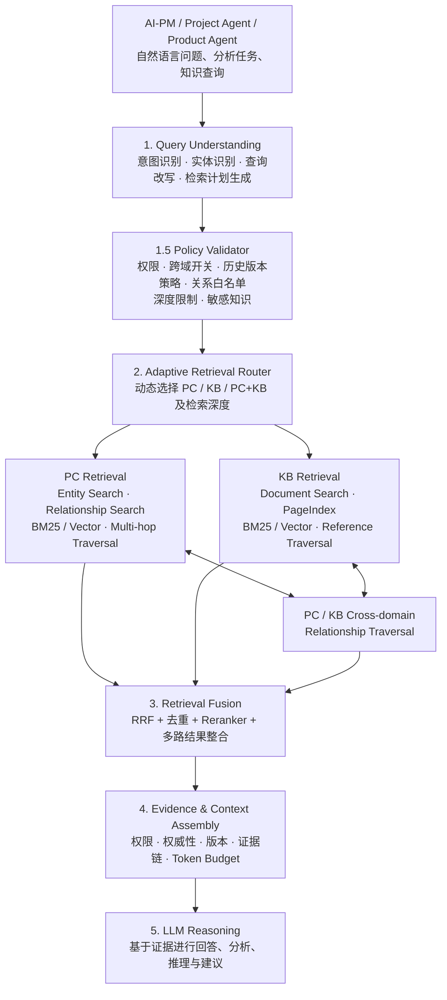
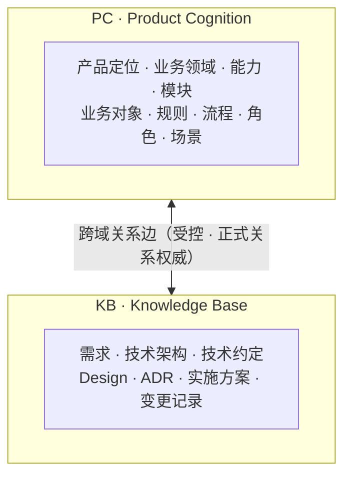
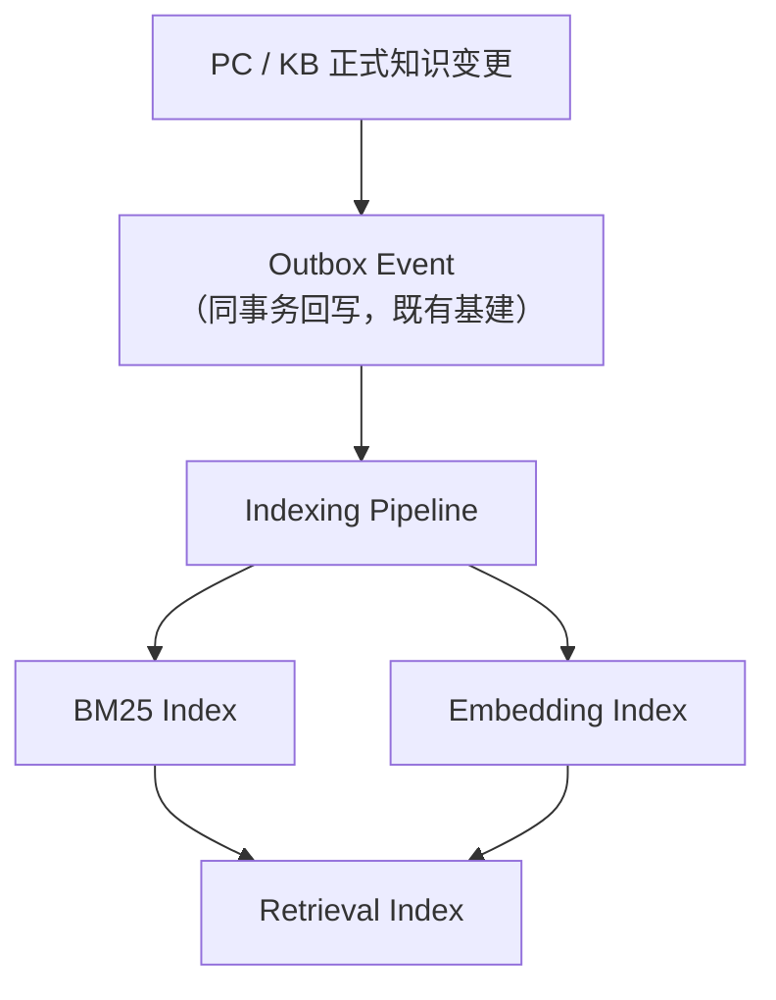

# PM-AI · PC / KB Retrieval 技术设计基线 V1.1

> **状态**：设计基线，已收编两批正式裁决，进实施设计。
> **V1.0**：Q1=B / Q2=A + R-01~R-12 正式裁决。
> **V1.1**：收编专家稿 §五~§十二——Policy Validator 六项校验、五维独立评分（不合并单一分数）、Evidence 统一结构、服务边界与五端点 API、Outbox→Indexing Pipeline、实施阶段 S1~S8 与验收矩阵 RT-001~RT-015、V1 九条非目标、冻结技术原则、关系数据维护权。
> **V1.1a 勘误**（2026-11-09 代码现实评审后，见 `pc-kb-retrieval-expert-review-code-reality-v1.md`）：①Requirement 锚 S02 需求域（delivery.requirement_revision）非 KB doc_type，跨域范围=**PC↔KB↔S02 三域**；②S2/S8 补内容管线前置依赖（KB published 通道未建+六格式解析层缺失）；③RT-002 标注 D-1 门控与降级验收路径；④种子增量澄清（PC 对象类型 18 条种子已覆盖零新增；真实增量=指向 KB 端点的新 relationship_type 种子）。
> **定位**：PM-AI 的**统一认知检索基础设施**，不是单纯的 RAG 功能。同时解决三件事：① LLM 如何知道该检索哪些知识（意图路由）；② 如何发现 PC/KB 跨领域知识关系（多跳遍历）；③ 如何确保回答遵循正式知识、版本与权威性约束（Authority-aware 组装 + 证据引用）。
> **权威边界（不变式）**：检索索引是**派生数据**，不取代正式知识正文（`kb.document_revision.content` / `pc.document_revision.content`）与结构化状态（PC 对象生命周期、KB 修订状态）的权威地位。
> **关联**：`kb-pc-knowledge-layer-model-selection-v1.md`（知识层选型）· `docs/architecture/knowledge-services/ai-pm-t060-knowledge-index-v1.md`（db-section/provider 端口）· `kb-pc-independent-services-architecture-v1.1.md`（ADR-01/ADR-10）· `pc-01b-00-overview-and-decisions-v1.1.md`（PC 正式模型）

---

## 一、正式架构裁决（如实转录）

根据本次正式裁决：**Q1 = B**（Intent-aware Adaptive Retrieval）、**Q2 = A**（允许 PC/KB 跨域多跳关联检索）。

| 编号 | 架构事项 | 正式裁决 |
| --- | --- | --- |
| R-01 | 检索路由 | LLM 意图感知、自适应路由 |
| R-02 | 检索范围 | PC、KB 独立检索及联合检索 |
| R-03 | 跨域检索 | 允许跨 PC/KB 多跳关系检索 |
| R-04 | 关键词检索 | BM25 |
| R-05 | 语义检索 | Embedding + Vector Search |
| R-06 | PC 关系检索 | PostgreSQL 结构化关系查询 |
| R-07 | KB 文档检索 | BM25 + Vector + PageIndex |
| R-08 | 结果融合 | RRF |
| R-09 | 检索精排 | Cross-Encoder Reranker |
| R-10 | 上下文组装 | Authority-aware + Version-aware |
| R-11 | 知识引用 | Evidence-based Answer |
| R-12 | 基础设施 | V1 优先采用 PostgreSQL + pgvector |

**核心原则**：PC 和 KB 保持独立的知识模型与数据所有权，使用统一 Retrieval Service 提供检索能力，允许通过受控关系进行跨域关联和多跳推理。

---

## 二、总体架构





---

## 三、裁决条目 × 既有资产对照

首要原则是**在已有资产上补缺口，不平行造第二套**：

| 裁决 | 既有资产（已建成） | 缺口（本设计要补） |
| --- | --- | --- |
| R-01 意图路由 | `conversation_router_model.rs`（LlmIntentClassifier，8s 超时/2000 字符截断先例）；DK-0 注入预算纪律 | **RetrievalPlan 契约 + Policy Validator** |
| R-02 独立+联合 | `kb_service`/`pc` 两域应用服务（进程内，ADR-10 方案 A）；`kb-pc-contracts` 端口形状 | 统一 Retrieval Service 编排层 + Retrieval 端口 |
| R-03 跨域多跳 | **`pc.relationship` 已内建跨域四元组端点**（`source_object_id` XOR `source_ext_domain/type/id/revision_id`，CHECK 互斥）+ lifecycle 状态机 + `pc.relationship_type` 注册表（directionality + governance_level L1/L2） | 遍历引擎（受控 SQL，递归 CTE + 环检测）；类型/对象**种子数据** |
| R-04 BM25 | PG 全文基建未用于知识域 | KB/PC 域 tsvector 列 + GIN + BM25 排序（pg_search 扩展后置） |
| R-05 向量 | 零 embedding 基建；零分块 | pgvector 表 + chunking + embedding 管线；**供给复用 team_llm**（provider kind 已含 `openai_compatible`/`gemini`） |
| R-06 PC 关系查询 | `pc.relationship` + `pc.relationship_revision` + 注册表 | 遍历查询 API 化 |
| R-07 KB 文档检索 | **`db-section` v1 = PageIndex 模式自研实现**；六格式解析层零 | kb 域自建索引表（不碰 `ai.document*`/guard）+ 六格式解析 |
| R-08 RRF | 无 | RRF 融合器（k=60 起步） |
| R-09 Reranker | 无 | 精排面（五维独立评分，§7.3） |
| R-10 权威/版本组装 | PC lifecycle；kb revision 状态；版本链裁决 | 组装器统一口径 + 历史检索显式策略（§11.4） |
| R-11 证据引用 | `ai.knowledge_reference`（锚点级）；`pc.evidence` / `kb.memory_ref` 四元组 | Evidence 统一结构（§8.1） |
| R-12 PG+pgvector | PG 单库既有 | pgvector 扩展启用（迁移自 0003+ 空号） |

**两个关键的"不新建"裁决（V1.0 已定，维持）**：
1. **`knowledge_relation` 表不新建平行表**——`pc.relationship` 已是其更强形态；跨域"统一读模型"用视图实现。
2. **关系语义表落种子数据不落代码枚举**——`pc.object_type`（18 条种子已在）/`pc.relationship_type`（12 条种子已在，3 条已指向 S02 需求域）是数据驱动注册表；真实增量=指向 KB 端点的新 relationship_type 种子（对照表见 §6.4 勘误版），治理走注册表 status 生命周期。

---

## 四、检索通道设计（R-02/R-04/R-05/R-06/R-07）

### 4.1 PC 通道

| 子通道 | 实现 | 权威数据 |
| --- | --- | --- |
| Entity Search | 结构化查询：`display_name`/`object_key` 精确+模糊 + `object_type` 过滤 + lifecycle 过滤 | `pc.cognition_object` |
| Relationship Search | 类型化关系查询（relationship_type_key / 端点对象展开） | `pc.relationship`（仅 active 进正式结果） |
| BM25 | `pc.document_revision.content` tsvector | 正文权威 |
| Vector | chunk embedding（S2 向量半边，受 D-1 门控） | 派生 |
| Multi-hop | §六 遍历引擎 | 正式关系 |

### 4.2 KB 通道

| 子通道 | 实现 | 权威数据 |
| --- | --- | --- |
| Document Search | doc_key/doc_type 元数据查询 | `kb.document` |
| PageIndex | 章节树索引（复用 `knowledge_index.rs` 纯函数 → kb 域自建索引表） | 派生 |
| BM25 | 章节/正文 tsvector | 派生索引列 |
| Vector | 章节+chunk embedding（S2） | 派生 |
| Reference Traversal | `kb.memory_ref` 四元组 + 引用回查 | 混合（引用=正式记录） |

### 4.3 索引有效性（派生数据纪律）

- **有效性四要素**：`content_hash` + 解析规则版本 + **该修订是家族现行 published 修订** + embedding 模型版本（vector 行）。任一失配 → `stale`。
- **不变量**：`status ≠ 'indexed'` ⇒ 该修订索引行数 = 0；状态转换只经单一原语（对齐 `apply_transition` 模式）。
- **域边界**：索引表落 `kb`/`pc` schema；**不碰 `ai.document*`、不碰 guard**。

---

## 五、Intent-aware Adaptive Retrieval + Policy Validator（R-01，Q1=B）

### 5.1 四种检索模式

| 模式 | 使用场景 | 执行策略 |
| --- | --- | --- |
| PC Only | 产品业务、业务规则 | PC 多通道检索 |
| KB Only | 技术架构、ADR、实施方案 | KB 多通道检索 |
| PC + KB | 需求与设计关联 | 双域并行检索 |
| Cross-domain | 影响分析、完整业务技术追踪 | 多跳关系遍历 |

### 5.2 RetrievalPlan 契约（V1.1 合并 schema）

逻辑示例（**非最终 API Schema**）：

```jsonc
{
  "intent": "cross_domain_coverage_analysis",   // factual_lookup | impact_analysis | completeness_check | summary | comparison
  "domains": ["PC", "KB"],                      // pc_only | kb_only | pc_kb | cross_domain
  "retrieval_modes": ["entity", "keyword", "vector", "relationship"],
  "entities": [                                 // 锚点实体（执行必需）
    { "kind": "pc_object", "type_hint": "business_object", "key_or_name": "订单状态" }
  ],
  "rewritten_queries": ["..."],                // 查询改写（1~3 条，多通道共用）
  "traversal": { "enabled": true, "max_hops": 3 },
  "analysis": { "type": "coverage_gap", "require_evidence": true },
  "budget": { "max_candidates": 60, "timeout_ms": 8000 }
}
```

**硬约束**：LLM 只产计划，**永不生成 SQL、永不直接决定访问权限**；遍历走预定义受控查询。计划校验失败 → 降级 `pc_kb` 双域并行；路由 LLM 失败/超时（8s 上限先例）→ 原始查询直查。计划与执行统计（各通道命中、遍历深度、降级原因、校验结论）随结果返回进审计。

### 5.3 Policy Validator 六项校验（校验通过后才执行检索）

| # | 校验项 | 落点（既有机制映射） |
| --- | --- | --- |
| 1 | 当前用户能否访问 PC 和 KB | 项目成员身份（`require_project_visible` 同口径；PC/KB 数据随项目归属） |
| 2 | 当前项目是否允许跨域访问 | 项目级策略位；**V1 默认 = 同项目内允许 PC↔KB、跨项目一律禁止**；开关待裁（D-7） |
| 3 | 是否允许读取历史版本 | 历史检索策略位（§11.4）：成员默认可读**已发布**历史修订；draft 永不进检索；密级后置（D-4 联动） |
| 4 | 关系类型是否在白名单中 | `pc.relationship_type` 注册表（`status='active'`）+ 引用四元组类型白名单；未注册类型不展开 |
| 5 | 检索深度是否超出限制 | `max_hops` 夹紧（默认 3，上限 5）、`max_candidates` 夹紧、timeout 夹紧 |
| 6 | 是否存在敏感或不可访问的知识 | V1 fail-closed：无密级元数据 = 项目内全部可见；**检索面预留密级过滤钩子**，密级标注随权威标注扩展后置（D-4） |

校验器是确定性代码（非 LLM）；校验结论（含拒绝原因）进审计。

### 5.4 查询处理示例

*"目前产品的权限体系是否完整？有哪些技术设计还没有覆盖？"* → 识别：权限体系=PC、技术设计=KB、完整性检查=跨域关联分析 → 计划 `domains=[PC,KB]` + `traversal.enabled` + `analysis.type=coverage_gap` → PC 定位权限域对象 → 关系展开 → KB 侧 Design/ADR 匹配 → **反向闭包找出零覆盖对象**（完整性检查的本质是关系反查，不是文本相似）。

---

## 六、跨域多跳检索（R-03，Q2=A）——**必须进 V1**

> 裁决稿明示：**跨域多跳能力必须进入 V1，不能因为实现复杂被推迟到 V2**（本条取代 V1.0 稿 R3 后置排期；渐进的是关系**数据丰度**，不是引擎本体）。

### 6.1 关系权威分层

| 层 | 载体 | 进正式遍历 | 标注 |
| --- | --- | --- | --- |
| 正式关系 | `pc.relationship`（`lifecycle_status='active'`） | ✅ | 权威 |
| 正式引用 | `pc.evidence` / `kb.memory_ref` 四元组（真人确认链产物） | ✅（作边） | 权威（引用语义） |
| 候选关系 | AI 推测（恒 draft / 待审 proposal） | ❌ 不进正式图 | `speculative` 必标，仅显式开启时作候选扩展边返回 |

### 6.2 遍历算法与约束

受控 BFS（递归 CTE + 逐跳权限过滤）：

- **跳数**：默认 3，显式提升至 5（校验器夹紧）。
- **合法边**：每跳必须命中注册表内类型 / 引用四元组白名单。
- **边界**：每跳租户/项目硬过滤，非成员不可见。
- **环检测（RT-014）**：遍历维护 visited 节点集合 + 跳数上限**双保险**，关系图成环时不无限遍历、不重复展开。
- **剪枝**：按相关性 × 权威性（active > draft）× 版本现行性排序截断；deprecated/superseded 节点只作历史标注不展开。
- **预算**：最大候选 60、Token Budget 组装器统一裁剪、时间预算 8s（超时返回已遍历部分标 `truncated`）。
- **推测纪律（RT-015）**：无法确认的关联一律标 `speculative`，不作为正式事实进证据链。

### 6.3 多跳示例（裁决稿走查）

*"如果我们修改订单状态，会影响哪些功能、需求、技术设计和架构决策？"*

```
第一跳  PC：Order → Order Status → 相关 Business Rules
第二跳  PC 内部：Business Rules → Business Processes → Product Modules
第三跳  PC → KB：Product Modules → Requirements → Designs
第四跳  KB 内部：Designs → ADR → Technical Documents
证据汇总：订单状态变更的业务影响 / 需求影响 / 技术影响分析
```

数据稀疏处如实输出缺口（RT-011）——遍历引擎输出证据与缺口，**不虚构关系**。

### 6.4 关系语义 → 种子数据映射（V1.1a 勘误版）

> **勘误 ①④**：`pc.object_type` 已有 **18 条种子**（business_capability / feature_module / business_process / business_rule / domain_object / scenario / product_decision 等全覆盖，baseline:10255~10272）——专家语义表的 PC 对象**零新增**。`pc.relationship_type` 已有 **12 条种子**（baseline:10280~10291），其中 `specified_by` / `constrains` / `informs` 的 ext 端点已指向 `requirement.requirement_revision`——**正式需求权威 = S02 需求域（`delivery.requirement_revision`），不是 KB 文档**。跨域遍历的实际范围是 **PC ↔ KB ↔ S02 需求域三域**，不是专家假设的两域。

真实种子增量 = 下表**新增**行（迁移执行；type_key 走 kebab-case；端点数组/directionality/governance_level 全按既有 12 条先例写法）：

| 源端 | 目标端 | relationship_type | 状态 |
| --- | --- | --- | --- |
| PC business_capability | S02 `requirement.requirement_revision` | `capability-realized-by-requirement` | **新增** |
| PC domain_object | S02 `requirement.requirement_revision` | `object-referenced-by-requirement` | **新增** |
| PC business_rule | S02 `requirement.requirement_revision` | `rule-enforced-by-requirement` | **新增**（与既有 `constrains` 同向，落地前合并评估去重） |
| PC business_process | KB doc_type=architecture | `process-implemented-by-design` | **新增** |
| PC feature_module | KB doc_type=architecture | `module-covered-by-design` | **新增** |
| S02 requirement_revision | KB doc_type=architecture | `requirement-implemented-by-design` | **新增** |
| KB doc_type=architecture | KB doc_type=decision | `design-constrained-by-adr` | **新增**（KB 域内边，归属见 §十五） |
| KB doc_type=decision | KB doc_type=knowledge | `adr-documented-in` | **新增**（同上） |
| PC scenario | S02 `delivery.requirement_acceptance_criterion` | `scenario-verified-by-acceptance` | **新增** |
| PC feature | S02 `requirement.requirement_revision` | —— | 已有（`specified_by`） |
| PC business_rule | S02 `requirement.requirement_revision` | —— | 已有（`constrains`） |
| PC product_decision | S02 `requirement.requirement_revision` | —— | 已有（`informs`） |

种子治理走注册表 status 生命周期（后续增类型零代码变更）；**新增种子须同时补 owner_domain 属性**（§十五）。白名单校验（Policy Validator #4）= 类型 `active` + **端点类型数组命中**双重判据。

---

## 七、统一检索算法（R-04/R-05/R-08/R-09）

### 7.1 多路召回

每个检索域按问题类型执行：BM25 关键词召回 / Vector 语义召回 / Entity 精确匹配 / Relationship 关系扩展 / PageIndex 文档导航（KB）。

### 7.2 RRF 融合（R-08）

$$RRF(d)=\sum_{i=1}^{n}\frac{1}{k+rank_i(d)}$$

- `d`：候选知识；`rank_i(d)`：第 i 通道中的排名；`k`：平滑参数，**初始 60**（llm_wiki 实测先例，可调）。
- 遍历边**不参与 RRF**，直接进证据集（关系是结构化事实，不是相似度竞争者）。
- 去重：同一（domain, type, id, revision）归并，合并通道来源。

### 7.3 五维独立评分（不可合并成单一不可解释分数）

| 维度 | 作用 |
| --- | --- |
| **Relevance** | 与问题的相关程度（BM25/vector/rerank 产出的唯一"分数"维度） |
| **Authority** | 知识权威等级（PC lifecycle / kb 修订状态 / 正式 vs 草稿） |
| **Version** | 版本有效性（现行 / 历史 / 被替代） |
| **Relationship** | 关系路径可信度（正式边 / 引用 / 跳数衰减） |
| **Freshness** | 信息时效性（修订时间 / family 现行性） |

**输出结构分列五维，不折算成单一 relevance_score**；示例分数永不作为生产阈值。

### 7.4 约束前置序（先约束、后精排）

**先执行权限、版本和权威性约束（通道级硬过滤：SQL WHERE + lifecycle 门），再进行相关性精排**。权限/版本过滤在通道查询内完成（索引友好）；权威性是门 + 独立维度（superseded/deprecated 默认不进"现行"答案，只在历史策略下出现）；rerank 只对通过门的候选集排序。

### 7.5 精排（R-09）

V1 用 LLM listwise 起步，`Reranker` trait 抽象（provider 托管 rerank 端点 / 本地 Cross-Encoder 后续无感替换——Cross-Encoder 是目标形态，不阻塞 V1 基建）。**历史检索采用明确的历史版本策略**（§11.4），精排不混淆现行与历史。

---

## 八、Evidence & Context Assembly（R-10/R-11）

> PC/KB 检索与普通 RAG 的核心区别：**LLM 不该只收到一堆文本 chunk，而应收到具有来源和关系的证据集合。**

### 8.1 统一 Evidence 结构（合并定版）

```jsonc
{
  "evidence_id": "ev-001",
  "domain": "KB",                          // PC | KB
  "object_type": "ADR",                    // 领域内类型
  "object_id": "ADR-006",
  "version": "v3",                         // 修订号（现行性见 authority_status）
  "authority_status": "current_published", // 规范词表：current_published | historical_published | draft_candidate | superseded | speculative
  "source_reference": {
    "document_id": "doc-001",
    "section": "Decision",                 // PageIndex 锚点（section_anchor + start_line）
    "content_hash": "sha256..."
  },
  "relationship_path": [                   // 跨域路径（一等公民，逐段类型化）
    "PC.BusinessRule", "KB.Requirement", "KB.Design", "KB.ADR"
  ],
  "relevance": {                           // 五维分列（§7.3），不给单一总分
    "channel": "pageindex", "hops": 2, "speculative": false
  }
}
```

> `relevance_score` 示意值**不作为生产阈值**；分数维度分列输出。

### 8.2 最终 Context 六要素

1. 正式知识证据；2. 对应的结构化实体；3. 跨域关系路径；4. 相关历史版本（任务需要时，走历史策略）；5. 证据状态和可信度；6. 原始知识引用位置。

### 8.3 LLM 必须能回答的六问

结论是什么？依据是什么？哪些是正式确认的？哪些只是 AI 推测？**哪些关系尚未建立（gaps）**？哪些知识存在冲突（联动 `pc.conflict`）？

无证据支持的论断 → 如实"知识库中未找到依据"；`gaps` 与降级（degradations）是一等公民输出。Token Budget 沿 DK-0 纪律：总量硬预算 + 分节配额 + **单条上限** + DROP 序。

---

## 九、基础设施（R-12）

### 9.1 pgvector（S2 向量半边，受 D-1 门控）

```sql
CREATE TABLE kb.chunk_embedding (
  id uuid PRIMARY KEY DEFAULT gen_random_uuid(),
  tenant_id uuid NOT NULL,
  project_id uuid NOT NULL,
  document_id uuid NOT NULL,
  document_revision_id uuid NOT NULL,     -- 有效性要素①②
  chunk_no int NOT NULL,
  content_hash text NOT NULL,             -- 要素①
  index_version text NOT NULL,            -- 要素②
  embedding_model text NOT NULL,          -- 要素④
  embedding vector(1024) NOT NULL,
  created_at timestamptz DEFAULT now() NOT NULL
);
CREATE INDEX ON kb.chunk_embedding USING hnsw (embedding vector_cosine_ops);
```

embedding 供给复用 team_llm（provider kind 已含 openai_compatible/gemini，endpoint 现成；**待裁扩 purpose=embedding**）。vector 不可用 → 自动降级 BM25 + PageIndex（检索永不全瘫痪）。

### 9.2 BM25（R-04）

V1 用 PG 原生 tsvector + GIN + `ts_rank`（中文 bigram 配置，llm_wiki CJK 先例）；pg_search/ParadeDB 登记为实测不达标时的后置升级，接口不变。

---

## 十、服务边界与职责划分

> 在现有 PC-Service、KB-Service 之外，增加独立的 **Retrieval Service 逻辑服务**；**不一定立即拆成独立部署单元，但必须独立定义领域接口**。

| 服务 | 职责 | 不负责 |
| --- | --- | --- |
| PC-Service | 产品实体、业务关系、正式认知查询 | 全局检索编排 |
| KB-Service | 知识文档、版本、引用、PageIndex | 跨域检索编排 |
| **Retrieval Service** | 检索计划、路由、多路召回、跨域遍历 | **修改正式知识** |
| Embedding Pipeline | 文本切分、Embedding、索引更新 | 知识审批 |
| Reranker | 相关性精排 | 权威性裁决 |
| LLM | 意图识别、推理、回答 | **自行改变知识状态** |

与代码现实对齐：V1 Retrieval Service = 进程内编排层（ADR-10 方案 A），`kb-pc-contracts` 增 `RetrievalPort`（端口形状为 Phase 7 HTTP 化预留）；PC/KB 通道实现留各自域（ADR-01：两域所有权不合并，检索层只编排融合不持权威数据）。

### API 边界

| 端点 | 语义 | V1 形态 |
| --- | --- | --- |
| `POST /v1/retrieval/query` | 统一检索入口 | ✅ **V1 唯一 REST 实现**（全局 fail-closed 中间件链，`project_id` 必填 + `require_project_visible`） |
| `POST /v1/retrieval/plan` | 生成并校验检索计划 | 内部模块边界（不暴露 REST） |
| `POST /v1/retrieval/execute` | 执行多通道检索 | 内部模块边界 |
| `POST /v1/retrieval/expand` | 受控跨域关系扩展 | 内部模块边界 |
| `POST /v1/retrieval/evidence` | 组装可引用证据 | 内部模块边界 |

V1 不过早拆成大量微服务 API；`RetrievalPort` 内部方法面按 plan/execute/expand/evidence 四能力切分。**MCP 四工具签名冻结不破**；新增独立 MCP 检索工具另裁（D-8）。

---

## 十一、索引与知识更新机制

**正式知识变化必须最终反映到检索索引**：



### 八项要求 × 落点

| # | 要求 | 落点 |
| --- | --- | --- |
| 1 | 知识版本变化触发索引更新 | 修订发布（published）/PC 版本发布事件 → 索引任务（outbox 消费，复用既有 handler 模式） |
| 2 | 旧版本索引保留或归档，支持历史检索 | **调和方案见 §11.4**：active 索引只含现行；历史走版本钉死直读，无需归档索引存储 |
| 3 | 删除或撤销的知识必须及时停止参与当前检索 | veto/rejected → 索引行清零（对齐 ai 栈 veto 路径不变量：非 indexed ⇒ 0 行） |
| 4 | 索引更新失败可重试 | outbox 消费重试 + `document_index_state.status=failed/last_error` 同款台账 |
| 5 | 支持全量重建 | ai 栈项目级全量重建先例（`rebuild_quietly`）；kb/pc 域同原语 |
| 6 | 支持增量更新 | hash 未变跳过（SHA256 增量，llm_wiki 先例）+ stale 逐篇重算 |
| 7 | 版本号和幂等键避免重复处理 | 幂等键先例 `kb_memory_approved:{revision_id}` → `kb_index:{revision_id}:{index_version}` |
| 8 | 索引更新不能反向修改 PC/KB 正式知识 | 索引管线只读正式表，写派生表（写权限单列表进守卫） |

**RabbitMQ 不引入**：现有 PG outbox + 进程内消费足够；异步传输扩展（MQ）登记为未来演进项，本次不为检索架构引入。

### 11.4 历史检索与"只索引现行"的调和

两裁决并存：**active 检索索引只含家族现行 published 修订**（版本链裁决，防旧版污染现行答案 = RT-008）；**历史修订支持显式检索**（RT-007 历史决策追溯）。落地方案：

- 历史修订**不再维护第二套归档索引**（修订正文不可变、解析确定性 → 按需解析零风险）；
- 历史查询 = 显式版本钉死（`revision_id` 指定）→ 直读该修订 → 同一解析器现场分节 → 附 `authority_status=historical_published` 标注返回；
- 现行查询永不混入历史行（通道级 WHERE）；历史查询必须显式声明（Policy Validator 第 3 项门控）。

## 十二、实施阶段与验收标准

### 12.1 S1~S8（跨域多跳在 S5，必进 V1）

| 阶段 | 实施内容 | 验收重点 | 落点备注 |
| --- | --- | --- | --- |
| S1 | 统一 Retrieval Service | 统一接口、权限边界 | `RetrievalPort` + `/v1/retrieval/query` + Policy Validator |
| S2 | BM25 + pgvector | 关键词和语义检索 | BM25 先行；向量半边受 D-1（embedding provider）门控。**前置依赖（V1.1a）**：内容管线——KB 确认/发布通道（K3 语义，现 501，`kb.document_revision` 无 published 转换代码）+ 六格式解析层（选型稿）；无此前置 BM25/pgvector 无内容可索引 |
| S3 | PC / KB Adapter | 独立检索和结果标准化 | 两域通道实现 + 结果归一 |
| S4 | Adaptive Retrieval Planner | 动态意图路由 | RetrievalPlan 契约 + 校验器 + 降级链 |
| S5 | **Cross-domain Traversal** | **PC/KB 多跳关联** | **V1 必交付**（引擎本体）；关系数据丰度渐进（种子迁移铺开） |
| S6 | RRF + Reranker | 召回和精排 | 五维独立评分 + listwise 起步 |
| S7 | Evidence Assembly | 权威性、版本、引用 | §8 统一结构 + 六要素 Context |
| S8 | Indexing Pipeline | 增量更新、重建、恢复 | §十一 outbox 接线 + 八项要求逐条验收。**前置依赖（V1.1a）**：KB 侧发布事件源——`kb.document_revision` 目前无 published 转换通道（全仓无此代码，K1/K3/K6 501），管线在 KB 侧无上游触发器可挂；PC 侧 `pc.cognition.version_published` 生产者已在 |

### 12.2 核心验收用例 RT-001~RT-015

| 编号 | 测试场景 | 预期结果 | 实现触点 |
| --- | --- | --- | --- |
| RT-001 | 精确搜索 ADR 编号 | 正确命中 | Entity/Document Search |
| RT-002 | 自然语言搜索业务规则 | 语义召回正确 | BM25/Vector；**D-1 未决时以 BM25+CJK bigram 验收并记降级路径**（V1.1a） |
| RT-003 | PC 独立查询 | 不依赖 KB | S3 Adapter 隔离性 |
| RT-004 | KB 独立查询 | 不依赖 PC | 同上 |
| RT-005 | 需求关联技术设计 | 正确跨域关联 | 正式关系边 |
| RT-006 | 业务对象影响分析 | 支持多跳遍历 | S5 引擎 |
| RT-007 | 历史决策追溯 | 找到指定历史版本 | §11.4 历史策略 |
| RT-008 | 当前正式决策查询 | 不被旧版本覆盖 | 只索引现行 + 权威门 |
| RT-009 | AI 草稿与正式知识冲突 | 正式知识优先 | 权威分层（draft 不进正式答案） |
| RT-010 | 跨项目数据访问 | 严格权限隔离 | Policy Validator #1/#2 |
| RT-011 | 关系不存在 | 明确报告证据缺口 | `gaps` 一等公民 |
| RT-012 | 索引更新失败 | 可恢复、可重建 | S8 重试+重建 |
| RT-013 | 证据引用 | 能追溯原始文档及章节 | source_reference 锚点 |
| RT-014 | 多跳关系循环 | 不无限遍历 | visited 集合 + 跳数双保险 |
| RT-015 | AI 推测关系 | 不作为正式关系使用 | `speculative` 纪律 |

**性能指标**：结合实际语料规模和部署环境通过基准测试确定，**现在不设定固定 QPS/延迟承诺**。

## 十三、V1 明确不做的事情（九条非目标）

1. 不引入 Neo4j 等独立图数据库（SQL 关系遍历承载）。
2. 不引入独立 Elasticsearch/OpenSearch 集群（PG 全文承载）。
3. 不让 LLM 自由执行 SQL（受控预定义查询）。
4. 不允许 AI 检索时自动修改 PC/KB 知识（检索只读）。
5. **不把 Embedding 相似度作为知识权威性判断**（权威来自 lifecycle/修订状态，与向量分数彻底分离）。
6. 不允许未经确认的 AI 推测关系进入正式知识图。
7. 不允许跨租户、跨项目无约束遍历。
8. 不把 PageIndex 当作正式知识存储（派生索引）。
9. **不让检索结果直接覆盖人工批准的设计和 ADR**。

## 十四、冻结的技术原则

**PC / KB Retrieval V1.0，冻结为架构基线。**

- **核心架构**：Intent-aware Adaptive Retrieval + Hybrid Search + Cross-domain Multi-hop Retrieval + Evidence-based RAG
- **技术栈**：PostgreSQL + pgvector / BM25 / PageIndex / SQL-based Relationship Traversal / RRF / Cross-Encoder Reranker / LLM Query Planner
- **两项关键裁决**：Q1=B（LLM 自适应决定检索域和检索策略）；Q2=A（V1 支持 PC/KB 跨域多跳关系检索）
- **不可违反的原则**：PC/KB 保持各自知识权威；Retrieval Index 始终是派生数据；多跳关系必须可追溯；LLM 只能在授权范围内检索；最终回答必须具备证据来源。

## 十五、关系数据维护权（防止第三个知识权威）

| 域 | 权威维护方 |
| --- | --- |
| PC 实体及其关系 | **PC-Service**（`pc.relationship` + 注册表） |
| KB 文档及其关系 | **KB-Service** |
| 跨域关系 | **明确的领域归属方维护**（关系类型注册表带 owner_domain 属性），另一方通过受控引用（`*_ext_*` 四元组） |
| Retrieval Service | **只读取、遍历、推理和整合，不拥有知识关系的写入权** |

代码现实调和：跨域边当前物理落在 `pc.relationship`（PC 主持，ext 四元组指向 KB 文档）；实施设计须补两件事——①关系类型注册表增 `owner_domain` 属性（谁维护该类型边）；②KB 侧文档级关系（如 Design↔ADR 同族约束）是否在 kb 域建对等表还是继续 PC 主持，随任务书第 2 项闭合。

## 十六、实施设计任务书范围（下一步四项）与待裁清单

**任务书重点闭合五项**（V1.1a 评审后由四项扩为五项）：
1. Retrieval Service 与 PC-Service / KB-Service 的**接口契约**（RetrievalPort 方法面 + 结果归一 schema）。
2. **跨域关系模型及多跳查询算法**（owner_domain、KB 侧关系落点、递归 CTE + 环检测形式化、**S02 需求域三域端点解析**）。
3. **Indexing Pipeline 与 Outbox 一致性机制**（事件清单、幂等键、重试/重建语义、§十一八项逐条；含 **KB published 通道缺口的补建方案**）。
4. **Retrieval Evaluation**（检索准确率、召回率、跨域推理正确率；RT-001~015 固化进测试集 + 选型稿 50 题标注集合并）。
5. **内容管线接缝**（V1.1a 新增）：KB 确认/发布通道 + 六格式解析层 + 版本族归并与 S2/S8 的衔接（与选型稿解析层设计合并闭合）。

**待裁清单（累计）**：

| # | 事项 | 建议 |
| --- | --- | --- |
| D-1 | embedding provider 选型与预算（team_llm 扩 purpose=embedding） | 复用既有 provider 面 |
| D-2 | Reranker V1 形态 | listwise 起步，trait 留三路 |
| D-3 | 关系/对象类型种子治理归属 | 走注册表既有治理语义 |
| D-4 | 权威标注扩展（密级/部门/生效日期） | 与选型稿 D4 合并设计；密级过滤钩子本批预留 |
| D-5 | 独立 MCP 检索工具 | 单独裁决，本基线不动工具面 |
| D-6 | 语料冷启动（50 个真实文件名样本） | **R1 出数硬前置** |
| D-7 | 项目级跨域访问开关默认值 | V1 默认同项目允许、跨项目禁止 |
| D-8 | 真 BM25 扩展（pg_search） | 实测不达标再升 |
