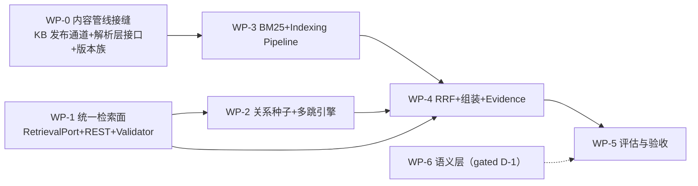

# PC / KB Unified Retrieval Architecture V1.0 · 实施设计与验收任务书

> **状态**：任务书 V1.0，待用户批准后按 WP 序开工。
> **输入基线**：`pc-kb-retrieval-technical-design-baseline-v1.md`（**V1.1a**，含四勘误）· `pc-kb-retrieval-expert-review-code-reality-v1.md`（代码现实评审）· `kb-pc-knowledge-layer-model-selection-v1.md`（知识层选型，六格式/版本族）。
> **裁决继承**：Q1=B / Q2=A / R-01~R-12 / S1~S8 分期 / RT-001~015 / 九条非目标 / 冻结原则——全部不再重开。
> **本文档职责**：把五项闭合项（基线 §十六）落成可开工的工作包分解——每个 WP 给出**迁移、代码落点、接口签名、测试与验收判据**，并给统一验收门与排期。
> **红线继承**（违者即返工）：检索索引=派生数据；LLM 不产 SQL 不定权限；AI 推测不进正式图；不碰 `ai.document*` 与 `guard_ai_container_users`；每跳权限校验；无证据不作答+gaps 一等公民；MCP 四工具签名冻结；Token 预算纪律。

---

## 〇、迁移号与落点事实（开工前实查基准）

> **迁移号随时可能被并行会话占用**。本文档分配基于 2026-11-09 实查（`0001_baseline` ~ `0005_conversation_interaction` 已在），**下个空号 = 0006**。每个 WP 开工当日必须 `ls migrations/` 复查，撞号顺移并回填本表。

| 分配 | 内容 | 归属 WP |
| --- | --- | --- |
| **0006**（WP-0 裁决后新增） | `kb.document_revision` 加 `confirmed_by uuid` + `published_at timestamptz` + CHECK（`status='published' ⇔ 两列非空`） | WP-0 |
| **0007** | `pc.relationship_type.owner_domain` 列 + 关系类型新种子（§三.1） | WP-2 |
| **0008** | `kb.document_section_index` + `kb.document_index_state`（镜像 ai 栈两表）+ BM25 tsvector 派生设施 | WP-3 |
| **0009** | `pc.document_revision` 检索面（正文 BM25 设施；PC 无章节表，见 §五.2） | WP-3 |
| **0010**（gated D-1） | `CREATE EXTENSION vector` + `kb.chunk_embedding`（+pc 对应） | WP-6 后置 |

**代码落点事实**（已核实，直接引用勿再猜）：

| 事实 | 位置 |
| --- | --- |
| outbox 消费者 trait | `pm-infrastructure/src/outbox_worker.rs:24`（`OutboxHandler::handle(&ClaimedOutboxEvent)`） |
| 既有 handler 先例 | `pm-infrastructure/src/kb_pc_handlers.rs`（KbMemoryApprovedHandler 等 7 个） |
| 事件目录（13 条） | `kb-pc-contracts/src/events.rs:37-49`（CATALOG 断言测试存在，**13→14 需同步**） |
| 鉴权助手 | `apps/pm-api/src/support.rs:196`（`require_project_visible`） |
| 章节解析纯函数（pub，直接复用） | `pm-application/src/knowledge_index.rs`（`parse_markdown_tree` / `MarkdownSection` / `SearchHit` / `raw_score` / `score_section` / `doc_type_weight`） |
| 索引状态机先例 | `pm-application/src/knowledge_indexer.rs`（`apply_transition` 单原语 / `rebuild_quietly` / 四要素有效性） |
| 意图分类先例 | `pm-ai/src/conversation_router_model.rs`（8s 超时 / 2000 字符截断） |
| 注入预算先例 | `pm-ai/src/discovery_context.rs:58-110`（TOTAL_BUDGET_CHARS / CAP_* / DROP_ORDER） |
| KB 草稿落库先例 | `pm-infrastructure/src/kb_pc_analysis.rs`（draft 落库等待人工确认） |
| PC 发布事件生产者 | `pm-application/src/pc/publish.rs` ⑫b → `pc.cognition.version_published` |
| provider 供给 | `ai.team_llm_provider`（kind 含 openai_compatible/gemini 等；endpoint/credential/status 现成） |

---

## 一、工作包分解与依赖图



| WP | 对应基线分期 | 内容 | 前置 |
| --- | --- | --- | --- |
| WP-0 | （评审新增第 5 项） | 内容管线接缝——**第一块多米诺** | 无 |
| WP-1 | S1+S4 | 统一检索面：RetrievalPort / REST / Policy Validator / Planner | 无 |
| WP-2 | S5 | 关系种子迁移 + 受控多跳遍历引擎 | WP-1 |
| WP-3 | S2(BM25 半边)+S3+S8 | BM25 索引设施 + outbox 索引管线 | **WP-0**（KB 侧无 published 触发器则管线无上游） |
| WP-4 | S6+S7 | RRF 融合 + 五维组装 + Evidence 契约 | WP-1/2/3 |
| WP-5 | 验收 | RT-001~038+前缀测试收口、评估 harness、合成 50 题、D-8 裁决包（GATED） | WP-4（RT 全量）；RT-003/004 可随 WP-1 先行 |
| WP-6 | **五项门控清单（收官定稿：不扩包不建设）** | D-1 embedding provider / 敏感知识钩子 / vector 通道（须重跑 WP-5）/ 真 BM25（依赖 D-8）/ Reranker 深化 | 各自门控条件，见 §十一 |

**关键路径 = WP-0 → WP-3 → WP-4 → WP-5**。WP-1/WP-2 可与 WP-0 并行（不同文件域，冲突面小）。

---

## 二、WP-0 · 内容管线接缝（第一块多米诺）——**已裁决定稿（2026-11-09，Q-A=A* / Q-B=A / Q-C=A）**

### 2.0 状态机核对结论（裁决 §四要求，已核）

`kb.document_revision` 库枚举 = **`draft / published / rejected`**（baseline:2893）。裁决书担心的 `pending_confirmation→approved→superseded` 生命周期**不在本表**——那是 `kb.memory_revision` 的审核状态机（PENDING_REVIEW/APPROVED + version_status CURRENT/SUPERSEDED，KB 记忆域另一张表）；`rolled_back` 只在 ai 栈（baseline:924）。**结论：WP-0 的 `draft→published` 与库枚举天然一致，事件名 `kb.document_revision.published` 与状态词一致；零新状态、零语义冲突、approved↔published 无需映射**。`rejected` 枚举原样保留（Q-C：不删除生命周期语义，仅暂不交付操作能力）。

**核对牵出的真缺口**：表无 `confirmed_by` / `published_at` 列（只有 created_by/created_at）——裁决处理顺序要求写入确认人与确认时间、事件 payload 需携带两者 → **迁移 0006 加列**（见 §〇 分配表）。

### 2.1 KB 确认/发布通道（补 F1 缺口；Q-A=A*）

**现状**：`kb.document_revision` 只有 draft 落库（`kb_pc_analysis.rs`），全仓无 draft→published 转换代码，K1/K3/K6 端点 501。

**交付**：

1. **应用命令** `confirm_kb_revision`（新文件 `pm-application/src/kb_service/document.rs`）：

   **处理顺序（裁决定版，顺序不可换）**：

   ```
   请求进入 → 身份真实性校验（auth_mode 准入） → Project Membership 校验
           → Revision 所属 Document 校验 → Revision 状态校验
           → 数据库事务 [draft→published / 写 confirmed_by+published_at / 写 Outbox Event]
           → 提交事务 → 返回成功
   ```

   **真人门（A* 三重）**：
   - **可信人类交互上下文**：消费 `caller.rs:41` 的 `auth_mode`（`interactive`/`api_key`/`unknown` 三分类既有基建）——**仅 `auth_mode='interactive'` 放行**；`api_key`/`unknown` 一律 403。**这是 auth_mode 三分类的首个准入消费者**（I6-A 核验结论"零准入消费"就此破零，对齐 A* fail-closed 既裁）；
   - **主体类型**：AI Agent / Service Principal / Device Principal 一律 403（`require_human` 先例：`requirement.rs:203` 主表版）；
   - **不可区分即拒绝**：无法区分真人与 Agent 代持真人凭据时拒绝确认（登录令牌复用不可防的既裁口径——所以 **MCP 不提供确认能力**，确认入口只开 REST/UI）；
   - 项目内任何真人成员可确认（**不要求 Lead / approver_grant**）；**Tenant Owner 不绕项目边界**（`require_project_visible` 已然：非成员一律 404）。

   **幂等行为表（裁决定版）**：

   | 场景 | 返回 |
   | --- | --- |
   | 真人成员首次确认 | 200 |
   | 已发布版本再次确认 | 200（**不得修改原 confirmed_by / published_at**——纯 no-op） |
   | 非项目成员 | 404 |
   | AI Agent / Service Principal / 未授权 Device Principal / api_key 调用 | 403 |
   | Revision 不属于该 Document | 404 |
   | rejected 修订再确认 | 409 |

2. **迁移 0006**（`0006_kb_revision_confirm_columns.sql`）：`confirmed_by uuid` + `published_at timestamptz` + CHECK（`(status='published') = (confirmed_by IS NOT NULL AND published_at IS NOT NULL)`；存量无 published 行，安全）。

3. **REST**：`POST /v1/kb/documents/{document_id}/revisions/{revision_id}/confirm`（挂 `kb_memory_api.rs` 同款链：全局 fail-closed + `?project_id=` 必填 + `require_project_visible`）。

4. **同事务 outbox 事件**（事务性事件红线：不能先发布库状态再异步补写）：

   ```jsonc
   // kb.document_revision.published（目录 13→14，contracts 断言测试同步）
   {
     "event_type": "kb.document_revision.published",
     "tenant_id": "...", "project_id": "...",
     "document_id": "...", "revision_id": "...",
     "doc_key": "...", "content_hash": "...",
     "confirmed_by": "...",           // 真人 principal
     "published_at": "...",
     "revision_no": 3                  // 裁决 payload 的 revision_version 落库字段=revision_no（int）
   }
   ```

   审计：`source_kind='kb_service'` 四身份列全写（audit_actor_coverage 登记 `kb_service/document.rs`）。

### 2.2 解析层（Q-B=A：纯 Rust ZIP+XML）

```rust
/// pm-application/src/knowledge_parse.rs（新）
pub struct ParsedDocument { pub markdown: String, pub warnings: Vec<String> }
pub enum ParseKind { Markdown, Text, Docx, /* Pdf, Xlsx, Image = 选型稿 Q5 后置，仅枚举占位 */ }
pub fn parse(kind: ParseKind, bytes: &[u8]) -> Result<ParsedDocument, ParseError>;
```

- **零 LibreOffice 依赖**、可直接部署 pm-api；优先还原 Word 标题层级（大纲级别→`#`）及正文结构；**复杂批注/复杂表格不列入 V1 硬指标**；
- 硬门槛：**合成 docx 大纲还原率 ≥90% 单测**；
- **解析与发布严格分离（长期安全约束）**：AI 可以解析/整理/提取标题/生成草稿，**不能越过真人确认门**；解析产物只喂 draft。

### 2.3 版本族归并（批准但 Gate 限制）

- `family_key(source: &str) -> Option<(key, version)>`（文件名正则；`v1.3`/`V1.3`/`（1.3）`归一）；
- 归并落点：family → `kb.document`（doc_key 稳定）；文件 → `kb.document_revision`（revision_no 按版本序）；
- **D-6 Gate（裁决四禁）**：50 个真实文件名样本到位前——不允许接入正式导入管线、不允许自动合并 Document Family、**不允许依据合成测试宣称真实归并准确率达标**。

### 2.4 本 WP 不做（Q-C=A）

Reject 命令 / Reject API / Reject 事件 / 索引撤销与清零 / 已发布版本撤销——**全部本批不实现**；`rejected` 生命周期语义保留不动。

**WP-0 实施红线（裁决原文六条）**：①AI 永远不能确认自己的解析产物；②确认和 Outbox 必须同事务；③解析只能产生 Draft；④未确认的文档不能进入正式检索索引；⑤不得绕过 D-6 接入版本族自动归并；⑥不得擅自改变既有 Revision 生命周期语义。

**WP-0 验收**：干净库 0001→0006 重放绿；集成测试七例（真人成功/重确认 no-op 不改确认人/非成员 404/AI 403/api_key 403/revision 归属错 404/rejected 409）；事件目录断言 14 项；docx 大纲还原率 ≥90%；auth_mode 准入单测（interactive/api_key/unknown 三态）。

### 2.5 实施发现登记（2026-11-09 首批实施，两条与裁决假设不符的基线事实）

**发现 F-1 · 库层比裁决假设更严：`kb.document_revision` 是严格 append-only**
- **事实**：baseline 里 `trg_kb_revision_append_only` 是 `BEFORE DELETE OR UPDATE` **全拒**触发器（`kb.reject_revision_mutation()`）——**连 `status` 列都不可改**。即：状态枚举虽含 `published`，库层**从未实现 draft→published 转换通道**，draft 行永远是死数据。这与评审 F1「无 published 转换代码」互为印证：不是缺代码，是缺通道。
- **同域先例**：KB 记忆域 `kb.memory_revision` 用的是**精细守卫** `kb.guard_memory_revision()`（允许白名单状态转换、拒非法转换）——文档修订应同款纪律。
- **处置（迁移 0006）**：`DROP TRIGGER trg_kb_revision_append_only` → 新建 `kb.guard_document_revision()` 守卫，四纪律：①DELETE 一律拒绝；②内容列不可改（content/content_hash/document_id/revision_no/tenant_id/analysis_mode）；③状态转换白名单=仅 `draft→published` 一次；④published 后确认人/确认时间不可改（**幂等的库层保证**）。触发器自述 "drop trigger to migrate" 即预期被迁移置换。
- **影响**：裁决「库枚举与事件名一致、零迁移改状态」的结论**仍成立**（未引入新状态词、未做 approved↔published 映射），但**"仅加两列"不足**——必须一并置换触发器。

**发现 F-2 · outbox 目录不变量要求事件必须有 handler**
- **事实**：`pm-application::outbox::CATALOG` 有硬门禁测试 `the_catalog_separates_handler_presence_from_default_enablement`——**无 handler 的事件不得 `enabled_by_default`**（"不假装消费"纪律；`enabled_by_default` 无机制消费点，纯纪律断言）。WP-0 首次登记（has_handler=false + enabled=true）直接撞红。
- **处置**：为该事件配**留痕型 handler** `KbDocumentRevisionPublishedHandler`（照 `PcVersionPublishedHandler` 同款 `notify_once` 留痕，去重键=revision_id），并装配进 `register_all_handlers`。WP-3 接手**同一事件、同一 trait 形状**换成真索引动作，worker 装配不动。
- **副作用登记**：装配覆盖断言 `handler_assembly_covers_catalog` 里有一份**手工对照清单**，新增事件类型必须同步（本次已同步）。

**发现 F-3 · PC 侧同款全拒触发器（WP-3 实施中）**：`trg_pc_document_revision_immutable` 是 `BEFORE DELETE OR UPDATE` 全拒——tsv 派生列无法落表，与 kb 侧 0006 同一冻结模式同一自述。处置（迁移 0009 同款纪律）：置换为 `pc.guard_document_revision()` 精细守卫——DELETE 禁 / 内容列不可变 / **派生列 `search_tsv` 允许更新**（索引管线唯一写入口，不触碰知识正文）。

**其他实现口径（非偏差，记录备查）**：
- **时间戳以库时钟为准**：`published_at` 用 `now()`（PG 微秒精度）+ `RETURNING` 回读，**不用** Rust `Utc::now()`（纳秒）——否则返回值与库内不一致，幂等断言即依赖两者相等。
- **ADR-06a 守扫注释字面量**：迁移头注若写全旧 ai 域表名会被守卫判为"新迁移触碰冻结容器"——措辞避开（老坑复发一次）。
- **测试库需调 `max_locks_per_transaction`**：多例并行建库重放迁移会撞 `out of shared memory`（默认 64）；测试容器以 `-c max_locks_per_transaction=2048` 启动。

---

## 三、WP-2 · 关系种子与多跳遍历引擎（S5，V1 必交付）——**已裁决定稿（2026-11-09，Q-A=收窄+双向 / Q-B=单表双 owner+不混确认 / Q-C=只走正式关系 / Q-D=speculative 恒关）**

> **修订（2026-11-09 终裁）**：`requirement-implemented-by-design` owner 由"pc 代持"**改判 kb**——owner_domain=确认权威域的语义自洽要求（PC 不拥有 S02/KB 对象即不得为其关系的确认权威）；RT-005 以 fixture Active 行验收，Phase 7 前不得默认 PC 代持。
> **架构定论（裁决金句，入册）**：正式关系遍历负责**解释影响路径**，文本相似度负责**发现候选证据**——两者互补，不混为一谈。**本定论同时约束 Retrieval Service、Evidence Assembly 与未来 Agent 的上下文注入逻辑。**

### 3.1 迁移 0007（`0007_relationship_owner_domain_seeds.sql`）

**owner_domain 六要求（裁决定版）**：①存量 12 条全回填 `pc`；②新增 KB 种子明确 `kb`；③**关系类型与 owner_domain 必须一致**；④**创建关系时校验类型所属领域**（`PcEndpoint::External` 只说明可引用外部对象，不代表任何领域可创建任意关系——禁双 ext 绕过 owner_domain 校验）；⑤查询恒过滤 `status='active'`；⑥既有 12 条 PC 种子不因遍历设计删除。

**种子终版（9→8 条新增）**：

| relationship_type | 端点 | owner_domain | 备注 |
| --- | --- | --- | --- |
| ~~rule-enforced-by-requirement~~ | — | — | **弃**（`constrains` 反向遍历覆盖——同一条正式关系的两个查询方向，不重复注册） |
| `capability-realized-by-requirement` | pc:business_capability → s02:requirement.requirement_revision | pc | **保留**（直接能力关联有独立语义，链式可达≠语义等价） |
| `object-referenced-by-requirement` | pc:domain_object → s02:requirement.requirement_revision | pc | **保留**（需求直接引用对象，不经规则中转） |
| `process-implemented-by-design` | pc:business_process → kb:document_revision(architecture) | pc | |
| `module-covered-by-design` | pc:feature_module → kb:document_revision(architecture) | pc | |
| `requirement-implemented-by-design` | s02:requirement.requirement_revision → kb:document_revision(architecture) | **kb**（终裁改判） | 两端均非 PC 对象；**owner=kb，V1 生产恒 draft**（KB 独立确认面 Phase 7 交付后才可 active；**禁止经 PC Proposal 发布为 active**）；RT-005 用 fixture Active 行验收引擎能力 |
| `scenario-verified-by-acceptance` | pc:scenario → s02:delivery.requirement_acceptance_criterion | pc | |
| `design-constrained-by-adr` | kb ↔ kb:document_revision(architecture/decision) | **kb** | KB 域内边；**V1 期确认面不存在**（见 3.2），实例恒 draft 不可遍历 |
| `adr-documented-in` | kb:decision → kb:knowledge | **kb** | 同上 |

### 3.2 确认权威边界（Q-B 核心修正——本轮最重要）

**允许复用（基础设施层）**：关系存储结构 / draft-active 状态表达 / 关系类型注册表 / 端点合法性校验 / 审计 / 通用状态迁移底层能力。

**不允许混用（业务确认层）**：PC 关系的业务确认权限 / PC 的 Proposal-Publish 流程 / PC 的正式认知确认入口 / KB 的 Document Revision 发布确认流程（WP-0 confirm 门）——**四者互不通用**。

**owner_domain 语义定版** = 该类型关系实例的**确认权威域**（**不能表示"哪个服务暂时能创建/维护这条关系"**）。V1 现实：有确认面的只有 PC（推进**自己主持**的类型——PC 对象发起、指向 KB/S02 ext 端点的边）与 KB 文档修订（WP-0，确认的是文档不是关系）→ **owner=kb 的三条类型（requirement-implemented-by-design + KB 域内两条）V1 期可创建 draft、生产恒不可 active**（KB 独立关系确认面 Phase 7 交付）。**两个结论并存（裁决定版）**：遍历引擎**支持** KB 域内边能力；V1 生产环境**暂不具备** KB 域内正式边的发布能力——验收用 fixture 直插 Active 行（**测试手段，不得成为生产 API 或数据修复脚本的绕行方式**），生产稀疏期如实。**状态词纪律**：Relationship 的 `active` 与 Document Revision 的 `published` 是两套状态机（§2.0 已核），各由各域接口推进，永不混谈。**RT-033 完整生命周期断言 = 关系生命周期与检索执行之间的核心边界**（"创建 Draft 成功 ≠ 已成为可遍历正式关系"），保留为长期断言。

**隐患红线（裁决原文）**：若 KB 关系发布走 PC Proposal 流程 → 两个确认权威 → 一致性灾难。禁止。

### 3.3 遍历引擎（`pm-application/src/retrieval/traversal.rs`）——五项实施约束（裁决定版）

1. **方向与关系语义分离**：反向遍历只改路径方向不改关系语义——输出**永不虚构关系类型**（`Requirement ─reverse: constrains→ Rule` 不得输出为 `enforced_by`）：

   ```rust
   pub struct TraversalEdge {
       pub relationship_id: String, pub relationship_type: String,
       pub source_id: String, pub target_id: String,
       pub traversal_direction: TraversalDirection,   // Forward | Reverse
   }
   ```

2. **多路径保留**：同一终点经 Rule/Capability/Object 多条独立路径分别保留（**直达与间接不合并成无路径差异的结论**——Evidence Assembly 侧同纪律）；节点/路径去重 + 候选预算防爆炸；**短路径优先**，3 跳是上限不是必须走满。
3. **超时语义**：预算由**统一 Retrieval 请求预算控制（8s 总量），不每跳重置**；`TraversalResult { nodes, edges, gaps, truncated: bool, truncation_reason: Option<String> }`——`truncated=true` 时调用方不得宣称完整影响分析。
4. **gaps 六分类**（不做"关系不存在"一锅烩）：`no_registered_relationship` / `no_active_edge`（类型在、无生效边）/ `endpoint_not_allowed` / `traversal_depth_exceeded` / `candidate_budget_exceeded` / `traversal_timeout`——告诉用户下一步该补什么。
5. **双端隔离**：每跳 `tenant_id+project_id` 硬过滤之外，**关系两端端点对象也必须同租户/项目**（防跨项目引用脏数据经端点连接渗入）；RT-036 专测端点污染。

引擎其余按既定：递归 CTE 常量 SQL（LLM 永不触 SQL）、`path` 数组环检测 + 跳数双保险（RT-014）、白名单 = 类型 active + 端点数组命中、候选 ≤60、跳数 ≤5。**边集接口预留不预实现**：

```rust
pub enum TraversalEdgeSource { FormalRelationship, EvidenceReference, MemoryReference }
pub struct TraversalConfig { pub edge_sources: Vec<TraversalEdgeSource> }  // V1 固定 [FormalRelationship]
```

（引用边后置单独评估：方向语义/跨域跨版本/目标生命周期/高频证据节点图膨胀四问。）

### 3.4 验收（RT-030~RT-038 续编；与裁决表 RT-021~029 的映射见 §7.1）

基线 RT-005 / RT-006 / RT-010 / RT-011 / RT-014 / RT-015 保留；新增续编：**RT-030** 正向遍历记 Forward / **RT-031** 反向遍历记 Reverse / **RT-032** 多路径保留独立有效路径 / **RT-033** 双 ext 端点 KB↔KB 创建 draft 成功**且验证"创建 draft ≠ 可遍历正式关系"（完整生命周期断言）** / **RT-034** owner_domain 校验（PC/KB 归属不可混淆、双 ext 不能绕过）/ **RT-035** 预算耗尽返回部分结果+truncated / **RT-036** 跨项目**端点污染** fixture（脏数据经端点连接渗不入）/ **RT-037** speculative/draft 恒不入 nodes/edges/Evidence 路径 / **RT-038** 未注册关系类型 Validator 拒绝。

fixture：种子关系 + 环 + draft 边 + 跨项目行 + **跨项目端点污染行**。

### 3.5 实施顺序（裁决八步）与 WP-1 接口纪律

①迁移 0007（owner_domain + 最小必要种子）→ ②类型白名单+owner_domain 创建校验 → ③双 ext draft 测试 → ④Traversal 结构+Forward/Reverse 语义 → ⑤递归 CTE+环检测+隔离 → ⑥gaps/预算/截断/去重 → ⑦接 WP-1 `RetrievalPort.expand` → ⑧RT 验收。**expand 在 WP-2 验收通过前恒 501**——不让 Planner 误判多跳已可用。

---

## 四、WP-3 · BM25 设施与 Indexing Pipeline（S2 半边 + S3 + S8）——**已裁决定稿（2026-11-09，Q-A/B/C/D 全批 + 三项技术约束）**

> **术语定版（约束一，最重要澄清）**：PostgreSQL 原生 `ts_rank` **不是 BM25**。V1 实际交付 = **PostgreSQL FTS（tsvector + tsquery + GIN + ts_rank_cd/ts_rank 经验证选一）+ CJK bigram 预分词**。标题沿用"BM25 设施"仅为沿袭分期命名，**正文与一切评估报告必须写 PostgreSQL FTS**；真 BM25（排序实现或 pg_search 扩展）由 **WP-5 依实测评估决定**，不为名称引入扩展、不在 WP-3 手搓未经验证的 BM25。
> **定稿金句**：不要把"建立索引"误认为"知识已经有效"——KB 有效性始终由正式 Revision + 家族现行性 + 索引版本共同决定；**索引只是可重建的检索投影，不是知识权威本身**。

### 4.1 四裁决与实施细则

**Q-A（CJK）**：Rust 侧 bigram 预分词，零扩展零镜像改动。细则：索引端与查询端**必须调用同一个 `cjk_bigrams()` 实现**；统一 Unicode 规范化/大小写/标点处理；≥2 连续 CJK 字符生成重叠双字组（"订单状态变更"→订单/单状/状态/态变/变化）；**单个 CJK 字符作为独立 token 保留**（防短查询静默丢失）；空串/纯标点不生成有效检索表达式；英文/数字/ADR 编号有明确保留与分词规则（单测覆盖中英数混排/标点/空格/短文本/ADR 编号）。pg_bigm 后置评估不进 V1 依赖。

**Q-B（PC 实体）**：ILIKE，四级检索顺序——①精确 ID/Key/编号 → ②精确名称 → ③ILIKE 模糊 → ④实体类型/状态/关联上下文排序。**ADR 编号、Requirement Key、Design Key 不依赖全文检索**。

**Q-C（重建）**：V1 仅内部函数 `rebuild_kb_index(project_id) -> Result<RebuildReport>`——**结构化报告**（扫描数/成功数/失败数/跳过数/耗时，非 `Result<()>`）；集成测试直调；**内部函数同样过项目权限与租户边界**；幂等；失败记录具体 Revision；重建期间旧版/draft/无效版本不得渗入正式检索；REST 管理面后置（届时另设计管理员权限/审计/任务管理）。

**Q-D（PC 无 state 表）**：确认——`pc.document_revision.search_tsv` 与 Revision 行一一对应（无 KB 的章节一对多派生），**KB/PC 结构差异是有意设计不是实现不一致**。补充约束：**PC tsv 更新失败必须能被消费重试与全量重建发现**——无 state 表 ≠ 无缺失检测（缺失检测 = 全量重建对账 + 消费重试，不是状态行）。

### 4.2 迁移 0008 / 0009

**0008（kb 域）**：`kb.document_section_index`（provider=`'kb-section'` / section_no/level/title/anchor/content/start_line + **`search_tsv tsvector` + GIN**）+ `kb.document_index_state`（五态）；转换只经 `apply_transition` 同款单原语（新文件 `pm-application/src/kb_service/indexer.rs`，复用 `knowledge_index.rs::parse_markdown_tree`）。新字段遵守既有 PC/KB 权限、项目边界与 Revision 生命周期。

**0009（pc 域）**：`pc.document_revision.search_tsv` + GIN；不建章节表/state 表。

**有效性五要素（定版表）**：

| 要素 | 判定 |
| --- | --- |
| content_hash | 与当前 Revision 正文哈希一致 |
| index_version | = `KB_INDEX_VERSION`（'v1'） |
| family_current | Revision 是该家族**最新 published** |
| provider | = `kb-section` |
| embedding_model_version | **WP-6 实施后才启用**（避免 Vector 管线未建时产生虚假约束） |

### 4.3 Outbox 消费事务边界（约束二，修订我的错误表述）

**发布事务与消费事务分离（定版模型）**——消费者不可能与原始发布事务同事务：

```
发布事务（WP-0/PC publish）：Revision 状态变更 + Outbox Event 写入 → 提交
消费事务（同一事务内完成全部四步）：
  Inbox 幂等检查 → 读取权威 Revision 正文 → 重算/重建索引 → 标记事件已消费 → 提交
```

- **PC**：消费者在**同一消费事务内**读正式 Revision 正文、重算 search_tsv、记录消费结果（保留"无 state 表"的设计优势，事务纪律不缺席）；
- **KB**：同一消费事务纪律 + 章节/索引表与 `document_index_state` 更新**同事务**；
- **幂等协议双域都要**：KB = `kb_index:{revision_id}:{KB_INDEX_VERSION}`；**PC 同样定义幂等键**（如 `pc_index:{revision_id}`），不只给 KB 定协议。

### 4.4 KB 家族现行性：防乱序与并发（约束三）

**不能只按事件到达顺序执行**（v1.3 事件先消费、v1.2 事件晚到 → 旧版本可能重新成为现行索引）。消费者六步纪律：

1. 按 `document_id`/family 取**家族级一致性锁**（或等效原子协调，如 advisory lock 先例）；
2. **从权威数据读当前最新 published**（不信事件里的版本声明）；
3. 比较事件 Revision 与家族现行；
4. **仅当事件对应现行版本时建立索引**；
5. 事件过期 → 只执行旧索引清理，**不得覆盖新索引**；
6. 索引更新与 state 更新同事务。

**"清零"语义定版**：清除不再参与当前检索的**章节索引行**——**永不删除历史正式版本的知识正文与 Revision 元数据**（历史走 WP-1 §5.6 版本钉死直读）。

### 4.5 Indexing Pipeline 行为表（定版）

| 触发 | 消费者 | 行为 |
| --- | --- | --- |
| `kb.document_revision.published` | `KbRevisionPublishedIndexHandler` | 家族现行性检查（§4.4 六步）→ 章节索引构建 → 旧索引清理 → 状态更新 |
| `pc.cognition.version_published` | `PcVersionPublishedIndexHandler` | 读正式 Revision → 重算 search_tsv（§4.3 消费事务） |
| 消费失败 | worker Retry | 记录错误重试 |
| 重试耗尽 | failed 状态 | 错误台账保留，等恢复或全量重建 |
| veto/reject 路径 | 索引行清零 + state=stale | 对齐 ai 栈 veto 不变量 |

**Draft 恒不索引**（批准）+ **索引过滤不是最终权限防线**：Retrieval execute 对正式 Revision 与有效状态**终检兜底**——索引残留/缓存未清理不得让 Draft 进入正式 Evidence（呼应 WP-1 约束三）。

### 4.6 验收（RT + 前缀命名测试并存；本轮新增用语义前缀命名，免续编）

RT-001 / RT-008 / RT-012 保留；新增 13 条（裁决原文编号照收）：

| 测试 | 验收目标 |
| --- | --- |
| CJK-BIGRAM-01 | 索引端与查询端 Token 完全一致 |
| CJK-BIGRAM-02 | 中英数混合检索 |
| CJK-BIGRAM-03 | 单汉字短查询处理 |
| KB-FAMILY-01 | v1.2/v1.3 家族现行性 |
| KB-FAMILY-02 | **旧事件晚到不能覆盖新索引** |
| KB-FAMILY-03 | **并发发布不产生双现行索引** |
| KB-STATE-01 | 非 indexed 状态章节行数=0（发布/重索引/失败/清零四路径一致） |
| KB-STATE-02 | 失败重试后恢复 indexed |
| PC-INDEX-01 | PC 消费事务重算 tsvector |
| INDEX-IDEM-01 | 重放不产生重复索引 |
| INDEX-REBUILD-01 | 全量重建结果与增量索引一致 |
| INDEX-DRAFT-01 | Draft 不产生索引行 |
| INDEX-FAIL-01 | 索引失败有明确错误台账 |

`guard_ai_container_users` = 迁移验收硬门槛（新表零 `ai.document*` 引用）。

---

## 五、WP-1 · 统一检索面（S1+S4）——**已裁决定稿（2026-11-09，Q-A=A / Q-B=A / Q-C=A + API Key 放行 + 四约束）**

> **架构纪律（裁决定版）**：LLM 负责提出检索计划，确定性代码负责授权、校验和执行。**LLM 不拥有检索权限，也不直接控制数据访问**——PC/KB Retrieval 的正式架构纪律。

### 5.1 三裁决

| 决策 | 裁决 | 实施要点 |
| --- | --- | --- |
| Q-A 供给线 | **A**：项目级 `ai.project_ai_model_policy` + team_llm provider（与 PC-I6 `RoutedAnalysisModel` 同一套机制，**不新增 Provider 管理体系**） | 独立 AI Role/purpose（不与对话模型混淆）；项目无 policy / provider 不可用 / 调用失败 → 全部进降级链；`llm_call_record.purpose='retrieval_planner'` 记模型/项目/结果/耗时/成本；**禁止环境变量绕过 Team/Project 模型授权** |
| Q-B 默认开关 | **A**：REST 端点常开；`AI_PM_RETRIEVAL_PLANNER` 默认 **false**，.10 栈显式开 | OFF 不调 LLM、不影响端点可用性、仍可 PC+KB 双域直查；**四种失败（关闭/超时/坏 JSON/provider 不可用）统一降级机制但 `degradation_reason` 各异**；ON 也不绕 Validator |
| Q-C D-7 | **A**：V1 硬编码——同项目允许 PC↔KB↔S02，**跨项目永久禁止**（不受 Planner/LLM/调用参数影响） | 常量+策略代码+文档；零新列零环境变量；项目级覆盖走未来正式 Schema 变更 |

**Planner OFF ≠ Cross-domain OFF（裁决定版）**：D-7 是数据访问边界，Planner 是计划生成能力，**两者不绑定**。能力矩阵：PC/KB/双域独立检索、确定性权限校验、确定性证据组装——OFF/ON 均支持；LLM 意图识别、动态路由、实体计划、多跳计划——仅 ON 支持。出厂态=基础双域搜索，**不得宣称完整 LLM 自适应多跳体验**；expand 在 WP-1 恒 NotWired（WP-2 接真）。

### 5.2 RetrievalPort 与类型层防绕过（四约束之二）

```rust
#[async_trait]
pub trait RetrievalPort: Send + Sync {
    async fn plan(&self, query: &str, ctx: &RetrievalCaller) -> Result<RetrievalPlan, PortError>;
    async fn validate(&self, plan: RetrievalPlan, caller: RetrievalCaller)
        -> Result<ValidatedPlan, ValidationReport>;
    async fn execute(&self, plan: ValidatedPlan) -> Result<ChannelHits, PortError>;
    async fn expand(&self, seed: &[EntityAnchor], hops: u8) -> Result<TraversalResult, PortError>;  // WP-1 期 NotWired
    async fn evidence(&self, hits: &ChannelHits, traversal: &TraversalResult)
        -> Result<EvidenceBundle, PortError>;
}
```

- **Validator 是唯一执行入口（类型层不可绕过）**：`execute` 只接受 `ValidatedPlan`；`ValidatedPlan` **不能由外部调用方构造**（私有构造，仅 validator 模块产出）；Planner 不直接调 Adapter；expand（WP-2 接入）走同一套授权与校验。
- 唯一 REST = `POST /v1/retrieval/query`（`apps/pm-api/src/retrieval.rs`，`routes.rs` 挂载，`require_project_visible`）。

### 5.3 Planner 与统一降级契约（四约束之一）

```rust
pub enum RetrievalPlanSource { LlmPlanner, DeterministicFallback }
pub enum RetrievalDegradationReason {
    PlannerDisabled,          // Q-B 开关关
    ProjectModelPolicyMissing,// 项目没配模型策略
    ProviderUnavailable,      // provider 不可用
    PlannerTimeout,           // 超时（8s 上限，conversation_router 先例）
    InvalidPlannerOutput,     // 坏 JSON / 出界计划
    PlannerExecutionError,    // 调用失败
}
```

- 降级产出**一个合法的确定性计划**（单一执行路径，杜绝两套分支）：`mode=PcKb / queries=[原始查询] / hops=0 / 固定预算`——**LLM 不得指定任意数据源或 SQL**；
- 响应必带三字段：`plan_source`（"deterministic_fallback"）/ `degraded: true` / `degradation_reason`——调用方可区分正常检索 / 成本闸 / 模型不可用 / 输出不合规；
- Planner 输入 2000 字符截断；调用落 `llm_call_record`（成本归因 RT-025）。

### 5.4 Policy Validator 六项（确定性代码）

①访问：`require_project_visible` 针对真实调用主体；②跨域：Q-C 硬编码；③历史版本：见 5.5；④关系白名单：注册表 active+端点数组（WP-2 生效，WP-1 留接口）；⑤夹紧：hops≤5 / candidates≤60 / timeout≤8s；⑥敏感：V1 fail-closed + 密级钩子留空。校验报告（逐项 pass/deny+原因）随响应返回。

### 5.5 API Key 检索权限与授权纪律（裁决定版）

**允许 Agent/API Key 调用统一检索端点**（MCP 任务上下文注入链的核心能力）；权限对照：

| 能力 | AI Agent / API Key | 真人 UI |
| --- | --- | --- |
| 查询 PC / KB published（含历史 published）/ 跨域关联（项目边界内） | ✅ | ✅ |
| 查询 Draft | ❌ 恒禁 | 按授权规则 |
| 正式确认知识版本（WP-0 confirm 门） | ❌ | ✅（interactive only） |
| 修改正式知识关系 | 不属 Retrieval 域 | 走对应领域权限 |

授权纪律六条：API Key 必须映射明确 Principal；Principal 必须有明确 Project 范围；`require_project_visible` 对真实主体执行（**API Key 有效 ≠ 可访问所有项目**）；非成员 404 防枚举；**不得经请求参数伪造 project_id/caller/身份类型扩权**；检索结果/遍历/证据全链继承相同可见性约束。检索只读 → 不适用 WP-0 真人交互门（与 K4 纪律不冲突：检索允许 Agent，确认只允许可信真人交互）。

### 5.6 历史版本语义（四约束之三）

当前正式 + 历史正式（published）**都可为证据**；默认优先当前；历史必标版本号+历史状态；**superseded 可作历史证据但不得冒充现行**；**Draft 不得因向量索引残留 / PageIndex 缓存 / BM25 未清理而泄漏**——权限与版本有效性过滤**不能只靠索引层，最终必须由权威数据校验**（execute 通道对正式表终检；牵连 WP-3 索引清零纪律）。

### 5.7 Evidence 完整溯源（四约束之四）

```rust
pub struct RetrievalEvidence {
    pub source_domain: KnowledgeDomain, pub source_id: String,
    pub revision_id: Option<String>, pub authority_status: String, pub project_id: String,
    pub relevance_score: Option<f32>,   // 仅 Relevance 维；五维分列纪律不变
    pub retrieval_channel: RetrievalChannel,
    pub title: Option<String>, pub content_excerpt: String, pub locator: Option<String>,
}
// 遍历来源另携带：起始节点 / 关系路径 / 终点节点 / 每条边的正式确认状态 / 关系版本与有效状态
```

LLM 最终回答必须可追溯**实际检索证据**（逐条），不是一段拼接上下文。

### 5.8 验收矩阵（RT-016~RT-026 续编；与裁决表 RT-011~020 的映射见 §七.1）

基线 RT-003/004/010 保留；新增（编号已续编避撞，语义一一对应裁决表）：RT-016 Planner OFF 不调 LLM 双域正常 / RT-017 超时降级 / RT-018 坏 JSON 降级 / RT-019 Policy 缺失降级 / RT-020 API Key 项目范围内可用 / RT-021 Draft 全通道不可见 / RT-022 历史版本可检且标注历史态 / RT-023 Validator 六项逐项 deny / RT-024 Evidence 逐条溯源 / RT-025 retrieval_planner 成本归因完整 / **RT-026 恶意 Planner 输出安全测试**（LLM 返回他项目 ID / 未注册关系类型 / >5 跳 / >60 候选 / 越权历史 / 任意 SQL 或内部表名——**Validator 必须拒或夹，JSON 格式正确不等于可执行**）。

**实施顺序（裁决）**：①RetrievalPort+数据契约 → ②确定性双域检索+API 鉴权 → ③Validator 六项 → ④Planner+模型路由+降级链 → ⑤Evidence Bundle+成本归因 → ⑥RT-003~026 全量验收。

**与 WP-0 并行纪律**：WP-1 **不假设** WP-0 发布事件已上线——针对既有正式知识工作，新发布版本的索引接入由后续管线补齐。

---

## 六、WP-4 · 融合、组装与 Evidence（S6+S7）——**已裁决定稿（2026-11-09，Q-A/B/C/D 全批 + 三组装契约）**

> **定稿金句（WP-4 结尾原则）**：检索排序决定哪些证据**更值得先看**；权威性决定哪些证据**有资格被采用**；Evidence 组装负责**保留证据的出处、版本和关系路径**——三者不能压缩成一个分数。
> **R-07 正式修订（裁决原文）**：V1 使用 PC Entity、PC FTS、KB Section 三个通道；KB Section 内部复合排序，**不将同源 FTS 与 PageIndex 重复计入 RRF**；Vector 能力启用后新增独立 Vector 通道。

### 6.1 通道与融合（Q-A 定版）

| 通道 | 数据来源 | 排序方式 | 进 RRF |
| --- | --- | --- | --- |
| `pc_entity` | PC 结构化实体 | 四级结构化匹配 | ✅ |
| `pc_fts` | PC Revision FTS | PostgreSQL FTS 排序 | ✅ |
| `kb_section` | KB Section Index | **复合打分**（见下） | ✅ |
| `kb_vector` / `pc_vector` | WP-6 后置 | Vector Similarity | 届时加入 |

**PageIndex 不作独立 RRF 通道**（裁决定版）：它是文档结构导航与定位能力——参与 KB Section 的候选定位、章节上下文与锚点加成，**不重复贡献一份候选排序**。RRF 的价值在融合**不同候选来源**的排序，不是机械增加排序数量。

**KB Section 复合打分（权重命名化，禁 SQL 魔法数字）**：

```rust
pub struct KbSectionScore {
    pub fts_rank: f32,
    pub title_match_bonus: f32,
    pub anchor_match_bonus: f32,
    pub doc_type_weight: f32,        // 初始：architecture/decision=12, requirement=11, 其他=10（命名配置）
    pub reference_anchor_bonus: f32,
}
```

（这些权重属 KB 通道**内部排序**，不是 authority/freshness 权重。）**Vector 上线纪律**：kb_vector/pc_vector 为独立通道进 RRF，EvidenceBundle 契约不变，但**必须重跑 WP-5 排序评估——不假设增加 Vector 一定提升效果**。

### 6.2 Excerpt 与条数（Q-B/Q-C 定版）

**按证据类型区分 excerpt**：KB Section = 命中章节正文；PC Object = display_name + 正文首段；**Traversal Edge = 关系类型 + 两端对象描述（结构化关系证据，不误当正文片段、不套 5000 上限）**。截断五规则：单条 ≤ min(总预算×30%, 5000)；句界优先（上限内最后完整句号）；无句界硬截；截断必标 `truncated:true`；**未截断显式 `truncated:false`**。截断永不丢 locator（章节 ID / Revision ID / 正文定位）。

**条数双约束**：文本 Evidence ≤**16** 条（受 12000 字符总预算约束）；Traversal Edge ≤**24** 条（独立数量上限，不占文本字符预算）。**完整路径组裁剪纪律**：不许为满足 24 条上限把三跳路径截成两跳还冒充完整影响分析——优先保留完整短路径；**剩余预算不足以保留完整路径 → 整条低优先级路径移入截断统计，不输出不完整路径**；budget_report 记保留路径数/边数/丢弃路径数。**两种去重区分**：Evidence 去重按 `(domain, type, id, revision)`；Traversal 图去重按 relationship ID+方向——共享边可去重底层边，**每条路径仍保留自己的路径描述**（两个路径共享一条边 ≠ 合并成一个无路径上下文的结论）。

### 6.3 Freshness（Q-D 定版）

三档静态分桶 + **Unknown 缺失值**（缺失不默认 Recent、不硬塞三档）：`Recent(<90d) / WithinYear / Older(>1y)`。纪律：UTC 计算；以检索时间为 as_of；**历史版本按自身发布时间**（不按家族当前版时间）；KB 取 `published_at`、PC 取版本发布时间；freshness 只作独立维度输出，**不改 authority 状态、不抵消权限/版本/权威性约束**。

### 6.4 三组装契约（裁决定版）

**① RRF 只排序，不裁决权威性**（管线定序）：通道候选 → 通道级硬过滤（权限/版本/权威）→ 通道内排序 → RRF(k=60) → Evidence 去重 → 五维独立组装 → 字符/条数预算裁剪 → 最终编号。红线：RRF 只接收过硬过滤的候选；Traversal Edge 不参与；**RRF 分数只用于内部排序，不得包装成 Evidence 综合质量分**；五维独立无单一 score 字段；RRF 排名不覆盖正式版本/权威状态/权限。**确定性 tie-breaker**：同分按通道优先级 → 实体类型 → ID 排序（防 DB 返回顺序漂移导致 Evidence 顺序不稳定）。

**② [E-n] 编号在最终裁剪之后生成**（防编号断裂）：融合→去重→五维组装→预算裁剪→**对最终保留者连续编号**。稳定性定义 = 同一 EvidenceBundle 序列化结果内编号唯一/连续/可引用（不要求跨请求永久稳定）。**evidence_id 与 [E-n] 分离**：前者=结构化证据身份（可保存/恢复会话引用），后者=当前回答上下文的临时引用编号——Agent 保存 Evidence 不依赖临时编号。

**③ gaps/degradations 机器可读**：degradations 用稳定原因码（非自然语言；解释由前端/LLM 生成）：`planner_disabled / planner_timeout / invalid_planner_output / traversal_timeout / candidate_budget_exceeded / evidence_character_budget_exceeded / evidence_count_limit_exceeded`。**gaps 数据源定版**：`TraversalResult.gaps` = 遍历引擎原始缺口；`EvidenceBundle.gaps` = 最终组装后的完整缺口集合（含其他阶段披露项）；两者内容相同时**必须同源生成**，不得分别计算致不一致。

### 6.5 BudgetReport 契约（裁决定版）

```rust
pub struct BudgetReport {
    pub text_evidence_count: usize,  pub text_evidence_limit: usize,      // 16
    pub text_chars_used: usize,      pub text_chars_limit: usize,         // 12000
    pub traversal_edges_count: usize, pub traversal_edges_limit: usize,   // 24
    pub truncated_excerpt_count: usize,
    pub dropped_evidence_count: usize,          // 按原因细分：单条超限 / 条数满 / 字符满 / 次要通道 DROP
    pub dropped_traversal_path_count: usize,
    pub budget_exhausted: bool,
}
```

**字符口径 = Unicode 字符数**（非 UTF-8 字节——`trim_chars` UTF-8 安全先例已有；防 Rust 字节/字符/前端展示混用）。dropped 按原因细分 → **WP-5 可分析召回损失来自检索阶段还是组装阶段**。

### 6.6 EvidenceBundle 顶层（定版）

```rust
pub struct EvidenceBundle {
    pub evidence: Vec<RetrievalEvidence>,   // 含五维分列 + truncated 标记 + locator
    pub traversal: TraversalResult,
    pub gaps: Vec<TraversalGap>,            // 同源规则见 §6.4③
    pub degradations: Vec<String>,          // 机器可读原因码
    pub budget_report: BudgetReport,
}
```

### 6.7 验收（RT 保留 + 前缀命名新增）

RT-002（FTS+CJK 口径）/ RT-009 / RT-013 / RT-007 保留；新增 19 条（裁决编号照收）：

| # | 测试 | # | 测试 |
| --- | --- | --- | --- |
| FUSION-01 | 三通道 RRF 排序正确 k=60 | ASSEMBLY-01 | 五维独立无单一总分 |
| FUSION-02 | 同源 KB 不重复计入 FTS/PageIndex 两通道 | ASSEMBLY-02 | authority 硬过滤先于 RRF |
| FUSION-03 | 四元组去重+通道来源合并 | ASSEMBLY-03 | **直达与间接路径不合并** |
| FUSION-04 | Traversal Edge 不参与 RRF | ASSEMBLY-04 | 16 条文本上限 |
| FUSION-05 | 同分确定性排序 | ASSEMBLY-05 | 24 边上限+完整路径优先 |
| | | ASSEMBLY-06 | 总字符预算 12000 |
| | | ASSEMBLY-07 | 单条上限 5000 |
| | | ASSEMBLY-08 | 超限 DROP 顺序正确 |
| | | ASSEMBLY-09 | 句界截断+truncated 标记 |
| | | ASSEMBLY-10 | [E-n] 连续唯一 |
| | | ASSEMBLY-11 | 空 gaps/degradations 序列化为 [] |
| | | ASSEMBLY-12 | BudgetReport 与实际一致 |
| | | ASSEMBLY-13 | 历史版本显式策略生效 |
| | | ASSEMBLY-14 | Freshness 缺失返回 Unknown |

ASSEMBLY-03/05 特别强调：不能因边数预算或 Evidence 去重破坏 WP-2 已批准的路径语义。

---

## 七、WP-5 · 评估与统一验收

### 7.1 RT 矩阵固化

- 落点：`apps/pm-api/tests/retrieval_rt.rs`（集成，sqlx::test，127.0.0.1 连接串）；RT-001~026 逐条一测；fixture 铺：种子关系 + 版本族（v1.2/v1.3）+ draft 边 + 环 + 跨项目行；
- 分配：RT-001/008/012→WP-3；RT-003/004/010→WP-1；RT-005/006/011/014/015→WP-2；RT-002/009/013→WP-4；RT-007→WP-4（历史策略）；**RT-016~026→WP-1**（WP-1 裁决新增，含 RT-026 恶意 Planner 安全测试）；**RT-030~038→WP-2**（WP-2 裁决新增）。
- **编号勘误（收编时处理）**：WP-1 裁决书用了 RT-011~RT-020 新语义，与专家稿冻结矩阵 RT-001~RT-015 撞号（基线 RT-011=关系缺口/012=索引失败/013=证据溯源/014=环检测/015=推测隔离）。处理 = 专家稿 001~015 冻结不动，WP-1 新用例续编 RT-016~RT-026，映射：裁决 RT-011→**RT-016**（Planner OFF）/012→RT-017（超时）/013→RT-018（坏 JSON）/014→RT-019（Policy 缺失）/015→RT-020（API Key）/016→RT-021（Draft 隔离）/017→RT-022（历史标注）/018→RT-023（Validator deny）/019→RT-024（Evidence 溯源）/020→RT-025（成本归因）；恶意 Planner=新增 **RT-026**。
- **编号勘误二（WP-2 裁决）**：WP-2 裁决书 RT-021~RT-029 与 WP-1 已占的 RT-021~026 撞号。续编 RT-030~RT-038，映射：裁决 RT-021 正向→**RT-030** / 022 反向→RT-031 / 023 多路径→RT-032 / 024 双 ext→RT-033 / 025 owner_domain→RT-034 / 026 预算→RT-035 / 027 端点污染→RT-036 / 028 speculative→RT-037 / 029 未注册类型→RT-038。裁决表中 RT-005/006/010/011/014/015 沿用基线编号语义一致，无冲突。

### 7.2 WP-5 定位（裁决定版）

WP-5 不是增加检索能力，而是回答三问：①V1 能否找到正确知识并排在合理位置；②能否正确解释跨域关系、保留证据来源、严守权限与版本边界；③PostgreSQL FTS 是否足够，或有真实数据证明值得引入真 BM25。**核心区分：合成数据可证明实现符合预期，不能证明算法在真实知识分布下有效——这是 D-8 设真实语料门槛的根本原因。**

### 7.3 四裁决定稿

**Q-A（D-8 与 D-6 同 gate）**：合成集只承担两项职责——建立 FTS+CJK bigram 的 V1 基线 + 验证 harness/指标/Evidence 质量/隔离纪律；**不得作为引入 BM25 的正式依据**（两算法优势依赖真实词频/长度分布/术语重复/查询类型，合成语料模板化易人为偏向一方）。**D-8 五步门槛**：①D-6 真实文件样本+版本族归并验证 → ②真实语料（保留实际章节结构/长度/术语分布/文档类型）→ ③**人工标注**查询/证据/排序（不能 AI 自己生成问题再评价自己）→ ④同数据集对照实验（同语料同查询同过滤）→ ⑤按 Recall@K/MRR/nDCG/中文召回/成本/运维复杂度裁决。**WP-5 收口时 D-8 状态 = GATED**（非 PASS 非 REJECTED）。

**Q-B（路径指标四件套）**：路径命中 = `期望边集 ⊆ 返回边集`（召回导向，不做严格全路径字符串匹配），辅以——

| 指标 | 定义 |
| --- | --- |
| Edge Recall | \|E_expected∩E_returned\| / \|E_expected\|（期望合理边的覆盖） |
| Edge Precision | \|E_expected∩E_returned\| / \|E_returned\|（额外边是否过多） |
| Endpoint Hit Rate | 期望终到节点到达比例 |
| Path Coverage | 期望路径所需边全部覆盖比例 |

E_expected 含**人工标注的合理边集**（非唯一指定路径）；**边比较四要素 = Relationship ID + 起终点 + 遍历方向 + 关系类型**（只比节点连通会把反向遍历/类型错算命中）；无期望边/终点的题标 N/A 不进分母。

**Q-C（手动评估+可复现）**：手动触发、报告落盘 `docs/evaluation/`、Markdown+JSON 双输出、人工比基线、**V1 不设硬阈值门禁**（合成集不足以建立可靠阈值，过早入 CI = 虚假质量保障）、不进 CI。报告元数据字段：dataset_version / retrieval_api_version / planner_enabled / planner_model / retrieval_config_version / index_version / evaluation_timestamp / query_count——**无法获得的字段记 null/unknown，不编造**。两项机制：①报告不可覆盖历史（每 run 独立文件 + baselines/ 索引另行维护）；②记录**实际** LLM 调用（Planner OFF/降级时不把预估当实际）。

**Q-D（50 题配比定版）**：事实查找 20（含编号/Key 直查 5）/ 跨域影响 10 / 完整性检查 5 / 中文专项 5 / 时效 5 / 缺口 5。**Ground Truth 完整 schema**（每题必含）：Query / 预期命中对象或证据 / 相关性等级 / 期望边集与终到节点（必要时）/ 是否允许合理替代证据 / 预期缺口 / 预期 authority+freshness / 评估类别——**禁只记"正确答案文本"**（否则排序与路径指标不可算）。**隔离负向独立于 50 题**：历史/权限/Draft 隔离 100% 通过率走独立负向矩阵（非成员跨项目 / Agent 读 Draft / 未声明历史策略时历史渗入现行 / superseded 经索引残留渗入 / 跨项目端点污染 / 历史策略启用后错标 current_published）——**安全边界不是平均分问题，任何一项失败不得被高分抵消**。

### 7.4 指标正式定义（写入任务书，harness 开发者不得自行解释）

| 指标 | V1 定义 |
| --- | --- |
| Recall@1 / Recall@5 | 至少一个相关证据出现在前 1 / 前 5 条的查询比例 |
| MRR | 第一个相关证据排名倒数的平均值 |
| nDCG@10 | 按标注相关性等级计算前 10 条排序质量 |
| Exact Hit Rate | 编号/Key 精确查询命中预期对象比例 |
| CJK Recall | 中文专项题相关证据召回率 |
| Edge Recall / Edge Precision / Endpoint Hit Rate / Path Coverage | §7.3 Q-B |
| Locator Effectiveness | locator 程序化定位原文（**验证五项**：Document/Revision 可寻 / Section 定位正确 / excerpt 确出自原文 / **截断后仍可定位** / **历史 Revision 不误指当前版**） |
| Authority Assertion | authority 标注符合权威版本事实 |
| Negative Isolation Pass Rate | 独立负向矩阵通过比例（须 100%） |
| Planner Cost / DB Latency | 每查询实际 LLM 成本 / DB 耗时及分位数 |

**两条计算纪律**：①排序指标只算有相关性标注的文本 Evidence，Traversal Edge 走路径类指标**不混进 Recall@K**；②缺口题**不按 Recall=0 计分**——单独算预期 miss 正确识别率 + gaps 报告正确率。

### 7.5 失败三分法与两段损失归因（裁决定版）

三分法互斥：**知识不对**（Ground Truth/权威知识本身问题）/ **找不到**（知识在但没召回：查询理解/通道/索引/遍历）/ **找到没读**（已召回但未进最终 Evidence：预算裁剪/组装/locator）。**例：正确章节被 KB Section 命中但因 16 条上限被丢 = 找到没读，不是找不到。**

**两段归因**（基于 WP-4 BudgetReport + 阶段性统计）：检索阶段损失（通道未召回/硬过滤/候选预算耗尽/遍历超时）vs 组装阶段损失（单条超限/16 条满/12000 字符满/次要通道 DROP/24 边路径丢弃）。**实现要求：不能只看最终 dropped 计数——harness 以 evidence_id+通道来源+阶段性候选统计做关联，Ground Truth 在哪一阶段消失必须可追踪**（检索阶段就没候选不得归因组装；已召回被裁剪必须能追到裁剪原因）。

### 7.6 交付物五件定稿

①RT 全量收口（RT-001~038 + 全部前缀测试回归全绿，**逐项记录结果**，不因总命令成功而省略分项）②Evaluation Harness（`examples/retrieval_eval.rs` 或 xtask 二选一，不建长期服务；输入 datasets/synthetic-v1.csv → 调 `/v1/retrieval/query` → 指标+归因 → 双输出 reports/synthetic-v1-{run_id}.md/.json + baselines/）③Synthetic Dataset V1（50 题完整 Ground Truth）④指标实现（全表+三分法+两段归因）⑤D-8 裁决包（FTS 基线报告 + BM25 对照实验方案 + **GATED 状态**）。报告十章：元数据/指标分项/逐题结果/三分法/两段归因/负向矩阵/Locator+Authority 断言/成本耗时/FTS 基线结论/D-8 门控状态。

### 7.7 WP-5 DoD（定稿）

| 验收项 | 要求 |
| --- | --- |
| 合成集 | 50 题完整运行 |
| 报告 | Markdown + JSON 均生成 |
| 隔离负向 | **100% 通过**（独立矩阵） |
| Locator | 合成集 **100%**（真实语料阈值后续定） |
| Authority | 自动化断言通过 |
| 失败三分法 / 组装损失归因 | 报告可见，两段分开统计 |
| 跨域路径 | 四指标均可计算 |
| D-8 | 裁决包交付，状态 **GATED** |
| CI | 不增加 LLM 评估任务 |

### 7.8 统一工程 DoD（全 WP 合并收官，评估 harness 为离线工具**不豁免**）

| 门 | 判据 |
| --- | --- |
| 迁移 | 干净库 0001→最新全量重放成功（撞号顺移后复跑） |
| 测试 | cargo-test.sh 全量绿（RT-001~038 + 前缀测试 + 事件目录 14 断言 + 索引不变量 + validator 单测） |
| 静态 | clippy --all 零新增；rustfmt **单文件执行**（避免波及同 crate 非本批文件） |
| 守卫 | guard_ai_container_users 绿（零 `ai.document*` 新增使用方）；audit_actor_coverage 登记 retrieval + kb_service/document |
| 契约 | MCP 四工具签名 diff=0；`pm_get_run_context` 输出在检索关闭时逐字节不变 |
| 端到端 | 基线 §6.3 订单状态示例走查（**统一 DoD 既有示例，不意味着引入订单域能力**；铺 fixture 后人工+自动各一遍） |

---

## 八、排期建议（依赖驱动的三轨）

| 轨 | 内容 | 说明 |
| --- | --- | --- |
| 轨 A（关键路径） | WP-0 → WP-3 → WP-4 → WP-5 | 内容进来才有索引与验收 |
| 轨 B（并行） | WP-1 → WP-2 | 检索面/遍历，文件域独立 |
| 轨 C（门控后置） | WP-6 | D-1 裁决后启动；不阻塞 V1 验收 |

每个 WP 独立成 commit 批（迁移+代码+测试同批），沿既有 worktree 纪律。

---

## 九、风险与坑（本仓实测史，直接规避）

1. **迁移撞号**：并行会话活跃（0003~0005 刚被占）——每 WP 开工 `ls migrations/` 实查；台账同步。
2. **sqlx::test**：DATABASE_URL 必须 `127.0.0.1`（IPv6 回环黑洞）；容器蒸发 → PoolTimedOut 重跑即恢复。
3. **reqwest 代理残留**：本机 wiremock 测试须 no_proxy（vendored consul 先例）。
4. **rustfmt -p 波及全 crate**：用单文件 rustfmt。
5. **事件目录断言**：13→14 漏改 contracts 测试即红；同步改。
6. **中文 GBK/YAML**：中文 JSON 走 UTF-8 文件；YAML `": "` 引号。
7. **audit 登记**：新写入面（confirm 命令）四身份列全写+清单登记，C174/C180 口径。
8. **bigram 一致性**：索引/查询共用同一 tokenize 函数（抽公共模块），否则召回静默劣化——单测锁双端一致性。

---

## 十、待裁项在任务书内的默认建议（批准即生效，另裁可推翻）

| # | 事项 | 默认建议 |
| --- | --- | --- |
| D-1 | embedding provider | WP-6 整体后置；开做时走 team_llm 扩 purpose=embedding |
| D-2 | Reranker | V1 不建独立精排（listwise 留 WP-6）；RRF+五维即验收 |
| D-6 | 50 文件名样本 | **仍是全线最硬前置**（版本族接管线 gated 此项）；标注集真实数字同 gated |
| D-7 | 跨域开关 | V1 硬编码同项目允许/跨项目禁止 |
| D-8 | 真 BM25 | ts_rank 起步，实测不达标再引 pg_search |
| 新 D-9 | `rule-enforced-by-requirement` vs 既有 `constrains` | **已裁（WP-2）**：弃新种子，constrains 反向遍历覆盖 |
| 新 D-10 | KB 域内边物理落 `pc.relationship` 是否长期化 | **已裁（WP-2）**：owner_domain='kb' 寄存，Phase 7 复评 |

---

## 十一、WP-6 · 后置能力门控清单（GATED · 不属于 V1 实施范围，收官定稿）

WP-6 不作为实质工作包，不增加独立架构建设任务，只管理 V1 之后的能力升级入口：

| # | 门控项 | 启用条件 |
| --- | --- | --- |
| G-1 | **D-1 Embedding Provider** | **已裁（2026-11-10，用户确认）：bge-m3 @ Ollama 本地**——1024 维（正合 `kb.chunk_embedding` 草案 `vector(1024)`）、中英双语、公司文档不出域、走 team_llm `openai_compatible` 面（Ollama `/v1/embeddings` 兼容端点）+ purpose=embedding、成本=零 API 费、失败策略=vector 通道自动降级 BM25/PageIndex。**Vector 通道本体仍按 G-3 门控**（启用须重跑 WP-5 全套评估）；激活时注册 Ollama provider（endpoint `http://<host>:11434/v1`，model `bge-m3`）到项目模型策略即达条件 |
| G-2 | **敏感知识钩子** | 为敏感知识的检索权限/脱敏/上下文注入预留确定性 Policy Hook——安全策略未完成前 fail-closed |
| G-3 | **Vector 通道接入** | kb_vector/pc_vector 进 RRF——**必须执行 WP-5 全套评估证明召回排序有实际改善**（不假设必提升） |
| G-4 | **真 BM25** | 依赖 D-8 真实语料评估（§7.3 五步门槛）——收益足以抵消新增基础设施/运维/一致性成本才引入 |
| G-5 | **Reranker 深化** | 依 WP-5 排序误差分析评估 Cross-Encoder 等——同时评估延迟/成本/排序收益 |

**五项门控共同原则：后置能力不能绕过 RetrievalPort、Policy Validator、EvidenceBundle 与 WP-5 评估体系。** Vector 与 BM25 都只能替换或扩展检索通道，**不能改变**：权限与版本硬过滤 / authority 五值语义 / 五维分列 / Traversal 不参与 RRF / Evidence 溯源 / Gaps-Degradations / BudgetReport。

## 十一·B · WP-5 交付登记（2026-11-10，五交付物全落）

| # | 交付物 | 状态 |
| --- | --- | --- |
| ① | RT 全量收口（RT-001~038 + 前缀测试 + 负向矩阵 NEG-01~06） | ✅ cargo-test 1403/1403 |
| ② | Evaluation Harness（`examples/retrieval_eval.rs`，离线；同生产代码路径） | ✅ |
| ③ | Synthetic Dataset V1（50 题 13 列完整 Ground Truth） | ✅ `docs/evaluation/datasets/synthetic-v1.csv` |
| ④ | 指标实现（Recall@K/MRR/Exact/CJK/Edge×2/Endpoint/Miss/Locator/Authority + 三分法） | ✅ |
| ⑤ | D-8 裁决包 | ✅ **GATED**（`docs/evaluation/d8-bm25-adjudication-v1.md`） |

**V1 基线（合成集，Planner OFF）**：Recall@1 0.552 / **Recall@5 1.000** / MRR 0.741 / Exact 1.000 / Edge Recall 1.000 / Miss Recognition 1.000 / p95 4ms / 负向矩阵 6/6。
**评估抓出并修复**：①AND 语义跨界 bigram 假阴性 → 查询改 OR（recall@5 0.167→1.000）；②种子零边静默空转 → `no_active_edge` gap。

## 十二、收官条款（Retrieval V1 最终设计原则）

**工作包终态**：WP-0 已裁决基线 · WP-1 已批准 · WP-2 已批准最终修订 · WP-3 已批准最终修订 · WP-4 已批准 · WP-5 已批准 · WP-6 清单化。

**架构设计至此收官。后续重心 = 实施 → 统一 DoD 验收 → 真实语料到位后的质量验证**（不再做架构扩展）。

> **最终收尾条款（原裁定文）**：
> 知识权威由 PC / KB 决定，检索索引负责发现，关系遍历负责解释，融合组装负责提供可信证据，评估体系负责证明有效性。**任何算法优化都不能改变知识权威、权限边界和证据溯源纪律。**
