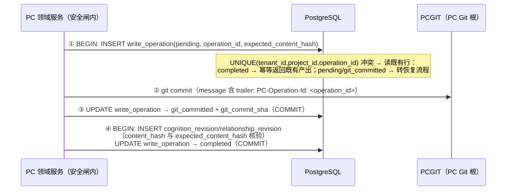

# PC-01B — Git-PG 一致性与跨域引用（V1.2 拆分件 05，原文档 §12~§13）

> **拆分声明**：本文件为《PC-01B 数据模型与数据库设计》拆分件之一（内容基线 V1.1 拆分，**V1.2 差异复核落版 2026-11-07**：§12.3/§12.5/§12.6/§12.7 PCGIT 指称与域内化改写、§12.5 新增跨域引用对账、§13.1/§13.3 C-4 四元组+对账机制），内容为原文档 §12~§13；章节编号保持原文档编号。总纲/裁决/验收见拆分件 00；账本表 §12.2 依赖的隔离模式见拆分件 06 §14。

---

# 12. Git-PG 一致性与恢复协议（PC-D-09 关闭）

## 12.1 原则

1. Git 与 PostgreSQL **无跨存储原子事务**（〔裁决〕基线 §12.3）；一致性由「幂等账本 + 状态机 + 对账恢复」达成。
2. 本协议是 PC 自身存储架构要求，**不属于**新旧模型双写禁令范围（〔裁决〕01A §6.7 术语澄清）。
3. 参考资产：A1（document_proposal 状态机 / resulting_revision 回填 / hash 对账）、A8（knowledge_write_operation 账本，0024:43-64）、`ai.document_proposal` 状态机（0014:38-41）。
4. H-4（`proposed_markdown → git commit → revision 落库` 的实际事务顺序）验证归 PC-01C；本节为协议设计 + 验证前提（§12.7）。

## 12.2 pc.write_operation — 写幂等账本

```sql
CREATE TABLE pc.write_operation (
    id                    UUID PRIMARY KEY DEFAULT gen_random_uuid(),
    tenant_id             UUID NOT NULL REFERENCES core.tenant(id),
    project_id            UUID NOT NULL,
    operation_id          TEXT NOT NULL,             -- 客户端/服务生成，全局唯一语义键
    command               TEXT NOT NULL CHECK (command IN
                            ('pc_commit_object_revision','pc_commit_relationship_revision',
                             'pc_publish_version')),
    status                TEXT NOT NULL DEFAULT 'pending' CHECK (status IN
                            ('pending','git_committed','completed','failed','abandoned')),
    expected_content_hash TEXT NOT NULL,             -- Git 侧内容预期哈希（对账锚）
    git_commit_sha        TEXT,                      -- Git 成功后回填
    object_revision_id    UUID,                      -- 产出回填（三选一，按 command）
    relationship_revision_id UUID,
    version_id            UUID,
    last_error            TEXT,
    retry_count           INT NOT NULL DEFAULT 0,
    created_by            UUID NOT NULL REFERENCES core.principal(id),
    created_at            TIMESTAMPTZ NOT NULL DEFAULT now(),
    updated_at            TIMESTAMPTZ NOT NULL DEFAULT now(),
    UNIQUE (tenant_id, project_id, operation_id),    -- A8 幂等键（0024:55 升级含租户）
    FOREIGN KEY (tenant_id, project_id) REFERENCES core.project (tenant_id, id)
);

-- 状态机单向（终态 completed/abandoned 不可再变；failed 可恢复至 completed）
CREATE FUNCTION pc.enforce_write_op_state() RETURNS trigger LANGUAGE plpgsql AS $$
BEGIN
    IF OLD.status IN ('completed','abandoned') AND NEW.status IS DISTINCT FROM OLD.status THEN
        RAISE EXCEPTION 'pc.write_operation % is terminal (%)', OLD.id, OLD.status;
    END IF;
    RETURN NEW;
END $$;
CREATE TRIGGER trg_pc_write_op_state BEFORE UPDATE ON pc.write_operation
    FOR EACH ROW EXECUTE FUNCTION pc.enforce_write_op_state();

CREATE INDEX idx_pc_write_op_pending ON pc.write_operation (tenant_id, project_id, status)
    WHERE status IN ('pending','git_committed','failed');
```

## 12.3 写入协议（正常时序）



- ①~③ 同一 PG 事务（步骤① 的 INSERT 与步骤③ 的 UPDATE 合并为一事务也可以——推荐合并：`BEGIN; INSERT pending; git commit; UPDATE git_committed; COMMIT`，将「Git 已提交而账本无记录」的窗口压到一个事务内）。
- ④ Revision 落库 + current_revision CAS 回填同事务（对象行 FOR UPDATE，§17.2 场景 1）。
- `pc_publish_version` 命令：发布事务本身（§18.1）即账本操作，Git 侧无新 commit（成员正文已各自入库）——账本行用于发布幂等键（同一 operation_id 重放发布 → 幂等返回已发布版本）。

## 12.4 故障场景与恢复（状态 × 处置矩阵）

| 故障点 | 账本状态 | Git 侧 | PG 侧 | 恢复动作 |
|---|---|---|---|---|
| ① 后、② 前 | pending（若已落行） | 无 commit | 无产出 | 重试：直接重新 ②（幂等键占用同一行） |
| ② 后、③ 前（进程崩溃） | pending | **commit 已存在** | 无 commit_sha | 后台 reconcile：按 trailer 反查 operation_id → 找到 commit → 回填 git_committed → 继续 ④ |
| ③ 后、④ 前 | git_committed | commit 存在 | 无 Revision | reconcile：校验 commit 内容 hash = expected_content_hash → 补 ④ |
| ④ 中失败 | git_committed → failed（**独立事务补标**〔V1.1 R11〕——步骤④回滚会连带回滚 failed 标记，故标记动作必须使用独立连接/事务，与业务事务解耦） | commit 存在 | ④ 事务回滚，无产出 | 人工/自动排查（内容 hash 不符 / FK 冲突）；修复后重放 ④；不可恢复 → abandoned（Git 侧 commit 留存为孤儿提交，正文无害，后续对账登记） |
| PG 已 completed 而 Git 状态异常（历史改写/revert） | completed | 与 commit_sha 不符 | Revision 在 | 对账任务报 `git_drift`，产出审计事件；PC 不改写历史 Revision（不可变），差异按新 Revision 流程处置 |

## 12.5 恢复与对账伪代码

```text
reconcile_pending_writes(pool, git_root):          # 后台任务，周期执行
  rows := SELECT * FROM pc.write_operation
          WHERE status IN ('pending','git_committed') ORDER BY created_at;
  FOR row IN rows:
    commit := git.find_commit_by_trailer("PC-Operation-Id", row.operation_id)
    IF commit IS NULL:
      IF row.age > RETRY_WINDOW: mark_abandoned(row)      # Git 无 commit 且超窗 → abandoned + 审计
      ELSE: retry_in_place(row)                            # 原路径重放 ②③④（幂等键相同）
            -- 〔V1.1（R11/F-11）〕retry_in_place 内 retry_count += 1；
            --    retry_count > 5（MAX_AUTO_RETRY）→ 标记 failed（独立事务）+ 审计，
            --    停止自动重试，转人工介入清单（可判定性保证：状态必然收敛于
            --    pending/git_committed/failed/abandoned 四态之一，不无限重扫）
    ELSE:
      IF sha256(commit.blob) != row.expected_content_hash:
          mark_failed(row, 'content_hash_mismatch')        # 人工介入
      ELSE IF row.status = 'pending':
          fill git_committed + commit_sha; then run step ④
      ELSE:
          run step ④                                       # 补 Revision 落库
audit: 每个恢复动作写 governance.audit_log(source_kind='pc_write.reconcile', ...)
```

〔V1.1（R11/F-11）〕补充语义：① 业务事务（步骤④）失败时，`failed` 标记使用**独立连接/事务**补写（业务事务回滚会连带回滚同事务内的状态标记，故解耦）；② `retry_count > MAX_AUTO_RETRY(5)` 或 `content_hash_mismatch` → 人工介入清单，自动任务不再触碰该行；③ 四态收敛保证（pending/git_committed/failed/abandoned + completed 终态）满足「操作状态永久无法判定」禁令。

对账（hash 对账，A1 模式）：周期任务抽样校验 `pc.cognition_revision.content_hash = pc.document_revision.content_hash` 与 PCGIT blob 实际 hash 三方一致；不一致 → `pc_write.drift` 审计事件 + 冲突表登记（conflict_type 沿用 `revision_conflict` 通道的治理流程）。

**跨域引用对账（V1.2/C-4 新增）**：周期任务扫描 `pc.source` / `pc.evidence` 的 `knowledge_base` 四元组引用（target_revision_id），**数据源 = K3/PK1 只读 API**（禁止直查 KB schema，§16.4 白名单 / 服务自治 §5.4.2），比对 KB 侧存在性与 content_hash；漂移 → `pc_write.drift` 审计事件 + `revision_conflict` 冲突登记（R-13 缓解；evidence_hash 为内容级锚，KB 文档删除非高频路径）。

## 12.6 并发写冲突

- 同 Object 并发 Revision：账本 operation_id 彼此独立；Revision 推号由对象行锁 + UNIQUE(revision_no) 保证（§17.2 场景 1）；两个 Git commit 并发不冲突（Git 天然多 commit），后落库者 Revision 号在后。
- 同文档并发提交：`pc.document_revision` 的 `UNIQUE(tenant_id, project_id, document_id, revision_no)`（V1.2/C-1 域内化，与原 0006:35 模式同构）由 PC 文档写路径推号；PC 写路径在对象行锁内串行化同一对象的提交（含 Git commit 顺序），保证 document_revision 与 cognition_revision 推号同序。

## 12.7 PC-01C 验证前提（H-4 交接）

1. 验证目标：12.3 合并事务方案（①+③ 同事务）在真实 Git 工作流（锁文件/索引刷新）下的失败注入行为。
2. 验证方法：故障注入测试（kill after ②、kill after ③、Git hook 拒绝）+ reconcile 恢复断言（§20 测试 20/21 承载）。
3. 前提：PCGIT 独立根布局确认（H-1，归 01C 实施环境项；V1.2/F-⑥ 双根——KGIT/PCGIT 物理分离）。

---

# 13. 跨领域引用设计（四元组逐域）

## 13.1 逐域通道设计表（任务书 §12；区分目标版本 / 计划阶段 / 当前实现状态）

| target_domain | target_type | revision 语义 | 设计状态 | 库层约束 | 服务层校验 | 当前实现状态 |
|---|---|---|---|---|---|---|
| requirement | requirement / requirement_revision | **必填 revision（Q-PC-03）** | **V1 启用** | `pc.relationship_revision` 跨域列 + proposal 校验；FK 不可行（0019:151-152 该表仅 `UNIQUE(tenant_id,id)`，无项目级组合键） | 组合键 SELECT 校验（tenant+project+id）+ 存在性 | delivery.requirement_revision 已实现（0002+0039）；校验服务归 01C/01D |
| project_goal | project_goal（doc_key='project-goal'） | Goal 侧接口定义（V1 允许空缺 + 原因列承载） | **V1 启用** | 三元定位非空 CHECK | 目标 = ai.project_document(project_id, doc_key='project-goal') 存在性校验；Goal 零表实现（project_goal.rs:8-14） | 文档身份存在；Goal 接口属项目管理域，PC 侧只读引用 |
| knowledge_base | document / document_revision | 必填 document_revision | **V1 启用**（Q-PC-12 输入通道） | **撤 FK；四元组 + 服务层组合键校验 + 周期对账（§13.3；C-4/V1.2）** | 项目级归属校验（0019 实况同上） | KB 域已实现（0006/0014） |
| project_cognition（S01-04） | cognition_run / cognition_item / project_knowledge | 只读引用，不钉 Revision | **V1 只读** | 无 FK（保留域原样，01A §6.7） | 四元组存在性校验 | ai.cognition_* 已实现（0036），属 S01-04 权威 |
| project_baseline（S01-05） | baseline 对象 | — | **V1 不启用**（01A §6.8，按需经协议启用） | 无 | 无 | ai.baseline_* 已实现（0037），属 S01-05 权威 |
| design / adr | — | — | **后续跨域集成**（01A §6.6；Design 域无实体，Gate 0 C.2.6） | 无（通道未开放：服务层按通道状态表拒绝该 domain 值） | 同左 | 不存在；不以 document_revision(doc_type='architecture') 冒充 |
| product_reality | — | — | **后续跨域集成**（01C 后评估） | 无 | 同左 | 不存在 |
| product_plan | — | — | **永久排除出 PC 权威模型**（〔裁决〕Q-PC-13）；PC 仅提供被引用能力（Plan→PC 引用由 Plan 域发起） | 无 | PC 侧提供对象查询接口供 Plan 域引用 | 不存在（表清单不含 Plan 实体） |

## 13.2 四元组列规范（统一落点）

| 载体表 | 列 | 约束 |
|---|---|---|
| pc.relationship / pc.relationship_revision | `{source,target}_ext_{domain,type,id,revision_id}` | 三元非空 CHECK（§6.3/§6.4）；PC 内端点走专用 UUID 列 + 复合 FK，二者互斥 |
| pc.source | `target_{domain,type,id,revision_id}` + `revision_missing_reason` | 空缺必填原因 CHECK（§9.2） |
| pc.evidence（V1.2/C-4） | `target_{domain,type,id,revision_id}`（证据来源四元组；document_section 类必填 knowledge_base + target_revision_id） | 判别器 CHECK（§9.3）；定位锚 = evidence_hash 内容 hash + section_anchor/end_line；跨域完整性 = 服务层校验 + 周期对账（R-13） |
| pc.proposal（未来跨域目标扩展时） | 经 proposal_member 的跨域端点 Revision 承载 | 同 relationship 规则 |

规范：`target_id`/`target_revision_id` 为 TEXT（跨域身份形态不一）；PC 内端点一律走 UUID 专用列（不用四元组列表达 PC 内引用——避免绕开复合 FK）。

## 13.3 双轨完整性（FK 不可行域的补偿机制）

〔事实〕0019:151-152 明示 5 张表（requirement_revision / task_run / document_revision / change_proposal / approval_request）当时无项目级组合唯一键；本设计核对其现状：这些表只有 `UNIQUE(tenant_id, id)`（0019:154-168）。因此：

1. **PC 文档引用已域内化（V1.2/C-1/C-2）**：pc.cognition_revision → pc.document/pc.document_revision 走**项目级组合 FK**（§5.3），组合一致性 document_revision_id ∈ document_id 由库层保证；pc.source/pc.evidence 对 KB 文档的引用为**真跨域**（knowledge_base 域），走四元组 + 服务层校验（下述机制）；requirement / project_goal / project_cognition 等其他外域同理。
2. **跨域项目级 FK 不可行**（外域目标表无 `(tenant_id, project_id, id)` 组合键；且服务化后跨服务表间禁止 FK）：PC 不擅自 ALTER 外域表（领域边界，01A §6.8 约束 5）；项目级归属由**服务层组合键校验**承担（SELECT 归属列比对，校验失败即拒绝写入——写入时即时校验），并纳入 §12.5 对账任务周期核对（不一致 → 审计 + 冲突登记；**真时窗 = 存续期漂移**——撤 FK 后外域删除/改写不被 RESTRICT 阻止，暴露窗口 = 对账周期，评审 N-6 精化）。
3. 若外域后续补齐组合键（其自身演进），PC 侧 FK 可升级——升级属 DDL 直改，无数据迁移。