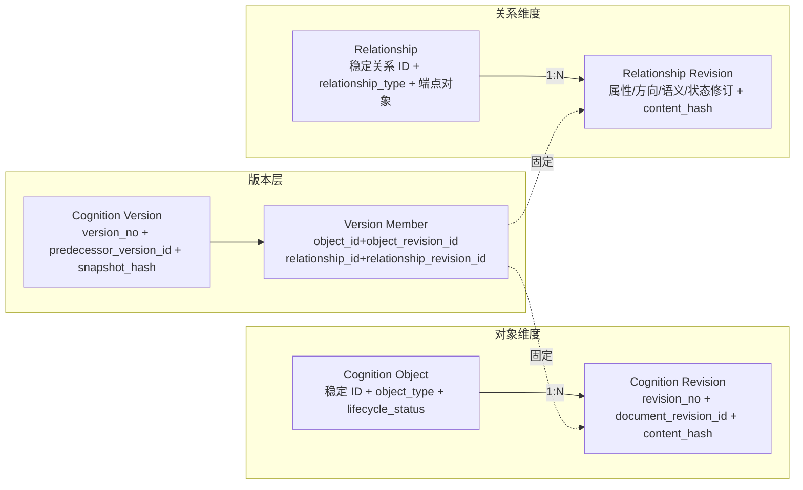
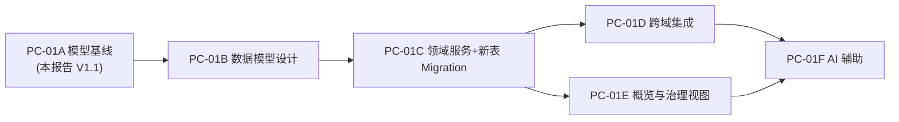

# PC 阶段 1 — 当前实现评审与开发计划 V1.1

| 项 | 值 |
|---|---|
| 文档版本 | V1.1 |
| 状态 | PC-01A 领域模型评审修订版，供产品负责人最终验收 |
| 日期 | 2026-11-06 |
| 修订对象 | 《PC 阶段 1 — 当前实现评审与开发计划 V1.0》（同目录） |
| 评审基线 | 仓库 HEAD `36801388b4f131a8292012c16e9b83e0e07bb3d5`（2026-11-06 20:48:50 +0800，本修订复核时 HEAD 未变，代码事实沿用） |
| 修订依据 | ① V1.0 原文；② Q-PC-01～Q-PC-13 产品裁决（Q-PC-13 为本轮新裁决：Product Plan 不属于 PC）；③ PC-01A 评审意见修订任务书；④ 当前代码与数据库事实（只读核实，未修改任何代码/数据库/Migration） |
| 修订性质 | 评审意见落实与文档修订；代码权限只读 |
| 上游输入 | ① Q-PC-01～Q-PC-13 产品裁决；② 《PC Gate 0 — 数据库 Schema 核查资料清单》；③ 《PC 阶段 1 — 目标领域模型设计基线 V1.0》（其迁移相关章节随本轮裁决废止，见 §6.1）；④ 《Product Cognition（PC）开发计划 V1.0》（docs/product-cognition-knowledge-base/，唯一正式执行台账） |
| 下游 | PC-01B 数据模型设计（启动条件见附录 F） |

**标注体系**：〔裁决〕= Q-PC-01～13 已确认产品裁决或基线已确认原则；〔事实〕= 代码/Schema 证据；〔推导〕= 技术设计建议（非裁决）；〔待决〕= 待裁决事项；〔待验证〕= 尚未从代码/SQL 证实，不得当作已实现。

---

# 1. 执行摘要

| # | 结论 | 依据 |
|---|---|---|
| 1 | **当前代码库不存在任何 Product Cognition 实现**：无 PC 实体表、无领域模型、无领域服务、无 API、无前端页面 | §3；migrations/ 全量扫描 + `crates/pm-domain/src/lib.rs:3-15` + 前端词边界搜索 0 命中 |
| 2 | 代码库中与 "cognition/baseline" 相关的现有实现是 **S01-04 Project Cognition（技术认知）与 S01-05 Project Baseline（项目基线）**，其六域取值（identity/repository/architecture/convention/evolution）与 PC 对象类型完全不同；它们**不是 PC 的不完整实现，而是另一个领域的完成实现** | `migrations/0036_s01_cognition.sql:38-40`、`0037_s01_baseline.sql:35-37` |
| 3 | PC 目标核心实体（Vision/Capability/Module/Actor/Scenario/Process/Page/Business Object/Business Rule/Product Decision/Source/Evidence/Proposal/Revision 及 Relationship）**全部缺失**，差距为「从零新建」而非「改造」 | §4.1 |
| 4 | 现有 cognition/baseline 管线与目标模型的三大结构差距：**① 正式版本不钉条目集合（不可还原）；② 无 Revision 模型（Edit&Confirm 直接覆盖正文）；③ Source/Evidence 内嵌 JSONB 无实体** | `0037:55-66`；`pm_cognition.rs:332-371`；`0036:44` |
| 5 | **存在大量可直接复用的基建先例**（A1～A9）：文档域七表（Git 权威 + PG 状态）、`review_approval` 不可变审批范式、`approver_grant` 审批授权、组合 FK 租户化、CAS 双令牌、证据实体表结构、写幂等账本 | §3.5 |
| 6 | 问题分级：**Blocker 0 项 / Major 9 项 / Minor 3 项 / Observation 6 项**（前提已由裁决确认：PC 新建，不复用 `ai.cognition_*`/`baseline_*`） | §5 |
| 7 | **〔裁决〕PC 为全新建设，不存在任何历史业务数据迁移**：旧 Cognition / Baseline / Knowledge / Discovery 数据不迁移、不转换、不回填、不双写、不保留兼容层；旧域原样保留并继续服务其自身领域 | 任务书 §二.1；§6.7 |
| 8 | **〔裁决〕领域边界四域归属确认**：S01-05 Project Baseline 保留项目基线职责，PC 全新建；PC 不复用 `project_baseline`、不改名旧实体、不受旧表结构反向约束 | 任务书 §二.2；§6.8 |
| 9 | **〔裁决〕Relationship 升级为一等可版本化领域对象**：Object Revision 与 Relationship Revision 双维度被 Cognition Version Member 固定，正式版本可完整还原对象集合与关系集合 | 任务书 §二.3；§6.2 |
| 10 | **〔裁决〕跨领域引用采用四元组协议**（target_domain / target_type / target_id / target_revision_id）；Design / ADR 引用标记为后续跨域集成，不得以 `document_revision(doc_type='architecture')` 冒充 | 任务书 §二.4；§6.6 |
| 11 | **〔裁决〕Q-PC-13：Product Plan 不属于 PC**，不纳入 Object / Revision / Cognition Version 正式认知模型；PC 仅维护 Plan 对认知对象的关系引用与影响分析 | 任务书 §二.5；§6.10 |
| 12 | 原待裁决三问（Q-1 旧 baseline 归属 / Q-2 阶段体系 / Q-3 Product Plan）**全部关闭**；剩余待决事项均为设计级（PC-D-01～06、09），归 PC-01B | §8 |

---

# 2. 评审范围与方法

- **范围**：任务书 §三 A～G 七个评审域；证据来源为 migrations/ 全量 44 个 SQL 文件（Gate 0 已逐块静态阅读）、Rust 后端（crates/、apps/）、Vue/TS 前端（ai-frontend/src）。
- **方法**：关键词词边界搜索（vision/capability/business_object/business_rule/scenario/process/module/decision/adr/supersede 等）+ 表清单双向核对 + 关键事务代码人工阅读（`pm_cognition.rs`、`pm_baseline.rs` 抽查至行号级）。
- **口径**：结论均附 文件:行号 证据；SQL 无法证明的应用层行为标注〔待验证〕；事实与建议严格分离（Gate 0 G 节与 H 节口径沿用）。
- **V1.1 增补**：本版仅做文档修订，未重新扫描代码；HEAD 复核为 `36801388` 未变，V1.0 全部代码事实沿用有效。修订聚焦：删除历史数据迁移设计、领域边界、Relationship 版本化、跨域引用协议、Q-PC-13 落实。

---

# 3. 当前实现清单

## 3.1 总体定位

```text
检索结果：Product Cognition（产品认知）实现 = 零
现有相近命名实现：
  ai.cognition_run / ai.cognition_item / ai.project_knowledge   → S01-04 Project Cognition（技术认知）
  ai.baseline_proposal / ai.baseline_item / ai.project_baseline → S01-05 Project Baseline（项目基线）
```

判定依据：`ai.cognition_item.domain` 六值为 `identity/repository/domain/architecture/convention/evolution`（`0036_s01_cognition.sql:38-40`），`ai.baseline_item.category` 七值为 `identity/scope/technical/architecture/repository/standards/constraints`（`0037_s01_baseline.sql:35-37`）——均为**技术认知**语义；而 PC 目标对象类型为产品语义（Vision/Capability/Module/Scenario/…，见领域模型基线 §3.2）。二者不重叠。

## 3.2 实体与数据表

| 领域 | 表 | 定义位置 | 状态 |
|---|---|---|---|
| S01-04 技术认知 | ai.cognition_run / cognition_item / project_knowledge | 0036:7-27 / 32-61 / 66-87 | 存在，创建后从未被修改 |
| S01-05 项目基线 | ai.baseline_proposal / baseline_item / project_baseline | 0037:7-27 / 29-50 / 55-66 | 存在，创建后从未被修改 |
| KB 文档域 | ai.project_document / document_revision / document_proposal / document_index_state / knowledge_reference / document_section_index / knowledge_write_operation | 0006、0014、0024 | 存在，闭环完整 |
| 通用提案-审批 | ai.change_proposal + governance.approval_request（1:1） | 0003:128-168 | 存在，服务 Task 15 AI 提案，未接 cognition |
| 交付审批 | governance.review_approval（不可变范式） | 0026:223-296 | 存在，服务 D5 Review |
| 审批授权 | core.approver_grant | 0040:23-38 | 存在，服务 S02 需求确认 |
| **PC 目标实体** | Product Vision / Business Domain / Capability / Module / Actor / Scenario / Process / Page / Interaction / Domain Object / Business Rule / Product Decision / Source / Evidence / Relationship | — | **全部不存在**（`vision`/`capability`/`business_rule` 等词边界搜索 0 命中；Decision/ADR 无实体表，仅 `doc_type` 分类值 0006:11-13） |

## 3.3 后端服务与 API

| 能力 | 位置 | 事实 |
|---|---|---|
| 认知概览 | `apps/pm-api/src/pm_cognition.rs:29-90` | GET，runs 近 20 条 + items + knowledge 统计 |
| 启动认知 Run | 同上 `:117-248` | 人类启动（`started_by NOT NULL`，0036:22，Q2-C）；V1 同步派生条目并**直接置 completed**（`:228-239`），无 LLM 编排 |
| 逐项决策 | 同上 `:288-393` | confirm/reject/defer/investigate；`FOR UPDATE`（`:309`）；重复决策 409（`:319-321`）；confirm 落 `ai.project_knowledge`（`:339-353`）；**Edit&Confirm 直接 UPDATE item.content**（`:356-371`） |
| 知识读取 | 同上 `:396-416` | 读 active 项目知识 |
| 基线提案 | `apps/pm-api/src/pm_baseline.rs:105-224` | 条目来源①=project_knowledge（`:154-179`）②=仓库快照（`:181-205`）；pending 提案唯一（409，`:124-128`；DB 层 `uq_baseline_proposal_pending` 0037:26-27） |
| 基线确认 | 同上 `:295-360` | 要求无 proposed 条目（`:317-330`）；落版本头 + 提案转 confirmed（`:332-355`） |
| 路由注册 | `apps/pm-api/src/routes.rs:226,228` | cognition 4 条 / baseline 4 条（`pm_cognition.rs:429-444`、`pm_baseline.rs:362-377`） |
| 领域模型层 | `crates/pm-domain/src/lib.rs:3-15` | **无 cognition/baseline/PC 模块**；实体行 struct 为 handler 内私有 `sqlx::FromRow`（`pm_cognition.rs:92-114`） |

## 3.4 前端

| 能力 | 位置 |
|---|---|
| 认知页（Run 启动/逐项确认/Edit&Confirm/证据展示） | `ai-frontend/src/views/project/cognition/CognitionPage.vue:24,33,174-335` |
| 基线页（提案/逐项确认/Confirm Baseline） | `ai-frontend/src/views/project/baseline/BaselinePage.vue` |
| API client | `src/api/cognition.ts:68-97`、`src/api/baseline.ts:40-68` |
| **PC 页面** | **不存在**（`vision`/`capability`/`ProductVision` 前端搜索 0 命中） |

## 3.5 可复用资产清单（评审认定的复用价值）

| # | 资产 | 证据 | 对 PC 的复用方式 |
|---|---|---|---|
| A1 | 文档域「Git 权威 + PG 状态」七表闭环（revision 链 / proposal 状态机 / hash 对账 / 写幂等账本） | 0006、0014、0024 | PC Cognition Revision 与 Relationship Revision 的正文承载与 Git 一致性协议基座（对应基线 §12、PC-D-02/09） |
| A2 | `governance.review_approval` 不可变审批范式（三重锚定 + 状态单向触发器 + pending 部分唯一） | 0026:223-296 | PC Approval 的库层保护范式（基线 §9.3 已指定为参考，PC-D-01） |
| A3 | `core.approver_grant` + `ensure_governance_authorized` 权限闸 | 0040:23-38；`crates/pm-application/src/approver.rs:37-60` | PC L1/L2 审批人判定直接复用（基线 §9.2 V1 审批人规则） |
| A4 | 0019 组合 FK 租户化模式（`(tenant_id, project_id)` FK + `UNIQUE(tenant_id, id)`） | 0019:154-168 | PC 全部新表的隔离基线（基线 §13） |
| A5 | `delivery.task_requirement` 复合 FK 钉 Revision 先例 | 0002:68-80 | PC↔Requirement 关联钉 Revision 的结构先例（基线 §7.4） |
| A6 | 需求修订 CAS 双令牌（`base_current_revision_id`/`base_row_revision`） | 0039:61-62 | PC 并发控制设计参考（基线 §5.6） |
| A7 | `discovery.discovery_finding_evidence` 证据实体结构（file_path/symbol/code_range/commit_sha） | 0031:128-171 | PC Evidence 定位协议参考（PC-D-05） |
| A8 | `ai.knowledge_write_operation` 写幂等账本（`UNIQUE(project_id, operation_id)`） | 0024:43-64 | PC 写路径防重（Gate 0 G.2-5） |
| A9 | `ai.project_document` doc_key/canonical_path 身份模型 + Project Goal 零表实现（doc_key='project-goal'） | 0006:7-20；`crates/pm-application/src/project_goal.rs:8-14` | PC Product Profile/Vision 的文档身份组织参考（PC-D-02/06） |

---

# 4. 目标模型差距（按任务书 §三 A～G）

> 每项：当前实现 → 目标要求 → 差异 → 影响 → 证据。本节全部为代码事实与差距分析，V1.1 原样保留；仅 §4.6 目标差距列按跨域引用裁决微调措辞。

## 4.1 A. 领域实体

| 目标实体 | 当前实现 | 差异 | 影响 |
|---|---|---|---|
| Product Vision / Business Domain / Capability / Module / Actor / Scenario / Process / Page / Interaction / Domain Object / Business Rule | 无（词边界搜索 0 命中） | 整层缺失 | PC 无从谈起，需全量新建 |
| Product Decision | 无实体表；`doc_type='decision'` 仅文档分类值（0006:11-13）；`change_proposal.target_type` 自由 TEXT 可扩值（0003:133） | 决策无结构承载、无生命周期 | L2 治理对象（正式产品决策）无落点 |
| Cognition Source / Evidence | Source 无实体（仅 `cognition_run.scope/repo_versions` JSONB 声明范围，0036:17-18）；Evidence 为 `cognition_item.evidence JSONB` 内嵌、无类型 CHECK（0036:44） | 来源/证据/认知混存于单表 JSONB | 追溯链（基线 §6.3）无法建立；证据不可独立验证/反驳 |
| Change Proposal | `ai.change_proposal` 存在但服务 Task 15 AI 域，`target_type` 无 CHECK、`target_id` 无 FK（0003:133-134） | 通用结构在，PC 契约未定义 | 需 PC-D-01 裁决扩展或新建 |
| Relationship / Relationship Revision | 无任何关系表（Gate 0 F.2-3） | 关系层整体缺失 | 关系作为一等可版本化对象从零新建（§6.2） |
| Revision / Version | 对象无 Revision；`project_knowledge` 有 version+supersedes 列但**代码无 supersede 写路径**（decide 重复确认 409，`pm_cognition.rs:327-330`）；`project_baseline` 仅版本头 | 三层模型（Object→Revision→Version）全缺 | 版本演进、历史还原无结构基础 |
| 身份与版本分离 | 无：`cognition_item` 身份即内容（content 列随确认被覆盖）；`project_knowledge` 行本身是版本 | 身份/修订未分离（PC-ARCH-02 违反） | 稳定引用、关系钉住、历史追溯均不可实现 |

**实体拆分意见（防过度设计）**：基线 §3.2 已按「逻辑对象≠物理表」声明（§3.2 F 节末）。评审同意：Page 与 Interaction 可共表分型、Feature 默认内嵌 Module 正文、Review Item/Cognition Audit 可复用现有 governance 载体；但 **Cognition Object / Cognition Revision / Cognition Version(Member) / Relationship(+Revision) 四类身份-修订-版本结构必须物理分离**（见 §6.2），Source 与 Evidence 必须实体化（见 4.4）。

## 4.2 B. 聚合边界与关系模型

| 检查点 | 事实 | 证据 |
|---|---|---|
| PC 聚合根 | 不存在。现有管线中 `cognition_run` 是过程对象（Run），`baseline_proposal` 是提案轮次聚合——均为**一次性流程聚合**，非「正式认知」聚合 | 0036:7-27；0037:7-27 |
| Project 与 PC 关系 | 现有：cognition/baseline 六表组合 FK 挂 `core.project`（可靠）；PC 目标聚合（按基线）应为「Project → Cognition Object（身份聚合根）」 | 0036:26,60,83；0037:23,49,65 |
| 稳定身份关联 | 无。对象间仅过程引用：item→run（单列 FK）、knowledge→item（单列 FK，可空）、proposal→run（单列 FK，可空） | 0036:36,74；0037:16 |
| 类型化多对多关系 | 无任何关系表；cognition↔document 域**零 FK 通道** | Gate 0 F.2-3 |
| 关系版本化 | 无 | — |
| 废弃/合并/替代 | 表层有状态（`superseded`：0036:51、0037:15；`status='retired'`：0036:76-77），**代码层零写路径**；knowledge 版本链靠 supersedes_id 但无消费方 | 探索：`supersede` 代码搜索 0 命中 |
| 跨项目风险 | 内部引用列全部单列 FK，不强制同租户/同项目（应用层 bug 可产生跨项目认知链）；项目删除 NO ACTION 无级联语义 | Gate 0 F.3-1；0036:36,74,78；0037:16,33,60 |

**目标关系模型**：按基线 §7 执行，并按本轮裁决升级——Relationship 为一等可版本化领域对象（稳定关系身份 + Relationship Revision + 双维度 Member 固定，§6.2）；关系两端引用 Cognition Object 的**稳定 ID**；跨域目标统一走 §6.6 四元组引用协议，避免为跨域目标伪造 PC 内部对象。

## 4.3 C. Revision 与正式版本（评审重点）

| 检查点 | 结论 | 证据 |
|---|---|---|
| 正式版本能否固定绑定一组对象及其 Revision | **不能**。`project_baseline` 版本头仅存 `proposal_id`（单列 FK），不钉条目集合；若 proposal 之后条目状态被改，快照构成无法从库层还原 | 0037:55-66；Gate 0 F.2-1 |
| 正式版本发布后能否完整重建当时认知状态 | **不能**（同上）；只能按 proposal_id 反推，属推导性重建 | Gate 0 G.1 映射建议已标注 |
| 修改是否产生新 Revision | **否**。Edit&Confirm 直接 `UPDATE ai.cognition_item SET content = COALESCE($7, content)`——修订覆盖原正文，无新 Revision；0036:52-53 注释声称「原 AI 提案保存在 decision_note 前缀」，但代码仅 `bind(body.note)`（`pm_cognition.rs:366`），原 AI 正文在 Edit&Confirm 后**丢失** | `pm_cognition.rs:332-338,356-371` |
| 草稿是否可能被误认正式认知 | 有区分：item.state='proposed' vs project_knowledge.status='active'；展示层按状态过滤（`CognitionPage.vue` 分区渲染）。**但** confirm 即落 knowledge 即「正式」，无提案→审批→版本的中间层 | `pm_cognition.rs:323-353` |
| Revision 与正式版本是否混淆 | 是。`project_knowledge.version`（条目级版本数字）与 `project_baseline.version`（项目级版本头）共用 "version" 语义但层级不同；且 knowledge 无 `(project_id, domain, version)` 唯一约束——同域同 version 可并存 | 0036:75；0037:59,64；Gate 0 F.3-5 |
| 并发版本冲突保护 | 部分：`FOR UPDATE` + 单次决策 409（`pm_cognition.rs:309-321`）+ pending 提案唯一索引（0037:26-27）；**无** CAS/expected_revision 令牌（`change_proposal.expected_revision` 有列但属 Task 15 域且 DB 无约束，0003:135） | Gate 0 C.3.5 |
| 仅凭 version 字段认定版本模型完整 | 不成立：version 列存在 ≠ Revision 模型存在（本节全部证据） | — |

## 4.4 D. 来源与证据

| 检查点 | 结论 | 证据 |
|---|---|---|
| 五类对象区分（Source / Evidence / KB Memory / Proposal / 正式认知） | **未区分**。evidence JSONB 混合承担「来源声明 + 证据内容 + 可信度」；KB Memory（ai.project_document 域）与 cognition 域零结构通道 | 0036:44；Gate 0 F.2-3 |
| 每条认知可追溯到来源 | 部分：knowledge.source_item_id 可追溯到提出条目（0036:74），但条目自身的 evidence JSONB 无实体、无类型约束（注释：V1 type ∈ project_record/repository_metadata，0036:42-43） | 0036:42-47 |
| 来源关联 KB 文档及 Revision | **无**。cognition/baseline 与 project_document/document_revision 之间无任何 FK | Gate 0 C.5.2/C.5.3 |
| 证据片段/引用位置保留 | evidence JSONB 结构自由，无 section_anchor/commit_sha 类定位协议；对比 `discovery_finding_evidence` 已实现定位协议（0031:128-171）与 `knowledge_reference` 已实现章节锚点（0014:87-104） | 0036:44 |
| AI 提议关联证据 | change_proposal.evidence JSONB（0003:139）存在但自由结构；cognition 管线未接 | 0003:139 |
| 正式认知追溯形成依据 | 有最简链：knowledge←source_item_id←item（evidence/confidence）；无 Proposal 层、无审批依据记录（decision_note 自由文本） | 0036:74；0036:54-56 |
| 来源更新后识别受影响认知 | **无**任何机制（无 source→cognition 反向关联） | — |

## 4.5 E. 审批与治理（L0-L3）

| 检查点 | 结论 | 证据 |
|---|---|---|
| 复用现有 Change Proposal / Approval 机制 | **未复用**。cognition/baseline 确认走自有 decision 端点，未挂 approval_request（其 1:1 结构也天然不适配逐项确认） | `pm_cognition.rs:288-393`；`pm_baseline.rs:234-290`；探索：挂接搜索 0 命中 |
| AI 自动确认正式认知路径 | **不存在**（正面结论）：confirm 仅在人类 decision 端点；start_run 为人类启动（`started_by NOT NULL`）；V1 无 AI 写入 knowledge 的代码路径 | 0036:22；`pm_cognition.rs:288` |
| 确认人权限闸 | **缺失**。decision 端点仅 `require_project_visible`（项目成员可见级）——**任何项目成员均可 confirm/reject**，无 Lead/授权审批人判定（`ensure_governance_authorized` 存在但未接入，`approver.rs:37-60`） | `pm_cognition.rs:294`；`pm_baseline.rs:300` |
| 审批记录完整性 | 记录了 decided_by/at/note、confirmed_by/at（0036:54-56,80-81；0037:44-46,61-62）；**无**审批依据结构化字段、无预期版本锚定 | 同上 |
| 审批历史不可篡改保护 | **无**。item 仅 proposed 态可决策（409 保护，`pm_cognition.rs:319-321`）；但 knowledge 行无不可变触发器，proposal 确认后条目「不可变」仅是注释约定（0037:237-238），**无 DB 强制** | 0037:14-15 注释；无触发器 DDL |
| 并发审批/重复提交安全 | 有：FOR UPDATE + 状态前置校验 + 409 + pending 部分唯一索引 | `pm_cognition.rs:305-321`；0037:26-27 |
| L0-L3 治理等级 | **完全不存在**（无等级字段、无分级策略、无分级权限路由） | — |
| L3 冲突冻结 | **不存在**。`has_conflict` 仅布尔落库与展示（0036:47；`pm_cognition.rs:109`），无解决流、无冻结消费方 | 0036:47 |
| 审计 | **缺失**：decide_item / confirm_baseline 事务内**无 `governance.audit_log` 写入**（grep `pm_cognition.rs`/`pm_baseline.rs` 中 audit 0 命中；commit `36801388` 时点） | grep 结果 |

## 4.6 F. 跨领域关系

| 领域 | 现状 | 目标差距 |
|---|---|---|
| Requirements | PC 侧无关联；现有最近关联是 `task_requirement`（Task↔Requirement Revision 钉定，0002:68-80）与 `requirement_finding/requirement_source_input`（0044_s02）——均非 PC | 需新建「Requirement 关联记录稳定身份 + 钉 Revision + 影响分析」（基线 §7.4、§11.1） |
| Design / ADR | **无实体**。doc_type='architecture' 仅分类值；ADR 仅是知识 Git 根模板字符串（`crates/pm-application/src/knowledge.rs:51,71`） | PC 不维护 ADR 正文（边界正确）；Design/ADR 域尚无可关联的领域实体——按〔裁决〕该引用标记为**后续跨域集成**（§6.6），PC 不得以普通 Markdown 文档冒充 Design/ADR 实体 |
| Project Goal | Goal = `ai.project_document(doc_key='project-goal')` 零表实现（`project_goal.rs:8-14`），与 cognition/baseline 无表级关联 | Vision↔Goal 支撑关系需新建（基线 §11.4）；Goal 已有稳定身份（doc_key），可关联 |
| Knowledge Base | KB 治理流（knowledge_proposal：质量门→红线→否决，`pm-application/src/knowledge_proposal/`）与 PC 无连接；KB 审核通过≠PC 正式确认（边界语义正确，但结构上 KB→PC 输入通道不存在） | PC-01F/PC-0601 建输入接口（运行时输入通道，非数据迁移） |
| S01-04 Project Cognition | ai.cognition_* 即 S01-04 技术认知实现，权威边界清晰（它们不是 PC）；但命名与 PC 高度相近（见 O1） | 无需改动；PC 设计须避免复用其表；引用只读 |
| S01-05 Project Baseline | ai.baseline_* 即 S01-05 项目基线实现 | 〔裁决〕权威归属不变（§6.8）；PC 与其零数据通道、零迁移（§6.7） |

## 4.7 G. API、服务与权限

| 检查点 | 结论 | 证据 |
|---|---|---|
| PC Domain Service | **不存在**。cognition/baseline 逻辑全部内联在 `apps/pm-api` handler 中直接 SQL，无 pm-domain 实体、无独立 service 层 | `pm_cognition.rs`（444 行全文件）、`pm_baseline.rs`（377 行全文件）；`pm-domain/src/lib.rs:3-15` |
| API 绕过领域规则 | 现有 API 即规则本身（无规则可绕过）；PC 建设时必须避免 handler 直操 DB 模式 | §3.3 |
| 项目隔离 | 可靠：全部查询双键过滤（tenant_id+project_id）+ 组合 FK | `pm_cognition.rs:39,49,57-60`；`pm_baseline.rs:33-34` |
| 统一审批权限模型 | 未统一：cognition 用 require_project_visible，S02 需求确认用 approver 闸，D5 用 review_approval——三套并存，PC 需收敛到 A2+A3 | §4.5 |
| AI 绕过人工确认路径 | 不存在（V1）；PC 建设后须经安全闸（开发计划 PC-0306） | §4.5 |
| 事务保护 | 有：`pool.begin()` + `FOR UPDATE` + commit（`pm_cognition.rs:305-386`、`pm_baseline.rs:303-357`） | 同上 |
| 不一致状态流转入口 | decision 端点 action 白名单校验（`:297-303`）；proposal 仅 pending→confirmed 两转换（`pm_baseline.rs:105-360`）——无非法流转入口；但状态机不完整（superseded 无路径） | 同上 |
| 重复服务/模型 | cognition_item 与 discovery_finding 语义重叠（两域各自产出认知条目，Gate 0 G.1）；command_center 的 `cognition_status` 读 discovery 不读 ai.cognition_*（`command_center.rs:164-192`）——命名重叠但无重复实现 | 同上 |

---

# 5. 问题分级

> Blocker = 阻断领域模型成立或正式认知安全；Major = 核心领域能力缺失或重大结构问题；Minor = 局部不完善；Observation = 事实观察。

## 5.1 Blocker（0 项）

无。前提已由裁决确认：PC 按目标模型新建，不复用 `ai.cognition_*` / `baseline_*` 承载正式产品认知（§6.8）。若未来违反此前提（例如复用 `project_baseline` 做 Cognition Version），B-1/M-2/M-3 即升级为 Blocker。

## 5.2 Major（9 项）

| # | 问题 | 证据 |
|---|---|---|
| M-1 | PC 全部核心实体、领域服务、API、前端缺失，差距为从零新建 | §3.2/§3.3/§3.4 |
| M-2 | 正式版本不可还原：版本头不钉条目集合 | 0037:55-66 |
| M-3 | 无 Revision 模型：Edit&Confirm 覆盖正文、原 AI 提案正文丢失（注释与实现不符） | `pm_cognition.rs:356-371` vs 0036:52-53 |
| M-4 | Source/Evidence 无实体，混存 JSONB，与 KB 文档域零结构通道 | 0036:44；Gate 0 F.2-3 |
| M-5 | 确认动作无审批权限闸：任何项目成员可确认正式认知 | `pm_cognition.rs:294`；`approver.rs:37-60` 未接入 |
| M-6 | 无 L0-L3 治理等级与 L3 冲突冻结（has_conflict 无消费方） | 0036:47 |
| M-7 | 正式确认/版本发布无审计记录（事务内无 audit_log 写入） | grep `pm_cognition.rs`/`pm_baseline.rs` audit 0 命中 |
| M-8 | cognition/baseline 内部引用单列 FK，不强制同项目（跨项目链风险） | 0036:36,74,78；0037:16,33,60 |
| M-9 | 认知正文存 PG（content TEXT），违反「Markdown+Git 正文权威、PG 状态」存储架构约束 | 0036:41,73；0037:38 |

## 5.3 Minor（3 项）

| # | 问题 | 证据 |
|---|---|---|
| m-1 | superseded/retired 状态表列存在但代码零写路径（死状态） | 0036:51,76-77；0037:15 |
| m-2 | project_knowledge 版本号无 `(project_id, domain, version)` 唯一约束，同域同 version 可并存 | 0036:75；Gate 0 F.3-5 |
| m-3 | `governance.approval_request` 弱结构（status 无 CHECK、无不可变触发器、无历史）——PC-D-01 若选择扩展它，须先加固 | 0003:157-168 |

## 5.4 Observation（6 项）

| # | 观察 | 证据 |
|---|---|---|
| O-1 | `ai.cognition_*` 命名与 Product Cognition 高度相近但属 S01-04 技术认知——后续文档/沟通须以「技术认知/PC」显式区分，避免复用误判 | 0036:38-40 |
| O-2 | 迁移账本异常：缺 0029；0044 同号双文件（sqlx 记账行为待核实 H-13）；新迁移应自 0045 起号 | Gate 0 B.2 |
| O-3 | cognition_item 与 discovery_finding 语义重叠（同一事实两个来源域）——PC 新建后各自服务其领域，PC 不引入 discovery_finding 历史数据 | Gate 0 G.1 |
| O-4 | 现有 V1 认知 Run 为同步派生（无 LLM 编排），条目直接 completed——Q2-C 人类启动已保证，且无 AI 直写正式认知路径（正面事实） | `pm_cognition.rs:228-239` |
| O-5 | Project Goal 零表实现（doc_key='project-goal'），有稳定身份可关联，PC-01D 无需 Goal 侧新建 | `project_goal.rs:8-14` |
| O-6 | S02 新近表部分偏离 0019 隔离模式（requirement_confirmation 无 tenant 引用、source_input 用 UNIQUE(project_id,id)）——PC 新表设计时应统一回 0019 模式，不跟随偏离 | 0039:86-93；0044_s02:21 |

---

# 6. 目标领域模型（V1.1 修订版）

> **V1.1 修订说明**：本节为修订重心。① §6.2 由「三层（对象维度）模型」补全为「对象 + 关系双维度」完整版本模型（任务书 §二.3）；② §6.6 跨域引用改四元组协议并删除 document_revision 过渡方案（任务书 §二.4）；③ §6.7 删除旧数据迁移行（任务书 §二.1）；④ 新增 §6.8 领域边界、§6.9 细节复核、§6.10 Product Plan 边界（任务书 §二.2/§二.5/§四）。

## 6.1 与领域模型基线 V1.0 的关系

PC-01A 目标模型基线仍为《PC 阶段 1 — 目标领域模型设计基线 V1.0》，其与代码事实无冲突的部分（设计原则 PC-ARCH-01~12、六层领域模型、Object→Revision→Version、Source/Evidence 分离、L0～L3 治理、跨模块权威边界、三层权威存储）继续有效。

**随本轮「无历史业务数据迁移」裁决，基线中以下内容废止，不作为 PC-01B/01C 输入**（基线文档升版时同步删除）：

| 基线章节 | 内容 | 处置 |
|---|---|---|
| §14（旧数据迁移目标模型，含 §14.1 原则/§14.2 旧对象映射/§14.3 特殊情况） | 旧 Cognition/Baseline/Knowledge/Discovery → PC 的迁移映射 | **废止**：PC 全新建设，零迁移 |
| §16.6（迁移验收标准组） | 迁移幂等/审计/验证/停止双写 | **废止** |
| §18 PC-01C「历史数据迁移设计」子阶段 | 迁移映射/去重/回滚/验证交付 | **废止**；PC-01C 语义改为「核心领域服务」（§7.3） |
| §17 PC-D-07 | Product Plan 边界 | **关闭**：Q-PC-13 已裁决（§6.10） |
| §17 PC-D-08 | 旧 baseline 历史成员集合推导 | **废止**：无迁移即无推导需求 |
| §17 PC-D-10 | 旧 Cognition 表兼容/冻结/退役 | **废止**：旧域原样保留，PC 不退役其表 |

基线其余待决项 PC-D-01～06、09 继续有效，归 PC-01B（§8.2）。

## 6.2 对象-关系-版本完整模型（Object / Relationship / Revision / Version / Member）

〔裁决〕三层分离原则（基线 §5.1）扩展为**双维度版本化模型**：正式认知不仅包含对象及其内容，也包含对象之间的关系。〔事实〕反面参照：`project_baseline` 版本头不钉条目集合（0037:55-66），不可还原——PC 新表不得复用该模式。



模型要点：

1. **Cognition Object（稳定身份）**：object_id + tenant_id + project_id + object_type（受控类型体系）+ object_key（如适用）+ lifecycle_status；身份不含可变正文（基线 §5.2）。
2. **Cognition Revision（对象内容修订）**：revision_no 递增、append-only；持 `document_id + document_revision_id + content_hash`，正文权威在 Git（〔裁决〕基线 §12.1 三层权威存储）；一对象一文档 or 多文档 = PC-D-02〔待决 01B〕。
3. **Relationship（稳定关系身份）**：relationship_id + relationship_type（受控注册，PC-D-04）+ 源/目标端点（PC 内对象用稳定 object_id；跨域端点用 §6.6 四元组）；关系自身生命周期与治理约束的物理字段归 PC-01B 设计〔推导〕。
4. **Relationship Revision（关系修订）**：记录关系属性、方向、语义及状态的每次修订；append-only、不覆盖历史；与 Cognition Revision 同构承载（Git 正文 + PG 状态）〔推导，任务书 §二.3〕。
5. **Cognition Version（正式版本）**：version_no + status + confirmed_by/confirmed_at + source_proposal_id + snapshot_hash + **predecessor_version_id（版本间演进链）**；发布后不可变（触发器保护，范式 A2）。
6. **Version Member（双维度成员）**：每条成员记录 `object_id + object_revision_id` 与/或 `relationship_id + relationship_revision_id`；组合外键保证成员 Revision 属于对应 Object/Relationship 且同项目同租户（修复 M-8 型缺陷）。

**正式版本完整快照要求**〔裁决〕——任一历史版本必须能从库层直接回答：

1. 该版本包含哪些正式认知对象；
2. 每个对象使用哪个 Revision；
3. 该版本包含哪些正式关系；
4. 每个关系使用哪个 Relationship Revision。

不得只固定 Object Revision 而不固定 Relationship Revision；不得依赖 Proposal 或当前对象状态反向推导成员集合（基线 §5.4）。

**版本之间的变更关系**〔推导〕：

- 同一对象的 Revision 链由 revision_no 递增表达；
- Version 链由 predecessor_version_id 显式表达（N→N+1 演进）；
- 相邻版本的变更差异（新增/修改/废弃了哪些对象与关系）通过 Member 集合 diff 查询能力提供，V1 不强制物化 diff 表。

**版本发布事务一致性要求**（〔推导〕设计约束，物理结构与具体约束 PC-01B 定；范式参考 A2/A6）：

```text
publish_cognition_version(proposal_id, expected_version_no):
  BEGIN
    ① 核验审批锚点：approval(proposal_id).status='approved' 且 content_hash 与提案一致（不可变记录，FOR SHARE）
       -- 失败 → ROLLBACK（未经审批不得发布）
    ② 解析提案成员集：对象 Revision 集合 + 关系 Revision 集合（双维度）
    ③ INSERT cognition_version(version_no = expected_version_no + 1, predecessor_version_id, snapshot_hash)
       -- UNIQUE(tenant_id, project_id, version_no) + CAS（expected_version_no 不符 → 失败返回，重读重试）
    ④ 批量 INSERT version_member（组合 FK 校验成员归属与项目隔离）
    ⑤ 复核 snapshot_hash = hash(成员集合)；不符 → ROLLBACK
    ⑥ INSERT governance.audit_log(source_kind='pc_version_publish', ...)
    ⑦ UPDATE proposal SET status='applied'（单向状态）
  COMMIT
```

Git 正文提交与 PG Revision 登记的跨存储一致性（幂等/失败恢复/补偿）按基线 §12.3 与 PC-D-09 处理〔待决 01B〕。

## 6.3 聚合边界

| 聚合 | 聚合根 | 成员 | 一致性边界 |
|---|---|---|---|
| 认知对象聚合 | Cognition Object | 其 Cognition Revisions | Revision 必属同一 Object（组合 FK `(tenant_id, project_id, object_id)`） |
| 认知关系聚合 | Relationship | 其 Relationship Revisions | Revision 必属同一 Relationship；两端端点为 PC 对象时须同项目（组合 FK）；跨域端点走 §6.6 协议 |
| 正式版本聚合 | Cognition Version | Member 集合（对象 + 关系双维度） | Member 的 object/relationship/revision 同项目同租户；发布后不可变（触发器，范式 A2） |
| 提案聚合 | PC Change Proposal | 拟变更对象/关系集 + 证据 | 目标对象/关系必须存在于同项目（组合 FK，修复 change_proposal target 无 FK 缺陷 m-3 路径） |

〔推导〕Project → 各聚合根之间用组合 FK 强制同项目（修复 M-8 模式缺陷）；多对多关系（Capability↔Domain、Page↔Interaction 等）由 Relationship 实体统一承载，不为每类关系建专属表。

## 6.4 来源与证据

〔裁决〕基线 §6：Source（来源）/ Evidence（定位 + hash + confidence + verification）分离；Confidence 与 Confirmation 分离（§6.4）。〔事实〕反面参照：现有 evidence JSONB 单字段混合「来源声明 + 证据内容 + 可信度」三种语义（0036:44）——PC 新模型**禁止用一个 JSONB 字段表达不同语义**，Source 与 Evidence 必须实体化分离。

〔推导〕Evidence 实体结构参考 A7（discovery_finding_evidence）与 `knowledge_reference`（章节锚点 0014:87-104）；Source 的跨域指针统一采用 §6.6 四元组协议；来源更新影响分析依赖 `Source → Cognition Object` 反向索引（当前完全缺失，M-4 修复项）。

**关联链完整性要求**（基线 §6.3/§11.3）：Source → Evidence →（PC Change Proposal）→ Cognition Revision / Relationship Revision → Cognition Version 全链可追溯；KB Memory 经 PC Proposal 输入（Q-PC-12），不自动转正；直接人工输入同样保留 Source 与 Proposal 追溯关系。

## 6.5 治理模型（L0-L3 + 审批 + 安全闸）

〔裁决〕L0-L3 权限等级、审批人规则（Lead + 授权审批人同权，Q-PC-08）、AI 不得确认 L1/L2、L3 冻结（基线 §9.2/9.4）；L0～L3 是变更权限等级，P0～P3 是处理优先级，PC-G17 风险等级是风险评估维度——三者不可混用。〔推导〕物理实现：

- 审批载体按 PC-D-01〔待决 01B〕裁决：扩展 `ai.change_proposal + governance.approval_request` 或新建 PC 专属结构（Q-PC-07 复用既有机制为方向，但须满足基线 §9.3 八条技术原则：审批对象不可事后替换 / 状态受控 / 单向转换 / 无重复有效审批 / 审批事实不可覆盖 / 版本发布与审批一致 / 并发事务保护 / 全程可审计）。库层保护范式取 A2。
- **复用路径需扩展/加固的明确清单**〔推导〕：① `change_proposal.target_type` 无 CHECK、`target_id` 无 FK（0003:133-134）→ PC 契约必须限定类型并加引用完整性；② `approval_request` 弱结构（m-3：status 无 CHECK、无不可变触发器、无历史）→ 扩展前必须先加固；③ 审批须锚定提案内容 hash 与 expected_version（A6 双令牌范式），拒绝时保留历史事实（基线 §9.2）。
- 审批人判定复用 A3（approver_grant + ensure_governance_authorized），修复 M-5。
- L3 冻结实现为 Conflict(status∈{under_review,awaiting_human}) 对受影响对象（含 Relationship）确认入口的前置校验。
- 全部正式确认/发布动作写 governance.audit_log（source_kind='pc_*'），修复 M-7。
- 正式写入唯一入口 = 安全闸服务（开发计划 PC-0306），API/handler 不得直写正式表——对象与关系一律如此。

## 6.6 跨领域引用协议

> **V1.1 修订**：删除 V1.0 §6.6 中「V1 允许以 document_revision（doc_type='architecture'）为 Design/ADR 关联目标过渡」的方案——〔裁决〕不得提前把普通文档当作尚不存在的领域实体。

**四元组协议**〔裁决，任务书 §二.4〕：PC 对外领域的所有引用（Relationship 跨域端点、Source 来源指针、Evidence 定位）统一采用以下语义：

- `target_domain`：目标领域标识；
- `target_type`：目标领域内的对象类型；
- `target_id`：目标对象稳定身份；
- `target_revision_id`：目标 Revision（**有 Revision 的领域对象必须支持且填写 Revision 级引用**；无 Revision 机制的对象按其领域接口定义，允许空缺时必须记录原因）。

要求：

1. 引用必须指向明确的领域对象（domain + type + id 三元定位，禁止自由文本指针）；
2. 有 Revision 的领域对象必须支持 Revision 级引用；
3. 项目隔离与引用完整性：引用双方须同租户同项目（组合键校验）；可行处用 FK，不可行处（跨 schema / 目标域未建）用服务层校验 + 完整性核对机制——具体外键、组合约束与服务接口由 PC-01B 设计〔待决〕；
4. 对尚未实现的领域，明确标记「后续跨域集成」，PC 不得把普通 Markdown 文档冒充该领域实体，也不得虚构已具备的能力。

**引用通道状态表**：

| target_domain | target_type（示例） | target_revision_id | 状态 | 依据 |
|---|---|---|---|---|
| requirement | requirement | 必填（requirement_revision_id） | **V1 可用**（Q-PC-03：身份 + Revision；范式 A5） | 0002:68-80 |
| project_goal | project_goal（doc_key='project-goal'） | 按 Goal 侧接口定义（V1 允许空缺+原因） | **V1 可用** | O-5；基线 §7.4 |
| knowledge_base | document / document_revision | 必填（document_revision_id） | **V1 可用**（KB→PC 输入通道，Q-PC-12；运行时输入，非数据迁移） | 0006/0014 |
| project_cognition（S01-04） | cognition_run / cognition_item / project_knowledge | V1 只读引用，不钉 Revision | **V1 只读** | §6.8 |
| project_baseline（S01-05） | baseline 对象 | — | **V1 不启用**（协作与引用关系按需经本协议启用） | §6.8 |
| design / adr | — | — | **后续跨域集成**：Design/ADR 域尚无领域实体，在其提供可关联身份前不开放；PC 不维护 ADR 正文、不审批 ADR | §4.6 |
| product_reality | — | — | **后续跨域集成**（执行证据对比，PC-01F 后考虑） | 基线 §11.5 |

基线 §6.1 Source 逻辑类型枚举中的 `design_revision` / `adr` 两类：其物理指向协议在 Design 域实体就绪后于后续跨域集成中定义；V1 不实现、不得以 `document_revision(doc_type='architecture')` 冒充。

## 6.7 新建 / 复用 / 保留对照（零数据迁移声明）

> **V1.1 修订**：删除 V1.0「退役/迁移」行（旧数据 → PC 草稿迁移）。〔裁决〕PC 为全新建设，不存在需要迁移的历史业务数据。

| 处置 | 对象 | 说明 |
|---|---|---|
| **新建** | PC 全部领域对象（Object/Revision/Relationship/Relationship Revision/Version+Member/Source/Evidence/PC Proposal/Approval 或扩展/Conflict/审计挂接）+ PC Domain Service + PC API + PC 前端 | 按 PC-01B→01F 推进 |
| **复用** | A1～A9（§3.5） | 文档域、审批范式、授权闸、隔离模式、CAS、幂等账本 |
| **保留** | ai.cognition_* / baseline_* 六表及其数据、API、前端；discovery_finding 等其他域数据 | 属 S01-04/05 等各自领域权威，**原样保留、继续服务原领域**；PC 不读取、不转换、不迁移、不退役其数据与表 |

**零迁移硬边界**〔裁决〕：

1. 不需要考虑旧数据迁移；
2. 不设计历史数据兼容、回填；
3. 不设计新旧模型双写；
4. 不将旧 Cognition、Baseline、Knowledge、Discovery 数据转换为 PC 数据；
5. 不为历史业务数据保留任何兼容层；
6. PC 与旧 cognition/baseline 域之间：零数据通道、零迁移脚本、零回填任务。

**术语澄清**：上述「双写」禁令指**旧 cognition/baseline 模型与 PC 新模型之间的数据双写**；「Markdown+Git 正文权威 + PostgreSQL 状态」的跨存储一致性协议（基线 §12.3，PC-D-09）是存储架构约束，与本禁令无关，继续有效。

**新系统自身版本能力清单**（属正常领域能力，不属于历史数据迁移，全部保留）：Object Revision、Relationship Revision、正式认知版本（Cognition Version + 双维度 Member）、审批记录、审计记录、Source/Evidence 来源追溯、版本之间的变更关系（§6.2）。

## 6.8 领域边界裁决（旧 Baseline 与 PC）

〔裁决，任务书 §二.2〕四域权威归属：

| 领域 | 权威职责 |
|---|---|
| S01-05 Project Baseline | 项目初始化、项目基线及项目启动阶段的基线确认 |
| Product Cognition | 产品正式认知及其版本、关系和治理 |
| Project Cognition（S01-04） | 技术侧项目认知 |
| Knowledge Base | 原始资料、文档、浅层记忆及知识来源管理 |

约束（全部为已裁决边界，非待决）：

1. PC 不复用 `project_baseline` 作为正式产品认知版本（Cognition Version 必须按 §6.2 新建）；
2. PC 不把旧 Baseline 实体直接改名为 Product Cognition；
3. Project Baseline 与 Product Cognition 可以建立明确的协作和引用关系——引用经 §6.6 四元组协议表达（`target_domain='project_baseline'`）；V1 范围内不启用该通道，按需启用；
4. 不为上述关系设计任何历史数据迁移；
5. PC 领域模型由 PC 产品职责推导，不得因旧 Baseline 表结构存在而反向受其约束（〔事实〕0037 版本头不钉条目集合的结构缺陷不构成 PC 模型的先例）。

## 6.9 领域模型细节复核（任务书 §四 13 项）

> **V1.1 修订**：新增本节，逐项复核任务书 §四 检查点。标注沿用全文口径；物理实现细节未定处一律标注归 PC-01B，不提前锁定表结构。

| # | 检查点 | 结论 | 性质 | 依据 |
|---|---|---|---|---|
| 1 | Object 与 Object Revision 的身份、版本、生命周期 | Object 稳定 ID 不含可变正文；Revision revision_no 递增 append-only、持 Git 引用 + content_hash；Object 生命周期 identity→draft→active→deprecated/superseded，Revision 历史不可覆盖 | 〔裁决基线 §5.2/5.3/§13.3〕 | 反面事实：cognition_item 身份即内容、Edit&Confirm 覆盖正文（M-3）；物理结构归 01B |
| 2 | Relationship 与 Relationship Revision 的身份、版本、生命周期 | Relationship 稳定关系 ID + 受控类型；Relationship Revision 记录属性/方向/语义/状态修订，append-only；关系增删改按治理等级（普通关系 L1、Governed By 等 L2） | 〔裁决〕任务书 §二.3 + 基线 §7.1/7.3 | 物理字段与表结构归 01B，本版不锁定 |
| 3 | Cognition Version 能否完整固定对象和关系集合 | **必须能**：双维度 Member（§6.2）；正式版本完整还原四问（§6.2 快照要求） | 〔裁决〕任务书 §二.3 | 反面事实：0037:55-66 版本头不钉条目集合 |
| 4 | Version Member 是否同时覆盖对象和关系 | **是**：每条成员含 object_id+object_revision_id 与 relationship_id+relationship_revision_id | 〔裁决〕任务书 §二.3 | 归 01B 落组合 FK |
| 5 | 正式版本治理/确认/生命周期元数据 | version_no、status、confirmed_by/at、source_proposal_id、snapshot_hash、predecessor_version_id（版本间演进链）；发布后不可变（触发器） | 〔裁决基线 §5.4/§9.2〕+〔推导〕lineage | 具体字段 01B |
| 6 | Source→Evidence→KB Memory→Proposal 关联链 | 链式要求完整（§6.4）；KB Memory 经 Proposal 输入（Q-PC-12）；直接人工输入保留 Source→Proposal 直接追溯 | 〔裁决基线 §6.3/§11.3〕 | 现状事实：链不存在（§4.4 全表） |
| 7 | 来源与证据分离，禁止 JSONB 混用 | Source 与 Evidence 实体化分离；Confidence 与 Confirmation 分离；禁止单 JSONB 字段表达多种语义 | 〔裁决基线 §6〕 | 反面事实：0036:44 |
| 8 | 跨域引用 Domain/Type/ID/Revision | 四元组协议（§6.6）；有 Revision 的目标必填 Revision 级引用 | 〔裁决〕任务书 §二.4 | 外键与约束归 01B |
| 9 | 项目隔离与引用完整性 | 全部新表 0019 组合 FK 模式（A4）；Member/Proposal/Relationship 内部引用组合 FK；跨域引用同项目校验 | 〔推导〕修复 M-8/O-6 | 0019:154-168 |
| 10 | Product Profile 与 Product Vision 边界粒度 | Profile=产品基本身份档案（不含愿景/规则/模块内容）；Vision=长期方向、价值与范围边界（L2 治理）；二者独立对象 | 〔裁决基线 §4.1/4.2〕 | 字段级细化 = PC-D-06〔待决 01B〕 |
| 11 | Feature 独立化如何保留原有信息与关联 | 独立化条件按基线 §3.2.B/§4.6；升级必须：原内容完整保留、原模块关系保留、已建立的 Requirement/Page/Scenario 关联保留、记录升级事件、历史可追溯——经「新增独立 Object + 保留关系（module contains feature）+ 原 Module 正文下一 Revision 标注迁移来源」实现 | 〔裁决基线 §4.6〕+〔推导〕实现方式 | 升级流程细节 01B/01C |
| 12 | 版本发布/审批/Revision 固定/审计事务一致性 | 单事务发布流程（§6.2 伪代码：审批锚点核验→双维度 Member 落库→snapshot_hash 复核→审计写入→提案单向状态）；Git 与 PG 跨存储一致性走幂等/补偿（PC-D-09） | 〔推导〕 | 反面事实：现有事务无审计（M-7）；伪代码为设计约束，非已实现 |
| 13 | 复用 Change Proposal/Approval 的契约、约束与扩展点 | 复用为方向（Q-PC-07），必须满足基线 §9.3 八条；扩展/加固三清单（§6.5）：target 完整性、approval_request 加固（m-3）、内容 hash + expected_version 锚定 | 〔裁决 Q-PC-07〕+〔推导〕 | 最终扩展 vs 新建 = PC-D-01〔待决 01B〕 |

## 6.10 Product Plan 边界（Q-PC-13）

〔裁决 Q-PC-13：选择 A〕**Product Plan 归属于产品规划 / 项目管理领域，不属于 PC 的正式认知对象。**

模型边界：

1. PC 负责维护正式产品认知；
2. Product Plan 负责规划内容、规划周期、阶段安排及交付安排；
3. Product Plan 可以引用 PC 中的 Capability、Module、Scenario、Business Rule 等正式认知对象（引用方向：Plan → PC，由 Plan 所属领域经 §6.6 协议发起）；
4. PC 对象发生正式变更时，可以分析对 Product Plan 的影响（PC 提供影响分析查询/通知能力，不维护 Plan 数据）；
5. PC 不直接修改 Product Plan；
6. Product Plan 不纳入 PC Object、Revision、Cognition Version 的正式认知模型（01B 表清单不含 Plan 实体；PC-FR-026 降级为关联需求）；
7. Product Plan 自身的生命周期和版本由其所属领域负责。

**Roadmap 边界**：Product Plan 与 Roadmap 不得混为同一概念。Roadmap 的权威边界尚未定义，标记为**待后续产品规划领域分析**；本版不自行补充未经确认的产品裁决。

---

# 7. 分阶段开发计划（PC-01A ～ PC-01F）

> **V1.1 修订说明**：六阶段保留；新增台账唯一性声明（任务书 §五）；PC-01A 验收更新、PC-01B 工作内容扩充、PC-01C 迁移措辞澄清、PC-01D Design 子项标记后续跨域集成、§7.8 映射表修订（阶段 7 任务废止说明）。

**台账唯一性**〔裁决，任务书 §五〕：《Product Cognition（PC）开发计划 V1.0》的阶段 0～7 / M0～M7 / PC-0001～0707 是**唯一正式执行台账**；PC-01A～01F 是其设计与实施**分组**（映射见 §7.8），不另建一套任务编号体系。台账中个别任务内容随本轮裁决废止/替换的说明见 §7.8；台账文本修订由台账维护方升版落实，落实前废止任务不执行。

## 7.1 PC-01A 目标领域模型与架构基线（本报告所属阶段）

| 项 | 内容 |
|---|---|
| 目标 | 冻结 PC 管什么、不管理什么，及核心实体/聚合/版本/治理模型 |
| 工作内容 | ① 评审报告 V1.0 + 修订版 V1.1；② 领域模型基线确认（迁移章节废止、PC-D-07 关闭）；③ 权威边界与跨域引用协议冻结 |
| 前置依赖 | Q-PC-01~13（已确认）；Gate 0（已完成） |
| 交付物 | 本报告 V1.1 + 基线（确认后升级为冻结基线，含废止标注） |
| 验收标准 | 附录 E《PC-01A 最终验收条件》全绿；基线 §16.1~16.5 验收清单（§16.6 已废止）全绿 |
| 风险 | 基线长期待确认阻塞下游（缓解：PC-D-01～06/09 可与 01B 并行裁决） |
| 顺序 | 第 1 步（当前） |

## 7.2 PC-01B 数据模型与数据库设计

| 项 | 内容 |
|---|---|
| 目标 | 将冻结基线映射为可实施的 PostgreSQL 逻辑/物理设计（设计交付，不含 Migration 实施） |
| 工作内容 | PC 表结构（建议 `pc` schema 或 `ai.pc_*` 前缀，01B 定）；UUID 主键 + TIMESTAMPTZ + 组合 FK `(tenant_id, project_id)` + UNIQUE/CHECK；**Relationship 与 Relationship Revision 物理结构**（关系生命周期/治理字段）；**Version Member 双维度组合外键**（成员 Revision 属对应 Object/Relationship 的复合 FK）；**版本间 lineage（predecessor_version_id）与 snapshot_hash**；Relationship 类型注册机制（PC-D-04）；Source/Evidence 物理结构与定位协议（PC-D-05，禁止单 JSONB 混用语义）；**跨域引用四元组字段、外键与完整性约束**；审批载体裁决（PC-D-01）；Git-PG 一致性协议（PC-D-09）；CAS/乐观锁与唯一约束设计；审计设计；索引设计；0045+ 迁移号规划 |
| 前置依赖 | PC-01A V1.1 终审通过；PC-D-01～06、09 裁决完成（可与 01B 并行，收稿前必须关闭） |
| 交付物 | 《PC-01B 数据模型设计》文档（DDL 级伪码 + 约束清单 + 并发控制伪代码 + 验收标准清单） |
| 验收标准 | 基线 §13.1-13.5 全部完整性要求可映射到具体约束；四类身份-修订-版本结构（Object/Revision、Relationship/Relationship Revision、Version+双维度 Member）逐条有 DDL 对应；Member 不可变/组合 FK/部分唯一索引逐条有 DDL 对应；跨域引用四元组逐域有约束方案 |
| 风险 | PC-D-01 若选扩展 approval_request 需先加固（m-3）；0044 同号双文件的 sqlx 行为未验证（H-13），迁移起号前需核实 |
| 顺序 | 第 2 步 |

## 7.3 PC-01C 核心领域服务

| 项 | 内容 |
|---|---|
| 目标 | PC 对象与关系全生命周期 + 治理闭环（第一个安全里程碑对应开发计划 M3，**M3 前禁开正式认知写入**） |
| 工作内容 | **PC 新建表结构的 Migration 实施**（01B 过稿后执行，0045 起；仅 DDL，不含任何历史业务数据迁移/回填/转换）；pm-domain PC 实体层 + pc-domain service crate（终结 handler 直操 SQL 模式）；对象 CRUD 与草稿管理；**关系 CRUD 与 Relationship Revision 管理**；Cognition/Relationship Revision 管理（Git-PG 双写幂等，复用 A1/A8）；PC Change Proposal；审批（安全闸统一入口，复用 A2/A3，修复 M-5/M-7）；**Version 发布与历史还原（双维度 Member + lineage + snapshot_hash，§6.2 事务流程）**；对象/关系废弃/合并/替代（supersede 实路径，修复 m-1 型缺陷）；L0-L3 策略与 L3 冻结 |
| 前置依赖 | PC-01B 验收 + PC 新表 Migration 实施 |
| 交付物 | 领域服务 + API + 单元/集成测试（含越权/绕闸/并发/审计/版本还原断言） |
| 验收标准 | 开发计划阶段 3 验收五条（人工确认必要条件/历史不可覆盖/普通成员不可越权/并发不丢失/全链路可追溯）逐条有测试；**版本完整还原四问（§6.2）有集成测试**；无绕过安全闸的写路径（负向测试证明） |
| 风险 | Git-PG 双写一致性（H-4 事务顺序）；建议 Migration 单迁移收编或按子域拆分，01B 定 |
| 顺序 | 第 3 步 |

## 7.4 PC-01D 跨领域集成

| 项 | 内容 |
|---|---|
| 目标 | 跨域协作接口，各领域维护自身权威；全部引用走 §6.6 四元组协议 |
| 工作内容 | Requirement 关联（稳定 ID + 必填 Revision，Q-PC-03，范式 A5）与 Revision 变化影响分析接口；Vision↔Goal 支撑关系（目标 = doc_key='project-goal'）；KB 输入接口（KB 已审核 → PC 草稿提议，不自动转正，运行时通道非数据迁移）；S01-04 边界接口（技术认知只读引用）；**Design/ADR 关联：后续跨域集成**——在 Design 域提供可关联领域实体前不开放，不提前排期实现 |
| 前置依赖 | PC-01C 服务可用；Requirements 侧确认门契约（PC-0507/0508 可并行设计） |
| 交付物 | 跨域接口契约文档 + 实现 + 联调测试 |
| 验收标准 | 基线 §11.1 Requirements 五步查询契约可运行；PC 不直接修改任何外域正式状态（负向测试）；跨域引用全部含 domain/type/id，有 Revision 的目标含 revision_id（校验测试） |
| 风险 | Design/ADR 集成时点取决于 Design 域建设计划（R-2）——已按「后续跨域集成」隔离，不阻塞 PC-01D 其余子项 |
| 顺序 | 第 4 步（可与 01C 后期并行设计契约） |

## 7.5 PC-01E 产品概览与人工治理

| 项 | 内容 |
|---|---|
| 目标 | PC 工作台：概览 + 八类视图 + 治理队列 |
| 工作内容 | Product Overview / Big View / Vision / Capabilities / Modules / Actors & Scenarios / Processes / Pages / Objects & Rules / Requirements & Decisions 视图（对应开发计划 PC-0401~0410）；待人工处理事项（P0-P3 队列）；冲突与风险视图；**正式版本历史（含版本间变更关系展示：对象与关系双维度 diff）** |
| 前置依赖 | PC-01C（数据可用）；01D（跨域视图数据） |
| 交付物 | 前端页面 + API 对接 + 组件测试 |
| 验收标准 | 开发计划阶段 4 验收四条（同一认知模型无重复事实源/状态区分/可下钻详情来源关系版本/Decision-ADR 归属正确）；设计令牌门禁通过 |
| 风险 | 视图先行导致模型返工（开发计划风险表）——已由 01C 前置规避 |
| 顺序 | 第 5 步（可与 01D 部分并行） |

## 7.6 PC-01F AI 辅助能力

| 项 | 内容 |
|---|---|
| 目标 | AI 分析与提议闭环，绝不绕过审批 |
| 工作内容 | 资料提取认知草稿；对象/关系建议（含 Relationship 类型建议）；证据关联（Evidence 定位协议）；冲突识别（对接 L3）；影响分析；Change Proposal 生成；认知质量检查 |
| 前置依赖 | PC-01C 治理闸 + PC-01D KB 输入接口（**I6 必须建立在 I3 治理闸之上**，开发计划 §七） |
| 交付物 | AI 分析服务 + Proposal 生成链路 + 测试 |
| 验收标准 | AI 产出全部止步于草稿/Proposal（无正式写路径，负向测试）；分析结果含来源/依据/可信度/不确定性；AI 失败不影响正式认知 |
| 风险 | AI 过早承担正式认知维护（开发计划列为高风险）——顺序上 01F 最后交付即为控制 |
| 顺序 | 第 6 步（最后） |

## 7.7 依赖图与关键路径



三条保护路径（沿用开发计划 §四）：数据模型路径、治理路径（提议→审批→安全闸→版本→审计，不可为 AI 效果让路）、业务协作路径。**M3（01C 验收）前禁开正式认知写入。**

## 7.8 与唯一执行台账（开发计划 V1.0）的映射

> **V1.1 修订**：台账唯一性声明；PC-0006 与 PC-0701~0703 随零迁移裁决废止/替换。

| 本报告阶段 | 开发计划 V1.0 对应 | 说明 |
|---|---|---|
| PC-01A | 阶段 0（Gate 0 + PC-0001~0005）+ 设计基线 | Gate 0 已完成；本报告补齐评审与计划 |
| PC-01B | 阶段 0 的 PC-0006 + 阶段 1/2 前置设计 | **PC-0006 语义替换**：原「旧 project_knowledge 迁移映射设计」废止，改指「PC 新表 Migration 起号规划（0045+）与设计」；台账升版落实 |
| PC-01C | 阶段 1（I1）+ 阶段 3（I3） | M1+M3，M3 = 安全里程碑 |
| PC-01D | 阶段 2 部分（PC-0206/0207）+ 阶段 5 部分（PC-0507/0508） | 跨域集成集中化 |
| PC-01E | 阶段 4（I4）+ 阶段 5 的队列视图 | M4+M5 |
| PC-01F | 阶段 6（I6） | M6 |
| （阶段 7） | Release Gate（PC-0701~0707） | **PC-0701（旧数据迁移）/PC-0702（迁移核对）/PC-0703（停止双写）废止**——无历史业务数据迁移；保留 PC-0704（跨模块联调）/PC-0705（全局场景验收）/PC-0706（权限与安全测试）；PC-0707（发布准备）保留，其内容不含历史数据迁移/回滚语义；台账升版落实，落实前废止任务不执行 |

---

# 8. 裁决记录与待决事项

> **V1.1 修订**：V1.0 §8 三问全部关闭，本节改写为「已裁决记录 + 废止事项 + 剩余待决」。

## 8.1 已裁决记录（原 V1.0 三问关闭）

| 原问题 | 裁决 | 依据 | V1.1 落实 |
|---|---|---|---|
| Q-1 旧 baseline 域归属 | S01-05 Project Baseline 保留项目基线职责（项目初始化、项目基线及项目启动阶段的基线确认）；PC 全新建；PC 不复用 `project_baseline`、不改名旧实体、不受旧表结构反向约束；两域协作引用经 §6.6 协议按需建立，零历史数据迁移 | 任务书 §二.2 | §6.7/§6.8 |
| Q-2 两套阶段体系对应 | 以开发计划 V1.0（阶段 0~7 / M0~M7 / PC-0001~0707）为唯一正式执行台账；PC-01A~01F 为设计-实施分组，不另建任务编号体系 | 任务书 §五 | §7 台账唯一性声明、§7.8 |
| Q-3 Product Plan 边界（基线 PC-D-07） | **Q-PC-13：选择 A**——Product Plan 不属于 PC 正式认知对象，不纳入 Object/Revision/Version 模型；PC 仅维护关系引用与影响分析；Plan 生命周期归其所属领域 | 任务书 §二.5 | §6.10 |

## 8.2 仍待裁决事项（设计级，归 PC-01B，不推翻 Q-PC-01～13）

| 编号 | 待裁决内容 |
|---|---|
| PC-D-01 | PC Approval 是扩展通用 Approval Request，还是建立独立领域结构（扩展须先加固 m-3，见 §6.5 三清单） |
| PC-D-02 | Cognition Revision 与 Markdown 文档之间一对象一文档，还是支持多文档组成 |
| PC-D-03 | Cognition Version 项目级完整快照，还是支持增量快照及基线合并 |
| PC-D-04 | Relationship 类型的注册和扩展机制 |
| PC-D-05 | Source 与 Evidence 的物理结构及证据定位协议（禁止单 JSONB 混用语义） |
| PC-D-06 | Product Profile 与 Product Vision 的具体字段和初始化要求 |
| PC-D-09 | Git 与 PostgreSQL 写入一致性和恢复协议 |

其中 PC-D-01 与 PC-D-09 建议在 01B 开工前与 Gate 0 H-10/H-4 一并核实裁决；PC-D-02～06、09 可与 01B 并行裁决，01B 收稿前必须关闭。

## 8.3 废止事项（随零迁移裁决失效）

| 原事项 | 废止理由 |
|---|---|
| 基线 PC-D-08（旧 baseline 历史成员集合推导与可信度标记） | 无历史数据迁移，无推导需求 |
| 基线 PC-D-10（旧 Cognition 表兼容、冻结和最终退役方式） | 旧域原样保留，PC 不退役其表 |
| 基线 §14（旧数据迁移目标模型）、§16.6（迁移验收）、§18 PC-01C「历史数据迁移设计」子阶段 | 同 §6.1 废止表 |
| 开发计划 PC-0006（旧数据迁移方案设计）、PC-0701~0703（旧数据迁移/核对/停止双写） | 同 §7.8 |

---

# 9. 完成标准对照（任务书 §七 11 问）

| # | 问题 | 回答 |
|---|---|---|
| 1 | 当前 PC 实际实现到了什么程度？ | 零实现。现有 cognition/baseline 为 S01-04/05 技术认知域（§3.1） |
| 2 | 哪些部分可以保留？ | 文档域七表、review_approval 范式、approver_grant、组合 FK 模式、CAS 双令牌、证据实体先例、幂等账本（§3.5 A1~A9）；ai.cognition_*/baseline_* 原域原样保留（§6.7） |
| 3 | 哪些部分需要重构？ | PC 侧无「重构」对象（从零新建，零历史数据迁移）；现有 cognition/baseline 管线的缺陷（M-2/M-3/M-5/M-7/M-8/m-1/m-2）属 S01-04/05 自身演进问题，不因 PC 建设强制修复，但 PC 新表必须规避同类缺陷 |
| 4 | 目标领域模型应包含哪些核心实体？ | 基线 §3.2 六层逻辑对象 + **Relationship/Relationship Revision 一等对象**（§6.2）；物理表按 §6.2/6.3 聚合（Object/Revision、Relationship/Relationship Revision、Version+双维度 Member、Source/Evidence/Proposal/Approval/Conflict + 14 类对象身份）；**不含 Product Plan**（Q-PC-13，§6.10） |
| 5 | 各实体的聚合边界与生命周期？ | §6.3 五聚合（含关系聚合）；生命周期按基线（对象 identity→draft→active→deprecated/superseded；对象与关系 Revision 均 append-only；Version 不可变） |
| 6 | Revision、正式版本和版本快照如何组织？ | 双维度版本模型（§6.2）：对象与关系 Revision + 不可变双维度 Member + snapshot_hash + lineage + CAS；明确不复用 project_baseline 版本头模式 |
| 7 | Source、Evidence、KB Memory 与正式认知如何关联？ | Source（来源指针走四元组）→ Evidence（定位+hash）→ Cognition Object/Revision 与 Relationship Revision；KB Memory 经 PC Proposal 输入；Confidence 与 Confirmation 分离（§6.4） |
| 8 | Requirements、Design、ADR、Project Goal 与 PC 如何关联？ | §6.6 四元组协议：Requirement 钉 Revision（V1 可用）；Design/ADR **后续跨域集成**（不以文档冒充实体的过渡方案已删除）；Goal 以 doc_key 身份建立支撑关系；S01-05 按需；PC 均不修改外域权威 |
| 9 | 审批、权限、冲突和审计如何保证？ | review_approval 范式 + approver_grant 闸 + L3 冻结前置校验 + audit_log 全量写入 + 安全闸唯一写入口（§6.5）；版本发布单事务含审计（§6.2） |
| 10 | PC 阶段 1 应如何分阶段实施？ | PC-01A（基线）→01B（数据模型）→01C（服务+新表 Migration，M3 安全闸）→01D/01E（集成与视图）→01F（AI）（§7.7 依赖图）；执行台账 = M0~M7 / PC-0001~0707（§7 台账唯一性） |
| 11 | 哪些问题必须由产品负责人裁决？ | 原三问已全部关闭（§8.1）；剩余为设计级 PC-D-01~06、09（§8.2），不上推产品裁决 |

---

# 10. 证据索引与未核实项

## 10.1 关键证据文件

| 证据 | 位置 |
|---|---|
| 技术认知域表定义 | migrations/0036_s01_cognition.sql（全文件） |
| 基线域表定义 | migrations/0037_s01_baseline.sql（全文件） |
| 审批弱结构 / 不可变范式 | migrations/0003_platform.sql:128-168；0026_delivery_review.sql:223-296 |
| 文档域闭环 | 0006、0014、0024 |
| 租户化模式 | 0019_tenant.sql:154-168 |
| Requirement 钉 Revision / CAS | 0002:68-80；0039:61-62 |
| 认知/基线服务实现 | apps/pm-api/src/pm_cognition.rs（444 行）、pm_baseline.rs（377 行） |
| 授权闸 | crates/pm-application/src/approver.rs:37-60 |
| Goal 零表实现 | crates/pm-application/src/project_goal.rs:8-14 |
| 前端 | ai-frontend/src/views/project/{cognition,baseline}/、src/api/{cognition,baseline}.ts |

## 10.2 未核实项（沿用 Gate 0 H 节 + 历次新增，V1.1 复核后清单）

| # | 事项 | 影响 | 性质 |
|---|---|---|---|
| H-4 | proposed_markdown → Git commit → revision 落库事务顺序 | PC-01C 双存储协议设计 | 〔待验证〕 |
| H-13 | sqlx 对 0044 同号双文件的记账/校验行为 | PC-01B 迁移起号前核实 | 〔待验证〕 |
| H-11 | 现有审批链 SELECT FOR UPDATE 使用完整性 | A2/A3 复用时核对 | 〔待验证〕 |
| R-1 | cognition/baseline 事务外是否存在中间件级审计写入 | 不阻塞 PC（S01-04/05 自身事实问题） | 〔待验证〕 |
| R-2 | Design/ADR 域后续建设计划 | PC-01D Design 集成时点（已按「后续跨域集成」隔离） | 〔待验证〕 |

> 说明：本版无新增代码核实项——V1.1 修订均为文档级裁决落实，未引入新的实现断言；§6.2 伪代码、§6.6 协议、§6.8 边界均为设计要求〔推导/裁决〕，不得解读为已实现。

---

# 附录 A：本次修订内容摘要

按修订任务书 §二 五项意见逐条说明落实方式：

| # | 修订意见 | 落实方式 | 落点 |
|---|---|---|---|
| 1 | 完全排除历史业务数据迁移 | ① §6.7 删除「退役/迁移」行，改为「保留」+ 零迁移硬边界六条 + 术语澄清（禁令指新旧模型间数据双写，不含 Git-PG 存储一致性）；② 原三问中 Q-1 的历史输入迁移方案删除；③ §7.8 台账映射中 PC-0006 语义替换、PC-0701~0703 废止；④ 基线 §14/§16.6/§18-PC-01C、PC-D-08/PC-D-10 声明废止（§6.1/§8.3）；⑤ 新系统自身版本能力清单保留（§6.7 末） | §1.7、§6.1、§6.7、§7.8、§8.1/8.3 |
| 2 | 明确旧 Baseline 与 PC 领域边界 | 新增 §6.8：四域权威归属表 + 五条约束（不复用/不改名/协作引用经协议按需/零迁移/不受旧表反向约束） | §6.8 |
| 3 | Relationship 一等可版本化对象 | §6.2 重构为「对象-关系-版本」双维度模型：Relationship + Relationship Revision + Version Member 双维度固定 + 正式版本完整还原四问 + 版本间变更关系（lineage + Revision 链 + diff 查询）+ 版本发布事务伪代码；§6.3 关系聚合升级；§7.2/7.3 工作内容扩充 | §6.2/6.3/7.2/7.3 |
| 4 | 跨领域引用协议 | §6.6 重写：四元组协议（target_domain/target_type/target_id/target_revision_id）+ 引用通道状态表（V1 可用/只读/不启用/后续跨域集成）；删除 document_revision(doc_type='architecture') 过渡方案；Source 枚举中 design_revision/adr 标记延后 | §6.6 |
| 5 | 纳入 Q-PC-13 | 新增 §6.10：七条模型边界 + Roadmap 边界标记待后续产品规划领域分析；§8.1 Q-3 关闭；PC-FR-026 降级为关联需求 | §6.10、§8.1 |
| 附带 | 原三问关闭后的全面同步 | §1 摘要更新（新增结论 7~12）；§8 重构（已裁决/待决/废止）；§9 对照表更新；§4.6 增加 S01-05 行；§7.1~7.6 各阶段条目同步 | 全文 |

---

# 附录 B：Q-PC-01～Q-PC-13 裁决落实检查表

| 裁决 | 正式结论 | V1.1 落实位置 | 状态 |
|---|---|---|---|
| Q-PC-01 | PC 与 S01-04 按产品认知和技术认知划分唯一权威 | §3.1、§6.8（Project Cognition 行） | ✅ 保留落实 |
| Q-PC-02 | 统一决策记录模型，按类别划分业务归属和确认权 | §4.1（Product Decision 行）、§6.8；Product Decision 为 PC 对象、ADR 归 Design | ✅ 保留落实 |
| Q-PC-03 | Requirement 关联同时记录身份和 Revision | §6.6 协议表（requirement 行，target_revision_id 必填） | ✅ 保留落实 |
| Q-PC-04 | Product Vision 管产品级目标，Project Goal 管项目阶段目标 | §6.6（project_goal 行）、§6.9 #10 | ✅ 保留落实 |
| Q-PC-05 | 功能点按关联和治理需要决定是否独立建模 | §6.9 #11（Feature 独立化条件与保留要求） | ✅ 保留落实 |
| Q-PC-06 | 采用 L0～L3 四级变更审批矩阵 | §6.5（含 L0～L3 与 P0～P3 不混淆声明） | ✅ 保留落实 |
| Q-PC-07 | 复用平台现有提案和审批机制 | §6.5（复用方向 + 八条技术原则 + 加固清单）、PC-D-01 | ✅ 保留落实 |
| Q-PC-08 | V1 审批人同权模式 | §6.5（Lead + 授权审批人同权） | ✅ 保留落实 |
| Q-PC-09 | 业务规则由 PC 确认，需求确认前由 Requirements 统一检查 | §6.5/§6.6、§9.8 | ✅ 保留落实 |
| Q-PC-10 | 采用 PC-I0～I6 实施切片 | §7 台账映射（I1～I6 对应 01B~01F 分组） | ✅ 保留落实 |
| Q-PC-11 | Requirements 统一服务负责需求确认门 | §6.6/§7.4（Requirements 确认门契约） | ✅ 保留落实 |
| Q-PC-12 | KB 已审核知识进入 PC 草稿或变更提议 | §6.4/§6.6/§6.7（运行时输入通道，非数据迁移；审核≠正式确认） | ✅ 保留落实 |
| Q-PC-13 | Product Plan 不属于 PC（本轮新裁决） | §6.10（七条边界）、§6.9 #4、§8.1 | ✅ 本版纳入 |

补充核对：L0～L3（变更权限）与 P0～P3（处理优先级）在 §6.5 显式分离，未混淆。

---

# 附录 C：V1.0 → V1.1 主要修改对照表

| # | 位置 | V1.0 | V1.1 | 依据 |
|---|---|---|---|---|
| 1 | 头部元信息 | 上游输入 Q-PC-01～12 | Q-PC-01～13；修订依据、修订性质补齐 | 任务书 §一 |
| 2 | §1 执行摘要 | 7 条结论，#7 三问待裁决 | 12 条结论：新增零迁移（#7）、四域边界（#8）、Relationship 一等对象（#9）、四元组协议（#10）、Q-PC-13（#11）、三问关闭（#12） | 任务书 §二 |
| 3 | §2 方法 | — | 增补 V1.1 修订方法与 HEAD 复核说明 | 任务书 §六.1 |
| 4 | §3.2/§4.1 实体清单 | 14 类目标实体 | 补 Relationship 为独立缺失实体；「三层必须物理分离」改「四类身份-修订-版本结构必须物理分离」 | 任务书 §二.3 |
| 5 | §4.6 F 表 | 5 行（无 S01-05 行；Design/ADR 差距未定性） | 增加 S01-05 行；Design/ADR 差距定性「后续跨域集成」 | 任务书 §二.2/§二.4.5 |
| 6 | §6.1 | 建议直接采用基线（含 §14.2 迁移方向） | 保留基线有效部分；新增基线废止章节表（§14/§16.6/§18-PC-01C/PC-D-07/08/10） | 任务书 §二.1 |
| 7 | §6.2 | 三层模型仅对象维度；无版本间关系；无事务伪代码 | 双维度模型（Relationship/Relationship Revision/双维度 Member/lineage/完整还原四问/发布事务伪代码） | 任务书 §二.3、§四.3/4/12 |
| 8 | §6.3 | 关系聚合=「两端对象+钉住的 Revision」 | 关系聚合=「Relationship + 其 Relationship Revisions」 | 任务书 §二.3 |
| 9 | §6.4 | — | 增加「禁止单 JSONB 字段表达不同语义」硬约束与全链追溯要求 | 任务书 §四.6/7 |
| 10 | §6.5 | 审批载体 PC-D-01 待决 | 补「复用路径需扩展/加固三清单」（target 完整性/approval_request 加固/hash+expected_version 锚定） | 任务书 §四.13 |
| 11 | §6.6 | target_ref 提法 + document_revision(doc_type='architecture') 过渡〔待决〕 | 删除过渡方案；四元组协议 + 引用通道状态表 + Source 枚举 design_revision/adr 延后说明 | 任务书 §二.4 |
| 12 | §6.7 | 4 行含「退役/迁移：旧数据→PC 草稿（归 PC-01C/阶段 7）」 | 3 行（新建/复用/保留）+ 零迁移硬边界 + 术语澄清 + 新系统版本能力清单 | 任务书 §二.1 |
| 13 | §6.8（新增） | — | 四域归属表 + 五条约束 | 任务书 §二.2 |
| 14 | §6.9（新增） | — | 任务书 §四 13 项复核表 | 任务书 §四 |
| 15 | §6.10（新增） | — | Q-PC-13 七条边界 + Roadmap 待定标记 | 任务书 §二.5 |
| 16 | §7.1 | 验收引用基线 §16 六组 + §8 三问裁决 | 改为附录 E 验收 + 基线 §16.1~16.5（§16.6 废止） | 任务书 §二.1 |
| 17 | §7.2 PC-01B | 无 Relationship Revision/lineage/四元组设计项 | 工作内容与验收标准扩充四项；前置改为「01A V1.1 终审 + PC-D 并行裁决收稿前关闭」 | 任务书 §二.3/4 |
| 18 | §7.3 PC-01C | 「Migration 实施（01B 过稿后执行，0045 起）」 | 措辞明确「PC 新建表结构 DDL Migration，不含任何历史业务数据迁移」；增加关系生命周期/版本还原四问测试 | 任务书 §二.1 |
| 19 | §7.4 PC-01D | Design/ADR 关联依赖 §6.6 过渡方案 | 标记「后续跨域集成」，不提前排期；其余四域通道保留 | 任务书 §二.4.5 |
| 20 | §7.5 PC-01E | 正式版本历史视图 | 补「版本间变更关系展示（双维度 diff）」 | 任务书 §二.3 |
| 21 | §7.8 | （阶段 7）Release Gate 全保留；PC-0006 = 迁移设计 | 台账唯一声明；PC-0006 语义替换；PC-0701~0703 废止；PC-0707 剥离历史迁移语义 | 任务书 §二.1、§五 |
| 22 | §8 | 三问待裁决 + PC-D 简述 | 重构：8.1 已裁决记录（三问关闭+依据+落实位置）、8.2 待决（PC-D-01~06/09）、8.3 废止事项 | 任务书 §二.1/5、§五 |
| 23 | §9 | 11 问回答（含迁移语义） | 同步零迁移、双维度模型、四元组协议、Q-PC-13、台账唯一 | 全文修订连带 |
| 24 | §10.2 | 未核实项 5 条 | 复核保留 5 条，补充「本版无新增实现断言」声明 | 任务书 §四 |
| 25 | 附录 A～F（新增） | — | 修订摘要/裁决检查表/对照表/未解决问题/验收条件/01B 启动评估 | 任务书 §六 |

---

# 附录 D：尚未解决的问题清单

| # | 事项 | 性质 | 处理阶段 |
|---|---|---|---|
| 1 | PC-D-01 审批载体（扩展 vs 专属；扩展须先加固 m-3） | 〔待决〕 | PC-01B |
| 2 | PC-D-02 一对象一文档 vs 多文档 | 〔待决〕 | PC-01B |
| 3 | PC-D-03 Version 完整快照 vs 增量 | 〔待决〕 | PC-01B |
| 4 | PC-D-04 Relationship 类型注册机制 | 〔待决〕 | PC-01B |
| 5 | PC-D-05 Source/Evidence 物理结构与定位协议 | 〔待决〕 | PC-01B |
| 6 | PC-D-06 Profile/Vision 字段细化 | 〔待决〕 | PC-01B |
| 7 | PC-D-09 Git-PG 一致性与恢复协议 | 〔待决〕 | PC-01B |
| 8 | H-13：0044 同号双文件 sqlx 行为 | 〔待验证〕 | PC-01B 迁移起号前 |
| 9 | H-4：Git commit 与 PG Revision 登记事务顺序 | 〔待验证〕 | PC-01C |
| 10 | H-11：现有审批链 FOR UPDATE 完整性 | 〔待验证〕 | PC-01B/01C 复用 A2/A3 时 |
| 11 | R-1：cognition/baseline 事务外中间件审计 | 〔待验证〕；不阻塞 PC | S01-04/05 自身演进 |
| 12 | R-2：Design/ADR 域建设计划 | 外部依赖 | PC-01D Design 集成启动前 |
| 13 | Roadmap 权威边界 | 待后续产品规划领域分析（本版不自行裁决） | 产品规划领域立项时 |
| 14 | Product Plan 所属领域的实体化与引用接口实现 | Q-PC-13 已定归属方向，实体建设归该领域 | 产品规划/项目管理领域计划 |
| 15 | 领域模型基线 V1.0 文档同步升版（废止 §14/§16.6/§18-PC-01C，关闭 PC-D-07，废止 PC-D-08/10） | 文档维护待办 | 基线升版时（PC-01A 验收后） |
| 16 | 开发计划 V1.0 台账升版（PC-0006 语义替换、PC-0701~0703 废止标注） | 文档维护待办 | 台账升版时；落实前废止任务不执行 |

---

# 附录 E：PC-01A 最终验收条件

| # | 验收条件 | 检查方式 |
|---|---|---|
| 1 | V1.1 文档落盘且产品负责人终审通过 | 本文档评审签字 |
| 2 | 修订任务书 §二 五项意见全部落实，与附录 A 逐条对应 | 对照附录 A 核验 |
| 3 | Q-PC-01～Q-PC-13 全部落实，检查表全绿 | 附录 B |
| 4 | 全文无历史业务数据迁移、兼容、回填、双写设计残留（Git-PG 存储一致性除外，已术语澄清） | 对照 §6.7、§7.8、附录 C #12/#21 |
| 5 | Relationship Revision 与正式版本完整快照要求（还原四问 + 双维度 Member）已写入目标模型 | §6.2 |
| 6 | 跨领域引用四元组协议确立，document_revision 过渡方案已删除 | §6.6 |
| 7 | 四域权威边界确立，旧 Baseline 约束五条生效 | §6.8 |
| 8 | 开发计划六阶段保留 + 唯一台账声明 + 废止任务清单明确 | §7、§7.8 |
| 9 | 全文区分〔裁决〕〔事实〕〔推导〕〔待决〕〔待验证〕，无将设计意图表述为已实现 | 全文标注抽检 |
| 10 | 本次修订未修改代码、未修改数据库、未创建或执行 Migration、未启动 PC-01B | 任务禁止项核对（git status / migrations 目录无新增） |
| 11 | 基线 §16.1~16.5 领域验收清单（除已废止 §16.6 外）逐项满足 | 基线 §16 勾选 |
| 12 | 附录 D 未解决问题均有明确处理阶段归属，无悬空 | 附录 D |

---

# 附录 F：是否具备启动 PC-01B 的条件及理由

**结论：条件基本具备。V1.1 经产品负责人终审通过后即可启动 PC-01B；两项并行门槛不阻塞开工，但分别阻塞 01B 收稿与 Migration 实施。**

| 条件 | 状态 | 说明 |
|---|---|---|
| PC-01A 三问关闭（Q-1/Q-2/Q-3） | ✅ 已具备 | §8.1：领域边界、台账唯一性、Q-PC-13 均已裁决 |
| 领域模型修订完成 | ✅ 已具备 | Relationship Revision、双维度 Member、四元组引用、零迁移边界已写入 §6 |
| PC-01B 工作内容与验收标准明确 | ✅ 已具备 | §7.2 已扩充并给出可验收条目 |
| V1.1 产品负责人终审 | ⏳ 待验收动作 | 本文档即验收交付物；终审通过为 01B 启动信号 |
| PC-D-01～06、09 设计裁决 | ⏳ 可与 01B 并行 | 不阻塞 01B 开工（延续 V1.0 §7.1 风险缓解口径）；**01B 文稿收稿前必须全部关闭** |
| H-13（0044 同号双文件）核实 | ⏳ 不阻塞设计 | 仅阻塞 01B 产出中的迁移起号结论；起号前必须核实 |

**理由**：① PC-01A 的全部产品级前置（Q-PC-01～13 + 三问）已闭合，不存在待产品裁决的模型歧义；② 剩余 PC-D 均为设计级裁决，属于 01B 自身工作内容的一部分（边设计边裁决、收稿前关闭），提前阻塞开工无收益；③ 零迁移裁决缩小了 01B 范围（无迁移映射设计），进一步降低开工风险。

**边界重申**：启动 PC-01B ≠ 启动 Migration。Migration 实施仍按既有约束在 PC-01B 过稿验收后、随 PC-01C 执行；本次修订全程未修改代码、未修改数据库、未创建或执行任何 Migration。

---

**文档结束。** 本 V1.1 为《PC 阶段 1 — 当前实现评审与开发计划》的评审修订版，供最终验收；PC-01B 在验收通过前不启动，Migration 在 PC-01B 过稿前不执行。