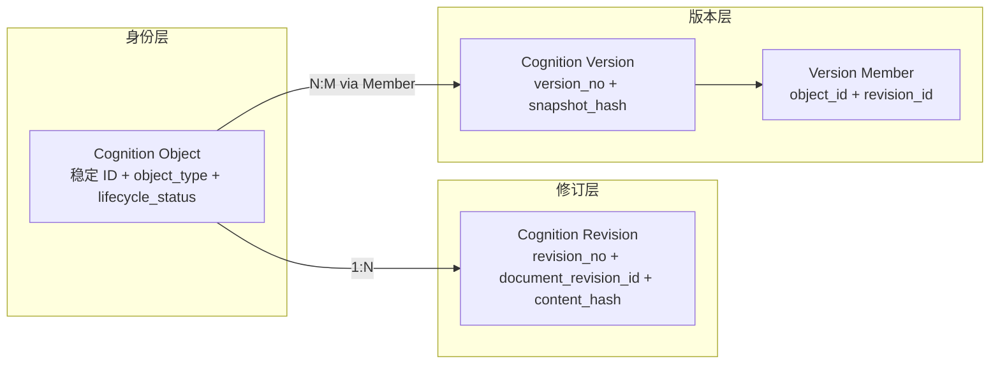
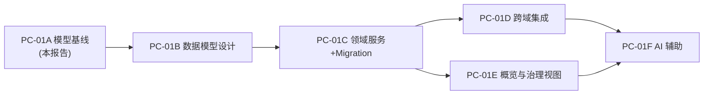

# PC 阶段 1 — 当前实现评审与开发计划 V1.0

| 项 | 值 |
|---|---|
| 文档版本 | V1.0 |
| 状态 | 评审报告，待产品负责人评审 |
| 日期 | 2026-11-06 |
| 评审基线 | 仓库 HEAD `36801388b4f131a8292012c16e9b83e0e07bb3d5`（2026-11-06 20:48:50 +0800，与 Gate 0 核查基线一致） |
| 评审性质 | 只读评审 + 计划设计；未修改代码、未修改数据库、未执行 Migration |
| 上游输入 | ① Q-PC-01～Q-PC-12 产品裁决；② 《PC Gate 0 — 数据库 Schema 核查资料清单》（同目录）；③ 《PC 阶段 1 — 目标领域模型设计基线 V1.0》（同目录，待确认）；④ 《Product Cognition（PC）开发计划 V1.0》（docs/product-cognition-knowledge-base/） |
| 下游 | PC-01B 逻辑数据模型设计（本报告 §7 验收通过后启动） |

---

# 1. 执行摘要

| # | 结论 | 依据 |
|---|---|---|
| 1 | **当前代码库不存在任何 Product Cognition 实现**：无 PC 实体表、无领域模型、无领域服务、无 API、无前端页面 | §3；migrations/ 全量扫描 + `crates/pm-domain/src/lib.rs:3-15` + 前端词边界搜索 0 命中 |
| 2 | 代码库中与 "cognition/baseline" 相关的现有实现是 **S01-04 Project Cognition（技术认知）与 S01-05 Project Baseline（项目基线）**，其六域取值（identity/repository/architecture/convention/evolution）与 PC 对象类型完全不同；它们**不是 PC 的不完整实现，而是另一个领域的完成实现** | `migrations/0036_s01_cognition.sql:38-40`、`0037_s01_baseline.sql:35-37` |
| 3 | PC 目标 14 类核心实体（Vision/Capability/Module/Actor/Scenario/Process/Page/Business Object/Business Rule/Product Decision/Source/Evidence/Proposal/Revision）**全部缺失**，差距为「从零新建」而非「改造」 | §4.1 实体对照表 |
| 4 | 现有 cognition/baseline 管线与目标模型的三大结构差距：**① 正式版本不钉条目集合（不可还原）；② 无 Revision 模型（Edit&Confirm 直接覆盖正文）；③ Source/Evidence 内嵌 JSONB 无实体** | `0037:55-66`；`pm_cognition.rs:332-371`；`0036:44` |
| 5 | **存在大量可直接复用的基建先例**：文档域七表（Git 权威 + PG 状态）、`review_approval` 不可变审批范式、`approver_grant` 审批授权、组合 FK 租户化、CAS 双令牌、证据实体表结构、写幂等账本 | §3.5 |
| 6 | 问题分级：**Blocker 0 项 / Major 9 项 / Minor 3 项 / Observation 6 项**（Blocker 为 0 的前提：PC 按目标模型新建，不复用 `ai.cognition_*`/`baseline_*` 作为正式产品认知权威） | §5 |
| 7 | 待产品负责人裁决 3 项：旧 baseline 域归属、两套阶段体系（PC-01A～01F vs M0～M7）对应关系、Product Plan 边界（PC-D-07） | §8 |

---

# 2. 评审范围与方法

- **范围**：任务书 §三 A～G 七个评审域；证据来源为 migrations/ 全量 44 个 SQL 文件（Gate 0 已逐块静态阅读）、Rust 后端（crates/、apps/）、Vue/TS 前端（ai-frontend/src）。
- **方法**：关键词词边界搜索（vision/capability/business_object/business_rule/scenario/process/module/decision/adr/supersede 等）+ 表清单双向核对 + 关键事务代码人工阅读（`pm_cognition.rs`、`pm_baseline.rs` 抽查至行号级）。
- **口径**：结论均附 文件:行号 证据；SQL 无法证明的应用层行为标注「待核实」；事实与建议严格分离（Gate 0 G 节与 H 节口径沿用）。

---

# 3. 当前实现清单

## 3.1 总体定位

```text
检索结果：Product Cognition（产品认知）实现 = 零
现有相近命名实现：
  ai.cognition_run / ai.cognition_item / ai.project_knowledge   → S01-04 Project Cognition（技术认知）
  ai.baseline_proposal / ai.baseline_item / ai.project_baseline → S01-05 Project Baseline（项目基线）
```

判定依据：`ai.cognition_item.domain` 六值为 `identity/repository/domain/architecture/convention/evolution`（`0036_s01_cognition.sql:38-40`），`ai.baseline_item.category` 七值为 `identity/scope/technical/architecture/repository/standards/constraints`（`0037_s01_baseline.sql:35-37`）——均为**技术认知**语义；而 PC 目标对象类型为产品语义（Vision/Capability/Module/Scenario/…，见领域模型基线 §3.2）。二者不重叠。

## 3.2 实体与数据表

| 领域 | 表 | 定义位置 | 状态 |
|---|---|---|---|
| S01-04 技术认知 | ai.cognition_run / cognition_item / project_knowledge | 0036:7-27 / 32-61 / 66-87 | 存在，创建后从未被修改 |
| S01-05 项目基线 | ai.baseline_proposal / baseline_item / project_baseline | 0037:7-27 / 29-50 / 55-66 | 存在，创建后从未被修改 |
| KB 文档域 | ai.project_document / document_revision / document_proposal / document_index_state / knowledge_reference / document_section_index / knowledge_write_operation | 0006、0014、0024 | 存在，闭环完整 |
| 通用提案-审批 | ai.change_proposal + governance.approval_request（1:1） | 0003:128-168 | 存在，服务 Task 15 AI 提案，未接 cognition |
| 交付审批 | governance.review_approval（不可变范式） | 0026:223-296 | 存在，服务 D5 Review |
| 审批授权 | core.approver_grant | 0040:23-38 | 存在，服务 S02 需求确认 |
| **PC 14 类目标实体** | Product Vision / Business Domain / Capability / Module / Actor / Scenario / Process / Page / Interaction / Domain Object / Business Rule / Product Decision / Source / Evidence | — | **全部不存在**（`vision`/`capability`/`business_rule` 等词边界搜索 0 命中；Decision/ADR 无实体表，仅 `doc_type` 分类值 0006:11-13） |

## 3.3 后端服务与 API

| 能力 | 位置 | 事实 |
|---|---|---|
| 认知概览 | `apps/pm-api/src/pm_cognition.rs:29-90` | GET，runs 近 20 条 + items + knowledge 统计 |
| 启动认知 Run | 同上 `:117-248` | 人类启动（`started_by NOT NULL`，0036:22，Q2-C）；V1 同步派生条目并**直接置 completed**（`:228-239`），无 LLM 编排 |
| 逐项决策 | 同上 `:288-393` | confirm/reject/defer/investigate；`FOR UPDATE`（`:309`）；重复决策 409（`:319-321`）；confirm 落 `ai.project_knowledge`（`:339-353`）；**Edit&Confirm 直接 UPDATE item.content**（`:356-371`） |
| 知识读取 | 同上 `:396-416` | 读 active 项目知识 |
| 基线提案 | `apps/pm-api/src/pm_baseline.rs:105-224` | 条目来源①=project_knowledge（`:154-179`）②=仓库快照（`:181-205`）；pending 提案唯一（409，`:124-128`；DB 层 `uq_baseline_proposal_pending` 0037:26-27） |
| 基线确认 | 同上 `:295-360` | 要求无 proposed 条目（`:317-330`）；落版本头 + 提案转 confirmed（`:332-355`） |
| 路由注册 | `apps/pm-api/src/routes.rs:226,228` | cognition 4 条 / baseline 4 条（`pm_cognition.rs:429-444`、`pm_baseline.rs:362-377`） |
| 领域模型层 | `crates/pm-domain/src/lib.rs:3-15` | **无 cognition/baseline/PC 模块**；实体行 struct 为 handler 内私有 `sqlx::FromRow`（`pm_cognition.rs:92-114`） |

## 3.4 前端

| 能力 | 位置 |
|---|---|
| 认知页（Run 启动/逐项确认/Edit&Confirm/证据展示） | `ai-frontend/src/views/project/cognition/CognitionPage.vue:24,33,174-335` |
| 基线页（提案/逐项确认/Confirm Baseline） | `ai-frontend/src/views/project/baseline/BaselinePage.vue` |
| API client | `src/api/cognition.ts:68-97`、`src/api/baseline.ts:40-68` |
| **PC 页面** | **不存在**（`vision`/`capability`/`ProductVision` 前端搜索 0 命中） |

## 3.5 可复用资产清单（评审认定的复用价值）

| # | 资产 | 证据 | 对 PC 的复用方式 |
|---|---|---|---|
| A1 | 文档域「Git 权威 + PG 状态」七表闭环（revision 链 / proposal 状态机 / hash 对账 / 写幂等账本） | 0006、0014、0024 | PC Cognition Revision 的正文承载与 Git 一致性协议基座（对应基线 §12、PC-D-02/09） |
| A2 | `governance.review_approval` 不可变审批范式（三重锚定 + 状态单向触发器 + pending 部分唯一） | 0026:223-296 | PC Approval 的库层保护范式（基线 §9.3 已指定为参考，PC-D-01） |
| A3 | `core.approver_grant` + `ensure_governance_authorized` 权限闸 | 0040:23-38；`crates/pm-application/src/approver.rs:37-60` | PC L1/L2 审批人判定直接复用（基线 §9.2 V1 审批人规则） |
| A4 | 0019 组合 FK 租户化模式（`(tenant_id, project_id)` FK + `UNIQUE(tenant_id, id)`） | 0019:154-168 | PC 全部新表的隔离基线（基线 §13） |
| A5 | `delivery.task_requirement` 复合 FK 钉 Revision 先例 | 0002:68-80 | PC↔Requirement 关联钉 Revision 的结构先例（基线 §7.4） |
| A6 | 需求修订 CAS 双令牌（`base_current_revision_id`/`base_row_revision`） | 0039:61-62 | PC 并发控制设计参考（基线 §5.6） |
| A7 | `discovery.discovery_finding_evidence` 证据实体结构（file_path/symbol/code_range/commit_sha） | 0031:128-171 | PC Evidence 定位协议参考（PC-D-05） |
| A8 | `ai.knowledge_write_operation` 写幂等账本（`UNIQUE(project_id, operation_id)`） | 0024:43-64 | PC 写路径防重（Gate 0 G.2-5） |
| A9 | `ai.project_document` doc_key/canonical_path 身份模型 + Project Goal 零表实现（doc_key='project-goal'） | 0006:7-20；`crates/pm-application/src/project_goal.rs:8-14` | PC Product Profile/Vision 的文档身份组织参考（PC-D-02/06） |

---

# 4. 目标模型差距（按任务书 §三 A～G）

> 每项：当前实现 → 目标要求 → 差异 → 影响 → 证据。

## 4.1 A. 领域实体

| 目标实体 | 当前实现 | 差异 | 影响 |
|---|---|---|---|
| Product Vision / Business Domain / Capability / Module / Actor / Scenario / Process / Page / Interaction / Domain Object / Business Rule | 无（词边界搜索 0 命中） | 整层缺失 | PC 无从谈起，需全量新建 |
| Product Decision | 无实体表；`doc_type='decision'` 仅文档分类值（0006:11-13）；`change_proposal.target_type` 自由 TEXT 可扩值（0003:133） | 决策无结构承载、无生命周期 | L2 治理对象（正式产品决策）无落点 |
| Cognition Source / Evidence | Source 无实体（仅 `cognition_run.scope/repo_versions` JSONB 声明范围，0036:17-18）；Evidence 为 `cognition_item.evidence JSONB` 内嵌、无类型 CHECK（0036:44） | 来源/证据/认知混存于单表 JSONB | 追溯链（基线 §6.3）无法建立；证据不可独立验证/反驳 |
| Change Proposal | `ai.change_proposal` 存在但服务 Task 15 AI 域，`target_type` 无 CHECK、`target_id` 无 FK（0003:133-134） | 通用结构在，PC 契约未定义 | 需 PC-D-01 裁决扩展或新建 |
| Revision / Version | 对象无 Revision；`project_knowledge` 有 version+supersedes 列但**代码无 supersede 写路径**（decide 重复确认 409，`pm_cognition.rs:327-330`）；`project_baseline` 仅版本头 | 三层模型（Object→Revision→Version）全缺 | 版本演进、历史还原无结构基础 |
| 身份与版本分离 | 无：`cognition_item` 身份即内容（content 列随确认被覆盖）；`project_knowledge` 行本身是版本 | 身份/修订未分离（PC-ARCH-02 违反） | 稳定引用、关系钉住、历史追溯均不可实现 |

**实体拆分意见（防过度设计）**：基线 §3.2 已按「逻辑对象≠物理表」声明（§3.2 F 节末）。评审同意：Page 与 Interaction 可共表分型、Feature 默认内嵌 Module 正文、Review Item/Cognition Audit 可复用现有 governance 载体；但 **Cognition Object / Cognition Revision / Cognition Version(Member) 三层必须物理分离**（见 §6.2），Source 与 Evidence 必须实体化（见 4.4）。

## 4.2 B. 聚合边界与关系模型

| 检查点 | 事实 | 证据 |
|---|---|---|
| PC 聚合根 | 不存在。现有管线中 `cognition_run` 是过程对象（Run），`baseline_proposal` 是提案轮次聚合——均为**一次性流程聚合**，非「正式认知」聚合 | 0036:7-27；0037:7-27 |
| Project 与 PC 关系 | 现有：cognition/baseline 六表组合 FK 挂 `core.project`（可靠）；PC 目标聚合（按基线）应为「Project → Cognition Object（身份聚合根）」 | 0036:26,60,83；0037:23,49,65 |
| 稳定身份关联 | 无。对象间仅过程引用：item→run（单列 FK）、knowledge→item（单列 FK，可空）、proposal→run（单列 FK，可空） | 0036:36,74；0037:16 |
| 类型化多对多关系 | 无任何关系表；cognition↔document 域**零 FK 通道** | Gate 0 F.2-3 |
| 关系版本化 | 无 | — |
| 废弃/合并/替代 | 表层有状态（`superseded`：0036:51、0037:15；`status='retired'`：0036:76-77），**代码层零写路径**；knowledge 版本链靠 supersedes_id 但无消费方 | 探索：`supersede` 代码搜索 0 命中 |
| 跨项目风险 | 内部引用列全部单列 FK，不强制同租户/同项目（应用层 bug 可产生跨项目认知链）；项目删除 NO ACTION 无级联语义 | Gate 0 F.3-1；0036:36,74,78；0037:16,33,60 |

**目标关系模型**：按基线 §7 执行（类型化 Relationship 实体 + 受控类型注册 PC-D-04 + Revision 钉住规则 §7.4 + 关系自身生命周期 §7.3）。评审补充一条架构推导：Relationship 表两端均应引用 Cognition Object 的**稳定 ID**，跨模块目标（Requirement/Design/ADR）另存 `target_ref`（模块标识 + 稳定 ID + 钉住的 Revision 列），避免为跨域目标伪造 PC 内部对象。

## 4.3 C. Revision 与正式版本（评审重点）

| 检查点 | 结论 | 证据 |
|---|---|---|
| 正式版本能否固定绑定一组对象及其 Revision | **不能**。`project_baseline` 版本头仅存 `proposal_id`（单列 FK），不钉条目集合；若 proposal 之后条目状态被改，快照构成无法从库层还原 | 0037:55-66；Gate 0 F.2-1 |
| 正式版本发布后能否完整重建当时认知状态 | **不能**（同上）；只能按 proposal_id 反推，属推导性重建 | Gate 0 G.1 映射建议已标注 |
| 修改是否产生新 Revision | **否**。Edit&Confirm 直接 `UPDATE ai.cognition_item SET content = COALESCE($7, content)`——修订覆盖原正文，无新 Revision；0036:52-53 注释声称「原 AI 提案保存在 decision_note 前缀」，但代码仅 `bind(body.note)`（`pm_cognition.rs:366`），原 AI 正文在 Edit&Confirm 后**丢失** | `pm_cognition.rs:332-338,356-371` |
| 草稿是否可能被误认正式认知 | 有区分：item.state='proposed' vs project_knowledge.status='active'；展示层按状态过滤（`CognitionPage.vue` 分区渲染）。**但** confirm 即落 knowledge 即「正式」，无提案→审批→版本的中间层 | `pm_cognition.rs:323-353` |
| Revision 与正式版本是否混淆 | 是。`project_knowledge.version`（条目级版本数字）与 `project_baseline.version`（项目级版本头）共用 "version" 语义但层级不同；且 knowledge 无 `(project_id, domain, version)` 唯一约束——同域同 version 可并存 | 0036:75；0037:59,64；Gate 0 F.3-5 |
| 并发版本冲突保护 | 部分：`FOR UPDATE` + 单次决策 409（`pm_cognition.rs:309-321`）+ pending 提案唯一索引（0037:26-27）；**无** CAS/expected_revision 令牌（`change_proposal.expected_revision` 有列但属 Task 15 域且 DB 无约束，0003:135） | Gate 0 C.3.5 |
| 仅凭 version 字段认定版本模型完整 | 不成立：version 列存在 ≠ Revision 模型存在（本节全部证据） | — |

## 4.4 D. 来源与证据

| 检查点 | 结论 | 证据 |
|---|---|---|
| 五类对象区分（Source / Evidence / KB Memory / Proposal / 正式认知） | **未区分**。evidence JSONB 混合承担「来源声明 + 证据内容 + 可信度」；KB Memory（ai.project_document 域）与 cognition 域零结构通道 | 0036:44；Gate 0 F.2-3 |
| 每条认知可追溯到来源 | 部分：knowledge.source_item_id 可追溯到提出条目（0036:74），但条目自身的 evidence JSONB 无实体、无类型约束（注释：V1 type ∈ project_record/repository_metadata，0036:42-43） | 0036:42-47 |
| 来源关联 KB 文档及 Revision | **无**。cognition/baseline 与 project_document/document_revision 之间无任何 FK | Gate 0 C.5.2/C.5.3 |
| 证据片段/引用位置保留 | evidence JSONB 结构自由，无 section_anchor/commit_sha 类定位协议；对比 `discovery_finding_evidence` 已实现定位协议（0031:128-171）与 `knowledge_reference` 已实现章节锚点（0014:87-104） | 0036:44 |
| AI 提议关联证据 | change_proposal.evidence JSONB（0003:139）存在但自由结构；cognition 管线未接 | 0003:139 |
| 正式认知追溯形成依据 | 有最简链：knowledge←source_item_id←item（evidence/confidence）；无 Proposal 层、无审批依据记录（decision_note 自由文本） | 0036:74；0036:54-56 |
| 来源更新后识别受影响认知 | **无**任何机制（无 source→cognition 反向关联） | — |

## 4.5 E. 审批与治理（L0-L3）

| 检查点 | 结论 | 证据 |
|---|---|---|
| 复用现有 Change Proposal / Approval 机制 | **未复用**。cognition/baseline 确认走自有 decision 端点，未挂 approval_request（其 1:1 结构也天然不适配逐项确认） | `pm_cognition.rs:288-393`；`pm_baseline.rs:234-290`；探索：挂接搜索 0 命中 |
| AI 自动确认正式认知路径 | **不存在**（正面结论）：confirm 仅在人类 decision 端点；start_run 为人类启动（`started_by NOT NULL`）；V1 无 AI 写入 knowledge 的代码路径 | 0036:22；`pm_cognition.rs:288` |
| 确认人权限闸 | **缺失**。decision 端点仅 `require_project_visible`（项目成员可见级）——**任何项目成员均可 confirm/reject**，无 Lead/授权审批人判定（`ensure_governance_authorized` 存在但未接入，`approver.rs:37-60`） | `pm_cognition.rs:294`；`pm_baseline.rs:300` |
| 审批记录完整性 | 记录了 decided_by/at/note、confirmed_by/at（0036:54-56,80-81；0037:44-46,61-62）；**无**审批依据结构化字段、无预期版本锚定 | 同上 |
| 审批历史不可篡改保护 | **无**。item 可经 defer→? 重决策路径回转吗——不能（仅 proposed 态可决策，409 保护，`pm_cognition.rs:319-321`）；但 knowledge 行无不可变触发器，proposal 确认后条目「不可变」仅是注释约定（0037:237-238），**无 DB 强制** | 0037:14-15 注释；无触发器 DDL |
| 并发审批/重复提交安全 | 有：FOR UPDATE + 状态前置校验 + 409 + pending 部分唯一索引 | `pm_cognition.rs:305-321`；0037:26-27 |
| L0-L3 治理等级 | **完全不存在**（无等级字段、无分级策略、无分级权限路由） | — |
| L3 冲突冻结 | **不存在**。`has_conflict` 仅布尔落库与展示（0036:47；`pm_cognition.rs:109`），无解决流、无冻结消费方 | 0036:47 |
| 审计 | **缺失**：decide_item / confirm_baseline 事务内**无 `governance.audit_log` 写入**（本次 grep `pm_cognition.rs`/`pm_baseline.rs` 中 audit 0 命中；commit `36801388` 时点） | grep 结果 |

## 4.6 F. 跨领域关系

| 领域 | 现状 | 目标差距 |
|---|---|---|
| Requirements | PC 侧无关联；现有最近关联是 `task_requirement`（Task↔Requirement Revision 钉定，0002:68-80）与 `requirement_finding/requirement_source_input`（0044_s02）——均非 PC | 需新建「Requirement 关联记录稳定身份 + 钉 Revision + 影响分析」（基线 §7.4、§11.1） |
| Design / ADR | **无实体**。doc_type='architecture' 仅分类值；ADR 仅是知识 Git 根模板字符串（`crates/pm-application/src/knowledge.rs:51,71`） | PC 不维护 ADR 正文（边界正确）；但 PC↔Design 的关联目标对象当前不存在，PC-01D 需 Design 域先有可关联身份 |
| Project Goal | Goal = `ai.project_document(doc_key='project-goal')` 零表实现（`project_goal.rs:8-14`），与 cognition/baseline 无表级关联 | Vision↔Goal 支撑关系需新建（基线 §11.4）；Goal 已有稳定身份（doc_key），可关联 |
| Knowledge Base | KB 治理流（knowledge_proposal：质量门→红线→否决，`pm-application/src/knowledge_proposal/`）与 PC 无连接；KB 审核通过≠PC 正式确认（边界语义正确，但结构上 KB→PC 输入通道不存在） | PC-01F/PC-0601 建输入接口 |
| S01-04 Project Cognition | ai.cognition_* 即 S01-04 技术认知实现，权威边界清晰（它们不是 PC）；但命名与 PC 高度相近（见 O1） | 无需改动；PC 设计须避免复用其表 |

## 4.7 G. API、服务与权限

| 检查点 | 结论 | 证据 |
|---|---|---|
| PC Domain Service | **不存在**。cognition/baseline 逻辑全部内联在 `apps/pm-api` handler 中直接 SQL，无 pm-domain 实体、无独立 service 层 | `pm_cognition.rs`（444 行全文件）、`pm_baseline.rs`（377 行全文件）；`pm-domain/src/lib.rs:3-15` |
| API 绕过领域规则 | 现有 API 即规则本身（无规则可绕过）；PC 建设时必须避免 handler 直操 DB 模式 | §3.3 |
| 项目隔离 | 可靠：全部查询双键过滤（tenant_id+project_id）+ 组合 FK | `pm_cognition.rs:39,49,57-60`；`pm_baseline.rs:33-34` |
| 统一审批权限模型 | 未统一：cognition 用 require_project_visible，S02 需求确认用 approver 闸，D5 用 review_approval——三套并存，PC 需收敛到 A2+A3 | §4.5 |
| AI 绕过人工确认路径 | 不存在（V1）；PC 建设后须经安全闸（开发计划 PC-0306） | §4.5 |
| 事务保护 | 有：`pool.begin()` + `FOR UPDATE` + commit（`pm_cognition.rs:305-386`、`pm_baseline.rs:303-357`） | 同上 |
| 不一致状态流转入口 | decision 端点 action 白名单校验（`:297-303`）；proposal 仅 pending→confirmed 两转换（`pm_baseline.rs:105-360`）——无非法流转入口；但状态机不完整（superseded 无路径） | 同上 |
| 重复服务/模型 | cognition_item 与 discovery_finding 语义重叠（两域各自产出认知条目，Gate 0 G.1）；command_center 的 `cognition_status` 读 discovery 不读 ai.cognition_*（`command_center.rs:164-192`）——命名重叠但无重复实现 | 同上 |

---

# 5. 问题分级

> Blocker = 阻断领域模型成立或正式认知安全；Major = 核心领域能力缺失或重大结构问题；Minor = 局部不完善；Observation = 事实观察。

## 5.1 Blocker（0 项）

无。前提：PC 按目标模型新建，不复用 `ai.cognition_*` / `baseline_*` 承载正式产品认知。**若违反此前提（例如复用 `project_baseline` 做 Cognition Version），B-1/M-2/M-3 即升级为 Blocker**——本报告将其列为建议而非既成约束，最终以产品负责人对 §8 Q-1 的裁决为准。

## 5.2 Major（9 项）

| # | 问题 | 证据 |
|---|---|---|
| M-1 | PC 全部 14 类核心实体、领域服务、API、前端缺失，差距为从零新建 | §3.2/§3.3/§3.4 |
| M-2 | 正式版本不可还原：版本头不钉条目集合 | 0037:55-66 |
| M-3 | 无 Revision 模型：Edit&Confirm 覆盖正文、原 AI 提案正文丢失（注释与实现不符） | `pm_cognition.rs:356-371` vs 0036:52-53 |
| M-4 | Source/Evidence 无实体，混存 JSONB，与 KB 文档域零结构通道 | 0036:44；Gate 0 F.2-3 |
| M-5 | 确认动作无审批权限闸：任何项目成员可确认正式认知 | `pm_cognition.rs:294`；`approver.rs:37-60` 未接入 |
| M-6 | 无 L0-L3 治理等级与 L3 冲突冻结（has_conflict 无消费方） | 0036:47 |
| M-7 | 正式确认/版本发布无审计记录（事务内无 audit_log 写入） | grep `pm_cognition.rs`/`pm_baseline.rs` audit 0 命中 |
| M-8 | cognition/baseline 内部引用单列 FK，不强制同项目（跨项目链风险） | 0036:36,74,78；0037:16,33,60 |
| M-9 | 认知正文存 PG（content TEXT），违反「Markdown+Git 正文权威、PG 状态」存储架构约束 | 0036:41,73；0037:38 |

## 5.3 Minor（3 项）

| # | 问题 | 证据 |
|---|---|---|
| m-1 | superseded/retired 状态表列存在但代码零写路径（死状态） | 0036:51,76-77；0037:15 |
| m-2 | project_knowledge 版本号无 `(project_id, domain, version)` 唯一约束，同域同 version 可并存 | 0036:75；Gate 0 F.3-5 |
| m-3 | `governance.approval_request` 弱结构（status 无 CHECK、无不可变触发器、无历史）——PC-D-01 若选择扩展它，须先加固 | 0003:157-168 |

## 5.4 Observation（6 项）

| # | 观察 | 证据 |
|---|---|---|
| O-1 | `ai.cognition_*` 命名与 Product Cognition 高度相近但属 S01-04 技术认知——后续文档/沟通须以「技术认知/PC」显式区分，避免复用误判 | 0036:38-40 |
| O-2 | 迁移账本异常：缺 0029；0044 同号双文件（sqlx 记账行为待核实 H-13）；新迁移应自 0045 起号 | Gate 0 B.2 |
| O-3 | cognition_item 与 discovery_finding 语义重叠（同一事实两个来源域），迁移设计需去重策略 | Gate 0 G.1 |
| O-4 | 现有 V1 认知 Run 为同步派生（无 LLM 编排），条目直接 completed——Q2-C 人类启动已保证，且无 AI 直写正式认知路径（正面事实） | `pm_cognition.rs:228-239` |
| O-5 | Project Goal 零表实现（doc_key='project-goal'），有稳定身份可关联，PC-01D 无需 Goal 侧新建 | `project_goal.rs:8-14` |
| O-6 | S02 新近表部分偏离 0019 隔离模式（requirement_confirmation 无 tenant 引用、source_input 用 UNIQUE(project_id,id)）——PC 新表设计时应统一回 0019 模式，不跟随偏离 | 0039:86-93；0044_s02:21 |

---

# 6. 目标领域模型建议

## 6.1 与领域模型基线 V1.0 的关系

**建议直接采用《PC 阶段 1 — 目标领域模型设计基线 V1.0》作为 PC-01A 目标模型基线。** 评审结论：该基线与代码事实无冲突，其 §14.2 旧对象映射方向与 Gate 0 G 节一致；本节仅补充评审推导的衔接设计，不推翻基线任何内容。

标注体系：〔裁决〕= Q-PC-01~12 或基线已确认；〔事实〕= 代码/Schema 事实；〔推导〕= 本报告架构推导；〔待决〕= 需产品/后续阶段裁决。

## 6.2 三层核心模型（Object → Revision → Version）



- 〔裁决〕三层分离（基线 §5.1）；Version 含不可变 Member 集合（§5.4），不复用 `project_baseline` 的「版本头 + 反推」结构（〔事实〕0037:55-66 不可还原）。
- 〔推导〕Revision 正文承载复用 A1 文档域基建：Cognition Revision 持 `document_id + document_revision_id + content_hash`，正文权威在 Git（〔裁决〕基线 §12.1 三层权威，即存储架构约束）；一对象一文档 or 多文档 = PC-D-02（〔待决〕01B）。
- 〔推导〕Version 发布 = 审批通过后的事务内 Member 批量落库 + snapshot_hash，CAS 校验（expected_version）+ `UNIQUE(tenant_id, project_id, version_no)`，范式参考 A6 双令牌与 0037:64 既有唯一键。
- 〔待决〕Version 完整快照 vs 增量 = PC-D-03（01B）。

## 6.3 聚合边界

| 聚合 | 聚合根 | 成员 | 一致性边界 |
|---|---|---|---|
| 认知对象聚合 | Cognition Object | 其 Revisions | Revision 必属同一 Object（组合 FK `(tenant_id, project_id, object_id)`） |
| 正式版本聚合 | Cognition Version | Member 集合 | Member 的 object/revision 同项目同租户；发布后不可变（触发器，范式 A2） |
| 提案聚合 | PC Change Proposal | 拟变更对象集 + 证据 | 目标对象必须存在于同项目（组合 FK，修复 change_proposal target 无 FK 缺陷 m-3 路径） |
| 关系聚合 | Relationship | 两端对象 + 钉住的 Revision | 两端同项目；跨域目标走 target_ref |

〔推导〕Project → 各聚合根之间用组合 FK 强制同项目（修复 M-8 模式缺陷）；多对多关系（Capability↔Domain、Page↔Interaction 等）由 Relationship 实体统一承载，不为每类关系建专属表。

## 6.4 来源与证据

〔裁决〕基线 §6：Source（12 类逻辑来源）/ Evidence（定位 + hash + confidence + verification）分离；Confidence 与 Confirmation 分离（§6.4）。〔推导〕Evidence 实体结构参考 A7（discovery_finding_evidence）与 `knowledge_reference`（章节锚点 0014:87-104）；Source 跨域引用协议（KB Memory / Requirement Revision / discovery_finding / repository_commit）在 PC-01B 定义（PC-D-05）；来源更新影响分析依赖 `Source → Cognition Object` 反向索引（当前完全缺失，M-4 修复项）。

## 6.5 治理模型（L0-L3 + 审批 + 安全闸）

〔裁决〕L0-L3 权限等级、审批人规则（Lead + 授权审批人同权）、AI 不得确认 L1/L2、L3 冻结（基线 §9.2/9.4）。〔推导〕物理实现：
- 审批载体按 PC-D-01 裁决；无论扩展或新建，必须满足基线 §9.3 八条技术原则，库层保护范式取 A2（锚定不可变 + 状态单向 + pending 唯一）；
- 审批人判定复用 A3（approver_grant + ensure_governance_authorized），修复 M-5；
- L3 冻结实现为 Conflict(status∈{under_review,awaiting_human}) 对受影响对象的确认入口前置校验；
- 全部正式确认/发布动作写 governance.audit_log（source_kind='pc_*'），修复 M-7；
- 正式写入唯一入口 = 安全闸服务（开发计划 PC-0306），API/handler 不得直写正式表。

## 6.6 跨领域关系

〔裁决〕基线 §11 五条边界（Requirements 唯一确认方 / PC 不审批 ADR / Goal 归项目管理 / KB 审核≠PC 确认 / Reality 来自执行证据）。〔推导〕结构衔接：
- Requirement 关联：稳定 requirement_id + 钉 revision_id（范式 A5 复合 FK 先例）；影响分析在 Requirement Revision 变化时由 PC 查询触发（PC-01D）。
- Design/ADR：当前无实体（〔事实〕§4.6）——PC-01D 的 Design 关联接口依赖 Design 域先提供可关联身份；若 Design 域尚未建设，V1 允许以 document_revision（doc_type='architecture'）为关联目标过渡，并标记〔待决〕是否接受。
- Goal：以 doc_key='project-goal' 文档身份为关联目标（O-5），支撑关系记录建立时依据，PC 不修改 Goal。

## 6.7 新建 / 复用 / 保留 / 退役对照

| 处置 | 对象 | 说明 |
|---|---|---|
| **新建** | PC 全部领域对象（Object/Revision/Version/Member/Relationship/Source/Evidence/PC Proposal/Approval 或扩展/Conflict/审计挂接）+ PC Domain Service + PC API + PC 前端 | 按 PC-01B→01F 推进 |
| **复用** | A1～A9（§3.5） | 文档域、审批范式、授权闸、隔离模式、CAS、幂等账本 |
| **保留** | ai.cognition_* / baseline_* 六表及其 API/前端 | 属 S01-04/05 技术认知权威，继续服务原领域，PC 不迁移其运行职责 |
| **退役/迁移** | 旧数据（project_knowledge/baseline/discovery_finding）→ PC 草稿 | 按基线 §14 映射原则（旧 confirmed 不自动转正）；具体方案归 PC-01C / 开发计划阶段 7（PC-0701~0703）；退役方式 = PC-D-10（〔待决〕01C） |

---

# 7. 分阶段开发计划（PC-01A ～ PC-01F）

> 本节为任务书 §四要求的 PC 阶段 1 实施主线。与既有《PC 开发计划 V1.0》（阶段 0～7 / M0～M7 / PC-0001～0707）的映射见 §7.8；两套体系对应关系列为 §8 Q-2 待确认。

## 7.1 PC-01A 目标领域模型与架构基线（本报告所属阶段）

| 项 | 内容 |
|---|---|
| 目标 | 冻结 PC 管什么、不管理什么，及核心实体/聚合/版本/治理模型 |
| 工作内容 | ① 本评审报告；② 领域模型基线 V1.0 确认（含 PC-D-07）；③ 权威边界与跨域关系冻结 |
| 前置依赖 | Q-PC-01~12（已确认）；Gate 0（已完成） |
| 交付物 | 本报告 + 基线 V1.0（确认后升级为冻结基线） |
| 验收标准 | 基线 §16 六组验收清单全绿；§8 三问获产品负责人裁决；基线 §17 PC-D-01～10 确认处理阶段归属 |
| 风险 | 基线长期待确认阻塞下游（缓解：PC-D-01～06/08～10 可与 01B 并行裁决，仅需 PC-D-07 在 01A 内关闭） |
| 顺序 | 第 1 步（当前） |

## 7.2 PC-01B 数据模型与数据库设计

| 项 | 内容 |
|---|---|
| 目标 | 将冻结基线映射为可实施的 PostgreSQL 逻辑/物理设计（设计交付，不含 Migration 实施） |
| 工作内容 | PC 表结构（建议 `pc` schema 或 `ai.pc_*` 前缀，01B 定）；UUID 主键 + TIMESTAMPTZ + 组合 FK `(tenant_id, project_id)` + UNIQUE/CHECK；Version Member 组合外键（成员 revision 属对应 object 的复合 FK）；Relationship 类型注册机制（PC-D-04）；Source/Evidence 物理结构（PC-D-05）；审批载体裁决（PC-D-01）；Git-PG 一致性协议（PC-D-09）；CAS/乐观锁与唯一约束设计；审计设计；索引设计 |
| 前置依赖 | PC-01A 验收通过；PC-D-01～06、09 裁决完成 |
| 交付物 | 《PC-01B 数据模型设计》文档（DDL 级伪码 + 约束清单 + 并发控制伪代码 + 验收标准清单） |
| 验收标准 | 基线 §13.1-13.5 全部完整性要求可映射到具体约束；三层模型/Member 不可变/组合 FK/部分唯一索引逐条有 DDL 对应；0045+ 迁移号规划 |
| 风险 | PC-D-01 若选扩展 approval_request 需先加固（m-3）；0044 同号双文件的 sqlx 行为未验证（H-13），01B 需先核实再定起号 |
| 顺序 | 第 2 步 |

## 7.3 PC-01C 核心领域服务

| 项 | 内容 |
|---|---|
| 目标 | PC 对象全生命周期 + 治理闭环（第一个安全里程碑对应开发计划 M3，**M3 前禁开正式认知写入**） |
| 工作内容 | Migration 实施（01B 过稿后执行，0045 起）；pm-domain PC 实体层 + pc-domain service crate（终结 handler 直操 SQL 模式）；对象 CRUD 与草稿管理；Revision 管理（Git-PG 双写幂等，复用 A1/A8）；PC Change Proposal；审批（安全闸统一入口，复用 A2/A3，修复 M-5/M-7）；Version 发布与历史还原（修复 M-2 型缺陷于新表）；对象废弃/合并/替代（supersede 实路径，修复 m-1 型缺陷）；L0-L3 策略与 L3 冻结 |
| 前置依赖 | PC-01B 验收 + Migration 实施 |
| 交付物 | 领域服务 + API + 单元/集成测试（含越权/绕闸/并发/审计断言） |
| 验收标准 | 开发计划阶段 3 验收五条（人工确认必要条件/历史不可覆盖/普通成员不可越权/并发不丢失/全链路可追溯）逐条有测试；无绕过安全闸的写路径（负向测试证明） |
| 风险 | Git-PG 双写一致性（H-4 事务顺序）；建议 Migration 单迁移收编或按子域拆分，01B 定 |
| 顺序 | 第 3 步 |

## 7.4 PC-01D 跨领域集成

| 项 | 内容 |
|---|---|
| 目标 | 五域协作接口，各领域维护自身权威 |
| 工作内容 | Requirement 关联（稳定 ID + 钉 Revision，范式 A5）与 Revision 变化影响分析接口；Design/ADR 关联（依赖 Design 域身份，见 §6.6 〔待决〕）；Vision↔Goal 支撑关系（目标 = doc_key='project-goal'）；KB 输入接口（KB 已审核 → PC 草稿提议，不自动转正）；S01-04 边界接口（技术认知引用只读） |
| 前置依赖 | PC-01C 服务可用；Requirements 侧确认门契约（PC-0507/0508 可并行设计） |
| 交付物 | 跨域接口契约文档 + 实现 + 联调测试 |
| 验收标准 | 基线 §11.1 Requirements 五步查询契约可运行；PC 不直接修改任何外域正式状态（负向测试）；各域权威数据零迁移 |
| 风险 | Design/ADR 域实体缺失可能阻塞关联接口（缓解：§6.6 过渡方案或延后该子项） |
| 顺序 | 第 4 步（可与 01C 后期并行设计契约） |

## 7.5 PC-01E 产品概览与人工治理

| 项 | 内容 |
|---|---|
| 目标 | PC 工作台：概览 + 八类视图 + 治理队列 |
| 工作内容 | Product Overview / Big View / Vision / Capabilities / Modules / Actors & Scenarios / Processes / Pages / Objects & Rules / Requirements & Decisions 视图（对应开发计划 PC-0401~0410）；待人工处理事项（P0-P3 队列）；冲突与风险视图；正式版本历史 |
| 前置依赖 | PC-01C（数据可用）；01D（跨域视图数据） |
| 交付物 | 前端页面 + API 对接 + 组件测试 |
| 验收标准 | 开发计划阶段 4 验收四条（同一认知模型无重复事实源/状态区分/可下钻详情来源关系版本/Decision-ADR 归属正确）；设计令牌门禁通过 |
| 风险 | 视图先行导致模型返工（开发计划风险表）——已由 01C 前置规避 |
| 顺序 | 第 5 步（可与 01D 部分并行） |

## 7.6 PC-01F AI 辅助能力

| 项 | 内容 |
|---|---|
| 目标 | AI 分析与提议闭环，绝不绕过审批 |
| 工作内容 | 资料提取认知草稿；对象/关系建议；证据关联（Evidence 定位协议）；冲突识别（对接 L3）；影响分析；Change Proposal 生成；认知质量检查 |
| 前置依赖 | PC-01C 治理闸 + PC-01D KB 输入接口（**I6 必须建立在 I3 治理闸之上**，开发计划 §七） |
| 交付物 | AI 分析服务 + Proposal 生成链路 + 测试 |
| 验收标准 | AI 产出全部止步于草稿/Proposal（无正式写路径，负向测试）；分析结果含来源/依据/可信度/不确定性；AI 失败不影响正式认知 |
| 风险 | AI 过早承担正式认知维护（开发计划列为高风险）——顺序上 01F 最后交付即为控制 |
| 顺序 | 第 6 步（最后） |

## 7.7 依赖图与关键路径



三条保护路径（沿用开发计划 §四）：数据模型路径、治理路径（提议→审批→安全闸→版本→审计，不可为 AI 效果让路）、业务协作路径。**M3（01C 验收）前禁开正式认知写入。**

## 7.8 与既有《PC 开发计划 V1.0》的映射

| 本报告阶段 | 开发计划 V1.0 对应 | 说明 |
|---|---|---|
| PC-01A | 阶段 0（Gate 0 + PC-0001~0005）+ 设计基线 | Gate 0 已完成；本报告补齐评审与计划 |
| PC-01B | 阶段 0 的 PC-0006（迁移设计）数据部分 + 阶段 1/2 前置设计 | 01B 为设计，01C 为实施 |
| PC-01C | 阶段 1（I1）+ 阶段 3（I3） | M1+M3，M3 = 安全里程碑 |
| PC-01D | 阶段 2 部分（PC-0206/0207）+ 阶段 5 部分（PC-0507/0508） | 跨域集成集中化 |
| PC-01E | 阶段 4（I4）+ 阶段 5 的队列视图 | M4+M5 |
| PC-01F | 阶段 6（I6） | M6 |
| （阶段 7） | Release Gate（PC-0701~0707） | 迁移/联调/发布，独立于本 6 阶段 |

---

# 8. 待产品负责人确认的问题

> 仅列真正需要产品决策的事项；可由领域分析确定的技术细节已归入 PC-01B/01C 工作内容，不上推。

## Q-1 旧 baseline 域的归属

- **为什么必须确认**：`ai.project_baseline` 的 category 含 `identity/scope` 类条目（0037:35-37），与 PC Product Profile/Vision 职责重叠（开发计划 V1.0 风险表第一条「高」）。它归属 S01-05 还是其部分内容代表产品意图，直接决定 PC-01C 迁移范围与 PC Vision 初始化策略。
- **方案 A（推荐）**：baseline 域整体保留为 S01-05 项目基线（技术+范围基线），PC 全新建；旧 baseline 数据按基线 §14.2 作「历史输入」迁移进 PC 草稿，scope 类条目由人工判断是否转化为 Vision/Profile 内容。影响：PC 无历史包袱；旧确认数据不自动转正；工作量集中在新建。
- **方案 B**：认定 baseline 的 identity/scope 条目即产品认知，整体并入 PC，S01-05 只留技术类。影响：迁移面大；需重新裁决 S01-05 剩余职责；与「旧 confirmed 不自动转正」原则叠加后实际仍需逐条人工确认——收益有限。
- **推荐理由**：方案 A 与 Q-PC 权威边界裁决及基线 §14.2 映射方向一致；方案 B 与「不为复用旧表牺牲目标模型」原则（任务书 §五.8）冲突。

## Q-2 两套阶段体系的对应关系

- **为什么必须确认**：本报告 PC-01A~01F（任务书体系）与已落盘开发计划 V1.0 的阶段 0~7 / M0~M7 / PC-0001~0707（产品裁决体系）并存，任务拆分与里程碑若不统一将产生双轨。
- **方案 A（推荐）**：以开发计划 V1.0（M0~M7 + PC-0001~0707 任务号）为唯一执行台账；PC-01A~01F 作为其阶段 0~6 的**设计-实施切面**（映射见 §7.8），本报告 §7 的验收标准并入对应 PC-0xxx 任务。影响：任务号连续、里程碑不变。
- **方案 B**：以 PC-01A~01F 为执行主线重排任务号。影响：需重编 PC-0001~0707 台账，产生编号迁移成本。
- **推荐理由**：A 避免双台账；PC-01x 与 PC-0xxx 已可无歧义映射。

## Q-3 Product Plan 边界（基线 PC-D-07，01A 级遗留）

- **为什么必须确认**：PC-FR-026（Product Plan Management）在基线 §15 明确「需结合功能范围确认，不应仅因编号存在就等同于 Cognition Object」。01B 建表前必须知道 Plan 是否为 PC 对象，否则表清单不完整或过度设计。
- **方案 A（推荐）**：Product Plan V1 不作为 PC 认知对象，PC 仅维护 Plan 与认知对象的关系引用（Plan 本体归项目管理/规划域，后续裁决）。影响：01B 表清单不含 plan 实体；FR-026 降级为关联需求。
- **方案 B**：Product Plan 进入 PC 作为 L2 认知对象。影响：需补定义其生命周期、治理等级与视图；01B/01C 范围扩大。
- **推荐理由**：基线已提示 Plan 职责未明；V1 先建立引用关系可保留演进空间，避免为未定义对象建表。

## 其余待裁决事项

基线 §17 的 PC-D-01～06、08～10 属设计级裁决（01B/01C 处理），不推翻 Q-PC-01~12，本报告不重复展开；其中 PC-D-01（审批载体）与 PC-D-09（Git-PG 一致性）建议在 01B 开工前与 Gate 0 H-10/H-4 一并核实裁决。

---

# 9. 完成标准对照（任务书 §七 11 问）

| # | 问题 | 回答 |
|---|---|---|
| 1 | 当前 PC 实际实现到了什么程度？ | 零实现。现有 cognition/baseline 为 S01-04/05 技术认知域（§3.1） |
| 2 | 哪些部分可以保留？ | 文档域七表、review_approval 范式、approver_grant、组合 FK 模式、CAS 双令牌、证据实体先例、幂等账本（§3.5 A1~A9）；ai.cognition_*/baseline_* 原域保留 |
| 3 | 哪些部分需要重构？ | PC 侧无「重构」对象（从零新建）；现有 cognition/baseline 管线的缺陷（M-2/M-3/M-5/M-7/M-8/m-1/m-2）属 S01-04/05 自身演进问题，不因 PC 建设强制修复，但 PC 新表必须规避同类缺陷 |
| 4 | 目标领域模型应包含哪些核心实体？ | 基线 §3.2 六层 17 类逻辑对象；物理表按 §6.2/6.3 聚合（Object/Revision/Version+Member/Relationship/Source/Evidence/Proposal/Approval/Conflict + Profile/Vision 等 14 类对象身份） |
| 5 | 各实体的聚合边界与生命周期？ | §6.3 四聚合；生命周期按基线（对象 identity→draft→active→deprecated/superseded；Revision append-only；Version 不可变） |
| 6 | Revision、正式版本和版本快照如何组织？ | 三层模型 + 不可变 Member + snapshot_hash + CAS（§6.2）；明确不复用 project_baseline 版本头模式 |
| 7 | Source、Evidence、KB Memory 与正式认知如何关联？ | Source（12 类）→ Evidence（定位+hash）→ Cognition Object/Revision；KB Memory 经 PC Proposal 输入；Confidence 与 Confirmation 分离（§6.4） |
| 8 | Requirements、Design、ADR、Project Goal 与 PC 如何关联？ | §6.6：Requirement 钉 Revision；Design/ADR 过渡方案〔待决〕；Goal 以 doc_key 身份建立支撑关系；PC 均不修改外域权威 |
| 9 | 审批、权限、冲突和审计如何保证？ | review_approval 范式 + approver_grant 闸 + L3 冻结前置校验 + audit_log 全量写入 + 安全闸唯一写入口（§6.5） |
| 10 | PC 阶段 1 应如何分阶段实施？ | PC-01A（基线）→01B（数据模型）→01C（服务+Migration，M3 安全闸）→01D/01E（集成与视图）→01F（AI）（§7.7 依赖图） |
| 11 | 哪些问题必须由产品负责人裁决？ | Q-1 旧 baseline 归属、Q-2 阶段体系、Q-3 Product Plan 边界 + 基线 PC-D-01~10 按阶段裁决（§8） |

---

# 10. 证据索引与未核实项

## 10.1 关键证据文件

| 证据 | 位置 |
|---|---|
| 技术认知域表定义 | migrations/0036_s01_cognition.sql（全文件） |
| 基线域表定义 | migrations/0037_s01_baseline.sql（全文件） |
| 审批弱结构 / 不可变范式 | migrations/0003_platform.sql:128-168；0026_delivery_review.sql:223-296 |
| 文档域闭环 | 0006、0014、0024 |
| 租户化模式 | 0019_tenant.sql:154-168 |
| Requirement 钉 Revision / CAS | 0002:68-80；0039:61-62 |
| 认知/基线服务实现 | apps/pm-api/src/pm_cognition.rs（444 行）、pm_baseline.rs（377 行） |
| 授权闸 | crates/pm-application/src/approver.rs:37-60 |
| Goal 零表实现 | crates/pm-application/src/project_goal.rs:8-14 |
| 前端 | ai-frontend/src/views/project/{cognition,baseline}/、src/api/{cognition,baseline}.ts |

## 10.2 未核实项（沿用 Gate 0 H 节 + 本次新增）

| # | 事项 | 影响 |
|---|---|---|
| H-4 | proposed_markdown → Git commit → revision 落库事务顺序 | PC-01C 双写协议设计 |
| H-13 | sqlx 对 0044 同号双文件的记账/校验行为 | PC-01B 迁移起号前核实 |
| H-11 | 现有审批链 SELECT FOR UPDATE 使用完整性 | A2/A3 复用时核对 |
| R-1（新增） | cognition/baseline 事务外是否存在中间件级审计写入 | 本次仅核查两文件无 audit 引用；M-7 表述限定于「decision/confirm 事务内」 |
| R-2（新增） | Design/ADR 域后续建设计划 | PC-01D Design 关联接口排期 |

---

**报告结束。** 等待产品负责人评审；PC-01B 在 §8 三问裁决及基线 §16 验收通过前不启动，Migration 实施在 PC-01B 过稿前不执行。