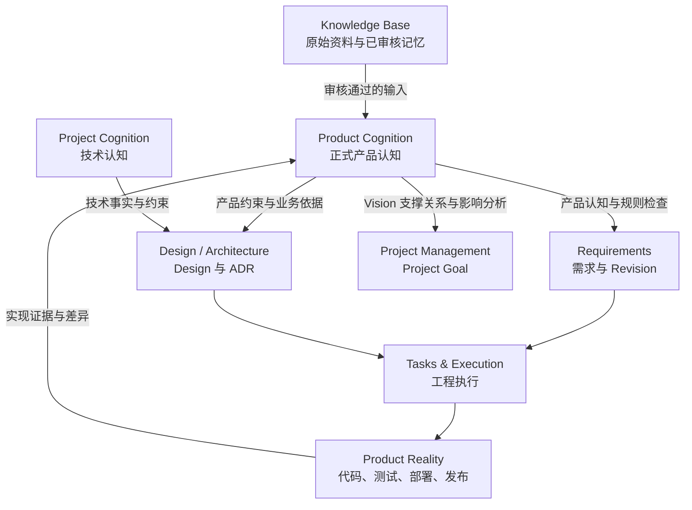
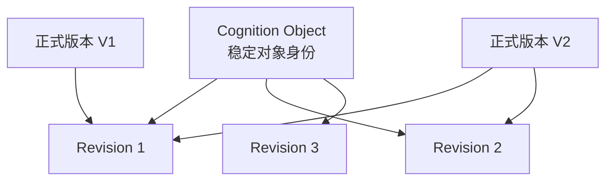
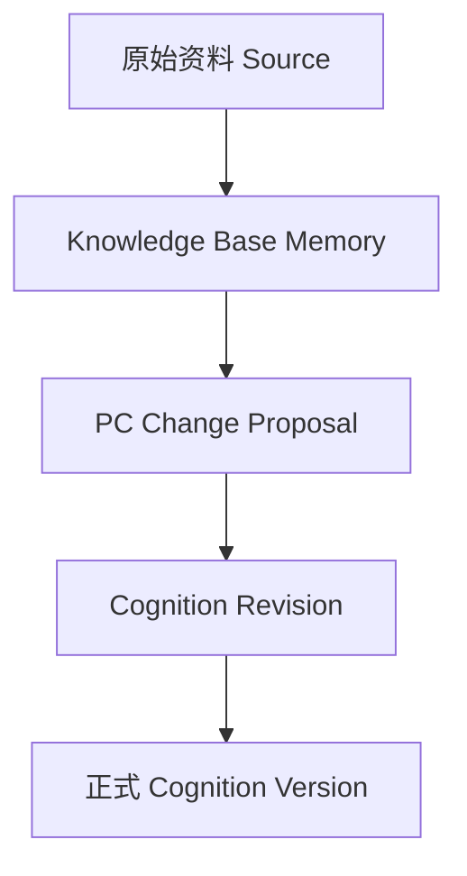

# PC 阶段 1 — 目标领域模型设计基线 V1.0

- **项目**：PM-AI / smark-pm
- **领域**：Product Cognition（PC）
- **文档版本**：V1.0
- **阶段**：PC Phase 1 — Domain Model & Data Architecture
- **前置阶段**：PC Gate 0 — Database Schema Inventory
- **状态**：设计基线草案，待产品负责人确认
- **日期**：2026-11-06

---

# 1. 文档目的

## 1.1 目的

本文件定义 Product Cognition（以下简称 PC）的目标领域模型和数据架构基线，作为后续数据库逻辑设计、模块接口设计、开发任务拆分和测试验收的共同依据。

本阶段不直接依据旧数据库表结构设计新模型，而是从 PC 的产品职责和领域对象出发，建立目标模型，再映射到 PostgreSQL、Markdown + Git 和 PageIndex。

本设计需要解决：

1. PC 应维护哪些正式产品认知对象。
2. 不同认知对象之间如何建立稳定关系。
3. 如何区分对象身份、内容修订、正式版本和历史快照。
4. 如何管理来源、证据、可信度和冲突。
5. 如何通过 Change Proposal 和人工审批更新正式认知。
6. 如何与 Requirements、Design、ADR、Knowledge Base、Project Goal 等模块协作。
7. 如何承接现有 Cognition、Baseline 和 Discovery 历史数据。
8. 如何保证租户隔离、项目隔离、并发安全和审计完整性。

## 1.2 设计范围

本阶段覆盖：

- PC 核心领域实体；
- 认知对象类型；
- 认知关系；
- 来源与证据；
- 认知版本；
- Proposal 与 Approval；
- Conflict 与 Review；
- 跨模块关联；
- 权威存储边界；
- 旧数据迁移目标模型。

本阶段不直接实现：

- PostgreSQL Migration；
- Git 知识库读写；
- PageIndex Provider；
- LLM Agent 执行流程；
- UI 页面和交互；
- Requirements、Design、ADR 模块内部业务实现。

## 1.3 设计原则

| 编号 | 原则 | 说明 |
|---|---|---|
| PC-ARCH-01 | 产品认知唯一权威 | PC 是正式产品侧认知的唯一维护方 |
| PC-ARCH-02 | 身份与内容分离 | 稳定对象身份与内容 Revision 分离 |
| PC-ARCH-03 | 正文与状态分离 | Markdown + Git 管理正文，PostgreSQL 管理结构化状态 |
| PC-ARCH-04 | 正式变更必须人工确认 | AI 可以分析和提案，但不能绕过人工确认写入正式认知 |
| PC-ARCH-05 | 历史不可覆盖 | 已发布的正式版本不可被原地修改 |
| PC-ARCH-06 | 来源可追溯 | 正式认知必须能够追溯其来源和证据 |
| PC-ARCH-07 | 关系可追溯 | 关联需要记录建立依据，必要时钉住对方 Revision |
| PC-ARCH-08 | 冲突优先于自动合并 | 重大冲突未解决时，冻结相关正式认知变更 |
| PC-ARCH-09 | 跨模块权威不混淆 | PC 不接管 Requirements、Design、ADR、KB、Tasks 的正文和生命周期 |
| PC-ARCH-10 | 项目隔离 | 所有项目级实体必须具备租户和项目边界 |
| PC-ARCH-11 | 派生数据可重建 | PageIndex 和检索索引不能成为正式认知权威 |
| PC-ARCH-12 | 支持渐进式初始化 | 项目没有 Repository、MCP 或外部执行工具时，PC 仍然可以工作 |

---

# 2. PC 领域定位与上下文边界

## 2.1 Product Cognition 定位

Product Cognition 是项目级产品认知管理领域。

它负责维护一个产品的正式认知，包括：

- 产品定位和愿景；
- 产品目标范围与业务领域；
- 产品业务能力；
- 产品功能模块；
- 用户和业务角色；
- 用户场景；
- 业务流程；
- 页面与交互；
- 领域对象；
- 业务规则；
- 产品决策；
- 上述对象之间的关系、来源、版本、冲突和变更历史。

PC 不是普通文档管理系统，也不是 Requirements 的替代品。

PC 的核心职责是回答：

- 产品是什么？
- 产品为什么存在？
- 产品面向哪些角色？
- 产品具备哪些业务能力？
- 产品通过哪些模块和流程实现这些能力？
- 产品有哪些业务对象和业务规则？
- 哪些产品认知已经正式确认？
- 当前认知依据是什么？
- 哪些认知存在冲突或需要人工确认？

## 2.2 与其他领域的权威边界

| 领域 | 权威内容 | PC 的职责 |
|---|---|---|
| Product Cognition | 正式产品认知 | 唯一维护产品侧正式认知 |
| Project Cognition（S01-04） | 技术架构、技术约定、仓库结构、技术实现约束、技术演进 | 引用技术认知，不维护其权威正文 |
| Knowledge Base | 原始资料、文档解析、会议记录、浅层/深层记忆 | 接收已审核知识作为认知输入 |
| Requirements | 需求正文、需求 Revision、需求生命周期、需求正式确认 | 提供产品认知依据和规则/冲突检查 |
| Design / Architecture | Design、Design Revision、ADR 正文与审批 | 提供产品认知依据，不维护其正式正文 |
| Tasks & Execution | 任务、执行记录、交付过程 | 提供执行上下文，不维护执行状态 |
| Product Reality | 代码、测试、部署、发布等实际实现证据 | 对比产品意图与实际实现，不把意图当作事实 |
| Project Management | Project Goal、项目状态和项目管理 | 建立 Vision 与 Goal 的支撑关系，不接管 Goal |

## 2.3 权威边界图



说明：

1. KB 审核通过不等于 PC 正式确认。
2. PC 不直接审批 Requirement。
3. PC 不直接审批 Design 或 ADR。
4. PC 不直接修改 Project Goal。
5. 工程实现事实必须来自实际执行证据。
6. 没有 Repository 不影响 PC 基础能力。

---

# 3. 目标领域模型总览

## 3.1 领域模型分层

PC 采用六个逻辑层次。

| 层次 | 领域内容 | 核心对象 |
|---|---|---|
| L1 产品身份与方向 | 产品是什么、为什么存在 | Product Profile、Product Vision |
| L2 产品结构 | 产品由哪些能力和模块构成 | Business Domain、Business Capability、Feature Module、Feature |
| L3 产品使用与业务行为 | 谁使用、如何使用、发生什么 | Actor、Scenario、Business Process、Page & Interaction |
| L4 产品业务语义 | 业务中有哪些对象和规则 | Domain Object、Business Rule |
| L5 产品决策 | 正式产品决策及其依据 | Product Decision |
| L6 治理与演进 | 来源、关系、版本、冲突和审批 | Cognition Revision、Source、Evidence、Relationship、Conflict、Change Proposal、Approval |

## 3.2 核心实体清单

### A. 产品身份与方向

| 实体 | 中文名称 | 职责 | 独立管理 |
|---|---|---|---|
| Product Profile | 产品档案 | 产品基本身份和描述 | 是 |
| Product Vision | 产品愿景 | 产品长期方向、价值和边界 | 是 |

Product Profile 是项目产品认知的基础身份对象。

Product Vision 是正式产品认知对象，不能与 Project Goal 混为一谈。

### B. 产品结构

| 实体 | 中文名称 | 职责 | 独立管理 |
|---|---|---|---|
| Business Domain | 业务领域 | 划分产品业务范围 | 是 |
| Business Capability | 业务能力 | 描述产品需要具备的业务能力 | 是 |
| Feature Module | 功能模块 | 组织相关功能和产品能力 | 是 |
| Feature | 功能特性 | 描述具体产品功能 | 条件独立 |

Feature 默认属于 Feature Module 的内部结构。

满足以下任一条件时，可以提升为独立 Feature：

- 需要独立关联 Requirement；
- 需要独立关联 Page；
- 需要独立关联 Scenario 或 Process；
- 需要独立版本追踪；
- 需要独立生命周期或治理；
- 需要跨模块引用。

提升为独立实体时，必须保留原有信息、历史关系和来源。

### C. 产品使用与业务行为

| 实体 | 中文名称 | 职责 |
|---|---|---|
| Actor | 用户/业务角色 | 描述与产品交互的角色 |
| Scenario | 用户场景 | 描述角色在特定目标下的使用场景 |
| Business Process | 业务流程 | 描述业务活动、步骤、条件和状态转换 |
| Page | 产品页面 | 描述页面身份、用途和所属模块 |
| Interaction | 页面交互 | 描述页面上的操作、反馈和行为 |

Page 与 Interaction 应允许建立多对多或父子组合关系，以满足页面包含多个交互、同一交互模式出现在多个页面等情况。

### D. 产品业务语义

| 实体 | 中文名称 | 职责 |
|---|---|---|
| Domain Object | 领域对象 | 描述产品中的业务概念和对象 |
| Business Rule | 业务规则 | 描述必须遵循的业务约束、条件和规则 |

业务规则是高治理等级对象。

业务规则只有经过 PC 正式确认，才可以被 Requirements 的正式需求确认流程视为有效依据。

### E. 产品决策

| 实体 | 中文名称 | 职责 |
|---|---|---|
| Product Decision | 产品决策 | 记录正式产品侧决策及其依据 |

产品决策需要区分：

- 正式决策；
- 待讨论议题；
- 被否决的方案；
- 未决问题；
- 历史决策。

只有正式决策进入正式产品认知版本。

ADR 不属于 Product Decision 的正文子类型，其权威归属为 Design / Architecture。

### F. 治理与演进

| 实体 | 中文名称 | 职责 |
|---|---|---|
| Cognition Object | 认知对象 | 稳定身份及类型 |
| Cognition Revision | 认知修订 | 对象某次内容修订 |
| Cognition Version | 正式认知版本 | 一组正式认知对象修订的不可变快照 |
| Source | 来源 | 来源资料或来源对象 |
| Evidence | 证据 | 支持或反驳认知的具体依据 |
| Relationship | 认知关系 | 认知对象之间的关系 |
| Change Proposal | 变更提案 | AI 或有权限成员提出的变更 |
| Approval | 审批事实 | 人工确认、拒绝等正式决策事实 |
| Conflict | 认知冲突 | 互相矛盾或无法同时成立的认知 |
| Review Item | 人工处理项 | 需要人工确认、补充或裁决的事项 |
| Cognition Audit | 认知审计 | 记录正式认知变化和治理行为 |

以上是逻辑领域对象，不代表每一个对象都必须对应独立数据库表。

---

# 4. 核心实体详细模型

## 4.1 Product Profile

职责：

维护产品基本身份。

建议属性：

| 属性 | 含义 |
|---|---|
| product_name | 产品名称 |
| product_summary | 产品简要描述 |
| product_category | 产品类别 |
| product_status | 产品认知状态 |
| primary_language | 产品主要语言 |
| created_at | 创建时间 |

Product Profile 不承担产品愿景、业务规则或功能模块的全部内容。

## 4.2 Product Vision

职责：

描述产品长期价值、方向和范围边界。

建议内容：

- Vision Statement；
- Target Users；
- Value Proposition；
- Product Scope；
- Out of Scope；
- Strategic Direction；
- Success Intent。

Vision 与 Project Goal 的关系：

- Product Vision 属于 PC；
- Project Goal 属于 Project Management；
- 一个 Vision 可以支撑多个 Project Goal；
- 一个 Project Goal 可以关联多个 Vision 支撑依据；
- Vision 变化时，AI 分析相关 Goal 的影响；
- PC 不直接修改 Goal。

Vision 的变更按 L2 治理。

## 4.3 Business Domain

职责：

定义产品业务领域边界。

建议属性：

- 名称；
- 描述；
- 业务范围；
- 包含的业务能力；
- 相关业务对象；
- 来源和依据。

关系：

- 一个 Business Domain 可以包含多个 Business Capability；
- 一个 Business Capability 可以关联多个 Business Domain；
- 具体关联基数在逻辑关系设计时确认。

## 4.4 Business Capability

职责：

描述产品必须具备的业务能力，不直接等同于技术模块或代码功能。

建议属性：

- 名称；
- 描述；
- 业务价值；
- 能力范围；
- 能力边界；
- 能力成熟度（如需要）。

关系：

- 可以支撑多个 Feature Module；
- 可以关联多个 Scenario；
- 可以被多个 Requirement 引用；
- 可以关联相关 Business Rule。

## 4.5 Feature Module

职责：

组织产品功能和能力。

建议属性：

- 模块名称；
- 模块描述；
- 所属业务领域；
- 业务目标；
- 功能范围；
- 包含的 Feature。

Feature Module 是默认的功能组织单元。

普通 Feature 不需要强制独立身份、独立版本和独立治理。

## 4.6 Feature

职责：

描述产品提供的具体功能特性。

默认作为 Feature Module 内部条目。

当满足独立追踪或治理条件时，升级为独立认知对象。

升级必须满足：

1. 原内容完整保留；
2. 原模块关系保留；
3. 已建立的 Requirement、Page、Scenario 等关联保留；
4. 记录升级事件；
5. 历史版本可以追溯。

## 4.7 Actor

职责：

描述产品交互角色。

Actor 表示业务角色，不直接等同于平台账户或 Team Membership。

建议属性：

- 角色名称；
- 角色描述；
- 目标；
- 权限和职责概述；
- 典型场景。

## 4.8 Scenario

职责：

描述角色在特定环境和目标下与产品交互的场景。

建议包含：

- 参与角色；
- 触发条件；
- 用户目标；
- 前置条件；
- 主流程；
- 替代流程；
- 异常情况；
- 期望结果。

关系：

- Scenario 可以关联多个 Actor；
- Scenario 可以涉及多个 Feature；
- Scenario 可以通过一个或多个 Business Process 实现；
- Scenario 可以关联多个 Requirement。

## 4.9 Business Process

职责：

描述业务活动、顺序、分支、条件和状态转换。

建议包含：

- 流程目标；
- 触发条件；
- 参与角色；
- 活动步骤；
- 条件分支；
- 输入与输出；
- 业务状态；
- 状态转换；
- 异常处理。

业务流程及其状态转换属于 L2 治理对象。

## 4.10 Page & Interaction

Page 描述产品页面身份、用途和所属模块。

Interaction 描述页面交互及其行为。

建议关系：

- Feature Module → Page；
- Feature → Page；
- Page → Interaction；
- Interaction → Scenario；
- Page / Interaction → Requirement。

页面和交互是产品认知，不代表前端实现事实。

## 4.11 Domain Object

职责：

描述业务领域中的实体、概念、属性和生命周期。

建议包含：

- 对象名称；
- 对象定义；
- 核心属性；
- 对象关系；
- 生命周期；
- 所属业务领域；
- 相关业务规则。

Domain Object 不直接等同于数据库表或代码类。

## 4.12 Business Rule

职责：

维护正式业务规则。

建议包含：

- 规则名称；
- 规则说明；
- 适用范围；
- 触发条件；
- 约束条件；
- 规则结果；
- 例外条件；
- 关联业务对象；
- 关联流程；
- 来源与依据。

业务规则变更属于 L2。

规则未正式确认时，不能作为正式需求确认的有效业务约束。

## 4.13 Product Decision

职责：

记录正式产品决策。

建议内容：

- 决策标题；
- 决策背景；
- 待解决问题；
- 候选方案；
- 选择结果；
- 否决方案及理由；
- 决策依据；
- 影响范围；
- 确认人；
- 确认时间。

正式决策与讨论记录分离。

Decision 的领域归属依据其实际决策内容：

- Product Decision → PC；
- ADR → Design / Architecture；
- 其他领域决策 → 对应模块。

底层可采用统一决策记录模型，但不要求物理上统一成一张表。

---

# 5. 认知对象、Revision 与正式版本模型

本节是 PC 领域模型的核心。

## 5.1 三层模型

必须区分：

1. Cognition Object：对象身份；
2. Cognition Revision：对象内容修订；
3. Cognition Version：一组正式认知内容的版本快照。

逻辑结构：



说明：

- Cognition Object 的 ID 稳定；
- 每次内容修改产生新的 Revision；
- Revision 不覆盖历史；
- 正式版本由明确的 Revision 集合构成；
- 正式版本发布后不可原地修改；
- 同一个 Revision 可以被多个正式版本引用；
- 未进入正式版本的 Revision 可以作为草稿或提案内容存在。

## 5.2 Cognition Object

建议具备：

- object_id；
- tenant_id；
- project_id；
- object_type；
- object_key（如适用）；
- lifecycle_status；
- created_by；
- created_at；
- archived_at（如适用）。

对象身份不包含可变正文。

object_type 需要使用受控类型体系，不允许依赖任意自由文本作为唯一类型定义。

## 5.3 Cognition Revision

每个 Revision 至少需要记录：

- revision_id；
- object_id；
- revision_number；
- document_id；
- document_revision_id；
- content_hash；
- change_summary；
- created_by；
- created_at；
- source_context；
- revision_status。

正文由 Markdown + Git 维护。

PostgreSQL 保存 Revision 身份、Git 引用、Hash 和结构化状态。

Revision 必须能够确定地指向对应的 Git 文档身份和内容版本。

如果一个认知对象由多个文档共同描述，需要明确其正文组织策略，不允许同一正式内容在多个文档中出现无法判定权威的重复副本。

## 5.4 Cognition Version

Cognition Version 表示某一时刻正式确认的一组认知对象及其 Revision。

建议包含：

- version_id；
- project_id；
- version_number；
- status；
- confirmed_by；
- confirmed_at；
- source_proposal_id；
- snapshot_hash；
- created_at。

正式版本必须有不可变的成员集合。

建议增加逻辑成员关系：

```text
Cognition Version
    └── Cognition Version Member
            ├── Cognition Object
            └── Cognition Revision
```

每个成员明确记录：

- object_id；
- revision_id；
- object_type；
- 所属版本。

正式版本不能仅依赖 Proposal 或当前对象状态反向推导成员集合。

## 5.5 版本发布原则

1. 草稿 Revision 不等于正式版本。
2. Proposal 被确认不代表 Git 正文已经成功提交。
3. Git 正文与 Revision 登记必须形成可验证的一致性。
4. 正式版本必须绑定确定的 Revision 集合。
5. 正式版本发布后禁止修改其成员。
6. 后续变化必须产生新 Revision 和新正式版本。
7. 历史版本可以完整还原。
8. 版本回滚通过创建新的正式版本引用历史内容实现，不删除历史。

## 5.6 并发控制

所有正式版本发布必须具备并发保护。

至少需要：

- expected_version 或 expected_revision；
- CAS 校验；
- 数据库事务保护；
- 唯一约束；
- 冲突失败后的重新分析机制。

不能只依赖应用层先查询再更新的非原子操作。

---

# 6. 来源与证据模型

## 6.1 Source

Source 表示认知来源。

来源类型建议包括：

- document；
- document_revision；
- meeting_record；
- knowledge_base_memory；
- requirement；
- requirement_revision；
- design_revision；
- adr；
- discovery_finding；
- repository_commit；
- manual_input；
- external_reference。

以上是逻辑分类建议，实际枚举和跨模块引用协议需要在接口设计阶段确定。

Source 不代表证据已经被认可。

## 6.2 Evidence

Evidence 表示支持、反驳或限定某项认知的具体依据。

建议属性：

- evidence_id；
- source_id；
- source_revision_ref；
- evidence_type；
- location_anchor；
- excerpt 或摘要；
- evidence_hash；
- collected_at；
- confidence；
- verification_status。

Evidence 可以来自文档章节、代码位置、会议内容、需求 Revision 等。

引用代码证据时，需要保留 Repository、Commit SHA、文件路径和定位信息。

## 6.3 认知来源链

必须能够追溯：



对于没有经过 KB 的直接人工输入，也必须保留 Source 与 Proposal 的直接追溯关系。

## 6.4 可信度与正式状态分离

Confidence 与 Confirmation Status 是两个不同维度。

| 维度 | 示例 | 含义 |
|---|---|---|
| Confidence | high / medium / low | AI 对信息正确性的判断 |
| Confirmation | proposed / confirmed / rejected | 是否经过正式确认 |

高可信度不能替代人工确认。

KB 已审核也不能替代 PC 正式确认。

---

# 7. Relationship 关系模型

## 7.1 设计原则

PC 的认知价值不仅来自对象本身，也来自对象之间的关系。

关系必须：

- 有明确的关系类型；
- 有来源和依据；
- 有创建时间；
- 有创建者；
- 有确认状态；
- 能够版本化；
- 必要时钉住目标对象 Revision；
- 支持历史查询。

## 7.2 核心关系矩阵

| 来源对象 | 目标对象 | 关系类型示例 |
|---|---|---|
| Product Vision | Project Goal | supports |
| Product Vision | Business Domain | covers |
| Business Domain | Business Capability | contains |
| Business Capability | Feature Module | realized_by |
| Feature Module | Feature | contains |
| Feature | Requirement | specified_by |
| Actor | Scenario | participates_in |
| Scenario | Feature | uses |
| Scenario | Business Process | realized_by |
| Business Process | Business Rule | governed_by |
| Page | Feature | implements |
| Page | Interaction | contains |
| Interaction | Scenario | supports |
| Domain Object | Business Rule | governed_by |
| Business Rule | Requirement | constrains |
| Product Decision | Cognition Object | affects |
| Product Decision | Requirement | informs |
| Cognition Object | Source | derived_from |
| Cognition Object | Evidence | supported_by |

关系类型不是全部固定的物理枚举。实际类型需要受控注册，避免任意字符串导致关系语义失控。

## 7.3 关系自身的生命周期

关系也是正式认知的一部分。

关系新增、修改和删除必须遵循相应治理等级。

关系历史不能被直接覆盖。

对于涉及 Requirement、Design、ADR、Document 等模块的关系，需要明确：

- 目标对象身份；
- 目标 Revision（适用时）；
- 建立关系时的依据；
- 当前有效状态；
- 历史变化记录。

## 7.4 Revision 钉住规则

| 关联对象 | 是否需要钉住 Revision |
|---|---|
| Requirement | 必须记录建立关联时的 Requirement Revision |
| Design | 必须记录关联时的 Design Revision |
| ADR | 必须记录关联时的 ADR Revision |
| Document Evidence | 必须记录 Document Revision |
| Project Goal | 需要稳定 Goal 身份；是否钉住 Goal Revision 由项目管理接口定义 |
| Product Cognition Object | 必须能够定位对应 Cognition Revision |

目标对象新 Revision 产生后，不自动改写既有关系依据。

AI 应分析影响并提出关系更新建议。

---

# 8. Product Decision、ADR 与其他决策模型

## 8.1 统一决策记录原则

采用统一的决策记录概念模型，按业务领域维护权威。

统一模型建议支持：

- 决策类型；
- 决策标题；
- 背景；
- 问题；
- 候选方案；
- 选择结果；
- 否决理由；
- 依据；
- 影响范围；
- 决策状态；
- 决策人；
- 确认时间。

## 8.2 决策领域归属

| 决策内容 | 权威模块 |
|---|---|
| 产品定位、范围、业务规则、产品能力等 | PC |
| 技术架构、技术选型、技术约束 | Design / Architecture |
| 需求范围与需求取舍 | Requirements |
| 任务执行和交付决策 | Tasks & Execution |
| 项目目标和项目管理决策 | Project Management |

统一决策记录模型不意味着必须统一物理表。

## 8.3 正式决策与讨论记录分离

以下内容不能自动成为正式决策：

- AI 讨论结果；
- 被否决方案；
- 未决问题；
- 会议中的临时观点；
- 未确认建议。

只有经过对应领域正式确认的决策，才能成为该领域的正式决策记录。

---

# 9. Change Proposal、Approval 与治理模型

## 9.1 Change Proposal

Change Proposal 是 PC 正式认知变更的统一提案入口。

来源可以是：

- AI Agent 分析；
- KB 已审核记忆；
- 用户人工输入；
- Requirement Revision 变化；
- Design / ADR 变化；
- 工程实现与产品认知差异；
- 其他正式来源。

建议包含：

- proposal_id；
- project_id；
- proposer；
- source；
- target_objects；
- proposed_changes；
- expected_version；
- rationale；
- evidence；
- risk_level；
- confidence；
- governance_level；
- status；
- created_at；
- expires_at。

Proposal 可以包含多个认知对象的变更，但必须明确变更范围、预期版本和影响对象。

## 9.2 Approval

正式认知变更必须有人工确认。

V1 审批人规则：

- Project Lead 与授权审批人同权；
- 普通成员不自动具备审批权；
- V1 不按对象类型或业务领域进一步细分审批权限。

审批必须记录：

- 被审批的 Proposal；
- 不可变审批锚点；
- 审批人；
- 审批动作；
- 审批理由；
- 审批时间；
- 审批时的预期版本；
- 审批结果；
- 对应正式版本。

拒绝、撤回、过期等状态也需要保留历史事实。

## 9.3 审批模型的技术原则

优先复用现有 Change Proposal 和 Approval Request 基础设施。

但不能简单沿用现有 Approval Request 的全部状态和写入逻辑。

新模型必须满足：

1. 审批对象不可被事后替换；
2. 审批状态有受控状态集合；
3. 状态转换符合单向规则；
4. 同一提案不能产生重复有效审批；
5. 审批事实不可原地覆盖；
6. 正式版本发布与审批结果一致；
7. 并发审批有事务保护；
8. 所有操作可审计。

`governance.review_approval` 可作为数据库保护机制的参考，但不能直接将其绑定的 Delivery Run 结构作为 PC 审批模型。

**待决事项 PC-D-01：** 最终采用扩展 `approval_request`，还是建立 PC 专属 Approval 领域结构，需要在逻辑数据设计阶段基于现有通用审批接口进一步裁决。本文件确定审批契约，不预先确定物理实现。

## 9.4 L0～L3 治理等级

| 等级 | 范围 | AI 权限 | 人工要求 |
|---|---|---|---|
| L0 | 草稿、摘要、分类、索引、不改变原意的格式整理 | 自动执行 | 不产生正式版本 |
| L1 | 普通能力、模块、角色、场景、页面、业务对象新增或描述修改；普通关系增删 | 提出或执行 | 有权限提出者可提交即确认，或由确认人确认 |
| L2 | 业务规则、业务流程及状态转换、Vision 范围边界、产品决策、Governed By、正式对象废弃或合并 | 只能提案 | Lead 或审批人确认 |
| L3 | 重大冲突尚未解决 | 冻结相关 L1/L2 正式确认 | 人工裁决后恢复 |

注意：

- L0～L3 是变更权限等级；
- P0～P3 是处理优先级；
- PC-G17 风险等级是风险评估维度。

三者不可混用。

Requirements、Design、ADR 的正文和状态由各自模块审批。

---

# 10. Conflict 与人工处理模型

## 10.1 Conflict

Conflict 表示两个或多个认知事实、来源或规则之间存在不一致。

建议记录：

- conflict_id；
- project_id；
- conflict_type；
- severity；
- involved_objects；
- involved_revisions；
- evidence；
- description；
- detection_source；
- status；
- resolution；
- resolved_by；
- resolved_at。

## 10.2 冲突类型

建议至少支持：

- 内容矛盾；
- 业务规则矛盾；
- 范围冲突；
- 关系冲突；
- 来源冲突；
- Revision 冲突；
- 产品与实际实现不一致；
- 跨模块权威冲突。

## 10.3 冲突处理状态

逻辑状态建议：

- detected；
- under_review；
- awaiting_human；
- resolved；
- dismissed；
- reopened。

状态是否采用独立表、状态事件或其他存储方式，在逻辑数据设计阶段确定。

## 10.4 冲突与治理关系

1. AI 可以自动发现冲突。
2. AI 可以提出解决建议。
3. AI 不得自行裁决重大业务规则冲突。
4. L3 未解决时冻结相关 L1/L2 正式确认。
5. 人工裁决必须保留原因、证据和历史。
6. 冲突解决不自动覆盖旧 Revision。

## 10.5 人工处理队列

人工处理队列是治理视图，不应成为另一个独立的认知权威。

队列项目可以来自：

- Change Proposal；
- Conflict；
- Source 可信度不足；
- 关系待确认；
- 认知缺失；
- 重大影响分析；
- 外部变更待采纳。

优先级采用 P0～P3：

| 优先级 | 定义 |
|---|---|
| P0 | 关键阻断，影响正式需求确认、核心业务规则或重大权限安全 |
| P1 | 重要问题，影响模块、流程、需求和设计一致性 |
| P2 | 一般问题，缺少关联、历史信息待核实、认知不完整 |
| P3 | 信息建议，优化建议、低风险整理或非阻断事项 |

---

# 11. 与外部模块的接口模型

## 11.1 Requirements

Requirements 是需求正式确认的唯一责任方。

PC 提供查询接口，至少支持：

- 查询引用的业务规则是否正式确认；
- 查询相关重大冲突是否解决；
- 查询相关认知对象及 Revision；
- 查询需求引用的产品认知依据；
- 查询认知变更对需求的影响。

需求正式确认前：

1. Requirements 调用 PC 查询业务规则状态；
2. PC 返回规则确认情况；
3. PC 返回相关重大冲突状态；
4. Requirements 根据查询结果决定是否允许确认；
5. PC 不直接改变需求状态。

不满足规则确认或冲突条件时，Requirements 阻止正式确认。

## 11.2 Design / Architecture

Design / Architecture 负责：

- Design；
- Design Revision；
- ADR；
- 技术设计审批。

PC 提供：

- Product Vision；
- Business Capability；
- Feature Module；
- Scenario；
- Business Process；
- Domain Object；
- Business Rule；
- Product Decision。

PC 不维护 ADR 正文，不直接审批 ADR。

## 11.3 Knowledge Base

KB 负责原始资料、文档解析和记忆加工。

KB 浅层记忆审核通过后，可以作为 PC 输入。

处理链：

```text
原始资料
  → KB 解析与记忆
  → KB 审核
  → PC 分析
  → Change Proposal
  → 人工确认
  → 正式 Cognition Revision
  → Cognition Version
```

KB 审核通过不等于 PC 正式确认。

## 11.4 Project Goal

Project Goal 属于 Project Management。

PC 维护 Product Vision，并与 Goal 建立支撑关系。

Vision 变化时：

- PC 识别受影响的 Goal；
- AI 分析支撑关系变化；
- 形成影响分析；
- 通知 Project Management；
- 不直接修改 Goal。

## 11.5 Product Reality

Product Reality 由实际工程执行证据形成。

证据可以包括：

- Git Commit；
- Pull Request；
- 测试结果；
- 构建结果；
- 部署记录；
- 发布记录。

PC 可以对比正式产品认知与实际实现，但不得将需求、设计或 AI 推断直接标记为已实现。

---

# 12. 正文存储与数据库权威模型

## 12.1 三层权威

| 层次 | 存储 | 权威内容 |
|---|---|---|
| 正文层 | Markdown + Git | 正式产品认知正文、正式决策正文和历史内容 |
| 状态层 | PostgreSQL | ID、关系、Revision 引用、版本、审批、状态机、审计、事件 |
| 派生层 | PageIndex | 检索索引、章节索引、向量或其他派生数据 |

## 12.2 PostgreSQL 不承担正式正文权威

正式认知正文不得以 PostgreSQL JSONB 或 TEXT 作为第二权威。

允许存在以下受控数据：

- Proposal 临时内容；
- 候选 Markdown；
- 摘要和检索片段；
- 结构化属性；
- 来源证据的短摘录；
- 派生索引内容。

这些数据必须标明性质，不能覆盖 Git 正式正文。

## 12.3 Git Revision 一致性

每个正式 Cognition Revision 必须能定位：

- Git Repository / KnowledgeRoot；
- Document ID；
- Document Revision；
- Commit SHA；
- Content Hash；
- 文档路径；
- 内容版本。

Git Commit 与 PostgreSQL Revision 登记必须有可靠的一致性恢复策略。

跨存储系统无法简单假设一个普通数据库事务可以同时原子提交 Git 和 PostgreSQL。

因此，实施阶段必须设计幂等操作、失败恢复、重试和补偿机制。

## 12.4 PageIndex

PageIndex 是派生索引。

必须支持：

- 按正式 Revision 建立索引；
- 根据 Hash 判断是否过期；
- 索引失败重试；
- 从 Git 正文重建；
- 多 Provider 扩展；
- 索引状态查询。

PageIndex 不得成为正式认知内容的唯一保存位置。

---

# 13. 多租户与数据完整性设计要求

## 13.1 项目级实体

所有项目级实体必须具备：

- tenant_id；
- project_id；
- 稳定主键；
- 项目归属约束。

数据库应使用租户 + 项目组合 FK 模式。

## 13.2 内部关联

同一项目内的关联必须确保：

- 来源实体与目标实体属于同一租户；
- 来源实体与目标实体属于同一项目；
- Revision 与所属对象一致；
- 正式版本成员与版本头一致；
- Proposal 与其目标对象一致。

不能只依赖全局 UUID 和单列 FK 推断项目隔离。

## 13.3 版本完整性

必须保证：

- 对象 Revision 编号不重复；
- 项目正式版本编号不重复；
- 正式版本成员唯一；
- 成员 Revision 属于对应 Cognition Object；
- 正式版本成员发布后不可修改；
- Revision 历史不可删除或覆盖。

## 13.4 删除与归档

正式认知对象不应采用简单级联删除破坏历史。

建议：

- 正式对象废弃通过状态和正式变更表达；
- 历史 Revision 保留；
- 已发布版本保留；
- 审计记录保留；
- 来源与证据关系保留；
- 删除操作需要明确权限和保护策略。

## 13.5 并发

正式变更必须采用原子 CAS 与事务保护。

多 Agent 并行分析可以存在，但正式认知写入必须由统一协调机制控制。

---

# 14. 旧数据迁移目标模型

## 14.1 迁移原则

旧数据迁移必须遵循：

1. 保留原始 ID 或可追溯的 ID 映射；
2. 保留原始来源；
3. 保留历史版本；
4. 保留确认人和确认时间；
5. 保留原始状态；
6. 不把旧 confirmed 状态无条件视为 PC 正式确认；
7. 不能确认的数据进入草稿或待人工处理；
8. 迁移过程记录审计；
9. 迁移完成后停止旧模型与新模型双写；
10. 迁移结果必须可验证、可重试、可审计。

## 14.2 旧对象映射

| 旧对象 | 目标模型 | 迁移策略 |
|---|---|---|
| ai.project_knowledge | Cognition Object + Revision | 作为历史知识输入，保留原始确认记录；不能无条件转为正式 PC 版本 |
| ai.cognition_item | Source / Evidence / Change Proposal | 按状态和关联情况迁移 |
| ai.baseline_proposal | Change Proposal | 保留提案历史和原状态 |
| ai.baseline_item | Cognition Revision 草稿内容 | 保留内容、来源和确认信息 |
| ai.project_baseline | Cognition Version 历史输入 | 条目集合需要推导并标记可信度 |
| discovery.discovery_finding | Source / Evidence / 待确认认知 | 先去重，再决定是否进入 PC |
| discovery.discovery_finding_evidence | Evidence | 保留 Commit、路径、符号和代码范围 |
| ai.project_document | Document Identity | 保留原文档身份和路径 |
| ai.document_revision | Document Revision | 保留 Git Commit 和 Hash，不重复迁移正文 |
| ai.document_proposal | Change Proposal / Document Proposal | 根据状态决定迁移、冻结或归档 |
| delivery.requirement_revision | Requirements | PC 只建立关联，不迁移需求正文 |
| integration.repo_import_draft_version | 历史导入记录 | 默认保留在原模块，不进入 PC 活跃认知 |

## 14.3 特殊迁移情况

### A. 旧 project_knowledge

- active 行可以成为 PC 草稿或候选认知；
- superseded / retired 行保留为历史；
- 旧 version 和 supersedes 链必须保留；
- confirmed_by / confirmed_at 作为历史确认事实保留；
- 不自动推断其满足新 PC 正式确认条件。

### B. 悬挂 cognition_item

对 proposed、investigation、deferred 等没有正式产物的条目：

- 保留原状态；
- 保留证据；
- 进入待处理草稿或历史归档；
- 不自动升级为正式认知。

### C. project_baseline

旧版本头没有直接绑定条目集合。

迁移时允许根据 proposal 和相关历史记录推导，但必须：

- 记录推导规则；
- 记录推导来源；
- 标记推导结果；
- 无法确定时进入待人工核实；
- 不伪造确定的历史快照。

### D. 重复认知

Cognition Item 与 Discovery Finding 可能描述相同事实。

迁移时应按来源、内容、Commit、证据定位等信息识别重复。

不能仅凭文本相似就自动合并正式认知。

### E. 旧 Decision 文档

`doc_type='decision'` 只是文档分类。

迁移时需要识别其实际领域归属：

- 产品决策进入 PC；
- 技术决策进入 ADR / Design；
- 其他领域决策进入对应模块。

不能仅根据 doc_type 自动确定归属。

---

# 15. PC 领域模型与功能需求映射

| 功能需求 | 目标模型 |
|---|---|
| PC-FR-001 项目产品认知初始化 | Product Profile、初始 Source、Cognition Object |
| PC-FR-002 Product Overview | Product Profile、Vision |
| PC-FR-003 Product Big View | 全部核心认知对象及关系 |
| PC-FR-004 Product Vision View | Product Vision |
| PC-FR-005 Business Capabilities View | Business Domain、Business Capability |
| PC-FR-006 Feature Modules View | Feature Module、Feature |
| PC-FR-007 Actors & Scenarios View | Actor、Scenario |
| PC-FR-008 Business Processes View | Business Process |
| PC-FR-009 Pages & Interactions View | Page、Interaction |
| PC-FR-010 Domain Objects & Rules View | Domain Object、Business Rule |
| PC-FR-011 Requirements & Decisions View | Requirement 引用、Product Decision |
| PC-FR-012 Relationship Management | Relationship |
| PC-FR-013 Relationship Traceability | Relationship Revision、目标 Revision |
| PC-FR-014 Source Traceability | Source、Evidence |
| PC-FR-015 Confidence & Confirmation | Confidence、Confirmation |
| PC-FR-016 Product Cognition Change Proposal | Change Proposal |
| PC-FR-017 Impact Analysis | Relationship、Impact Analysis |
| PC-FR-018 Version Management | Cognition Revision、Cognition Version |
| PC-FR-019 Conflict Detection | Conflict |
| PC-FR-020 Conflict Resolution | Conflict Resolution、Approval |
| PC-FR-021 Cognition Quality Assessment | Quality Assessment |
| PC-FR-022 Priority & Human Review Queue | Review Item、Priority |
| PC-FR-023 Risk-Based AI Execution | Risk Level、Governance Level |
| PC-FR-024 Knowledge Base Integration | Source、Evidence |
| PC-FR-025 Document Change Impact Analysis | Document Revision、Relationship |
| PC-FR-026 Product Plan Management | Product Plan 关联模型，需结合功能范围确认 |
| PC-FR-027 Product Reality Boundary | Product Reality Reference |
| PC-FR-028 Human Decision Lifecycle | Product Decision、Approval、Audit |
| PC-FR-029 Project-Level Access Control | Project Member、Approver Grant |
| PC-FR-030 Audit Trail | Cognition Audit |
| PC-FR-031 最小认知面与关系可用性 | 核心认知对象与 Relationship |
| PC-FR-032 Vision-Project Goal 支撑关系 | Product Vision、Project Goal |
| PC-FR-033 Requirement 身份 + Revision 关联 | Requirement Reference |
| PC-FR-034 统一决策记录模型与领域归属 | Product Decision、ADR Reference |
| PC-FR-035 Feature 独立化治理 | Feature、Feature Module |
| PC-FR-036 需求正式确认前规则/冲突查询契约 | Business Rule、Conflict Query |
| PC-FR-037 KB 已审核知识进入 PC 草稿提议 | Source、Change Proposal |
| PC-FR-038 正式认知写入安全闸 | Governance、Approval、Cognition Version |
| PC-FR-039 并发版本校验 | CAS、Cognition Version |
| PC-FR-040 既有产品知识迁移 | Migration Mapping、Source、Audit |

说明：FR-026 的具体产品计划对象和职责仍需结合 PC 产品计划功能范围确认，不应仅因为功能编号存在就预先将 Product Plan 等同于 Cognition Object。

---

# 16. 领域模型验收标准

本设计基线进入下一阶段前，应满足以下条件。

## 16.1 领域完整性

- [ ] 核心产品认知对象均有明确职责；
- [ ] 产品认知与技术认知权威边界明确；
- [ ] Product Vision 与 Project Goal 分离；
- [ ] Product Decision 与 ADR 分离；
- [ ] Feature 独立化条件明确；
- [ ] Business Rule 正式确认要求明确。

## 16.2 版本与历史

- [ ] Cognition Object 与 Revision 分离；
- [ ] Cognition Version 与 Revision 分离；
- [ ] 正式版本绑定明确成员集合；
- [ ] 正式版本不可变；
- [ ] 历史版本可以还原；
- [ ] 跨模块引用可以钉住 Revision；
- [ ] 并发控制有明确机制。

## 16.3 来源与证据

- [ ] 原始资料到正式认知的追溯链完整；
- [ ] Source 与 Evidence 职责分离；
- [ ] Confidence 与 Confirmation 分离；
- [ ] KB 审核与 PC 正式确认分离；
- [ ] 证据可以支持或反驳认知。

## 16.4 治理

- [ ] Change Proposal 统一入口明确；
- [ ] L0～L3 权限边界明确；
- [ ] 人工审批人规则明确；
- [ ] 冲突可以阻断正式认知确认；
- [ ] 正式审批事实不可覆盖；
- [ ] 认知变更可以审计。

## 16.5 跨模块接口

- [ ] Requirements 是需求正式确认唯一责任方；
- [ ] PC 提供规则和冲突查询；
- [ ] Design / ADR 由对应模块维护；
- [ ] Project Goal 由 Project Management 维护；
- [ ] Product Reality 来源于真实执行证据；
- [ ] PC 在无 Repository / MCP 时仍可工作。

## 16.6 迁移

- [ ] 旧数据映射规则明确；
- [ ] 旧 ID 与历史来源可追溯；
- [ ] 旧 confirmed 状态不自动转换；
- [ ] 无法还原的历史快照有明确处理方式；
- [ ] 迁移支持幂等、审计和验证；
- [ ] 迁移完成后停止旧模型双写。

---

# 17. 本版本待裁决事项

以下事项不应被误认为已经完成产品裁决。

| 编号 | 待裁决内容 | 建议处理阶段 |
|---|---|---|
| PC-D-01 | PC Approval 是扩展通用 Approval Request，还是建立独立领域结构 | PC-01B |
| PC-D-02 | Cognition Revision 与 Markdown 文档之间采用一对象一文档，还是支持多文档组成 | PC-01B |
| PC-D-03 | Cognition Version 是项目级完整快照，还是支持增量快照及基线合并 | PC-01B |
| PC-D-04 | Relationship 类型的注册和扩展机制 | PC-01B |
| PC-D-05 | Source 与 Evidence 的物理结构及证据定位协议 | PC-01B |
| PC-D-06 | Product Profile 与 Product Vision 的具体字段和初始化要求 | PC-01B |
| PC-D-07 | Product Plan 与 PC 认知对象之间的边界 | PC-01A/01B |
| PC-D-08 | 旧 baseline 历史成员集合的推导和可信度标记 | PC-01C |
| PC-D-09 | Git 与 PostgreSQL 写入一致性和恢复协议 | PC-01B |
| PC-D-10 | 旧 Cognition 表的兼容、冻结和最终退役方式 | PC-01C |

这些待决事项不推翻已经确认的 Q-PC-01～Q-PC-12。

---

# 18. 下一阶段交付计划

PC 阶段 1 建议拆成三个子阶段。

## PC-01A：领域模型基线确认

交付：

1. 目标领域实体清单；
2. 实体职责与边界；
3. 核心实体关系图；
4. 跨模块权威关系图；
5. 领域生命周期；
6. 待裁决事项清单。

验收目标：产品负责人确认 PC 管理什么、不管理什么，以及核心实体和关系。

## PC-01B：逻辑数据模型设计

交付：

1. PostgreSQL 逻辑实体模型；
2. Markdown + Git 文档组织模型；
3. Cognition Object / Revision / Version 模型；
4. Relationship 与 Revision 引用模型；
5. Source / Evidence 模型；
6. Proposal / Approval / Conflict 模型；
7. 组合 FK、唯一约束、索引和 CAS 设计；
8. 模块接口契约。

验收目标：所有核心实体、关联和完整性要求都可以映射到可实施的数据模型。

## PC-01C：历史数据迁移设计

交付：

1. 旧表到新模型映射；
2. 数据分类与去重规则；
3. 历史版本恢复策略；
4. 不确定数据处理策略；
5. 迁移审计设计；
6. 幂等和回滚方案；
7. 迁移验证标准。

验收目标：能够明确每一类旧数据迁移到哪里、保留什么、哪些需要人工确认，以及如何证明迁移正确。

---

# 19. 最终设计基线声明

PC 阶段 1 的目标不是把旧 Cognition / Baseline 表改造成更多字段的知识表，而是建立一套完整的产品认知领域模型。

正式模型必须具备：

- 稳定的产品认知对象身份；
- 不可覆盖的内容 Revision；
- 可还原的正式 Cognition Version；
- 可追溯的 Source 与 Evidence；
- 可版本化的 Relationship；
- 可治理的 Change Proposal 与 Approval；
- 可阻断正式变更的 Conflict；
- 与 Requirements、Design、ADR、Project Goal 等模块明确的权威边界；
- 与 PostgreSQL、Markdown + Git、PageIndex 一致的存储架构。

**最终原则：PC 管理产品正式认知的内容、关系、来源、版本和治理；其他模块继续维护各自领域的权威事实。**

本文件作为 PC-01A 的设计输入和评审基线。完成产品负责人确认后，进入 PC-01B 逻辑数据模型设计；在 PC-01B 和 PC-01C 验收之前，不启动 PC 正式数据库 Migration 实施。