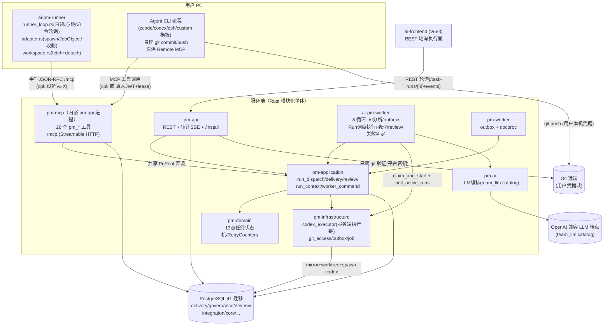
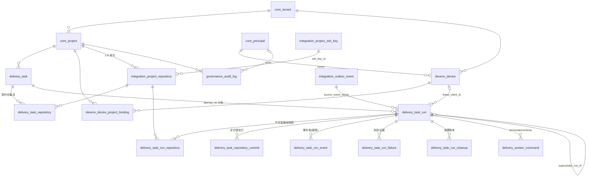
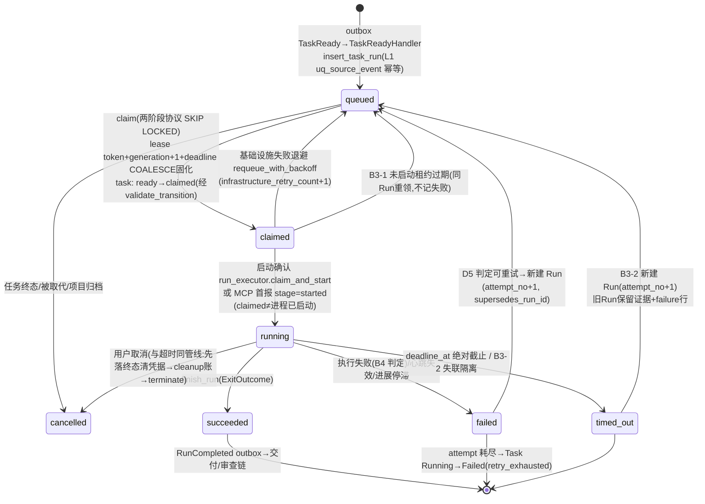

# smark-pm 现有代码基线审查 — Runner Architecture Assessment

- 审查日期：2026-11-20
- 审查基线：工作区当前状态（HEAD = `a176e5c`，含未提交的 P4 Phase 2 在途变更，如 `0041_agent_registry.sql`、`tenant_members.rs → team_members.rs` 改名）
- 审查方式：只读源码/迁移/测试审查 + 设计文档对照；7 个并行只读子审查（执行体系 / Runner·Device / MCP / Git·Workspace / DB Schema / 测试·安全 / 设计文档）
- 约定：所有判断给出 文件路径 + 符号名；实现状态分级 = 已实现+有测试 / 已实现无测试 / 部分实现 / 仅接口或数据模型 / 仅设计文档 / 未实现；不确定标 UNKNOWN

---

## 一、整体代码库结构

### 1.1 技术栈与形态

| 项 | 事实 | 证据 |
|---|---|---|
| 语言/运行时 | Rust（edition 2021），axum 0.8 + sqlx 0.8（Postgres）+ tokio + rmcp（MCP SDK） | `Cargo.toml`（workspace dependencies） |
| Monorepo | 单仓双栈：Rust workspace（`crates/*` + `apps/*`）+ Vue 前端（`ai-frontend/`） | `Cargo.toml` members、`ai-frontend/package.json` |
| 数据库 | PostgreSQL 16，迁移 41 个（`0001_baseline.sql` 为 pg_dump squash 基线 10306 行 + 0002~0041 forward-only） | `migrations/` 目录 |
| 测试基建 | `#[sqlx::test]` 1275 个、`#[tokio::test]` 77、`#[test]` 505；前端 Playwright ~140 test；Python 真实双机 E2E | grep 统计 + `scripts/e2e/` |

### 1.2 服务划分（apps/）

| 二进制 | 职责（实读 main.rs 确认） | 证据 |
|---|---|---|
| `pm-api` | HTTP 后端 + **内嵌 MCP Server**（同一进程共享 PgPool，非独立进程） | `apps/pm-api/src/routes.rs:207-232`（`PmMcpServer::streamable_http_service(mcp_pool)` nest 于 `/mcp`） |
| `pm-worker` | 仅 outbox 统一消费 + docproc job 循环，**不参与 Run 领取**（70 行） | `apps/pm-worker/src/main.rs` |
| `ai-pm-worker` | 8 条循环：AI 分析主循环 / repo_import / outbox / **Run 调度执行循环（claim_and_start + poll_active_runs + interaction 超时清扫 + run_cleanup + cleanup_finished_processes）** / review 领取 / D5 失败判定 / 会话回复 / 访谈编排 | `apps/ai-pm-worker/src/main.rs:125-275` |
| `ai-pm-runner` | 用户 PC 客户端 Runner：自领任务 → 准备工作区 → spawn Agent CLI → 心跳续租 → 命令轮询 → 回执收割 | `apps/ai-pm-runner/src/runner_loop.rs:137-350` |

### 1.3 crate 分层

```
pm-domain          纯状态机/领域模型（零 SQL）：Task 13 态、RunOutcome/RetryCounters、迁移矩阵
pm-application     应用服务（全部业务事务：run_dispatch/delivery/review/run_context/worker_command/…）
pm-infrastructure  行映射 + 外部副作用（sqlx、outbox/job 队列、codex_executor、git_access）
pm-mcp             MCP Server（26 个 pm_* 工具，共享 pool 直调 pm-application）
pm-ai              LLM 编排（team_llm catalog → OpenAI 兼容端点；与 pm-mcp 零依赖）
kb-pc-contracts    认知域契约（本次未深查）
```

### 1.4 部署形态

- `docker-compose.dev.yml` 仅含 Postgres（`aipm-pg-dev`）；`Dockerfile` 有 `runtime-pm-api / runtime-pm-worker / runtime-ai-pm-worker / runtime-web` 四个 target。
- **`ai-pm-runner` 无容器 target（刻意排除）**：定位用户 PC 客户端，E2E 以 nohup 拉起（`scripts/e2e/run_storyline.py:83-99`）；代码注释提及 supervisor，仓内无 supervisor 资产（UNKNOWN，属仓外部署物）。
- `services/{iam,notification,token}-service`、`tools/seecode`、`infrastructure/`、`policies/` 本次未深查（见 §十三）。

---

## 二、Run / Execution 执行体系（审查重点）

### 2.1 实体与关系结论

| 问题 | 结论 | 证据 |
|---|---|---|
| Task↔Run | 1 Task : N Run；Task 13 态（`crates/pm-domain/src/task.rs:15-105`），Run 7 态（`run_dispatch/mod.rs:28-36`，DB CHECK `task_run_status_check` `0001_baseline.sql:1959`） | 两者同事务迁移（I5） |
| Run vs Attempt | **无独立 Attempt 表/struct**；一次 attempt = 一条 `task_run` 行，`attempt_no` 按 `run_kind` 分轨编号（`uq_task_run_attempt_delivery/_review` 唯一索引）；重试/恢复 = 新建 Run（`attempt_no+1`，`supersedes_run_id` 指旧 Run） | `run_dispatch/port.rs:13-50`；`0001_baseline.sql:6340-6347` |
| Run 状态机形态 | **部分实现**：DB CHECK + 条件 UPDATE（先到先得）+ 事件账，无领域层集中转移函数（与 Task 13 态的 `validate_transition` 不同） | 转换散布于 `claim.rs:883-917`、`run_executor.rs:168-191/945-1036`、`lease.rs:60-130` |
| 谁创建 Run | outbox 事件 `TaskReady` → `TaskReadyHandler::handle`（活跃 Run L0 检查 + `uq_task_run_source_event` L1 幂等）；重试 Run 由 D5 失败判定（`review/failure.rs:213`）与 B3-2（`lease.rs:152-179`）创建 | `crates/pm-infrastructure/src/outbox_handlers.rs:50-269` |
| 谁启动执行 | 双通道：Model B 无人值守 = ai-pm-worker 第 4 循环 `claim_and_start`（executor 由 `AI_PM_RUN_EXECUTOR=codex\|mock` 选择，缺省 NoopExecutor）；Model A = MCP `pm_claim_task` 显式领取（`execution_mode: human/spawn`） | `run_executor.rs:43-238`；`pm-mcp/src/tools.rs:571`；`claim.rs:870-881` |
| 谁维护状态 | 平台唯一权威：所有 Task 迁移经唯一受守卫入口 `apply_task_transition`（`command_executor/transition.rs:36-145`：行锁→revision 乐观锁→`validate_transition`→审计）；执行端只能经 MCP 触发，**无通用状态写工具** | R1 不变量落实 |

### 2.2 取消 / 重试 / 恢复 / 事件 / 幂等

| 能力 | 状态 | 证据 |
|---|---|---|
| 取消 | **已实现+有测试**：`POST /v1/pm/task-runs/{run_id}/cancel`（`project_lifecycle.rs:111-159`）→ `cancel_run`（`run_executor.rs:394-455`）与超时同管线：先落终态+清凭据 → 入 cleanup 账本 → terminate 进程 | `run_executor.rs` 测试 `c61` |
| 重试 | **已实现+有测试**：三层计数分离——`attempt_no/attempt_count`（生命周期，`AI_PM_MAX_RUN_ATTEMPTS=3`）、`infrastructure_retry_count`（spawn 失败，独立上限 5，指数退避）、`dispatch_attempts`（资格退避）；不可恢复类别（permission/policy_violation 等）立即 Failed | `review/failure.rs:50-236`；`run_executor.rs:732`；测试 `c63/c64/t26` |
| 重启恢复 | **已实现+有测试**：B3-1/B3-2 二分（`claim.rs:607-672`：`stage='dispatch'` 同 Run 重领不记失败；`stage='started'` 隔离旧 Run timed_out + 新建 Run）；启动孤儿对账 `reconcile_orphans`（`run_executor.rs:470-555`，三重证据，Uncertain 不回收）；cleanup 账本（`run_cleanup.rs`，max_attempts=8 → needs_human） | 测试 `run_dispatch.rs:332/370/1077`、`recovery.rs` |
| `needs_recovery` | **仅设计文档**：TaskStatus 13 态无此值、无代码写读；实际排他机制 = 开放 `task_waiting` 行 + `scheduling_shield`（none/human_wait/start_wait/timed_out）。`recover_expired_leases` 函数不存在（能力并入 claim_once 回收分支） | `review/failure.rs:15`（仅注释提及） |
| 事件回传 | **已实现（REST 轮询）**：`delivery.task_run_event`（0013，8 种事件白名单，`UNIQUE(run_id,event_type,lease_generation,dedupe_tag)` 幂等 + 禁 UPDATE 触发器）；读面 `GET /v1/pm/task-runs/{id}/events`（`pm_runs.rs:235-262`）。**SSE 仅 audit 流**（`audit_stream.rs`，PG LISTEN/NOTIFY）；Run 事件无 SSE | `run_events.rs:65-96` |
| 重复交付防护 | **已实现+有测试**：`delivery.task_run.request_fingerprint`（规范化 SHA-256）；submit 管线步骤⓪幂等识别先于 fencing：同指纹幂等重放同一 manifest，不同指纹 409 SubmitConflict | `delivery/mod.rs:243-277, 407-425`；测试 `c78/c86` |
| 执行 fencing | **已实现**：`verify_row` 七项顺序校验（token hash / generation / status∈{claimed,running} / 租约活性 / deadline 绝对截止 / 项目隔离）`run_context.rs:124-157`；`lock_lease` FOR UPDATE 行锁；旧 generation 永不重新授权 | 测试 `run_context.rs` 12 例 |
| 结果 → Delivery/Review | **已实现+有测试**：`pm_submit_result` → 逐仓 git 事实校验（commit=工作区 HEAD ∧ 锁定基线后代）→ 同事务落 `task_repository_commit` + Task Running→Submitted + outbox `DeliverySubmitted` → review 队列拍①（`review/queue.rs:148`）→ 平台 Reviewer 确定性管线 → 拍② `advance_after_review`（changes_requested / 自动完成 / 降级人工审批） | `delivery/mod.rs:395-909`；`review/decide.rs:240` |

### 2.3 PM-AI 与外部执行器的状态双写问题

- **不存在双写 Run 状态的路径**：AI 写回（`crates/pm-ai/src/discovery_writeback.rs:1233-1298`）只经 `AI_WRITABLE_COMMANDS` 白名单创建 `draft` 任务，**不触碰 `delivery.task_run`**；Run 状态只由 run_dispatch/run_executor/review 写。
- **已确认的产品断裂（待裁决）**：`pm_write/task.rs:20-24` `create_task` 调 `require_human`（`requirement.rs:203-226`，`core.principal.kind='human'` 否则 Forbidden）；commit `caae372`（2026-11-15）的无条件门控晚于 writeback 实现（`b2eef7b`），**decompose AI 建任务的生产链路被闸死**，编排器 fail-soft 静默，`pm-ai/tests/discovery_writeback.rs:353` 起持续 2 测试红——官方留痕（HEAD~2 `a176e5c` 提交信息④）待产品三选一裁决。
- 0032 `write_operation_request_fingerprint` 属 PC/ProjC 认知写账本，**与 Run/Execution 无关**（Run 域幂等用 `delivery.task_run.request_fingerprint`，0001 内置列）。

### 2.4 Task 审批策略门控（两条独立链，均已实现+有测试）

1. **领取门**：四层策略合成（organization→project→task_type→task，`policy.rs:58-98`，任一层 require_human_approval 即不可放宽）+ 审批证据查询（`assess_approval`）→ 七门判定 `claimability_assessment`（`policy.rs:136-256`：retry_exhausted / policy_requires_approval / task_waiting / no_executor_assignee / no_repository_scope / repository_not_verified / baseline_unavailable）；快照不可变落 `task_run.policy_snapshot`。
2. **验收门**：Reviewing→Completed 需 E2 证据 + `load_completion_gate`，不可自动则开人工审批（`review/decide.rs:112`，REST `/api/v1/supervision/approvals/{id}/decision`）。

---

## 三、Runner / Device 体系

### 3.1 结论：存在独立 Runner，且已完整实现

`apps/ai-pm-runner`（客户端，用户 PC）与 `crates/pm-infrastructure/src/codex_executor.rs`（服务端 Model B）是**两条并行执行链路，共享同一 claim 事务内核**（`run_dispatch/claim.rs` 两阶段协议：无锁发现候选 Project → project→run→task 统一锁序 + `FOR UPDATE OF r SKIP LOCKED`）。

| 问题 | 结论 | 证据 |
|---|---|---|
| Runner 主循环 | **完整实现**：500ms 一拍；孤儿扫描→fail-fast 自检→恢复在途 Run（`recover_inflight_run`：`pm_discover_runs`+`pm_reacquire_lease` 有界退避）→进程收割→自领→通信拍（心跳=续租 / 标记侦测 / 命令轮询） | `runner_loop.rs:137-350, 386-512, 557-658` |
| Runner 注册/认证 | **完整实现**：cpk 设备凭据（`cpk_`+64hex，256bit 熵，库存 sha256，明文仅返回一次）；四项验证链+owner active，每请求直查库 fail-closed 无缓存无回退；`granted_permissions` 三码真源在 `devenv.device` 列 | `device_credential.rs:273-309`；`auth.rs:220-279` |
| Device↔Runner 关系 | Device = `devenv.device` 行（`is_runner boolean` 声明领取型载体，D-2=c）；Runner = 运行 `ai-pm-runner` 的设备实例。注册（POST /v1/pm/devices）≠ 凭据签发（POST /credential）≠ Run 领取 ≠ OS 进程启动，四件事代码中明确分离 | `pm_devices.rs:34-54`；`0001_baseline.sql:2269-2292` |
| 多 Device / 多 Runner | 支持多设备多 Runner（每设备独立凭据+绑定）；**单 Runner 同时至多 1 个活跃 Run 仅是客户端单槽位约定**（`active: Option<ActiveRun>`），服务端无 per-device 并发上限（同一 cpk 并发 claim 多任务无库级防线） | `runner_loop.rs:158, 289`；`claim.rs:485-500`（仅每任务级互斥） |
| 心跳 | Run 级心跳（`pm_report_progress` 续租，60s 默认，节拍守卫 `heartbeat*2 < lease_secs`）**完整实现**；Device 级心跳 = 服务端归因式被动刷新（MCP 六个工具入口顺带 `refresh_runner_heartbeat`），Runner 无专用调用——**基本可用**；`is_runner_available` 判定已落库但**不门控 worker 领取**（D-2=c 只登记语义） | `run_context.rs:696-697, 808-809`；`tools.rs:36-48`；`availability.rs:5-9, 40-48` |
| 任务分配协议 | 轮询式无推送：`pm_list_tasks`（发现 ready 任务+queued run）→ `pm_claim_task`（原子领取+一次性 lease token+锁定多仓基线）；七门 deny 枚举齐全；claimability 判定在平台 | `tools.rs:336-356`；`policy.rs:136-256` |
| 能力声明 | **部分实现**：仅 `client_name/client_version` 预留字段；profiles 为**模板单选**（`AI_PM_RUNNER_ADAPTER=zcode\|codex\|dsh\|custom`），设计文档的"ZCode→Codex→DSH 优先级链"**无自动探测/回退代码** | `profiles.rs:27-70` |
| 进程管理 | **完整实现**：Windows Job Object（KILL_ON_JOB_CLOSE 整树杀）+ Unix 进程组；`process.json` 原子落盘含身份锚点（进程创建时间防 PID 重用误判）；`launch.json` env 只记键名；stdout/stderr 脱敏管道（token→`[REDACTED]`，10MiB 帽）；ExitOutcome 五值收割 | `adapter.rs:638-711, 465-524, 609-634` |
| 命令通道 | **完整实现**：`delivery.worker_command` 四态（issued→delivered→acked\|failed）；仅 terminate/continue 两类；ack 从严 fencing（receipt `aipm.receipt.v1` + `run_generation` 必须等于当前代次）；terminate 未回执时 continue 被过滤；`scheduling_shield` 与 `continuation` 状态机闭环 | `worker_command.rs:66-708`；`continuation.rs` |
| 离线/崩溃处理 | **完整实现**：401 fail-fast 退出码 2 绝不降级；Runner 崩溃后 `pm_discover_runs`+`pm_reacquire_lease`（generation+1，deadline 不动）恢复；孤儿进程**只报告不强杀**（Q-RC-5 裁决：用户 PC 越权风险大于收益）；服务端崩溃由 `reconcile_orphans`+cleanup 账本兜底 | `main.rs:15-17`；`recovery.rs:74-103, 170+`；`adapter.rs:564-567` |
| 远程/本地执行 | Remote MCP 控制面 + 本地进程执行面组合（Runner 手写薄 JSON-RPC 客户端直连 `/mcp`，不依赖 pm-mcp crate）；容器/远程隔离明确不做（P11） | `mcp.rs:1-6`；runner Cargo 无 pm-mcp 依赖 |
| 无人值守派发开关 | `AI_PM_RUN_DISPATCH`：`off`（缺省）不领取新 Run 但租约健康检查持续；`probe` 领取即释放；`on` 正常。只门控 Model B worker；Model A 恒不受门控 | `run_dispatch/mod.rs:111-158`；`claim.rs:57` |
| 服务端 executor | `CodexExecutor`：mirror 仓（跨进程文件锁+600s 陈旧阈值）→ `git worktree add --detach {root}/{run_id}/{workspace_path}` → spawn Codex → pid 三重证据 poll → Windows Job Object 收尸；`NoopExecutor` start 即 Unsupported **绝不伪造成功** | `codex_executor.rs:137-303, 583+, 992+` |

### 3.2 关键澄清（与设计文档对照）

- **DSH adapter = 初步实现**：`ResolvedLaunch{program,args,stdin_prompt}` 的 stdin 流式注入真实可跑（`adapter.rs:151-186`），但 R-6「注入后观测首个输出轮次」分层证据未实现（`input_injected` 仅判 `.aipm/reply.json` 存在+进程存活）；仓内无 dsh 二进制与适配测试。
- **`0025_projc_domain_bootstrap.sql` 与 Device 无关**（纯 projc 认知域）；device DDL 全在 0001 基线。
- **fake_agent.py**（`scripts/e2e/fake_agent.py`）：E2E 确定性假 Agent（Session-1 长眠等 terminate；Session-2 消费回复→真实 commit/push→裸 HTTP 申报 SHA），验收链不依赖真实 LLM CLI。

---

## 四、MCP / Agent 工具接入

### 4.1 工具面：26 个 `pm_*` 工具全部实现

`crates/pm-mcp/src/server.rs`（`#[tool_router]`，26 个 `#[tool]`；rmcp **Streamable HTTP 无状态 JSON 模式**，无 stdio/无 session store）。命名已冻结 `pm_*`（设计文档的 `task.*`/`knowledge.*` 点分命名未采用）。分组：

| 组 | 工具 | 说明 |
|---|---|---|
| 发现/领取/上下文 | `pm_list_tasks` `pm_claim_task` `pm_get_task_context` `pm_get_run_context` | 领取签一次性 lease token；上下文=完整执行契约（goal/约束/验收/每仓基线/知识引用/分支/策略快照） |
| 进度/交付 | `pm_report_progress` `pm_submit_result` | 首报 started 经受守卫状态机推进（Model B 已写 executor_session 时不推进——执行端不得覆盖平台 spawn 意图）；submit 逐仓 git 事实校验 |
| 交互/命令 | `pm_report_interaction` `pm_poll_commands` `pm_ack_command` `pm_report_consumption` `pm_report_checkpoint` | interaction 落库+任务转 awaiting_decision+human_wait+同事务下发 terminate；consumption 需 `initial_input_injected`+`process_alive` 双证据 |
| 恢复 | `pm_discover_runs` `pm_reacquire_lease` | 强制 cpk Client 通道 |
| 知识 | `pm_submit_document` `pm_propose_document` `pm_confirm_document_proposal` `pm_veto_document_revision` | 红线闸门（external_commitment/delete_history/rewrite_delivered 挂人工）；confirm/veto 有 `require_human`；审计依据=认证调用人（wire 参数 `confirmed_by` 被丢弃） |
| 发现域（/pm-learn） | `pm_discovery_*` 6 个 + `pm_submit_evidence` `pm_submit_technical_design` `pm_get_submission_status` | propose-only：永不直写 `ai.project_document` |

- **`knowledge.search` 未实现为 MCP 工具**（仅 REST `/v1/pm/documents/search`，`documents.rs:139`）；`knowledge.propose_change` 由 `pm_propose_document` 承担。`request_decision` 未以原名实现（由 `pm_report_interaction` 承担）。
- **无通用状态设置工具**；所有迁移经 `apply_task_transition`。`PM_MCP_TASK_UPDATE` 权限码保留未分配（`auth.rs:550`）。
- 权限映射：`auth.rs:558-571` `MCP_TOOL_PERMISSIONS`（读=PM_MCP_READ；命令面=PM_MCP_COMMAND；上报=PM_MCP_AGENT_REPORT；文档写=PM_MCP_DOCUMENT_WRITE，**不在 cpk 默认三码内**）。

### 4.2 MCP 是否越界承担 Runner 职责——没有

- MCP 不调度、不保活、不超时重试、不并发控制；无人值守由 Runner/worker 承担（`docs/architecture/ai-pm-mcp-executor-positioning-v1.md` §3.2 原则在代码中成立）。
- MCP 不碰文件系统；工作区布局平台下发。
- 唯一注意点：MCP Server 进程内嵌 pm-api（共享 PgPool），设计文档允许（"可与 API 同进程"），非违规；但意味着 MCP 面与 REST 面同进程同故障域（见 §十一 P2）。

### 4.3 Bootstrap / Skills / pm-ai

| 项 | 状态 | 证据 |
|---|---|---|
| Bootstrap 服务端 | **已实现**：`/install`、`/install/{tool}` 公开免鉴权（含 JSON `bootstrap` 段：package_url/release_manifest/endpoints/key_handling，无凭据返回）；设备登记/绑定/自检/凭据签发撤销全链 | `onboarding.rs`；`skills_package.rs` |
| Skills 包 | **已实现**：构建期 `include_bytes!` 打包 `pm-ai-skills-<version>.zip`（SHA-256 manifest，integrity_only）；`skills/pm-ai-bootstrap/SKILL.md` 七步生命周期完整 | `apps/pm-api/build.rs` |
| Skills 占位 | `pm-task-execution/SKILL.md`、`pm-knowledge/SKILL.md` 为 T-090 占位骨架，且写"工具面 18 个"与实际 26 个不符（文档滞后）；`verify-install.{sh,ps1}` 四项 HTTP 检查占位 | `skills/` 目录 |
| Agent Adapter 抽象 | **无统一 trait**（Q-RC-6 裁决：模板库起步，trait 只立接口位）；不绑定单一厂商但 zcode/codex/dsh 程序名硬编码 | `profiles.rs:1` |
| pm-ai 与 pm-mcp 边界 | 零依赖，仅在 pm-api 进程汇合；pm-mcp 26 工具不触碰 LLM；pm-ai 走 team_llm catalog → OpenAI 兼容 `/chat/completions`（OpenAI/GLM/DeepSeek/vLLM 通吃） | `pm-ai/src/analysis_model.rs:18-19` |
| Host 白名单 | `mcp_hosts.rs`：`AI_PM_MCP_ALLOWED_HOSTS` 只增不减、空名单禁令（rmcp 空名单=放行全部的陷阱被封死）；白名单只防 DNS rebinding，不是授权 | `mcp_hosts.rs`；`server.rs:634-639` |

---

## 五、Git / Repository / Workspace

全仓**不用 git2/gix**；所有 Git 操作为命令行子进程（`git_access.rs`：参数数组、禁交互 `GIT_TERMINAL_PROMPT=0`、显式超时 kill_on_drop、SSH 经临时 `GIT_SSH_COMMAND`）。

| 问题 | 结论 | 证据 |
|---|---|---|
| Project↔Repository | **已实现+有测试**：`integration.project_repository`（一项目多仓，`UNIQUE(project_id,url)`，role∈{main,docs,service,infra}）；设计稿的全局 `integration.repository` 实体（I2 不变量）**未实现**——仓库身份与项目耦合 | `0001_baseline.sql:2135`；`repository/repo.rs` |
| Task 仓集合 | `delivery.task_repository`（PK(task_id,repository_id)，role∈{primary,secondary,knowledge}）；写入唯一入口 `task_repository_binding.rs`（只允许 verified、防伪造归属） | `0001_baseline.sql:1837` |
| 平台 Git 权限面 | **只读白名单**：ls-remote/clone(--bare/--mirror)/fetch/worktree add/log/show/ls-tree/diff/merge-base/rev-parse/cat-file；**平台不 commit、不 push**（commit/push 由 Agent 在工作区自理）；唯一例外：知识 Git 根（`knowledge.rs`）对需求文档 markdown 仓 add/commit | `git_access.rs:183-315` |
| Worktree | 服务端 `codex_executor.rs checkout`：`git-mirror/{repository_id}` 共享镜像 + `git worktree add --detach`；Runner 侧**不用 worktree**（按设计分域）：git map 命中→fetch+`checkout --detach`，否则 clone；API 侧不做 | `codex_executor.rs:232-293`；`workspace.rs:48-141` |
| 工作目录 | `{AI_PM_WORKSPACE_ROOT}/{run_id}/{workspace_path}`；`workspace_path = repos/{safe-name}-{repository_id}` 冻结算法+执行器侧二次防穿越校验；领取时固化不可变快照 `delivery.task_run_repository`（无 UPDATE 路径） | `run_dispatch/port.rs:55-72`；`lease.rs:4` |
| Credential | **已实现**：`integration.project_ssh_key` AES-256-GCM（`secret.rs seal_text/open_text`，AAD 绑 project_id）；0022 多把 key（绑定→项目默认→最新 active 三级回退）；REST 不暴露私钥（测试 `e2e_flow.rs flow_15`）。**无有效期/轮换机制**。**关键分域**：Runner 不接收任何平台 git 凭据（凭据走用户会话 ssh-agent/credential helper，`workspace.rs` 头注），交付走远端验证模式（平台侧密钥只读验证） | `secret.rs:60-104`；`repository/ssh_key.rs` |
| Commit 关联 | `delivery.task_repository_commit`（Run 级，`UNIQUE(task_run_id,repository_id)`，commit_sha 取 git 校验现算 HEAD 不信任申报）；task 表无 commit_sha 反模式列 | `0001_baseline.sql:1856`；`delivery/mod.rs:776-813` |
| 多仓交付 | **已实现**：一次交付跨 N 仓同事务落行；只读仓 HEAD 漂移整单驳回（`ReadonlyRepoCommit`）；**设计的 partial/needs_recovery 交付语义未实现**（integration_status 仅 passed/failed/not_run） | `delivery/mod.rs:603-656, 728-774` |
| 外部 Commit Adoption | **无显式 adoption 机制**（grep 无 adoption 代码/表）；间接链路已实现：外部推送→`verify_repository` ls-remote 发现 Observed HEAD 前进→自动 intake→`analyze_repository` 增量（0024 run_mode=incremental，since_commit=last_analyzed_commit_sha）→`repo_facts::collect_incremental`（人类 author 一并入事实）→KB/PC 提案→`repo_analysis_report` 关闭固化锚点。无按 author 标注"外部人提交"的字段 | `repository/repo.rs:493,747`；`repo_facts.rs:172,320` |
| 仓库 API | `pm_repositories.rs router()`（`pm_repositories.rs:31`）：repositories CRUD + verify + analyze + update-version + archive + ssh-key 绑定/导入/吊销 | `pm_repositories.rs` |

---

## 六、安全与可靠性（已实现 vs 仅设计）

| # | 控制项 | 状态 | 证据 |
|---|---|---|---|
| 1 | 租户/项目隔离 | **已实现+回归测试**：API 层跨租户 404 防存在性泄露（`team_llm_guard.rs`——注意它是租户守卫**不是** SSRF 文件）；MCP 层成员门+跨项目 NotFound；回归 `v2_tenant_isolation.rs`(T01-T10)、`security_p0_regression.rs` | `authz.rs`、`caller_ctx.rs::c173` |
| 2 | 执行端权限边界 | **已实现**：cpk 三码裁剪（未知码拒绝，收窄测试 `acp464`）；cpk 仅限 `/mcp` 面；cpk 默认无文档写权 | `device_credential.rs:28`；`auth.rs:218-222, 559-567` |
| 3 | Secret 脱敏 | **已实现（一处实证残留）**：lease_token 日志 `[REDACTED]`（runner+executor 两侧，测试 `c71` 断言明文不落 process.json/mcp.json/events）；凭据仅存哈希；**`codex_executor.rs:110-133` 解密私钥明文落 `{root}/keys/{repository_id}.pem` 且全仓无删除代码**（对比 git_verify 路径 `write_temp_key` RAII 即删） | 抽查核实 |
| 4 | 执行超时 | **已实现**：`deadline_at` 首次 claim COALESCE 固化、续租不重置（T3）；绝对截止优先于续租（`lease.rs:222-237`）；心跳失效 900s / 进展停滞 3600s / 默认 deadline 3600s 三阈值分立（T4 四信号分立） | `run_dispatch/mod.rs:145-178` |
| 5 | 资源限制 | **部分实现**：runner 日志 10MiB 帽；repo_facts 采集上限（300 commits/20000 files/400KB docs）；LLM 上下文字符预算（discovery 分级丢弃）+ `max_run_attempts` 反馈上限；**无显式 max_tokens 级预算配置**（UNKNOWN） | `adapter.rs:97`；`repo_facts.rs:18-29` |
| 6 | 进程终止清理 | **已实现**：Windows Job Object 整树杀（测试 `acp08`）；终止顺序反转（先落终态+清凭据后杀，ADR-0002 L3）；cleanup 账本退避重试 max_attempts=8 → needs_human 人工队列 | `run_executor.rs:394-455`；`run_cleanup.rs` |
| 7 | SSRF | **已实现（一处缺口）**：`team_llm.rs:206-270 validate_endpoint_for_type` 拒 loopback/private/link-local/ULA（ollama 豁免）；**无 DNS 重绑定解析后二次校验/连接时 pinning** | 内联测试 `endpoint_blocks_private_hosts` |
| 8 | 幂等 | **已实现**：交付指纹幂等（同指纹重放/异指纹 409）；outbox 幂等键（`delivery_submitted:{run_id}` 等）；TaskReady 双层（活跃 Run 检查+source_event 唯一索引）；事件账 `ON CONFLICT DO NOTHING` | §2.2 |
| 9 | 审计 | **已实现（双轨）**：项目级 `governance.audit_log` 18 个 INSERT 点（claim/supersede/transition/delivery.submitted/review/…，含补偿快照列）；租户级 `governance.tenant_audit_log` 7 处（设备凭据/provider 变更）；SSE 审计流（`/v1/pm/events/stream`，鉴权测试齐全）；**设计承诺的 actor_client/actor_auth_mode 三列已在列但写入覆盖度 UNKNOWN** | `lease.rs:275-374` |
| 10 | 认证面 | **已实现**：JWT(JWKS，强制 tid fail-closed) + cpk（每请求查库）+ 设备归因头（仅归因不影响授权）+ auth-off 开发态；公开面仅 `/health /install /install/{tool} /setup/status`（+ skills zip 公开下发，泄露面有限但值得留意） | `auth.rs::is_public_path` |
| 11 | 重复执行 | Run 域无重复执行风险：活跃 Run 部分唯一索引 + 行锁 + 七门；**服务端无 per-device 并发上限**（§3.1）是唯一约定式约束 | `0001_baseline.sql:6320-6347` |

---

## 七、数据库结构（执行体系相关）

- 实际迁移链 **0001~0041**（0041_agent_registry.sql 为 2026-11-20 新签发，新增 `ai.project_agent_member` + `core.project_member.role` 收敛人类两值）。0001 基线 10 schema 128 表；后续新增 design/plan/docproc/viz/projc 5 schema。

### 7.1 核心表（字段级明细见子审查，此处列约束要点）

| 表 | 关键约束/状态枚举 |
|---|---|
| `delivery.task` | status CHECK **13 态**；`revision` 乐观锁；attempt_count/consecutive_failure_count/retry_exhausted；last_failure_category CHECK 7 值 |
| `delivery.task_run` | 47 列；status CHECK 7 态；outcome 4 值；run_kind∈{delivery,review}；integration_status∈{passed,failed,not_run}；execution_mode∈{human,spawn}；scheduling_shield 4 值；**6 个部分唯一索引**：`uq_task_run_active`（每任务至多 1 活跃 delivery run）、`uq_task_review_active`、`uq_task_run_attempt_delivery/_review`、`uq_task_run_source_event`；租约列组（lease_token_hash/lease_generation/deadline_at/heartbeat_at/last_agent_heartbeat_at/last_progress_at/lease_client_id）；review 隔离 CHECK（review 必须 platform+无 token/session） |
| `delivery.task_run_event` | 无 PK（有意）；幂等唯一键 (run_id,event_type,lease_generation,dedupe_tag)；禁 UPDATE 触发器；event_type CHECK 8 值 |
| `delivery.task_run_failure` | PK=run_id（一 Run 一失败行）；category CHECK 7 值 |
| `delivery.task_run_repository` | PK(run_id,repository_id)，不可变基线快照 |
| `delivery.task_repository_commit` | UNIQUE(task_run_id,repository_id)；test_evidence jsonb 结构 CHECK |
| `delivery.worker_command` | command_type CHECK 2 值（terminate/continue）；status CHECK 4 值；delivered 必带 claim 租约；`uq_worker_command_active` |
| `delivery.task_run_cleanup` | status CHECK {pending,cleaning,completed,needs_human}；max_attempts 默认 8 |
| `devenv.device` | status∈{active,revoked}；readiness 6 值；credential_key_hash partial unique；granted_permissions text[] 默认三码；is_runner；last_heartbeat_at（部分索引 WHERE is_runner） |
| `governance.audit_log` | 无 action CHECK（自由 text）；含 actor_client/actor_auth_mode/claimed_device_id/compensation 列 |

### 7.2 代码与 Schema 一致性

- 抽查一致：`repo/runs.rs` 读模型列、`run_context.rs` LEASE_SELECT、全部 INSERT/UPDATE 列清单逐列核对无幽灵列。
- **存在列未被代码使用（0 引用）**：`task_run.triggered_by_user_id`、`task_run.override_version`、`task_run.evaluated_at`（疑似历史遗留）。
- 次要：`devenv.device` 重复 UNIQUE(tenant_id,id) 两条并存（squash 冗余）；`run_dispatch/mod.rs` 锁序注释过时（实际 project→run→task）。

### 7.3 并发控制风格

「悲观行锁 + SKIP LOCKED 表即队列 + ON CONFLICT 幂等 + revision 乐观锁」四件套。生产 SQL 全部集中在 pm-application（FOR UPDATE 150 / SKIP LOCKED 11 / ON CONFLICT 69）；域层零 SQL。事务边界：claim 事务写 6 表（task_run/task/task_run_repository/task_run_failure/audit_log/task_run_event）；submit 事务写 5 表（commit/task_run/task/audit/outbox）——注意 **submit 事务内执行 git 子进程校验**（长事务风险点）。

---

## 八、测试覆盖

### 8.1 规模

198 个测试文件；`#[sqlx::test]` 1275（pm-api 481 / pm-application 561 / pm-infrastructure 119 / pm-mcp 25）；`#[tokio::test]` 77；`#[test]` 505；前端 Playwright ~140 test；Python E2E（`run_storyline.py` 真实双机 ACP 故事线 + `acp09_e2e.py` 本机全栈十场景 + `fake_agent.py` 确定性假 Agent）。

### 8.2 十项关键行为覆盖判定

| 行为 | 判定 | 代表测试 |
|---|---|---|
| Run 生命周期 claim→start→submit→review | ✅ 有强断言 | `run_executor.rs::c59_full_loop_exit_zero_succeeds_run`、`delivery.rs::c72` |
| 并发 claim | ✅ | `run_dispatch.rs::concurrent_claims_yield_exactly_one_claimed_run`（4 worker 恰 1 claimed） |
| 重试 | ✅ | `c63/c64`（infrastructure 计数+耗尽）、`t26` |
| 取消 | ✅ | `c61_user_cancel_uses_the_same_pipeline` |
| 租约过期回收 B3-1/B3-2 | ✅ 断言强 | `unstarted_expired_lease_recovers_same_run`、`started_lost_run_is_isolated_and_superseded` |
| 服务重启恢复 | ✅ | `reconcile_finalizes_exited_orphan`、`c72 PID 重用判死`、`c73 Uncertain` |
| worktree 隔离 | ✅ | `c69/c70`（布局+锁定 base_commit） |
| 多 repo 交付 | ✅ | `c72_three_repository_delivery`、只读仓整单拒绝 `c73/c87` |
| credential 清理 | ⚠️ 部分：DB 凭据生命周期有测试；**.pem 明文密钥无清理代码也无测试** | `acp460` vs 缺口 |
| 重复提交幂等 | ✅ | `c78_repeated_submission_replays_same_manifest`、`c86` 409 |
| 命令通道 fencing | ✅ | `acp454/455`、`c19_reclaim_invalidates_old_token` |
| Runner 客户端主循环 | ⚠️ **run_loop 无直接单测**（组件级 comm_loop/checkpoint2 16 测试齐全，闭环仅靠 E2E） | `comm_loop.rs`、`checkpoint2.rs` |

当前全量测试是否全绿：UNKNOWN（只读审查未运行；已知 `pm-ai/tests/discovery_writeback.rs` 2 例持续红为产品断裂留痕）。

---

## 九、设计文档 vs 代码 不一致清单

| # | 设计承诺 | 实际代码 | 定性 |
|---|---|---|---|
| 1 | `needs_recovery` 状态（D1 §5.5.3 终止无法确认时） | 状态不存在；用 `scheduling_shield` + `task_waiting` + `continuation.frozen` 承载同等语义 | 语义等价、命名漂移 |
| 2 | `recover_expired_leases` 独立操作（D1 dispatch_once/recover 拆分） | 无此函数；回收并入 claim_once 回收分支 | 职责合并（与"不引入第二套调度"一致，但与文档表述不符） |
| 3 | Adapter 优先级链 ZCode→Codex→DSH（V-05-5 冻结） | 模板单选（env 手动指定），无自动探测/回退 | 未实现自动链 |
| 4 | DSH 消费证据 R-6 分层（观测首输出轮次） | `input_injected` 仅判文件+进程存活 | 初步实现 |
| 5 | partial/needs_recovery 交付裁决（multi-repo §4.5） | integration_status 仅 passed/failed/not_run | 未实现 |
| 6 | 全局 `integration.repository` 实体 + I2（仓可跨项目引用） | 仓库与项目耦合（project_repository） | 未实现（C3 裁决曾确认 D1 不做全局仓，multi-repo 文档仍保留主张） |
| 7 | `task_workspace` 表、cross_repo_contracts、delivery_expectation | 未建表；由 task_run_repository + 契约字段承载 | 部分承载 |
| 8 | `request_decision` / `task.get_review` / `knowledge.search`（positioning 9 工具） | 未以原名存在（interaction/REST/propose_document 承担）；工具面已演进至 26 个 | 演进取代 |
| 9 | skills/pm-task-execution 写"工具面 18 个" | 实际 26 个 | 文档滞后 |
| 10 | 心跳作派发可用性真源门控（D-2=c） | `is_runner_available` 已落库**不门控** worker 领取（按裁决只登记语义） | 与文档一致（D-2=c 自己声明不门控） |
| 11 | Executor Registry / executor_id FK（ADR-0001 D6 推迟） | `executor_id` 列无 FK，无写入方据其鉴权（符合推迟裁决） | 按裁决未实现 |
| 12 | todo.md 被 §6 M3/T-081/T-090 引用 | 当前 todo.md 已重写为仓析+SSH 页两项，编号索引失联 | 文档漂移 |
| 13 | actor_client/actor_auth_mode 审计三列（G6/T-059） | 列已存在，写入覆盖度 UNKNOWN | 待核实 |
| 14 | SSE 实时日志（T-070"需要时再加"） | 未实现（Run 事件 REST 轮询；SSE 仅 audit 流） | 与裁决一致 |

---

## 十、最终报告 A：模块实现状态总表

| 模块 | 实现状态 | 代码证据 | 测试情况 | 主要问题 |
|---|---|---|---|---|
| Task 13 态状态机 | 已实现+有测试 | `pm-domain/task_transition.rs:32-162`；唯一入口 `command_executor/transition.rs:36` | 域层单测+接线集成测试 | 无 |
| Run 生命周期 | 已实现+有测试（部分实现形态） | `run_dispatch/*`、`run_executor.rs` | `run_dispatch.rs` ~30 例 + `run_executor.rs` 10 例 | 无领域层集中转移矩阵（DB CHECK+条件 UPDATE） |
| Attempt/重试 | 已实现+有测试 | attempt_no/supersedes_run_id；`review/failure.rs` | `c63/c64/t26` | 无独立 Attempt 实体（设计即如此） |
| 取消/终止 | 已实现+有测试 | `cancel_run`、Job Object、terminate 回执 | `c61`、`acp08`、`f6` | pm-api 侧取消用 NoopExecutor（进程终止交 worker 兜底） |
| 租约/fencing | 已实现+有测试 | `run_context.rs verify_row` 七项、generation | 12 例 | 无 |
| 恢复（B3-1/B3-2/reconcile/cleanup） | 已实现+有测试 | `claim.rs:607-672`、`run_executor.rs:470`、`run_cleanup.rs` | `recovery.rs` 等 | `needs_recovery` 命名不存在（shield/waiting 替代） |
| 事件账 | 已实现+有测试 | `task_run_event`（0013）、`run_events.rs` | `run_events.rs` | review Run 不落账（有意）；无 Run 事件 SSE |
| 交付/Review | 已实现+有测试 | `delivery/mod.rs`、`review/{queue,pipeline,decide}.rs` | `delivery.rs` ~20 例 | partial 交付语义未实现；submit 事务内跑 git 子进程 |
| MCP 工具面 | 已实现（26 工具） | `pm-mcp/server.rs`、`tools.rs` | `pm-mcp` 25 sqlx + contract 测试 | `knowledge.search` 未 MCP 化；占位 skills 文档滞后 |
| Runner 客户端 | 已实现（组件级测试+E2E） | `runner_loop.rs`、`adapter.rs`、`mcp.rs`、`profiles.rs`、`workspace.rs` | `comm_loop.rs` 9 + `checkpoint2.rs` 7 + E2E | **run_loop 主循环无单测**；DSH adapter 初步；无自动 adapter 链 |
| 服务端 CodexExecutor | 已实现+有测试 | `codex_executor.rs`（1068 行） | 7 例 | **.pem 明文残留**；镜像锁 120s 等待极端并发下可能失败 |
| Device/凭据 | 已实现+有测试 | `device_credential.rs`、`pm_devices.rs` | 7 例 + API 测试 | 无凭据有效期/轮换 |
| 命令通道/续办 | 已实现+有测试 | `worker_command.rs`、`continuation.rs`、`interaction.rs` | `recovery.rs`、`continuation.rs`、`response_delivery.rs` | 无 |
| Git 只读面 | 已实现+有测试 | `git_access.rs`、`git_verify.rs`、`repo_facts.rs` | 内嵌+e2e_flow 真实远端 | 无 push 能力（设计即如此，Agent 自理） |
| 仓库管理/多仓 | 已实现+有测试 | `repository/*`、`task_repository_binding.rs` | `repositories.rs`、`repo_access_enforcement.rs` | 全局 repository 实体缺；无外部提交 adoption 标注 |
| 工作区管理 | 部分实现 | `port.rs` 冻结算法、`codex_executor checkout`、runner `workspace.rs` | `c69/c70` | **run 工作目录与 mirror 仓无任何清理代码** |
| 引导/安装 | 已实现 | `onboarding.rs`、`skills_package.rs`、`skills/` | `/install` 有测试 | pm-task-execution/pm-knowledge SKILL 占位 |
| AI 写回（discovery_writeback） | **生产断裂（待裁决）** | `discovery_writeback.rs:1233`、`pm_write/task.rs:20-24 require_human` | 2 测试持续红（留痕） | decompose AI 建任务链路被闸死 |
| LLM 编排（pm-ai） | 已实现 | `analysis_model.rs`、`team_llm catalog` | budget/discovery 测试 | 无 token 级预算上限 |
| 前端执行面 | 已实现（本次浅查） | `ai-frontend/src/api/execution-plans.ts`、`e2e/p0-05-task-delivery.spec.ts` | ~140 test | 未深查 |

---

## 十一、最终报告 B/C/D：架构图 / ER 图 / Run 生命周期

### B. 当前执行架构图（仅画代码证实的模块）



### C. 核心实体关系图（实际存在的表）



（表名以下划线连写；实际 DDL 见 `migrations/0001_baseline.sql` 相应行：task :1680 / task_run :1894 / task_run_repository :2077 / task_repository_commit :1856 / device :2269 / worker_command :2236。）

### D. Run 生命周期（实际状态与转换）



注：Run 侧无集中转移函数——每条边是独立条件 UPDATE（先到先得）；Task 侧 13 态全部经 `validate_transition`。

---

## 十二、最终报告 E：Runner 能力成熟度表

| 能力 | 评分 | 证据 |
|---|---|---|
| Runner 进程本体（领取/准备/spawn/心跳/命令/收割闭环） | **完整实现**（主循环无单测，闭环靠 E2E） | `runner_loop.rs:137-350` |
| Runner 注册与认证（cpk/fail-closed） | **完整实现** | `device_credential.rs`、`auth.rs:220-279` |
| Device 登记/绑定/自检（readiness） | **完整实现** | `pm_devices.rs`、bootstrap 文档六步流水线落地 |
| 心跳与在线状态 | Run 级**完整实现**；Device 级**基本可用**（归因式被动刷新，不门控派发——按 D-2=c 裁决） | `tools.rs:36-48`、`availability.rs` |
| 任务分配协议（轮询+租约+fencing） | **完整实现**（生产级特征：两阶段锁序、generation、绝对截止、七门） | `claim.rs`、`run_context.rs` |
| 能力声明/协商（capability） | **初步实现**（仅 client_name/version 预留） | `claim.rs:883-917` |
| 进程管理（Job Object/身份锚点/脱敏/收割） | **完整实现** | `adapter.rs`、`codex_executor.rs` |
| 取消/超时 | **完整实现** | `cancel_run`、`deadline_at` |
| 重试 | **完整实现**（三层计数分离） | `review/failure.rs`、`run_executor.rs:732` |
| 崩溃/离线恢复 | **完整实现**（B3 二分、reacquire、reconcile、cleanup 账本） | `recovery.rs`、`run_cleanup.rs` |
| 幂等（交付/事件/outbox/命令回执） | **完整实现** | §2.2 |
| 多仓工作区隔离 | **完整实现**（服务端 worktree；runner detach checkout 属设计内分域） | `codex_executor.rs:232-293` |
| 多仓交付 | **基本可用**（整单语义完整；partial/needs_recovery 未实现） | `delivery/mod.rs` |
| 凭据分域（执行端零平台凭据） | **完整实现**（runner 不接触平台 git 凭据；但服务端 .pem 残留降分） | `workspace.rs` 头注 vs `codex_executor.rs:110-133` |
| 无人值守派发开关 | **完整实现**（off/probe/on 三态，off 不停健康检查） | `run_dispatch/mod.rs:111-158` |
| Agent Adapter 抽象 | **初步实现**（模板单选，无 trait、无自动链、DSH 证据分层缺） | `profiles.rs` |
| 远程/容器执行隔离 | **不存在**（明确 P11 不做；execution_mode 预留 remote/container 值） | `0001_baseline.sql` |
| Runner HA/多实例/自动升级 | **不存在**（V0.5 明示非目标） | v05 设计 §0.1 |
| SSE 实时执行日志 | **不存在**（Run 事件 REST 轮询） | `pm_runs.rs` |
| 工作区磁盘回收 | **不存在**（进程清理有账本，目录/mirror 无删除代码） | §5 |
| 生产级评分 | **无任何模块达到"生产级"标准**（缺少真实多机长周期运行证据；E2E 为验收故事线性质；supervisor/监控/告警面在仓外 UNKNOWN） | — |

---

## 十三、最终报告 F：主要技术债清单

**P0（阻断核心链路 / 严重安全问题）**

| # | 问题 | 证据 |
|---|---|---|
| P0-1 | AI 建任务产品链路断裂：`create_task` 无条件 `require_human` 闸死 `discovery_writeback` decompose 通道，编排器 fail-soft 静默，2 测试持续红——**官方留痕待产品三选一裁决，非本审查可修复项** | `pm_write/task.rs:20-24`；`requirement.rs:203-226`；`a176e5c` 提交信息④ |

**P1（影响核心架构或近期开发）**

| # | 问题 | 证据 |
|---|---|---|
| P1-1 | SSH 私钥明文落盘无清理：`codex_executor.rs` 解密私钥写 `{root}/keys/{repository_id}.pem`，全仓无删除代码（对比 git_verify 路径 RAII 即删） | `codex_executor.rs:110-133` |
| P1-2 | run 工作目录与 git-mirror 无磁盘回收：全仓无 `remove_dir_all({workspace_root}/{run_id})` 类代码，仅临时 key/分析缓存/staging 回滚有清理 | `run_cleanup.rs` 只管进程账 |
| P1-3 | 服务端无 per-device 并发上限：同一 cpk 设备可并发 claim 多个不同任务（单 Runner 单活跃 Run 仅客户端约定），与"设备=单执行环境"假设存在撕裂 | `claim.rs` 全路径无 per-device 计数 |
| P1-4 | runner_loop 主循环零单测：唯一核心闭环（claim→spawn→上报→收割）仅靠 E2E fake_agent 故事线 | `apps/ai-pm-runner/tests` 清单 |
| P1-5 | submit 事务内执行 git 子进程校验：逐仓 git 事实校验在数据库事务内进行，远端慢/挂起时拉长事务持锁时间 | `delivery/mod.rs`（事务从 :405 到 commit 覆盖 git 校验） |

**P2（中期）**

| # | 问题 | 证据 |
|---|---|---|
| P2-1 | MCP 与 REST 同进程同故障域（内嵌设计允许，但 scaling/独立演进受限） | `routes.rs:207-232` |
| P2-2 | Device 级可用性不门控派发（D-2=c 只登记语义，"离线兜底接管"属 V2） | `availability.rs:5-9` |
| P2-3 | partial/needs_recovery 交付语义缺失（提交集合不全时只有整单通过/驳回两极） | `delivery/mod.rs:603-656` |
| P2-4 | 全局 repository 实体缺失：仓库不能跨项目引用（multi-repo 设计 I2 不变量未落地） | `integration.project_repository` 结构 |
| P2-5 | 无外部提交 adoption 标注（人类提交只能整仓增量分析，无按 author/选择性收编） | §5 |
| P2-6 | team_llm SSRF 无 DNS 重绑定二次校验（解析后不 re-check，无连接时 IP pinning） | `team_llm.rs:206-270` |
| P2-7 | 审计三列（actor_client/actor_auth_mode）写入覆盖度 UNKNOWN（T-059 挂账） | `governance.audit_log` 列存在 |
| P2-8 | 无 LLM token 级预算上限（仅字符预算+轮数上限） | `pm-ai` |
| P2-9 | 凭据无有效期/自动轮换机制 | `integration.project_ssh_key` 无 TTL 列 |

**P3（优化）**

- 遗留列 3 个 0 引用（`task_run.triggered_by_user_id/override_version/evaluated_at`）；
- `devenv.device` 重复 UNIQUE 约束；`run_dispatch/mod.rs` 锁序注释过时；
- 设计文档命名漂移（needs_recovery、task.*/knowledge.*、skills 占位"18 工具"vs 26）；
- todo.md 索引失联（ADR/T-032 引用的任务编号已不存在）；
- `knowledge.search` 未 MCP 化（执行端检索知识要走 REST，绕开 MCP 面）。

---

## 十四、最终报告 G：下一阶段建议（吸收 DSH Superagent 前的处置基线）

### 1. 可直接保留（成熟，勿动）

- **整个 run_dispatch 内核**：两阶段 claim 协议、租约/generation/绝对截止、七门判定、B3 恢复二分、三层重试计数、cleanup 账本——这是全仓最 hardened 的部分。
- **Task 13 态受守卫状态机 + 唯一迁移入口**（`apply_task_transition`）。
- **交付校验管线**（git 事实校验+指纹幂等+只读仓整单驳回）。
- **cpk 设备凭据体系**（四项验证链、每请求查库、granted_permissions）。
- **MCP 26 工具面**与"通信接口不是 Runtime"边界。
- **审计双轨 + 审计 SSE 流**。
- **进程硬化三件套**（Job Object / 身份锚点 / 脱敏日志）。

### 2. 需要改造

- `profiles.rs` 模板单选 → 若引入新执行端（DSH），优先补**消费证据分层**（R-6：注入后观测首输出轮次）而非自动优先级链；
- 服务端 CodexExecutor 的 `.pem` 残留 → 改为 `write_temp_key` 同款 RAII；
- 增补 per-device 活跃 Run 上限（DB 部分唯一索引或 claim 事务内计数）；
- 工作目录/mirror 增加回收策略（可挂 run_cleanup 账本扩展）。

### 3. 必须新增（若进入无人值守规模化）

- Runner 守护/自启动资产（仓内 supervisor/systemd 定义，当前在仓外 UNKNOWN）；
- Device 心跳门控派发（D-2=c 的 V2 范围）；
- partial 交付裁决；
- 执行端知识检索 MCP 化（`knowledge.search`）。

### 4. 当前不需要建设

- 容器/远程执行隔离（P11 明确不做）；
- Runner HA/多实例；
- Executor Registry 管理面（T-093 P2，确有多 Executor 调度需求才做）；
- SSE 执行日志流（T-070 需要时再加）；
- 断点续跑（设计明确：恢复=重新领取+读上下文）。

### 5. 需要进一步调查

- `services/{iam,notification,token}-service`、`tools/seecode`、`infrastructure/`、`policies/`、`crates/kb-pc-contracts` 未深查；
- pm-ai 内部编排深度（discovery_orchestrator/ 会话回复/访谈编排）仅到模块边界；
- ai-frontend 执行面视图层（仅确认 REST 轮询消费）；
- supervisor 部署物与生产监控/告警面（仓外）；
- 全量测试当前是否全绿（需跑 `cargo test`；已知 discovery_writeback 2 例红为留痕）。

---

## 十五、最终报告 H：DSH Superagent 对照预留（能力清单，不下结论）

> 用途：后续与 DeepSeek `dsh-superagent-prototype` 逐模块对照的基线。只列 smark-pm 现状，不做 Fork/重写判断。

**smark-pm 已实现（DSH 对照时的"已有面"）**：

1. 任务契约下发（goal/constraints/acceptance/git/lease，刻意无工具字段）；
2. 领取协议（原子 claim + 一次性 lease token + generation fencing + 绝对截止）；
3. 执行编排外壳（工作区准备、spawn、心跳=续租、命令轮询、收割、回执信封）；
4. 恢复语义（恢复=重新领取+读上下文；reacquire 世代递增；无断点续跑承诺）；
5. 进程硬化（Job Object、身份锚点、脱敏、孤儿只报告）；
6. 交付事实校验（平台只读 git 面、commit 必须为锁定基线后代）；
7. 凭据三域分立（Principal 归因 / Credential 授权 / Executor 执行；执行端零平台凭据）；
8. 审计与事件账（幂等事件、状态迁移审计、SSE 审计流）。

**smark-pm 缺失/薄弱（DSH 对照时的"空位"）**：

1. Agent Adapter 无 trait 抽象（模板单选；新执行端接入=加模板+补证据协议）；
2. 无自动 adapter 探测/优先级链（V-05-5 文档冻结但未实现）；
3. DSH 通道仅 stdin 注入，无输出观测/消费证据分层；
4. 无会话内多轮检查点/续跑（仅 continuation 换 Session 注入 reply.json）；
5. 无 SSE/流式执行日志；
6. 能力声明仅 client_name/version，无 capability 协商；
7. 心跳不承载执行进展语义（四信号分立，心跳≠进展——与 DSH 类产品"心跳即活性"的假设需对照）；
8. 无人值守默认关（`AI_PM_RUN_DISPATCH=off` 缺省）；
9. 单 Runner 单活跃 Run（串行），无设备级并发。

**对照时应注意的 smark-pm 硬约束（DSH 方案必须兼容，否则是改造点）**：

- MCP 是通信接口不是执行 Runtime（长期架构约束，`ai-pm-codex-bootstrap-v1.md` §〇）；
- 执行端不得直写任务/Run 状态（I3）；无通用状态写工具；
- 契约不含工具名/prompt/model 名（工具无关性 A1-A6）；
- 心跳不能自动视为执行进展（T-032 T4）；续租不得重置绝对截止（T3）；
- 不整单回滚（multi-repo 反设计清单）；
- lease_token 不本地持久化（R-16）；执行端不接触平台凭据（ADR-0002）；
- NoopExecutor 不伪造成功（占位返回 Unsupported）。

---

## 附：审查覆盖度自报

**已审查**：`apps/{pm-api,pm-worker,ai-pm-worker,ai-pm-runner}/src` 关键模块全读；`crates/{pm-domain,pm-application,pm-infrastructure,pm-mcp}` 执行相关模块；`migrations/` 41 个全部；`skills/`；`scripts/e2e/`；测试目录清单+断言抽查；`docs/{architecture,executor,adr,tasks,slice-d,project-ai-team-v2,product,four-domain,phase4,design}` 设计主张提取。

**未审查/浅查**：`services/*`（3 个服务目录）、`tools/seecode`、`infrastructure/`、`policies/`、`test-case/`、`crates/kb-pc-contracts`、pm-ai 内部编排深度、ai-frontend src 深度、DB 非执行域 90+ 表（仅表名级）、live DB 实测（未连库验证 \dt）。

**需人工裁决的架构问题**：

1. **P0-1（既存裁决请求）**：discovery_writeback 与 `require_human` 闸门的冲突三选一（门控收窄为特定命令 / AI 写回走提案面 / 维持断裂）——已在 `a176e5c` 留痕，属产品裁决非技术裁决；
2. **P1-3**：是否给"单设备并发 claim"上 DB 级约束（当前纯客户端约定）；
3. **P2-4**：是否补 multi-repo 设计的全局 repository 实体（I2），或正式修订 multi-repo 设计稿承认单项目绑定；
4. **命名收尾**：`needs_recovery` 语义已由 scheduling_shield/task_waiting 承载——建议修订 D1/slice-d 文档对齐实现命名，避免后续 DSH 对照时误判缺口。
