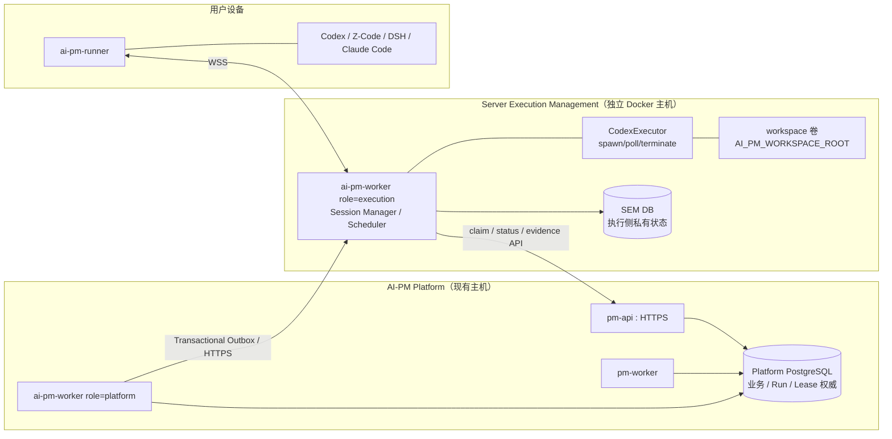

# Server Execution Management Architecture V1（总览）

- 日期：2026-11-24
- 依据：SEM-01 只读审计（`docs/architecture/sem-01-deployment-audit/`，基于 master `4f047f12`）
- 本文档基于 SEM-01 / SEM-02A 代码审计基线整理；后续架构决策与文档修订以当前 master 为准
- 性质：**架构设计与迁移方案定稿**。本阶段只读代码、只写文档，未修改任何业务代码 / 迁移 / Dockerfile / Compose / Worker 主循环。
- 工程政策：Greenfield（`docs/architecture/engineering-lifecycle-policy.md`，AGENTS.md 第 7 条引用；
  政策文件与 AGENTS.md 引用均已进入 master；以当前 master 文件内容为准）。
  核心约束：无历史生产数据/客户/正式版本，可直接重构 Schema、Session 数据模型、Worker 角色装配与内部接口，
  废弃表/字段可提删除方案，不留兼容层；但**不降低执行安全要求**（事务完整性、唯一执行权、
  进程/工作区安全生命周期、凭据安全、关键状态可审计、全新库可完整初始化）。

## 一句话架构

AI-PM 拆分为三类部署单元：**Platform**（业务状态与 DB-only 循环）、
**Server Execution Management（SEM）**（服务端进程 spawn/poll/terminate + 工作区 + 执行证据，
独立 Docker 主机）、**Client Runner**（用户设备上的进程载体）。
Platform 与 SEM 是独立服务，通过版本化 HTTPS API 通信、各自管理数据库；AI-PM 是业务 Run/Lease/Generation 的权威方，SEM 管理执行侧持久状态。Runner 与 SEM 通过 WSS 通信。初期使用 HTTP API + Transactional Outbox，不引入消息中间件。Session Manager 是 SEM 执行运行时内的逻辑模块，不因本决策强制拆成微服务。

## 部署边界总图

## 核心决策摘要（D1–D9）

| # | 决策 | 要点 | 详见 |
|---|---|---|---|
| D1 | 循环归属 | 循环 1/2/3/5/6/7/8 + `pm-worker` 全部 + pm-api audit listener 留 Platform；循环 4 执行子步迁 SEM | `worker-role-separation.md` |
| D2 | outbox 单消费者 | 循环 3（outbox 分发）**只允许存在于一个部署单元**（Platform）；SEM 角色不装配 outbox handler，从根上消除「两侧 handler 集合不一致 → 假死信」 | `worker-role-separation.md` §3 |
| D3 | 角色化装配 | `AI_PM_WORKER_ROLE=platform\|execution\|all`（默认 `all` 保持开发态零行为漂移）；Phase 1 不拆新二进制 | `worker-role-separation.md` |
| D4 | 回收安全 | **DB 租约过期 ≠ 进程死亡**。回收必须以终止证据为前提：同主机走 poll 三证据；远程 Runner 只有在 E3 终止 ACK 通道实现并验收后才可凭 E3 重派；否则按 E4 隔离不重派（HIR 兜底） | `execution-safety.md` |
| D5 | 工作区唯一所有权 | 一个工作区同一时刻至多一个活进程；新 Attempt 不得复用未确认死亡的旧工作区（新建或等确认后按 reclamation 策略处置） | `execution-safety.md` §5 |
| D6 | Session Manager 位置 | `crates/pm-application` 新增 `session_manager` 模块（逻辑职责）；实现落 `pm-infrastructure::codex_executor`；新增 `task_run.harness_session_id` 与 `harness_kind` 两列；HIR 使用独立表；Resume 默认关闭，实测通过后按 Harness 版本启用 | `session-manager-design.md` |
| D7 | 跨 Runner 接管 | 接管 = 新设备**走正常 claim**（generation+1、token 重签），**不放宽 `lease_client_id` 校验**；原执行端先停/隔离，HIR 全程审计 | `runner-supervision-and-handoff.md` |
| D8 | 人工介入 | Q1=B（无人监督失败后建 HIR 并尽量恢复原 Session）、Q2=B（有人监督先通知由用户选 Runner，选择≠接管成功）、Q3=A（高频介入只提示不改策略） | `runner-supervision-and-handoff.md` §2 |
| D9 | Platform–SEM 服务边界 | 版本化 HTTPS API + Platform Transactional Outbox；双方数据库独立；Platform 保持 Run/Lease/Generation 权威；SEM 不直连 Platform DB；Runner–SEM 使用 WSS | `protocol-contracts.md`、`deployment-topology.md` |
| D10 | SEM 统一派发与接管 Runner | SEM 是 Runner 控制面的唯一调度/派发/接管协调者；Runner 不再轮询 Platform MCP Claim；SEM 代表目标 Runner 请求 Platform 原子 Claim；Harness 业务 MCP 保留 | `protocol-contracts.md` §2–6、`runner-supervision-and-handoff.md` §5、`decision-record.md` ADR-SEM-20 |

## 用户确认的 V1 产品决策

- Workspace / Worktree / Git Mirror 不做备份；运行期间仍使用单一持久卷。卷丢失不代表进程死亡，活跃 Run 按 E4/E5 隔离。
- Runner 默认 `unattended`；只有明确配置 `supervised` 才要求领取前用户确认。
- 每个 Repository 只有一个权威 Git `origin`；SEM 不管理第二远端、同步或合并。
- HIR 采用独立实体；E4 使用持久化 scheduling shield。
- Harness Resume 默认关闭，必须按具体版本实测通过后启用。

## SEM-01 结论复核结果

SEM-01 十条结论**全部经代码复核成立**，两处需要精化（不推翻）：

1. **精化 ①（outbox）**：SEM-01 表述为「两侧 handler 注册集合必须一致」。复核后收敛为更强、更简单的约束：
   **outbox 循环整个留在 Platform，SEM 角色根本不注册 handler**。「集合一致」问题被「单消费者」消解。
   代码证据：`apps/ai-pm-worker/src/main.rs:131` 与 `apps/pm-worker/src/main.rs:39` 均经
   `pm_infrastructure::outbox_handlers::register_all_handlers` 全集装配；只要 outbox 循环不 duplicated，不存在集合分叉。
2. **精化 ②（reconcile_orphans）**：SEM-01 说「>1h 回收不带 runner 项目排除」。复核确认且**风险比 SEM-01 表述更大**：
   B06-D3 回收（`run_executor.rs:489-539`）对 `status='running' AND lease_expires_at < now()-1h` 的 Run
   **直接 UPDATE 回 queued**，既不 poll 进程存活、也不查 `devenv.device_project_binding`。
   注意 Model B claim 候选发现（`claim.rs:344-380`）**有** runner 项目排除（NOT EXISTS 绑定+is_runner），
   所以 runner 项目的 Run 不会走 claim 路径的 B3-2——但会走 B06-D3 这条**绕过排除的旁路**。
   这是 Phase 0 必须修复的第二个点（与 B3-2 同根：未确认进程死亡就重派）。

其余结论（B3-2 回收分支不验存活、`executor_session` 不能当 Harness 原生 Session、
执行状态一半在宿主机、镜像缺 codex CLI、未设 `AI_PM_WORKSPACE_ROOT` 等）复核均成立，证据锚点见各分册。

## 关键代码锚点（本定稿全部结论的可复核依据）

| 事实 | 位置 |
|---|---|
| 循环 1–8 装配 | `apps/ai-pm-worker/src/main.rs`（:104 第二条、:122 第三条、:143 第四条、:387 第五条、:396 第六条、:414 第七条、:448 第八条） |
| outbox 全集装配约束 | `apps/ai-pm-worker/src/main.rs:131`、`apps/pm-worker/src/main.rs:39`、`crates/pm-application/src/outbox.rs:394` |
| claim 唯一事务模板 / B3-1 / B3-2 分叉 | `crates/pm-application/src/run_dispatch/claim.rs:109-674`（④ 回收分支 :574-674） |
| `recover_lost_run`（隔离+新建，无存活验证） | `crates/pm-application/src/run_dispatch/lease.rs:166-202` |
| B06-D3 孤儿回收（>1h，无 runner 排除、无 poll） | `crates/pm-application/src/run_executor.rs:480-583` |
| runner 项目排除（claim 候选发现层） | `crates/pm-application/src/run_dispatch/claim.rs:344-380` |
| 心跳即续租（runner 强制 `heartbeat*2 < lease_secs`） | `apps/ai-pm-runner/src/runner_loop.rs:71-75`、`crates/pm-application/src/run_dispatch/lease.rs:259-269` |
| generation fencing / deadline 不重置 | `claim.rs:928-963`（`lease_generation = COALESCE+1`、`deadline_at COALESCE`） |
| 循环 4 执行器选择与 reclamation 三重开关 | `apps/ai-pm-worker/src/main.rs:143-220` |
| Uncertain 不回收（T1 三证据） | `run_executor.rs:620-625` |

## 架构文档索引

| 文档 | 内容 |
|---|---|
| README.md | 总览、部署边界和决策摘要 |
| decision-record.md | ADR-SEM-01–18、OQ-1–8 裁决及验证门槛 |
| deployment-topology.md | Platform / SEM / Runner 部署与运行期卷 |
| worker-role-separation.md | Worker 循环归属和角色化装配 |
| session-manager-design.md | Session 概念、生命周期和 Harness Resume |
| execution-safety.md | E1–E5、Scheduling Shield、进程和凭据安全 |
| runner-supervision-and-handoff.md | Runner 监督模式、HIR 和跨 Runner 接管 |
| domain-model.md | Run/Attempt/Session/Runner/HIR 领域模型 |
| protocol-contracts.md | Claim、Heartbeat、Cancel ACK、Result 协议契约 |
| state-machines.md | Run、Lease、HIR、Handoff 状态机 |
| failure-recovery.md | 故障矩阵与恢复顺序 |
| security-model.md | 身份、凭据、租约、E3 和审计安全 |
| operational-runbook.md | 启停、监控、排障和卷丢失处置 |
| testing-and-acceptance.md | 并发、进程、Runner、Harness 和故障验收 |
| migration-roadmap.md | Phase 0–5 实施路线图 |
| consistency-review.md | 跨文档一致性审查、未冻结项和 SEM-02C 退出条件 |
| code-contract-mapping.md | SEM-02C 当前代码事实、Platform/SEM/Runner 契约映射、差异与阻断项 |

## ADR-SEM-20：SEM 统一负责 Runner 任务派发与接管

用户于 2026-11-24 确认：SEM 是 Runner 任务派发与接管的唯一协调入口。Runner 不再主动轮询 Platform MCP 领取任务。SEM 选择/确认目标 Runner 后，通过 Platform 服务 API 请求 Claim；Platform 仍在自身数据库事务中校验设备身份、项目绑定、资格、Scheduling Shield、并发互斥并签发 Lease/Generation。SEM 只有在成功 Claim 后才可通过 WSS 派发执行授权。Harness 继续通过 Platform MCP 使用业务工具。

控制通道唯一归属：Claim、Runner 监督心跳、Lease Renewal、命令投递/ACK、取消、接管协调走 Runner–SEM WSS + SEM–Platform HTTPS；Harness 的项目/任务上下文、Agent Activity、交互、结果/交付等业务操作走 Platform MCP。Agent Activity 不续租；Lease Renewal 只由 Runner Supervisor 经 WSS 发起、SEM 转 Platform API。Runner 不得绕过 SEM 直接 Claim 或轮询命令。

## 原始交付索引

1. SEM-01 复核 → 本文件 §「SEM-01 结论复核结果」
2. B3-2 根因与修复 → `execution-safety.md`
3. 部署架构 → `deployment-topology.md`
4. 职责边界 → `worker-role-separation.md`（Platform/SEM）+ `runner-supervision-and-handoff.md`（Client Runner）
5. Session Manager → `session-manager-design.md`
6. 接管安全模型 → `runner-supervision-and-handoff.md` §4
7. Phase 0–5 → `migration-roadmap.md`
8. 已关闭 OQ 与验证门槛 → `decision-record.md`

## 本阶段状态

- Git HEAD：以当前 master 实际 HEAD 为准；本文件不固化可能过期的短 SHA
- **SEM-02B：文档补齐与 OQ-1 至 OQ-8 决策更新已写入 master。**
- **SEM-02C：代码契约映射初审已完成，全量一致性审查与 18 项接口门槛关闭仍在进行。** 当前实现尚无 SEM HTTPS API、SEM DB、Runner WSS 或 service-to-service API；详见 `code-contract-mapping.md`。
- 架构状态：`Design In Progress`；尚未达到 `Design Complete`。
- 本轮仅新增 `code-contract-mapping.md` 并更新架构索引；未修改业务代码、数据库 Migration、Dockerfile、Compose、Worker 主循环、API 或 Runner 实现。
- 未开始 Phase 0 实施。
