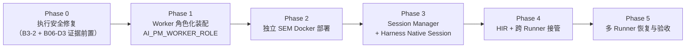

# 迁移路线图：Phase 0–5（migration-roadmap）

- 性质：架构设计（实施计划定稿），本阶段不实施。
- Greenfield 前提（`engineering-lifecycle-policy.md`）：Phase 序号是**架构实施阶段**，不是「必须保留旧架构」的约束；允许直接重构 Schema/接口；每个 Phase 后全新库必须可完整初始化；**Phase 0 不做数据迁移**（无历史生产数据，活跃中的开发库按项目惯例处理）。

## 总览

依赖关系是硬序：没有 Phase 0 的证据模型，Phase 2 的独立主机会放大双重执行风险；没有 Phase 1 的角色化，Phase 2 没有可部署单元。

---

## Phase 0：执行安全修复

| 项 | 内容 |
|---|---|
| **前置条件** | 无（本 Phase 独立于部署变更，可在当前单机上先行落地） |
| **涉及模块** | `pm-application::run_dispatch`（claim 回收分支）、`pm-application::run_executor`（poll 集合扩展、B06-D3、reconcile_orphans）、`pm-infrastructure::codex_executor`（`confirm_termination` 实现） |
| **预计修改文件** | `crates/pm-application/src/run_dispatch/claim.rs`（④ 段证据前置）、`crates/pm-application/src/run_dispatch/lease.rs`（`recover_lost_run` 增加 `TerminationEvidence` 参数）、`crates/pm-application/src/run_executor.rs`（poll 集合纳入「租约过期未确认」；B06-D3 加 runner 排除与证据前置）、`crates/pm-application/src/run_dispatch/port.rs`（RunExecutor 增 `confirm_termination`）、`crates/pm-infrastructure/src/codex_executor.rs`（三证据确认实现）、runner cancel ACK 通道（`apps/ai-pm-runner/src/*` 轻量） |
| **风险** | 回收延迟一个 poll 周期（安全换延迟，接受）；runner cancel ACK 通道改动触到 runner 主循环（需单独测试；可先落 SEM 侧证据前置，E3 通道 Phase 4 补齐——期间 runner 形态全部走 E4 挂起 + 人工） |
| **测试** | ①claim 回收：有 E1/E2 证据才 `recover_lost_run`；无证据挂起；②B06-D3：runner 项目排除、E4 不回收、E1/E2 正常回收；③Uncertain 保留（T1 回归）；④generation fencing 回归（旧 token 拒绝）；⑤q10 系列单独跑（AGENTS.md 第 6 条） |
| **验收标准** | 构造「进程活着 + 租约过期」场景：任何路径都不产生第二个进程；构造「进程死了 + 证据在」场景：下一轮回收成功；全新库迁移链可完整初始化 |
| **回滚方式** | 还原上述文件（无 Schema 变更，纯代码语义回退） |

## Phase 1：Worker 角色化装配

| 项 | 内容 |
|---|---|
| **前置条件** | Phase 0 合并 |
| **涉及模块** | `apps/ai-pm-worker` 装配层 |
| **预计修改文件** | `apps/ai-pm-worker/src/main.rs`（角色解析 + 循环 4 拆分为 `run_db_only_round`/`run_execution_round` + 按 spawn 过滤；outbox 循环仅 platform/all 角色装配，SEM 角色误配 fail-fast） |
| **风险** | 低（默认 `all` 零行为漂移）；配置错误导致双 outbox 消费者（fail-fast 缓解） |
| **测试** | 三角色 × 启动冒烟（循环集合符合归属表）；outbox 双消费者 fail-fast；`all` 角色全量回归（现有测试基线） |
| **验收标准** | `role=platform` 无任何 spawn/FS 执行行为；`role=execution` 不装配 outbox；单机 `all` 与改造前行为逐循环等价 |
| **回滚方式** | 还原 main.rs（单文件） |

## Phase 2：独立 Docker 部署

| 项 | 内容 |
|---|---|
| **前置条件** | Phase 0/1 合并；workspace 卷规划完成 |
| **涉及模块** | Dockerfile、infrastructure compose |
| **预计修改文件** | `Dockerfile`（新 execution target：含 codex CLI 的 runtime 层）、`infrastructure/full-dev/docker-compose.ai-pm.yml` 或新 compose 文件（`ai-pm-execution-worker` 服务：`AI_PM_WORKER_ROLE=execution`、`AI_PM_RUN_EXECUTOR=codex`、`AI_PM_WORKSPACE_ROOT` 持久卷、`AI_PM_RUN_DISPATCH=on`；Platform 侧服务设 `AI_PM_WORKER_ROLE=platform` + `AI_PM_RUN_DISPATCH=off`）、部署清单文档 |
| **风险** | SEM 主机与 DB 网络不通（预检项）；卷权限/UID 错配；跨主机 `DATABASE_URL` 误用 `localhost`（AGENTS.md 第 3 条：本机 Docker 映射用 `127.0.0.1`，远程用 IP） |
| **测试** | 全新环境空库初始化 → Platform + SEM 起服务 → 端到端跑一条 delivery Run（spawn/poll/收尾）；SEM 容器强杀重启 → 在途 Run 按证据分类处置；workspace 卷内容在重启后完好 |
| **验收标准** | 独立主机上真实执行一条任务全链路成功；Platform 主机上无任何执行进程残留；凭据不落卷（审计抽查卷内文件无 token/密钥） |
| **回滚方式** | compose 退回单机 `role=all` 形态（默认形态始终保留） |

## Phase 3：Session Manager

| 项 | 内容 |
|---|---|
| **前置条件** | Phase 2 部署基线稳定 |
| **涉及模块** | `pm-application::session_manager`（新模块）、`pm-infrastructure::codex_executor`、一次迁移 |
| **预计修改文件** | `crates/pm-application/src/session_manager/{mod,ports,lifecycle}.rs`（新）、`crates/pm-infrastructure/src/codex_executor.rs`（SessionProbe/Resume 实现 + harness_session_id 采集）、迁移 `00XX_task_run_harness_session.sql`（`harness_session_id`/`harness_kind` 两列，Greenfield 允许直接改）、`apps/ai-pm-worker/src/main.rs`（投影重建接入启动序列） |
| **风险** | harness 事件格式不稳定（采集失败只降级为不可 resume，不阻塞执行）；Resume 能力未经 codex 实测（默认 false，交付时以实测为准） |
| **测试** | 生命周期状态机纯函数单测；采集→落库→投影重建端到端；重启后 Detached 分类正确；resume=false harness 走新 Attempt |
| **验收标准** | 同一 Run 重启 worker 后 Session 投影与宿主机事实一致；`harness_session_id` 在 codex 事件流中成功采集；`supports_resume=false` 时无任何 resume 尝试 |
| **回滚方式** | 删模块 + 回退迁移（Greenfield：迁移历史允许重整为 clean baseline） |

## Phase 4：Human Intervention

| 项 | 内容 |
|---|---|
| **前置条件** | Phase 0 证据模型 + Phase 3 Session 投影 |
| **涉及模块** | 一次迁移、`pm-application`（HIR 域服务）、`pm-api`（HIR 查询/处置 REST）、runner（通知/选择交互） |
| **预计修改文件** | 迁移 `00XX_human_intervention_request.sql`（方案甲表结构，见 `decision-record.md` 待裁 HIR-1）、`crates/pm-application/src/hir/…`（新）、`apps/pm-api/src/…`（路由）、`apps/ai-pm-runner/src/…`（领取前通知门 + 终止 ACK）、前端告警面（提示 Q3 频次） |
| **风险** | runner 交互改动（有人监督模式）影响现有自动领取路径（需模式开关：有人监督 = 领取前确认，无人监督 = 失败建 HIR，二选一按部署配置） |
| **测试** | HIR 状态机全迁移路径；接管七不变式逐条集成测试（重点：② token 失效、⑤ 单执行权、⑧ 审计完整）；E4 挂起 → HIR → 授权重派端到端 |
| **验收标准** | 构造双 Runner 接管场景：全程无双重执行、无身份校验放宽、审计链完整可回放；Q3 高频只提示不改策略 |
| **回滚方式** | 关闭 HIR 触发开关（E4 行为退化为「永久挂起 + 告警」，安全但需人工 DB 介入）→ 删迁移 |

## Phase 5：多 Runner 恢复与验收

| 项 | 内容 |
|---|---|
| **前置条件** | Phase 0–4 全部合并 |
| **涉及模块** | 无新代码（验收阶段）；测试与演练脚本 |
| **预计修改文件** | 测试文件（集成/混沌场景）、运维演练手册文档 |
| **风险** | 真实设备环境差异（Windows/macOS 进程行为）；演练发现的问题回灌 Phase 0–4 修复 |
| **测试** | ①跨 Runner handoff 全链路（真实两设备）；②SEM 主机断电重启恢复；③Runner 断网 2×lease 时长再重连（resume 路径）；④DB 短暂不可达期间 SEM 行为；⑤并行 10 Run 压测下无双重执行（审计断言） |
| **验收标准** | 演练矩阵全绿；每个故障场景的审计链能完整还原事件时序 |
| **回滚方式** | 不适用（验收阶段；问题按所属 Phase 回修） |

---

## 全局回滚原则

- 每个 Phase 独立可回滚（文件清单见各表）；Greenfield 允许迁移历史重整，回滚不需要向前兼容垫片。
- 执行安全（Phase 0）一经合并不建议回退——它是后续所有 Phase 的安全地平线；若必须回退，回退到的行为必须保留「E4 挂起不重派」底线。
