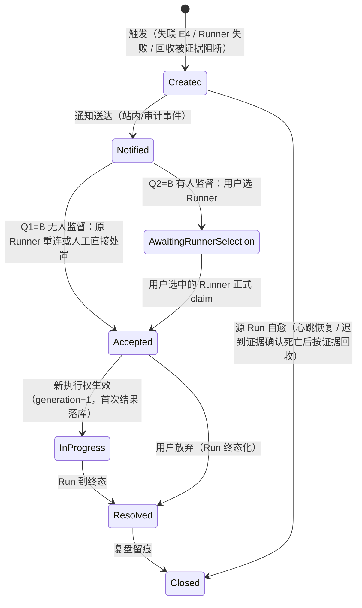
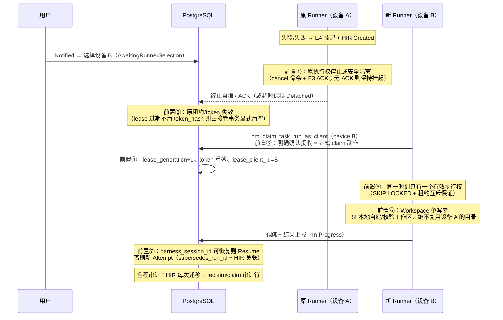

# Runner 监督模式、HIR 与跨 Runner 接管（runner-supervision-and-handoff）

- 性质：架构设计（Phase 4/5 的设计依据），本阶段不实施。
- 已确认决策：**Q1=B、Q2=B、Q3=A**（见 §2）。

## 1. 三类执行主体的监督边界

| 主体 | 监督者 | 进程归属 | 平台可见性 |
|---|---|---|---|
| SEM（worker spawn） | Session Manager + CodexExecutor（同主机） | SEM 宿主机进程 | pid 文件 / children map / 三证据 poll |
| Client Runner（有人监督） | 用户（人) | 用户设备进程 | 租约/心跳/命令通道/自报 |
| Client Runner（无人监督） | 平台（弱监督：只有心跳） | 用户设备进程 | 同上，且失联时只能走 HIR |

**硬规则**：Server Worker **不得**把 Client Runner 当本地子进程管理——`executor.poll`/`terminate` 对远程 session 只能返回 Err/Uncertain（现状即如此，`run_executor.rs:607-609`），SEM 侧终止确认对 runner 形态走 **E3（Runner 终止 ACK）**，见 `execution-safety.md` §2。

## 2. 三项已确认决策

| # | 决策 | 落地含义 |
|---|---|---|
| Q1=B | **无人监督** Runner 失败后 → 创建 HIR，**尽可能恢复原 Session** | 失败/失联 ≠ 立即重派；先建 HIR，恢复判定按 `session-manager-design.md` §4.3 |
| Q2=B | **有人监督** Runner 接任务前 → 通知用户选 Runner；**用户选择 ≠ 接管成功** | 选择只是授权意图；接管完成以「新 Runner 正式 claim 成功（generation+1）」为准 |
| Q3=A | 高频人工介入 → **只提示，不自动改策略** | HIR 频次超阈值 → 提醒面告警；不自动降级/换 Runner/改任务策略 |

## 3. Human Intervention Request（HIR）生命周期

- **HIR 载体（Greenfield 最小化）**：HIR 是一条带状态字段的记录。候选载体二选一（决策记入 `decision-record.md` 待裁）：
  - 方案甲：新表 `governance.human_intervention_request`（显式、可查询、可统计 Q3 频次）；
  - 方案乙：复用审计事件 + `scheduling_shield` 状态（零新表，但 Q3 频次统计要扫审计，弱）。
  **倾向方案甲**（Q3 需要频次聚合，审计扫描不可取）。
- HIR 与 Run 的关联：`task_run_id` + 触发证据类型（E3/E4/E5）+ `harness_session_id`（可恢复时）。
- **HIR 是 Phase 0 证据模型的兜底**：E4/E5 挂起的 Run 必须有出路，HIR 就是那条出路。

## 4. 跨 Runner 接管安全模型

### 4.1 接管全序列（安全不变式内嵌）

### 4.2 七条安全不变式（任务 §六 checklist 逐条落位）

| 不变式 | 机制 |
|---|---|
| ① 原执行端停止或安全隔离 | cancel 命令 + E3 ACK；无 ACK → Run 保持 Detached（scheduling shield），**不进入接管** |
| ② 原租约/token/generation 失效 | 接管 claim 事务内显式清 `lease_token_hash` + generation+1（现有 claim ⑨ 段已做 generation+1，补显式 token 失效步） |
| ③ 新 Runner 明确确认接收 | Q2=B 的「用户选择」只是授权；接管以 `claim_task_run_as_client`（设备 B 显式 claim）为准 |
| ④ 新 generation 生效 | 现有 `lease_generation = COALESCE+1`（`claim.rs:928-963`），不动 |
| ⑤ 同一时刻一个有效执行权 | 现有 `FOR UPDATE SKIP LOCKED` + 单活跃 Run 约束，不动 |
| ⑥ Workspace 不被双写 | Runner 工作区本就是设备本地目录（`workspace.rs`），新 Runner 永远用自己设备的工作区；平台侧 SEM 工作区按 run_id 唯一（`execution-safety.md` §5） |
| ⑦ Session 恢复优先、否则新 Attempt 并关联 | `session-manager-design.md` §4.3 判定树 + HIR 关联字段 |
| ⑧ 全程可审计 | HIR 状态迁移审计 + 现有 claim/reclaim 审计，无新增旁路 |

### 4.3 不放宽 `lease_client_id`（任务硬约束）

- 接管**不修改**任何身份校验：`lease_client_id = device_id` 的复合外键约束（`fk_task_run_client_tenant`）、claim 时的身份验证全部原样。
- 「接管」在协议上是**新设备的一次全新合法 claim**——旧执行权自然过期/被证据终止，新执行权走正门。没有任何代码路径「把 A 的租约改绑给 B」。
- 若未来出现「预授权转移」需求（把 claim 权指定给设备 B），必须以新迁移+新校验实现，不走放宽路线（记入 `decision-record.md` 未决）。

## 5. 有人监督 Runner 的任务接收通知（Q2=B）

- 触发点：Runner 调 `pm_claim_task_run_as_client` **之前**（现状 runner 是自动领取循环）。设计取向：领取前插入「通知 + 用户确认」门（runner 侧 UI/交互，平台侧提供 HIR 状态查询命令）；用户选择后 runner 才发起 claim。
- 平台不感知「用户何时点确认」——那是设备端交互；平台只认 claim 请求本身（前置③）。
- Q3=A：HIR 高频项目只产出提示事件（审计/告警面），**不**自动 shield、不自动换 Runner、不自动改 retry 策略。

## 6. 无人监督 Runner 失败的处置流（Q1=B）

1. 心跳死亡进入 E4 → Run 挂起（`execution-safety.md` R-SAFE-2）→ HIR Created。
2. 优先恢复判定（`session-manager-design.md` §4.3）：原 Runner 重连且 harness 可 resume → 恢复原 Session。
3. 不可恢复 → 用户（或值班流程）通过 HIR 决定：终止（Run 终态化）或授权重派（新 Attempt）。
4. 全程不自动重派——这是与 B06-D3 现状行为的关键差异（现状 >1h 自动回 queued，正是 Phase 0 要修复的点）。
