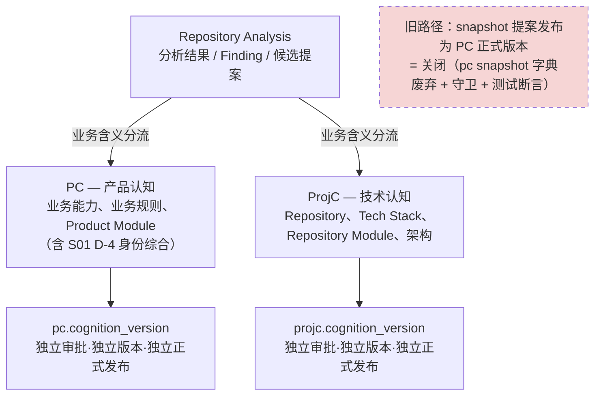
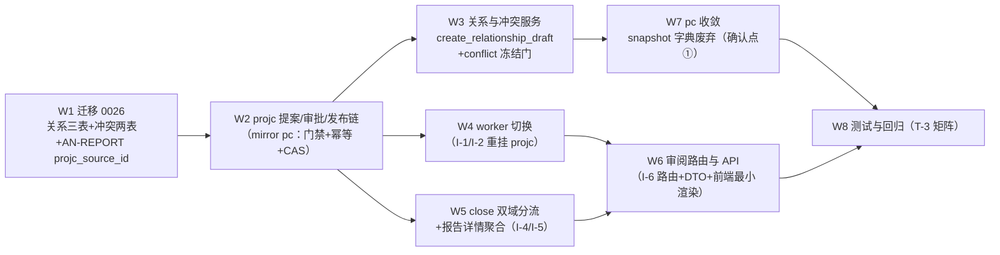
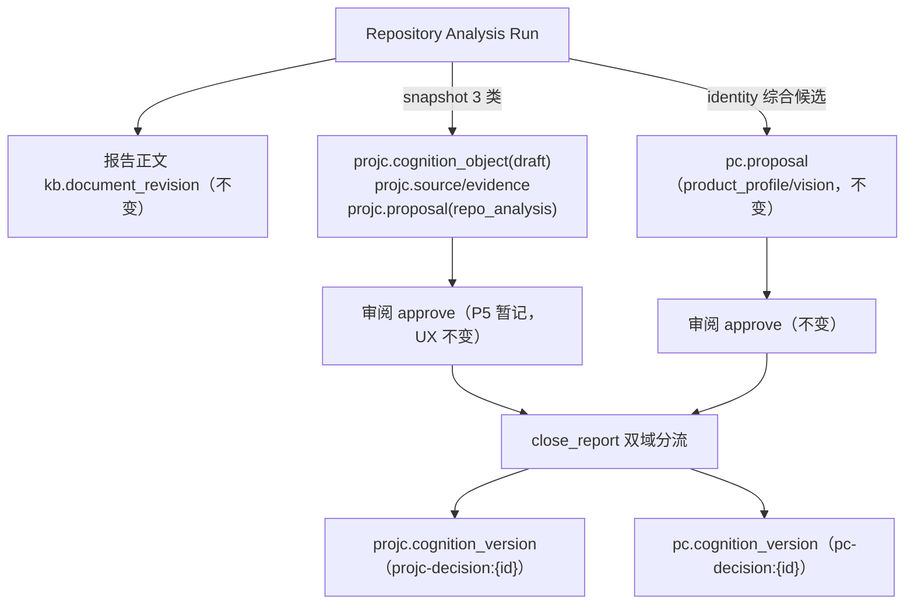

# P3-11 下一阶段实施方案 — ProjC 正式链路接入与旧路径收敛（T-1/T-2/T-3）V1.0

- 日期：2026-11-16 · 基准：master `ac8eb298`（Stage 1 已入库）· 状态：**方案待范围确认，确认后才实施**
- 定调（产品指令，2026-11-16 重申）：**T-1 与 T-2 同批原子切换**——一次落地后旧发布路径关闭、新链已接通；不存在「先关旧、久等新」的窗口期；不建数据迁移/回填/双写/历史兼容。

## 0. 目标终态

## 1. 已核验的现行集成点（改造靶点，file:line 实证）

| # | 集成点 | 位置 | 现行为 | 目标行为 |
|---|---|---|---|---|
| I-1 | 快照认知派生 | `crates/pm-infrastructure/src/kb_pc_analysis.rs` `derive_pc_cognition`(:817)+`plan_cognition_objects`(:735) | 4 类草稿（含 delivery_activity）upsert `pc.*`；来源/证据登记 `pc.source/pc.evidence` | 3 类草稿（delivery_activity 停派生）→ `projc.*`；来源/证据 → `projc.source/projc.evidence` |
| I-2 | 分析提案起草 | `crates/pm-application/src/pc/proposal.rs` `propose_from_analysis`(:1401)（advisory `pc_analysis_proposal:`，候选=证据钉扎新修订） | 提案落 `pc.proposal`（origin=ai_agent） | 新增 `projc::propose_from_analysis`（advisory `projc_analysis_proposal:`，origin_kind=`repo_analysis`）；pc 版保留服务身份综合 |
| I-3 | 身份综合（PC） | `crates/pm-application/src/identity.rs:232/243`（product_profile/product_vision，source=报告 pc_source_id） | PC 提案 | **不变**（R-03 限定已天然满足：仅产品身份候选） |
| I-4 | close 分流发布 | `crates/pm-application/src/analysis_report.rs` `close_report`(:394)：approved pc 提案批量 `publish_version`（`pc-decision:{id}`）、未决 withdraw、KB 草稿 rejected、D-1 锚 | 仅 pc 域 | **双域分流**：pc 提案照旧；新增 approved `projc.proposal`（by projc_source_id）→ `projc::publish_version`（`projc-decision:{id}`）；两域未决各自 withdraw；端点契约/状态机/锚点不动 |
| I-5 | 报告详情聚合 | 同文件 `report_detail`(:330)：proposals（pc.proposal by pc_source_id）+ pc_revisions（pc.evidence 反查） | 仅 pc | +`projc_proposals`/`projc_revisions`（by projc_source_id） |
| I-6 | P5 决策端点 | `apps/pm-api/src/knowledge_services.rs:574` `p5_decide_proposal` → `pc::decide_proposal` | 仅 pc | 路由到 projc（形态=范围确认点②） |
| I-7 | API 回归基线 | `apps/pm-api/tests/analysis_reports.rs`（decide :511、frozen :603、close 全链） | — | **T-3 回归必过清单** |
| I-8 | 关系域约束 | `migrations/0007`：`pc.relationship_type.owner_domain CHECK IN ('pc','kb')`；端点集合支持 `domain.type` 跨域键 | — | projc **自建** relationship_type（CHECK `IN ('project_cognition')`），不动 pc 约束；跨域端点走 ext 键（既有先例） |

## 2. 任务拆分与依赖（WBS）

**交付形态：W1~W8 一个批次内完成、合并前 T-3 矩阵全绿**（原子切换；分批合并=违反产品定调）。

| 工作包 | 内容 | 涉及文件（计划） |
|---|---|---|
| W1 | 迁移 0026：`projc.relationship(_type/_revision)`（owner_domain CHECK=project_cognition，ext 端点列，种子：implements=repository_module→pc.feature_module、depends_on=repository_module→repository_module）；`projc.conflict(+object)`（6 态 mirror）；`integration.repo_analysis_report ADD projc_source_id uuid`；version_member 端点闭合触发器启用 | `migrations/0026_projc_formal_chain.sql` |
| W2 | projc 提案/审批/发布链：create/submit/approve/reject/withdraw/decide（P5 暂记语义）；`ensure_formal_authorized`（真人+A3 闸）；`publish_version`（advisory+CAS expected_version_no+规范成员哈希+版本/成员插入+lifecycle 推进+审计+账本幂等重放）；`frozen_by_conflict` | `crates/pm-application/src/projc/{proposal,publish,mod}.rs` |
| W3 | 关系草稿（端点类型合法/跨域 `domain.type` 键/存在性探测）+ conflict create/resolve（人工） | `crates/pm-application/src/projc/{relationship,conflict}.rs` |
| W4 | worker 切换：`plan_cognition_objects` 停派 delivery_activity；`derive_pc_cognition` 重挂 projc（来源/草稿/证据/提案起草）；LLM enrichment 语义保留（D-1=A/D-2=A/D-3=A 不变） | `crates/pm-infrastructure/src/kb_pc_analysis.rs` |
| W5 | close 双域分流 + `report_detail` 聚合扩展 + AN-REPORT 读写 projc_source_id | `crates/pm-application/src/analysis_report.rs` |
| W6 | P5 决策路由（确认点②）+ DTO 扩展 + `AnalysisReportsPanel` 最小渲染（技术认知徽标，不扩 P2 UI 范围） | `apps/pm-api/src/knowledge_services.rs`、`apps/pm-api/src/analysis_reports.rs`、`ai-frontend/src/views/project/knowledge/AnalysisReportsPanel.vue`、`ai-frontend/src/api/analysis-reports.ts` |
| W7 | pc 收敛：`pc.object_type` snapshot 四类 `status='deprecated'`（确认点①；字典层禁写=错误域草稿源头不可达）+ pc.conflict Legacy 维持 | `migrations/0026`（UPDATE 种子） |
| W8 | 测试矩阵（§4）+ 文档（§6） | tests + docs |

## 3. 修订后数据流（before → after）

**Before（现行，错误域）**：snapshot 派生 → pc.cognition_object(draft)+pc.source/evidence → propose_from_analysis → pc.proposal → 审阅 approve（P5 暂记）→ close publish → **pc.cognition_version（技术认知被登记为产品认知）**

**After（目标，双域分流）**：

## 4. T-3 验收矩阵（完成标准逐条映射）

| 用户完成标准 | 验证方式（自动化） |
|---|---|
| 技术栈/仓库结构/Repository Module 进 ProjC | worker 集成测试：分析后 `projc.cognition_object` 3 类有行、`pc.cognition_object` snapshot 类恒 0 行 |
| 产品能力/规则/Product Module 进 PC | identity_synthesis 回归 + PC 提案链测试（PC 通道不变证据） |
| Finding 仅候选 | 测试断言：派生只产生 draft+proposal，无 version 行，直至人工 approve+close |
| 技术认知不能发布到 PC | T-1 守卫测试：pc publish 链对 snapshot 提案拒绝（字典废弃+路由断言） |
| 产品认知不能发布到 ProjC | 测试断言：projc 字典拒 product_* 类型（既有 Stage 1 断言延续） |
| 未经人工确认不正式发布 | AI 主体 approve/publish 403（真人门测试） |
| 越权/跨域无权限/版本冲突/重复提交 | 403（非授权人）/SEC-P2-2 探测 404/CAS 409/幂等重放同 receipt |
| 旧 snapshot 路径不能绕过新规则 | 字典废弃守卫 + close 分流断言（pc 侧无 snapshot 提案可发布） |
| Phase 2 close 契约回归 | `apps/pm-api/tests/analysis_reports.rs` 全绿（I-7）+ `identity_synthesis.rs` + 新 `projc_formal_chain.rs` |

回归范围：pm-application 全量集成测试 + apps/pm-api analysis_reports/identity_synthesis；**P0 E2E 真实跑批不在本批**（需全栈，见确认点③）。

## 5. 不做清单（产品指令 §三，逐条承接）

不做 pc→projc 数据迁移；不做历史回填；不建双写/兼容；不删 pc.* Legacy 表；不扩 Phase 2 UI 重构；统一检索/FTS/PageIndex 留 P3-10，不作为本批前置。

## 6. 文档交付（随实施）

1. 四域注册表附录升 V1.2：projc 六对象 COMPLETE（含 VERSION/PROPOSAL/RELATION/CONFLICT）、pc snapshot 四类=DEPRECATED（字典）、pc_source_id/projc_source_id 双源登记。
2. 台账 §10.3：本批落实状态 + T-3 证据链接。
3. 差异报告 V2（或本方案文档追加落实记录）。

## 7. 风险

1. **close 事务改动**（本批唯一触碰 Phase 2 契约点）：限定为「新增 projc 分流分支」，pc 分支逐行不动；以 `apps/pm-api/tests/analysis_reports.rs` 全绿为回归门。
2. **worker 改动波及分析链回归**：`repo_manual_analyze.rs`（幂等/409/422）不触认知派生段，风险低；`identity_synthesis.rs` 依赖报告打开门——close 语义不变，预期绿。
3. **pc snapshot 字典废弃**（若确认点①=A）：`load_object_type` 拒绝后，任何残留 pc 路径调用会显式报错而非静默——这是想要的 fail-closed；identity 链用 product_* 类型不受影响。
4. **批量规模**：W2 mirror 量大（pc proposal.rs+publish.rs ≈ 2100 行语义）；采用 pc 同构+域内改名策略，测试先行锁定行为等价。
