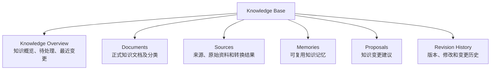
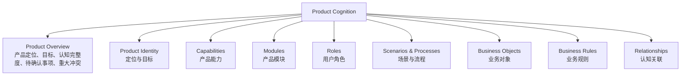
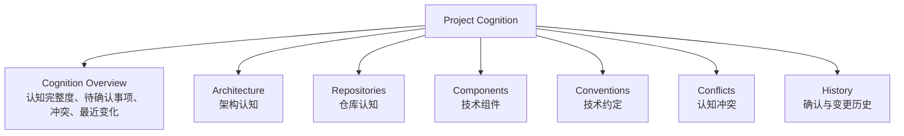
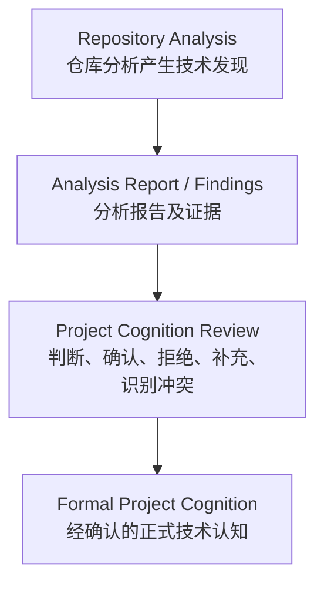
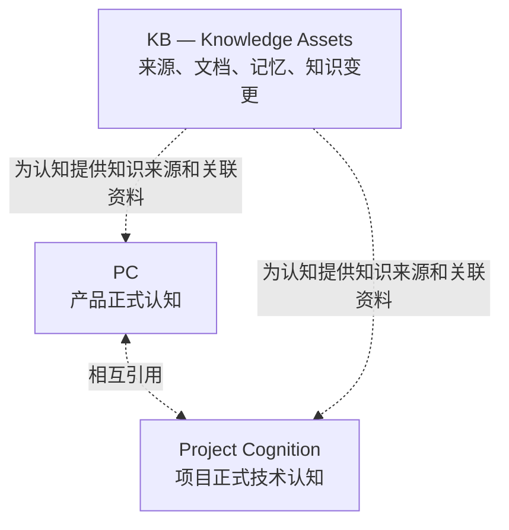
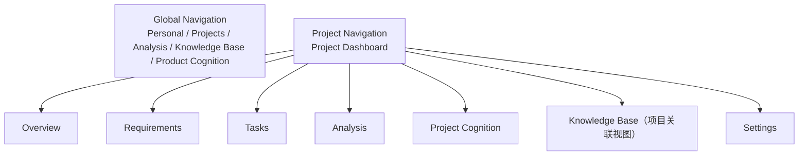

# Phase 3 — Product Design Baseline（三域产品设计基线）V0.1

- 日期：2026-11-16
- 状态：**设计基线草案，未评审、未冻结**
- 性质：WP-02 正式启动记录；按「先记录后评审」纪律落盘
- 约束：不重新讨论已冻结事项（四域对象模型 V1.0、全局导航 IA V1.2、Phase 2 裁决 D-1/D-2、三域裁决 Q1~Q12）

Phase 3 的核心目标：让 **KB、Product Cognition、Project Cognition** 成为具有独立权威、独立生命周期和独立用户操作界面的业务领域。

---

## 1. Phase 3 总体架构

**KB — Knowledge Base**（知识资产及知识生命周期权威）
对象：Source · Document · Revision · Memory · Proposal · Review

**PC — Product Cognition**（产品正式认知权威）
对象：定位 · 目标 · 能力 · 模块 · 角色 · 流程 · 规则

**Project Cognition**（项目技术认知权威）
对象：架构 · 技术约定 · 仓库认知 · 冲突 · 生命周期

**Shared Governance**：人工确认 · 权限控制 · 版本管理 · 来源追溯 · 审计

> 示意图表达领域职责，不代表三个领域之间存在上下级关系。

核心原则：

- KB 管理知识资产。
- PC 管理产品正式认知。
- Project Cognition 管理项目正式技术认知。
- 三者可以相互引用，但不能互相夺取权威。

与已确认的四领域独立、各自拥有对象权威和生命周期的原则一致。**Analysis 继续作为独立领域，不纳入这次三个领域的合并设计。**

## 2. 三个领域的正式职责

| 维度 | KB | PC | Project Cognition |
|---|---|---|---|
| 核心对象 | 知识资产 | 产品认知 | 项目技术认知 |
| 权威范围 | 知识内容 | 产品业务事实 | 项目技术事实 |
| 主要输入 | 文档、来源、资料 | 需求、业务资料 | 仓库、技术资料、分析结果 |
| AI 职责 | 提取、整理、建议 | 识别、分析、建议 | 分析、识别、建议 |
| 人工职责 | 确认正式知识 | 确认正式认知 | 确认技术认知 |
| 主要产出 | 正式知识资产 | 产品认知模型 | 项目技术认知模型 |

**需要特别注意：AI 分析完成不等于正式认知成立。** AI 可以形成草稿、发现冲突、提出修订，但正式内容的确认必须遵循对应领域的人工确认机制。

## 3. WP-02.1：KB 产品设计

### 3.1 产品定位

KB 是 smark-pm 的正式知识资产管理领域。它不仅是一个文件管理器，也不是普通的 Markdown 文档列表。它负责将来源资料经过处理、理解、提取、确认，形成**可追溯、可复用、可维护的正式知识资产**。

### 3.2 核心对象

沿用已经确认的对象范围：

| 对象 | 职责 |
|---|---|
| Source | 原始信息来源及来源追溯 |
| Document | 知识文档 |
| Revision | 文档版本及历史 |
| Memory | 可复用的知识记忆 |
| Proposal | AI 或其他来源提出的知识变更建议 |
| Review | 知识审核和人工确认 |

两个概念必须区分开：

- **Source 是信息来源，不等于正式知识。**
- **Document 是知识正文的承载对象，不等于原始文件。**

例如，用户上传一份 PDF：

1. 建立 Source。
2. 通过文档处理服务提取内容。
3. AI 识别知识内容。
4. 生成 Document 或 Proposal。
5. 人工审核。
6. 确认后成为正式知识。
7. 形成对应 Revision。

文档处理服务负责转换能力，KB 负责正式知识管理。**不能把两者合并成一个领域。**

### 3.3 KB 页面规划（初步 IA）



初步 IA，不意味着必须把六个对象全部做成一级菜单。建议：

- Overview 是主要入口。
- Documents 是知识主体。
- Sources 是知识来源。
- Memories 是知识复用。
- Proposals 是变更处理。
- Revision History 作为文档详情中的重要能力，同时支持全局历史查询。

**Review 不必单独变成一个新的一级业务页面**，可以先通过 Proposals 和审核中心进入对应 Review。

### 3.4 KB 关键交互

必须设计以下流程：

1. 原始资料导入。
2. 文档处理及转换。
3. AI 知识提取。
4. 知识内容审阅。
5. 正式知识确认。
6. 正式知识修改。
7. 版本对比与历史追溯。
8. AI 提出知识修订 Proposal。
9. 人工处理 Proposal。
10. 知识关联及复用。

其中，最重要的是**知识确认和知识修订不能混为一谈**。已确认的正式知识不能因为 AI 重新分析而被自动覆盖。

## 4. WP-02.2：PC — Product Cognition 产品设计

### 4.1 产品定位

PC 是**正式产品认知的唯一权威管理领域**。它不是 Product Plan，也不是需求管理页面。它负责回答：

- 我们正在构建什么产品？
- 产品服务什么目标？
- 产品有哪些能力？
- 产品由哪些模块构成？
- 有哪些用户角色？
- 用户在什么场景下使用？
- 产品有哪些业务流程？
- 产品必须遵循哪些业务规则？

此前已经确认的产品认知边界必须保留。

### 4.2 核心认知对象

| 认知对象 | 主要内容 |
|---|---|
| Product Identity | 产品定位、愿景、目标 |
| Product Capability | 产品能力 |
| Product Module | 产品模块 |
| Product Role | 用户及业务角色 |
| Product Scenario | 使用场景 |
| Business Process | 业务流程 |
| Business Object | 业务对象 |
| Business Rule | 业务规则 |

这些是产品认知模型的**设计范围**，不代表数据库表结构已经确定。特别是 Business Object 和 Business Rule，应该拥有明确的业务语义和关联关系，而不是简单地作为文档中的普通段落。

### 4.3 PC 页面规划（初步 IA）



### 4.4 PC 必须解决的核心问题

**第一，产品认知不是普通文档集合。** 例如，一个业务规则应该可以关联：对应的业务对象、对应的产品模块、适用的业务流程、相关需求、相关设计。

**第二，PC 与需求管理必须分离。** 需求描述要实现什么，PC 描述产品正式认知是什么。需求可以引用 PC 的认知对象，但不能因为一个需求被创建，就自动改变产品正式认知。

**第三，PC 与 Product Plan 必须分离。** Product Plan 属于产品规划/项目管理领域，引用 PC 的正式认知对象，形成规划和交付安排。

**第四，认知必须支持演进。** 产品定位、模块、业务规则发生变化时，需要有变更记录、版本关系、来源和确认历史。

### 4.5 PC V1 的范围约束（严格保留此前决定）

- PC V1 采用**项目级范围**。
- 中期再演进 Product 级资产。
- 不在 V1 同时引入完整的跨项目 Product 资产体系。
- AI 可以建议产品认知，但不能替代人工正式确认。

这点非常重要，因为它会直接影响对象归属、页面导航、关联关系和权限设计。

## 5. WP-02.3：Project Cognition 产品设计

### 5.1 产品定位

Project Cognition 管理项目层面的正式技术认知。它与 PC 的区别是：**PC 回答产品在业务上是什么，Project Cognition 回答这个项目在技术上是怎样构建的。**

| PC | Project Cognition |
|---|---|
| 产品模块 | 技术模块及其实现结构 |
| 产品业务流程 | 技术执行流程 |
| 业务对象 | 技术实体与数据结构 |
| 业务规则 | 技术约束 |
| 产品能力 | 技术实现能力 |
| 产品角色 | 技术组件职责 |

二者可以有关联，但不能因为名称相似而混合。

### 5.2 核心对象设计（建议模型分类）

| 对象类别 | 主要内容 |
|---|---|
| Architecture | 系统架构及架构决策 |
| Technical Convention | 技术规范和约定 |
| Component | 技术组件及职责 |
| Dependency | 组件及服务依赖 |
| Repository Cognition | 仓库结构及技术认知 |
| Technical Constraint | 技术限制和约束 |
| Technical Conflict | 技术认知冲突 |
| Cognition Confirmation | 人工确认记录 |
| Cognition Revision | 认知变更历史 |

其中，Architecture、Technical Convention 等属于**建议的产品模型分类**，最终对象粒度需要在详细需求评审中确定。

### 5.3 页面规划（初步 IA）



### 5.4 与仓库分析的衔接（重点）

建议形成这样的闭环：



需要保留 Analysis 的权威边界：

- Analysis 拥有 Run、Report、Revision、Finding。
- Project Cognition 拥有正式技术认知及其确认、冲突和生命周期。
- **Analysis 的 Finding 不应该直接变成正式技术认知。**
- Project Cognition 应保留认知内容与原始分析证据之间的关联。

## 6. WP-02.4：三个领域之间的关系

不能让三个领域成为互不相干的孤岛，也不能让它们成为同一个知识库的三个分类。采用：

**独立权威 + 跨领域引用 + 统一来源追溯 + 各自生命周期。**



举例：一份技术架构文档——

1. 在 KB 中作为知识文档管理。
2. Project Cognition 引用其中的技术架构信息。
3. AI 分析后提出技术认知变更。
4. 人工确认后形成 Project Cognition 的正式认知。
5. 正式认知保留原始文档及分析证据的引用。

但需要注意：

- **KB 文档的修改，不应该自动修改 Project Cognition 的正式认知。**
- 同样，PC 的业务规则变化也不能自动改变项目技术架构。

### 6.2 统一的跨领域规则（六条）

| 编号 | 规则 |
|---|---|
| G-01 | 每个正式认知对象只有一个所属权威领域 |
| G-02 | 跨领域关联采用引用，不转移对象所有权 |
| G-03 | 引用对象发生变化时，识别受影响对象 |
| G-04 | AI 提议与正式认知变更分离 |
| G-05 | 正式认知的确认由对应领域负责 |
| G-06 | 所有正式认知保留来源、版本和确认历史 |

其中 **G-03 是未来非常重要的能力**：例如 KB 中的技术规范发生变化，系统应该能够发现哪些 Project Cognition 对象可能受到影响，并提醒相关人员重新检查，而不是自动修改它们。

## 7. WP-02.5：统一人工确认和 AI 协作机制

直接遵循现有 AI Collaboration Workspace V1.0 和组件库基线，不重新创造交互协议。三个领域统一采用以下工作模式：

```text
AI-assisted Cognition Lifecycle
1. AI Analysis     AI 根据资料、历史认知和现有知识进行分析。
2. AI Proposal     产生新增、修改、删除建议，附上证据和理由。
3. Human Review    人工查看差异、来源、影响范围和置信依据。
4. Human Decision  接受、拒绝、修改、暂缓或要求补充信息。
5. Domain Confirmation  对需要正式生效的内容，执行领域自身的人工确认流程。
6. Revision & Audit 保存正式版本、来源关联、操作记录和历史。
```

四种业务动作必须区分，**不能在 UI 上混成一个通用的「确认」按钮**：

| 动作 | 语义 |
|---|---|
| Accept | 接受 AI 建议 |
| Approve | 批准需要审批的操作 |
| Confirm | 正式确认领域认知 |
| Apply | 执行实际变更 |

另有四条边界：

- AI 建议不能直接绕过人工确认。
- 正式内容变更需要对应领域授权。
- 只有被授权的人员才能执行正式确认。
- **审核中心只负责聚合待处理事项和跳转，不接管三个领域的审批权威。**

## 8. WP-02.6：导航和页面入口设计

必须遵循已冻结的导航架构：

- 全局导航与项目内二级导航分层。
- 四个领域独立。
- 保留旧深链兼容。
- 不引入 Workspace 实体。
- PC V1 按项目级范围运行。

建议的 IA（**待评审映射，不是对 P01–P10 已冻结导航决策的重新裁决**）：



需要特别研究 **KB 的 Team 级知识和 Project 关联视图如何共存**。此前 Document Processing 已确定 Team 级 Document、可选 Project 关联，因此 KB 不应该被简单设计成每个项目各自独立的一套文件库。同样，PC V1 的项目级范围也必须与中期 Product 资产演进保持兼容。

## 9. 当前需要正式评审的设计问题

以下建议进入下一轮产品裁决（P0/P1/P2 为本次设计评审优先级，不是已有业务实体的状态）：

| 编号 | 待评审问题 | 优先级 |
|---|---|---|
| P3-01 | KB 中 Document、Memory 的关系和边界 | P0 |
| P3-02 | KB Proposal 的状态及正式生效机制 | P0 |
| P3-03 | PC 认知对象的关系模型和完整性规则 | P0 |
| P3-04 | PC V1 项目级对象归属和中期 Product 演进 | P0 |
| P3-05 | Project Cognition 对象分类与粒度 | P0 |
| P3-06 | 三个领域之间的引用和变更影响机制 | P0 |
| P3-07 | 来源可信度、证据和冲突处理 | P1 |
| P3-08 | Revision、Confirmation、Audit 的统一边界 | P1 |
| P3-09 | 三个领域的页面导航和详情页布局 | P1 |
| P3-10 | 跨领域搜索和统一认知检索 | P2 |

到这里，三个领域的基本职责、核心对象和页面框架已经建立。**不会把尚未讨论的细节伪装成已冻结决策。**

## 10. Phase 3 正式交付计划

| 交付编号 | 交付内容 | 状态 |
|---|---|---|
| P3-D01 | Phase 3 总体产品架构与领域边界 | V0.1 已建立 |
| P3-D02 | KB 产品需求与领域模型 | 待详细设计 |
| P3-D03 | Product Cognition 产品需求与领域模型 | 待详细设计 |
| P3-D04 | Project Cognition 产品需求与领域模型 | 待详细设计 |
| P3-D05 | 跨领域交互、引用、权限和治理规范 | 待详细设计 |

注意：目前建立的是设计基线草案，不代表已经完成人工评审或正式冻结。

## 11. 执行顺序

不同时展开三个领域的详细设计，按依赖关系执行：

1. **KB 详细设计**：先确定知识资产、Document、Memory、Proposal、Revision 的关系和生命周期。
2. **Product Cognition 详细设计**：明确产品认知对象、关系模型、业务规则和确认机制。
3. **Project Cognition 详细设计**：明确技术认知对象、仓库分析衔接、冲突管理和生命周期。
4. **跨领域整合**：完成对象引用、来源追溯、影响分析、权限和审计。
5. **UX/UI 设计**：为三个领域分别生成完整页面 IA、用户流程、异常流程和 Figma AI 设计提示词。

每个领域遵循：需求分析 → 领域模型 → 业务规则 → 状态机 → 权限规则 → UX 设计 → 人工评审 → 正式冻结。

最终成果应当是能够直接交给后续研发阶段使用的产品设计规范，而不是只有页面截图的 UI 方案。

每周整理一次 Phase 3 的设计进度和未决事项：先记录后评审。

## 12. 第一个正式评审问题：P3-01

从 KB 开始（三个领域共享的知识来源基础）。第一个问题：**Document 与 Memory 究竟是什么关系？**

初步建议（**尚未冻结**）：

- Document 是具有完整正文、版本和来源的正式知识载体。
- Memory 是从知识中提炼出来、供 AI 检索和复用的结构化知识单元。
- Memory 可以关联一个或多个 Document。
- Memory 不应取代 Document，也不应成为绕开 Document 确认机制的第二套知识正文。
