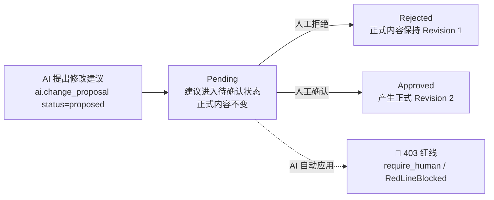

# AI-PM · P0-03 Project AI-PM 核心能力 · Playwright E2E 规格 V1.0

> **性质**：P0-03 套件的**可执行**自动化规格（3 条案例：P0-008 ~ P0-010）。
> **上位文件**：`docs/e2e-spec/10-p0-test-specification-v1.md`（P0 总规格，评审 R8/R10 在此收窄）、`docs/e2e-spec/11-p0-01-playwright-spec-v1.md`（栈与纪律）。
> **复用基建**：`ai-frontend/e2e/team/stack.ts` + `ai-frontend/playwright.team.config.ts`（vite :8850 + `PM_API_URL` + `VITE_USE_MOCK=0`）。
> **基线**：master @ `2b3f509e`；迁移基线 `migrations/0001_baseline.sql`。
> **判定纪律**：UI 状态 + 直连 pm-api 终态**双证据**；结构化断言而非逐字比对自然语言；记录 Prompt / Model / Run / 输出 / 审计。

---

## 0. 评审结论速览（先读这节）

规格原稿的**三条产品原则全部成立**（AI-PM 内置、建议不擅改权威、知识写入经人工确认），但 4 处实现事实必须先校正：

| # | 级别 | 规格原文 | 本仓事实 | 处置 |
|---|---|---|---|---|
| **R21** | 🔴 | P0-008「输入问题 → AI 正常返回结果」 | 会话**回复链无 fallback**：无 provider → WARN + 跳过 + 不回复（`crates/pm-ai/src/conversation_reply.rs:16-17,191-201`）；开关 `AI_PM_CONVERSATION_REPLY` **默认 off**（`:31-32`）；**E2E 栈未起 ai-pm-worker**（`ai-frontend/e2e/team/global-setup.ts` 只 spawn pm-api） | 拆 **008a（会话存储与持久化，现在可自动化）** + **008b（真实 AI 回复，需 worker + flag + provider）**；默认配置下 008b = BLOCKED |
| **R22** | 🟠 | 「请求需求分析 → AI 启动分析」 | 分析**消费者是 ai-pm-worker**（`apps/ai-pm-worker/src/main.rs:315`），pm-api 只入队；但分析链**可无 LLM 跑通**——无 provider 回退确定性 `FakeModel`（`crates/pm-ai/src/analysis_model.rs:110-150`，`fake_model.rs:206` 含 requirement_analysis 技能） | worker 进栈（D11）；断言**结构**而非语义；必须记录 `ai.analysis_run.model_name`（fake 也要如实记录） |
| **R23** | 🟠 | 「向 AI-PM 提交一段项目需求，要求分析」 | 分析触发入口是 **`POST /v1/pm/intakes`**（`apps/pm-api/src/intakes.rs:28`；body 必填 `intake_type/channel/source_ref`）→ `integration.job('ai_analysis')`（`crates/pm-application/src/ingestion.rs:103`）；结果落 `ai.analysis_run`（`status/result/model_name/failure_code`，`migrations/0001_baseline.sql:675-692`）+ `ai.change_proposal`（`status='proposed'`，`:742-760`） | 用例走 intake API，不走对话；不虚构 `RequirementAnalysis` 接口（D13） |
| **R24** | ✅+🟠 | 「AI 自动应用 → 403」「建议状态 pending」 | **403 期望正确**：`require_human` → `PmWriteError::Forbidden` → **403**（`crates/pm-application/src/requirement.rs:210-226` → `apps/pm-api/src/support.rs:40`）；但确认还需 **`expected_content_hash`**（哈希门，不符 → 409，FLOW-05）+ `ensure_governance_authorized`（Lead 或显式 Approver）；AI 提案真实落点 = `ai.change_proposal` + `governance.approval_request`（`status='pending'`，`migrations/0001_baseline.sql:2485-2496`），不是虚构 suggestion API | 断言锚点改真实表；补哈希门与治理授权两道闸 |
| **R25** | 🟡 | 「AI 不能修改正式 Markdown 内容」 | 需求权威正文**在 Git 知识空间**（投影 `doc_key=req-{uuid}`，绑定点 = `submit_revision`，`markdown_version_ref` = `ai.document_revision.git_commit_sha`）；PG revision 的 content jsonb 是**读投影**（可由 `rebuild_projection` 从 Git 重建）。本套件 DB 断言锚定 revision 行 + `git_commit_sha`；**Git HEAD 断言归 P0-04**（`14-p0-04-playwright-spec-v1.md` §5） | 已细化 → P0-04 承接 Git 断言 |
| **R26** | ⚠️ | `ai-input` / `ai-response` / `ai-conversation` testid | **无这些 testid**。AssistantView 用 `AiConversationPanel` / `AiConversationComposer`（输入 placeholder = i18n `ai.conversation.composer.placeholder`，`AiConversationComposer.vue:46-47`）；消息 POST body = `{content, content_type?}`，**role 恒 `user`**（`ai_conversations.rs:5,63-65`）；**回复由 ai-pm-worker 异步落库**，前端轮询（`AssistantView.vue:55,584`） | 选择器与等待策略改真实锚点；回复断言 = 轮询消息列表出现 `role='assistant'`（008b） |

**AI 主体识别**（P0-010 负向用例的钥匙）：`core.principal.kind` ∈ `human / dev_agent / ai_pm / service`（`migrations/0001_baseline.sql:1222-1229`）；建项目时 bootstrap 自动创建 **`kind='ai_pm'`** 的 AI 主体并加入 `core.project_member(role='ai_pm')`（`crates/pm-application/src/bootstrap.rs:250,289`）。负向测试 = 以该主体令牌直调 confirm → 403。

---

## 1. 测试范围与核心原则

| ID | 测试案例 | 核心验证 | 可自动化性 |
|---|---|---|---|
| **P0-008** | 无外部工具启动 AI-PM | 内置 AI-PM 独立可用 | **008a ✅ 现在可做；008b 🔴 需 D11/D12 裁决** |
| **P0-009** | 项目需求分析 | AI 理解、分析并关联项目 | 🟠 需 worker 进栈；FakeModel 回退可跑 |
| **P0-010** | AI 建议人工确认 | AI 不能擅自修改正式权威内容 | ✅ 全链可自动化（红线 + 哈希门 + 治理授权） |

**三条架构边界 → 代码事实**

| 架构边界 | 代码事实 |
|---|---|
| 1. AI-PM 是项目级内置能力，不是外部 Coding Agent 的代理 | 建项目事务内自动写 `ai.project_ai_config`（provider 默认 `'fake','fake'`、`automation_mode='ai_lead'`）+ `ai.project_ai_role`（5 模板）+ `role='ai_pm'` 成员行（`bootstrap.rs:250,289,294-303,319`） |
| 2. AI 可以生成分析、建议和草稿，但不能擅自确认正式需求或认知 | 红线硬拦（`executor.rs:58`）+ `confirm_revision` 无条件 `require_human`（`requirement.rs:787`）+ `submit_revision` 只落 `pending_confirmation`（`requirement.rs:716`）+ `AI_FORBIDDEN_COMMANDS` 含 confirm（`discovery_writeback.rs:57-77`） |
| 3. 高能力模型统一分析；多 Agent 并行执行；知识写入统一协调 | 分析统一走 `integration.job('ai_analysis')` 单消费者；提案升级 `governance.approval_request`（`orchestrator.rs:605`）；**已知缺口 R8**：task/milestone 非红线可被 AI 直写 —— 本套件**不验**（原权限套件已解散（D32），缺口挂 **DEF-P0-01**，见 `15-p0-05` P0-019C2） |

---

## 2. 测试环境与 Fixture

### 2.1 项目初始状态（规格原文成立，逐项给出验证锚点）

| 配置 | 初始状态 | 验证锚点 |
|---|---|---|
| Project | 已创建 | `core.project` 1 行，`status='planning'` |
| Team | 已关联 | `core.project.tenant_id` |
| Project AI Config | 已初始化 | `ai.project_ai_config` 1 行（`enabled=true`、`automation_mode='ai_lead'`） |
| Git Repository | 未关联 | `integration.project_repository` 0 行 |
| Runner | 未配置 | `devenv.device_project_binding` 0 行 |
| MCP | 未连接 | 无 MCP host 绑定 |
| Codex / Claude Code | 未连接 | 无外部执行器（`AI_PM_RUN_EXECUTOR` 缺省 `NoopExecutor`，`apps/ai-pm-worker/src/main.rs:136-143`） |
| Project Knowledge | 可以为空 | 知识域 0 行不阻断 |

### 2.2 AI 测试配置（三条全部落实为代码事实）

| 建议 | 本仓落实 |
|---|---|
| 使用真实可调用的 LLM Provider | **默认无 provider** → FakeModel 回退。008b 需在 `ai.team_llm_provider` / `ai.team_llm_credential` 配置真 provider（D12） |
| 固定测试输入 / 固定模型版本 | 固定 intake 输入文本；记录 `ai.analysis_run.model_name` + `config_snapshot`（jsonb 已有列） |
| 结构化断言 | 断言 `ai.analysis_run.result` 结构与 `ai.change_proposal` 行数/状态，**不逐字比对** |
| 保留 Prompt / Model / Run / 输出 / 审计 | `ai.analysis_run.config_snapshot / context_snapshot / result`；`governance.audit_log` |
| 受控 Mock Provider 做故障注入，不只靠 Mock | FakeModel 是**确定性夹具**：结构断言可用；语义质量断言（P0-009 质量项）须在真 provider 下复测一轮（D13） |

### 2.3 Fixture 辅助函数（映射到真实 API）

| 规格建议 | 真实实现 |
|---|---|
| `createProjectWithoutTools()` | `POST /v1/pm/projects { code, name }`（复用 P0-02 fixture，无仓库/Runner 字段） |
| `submitAIMessage()` | `POST /v1/pm/projects/{pid}/conversations` 建会话 → `POST .../conversations/{cid}/messages {content}`（role 恒 user） |
| `waitForAIRun()` | 轮询 `ai.analysis_run`（经 API/DB）直到 `status ∈ succeeded/failed` 或超时；或轮询会话消息出现 assistant 回复（008b） |
| `getLatestAnalysis()` | 读 `ai.analysis_run` 最新行（`result` jsonb + `model_name` + `failure_code`） |
| `getLatestSuggestion()` | 读 `ai.change_proposal`（`status='proposed'`，含 `command_type/proposed_data/rationale/evidence`）+ `governance.approval_request`（`status='pending'`） |
| `getFormalRevision()` | `GET /v1/pm/requirements/{rid}`（含 `current_revision_id`）+ `GET .../revisions/{revision_id}` |
| `approveAsHuman()` | `POST /v1/pm/requirements/{rid}/revisions/{revid}/confirm`，body 带 `expected_content_hash`，**human 主体令牌** |
| `assertKnowledgeUnchanged()` | revision 行数不变 + `current_revision_id` 不变 + `content->>'markdown'` 不变 |

---

## 3. P0-008 · 无外部工具启动 AI-PM（拆 a/b）

### 3.1 P0-008a · 会话存储与持久化（现在可自动化）

**测试目标**：无 Git / Runner / MCP / 外部 Agent 时，AI-PM 的**能力面与数据面**完整可用：配置就绪、会话创建、消息持久化、项目关联、刷新不丢。

| Step | 操作 | 预期结果 | 真实锚点 |
|---|---|---|---|
| 1 | 登录系统 | 登录成功 | 会话注入（P0-001a 口径） |
| 2 | 进入 Project A1 | Command Center 正常加载 | `/project/command-center?project_id=` |
| 3 | 打开 AI-PM | AI 交互入口正常 | 路由 `/project/assistant`（`router/navigation.ts:194-198`） |
| 4 | 输入项目管理问题 | 请求正常提交（**201**，role=user 落库） | `POST .../conversations/{cid}/messages` |
| 5 | 查看会话记录 | 会话正确关联 Project A1 | `ai.conversation.project_id`（`migrations/0001_baseline.sql:816`） |
| 6 | 查看 Run 记录 | 执行记录保存位就绪 | `ai.analysis_run`（008a 只验表可查；落 Run 归 009） |
| 7 | 刷新页面 | 会话和历史仍然存在 | `GET .../conversations` + `GET .../messages` |
| 8 | 检查外部依赖 | 全部为空且无阻断错误 | §2.1 锚点逐项为 0 |

```ts
test("P0-008a 无外部工具时 AI-PM 会话存储与持久化", async ({ page, context }) => {
  const a = await buildOwner("test-owner-a", 9201, "e2e-team-a");
  const project = await createProject(a, "e2e-ai-pm-no-tools", "E2EAI9201");

  // 前置确认：无仓库 / 无 Runner（R22/R24 锚点）
  const repos = await api("GET", `/v1/pm/projects/${project.id}/repositories`, a.token);
  expect(repos.status).toBe(200);
  expect(repos.body?.items?.length ?? 0).toBe(0);

  // 能力面：AI 配置就绪
  const cc = await api("GET", `/v1/pm/projects/${project.id}/command-center`, a.token);
  expect(cc.status).toBe(200);

  // UI：打开 AI-PM 助手
  await signIn(context, a.sub, a.tid);
  await page.goto(`/project/assistant?project_id=${project.id}`);

  // 发送消息（真实锚点：composer 的 Textarea + 发送按钮）
  const prompt = "请说明这个项目目前可以开展哪些项目管理工作";
  const composer = page.getByPlaceholder(/请输入|placeholder/i); // D16：补 testid 后收紧
  await composer.fill(prompt);
  await page.keyboard.press("Enter"); // composer 支持键盘提交

  // 消息持久化（后端证据）
  const sessions = await api("GET", `/v1/pm/projects/${project.id}/conversations`, a.token);
  expect(sessions.status).toBe(200);
  const convId = sessions.body[0]?.id as string;
  const msgs = await api(
    "GET",
    `/v1/pm/projects/${project.id}/conversations/${convId}/messages`,
    a.token
  );
  expect(msgs.status).toBe(200);
  expect(msgs.body.some((m: any) => m.role === "user" && m.content.includes(prompt)))
    .toBe(true);

  // 刷新后仍在
  await page.reload();
  await expect(page.getByText(prompt).first()).toBeVisible();
});
```

### 3.2 P0-008b · 真实 AI 回复（🔴 默认配置 BLOCKED）

规格原案的「等待 AI 响应非空」三个前提当前都不满足：

| 前提 | 现状 | 需要的动作 |
|---|---|---|
| ai-pm-worker 消费回复链 | 栈内只有 pm-api | D11：global-setup 增加 spawn `ai-pm-worker`（同库同策略文件） |
| `AI_PM_CONVERSATION_REPLY` 开关 | 默认 off | D12：worker env 置 on |
| 真实 LLM provider | 无 provider → 回复链跳过不回复 | D12：`ai.team_llm_provider` 配置可调用 provider；仍不可得则 008b 标 **BLOCKED**（不得标 PASS） |

**达到前提后的断言**：轮询 `GET .../messages` 出现 `role='assistant'` 的非空回复；`ai.conversation` 关联正确；无因缺 Repository/Runner 产生的阻断错误。

**通过标准（合并 008a+008b）**：没有外部工程工具，AI-PM 的会话数据面完整可用（008a 必过）；真实回复链在前提满足时完成一次真实交互（008b 按 D11/D12 裁决后执行）。

---

## 4. P0-009 · 项目需求分析

**测试目标**：AI-PM 能理解提交的需求、形成结构化分析、正确关联当前 Project；不要求固定文案，验证结构与可追溯。

### 4.1 真实触发链（R23）

```
POST /v1/pm/intakes { intake_type, channel, source_ref{kind,uri|inline_ref,content_hash,size,mime}, title? }
  → integration.inbound_event（幂等键去重）
  → integration.job(job_type='ai_analysis')
  → [ai-pm-worker] 领取（条件：ai.project_ai_config.enabled AND automation_mode='ai_lead'）
  → RoutedAnalysisModel（无 provider → FakeModel 确定性回退 + WARN）
  → ai.analysis_run（status: queued→…→succeeded/failed；result jsonb；model_name；failure_code）
  → ai.change_proposal（status='proposed'，command_type / proposed_data / rationale / evidence / risk_level）
```

固定测试需求文本（规格原文，保留为夹具常量）：

```ts
const TEST_REQUIREMENT = `在线任务管理系统
我们希望建立一个面向研发团队的任务管理系统。
主要能力包括：
1. 团队成员可以创建和分配任务。
2. 每个任务可以关联项目需求。
3. 支持任务状态跟踪。
4. 管理员可以查看项目进度。
5. AI 可以辅助拆解任务并识别风险。
请分析这项需求，整理核心业务能力、主要业务流程、关键业务规则，以及目前仍然需要确认的问题。`;
```

| Step | 操作 | 预期结果 | 真实锚点 |
|---|---|---|---|
| 1 | 进入 Project A1 | 项目正确加载 | Command Center 200 |
| 2 | 提交测试需求 | intake 受理（202/201 + idempotency） | `POST /v1/pm/intakes` |
| 3 | 请求需求分析 | 分析 job 入队并被领取 | `integration.job('ai_analysis')` → `ai.analysis_run.status` 离开 `queued` |
| 4 | 等待分析完成 | 返回结构化结果 | `ai.analysis_run.status='succeeded'`，`result` 非空 |
| 5 | 检查业务能力 | 结构含能力集合 | `result` 结构断言（D13：以实际 result schema 为准） |
| 6 | 检查业务流程 / 规则 / 待确认 | 同上 | 同上 |
| 7 | 检查项目关联 | 分析结果关联当前 Project | `ai.analysis_run.project_id`、`ai.change_proposal.project_id` |
| 8 | 检查提案 | 产生 `proposed` 提案，**未**自动落正式需求 | `ai.change_proposal.status='proposed'`；`delivery.requirement` 无对应自动创建行（红线 `create_requirements`） |
| 9 | 检查可追溯 | 证据可回指输入 | `ai.change_proposal.evidence` jsonb + `analysis_run_id` |

```ts
test("P0-009 需求分析：结构化结果 + 项目关联 + 不自动落正式需求", async () => {
  const a = await buildOwner("test-owner-a", 9202, "e2e-team-a");
  const project = await createProject(a, "e2e-requirement-analysis", "E2ER A9202");

  // 提交 intake（真实入口，不走对话）
  const intake = await api("POST", "/v1/pm/intakes", a.token, {
    intake_type: "requirement_draft", // 以实现枚举为准（D13 实现时确认合法值）
    channel: "e2e",
    source_ref: {
      kind: "inline",
      inline_ref: TEST_REQUIREMENT,
      content_hash: sha256(TEST_REQUIREMENT),
      size: TEST_REQUIREMENT.length,
      mime: "text/markdown"
    },
    title: "在线任务管理系统"
  });
  expect([200, 201, 202]).toContain(intake.status);

  // 等待分析完成（轮询 ai.analysis_run，经 pm-api 或直查 DB）
  const run = await waitForAnalysisRun(a, project.id, 60_000);
  expect(run.status).toBe("succeeded");
  expect(run.failure_code ?? null).toBeNull();

  // 结构断言（不逐字比对；字段集合以实现为准）
  expect(Object.keys(run.result ?? {}).length).toBeGreaterThan(0);

  // 项目关联
  expect(run.project_id).toBe(project.id);

  // 提案待确认，未自动落正式需求
  const proposals = await api(
    "GET", `/v1/pm/projects/${project.id}/change-proposals`, a.token); // 或直查 ai.change_proposal
  expect(proposals.body.items.every((p: any) => p.status === "proposed")).toBe(true);

  const reqs = await api(
    "GET", `/v1/pm/requirements?project_id=${project.id}`, a.token);
  // 红线 create_requirements：AI 分析不得自动创建正式需求
  expect(reqs.body.items?.length ?? 0).toBe(0);
});
```

### 4.2 质量断言（在真 provider 下复测，D13）

| 质量项 | 判定 | 备注 |
|---|---|---|
| 业务能力与输入相关 | `result` 提及任务/分配/进度域词 | FakeModel 下只验结构；语义质量须真 provider 一轮 |
| 不凭空编造正式业务规则 | 提案 `evidence` 非空、可回指 `analysis_run_id` | 追溯锚 |
| 不确定信息进入待确认 | `result` 含 open questions 结构（实际字段名实现时确认） | — |
| 可追溯原始输入 | `source_ref.content_hash` 与 intake 一致 | 幂等键缺省按内容派生 |
| **不自动成为正式 Requirement** | `delivery.requirement` 0 行 | 红线 `create_requirements`（`policy_engine.rs:45-69`） |

**通过标准**：AI 能产生有效、可追溯、结构完整的分析结果；提案全部停在人待确认态。

---

## 5. P0-010 · AI 建议人工确认（本阶段最重要）

**测试目标**：AI 可提出正式需求修改建议，但**没有人工正式确认时不得修改权威内容**。

### 5.1 核心状态规则（规格附图语义 → 本仓真实状态机）



| 图中状态 | 本仓真实落点 |
|---|---|
| AI 提出建议 | `ai.change_proposal(status='proposed')` + `governance.approval_request(status='pending')` |
| AI 直接落修订 | `submit_revision` → `delivery.requirement_revision.state='pending_confirmation'`（`requirement.rs:716`），**不是 approved** |
| 人工确认 | `POST .../revisions/{revid}/confirm` + `expected_content_hash` → `approved`；旧 `approved` → `superseded`；`current_revision_id` 原子迁移 |
| 人工拒绝 | 修订态 `rejected`，`current_revision_id` 不变 |
| AI 自动应用 | **三道闸全拒**：①红线 `RedLineBlocked`（`executor.rs:58`）②`refuse_requirement_confirmation`（`executor.rs:855-865`）③REST `require_human` → **403**（`requirement.rs:787` → `support.rs:40`） |

### 5.2 前置数据（真实链路产生）

```
Requirement REQ-001（人工创建）
POST /v1/pm/projects/{project_id}/requirements
  { code: "REQ-001", title: "任务管理", markdown: "系统支持用户创建任务。" }   → 201
  （CreateRequirementRequest：code+title 必填，markdown 缺省 `# {title}`）
  revision v1（draft）→ submit → pending_confirmation → 人工 confirm（hash）→ approved
  current_revision_id = v1
```

### 5.3 执行步骤与断言

| Step | 操作 | 预期结果 | 真实锚点 |
|---|---|---|---|
| 1 | 查询 REQ-001 | 正式内容为 Revision 1（approved） | `GET /v1/pm/requirements/{rid}` |
| 2 | 让 AI 提出修改建议 | AI 生成建议（经分析链/命令链） | `ai.change_proposal(status='proposed')` 或 `submit_revision` → `pending_confirmation` |
| 3 | 检查建议记录 | 待人工确认 | `governance.approval_request.status='pending'` |
| 4 | 检查正式内容 | 仍是 Revision 1 | `current_revision_id` 不变 |
| 5 | **AI 身份直调 confirm** | **403** + 拒绝消息 | 以 `kind='ai_pm'` 主体令牌调 confirm → 403 `"confirmation and lifecycle commands require a human principal"` |
| 6 | 人工查看建议 | 能查看差异与修改原因 | `ai.change_proposal.proposed_data / rationale / evidence` |
| 7 | 人工确认建议 | 产生 Revision 2 | human 令牌 + `expected_content_hash` → 200；旧 v1 → `superseded` |
| 8 | 再次检查正式内容 | Revision 2 内容正确 | `current_revision_id = v2`，`content->>'markdown'` 含新增能力 |
| 9 | 检查审计 | 确认人与操作历史完整 | `governance.audit_log` 含 confirm 记录，`actor` = 人工主体；`governance.approval_request.decided_by` = 人工主体 |

```ts
test("P0-010 AI 无法绕过人工确认修改正式需求", async () => {
  const a = await buildOwner("test-owner-a", 9203, "e2e-team-a");
  const project = await createProject(a, "e2e-human-approval", "E2EHA9203");

  // 前置：人工创建 REQ-001 并确认到 approved（走真实链）
  const req = await createAndConfirmRequirement(a, project.id, {
    title: "任务管理",
    markdown: "系统支持用户创建任务。"
  });
  const v1 = req.current_revision_id;
  const originalMarkdown = req.content_markdown;

  // AI 提出修改建议（经 AI 命令链 submit_revision → pending_confirmation）
  const suggestion = await aiProposeRevision(a, project.id, req.id,
    "补充任务分配能力：管理员可将任务分配给指定团队成员。");
  expect(suggestion.state).toBe("pending_confirmation");

  // 正式内容不能被 AI 修改
  const current = await api("GET", `/v1/pm/requirements/${req.id}`, a.token);
  expect(current.body.current_revision_id).toBe(v1);

  // ★ 核心：AI 身份直调后端 confirm → 403（不是前端按钮隐藏）
  const aiPrincipal = await getProjectAiPmPrincipal(a, project.id); // core.principal.kind='ai_pm'
  const aiAttempt = await api(
    "POST",
    `/v1/pm/requirements/${req.id}/revisions/${suggestion.revision_id}/confirm`,
    signToken(aiPrincipal.sub, a.tid),
    { expected_content_hash: suggestion.content_hash }
  );
  expect(aiAttempt.status).toBe(403);

  // 拒绝后终态不变
  const unchanged = await api("GET", `/v1/pm/requirements/${req.id}`, a.token);
  expect(unchanged.body.current_revision_id).toBe(v1);

  // 人工确认 → Revision 2
  const approved = await api(
    "POST",
    `/v1/pm/requirements/${req.id}/revisions/${suggestion.revision_id}/confirm`,
    a.token, // human 主体
    { expected_content_hash: suggestion.content_hash }
  );
  expect(approved.status).toBe(200);

  const updated = await api("GET", `/v1/pm/requirements/${req.id}`, a.token);
  expect(updated.body.current_revision_id).not.toBe(v1);
  expect(updated.body.content_markdown).toContain("分配");
});
```

### 5.4 必须增加的数据库断言（规格原文 6 项 → 真实锚点）

| # | 断言 | 真实锚点 |
|---|---|---|
| 1 | AI 提议阶段不产生正式 Revision | `submit_revision` 落 `state='pending_confirmation'`；`delivery.requirement.current_revision_id` 不变 |
| 2 | AI 不能修改正式内容 | `content->>'markdown'` 与提议前逐字节一致 |
| 3 | AI 不能伪造人工审批身份 | `core.principal.kind='ai_pm'` 令牌 confirm → **403**；`governance.audit_log` 无 AI 成功 confirm 记录 |
| 4 | 人工审批后产生新 Revision | `delivery.requirement_revision` 新行 `state='approved'`；`current_revision_id` 迁移 |
| 5 | 旧 Revision 不被覆盖 | v1 行仍在，`state='superseded'`，内容不变（FLOW-05 同口径） |
| 6 | 审计能识别实际确认人 | `governance.audit_log.actor` = human 主体；`governance.approval_request.decided_by` = human 主体 |

> **特别注意（规格原文正确，保留）**：不能只测前端按钮隐藏/禁用 —— 必须**直接调用后端审批 API**，验证服务端也拒绝 AI 身份（Step 5 即为此设计）。

**通过标准**：AI 建议停在人待确认态；AI 身份三道闸全拒；人工确认产生新 Revision 且旧版可追溯；审计完整。

---

## 6. 辅助模块（映射到本仓真实路径）

```
ai-frontend/e2e/
├── p0-03-ai-pm.spec.ts              # ← 本套件（P0-008a/008b/009/010）
├── p0/
│   ├── fixtures.ts                  # 复用 P0-02：buildOwner / createProject
│   ├── ai-pm.fixture.ts             # createProjectWithoutTools / submitAIMessage / waitForAIRun
│   ├── ai-analysis-api.ts           # intake 提交 + ai.analysis_run 轮询封装
│   ├── suggestion-api.ts            # ai.change_proposal / approval_request 读取封装
│   └── approval-api.ts              # createAndConfirmRequirement / aiProposeRevision / confirm 封装
└── team/stack.ts                    # 复用：signToken / api / claimTeam
```

> **不新建** `tests/` 平行目录（R20 同口径）；`waitForAIRun` 的轮询落点优先直查一次性库（fixture 有 psql 通道，`global-setup.ts:26-28`），避免为测试加只读端点。

---

## 7. 最终验收清单（13 项，含修正）

**P0-008**
- [ ] 008a 无 Git Repository 时 AI-PM 会话数据面可用
- [ ] 008a 无 Runner / 外部 Agent 时 AI-PM 可用（能力面完整）
- [ ] 008a Session 正确持久化且关联 Project
- [ ] 008b 真实 AI 回复链完成一次交互（**按 D11/D12 裁决；未满足前提 = BLOCKED，不得标 PASS**）

**P0-009**
- [ ] AI 生成结构化分析（`ai.analysis_run.result` 非空，结构断言）
- [ ] 分析结果关联正确 Project（`analysis_run.project_id`）
- [ ] 提案停在人待确认态（`ai.change_proposal.status='proposed'`）
- [ ] 分析结果**不自动成为正式需求**（`delivery.requirement` 0 行）
- [ ] `ai.analysis_run.model_name` 如实记录（FakeModel 也要可见）

**P0-010**
- [ ] AI 建议进入待人工确认状态（`pending_confirmation` / `approval_request.pending`）
- [ ] AI 无法直接修改正式内容（revision 行不变）
- [ ] AI 无法执行人工审批（ai_pm 主体直调 confirm → **403**）
- [ ] 人工确认产生新 Revision + 旧 Revision 保留（superseded）+ 审计记录确认人

---

## 8. 待裁决项

| # | 议题 | 选项 | 建议 |
|---|---|---|---|
| **D11** | ai-pm-worker 进 E2E 栈 | ① global-setup spawn worker（同库）② 测试内联消费 job | **①**（复用 pm-api spawn 模式；worker 与 API 共用策略文件 `policies/ai-pm-ai-lead-v2.yaml`） |
| **D12** | 008b 回复链前提 | ① 配真 provider + `AI_PM_CONVERSATION_REPLY=on` ② 008b 标 BLOCKED | 有可用 provider 则 **①**；否则 **②**，008a 单独过门 |
| **D13** | 分析结果断言 schema | 按 `ai.analysis_run.result` 实际字段写断言 / 先定义理想接口 | **以实现为准**；`intake_type` 合法枚举实现时确认；语义质量断言在真 provider 下复测 |
| **D14** | AI 身份直调方式 | ai_pm 主体令牌 / service 主体 / API Key | **ai_pm 主体令牌**为主（bootstrap 真实产物）；API-Key 通道另测 `ensure_trusted_context` 403 |
| **D15** | 缺陷编号 | 沿用 D2 裁决 | P0 域缺陷用 `DEF-P0-xx`，不与 Team QA / S02D 的 DEF-01/02 混用 |
| **D16** | Assistant 选择器 | 补 `data-testid`（composer/input/messages）| **补 testid**（与 D6 同口径），补前用 placeholder+键盘提交过渡 |

---

## 9. 关联文档

| 文件 | 内容 |
|---|---|
| `docs/e2e-spec/10-p0-test-specification-v1.md` | P0 总规格（R8/R10 断言收窄的裁决出处） |
| `docs/e2e-spec/11-p0-01-playwright-spec-v1.md` | 栈、纪律、D1–D5 |
| `docs/e2e-spec/12-p0-02-playwright-spec-v1.md` | 项目创建 / Command Center / 隔离（本套件前置） |
| `crates/pm-application/src/requirement.rs` | `require_human` / `confirm_revision` / `submit_revision`（权威实现） |
| `crates/pm-application/src/policy_engine.rs` | 红线清单与黑名单默认 auto_apply（R8 缺口） |
| `crates/pm-ai/src/conversation_reply.rs` / `analysis_model.rs` | 回复链无 fallback / 分析链 FakeModel 回退 |
| `apps/pm-api/src/intakes.rs` / `ai_conversations.rs` | intake 与会话存储 REST 契约 |
| `apps/ai-pm-worker/src/main.rs` | 分析 job 消费者（D11 需入栈） |
