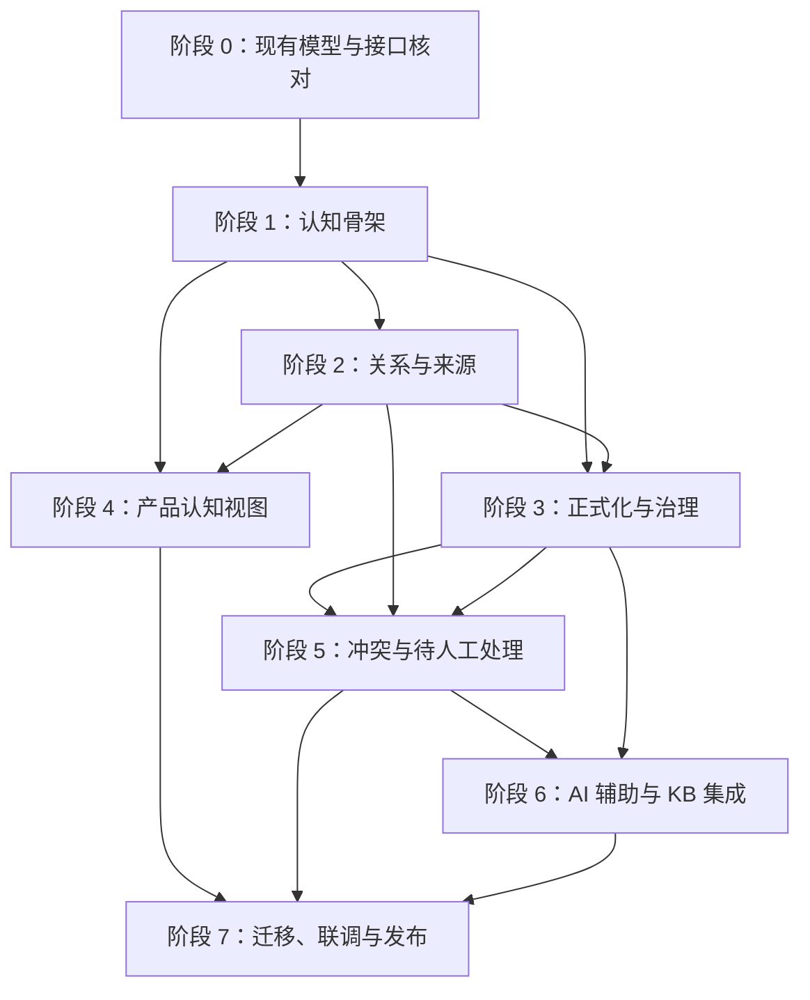

# Product Cognition（PC）开发计划 V1.0

**文档状态：** 开发计划记录稿
**版本：** V1.0
**日期：** 2026-11-06
**所属产品：** smark-pm / PM-AI
**开发目标：** 将已确认的 Product Cognition 产品裁决转化为可分阶段交付、可独立验收的研发计划。

本计划以目前已确认的 Q-PC-01～Q-PC-12、PC-I0～I6 建设切片，以及 V1.0 原始功能需求为依据。开发过程中不等待外部 MCP、Codex、Trae 或 Repository 接入，先完成 PM-AI 内置 Product Cognition 的核心能力。

- 建议采用分阶段交付
- 正式排期前需技术核对

---

# 一、开发目标与交付边界

最终交付应具备以下能力：

1. 项目创建后即可建立产品认知，不依赖代码仓库。
2. 能够管理产品愿景、业务能力、模块、角色、场景、流程、页面、领域对象和业务规则。
3. 产品认知对象之间具备类型化关系和完整追溯。
4. 支持人工确认、正式版本、历史还原和审计。
5. 能识别冲突，并建立待人工处理机制。
6. 与 Requirements、Knowledge Base、Project Goal 建立明确的协作接口。
7. AI 可以辅助分析和提出变更，但不能绕过人工审批修改正式认知。

**本期不做：**

- PC 接管技术架构认知（归 S01-04）。
- PC 接管需求正式审批（归 Requirements）。
- PC 接管 ADR 审批（归 Design / Architecture）。
- 自动把 KB 已审核内容升级为正式产品认知。
- 在治理安全闸完成前开放 AI 自动正式写入。

---

# 二、总体开发阶段

| # | 阶段 | 切片 | 内容 |
|---|---|---|---|
| 1 | 阶段 0：研发前置核对 | Gate 0 | 确认现有数据库、模块和接口，锁定数据迁移及权威边界。 |
| 2 | 阶段 1：认知骨架 | I1 | 项目级认知模型、核心对象、稳定 ID、草稿状态。 |
| 3 | 阶段 2：关系与来源 | I2 | 类型化关系、来源追溯、Requirement Revision 关联、迁移准备。 |
| 4 | 阶段 3：正式化与治理 | I3 | Change Proposal、人工审批、版本管理、安全闸、并发控制、审计。 |
| 5 | 阶段 4：产品认知视图 | I4 | Product Overview、Product Big View 及八类 Product View。 |
| 6 | 阶段 5：冲突与待人工处理 | I5 | 冲突检测、冲突裁决、P0～P3 队列、Requirements 确认前检查。 |
| 7 | 阶段 6：AI 辅助与 KB 集成 | I6 | KB 输入、AI 认知分析、影响分析、质量检查和变更提议。 |
| 8 | 阶段 7：迁移、联调与发布 | Release Gate | 既有数据迁移、跨模块集成、全局验收、正式发布。 |

> 注意：这是交付顺序建议，不是严格串行依赖。阶段 4 的视图开发可以与阶段 3 的部分治理工作并行；阶段 5 的确定性规则检查也可以先于复杂 AI 分析交付。

---

# 三、详细工作分解

## 阶段 0：研发前置核对（必须先完成）

| 工作项 | 任务 ID | 工作内容 | 交付物 |
|---|---|---|---|
| 现有模型盘点 | PC-0001 | 盘点 project_knowledge、project_baseline、baseline_item、baseline_proposal | 现有模型盘点报告 |
| 决策模型盘点 | PC-0002 | 盘点 ai.project_document、doc_type='decision'、ADR 相关实体 | 决策模型映射表 |
| 治理机制盘点 | PC-0003 | 检查 ai.change_proposal、governance.approval_request 的状态和权限逻辑 | 治理机制差距报告 |
| 版本与存储核对 | PC-0004 | 核对 Markdown + Git、PostgreSQL 元数据及 PageIndex 的现状 | 数据权威边界设计 |
| 跨模块接口核对 | PC-0005 | 核对 Requirements、KB、S01-04、Project Goal 的现有接口 | 接口依赖清单 |
| 数据模型与迁移起号设计（原「迁移方案设计」，语义替换） | PC-0006 | 〔2026-11-07 语义替换，依据 PC-01A V1.1 §7.8 零历史数据迁移裁决〕设计 PC 新表 Migration 起号方案（0045+，H-13 源码级验证支持）与 PostgreSQL 数据模型：15 张 pc.* 表 DDL、双维度版本 Member、端点闭合约束、审批/Git-PG 协议、隔离与测试方案 | 《PC-01B — Product Cognition 数据模型与数据库设计 V1.0》（docs/architecture/product-cognition/pc-01b-data-model-and-database-design-v1.0.md，已交付，待产品负责人终审；Migration 实施仍归 PC-01C） |

**阶段出口条件：**

- 不存在未识别的旧模型双写路径。
- Product Vision 与 project_baseline 的边界明确。
- 正式写入入口和审批机制已识别。
- Markdown 与 PostgreSQL 的职责及一致性策略明确。
- 所有跨模块依赖均有责任模块和接口方案。

## 阶段 1：认知骨架（I1，第一个可运行版本）

| 工作项 | 任务 ID | 工作内容 | 主要需求 |
|---|---|---|---|
| 认知模型定义 | PC-0101 | 定义 Product Cognition Model、对象类型、项目归属 | FR-001、031 |
| 核心对象身份 | PC-0102 | 稳定 ID、对象类型、基本元数据 | FR-031 |
| 草稿管理 | PC-0103 | 创建、读取、编辑草稿，区分草稿与正式状态 | FR-001、015 |
| 最小对象 CRUD | PC-0104 | 支持愿景、能力、模块等最小对象的创建和读取 | FR-001、031 |
| 项目隔离 | PC-0105 | 所有查询和写入强制校验 project scope | NFR-001 |
| 最小查询 API | PC-0106 | 提供项目认知对象查询接口 | FR-001、031 |
| 基础 UI | PC-0107 | 产品认知入口、对象列表、对象详情、草稿编辑 | FR-001、002 |

**阶段验收：**

- 新项目无 Repository 也能使用 PC。
- 用户可以创建产品愿景和业务能力草稿。
- 不同项目的数据严格隔离。
- 每个对象有稳定 ID。
- 草稿不会被错误显示为正式认知。

## 阶段 2：关系与来源（I2）

| 工作项 | 任务 ID | 工作内容 | 主要需求 |
|---|---|---|---|
| 关系模型 | PC-0201 | 设计关系类型、方向、约束和两端对象 | FR-012、031 |
| 关系管理 API | PC-0202 | 建立、修改、废弃关系 | FR-012 |
| 关系追溯 | PC-0203 | 查看对象上下游关系和历史变化 | FR-013 |
| 来源模型 | PC-0204 | 记录原始资料、KB、人工输入、AI 分析等来源 | FR-014 |
| 可信度与确认状态 | PC-0205 | 分离可信度、证据充分性和确认状态 | FR-015 |
| Vision-Goal 关联 | PC-0206 | 建立 Product Vision 与 Project Goal 支撑关系 | FR-032 |
| Requirement Revision 关联 | PC-0207 | 保存 Requirement 稳定身份和关联时 Revision | FR-033 |
| Feature 独立化 | PC-0208 | 支持内部 Feature 提升为独立对象并保留历史映射 | FR-035 |

**阶段验收：**

- 对象可以建立明确语义的类型化关系。
- 可从任一对象查看其直接关联及来源。
- Requirement 新 Revision 不覆盖旧关联依据。
- Product Vision 与 Project Goal 的归属及支撑关系清楚。
- Feature 提升后不丢失原有追溯关系。

## 阶段 3：正式化与治理（I3，核心安全里程碑）

| 工作项 | 任务 ID | 工作内容 | 主要需求 |
|---|---|---|---|
| Change Proposal | PC-0301 | 创建、提交、撤回、处理认知变更提议 | FR-016 |
| 审批机制适配 | PC-0302 | 适配现有 Proposal / Approval 机制 | FR-016、038 |
| L0～L3 策略 | PC-0303 | 实现变更级别及相应权限策略 | FR-023、038 |
| 人工确认 | PC-0304 | Lead 和授权审批人确认；普通成员不可越权 | FR-015、029 |
| 正式版本管理 | PC-0305 | 新版本生成、历史查询、历史还原 | FR-018 |
| 正式写入安全闸 | PC-0306 | 统一校验权限、审批、冲突冻结和版本 | FR-038 |
| 并发控制 | PC-0307 | 基于版本校验拒绝静默覆盖 | FR-039、NFR-005 |
| 审计 | PC-0308 | 记录对象、关系、提议、审批、版本和主体 | FR-030 |
| 人工处理生命周期 | PC-0309 | 处理创建、分派、审阅、裁决、关闭 | FR-028 |

**实现约束：**

- 所有正式认知写入必须经过 PC-0306。
- AI、API、后台任务、外部 Agent 均不得绕过安全闸。
- L0 只能做不改变正式语义的整理，不生成正式版本。
- L1 提交即确认只对具有确认权限的提出者开放。
- L2 必须由 Lead 或授权审批人确认。
- L3 重大冲突未解决时，冻结直接受影响的 L1/L2 确认。
- 并发版本不匹配时拒绝写入，要求重新读取和分析。

**阶段验收：**

- 人工确认是正式认知写入的必要条件。
- 历史版本不可覆盖。
- 普通成员不能通过 API 越权确认。
- 并发更新不会丢失。
- 每次正式变更均可追溯到提议、确认人、理由和版本。

## 阶段 4：产品认知视图（I4）

| 工作项 | 任务 ID | 工作内容 | 主要需求 |
|---|---|---|---|
| Product Overview | PC-0401 | 产品概览与认知状态汇总 | FR-002 |
| Product Big View | PC-0402 | 产品全景及对象关系浏览 | FR-003 |
| Product Vision View | PC-0403 | 产品定位、愿景、范围、边界 | FR-004 |
| Business Capabilities View | PC-0404 | 业务领域与能力视图 | FR-005 |
| Feature Modules View | PC-0405 | 模块及 Feature 结构 | FR-006 |
| Actors & Scenarios View | PC-0406 | 角色和使用场景 | FR-007 |
| Business Processes View | PC-0407 | 业务流程和状态转换 | FR-008 |
| Pages & Interactions View | PC-0408 | 页面与交互认知 | FR-009 |
| Domain Objects & Rules View | PC-0409 | 领域对象和业务规则 | FR-010 |
| Requirements & Decisions View | PC-0410 | 需求与产品决策关联视图 | FR-011、034 |

**阶段验收：**

- 所有视图使用同一认知模型，不建立重复事实源。
- 视图展示对象的正式状态、草稿状态和待确认状态。
- 用户能够从视图进入对象详情、来源、关系和版本。
- 产品决策与 ADR 按领域正确归属。

## 阶段 5：冲突与待人工处理（I5）

| 工作项 | 任务 ID | 工作内容 | 主要需求 |
|---|---|---|---|
| 冲突记录模型 | PC-0501 | 冲突双方、依据、影响范围和状态 | FR-019 |
| 确定性冲突检测 | PC-0502 | 规则、状态、关系约束等确定性检查 | FR-019 |
| 冲突处理流程 | PC-0503 | 人工裁决、暂缓、拒绝、解决 | FR-020 |
| 重大冲突冻结 | PC-0504 | L3 对受影响 L1/L2 确认实施冻结 | FR-020、038 |
| 待处理队列 | PC-0505 | P0～P3、责任人、状态和来源 | FR-022 |
| 质量检查 | PC-0506 | 孤立对象、缺失关系、重复和过期信息 | FR-021 |
| Requirements 检查接口 | PC-0507 | 向 Requirements 提供规则/冲突查询契约 | FR-036 |
| Requirements 联调 | PC-0508 | 需求正式确认前调用 PC 检查 | FR-036 |

**阶段验收：**

- 已确认重大冲突能阻止受影响需求正式确认。
- 无关需求不受局部冲突影响。
- 冲突处理过程有完整记录。
- P0～P3 与 L0～L3 分离。
- PC 不建立独立需求审批入口。

## 阶段 6：AI 辅助与 KB 集成（I6）

| 工作项 | 任务 ID | 工作内容 | 主要需求 |
|---|---|---|---|
| KB 接入 | PC-0601 | 接收 KB 已审核浅层记忆及版本信息 | FR-024、037 |
| 资料变化影响分析 | PC-0602 | 识别原始资料/KB 变化影响 | FR-025 |
| AI 认知提取 | PC-0603 | 从资料提取对象、关系和规则草稿 | FR-001、037 |
| AI 质量分析 | PC-0604 | 完整性、一致性、缺失关系分析 | FR-021 |
| AI 冲突分析 | PC-0605 | 语义冲突识别和建议方案 | FR-019、020 |
| AI 影响分析 | PC-0606 | 关联对象及跨模块影响分析 | FR-017 |
| AI 风险执行策略 | PC-0607 | 根据 L0～L3 和风险控制执行能力 | FR-023、038 |
| AI 提议生成 | PC-0608 | 生成 Change Proposal，不直接写正式认知 | FR-016、037 |

**阶段验收：**

- KB 已审核知识能够生成 PC 草稿或提议。
- 原始资料 → KB 记忆 → PC 提议 → 正式版本链路完整。
- AI 可以提出变更，但无法绕过人工确认。
- AI 分析结果包含来源、依据、可信度和不确定性。
- AI 失败不影响既有正式认知。

## 阶段 7：迁移、联调与发布（Release Gate）

| 工作项 | 任务 ID | 工作内容 | 交付物 |
|---|---|---|---|
| 旧数据迁移 | PC-0701 | project_knowledge 转 PC 草稿 | 迁移报告 |
| 迁移核对 | PC-0702 | 数量、映射、异常、来源完整性校验 | 迁移验收报告 |
| 停止双写 | PC-0703 | 关闭旧产品知识双写路径 | 切换记录 |
| 跨模块联调 | PC-0704 | KB、Requirements、S01-04、Project Goal、Design | 联调报告 |
| 全局场景验收 | PC-0705 | 验收 A～H | 测试报告 |
| 权限与安全测试 | PC-0706 | 项目隔离、越权、并发、绕过安全闸 | 安全测试报告 |
| 发布准备 | PC-0707 | 数据备份、迁移、回滚、监控和发布说明 | Release Checklist |

---

# 四、关键依赖关系

建议按下面的依赖关系组织研发，避免因为 UI、AI 或跨模块集成提前启动而返工。

这里有三条必须保护的关键路径：

1. 数据模型路径：认知对象 → 类型化关系 → 来源与版本。
2. 治理路径：变更提议 → 权限审批 → 安全闸 → 正式版本 → 审计。
3. 业务协作路径：PC 规则/冲突查询 → Requirements 确认门 → KB 输入与 AI 辅助。

尤其是第二条，不能为了尽早展示 AI 自动化效果而推迟治理能力。

---

# 五、建议的研发组织方式

建议拆成四个工作流，而不是按页面分配研发人员。

| 工作流 | 负责内容 | 核心任务 |
|---|---|---|
| A. Domain & Backend | 领域模型、存储、API、版本、关系 | PC-0101～0208、0305、0307、0401～0410 |
| B. Governance | 提议、审批、权限、安全闸、审计、冲突 | PC-0301～0309、0501～0505 |
| C. Product UX | 产品认知工作台、各 View、对象详情、待处理体验 | PC-0107、0401～0410、0505 |
| D. AI & Integration | KB、AI 分析、Requirements、Project Goal、迁移 | PC-0206、0207、0507～0508、0601～0704 |

建议由一名产品/架构负责人统一维护需求边界和验收标准，避免四个工作流分别定义自己的对象状态和权限语义。

---

# 六、建议的里程碑

这里先用里程碑而不是承诺日历日期。实际工期应在阶段 0 完成后，根据现有代码复用程度和团队人数估算。

| 里程碑 | 交付内容 | 发布判断 |
|---|---|---|
| M0 | 现有系统盘点、数据模型和接口设计 | 允许开始正式开发 |
| M1 | 无 Repository 可用的最小 PC | 核心模型可用 |
| M2 | 关系、来源和 Revision 追溯 | 认知关联可用 |
| M3 | 正式确认、安全闸、版本、审计 | 允许正式认知写入 |
| M4 | 产品认知各类视图 | 核心 UI 完成 |
| M5 | 冲突、待处理和 Requirements 确认门 | 业务治理闭环 |
| M6 | KB 与 AI 辅助 | AI 辅助闭环 |
| M7 | 迁移和全局验收 | 正式发布 |

建议 M3 作为第一个重要的产品安全里程碑。M1、M2 阶段可以积累草稿和关系数据，但在 M3 之前不能开放正式认知写入。

---

# 七、重点风险与控制措施

| 风险 | 等级 | 控制措施 |
|---|---|---|
| 现有 project_baseline 与 Product Vision 职责重叠 | 高 | 阶段 0 完成实体和数据迁移设计 |
| 现有审批机制不能满足 L0～L3 | 高 | 先盘点状态机，必要时扩展，不直接复用旧逻辑 |
| AI 或内部 API 绕过正式写入安全闸 | 高 | 所有正式写入统一经过安全服务，做绕过测试 |
| Markdown 与 PostgreSQL 状态不一致 | 高 | 明确版本引用、提交顺序、失败恢复及审计 |
| Requirement Revision 更新导致追溯丢失 | 高 | 关联同时记录稳定身份和 Revision |
| 冲突检测误伤无关需求 | 中高 | 采用局部影响范围，不做项目级无差别阻断 |
| 视图先行导致数据模型返工 | 中高 | 先统一领域模型，再以同一数据源开发视图 |
| AI 过早承担正式认知维护 | 高 | I6 必须建立在 I3 治理闸之上 |

---

# 八、研发完成定义（Definition of Done）

一个阶段只有同时满足以下条件才能验收：

- [ ] 对应需求有明确的任务和验收标准。
- [ ] 数据模型、API 和 UI 行为一致。
- [ ] 项目隔离和权限校验通过。
- [ ] 正常路径和失败路径通过测试。
- [ ] 涉及正式认知的操作有版本和审计记录。
- [ ] 跨模块接口有明确责任方和契约。
- [ ] 不存在绕过安全闸的写入路径。
- [ ] 对应文档和测试用例已更新。

---

# 九、建议立即启动的开发任务

（待补充）