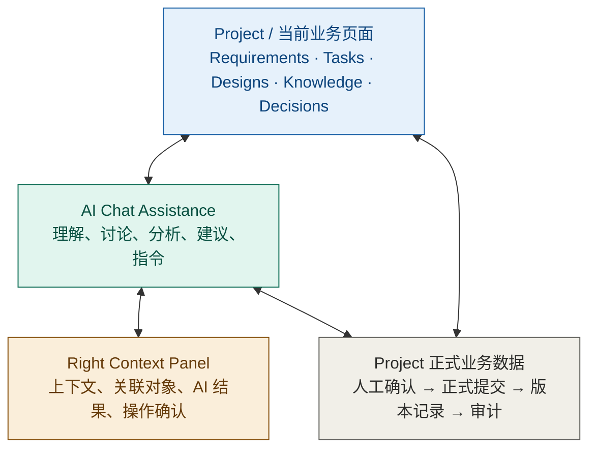
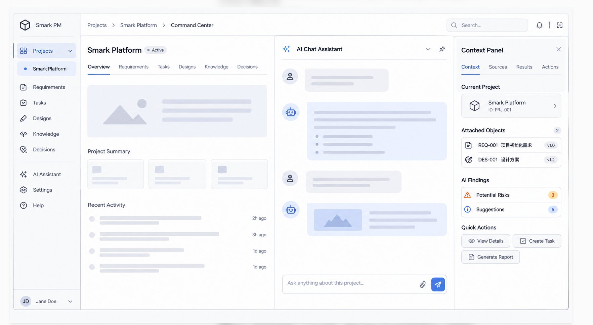
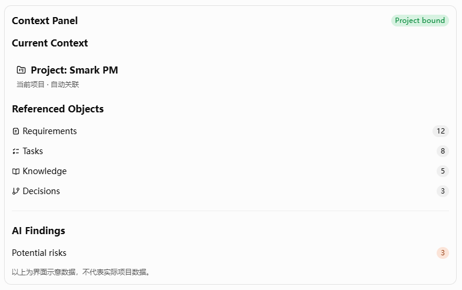
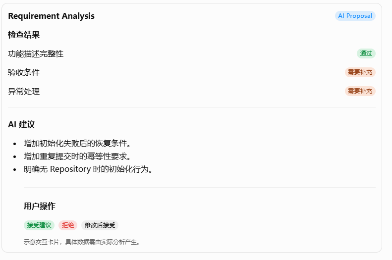
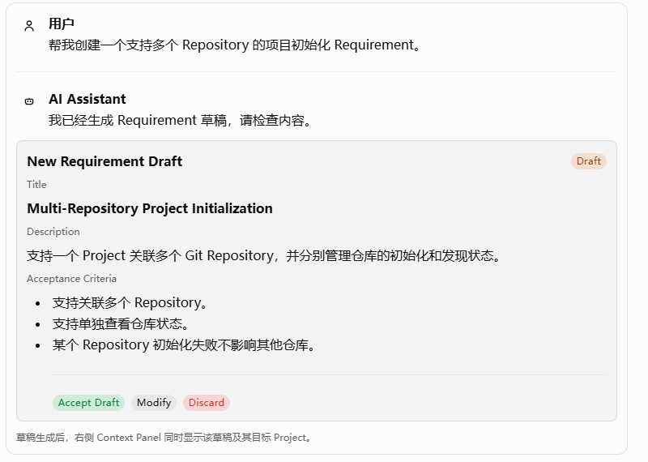
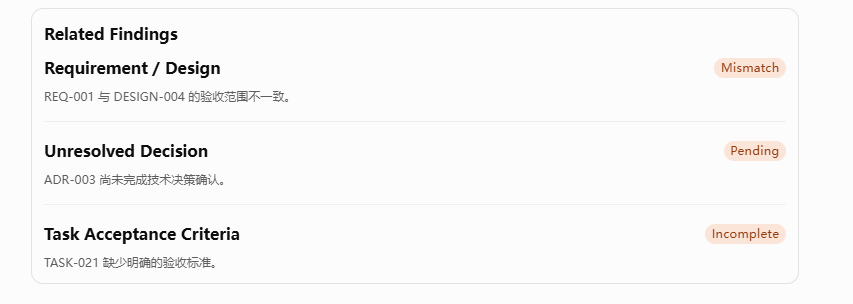
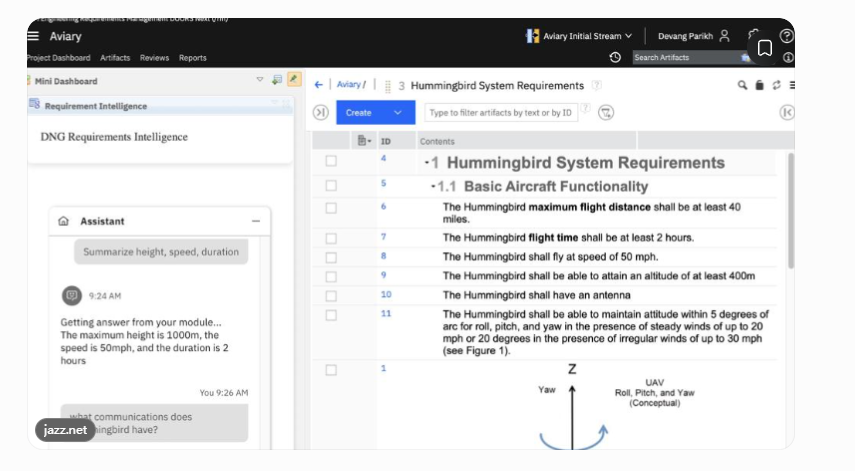
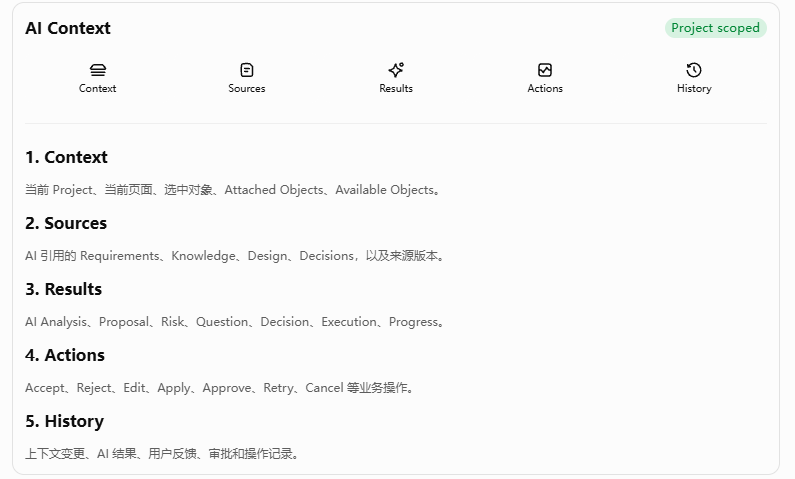
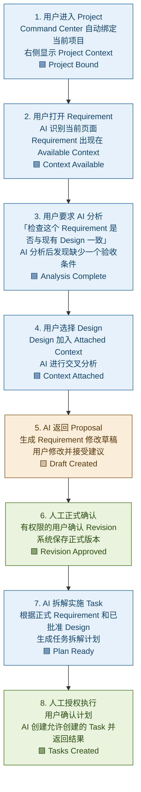

# AI Collaboration Workspace — Project / Chat / Context Integration V1.0

| 项目 | 内容 |
|---|---|
| 文档性质 | **UI 设计基线**（交互骨架定义，非实施设计稿） |
| 日期 | 2026-11-11 |
| 状态 | **已评审通过（有条件）· 2026-11-11 经 DR-C1~C6 裁决修订** |
| 范围 | 四区工作区布局 · AI Chat Assistance 交互 · Right Context Panel 组织 · 六类核心场景 · 交互对象模型 · Figma 页面规划 |
| 裁决真源 | `docs/ui/ai-collab/smark-pm-aic-95-decision-record-v1.md`（DR-C1~C6）· 提示词包 `docs/ui/ai-collab/`（v1-1） |
| 不覆盖 | 后端接口契约 · 数据库迁移 · 注入分节预算 · 权限模型的实现选型（只定交互语义） |
| 上位依据 | AI Interaction Component Library V1.0（8 类响应卡 + 11 态生命周期）· `docs/ai-pm-hybrid-workspace-design.md`（壳结构）· AI-PM 权威边界（Markdown + Git 管正式内容 / PostgreSQL 管状态、版本引用、审批与审计） |
| 关联文档 | `docs/product/ai-pm-assistant-context-integration-plan-v1.md`（既有对话 × 上下文整合计划，Batch 1~4 已落地）· `docs/product/ai-pm-dialog-orchestration-design-v1.md`（DK-0 对话编排底座） |

---

## 〇、核心原则

### 0.1 三者定义

| 对象 | 定义 | 回答的问题 |
|---|---|---|
| **Project** | 用户正在处理什么业务、需求、任务或项目对象 | 「我在做什么业务」 |
| **AI Chat Assistance** | 用户通过自然语言向 AI 提出问题、发出指令、讨论方案、要求分析和执行 | 「我想让 AI 做什么」 |
| **Right Context Panel**（右侧上下文面板） | 展示 AI 当前理解了什么、正在参考什么、产生了什么结果，以及用户可以对这些结果进行什么操作 | 「AI 看到了什么、做了什么，我能对它做什么」 |

### 0.2 三者闭环

三者不是三个并列模块，而是形成一个闭环：



> 原图见 [`docs/figures/ai-collab-v1-three-zone-loop.png`](../figures/ai-collab-v1-three-zone-loop.png)

### 0.3 AI 建议与正式业务数据分离（硬边界）

**AI 对话产生的内容，不应该自动变成 Project 的正式数据。**

AI 可以提出建议、生成草稿、修改方案、分析风险，但正式 Requirement、Knowledge、Design、Decision 的变更，**必须按照各自领域的确认权限和审批规则提交**。

这符合 AI-PM 已确定的权威边界：

| 内容类型 | 权威载体 | 写入方式 |
|---|---|---|
| 正式内容正文 | Markdown + Git | 领域单点服务 → Git 提交 |
| 状态、版本引用、审批、审计 | PostgreSQL | 同事务写入 |

「AI 说过了」≠「已确认」；「用户点了 Accept」≠「已生效」。这条边界贯穿全文的所有卡片动作与权限判据。

---

## 一、四区主 UI 的职责

沿用此前已确认的 AI Interaction Center 结构：**四区（导航 + 主区 + AI Chat + 右栏）+ 底部输入框**。



| 区域 | 职责 | 用户主要操作 | 正式宽度（DR-C5） |
|---|---|---|---|
| 左侧导航 | 产品及 Project 导航 | 切换项目、进入业务模块 | 188px（13%） |
| 中间主区域 | 当前业务工作区 | 查看、编辑 Requirement、Task、Design 等 | 518px（36%） |
| **AI Chat Assistance** | 人机交流与协作 | 提问、指令、讨论、追问 | 446px（31%） |
| **右侧 Context Panel** | AI 工作上下文与结果 | 检查来源、选择对象、确认结果 | 288px（20%） |

> 画板 1440 × 1000px。四区同时存在，不增加第五主区；AI Chat 不随业务页面切换而消失；Context Panel 支持折叠。详见 §5.4。
> 原图见 [`docs/figures/ai-collab-v1-three-column-layout.jpg`](../figures/ai-collab-v1-three-column-layout.jpg)

### 1.1 AI Chat 是持续能力，不是独立产品

**AI Chat Assistance 是持续存在的交互能力，不应该成为一个独立于 Project 的聊天产品。**

它有两种入口（**DR-C6 裁决，2026-11-11**）：

| 入口 | 触发位置 | 上下文状态 |
|---|---|---|
| **Global AI** | 从 Personal Home 或全局入口发起 | **只是 Project 选择入口**，不创建未绑定 Project 的会话 |
| **Project AI** | 进入 Project 后自动获得该项目上下文 | 自动锚定当前 Project |

> **V1 不支持未绑定 Project 的 Conversation**，与 `ai.conversation.project_id NOT NULL` 保持一致。
> Global AI 流程：展示 Project 选择界面 → 用户选 Project → 创建或恢复该 Project 的 Conversation → 进入对应 Project AI Workspace。
> Team-level Conversation / Multi-project Context / Cross-project Knowledge Search **不纳入 V1**；未来如需实现须单独评审数据模型与权限架构。

### 1.2 Project 切换不得静默替换上下文

当用户从一个 Project 切换到另一个 Project 时，**不能悄悄把原来的对话上下文替换掉**（**DR-C6**）：

- 当前 Conversation **不得自动转移**，保持绑定原 Project
- 当前 Project Context **不得带入其他 Project**
- 用户须进入目标 Project 的 Conversation（保留原会话并在目标项目新建 / 取消）

### 1.3 已确认的交互细节（继续保留）

- 发送消息后，对话区域**渐进展开**
- **Composer 固定在底部**
- Context Panel **不随对话滚动而消失**
- Context Panel **可以固定或隐藏**
- **切换业务页面不能无提示地替换上下文**
- **对话草稿应该保留**

---

## 二、具体操作场景

至少需要设计以下六个核心场景。

### 场景 1：用户进入 Project，直接向 AI 提问

**基础场景 · P0**

这是最重要的场景——用户**不需要先配置 Git、MCP、Runner 或外部 Agent**，就应该能够使用 AI-PM。

**操作过程**

1. 用户进入 Project Command Center。
2. AI Chat Assistance 自动获得 Project ID。
3. 右侧 Context Panel 显示当前 Project。
4. 用户询问：「目前这个项目有哪些重要风险？」
5. AI 查询项目的 Requirements、Tasks、Knowledge、Decisions。
6. AI 在对话区返回分析。
7. 右侧面板显示引用的业务对象和风险结果。

**右侧面板可呈现**



> 原图见 [`docs/figures/ai-collab-v1-context-panel-sources.png`](../figures/ai-collab-v1-context-panel-sources.png)

**关键设计**：AI 需要告诉用户——

- 我正在处理哪个 Project
- 我参考了哪些对象
- 哪些内容是正式知识
- 哪些是 AI 推断
- 哪些问题还需要人工确认

**不能只给出一段没有来源的 AI 答案。**

---

### 场景 2：用户在 Requirement 页面要求 AI 分析需求

**核心业务场景 · P0**

这是 Project 与 AI Chat 联动最有价值的地方。

**前置**：用户正在查看 `REQ-001 · Project Initialization`。

**用户在 AI Chat 输入**：「帮我检查这个需求是否完整，特别是验收条件和异常流程。」

**交互过程**

1. Project 当前页面是 Requirement Detail。
2. AI 自动识别当前打开的 Requirement。
3. Context Panel 自动加入该 Requirement。
4. AI 分析 Requirement 内容。
5. AI 返回结构化分析卡片。
6. 用户选择需要进一步处理的结果。



> 原图见 [`docs/figures/ai-collab-v1-card-analysis.png`](../figures/ai-collab-v1-card-analysis.png)

**必须区分的两个动作**

| 动作 | 语义 | 落点 |
|---|---|---|
| **接受 AI 建议** | 将选定内容纳入编辑草稿 | 编辑草稿（未提交） |
| **正式提交 Requirement Revision** | 经过用户检查和确认后，才写入正式知识 | 领域单点服务 → Git 提交 |

**不能把点击 Accept 直接等同于正式发布。**

---

### 场景 3：用户在 AI 对话中要求创建新的业务对象

**核心业务场景 · P0**

**用户输入**：「帮我创建一个 Requirement，描述支持多个 Repository 的项目初始化能力。」

这是一个非常重要的交互。传统系统会要求用户离开聊天界面，进入 Requirement 页面，再填写表单。

PM-AI 允许用户**直接在对话中完成业务对象的草拟**。

**交互过程**



> 原图见 [`docs/figures/ai-collab-v1-card-draft.png`](../figures/ai-collab-v1-card-draft.png)

**用户接受草稿后**

- 可以在右侧预览
- 可以跳转到 Requirement 编辑页面
- 可以继续要求 AI 修改
- 最后由有权限的人正式确认

**关键点**：AI 不应该因为用户说了 Create，就直接绕过正式业务流程。

---

### 场景 4：用户切换 Project 页面，但继续当前 AI 对话

**核心场景 · P0**

**示例**：用户先在 Requirement 页面询问需求问题，随后进入 Design 页面，问「这个 Design 是否覆盖刚才讨论的 Requirement？」

**应发生什么**

1. AI Chat Conversation 保持不变。
2. Project 仍然是原来的 Project。
3. 右侧 Context Panel **保留之前的 Requirement**。
4. 新打开的 Design **自动进入 Available Context**。
5. 用户可以选择 **Attach**。
6. AI 同时使用 Requirement 和 Design 进行分析。

**三种上下文状态（重要设计决定）**

| 状态 | 含义 | AI 是否使用 |
|---|---|---|
| **Available** | 当前页面可用对象 | 默认不使用 |
| **Attached** | 用户明确关联对象 | 可以使用 |
| **Read-only** | 只读参考对象 | 可以读取，不可修改 |

> **当前页面发生变化，不代表 AI 的上下文必须立即发生变化。用户应当拥有上下文的控制权。**

---

### 场景 5：AI 发现跨模块问题，主动关联其他业务对象

**智能协作场景 · P1**

**示例**：用户正在分析一个 Requirement，AI 发现——

- Requirement 与 Design 不一致
- Design 中有一个未解决的技术决策
- 某个 Task 缺少验收条件

这时 AI **不应该只在对话中告诉用户三个问题**，而应该将发现转化为可操作的关联对象。

**右侧 Context Panel 可显示（Related Findings）**



> 原图见 [`docs/figures/ai-collab-v1-related-findings.png`](../figures/ai-collab-v1-related-findings.png)

**对标参考**：侧栏作为助手伴随界面（sidecar）的产品形态参考。



> 原图见 [`docs/figures/ai-collab-v1-ref-aviary-sidecar.png`](../figures/ai-collab-v1-ref-aviary-sidecar.png)

**用户可以选择**

- 查看关联对象
- 要求 AI 解释问题
- 生成修改建议
- 创建待处理事项
- 转交给有权限的人员

**注意**：AI 发现问题，**不等于**自动修改正式对象。

---

### 场景 6：用户授权 AI 执行任务

**Agent 执行场景 · P1**

**用户输入**：「根据已经确认的 Design，帮我拆解实施任务。」

此时 AI **不应该直接开始执行一连串不可见的操作**，而应该：

1. 确认当前 Project
2. 识别已批准的 Design
3. 检查关联 Requirements
4. 生成任务拆解方案
5. 展示执行计划
6. **等待用户确认**
7. 执行允许的操作
8. 返回结果和执行记录

**右侧面板从 Context 模式转为 Execution 模式**，展示：

- 执行目标
- 输入对象
- 执行步骤
- 所需权限
- 执行状态
- 待人工处理事项
- 最终交付物

**这时 AI Chat 是交流界面，右侧 Context Panel 是执行控制和结果检查界面。**

这符合当前 Agent UI 的常见设计方向：**对话负责表达意图，侧栏负责计划、证据、审批和执行状态。**

---

## 三、右侧 Context Panel 的组织方式

右侧面板**不应是一个简单的文件列表**，而应该是一个**动态的 AI 工作控制台**。

### 3.1 四个一级 Tab + History Drawer（DR-C3 裁决，2026-11-11）



> 原图见 [`docs/figures/ai-collab-v1-context-tabs.png`](../figures/ai-collab-v1-context-tabs.png)

| # | Tab | 内容 |
|---|---|---|
| 1 | **Context** | 当前 Project、当前页面、选中对象、Attached Objects、Available Objects、Read-only Objects |
| 2 | **Sources** | AI 引用的 Requirements、Knowledge、Design、Decisions，以及来源版本 |
| 3 | **Results** | AI Analysis、Proposal、Risk、Question、Decision、Execution、Progress |
| 4 | **Actions** | 待授权操作、执行任务及操作结果（Accept、Reject、Edit、Apply、Approve、Retry、Cancel 等） |

**History 不是第五个一级 Tab**，通过二级入口或 **History Drawer** 访问，七个页面一律遵守。Drawer 内容五类：Conversation History · AI Action History · Context Change History · Approval History · Execution History，支持分类查看；**历史保留发生时的状态，不得被当前 Context 覆盖**；Drawer 不得改变四区布局。

### 3.2 三类上下文状态（沿用已确定口径）

| 状态 | 语义 |
|---|---|
| **Available** | 可选择，但尚未加入当前对话 |
| **Attached** | 已经加入当前对话的工作上下文 |
| **Read-only** | 可以作为参考，但不可执行修改 |

其中 **Attached 对象还应显示其版本或 Revision**，避免 AI 在不同版本间混淆。

---

## 四、AI Chat 与右侧面板如何互相驱动

这是整个设计中最值得仔细处理的部分。

### 4.1 交互规则表

| 用户操作 | AI Chat 行为 | Context Panel 行为 |
|---|---|---|
| 打开 Project | 建立项目上下文 | 显示 Project |
| 打开 Requirement | 可以继续当前对话 | 将 Requirement 放入 Available |
| Attach Requirement | AI 获得明确参考对象 | 显示 Attached |
| 移除 Requirement | 后续分析不再使用它 | 从 Attached 移除 |
| AI 生成分析 | 显示结构化结果卡 | Results 更新 |
| 点击某个 AI 结果 | 可以继续讨论 | 显示结果详情 |
| 接受 AI 建议 | 进入草稿或业务提交流程 | 显示待提交状态 |
| 正式提交 | 返回提交结果 | 更新对象状态和版本 |
| 执行失败 | 说明失败原因 | 显示异常与 Retry |
| 切换 Project | **不自动串用旧项目上下文** | 要求明确切换或新建会话 |

### 4.2 关键附加规则

> **Context Panel 的内容不是全部对话历史，而是当前 AI 任务实际使用的上下文及其状态。**

例如：用户在对话中提到过 Requirement A，但后来移除了它，那么它可以保留在历史记录中，**却不能继续被当作当前 Attached Context**。

---

## 五、正常流程、异常处理、权限控制

本节与 AI Interaction Component Library 的三个维度直接对应。

### 5.1 正常业务流程

| 操作 | 交互方式 |
|---|---|
| AI 分析 | Analysis Card |
| AI 提出建议 | Proposal Card |
| AI 识别风险 | Risk Card |
| AI 需要补充信息 | Question Card |
| AI 生成决策草稿 | Decision Card |
| AI 执行任务 | Execution Card |
| AI 返回进度 | Progress Card |

**每一种 Card 都应该具有自己的操作类型，而不是所有卡片都只有 Accept / Reject 两个按钮。**

| Card | 动作集 |
|---|---|
| Analysis | 查看依据、继续追问 |
| Proposal | 接受（进草稿）、拒绝、修改 |
| Risk | 确认、忽略、转为待办 |
| Question | 选择答案、输入补充信息 |
| Decision | 编辑、提交人工确认 |
| Execution | 请求授权、拒绝、查看详情 |
| Progress | 查看执行记录、重试可重试步骤 |

**DR-C4 裁决（2026-11-11）· UI 卡 ↔ 后端 Envelope 映射**

后端维持八类 `RESPONSE_TYPES`（informational / recommendation / proposal / question / decision / artifact / action-request / execution-result），**不新增 Risk、Progress 独立类型**：

| UI Card | Envelope | 渲染要求 |
|---|---|---|
| Analysis | informational | 分析、结论、证据 |
| Proposal | proposal | 修改方案、前后对比 |
| Risk | recommendation | severity / impact / likelihood |
| Question | question | 问题、选项、补充回答 |
| Decision | decision | 决策、备选方案 |
| Execution | action-request | 执行计划、授权请求 |
| Progress | execution-result | 进度、执行状态、结果 |
| —（无独立主卡） | artifact | 可嵌入业务产物（Draft / Design 文档 / 分析报告 / 执行报告） |

- **Risk 识别**：必须有结构化字段 `severity` · `impact` · `likelihood` · `affected_objects` · `mitigation` · `status`；**无这些字段时显示普通 Recommendation**，不得由 AI 文本推断风险。
- **Progress 识别**：状态须依据真实执行状态（Running / Partially Completed / Failed / Completed / Cancelled），**不得根据 AI 文本推断成功**。
- **Action Request**：`action-request` 仅代表请求执行，**不代表已获授权**。

### 5.2 异常处理

统一设计以下状态：

| 状态 | 描述 | 处理方式 |
|---|---|---|
| **Context Missing** | 缺少必要业务对象或上下文 | 选择对象 / 补充信息 |
| **Context Conflict** | 不同对象或版本存在冲突 | 查看差异 / 选择依据 |
| **AI Unavailable** | 模型或 Provider 不可用 | 重试 / 联系管理员 |
| **Execution Failed** | 执行步骤失败 | 查看错误 / 重试 / 取消 |
| **Permission Denied** | 当前用户无权执行操作 | 申请授权 / 转交有权限人员 |
| **Approval Pending** | 操作等待人工确认 | 查看内容 / 确认 / 拒绝 |

**异常不能只显示在 Chat 对话中。**

例如 AI 执行任务失败，右侧面板应该保留**失败步骤、错误原因、已完成步骤和可以恢复的操作**。

### 5.3 权限控制（三层交集 + 默认拒绝 + 真人审批）

**DR-C2 裁决（2026-11-11）· Default Deny + Permission Intersection + Mandatory Human Approval**

| 层次 | 判断内容 | 示例 |
|---|---|---|
| **Project Permission** | 用户能否访问对象 | 能否读取 Project |
| **Business Permission** | 用户能否修改业务对象 | 能否确认 Requirement |
| **AI Execution Permission** | AI 能否执行指定动作 | 能否调用 Runner |

```
Effective Permission = Team Policy ∩ Project Policy ∩ Action Policy
```

- **默认拒绝**：任何权限策略没有明确表态 → DENY，不允许默认放行。
- **受保护操作必须真人审批**：Formal Requirement Approval · Formal Requirement Revision Confirmation · Formal Knowledge Confirmation · Formal Decision Approval · 其他正式业务批准或发布操作；`require_human_approval = true` **不可绕过**。
- **AI 不得**：批准自己的 Proposal · 自动确认正式 Requirement · 自动批准正式 Revision · 通过 `auto_accept` 绕过人工审批。
- **`auto_accept` 语义拆分**：自动接受建议进入**非正式 Draft** 允许（须有明确权限）；自动修改正式业务对象 / 批准正式 Revision / 发布正式 Requirement 一律禁止。
- **强制 UI 状态**：Approval Pending · Human Approval Required · Permission Denied · Approved · Rejected。**Approval Pending 是强拦截态**——AI Action 在审批完成前不得产生正式批准结果，且不得通过 Retry / Resume / Auto Accept / 替代动作绕过。

**需要特别区分**

- AI 有读取权限，**不代表**有写入权限
- AI 能生成草稿，**不代表**能正式确认
- 用户有权限，**也不代表** AI 可以绕过授权流程
- **执行授权 ≠ 正式业务审批**：授权执行某操作不替代受保护操作的真人审批门
- **只有有权限的用户**才能完成相应的正式确认

> 已确定的约束：**AI 不得 AutoApply 正式 Requirement，不得自动审批。**
> **实现现状**：该约束目前在代码中**尚未完全成立**——DEF-P0-01（`auto_accept` 无表态默认放行，`ai_team_policies.rs:150`）与 DEF-P0-02（`confirm_baseline` 无真人守卫）已登记待修，见附录 B.4。修复须通过服务端自动化测试验证，不以 UI 按钮限制替代。

### 5.4 布局尺寸（DR-C5 裁决）

正式画板 **1440 × 1000px**，四区宽度：Navigation **188px**（13%）· Main Area **518px**（36%）· AI Chat **446px**（31%）· Context Panel **288px**（20%）。

Main Area 仅 518px，**不允许强制双栏 Original / Proposed Diff**；采用 Inline Diff · Unified Diff · 单列 Original–Proposed 切换 · 必要时独立展开比较视图。1280px 保持四区压缩留白，1024px Context Panel 默认可折叠、AI Chat 可扩展，不得横向溢出。

---

## 六、完整的端到端操作案例

**任务**：检查 Requirement、关联 Design，并创建实施 Task。

推荐作为 Figma 主演示流程。



> 原图见 [`docs/figures/ai-collab-v1-end-to-end-flow.png`](../figures/ai-collab-v1-end-to-end-flow.png)

这个案例可以成为整个 AI Chat Assistance 的核心 Figma Prototype。

---

## 七、三个不同的交互对象

> **架构问题，必须在 UI 设计阶段明确：不要将 Chat、Context、Execution 混成同一个对象。**

| 对象 | 作用 | 生命周期 |
|---|---|---|
| **Conversation** | 保存用户与 AI 的交流 | 可以长期持续 |
| **Context Set** | 定义当前对话或任务使用的业务上下文 | 随任务变化 |
| **AI Action / Run** | 代表一次具体分析、生成或执行工作 | 独立运行及审计 |

### 7.1 关系约束

- 一个 **Conversation** 可以有多次 **AI Action**
- 一次 **AI Action** 可以使用多个 **Attached Objects**
- 多个 **AI Action** 可以共享一个 **Conversation**，但每次执行都应有自己的**输入上下文快照**

这能够避免：用户修改 Context 后，历史 AI 结果看起来像是使用了新上下文。

### 7.2 Context Set 的最小记录

Context Set 应当记录**对象 ID、版本、来源和权限范围**，而不只是保存一组对象名称。

---

## 八、正式 UI 设计基线

**命名**：AI Collaboration Workspace — Project / Chat / Context Integration V1.0

### 8.1 核心设计原则

| # | 原则 |
|---|---|
| 1 | Project 提供业务环境 |
| 2 | AI Chat 提供自然语言交互 |
| 3 | Context Panel 提供上下文管理和结果操作 |
| 4 | AI 输出必须结构化 |
| 5 | AI 建议与正式业务数据分离 |
| 6 | 用户控制上下文附加和移除 |
| 7 | 重要操作必须具备权限检查 |
| 8 | 执行结果必须能够追踪和审计 |
| 9 | Conversation、Context Set、AI Action 独立管理 |
| 10 | 页面切换不能静默改变对话语义 |

### 8.2 Figma 页面规划

不要只设计一个 Chat 页面，而是设计以下七个页面或交互状态：

| 编号 | Figma 页面 | 重点 |
|---|---|---|
| **AI-01** | Project AI Workspace | 四区整体布局（188/518/446/288） |
| **AI-02** | Context Management | Available / Attached / Read-only |
| **AI-03** | AI Response Cards | Analysis / Proposal / Risk 等 |
| **AI-04** | Draft & Review | 接受、拒绝、修改、正式提交 |
| **AI-05** | AI Execution Control | Plan、授权、进度 |
| **AI-06** | Exception & Permission | 异常、权限、审批 |
| **AI-07** | Conversation Continuity | 页面切换、Project 切换、历史恢复 |

### 8.3 优先级建议

> **先做 AI-01、AI-02、AI-03、AI-04 的交互原型。**

这四个决定整个产品的交互骨架，其余页面在这个骨架上扩展。

---

## 附录 A、参考的设计方向

| 资料 | 借鉴点 |
|---|---|
| **Agentic Experience UX Handbook** | 对话与 Sidecar 的职责划分 |
| **Agentic UX Patterns** | 计划、审批、执行进度和结果审查的交互模式 |

---

## 附录 B、与现有实现的差距（代码事实核对 · 2026-11-11）

本附录记录本设计基线与当前代码实现之间的差距，作为后续实施拆分的输入。**核对基准：master @ `a3f92f7c`。**

### B.1 已就位（可直接复用）

| 能力 | 实现位置 | 说明 |
|---|---|---|
| 上下文单一真源 | `ai-frontend/src/stores/shell.ts:147` `assistantContext` | 指令栏作用域串 / 右栏上下文卡 / 会话页三处共用同一对象 |
| 快照交接 | `stores/shell.ts:200` `queueAssistantPrompt` → `:211` `takeAssistantPrompt` | 提交时刻定格，导航与切项目不改变快照 |
| 线程级锚点落库 | `migrations/0003_conversation_context_anchor.sql` | JSONB 单列，白名单键 + 跨项目 CHECK |
| 锚点校验 | `crates/pm-application/src/ai_conversations.rs:82` `ContextAnchor::validate` | project_id 须匹配目标项目；仓库须真实存在 |
| 服务端重新投影 | `crates/pm-ai/src/chat_context.rs:100` `build_chat_context` | 按锚点查库重读，注入 S1 项目画像 + S2 仓库事实，独立 8k 预算 |
| 注入记账落库 | `crates/pm-ai/src/conversation_reply.rs:438` | `message.metadata.injection` 含 `sections_included/dropped/chars_total` |
| 响应卡信封协议 | `crates/pm-application/src/ai_interaction_envelope.rs` | 8 类白名单 + 11 态 + payload 必填校验，fail-closed |
| 交互写回闭环 | `migrations/0005_conversation_interaction.sql` | 终态幂等 / 换 action 409 / 属主外 404 同形 |

### B.2 差距清单

| # | 设计基线要求 | 当前实现 | 差距性质 |
|---|---|---|---|
| **G1** | 右栏显示「AI 当前实际使用的上下文」 | `ContextPanel.vue:97` 读**活态** `shell.assistantContext`；注入按**线程锚点**重新投影 | 断点①：切 Project 后右栏宣称 ≠ 实际注入（原 F-2 承诺脱节换了位置复发） |
| **G2** | 右栏「Sources」Tab 展示 AI 实际引用的对象与来源版本 | 注入记账 `metadata.injection` 前端**零消费**（`grep` 仅命中 i18n 标签） | 断点②：宣称无证据链，用户无法核对「这条回复 AI 实际看到了什么」 |
| **G3** | 右栏随当前对象（Requirement / Task / Design）变，含 Available / Attached / Read-only 三态 | `ContextPanel` 固定展示当前项目 + main 仓库；三态未实现；`/focus/:type/:id` 机制未实现 | 断点③：只有项目级，无对象级 |
| **G4** | 用户可 Attach / Remove 对象，控制 AI 上下文 | 锚点只能在建会话时自动定格（`AssistantView.vue:537` `contextAnchor`）；无追加/移除入口 | 场景 4「用户拥有上下文控制权」未落地 |
| **G5** | Attached 对象显示版本 / Revision | `ContextAnchor` 无版本字段；`ConversationAnchor` 白名单不含 revision | 版本混淆风险未覆盖 |
| **G6** | Related Findings（AI 主动发现跨模块问题 → 关联对象） | 无对应实体与交互 | 场景 5 未落地 |
| **G7** | Execution 模式（计划 / 授权 / 进度 / 交付物） | 现有 Execution Card 为组件库形态，真栈执行链与右栏执行模式未打通 | 场景 6 右栏侧未落地 |
| **G8** | 异常态在右栏保留失败步骤、错误原因、已完成步骤 | 异常态目前仅在 Chat 侧；`AiInteractionStatus` 11 态有 `failed`，但右栏无对应视图 | §5.2「异常不能只显示在 Chat」未落地 |
| **G9** | Context Set 记录对象 ID + 版本 + 来源 + 权限范围 | 当前锚点为 5 字段（project_id / project_name / repository_name / default_branch / repository_role），无权限范围 | §7.2 记录粒度不足 |
| **G10** | Conversation / Context Set / AI Action 三对象独立 | 当前只有 `ai.conversation` + `context_anchor`；无独立 Context Set 实体，无 AI Action 快照 | §7 架构要求未落地 |
| **G11** | 全局 AI 入口 | 会话强制 `project_id`（`ai.conversation` 列 NOT NULL） | **DR-C6 已裁决**：V1 不做未绑定会话，Global AI 降级为 Project 选择入口 → 差距消解为交互实现 |
| **G12** | 切 Project 时明确提示新建 / 切换 / 保留 | 前端已有快照机制防漂移，但**无切换提示交互** | 交互层缺失 |
| **G13** | 对话草稿保留 | 未见草稿持久化 | 交互层缺失 |

### B.3 差距归类

| 类别 | 条目 | 性质 |
|---|---|---|
| **诚实性** | G1、G2 | 右栏「宣称面」与「实际注入面」不一致 —— **最高优先**，是既有承诺脱节的残留 |
| **上下文控制权** | G3、G4、G5、G9、G12 | 场景 4 的核心能力缺失 |
| **结构化结果与执行** | G6、G7、G8 | 场景 5 / 6 的右栏侧缺失 |
| **架构独立对象** | G10、G13 | 需先做模型裁决，可能涉及迁移与新表（G11 已由 DR-C6 消解） |

### B.4 既有缺陷挂账（DR-C2 · 待修，非已实现）

§5.3 的「AI 不得自动审批」为**已确认约束**，但代码现状与之相悖。两条缺陷**仅登记，不代表已修复**：

| 缺陷 | 位置 | 现状 | 要求 | 优先级 |
|---|---|---|---|---|
| **DEF-P0-01** | `crates/pm-application/src/ai_team_policies.rs:150` | 能力类字段规则为「取所有表态层交集；**无任何层表态时默认允许**」 | 改为**默认拒绝**（Default Deny）：无明确表态 → DENY | P0（与 §5.3 硬边界直接冲突） |
| **DEF-P0-02** | `confirm_baseline` | 无真人守卫 | 增加真人审批守卫（真人确认不可绕过） | P0（同上） |

补充要求（DR-C2）：

- `auto_accept` 语义必须拆分：**可**自动接受建议进入非正式 Draft（须有明确权限）；**不可**自动修改正式业务对象 / 批准正式 Revision / 发布正式 Requirement。
- 权限取交集：`Effective Permission = Team Policy ∩ Project Policy ∩ Action Policy`，任一层拒绝即拒绝。
- 修复后**必须通过服务端自动化测试**，不得以 UI 按钮限制替代后端校验。
- 前端不得自行扩展 Envelope 白名单（DR-C4）；会话必须 Project 绑定（DR-C6）。

---

## 附录 C、Figma 原型与本文档的对应关系

**Figma 提示词包**：`docs/ui/ai-collab/`（v1-1）。**裁决真源**：`docs/ui/ai-collab/smark-pm-aic-95-decision-record-v1.md`（DR-C1~C6，2026-11-11 确认）。本基线若与裁决记录冲突，以裁决记录为准。

| Figma 页面 | 对应章节 | 依赖的当前实现 |
|---|---|---|
| AI-01 | §一（四区布局 188/518/446/288）、§1.1~1.3、§5.4 | `WorkspaceShell.vue` + `ContextPanel.vue` + `CommandBar.vue`；Global AI = Project 选择入口（DR-C6） |
| AI-02 | §三（四个 Tab + History Drawer）、§4（驱动规则） | `shell.assistantContext`、锚点读侧（待补 UI） |
| AI-03 | §5.1（Card 类型、动作集、Envelope 映射） | AI Interaction Component Library V1.0（8 类卡已完工） |
| AI-04 | §0.3、场景 2、场景 3、§5.3（审批状态机 + 强拦截） | 信封协议 + 交互写回闭环（已落地）；真人审批守卫待修（DEF-P0-02） |
| AI-05 | 场景 6、§5.3（授权 ≠ 审批） | Execution 链（待补右栏视图） |
| AI-06 | §5.2、§5.3（默认拒绝 + 硬审批边界） | 交互状态机 11 态 + 权限三层；默认拒绝待修（DEF-P0-01） |
| AI-07 | §1.2、场景 4、§3.1（History Drawer） | 快照交接机制（已落地，提示交互待补） |

---

## 附录 D、裁决后的落地责任划分

| 事项 | 责任方 | 依据 |
|---|---|---|
| Figma 视觉与交互（七页 + Prototype） | 设计 | `docs/ui/ai-collab/` |
| 默认拒绝 / 权限交集 / 真人审批守卫（DEF-P0-01、DEF-P0-02） | 后端 + 服务端自动化测试 | DR-C2、附录 B.4 |
| 统一 Response Rendering Contract（不扩白名单） | 前端 | DR-C4 |
| 会话 Project 绑定与 Project 选择入口 | 前端 + 后端 | DR-C6 |
| Context 快照完整性 / 审批审计轨迹 | 后端 | 90 Part 8 |
| 右栏「宣称面 = 实际注入面」（G1、G2） | 前端 + 后端 | 附录 B.2（**最高优先**） |
