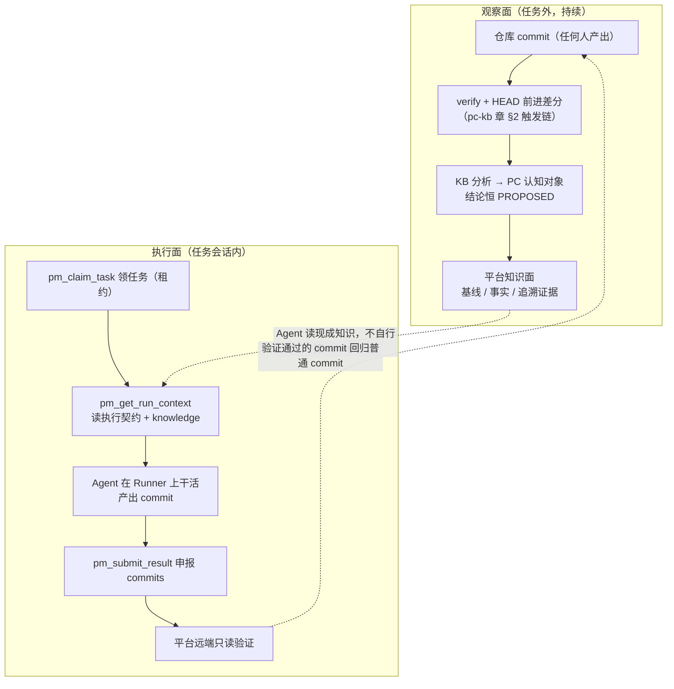

# MCP 工具面与三通道分工 · 业务逻辑终态

| 属性 | 值 |
| --- | --- |
| 版本 | V1.0（终态登记） |
| 登记日期 | 2026-11-08 |
| 证据基准 | `crates/pm-mcp/src/server.rs`（26 工具声明与描述）+ 五阶段业务架构基线 V1.0（「MCP 非运行时」边界）+ I6-A A*（确认入口 fail-closed）+ 相邻两章（runner 通信章 / pc-kb 操作链章） |
| 验收状态 | 工具面已挂载 pm-api `/mcp` 生产路径；执行链验收继承 runner 章（**ACP-09 已关闭**）；Discovery / KB Git 写入线随 KB-PC 服务化批落地 |

---

## 1. 本章回答的问题

「Runner 已经存在、PC/KB 已经在监控 commit 变化，那 MCP 在 AI Agent 里到底干什么具体工作？」——本章登记三通道（PC/KB intake、Runner+ACP 派发、MCP 工具面）的分工终态、MCP 26 工具的族谱目录、以及闭环扣合方式。传输/鉴权/状态机不在此重复，见 §7 分工表。

## 2. 三通道分工（结论先行）

**PC/KB 从 commit 获取的是「知识」，MCP 干的是「任务契约」。两条通道方向不同、时机不同、身份不同，零重叠，且是接力关系。**

| | PC/KB intake | Runner + ACP/派发 | MCP |
| --- | --- | --- | --- |
| 方向 | 仓库 → 平台（单向观察） | 平台 → Runner（送 run） | Runner 上的 Agent ↔ 平台（会话内双向） |
| 时机 | 任务外，持续巡检（verify + HEAD 前进差分） | 派发 / 干预时刻 | 只在 run 会话期间活 |
| 产物 | facts / 认知对象 / 追溯证据 | 执行环境、会话 | 上下文读取 + 产出提交 + 干预回执 |
| 身份 | 平台服务身份（worker） | 设备凭据 cpk | client credential（唯一 Client Identity，禁第二套） |
| 典型动作 | intake 三写（0048）→ KB/PC 分析 | `pm_claim_task` 租约签发 | `pm_get_run_context` 读契约 / `pm_submit_result` 交产出 |

**为什么 intake 不能替代 MCP**（判定依据，四条）：

1. **方向相反**：intake 是平台主动拉仓库（观察），MCP 是 Agent 主动调平台（执行中读写）。
2. **对象不同**：intake 产的是知识（facts/findings/追溯证据），MCP 读写的是任务执行契约与产出。
3. **有状态契约无法用观察表达**：lease 签发（`pm_claim_task` 一次性 token）、心跳续租（`pm_report_progress` 严格前向）、命令领取与回执（`pm_poll_commands`/`pm_ack_command`）是双向有状态协议，单向观察面没有对应物。
4. **身份门不同**：确认类边界按通道收口（见 §5），不能靠「多观察」替代。

**接力关系**：intake 先把 commit 变成平台确认的知识（基线/事实/追溯证据）→ Agent 执行任务时经 `pm_get_run_context` 读到的 knowledge 就是这份现成知识（`server.rs:532`，执行契约含「per-repository baselines, knowledge」），而不是自己去 commit 里现挖。

## 3. 分工闭环图

闭环扣合点：Runner Agent 干完活产出的 commit，经 `pm_submit_result` **自报并接受平台验证**（`server.rs:576`）后，与任何 commit 一样走 intake 巡检拾取 → PC 分析产出 findings（evidence 带 commit_sha）→ 需求追溯 / KB 更新。**MCP 从头到尾不做「监控/拉取 commit」——那是 intake 的专属职责。**

## 4. MCP 工具面终态目录（26 工具 · 四族 + 只读）

行号锚点为 2026-11-08 工作区（`crates/pm-mcp/src/server.rs`），仅作导航。

### 族 A · 任务执行契约（Model A executor，8 个）

| 工具 | 语义（description 原义） | 关键门 |
| --- | --- | --- |
| `pm_claim_task`(:509) | 以 executor 身份领取一个任务的 run（Model A）；签一次性租约 token（明文只回一次，库存 sha256） | cpk 通道恒开放，不受派发开关门控（D-1=b） |
| `pm_get_run_context`(:532) | 读所持 run 的完整执行契约：goal / constraints / 验收标准 / deliverables / 每仓库基线 / knowledge | 须持租约 |
| `pm_report_progress`(:554) | 心跳 + 进度：续租（严格前向）；首个 stage=started 同时推进任务状态 | 心跳间隔 < 租约（INV-1，见 runner 章 §2） |
| `pm_submit_result`(:576) | 交付 run：每仓库 commits、变更文件数、测试证据；**平台逐条验证声明的 commit** | 远端只读验证，仅 `client:` 前缀身份 |
| `pm_submit_technical_design`(:74) | 为一个任务提交技术设计（幂等持久化） | — |
| `pm_get_submission_status`(:95) | 读一个已提交事件的处理状态 | — |
| `pm_reacquire_lease`(:473) | 同主租约重签（R-16）：generation+1、新 token、deadline 不变，非终态命令原子改路由；**不建会话**，continue 仍等 terminate 确认 | 须 client credential 通道 |
| `pm_discover_runs`(:455) | 发现本凭据名下待恢复的 run（shield=start_wait 且有 continue 命令）；只读分页，不含人工回复内容 | 须 client credential 通道 |

### 族 B · 干预与检查点（ACP Model B，5 个）

| 工具 | 语义 | 关键门 |
| --- | --- | --- |
| `pm_report_interaction`(:383) | 代表本地 Agent 报 interaction.required：持久化干预 + 任务转 awaiting_decision + 挡自动调度 + 同事务下发 terminate | 须租约 token；**描述明写「NOT a human approval entry」** |
| `pm_poll_commands`(:401) | 领取路由到一个 worker 身份/run 的平台命令（terminate/continue）；有界 claim lease，同 id 崩溃恢复后可重投 | 命令面身份，不需租约 token |
| `pm_ack_command`(:419) | 回执已领命令：terminate 须 exit_outcome；continue 须 session_created ∧ input_injected；失败 terminate 冻结新会话启动 | 严格 ack 判据 |
| `pm_report_checkpoint`(:437) | 注册检查点元数据（ACP-06）；检查点本体在 Workspace，平台只存登记；按 (run, content_hash) 幂等；**无检查点永不阻塞干预** | — |
| `pm_report_consumption`(:491) | 人工回复消费回执（interaction.consumed）；须双证据 initial_input_injected ∧ process_alive，**回执不可伪造** | 证据门 |

### 族 C · Discovery 需求分析线（/pm-learn · DK-0 的 Agent 侧，7 个）

| 工具 | 语义 | 关键门 |
| --- | --- | --- |
| `pm_discovery_get`(:241) | 读一个项目的 discovery 会话（findings/questions/proposals）；省略 session_id 解析活会话 | 无会话报 not-found |
| `pm_discovery_get_context`(:261) | 聚合 /pm-learn 工作上下文：会话摘要 + 既有知识文档 + 关联仓库 + 待用户澄清的开放问题 | — |
| `pm_discovery_submit_findings`(:281) | 提交分析发现（observed / user_confirmed / speculation / contradicted）+ 证据 + 可选仓库链接 | **collection only：不写正式知识库** |
| `pm_submit_evidence`(:301) | 给既有 finding 挂一条证据（代码/引用） | — |
| `pm_discovery_submit_answers`(:322) | 提交 AI 澄清问题和/或中继用户答案 | collection only；正式知识保持 propose-only |
| `pm_discovery_submit_proposal`(:341) | 从 discovery 会话提交知识库变更提案：走既有 propose_document 链（质量门 / 红线挂起 / base_revision_id 乐观并发），镜像落到 discovery_proposal 行 | **须 PM_MCP_DOCUMENT_WRITE** |
| `pm_discovery_complete`(:363) | 把一轮 discovery 收口为 COMPLETED 或 REVIEW_REQUIRED；**提案仍由用户在 Web console 批**，本工具只关采集轮 | — |

### 族 D · 知识库 Git 写入线（4 个）

| 工具 | 语义 | 关键门 |
| --- | --- | --- |
| `pm_submit_document`(:157) | 建 Git-backed 知识文档（Markdown 正文 + commit + revision 行） | 须 PM_MCP_DOCUMENT_WRITE；项目须已有 ai_pm principal；doc_key 唯一 |
| `pm_propose_document`(:178) | 经知识质量门提交 Markdown 提案 | 质量门 + 红线挂起 |
| `pm_confirm_document_proposal`(:200) | **人工**确认红线知识提案：落 Git 并记 redline_confirmed_by | 须 PM_MCP_DOCUMENT_WRITE（人类侧凭据，见 §5） |
| `pm_veto_document_revision`(:220) | 否决窗口内撤已发布修订：Git revert + revision rolled_back + 指针回退 + 索引跟随 + 审计 | 须 PM_MCP_DOCUMENT_WRITE |

### 只读面（2 个）

| 工具 | 语义 |
| --- | --- |
| `pm_list_tasks`(:135) | 列一个项目的 ready 任务（read-only，T-082）：按优先级+创建时间排序，每行带最新 queued run id；非成员读为 not-found；后续用 `pm_claim_task` |
| `pm_get_task_context`(:115) | 读一个任务的上下文快照：任务字段 + **最新关联需求修订** + 里程碑；跨项目读为 not-found |

## 5. 确认门与身份边界（谁确认什么，走哪里）

1. **S02 需求确认：MCP 无工具**。I6-A A* fail-closed 裁决，确认入口只开 REST/UI（证据：`docs/s02-i6a-auth-isolation-verification-v1.md`）。
2. **KB 红线文档确认：工具在 MCP 上但属人工动作**。`pm_confirm_document_proposal` 须持 `PM_MCP_DOCUMENT_WRITE` 权限凭据执行，记 redline_confirmed_by——「MCP 不暴露绕过人工确认的工具」指 PC 认知产物无 MCP 确认工具（pc-kb 章 §6），并非 KB 红线确认工具不存在。
3. **PC 认知产物：恒 PROPOSED**，正式确认入口待 PC-01C 批（proposal/审批端点），当前人工经 K2/P3 读端点查看（pc-kb 章 §6）。
4. **干预不是审批**：`pm_report_interaction` 是 Agent 侧上报，人工回复走 REST（responded），MCP 只回执消费（`pm_report_consumption` 双证据防伪造）。
5. **身份面**：MCP 工具调用落 `client:{device_id}`（runner 章 §1 第 3 条）；权限真源 = 凭据行 `granted_permissions` 列，token 不参与授权。

## 6. 与相邻章的分工（本章不重复登记的部分）

| 主题 | 权威章 |
| --- | --- |
| 传输（Streamable HTTP 无状态 JSON）/ cpk 鉴权 / task_run 状态机 / claimability 七门 / 异常恢复 | [runner-platform-mcp-communication-v1.md](runner-platform-mcp-communication-v1.md) |
| intake 触发链 / KB·PC 分析本体 / 产物治理与确认规则 | [pc-kb-operation-v1.md](pc-kb-operation-v1.md) |
| DK-0 对话编排设计（D-DK-1~11，已裁未实施） | [AI团队角色体系与对话编排对接-v1.md](AI团队角色体系与对话编排对接-v1.md) |
| 本章只登记 | 三通道分工判定 + 26 工具族谱目录 + 闭环扣合 |

## 7. 边界与未做

1. **MCP 无推送**：无 SSE 通知、无 MCP OAuth、无 session store（M1 裁决，`server.rs` 头注）；心跳/命令全靠工具轮询（runner 章 §2）。
2. **Discovery 线是采集面**：submit_findings / submit_answers 均不写正式知识库；正式知识只有 propose 一条路，人工在 Web console 批准（`pm_discovery_complete` description 原文）。
3. **DK-0 对话编排未实施**：族 C 工具是已落地的采集面，编排第八 loop 等尚属已裁未实现（AI 团队章 ⚠️ 状态）。
4. 行号锚点随代码演进漂移，仅作导航；以工具名检索为准。

## 8. 权威源

1. **代码**：`crates/pm-mcp/src/server.rs`（26 工具声明 + description 原义；本目录所有工具语义以此为准）。
2. **挂载**：pm-api `/mcp`（rmcp Streamable HTTP，`apps/pm-api/src/mcp_hosts.rs` 管跨机 Host 白名单）。
3. **边界裁决**：`docs/ai-pm-five-stage-business-architecture-v1.md`（「MCP 非运行时」；S04 不混执行）；`docs/s02-i6a-auth-isolation-verification-v1.md`（A* 确认 fail-closed）。
4. **运行时与验收**：[runner-platform-mcp-communication-v1.md](runner-platform-mcp-communication-v1.md)（ACP-09 关闭；D-1=b 双通道）。
5. **观察链**：[pc-kb-operation-v1.md](pc-kb-operation-v1.md)（intake 触发链与产物治理）。
