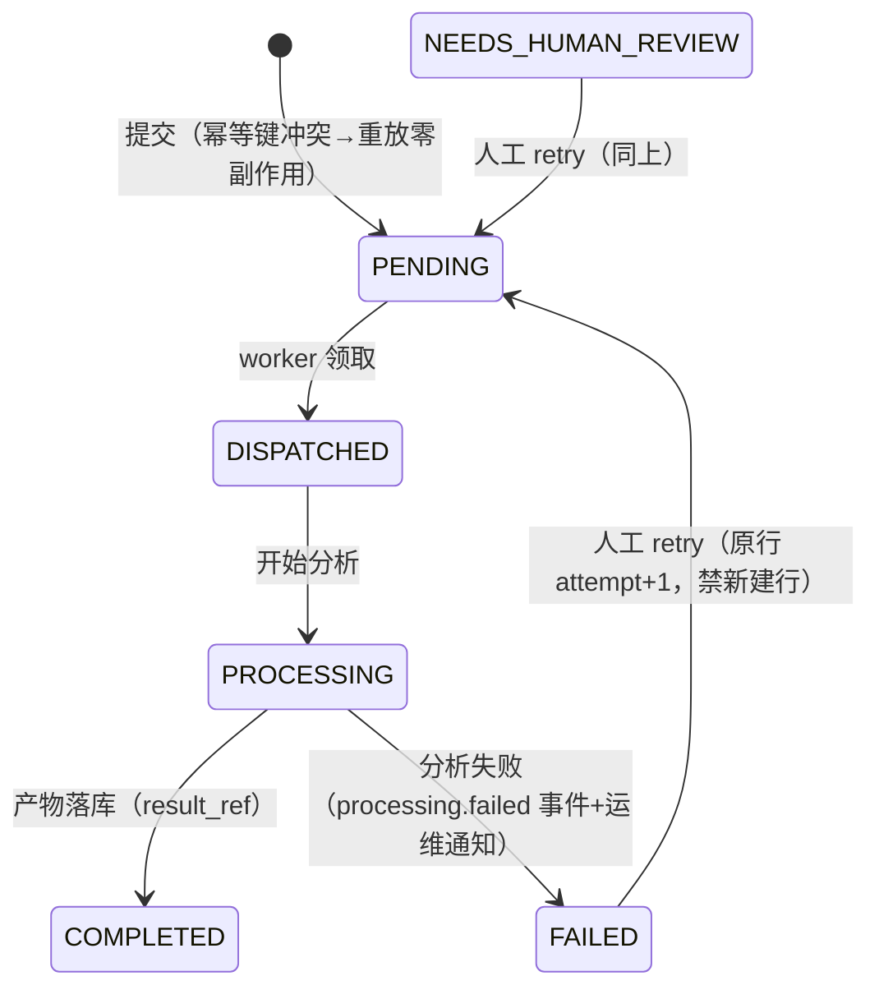
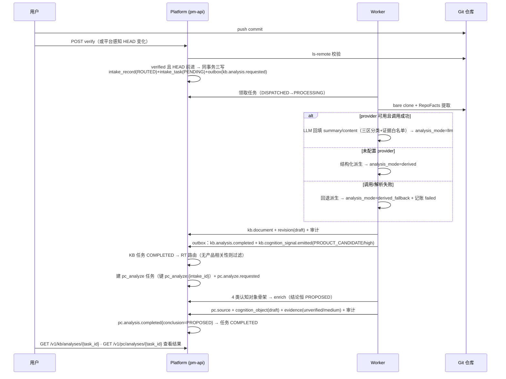

# PC / KB 操作链 · 业务逻辑终态（commit → 分析 → 人工确认）

| 属性 | 值 |
| --- | --- |
| 版本 | V1.0（终态登记） |
| 登记日期 | 2026-11-08 |
| 证据基准 | P2-13×PC-I6 裁决包（2026-11-08 已裁）+ Checkpoint-1 验收记录（全链 8s PASS）+ kb-pc 服务架构 v1.1（13 项 ADR 已批）+ 代码工作区 |
| 验收状态 | Checkpoint-1 全链 PASS（`scripts/checkpoint1-e2e.sh`）；LLM 增强切片（PC-I6 起笔）已裁决待实施落全 |

---

## 1. 模块定位与分工

| 域 | 定位 | 关键规则 |
| --- | --- | --- |
| **KB**（Knowledge Base） | 仓库资料的**权威管理层**，三层：Original Sources / Extracted Content / Structured Memory；原始资料 AI 不得改写 | digest = 仓库快照结构化统计摘要；信号保守固定 `relevance=PRODUCT_CANDIDATE`、`confidence=high`（裁决 D-4a 维持） |
| **PC**（Product Cognition） | 项目**认知层**：从 KB 信号出发判断并起草认知对象 | 产物恒 `PROPOSED`/draft；AI **无确认权**（fail-closed 写入闸，MCP 不暴露绕过人工确认的工具） |
| 路由分工 | **ADR-02 三分法**：KB 产信号 → Platform 路由 → PC 判断 | KB→PC 点对点取消、PC→KB 只读保留；信号 confidence 不影响 PC 治理等级 |

产品定义中的「八观察视角」是概念框架（`product-cognition-knowledge-base-definition-architecture-v1.md` §4）；**当前代码兑现的是 4 类认知对象**：`repository` / `tech_stack` / `delivery_activity` / `module`（`kb_pc_analysis.rs:602-686`），关系建模归后续切片。

## 2. 触发链：用户 commit 之后发生什么

1. 用户（或平台感知 HEAD 变化后）调 `POST /v1/pm/repositories/{id}/verify`（`pm_repositories.rs:38-41`），平台对仓库真实 `ls-remote` 校验。
2. **仅当** `status=="verified"` 且 HEAD 前进（`previous_head != head`）才触发 intake；同 HEAD 重复 verify 短路、零副作用（幂等键 `repo_verify:{repository_id}:{head_commit_sha}`，`repo.rs:505-583`）。
3. 同一 PG 事务三写：`intake_record(ROUTED)` + `intake_task(kb_analyze, required, PENDING)` + outbox `kb.analysis.requested`（`intake.rs:291-294`）；键冲突即重放 `replayed=true`。
4. 其他入口：手动 `POST /v1/pm/intakes` 可提交八类输入（`intake.rs:29-38`）；`product_decision` 直派 PC 判断；契约路由 K1/P1/P2/P4/P5 受理面暂为 501 骨架（后续切片）。

## 3. intake 状态机（L2 任务层）

枚举（迁移 0048）：`PENDING / DISPATCHED / PROCESSING / COMPLETED / FAILED / NEEDS_HUMAN_REVIEW / SKIPPED / CANCELLED`。全部 CAS 迁移；活跃唯一索引防重复任务；父层（intake_record）受理即 `ROUTED`，顶层状态查询时**派生**不落列（优先级：NEEDS_HUMAN_REVIEW > 必需 FAILED > PROCESSING > COMPLETED）。

人工重试入口：`POST /v1/pm/intakes/{intake_id}/tasks/{task_id}/retry`——FAILED / NEEDS_HUMAN_REVIEW 原行 attempt+1 重置 PENDING，新派发键 `retry:{task_id}:{attempt}`（ADR-12：禁新建行）。

## 4. 分析本体（derived 与 LLM 双模式）

**结构化派生（基线，全部取自 RepoFacts 真实事实，不虚构）**：

| 对象 | 提取内容 |
| --- | --- |
| repository | HEAD / 分支 / 文件数 |
| tech_stack | 文件扩展名构成 |
| delivery_activity | 近 10 commit |
| module | 热点文件 ≤5（object_key=`repo:{repo_id}:{slot}`） |

KB digest：统计小节恒有（技术栈 Top8 / 近 30 commit / 热点 10 / 文档清单）。

**LLM 增强（裁决 D-2=A 的产物边界）**：对象骨架与结论**不由 LLM 决定**，LLM 只回填 summary/content——PC content 强制三区分类（**事实 / 推断 / 不确定**）+ 证据白名单（实现侧对照 RepoFacts 过滤，只许引用真实存在的 sha/路径）；结论恒 `PROPOSED`（`kb_pc_handlers.rs:279`）。

**模式标记与降级（analysis_mode，迁移 0062，append-only）**：

| analysis_mode | 触发条件 |
| --- | --- |
| `llm` | LLM 调用成功 |
| `derived` | 未配置 provider（无 LLM 参与，digest 尾注声明） |
| `derived_fallback` | provider 调用/解析失败 → 回退结构化派生 + WARN + `ai.llm_call_record` 记 failed（裁决 D-3=A） |

**绝不回退 fixtures 假数据**（会污染供人审的治理面）。去重：KB 同 content_hash 复用修订；PC 同 content 跳过追加。

## 5. 端到端时序（用户 commit → 人工确认）

## 6. 产物治理（谁能确认什么）

| 产物 | 初始状态 | 确认规则 |
| --- | --- | --- |
| KB revision | `draft`（0053） | AI 禁自动确认（M3 门）；confidence 与确认语义分离 |
| PC cognition_object / revision | `draft`；evidence `unverified` + `confidence=medium` | 同上 |
| 结论 | 恒 `PROPOSED`（三态枚举 `PROPOSED/NO_CHANGE/CONFLICT` 中仅此态在快照路径产生） | — |

- 审批矩阵（正式治理，L0~L3）：L0 自动处理不产正式版本；L1 单步确认；**L2 = AI 只能提案，由 Lead 或审批人确认**；L3 冲突冻结（`05-formal-governance.md:24-33`）。
- fail-closed 写入闸：未登记写命令不放行；MCP 不暴露绕过人工确认的正式确认工具。
- **当前确认入口未建**：PC-01C 批次提供 proposal/审批端点（`pc.proposal*` / `pc.approval`）；本阶段人工通过 K2/P3 读端点查看分析结果，正式确认待 PC-01C。

## 7. 未做边界（属 PC-I6 后续切片，勿当已有能力）

1. 三态结论中的 `NO_CHANGE`（仅桩路径）/`CONFLICT` 与冲突发现（依赖认知对象关系建模，未建）。
2. Requirement / Design·ADR 影响分析、完整性/一致性检查、主动认知维护。
3. 非仓库类产品资料输入（Team Source Pool 面仍为 Phase 3 桩）。
4. KBGIT/PCGIT 正文权威（正文暂存 PG）。
5. 契约受理面 K1/P1/P2/P4/P5（501 骨架）。

## 8. 权威源

1. **裁决终态**：`project-ai-team-v2/ai-pm-p2-13-pc-i6-llm-analysis-adjudication-pack-v1.md`（§〇 D-1~D-4，2026-11-08）。
2. **验收终态**：`checkpoint1-verification-record-v1.md`。
3. **架构权威**：`architecture/knowledge-services/kb-pc-independent-services-architecture-v1.1.md`（13 项 ADR 2026-11-07 全批；**取代同目录 v1.0**）。
4. **需求权威**：`product-cognition-detailed-requirements-v1.1/`（**取代 v1**；v1-review.md 为过程稿）。
5. 表结构：迁移 0048（intake）/ 0053（KB/PC 最小表）/ 0062（analysis_mode）。
6. 概念源：`product-cognition-knowledge-base-definition-architecture-v1.md` §4/§5/§6（八视角/三层资料/Team Source Pool）——概念有效，兑现面以代码与 0053 为准。
