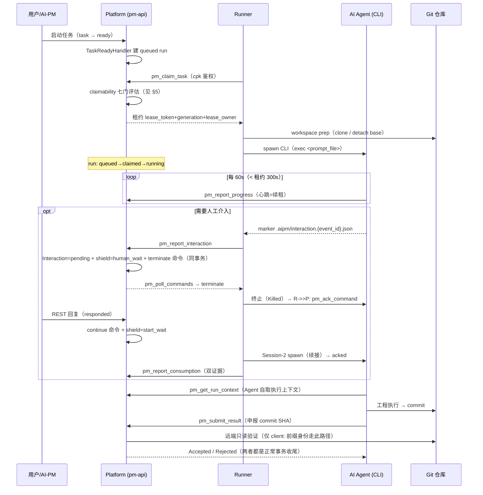
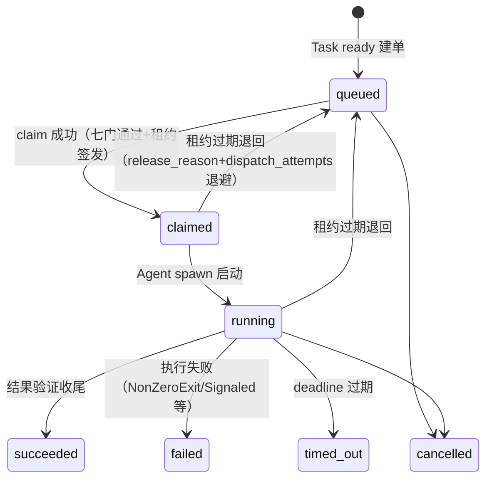

# Runner / Platform / AI Agent / MCP 通信协议 · 业务逻辑终态

| 属性 | 值 |
| --- | --- |
| 版本 | V1.0（终态登记） |
| 登记日期 | 2026-11-08 |
| 证据基准 | checkpoint2-R4 验收记录 + 派发竞争裁决记录（2026-11-08）+ 代码工作区（master 8d81fbd 后） |
| 验收状态 | **ACP-09 已正式关闭**（R4 全链真机验收 PASS：.59 真机 cpk 全链 → 平台远端验证 accepted） |

---

## 1. 四方角色与信任模型

| 角色 | 是什么 | 职责边界 |
| --- | --- | --- |
| **Platform** | pm-api（:8090），含 `/mcp` JSON-RPC 面（26 工具） | 任务派发裁决、租约签发、结果远端验证、命令下发 |
| **Runner** | 用户机器上的成品二进制 `apps/ai-pm-runner`（R4 真机部署于 .59） | 只做**通信与编排**：领取任务、准备工作区、spawn/终止 Agent、心跳、命令轮询；「不代拉上下文、不代交结果」 |
| **AI Agent** | 本地 CLI（ZCode → Codex → DSH 按序探测，`apps/ai-pm-runner/src/profiles.rs:1-19`） | **真正的执行运行时**；自行调用 `pm_get_run_context` / `pm_submit_result` 等 MCP 工具 |
| **MCP** | Platform `/mcp` 上的 JSON-RPC 工具接口（Streamable HTTP） | **只是通信接口，不是执行运行时**——执行能力来自 Runner 托管的外部 CLI |

信任与身份（三层）：

1. **设备凭据（cpk）**：`POST /v1/pm/devices/{id}/credential` 签发，明文仅响应一次、重复签发 409（`device_credential.rs:89-128`）；写入 Runner `.env` 的 `AI_PM_RUNNER_TOKEN`。平台侧每请求查库验证，fail-closed、不回退 JWT（`apps/pm-api/src/auth.rs:219-223`）；四项链 = hash 命中 ∧ 设备 active ∧ 同租户 owner active ∧ 未撤销。
2. **权限真源** = 凭据行 `granted_permissions` 列（默认三码：`PM_MCP_READ` / `AGENT_REPORT` / `COMMAND`，迁移 0049），token 不参与授权。
3. **执行面身份**：工具调用落 `client:{device_id}`（`auth.rs:252-257`）；Run Lease 三要素 `lease_token + generation + run scope`（token 一次性明文、库存 sha256，`run_context.rs:25,63,129-132`）；命令面 `worker_id` = claim 响应 `lease_owner` 快照原样回带。

## 2. 协议面（当前确认语义）

| 项 | 终态 |
| --- | --- |
| 传输 | Streamable HTTP，`POST {AI_PM_PLATFORM_URL}`（:8090 `/mcp`），`tools/call` 信封 `{jsonrpc,id,method,params:{name,arguments}}`，取 `structuredContent`（回退 `content[0].text`），`isError`→Tool 错（`apps/ai-pm-runner/src/mcp.rs:83-151`） |
| 推送 | **无推送**。心跳 = `pm_report_progress` 续租（默认 60s，INV-1：须 < 租约 300s，`main.rs:134-136`）；命令 = `pm_poll_commands` 轮询（3s）+ `pm_ack_command` 回执 |
| 命令账 | `worker_command` 四态 `issued→delivered→acked|failed`（迁移 0046） |
| 关键工具 | `pm_claim_task` / `pm_get_run_context` / `pm_submit_result` / `pm_report_progress` / `pm_poll_commands` / `pm_ack_command` / `pm_report_interaction` / `pm_report_consumption` / `pm_discover_runs` / `pm_reacquire_lease` |

## 3. 任务派发全链时序

双通道领取（竞争语义）：Runner cpk 通道（Model A）**恒开放**，不受派发开关门控；ai-pm-worker 自动领取通道（Model B，`claim_and_start`）由环境变量 `AI_PM_RUN_DISPATCH` 控制，**代码默认 Off**（`run_dispatch/mod.rs:126-131`），项目排除列表 `AI_PM_RUN_DISPATCH_EXCLUDE_PROJECTS`。该接线由裁决 D-1=b 落地（commit a1bd7f4）。

## 4. 状态机（终态枚举）

**task_run（7 态，`run_dispatch/mod.rs:28-36`）**

- stage 标记：`dispatch / started`；exit 口径与 Runner 独立对齐为五值 `Success / NonZeroExit / Signaled / Killed / Lost`（`run_dispatch/port.rs:173-183`、`adapter.rs:29-49`）。
- **scheduling_shield**（0046）：`none → human_wait → start_wait → none`；terminate 重试耗尽 → `timed_out` + `continuation_start_frozen_at` 冻结。
- **worker_command**（0046）：`issued → delivered → acked | failed`。
- **interaction_response_delivery**（0050）：一回复一投递账（UNIQUE(response_id)），`pending → delivering → delivered → consumed`；failed 重投复用原行 attempt_count+1。
- **continuation**（0051）：`open → started → consumed`；`open|started → frozen`；`closed` 为终态不可迁移；generation = 同 Run 第 N 次继续（UNIQUE(run_id, generation)）。
- **Task 层**：13 态（迁移 0010）；等待原因第五值 `no_executor_available`（0059）是 `task_waiting.reason`，**不是** Task 状态。无独立 TaskExecution 表——执行态由 task_run + shield + continuation 承载。

## 5. claimability 七门（竞争与可用性真枚举）

deny 枚举原样抄录（`run_dispatch/policy.rs:135-231`）：

| deny 值 | 语义 |
| --- | --- |
| `retry_exhausted` | 重试次数耗尽 |
| `policy_requires_approval` | 策略要求审批 |
| `task_waiting` | 任务处于等待态 |
| `no_executor_assignee` | 无 executor assignee（必须为 dev_agent principal） |
| `no_repository_scope` | 无仓库范围 |
| `repository_not_verified` | 仓库未通过 verify |
| `baseline_unavailable` | 基线不可用 |

deny 后：worker 通道 → `requeue_with_backoff(release_reason=deny)`；Runner 通道 → `TaskNotReady("denied: {reason}")`。**注意**：旧文档中的 `no_client_available` 字面量**不存在**，是勘误后的失实表述。

## 6. 异常与恢复

| 场景 | 终态行为 |
| --- | --- |
| 租约过期 | 退回 queued + `release_reason` + `dispatch_attempts` 退避（`claim.rs:677,799-817`） |
| 基础设施失败 | 独立计数 `infrastructure_retry_count`（迁移 0011） |
| terminate 重试耗尽 | shield `timed_out` + `continuation_start_frozen_at`（0046） |
| deadline 过期后续领/continue | 一律拒绝；ACP-07 语义 = REST 重授权（独立审计），`run.deadline_at` 零改动（`acp06_07.rs:152-196`） |
| Runner 离线超 TTL 后恢复 | `pm_discover_runs`（`lease_client_id` 严格相等 + shield start_wait + 存在 continue 命令）→ `pm_reacquire_lease`：五前置单事务，generation+1，命令改路由 rerouted（`recovery.rs:76-170`） |

## 7. V1 边界（已验收 vs 挂账）

- **已验收**（R4 关闭）：Runner 真二进制 claim 循环 + .59 部署；cpk 全链 + 401 fail-closed；离线超 TTL 恢复（generation=2、rerouted=1）；人工介入全链十项对照。
- **挂账**：CLI Adapter 真机档（.59 无 ZCode/Codex，验收用 fake_agent.py 替代）；CRLF/LF 迁移指纹 LF 规范化小批；Linux systemd 注册（V0.6 候选）；心跳作可用性真源（裁决 D-2=c 仅登记方向未实施）；0059 无自动重试器；Runner HA 不在范围。

## 8. 权威源与勘误

1. **验收终态**：`docs/checkpoint2-r4-acceptance-record-v1.md`（R4 十项对照）。
2. **竞争裁决**：`docs/project-ai-team-v2/ai-pm-v05-dispatch-competition-adjudication-record-v1.md`——其中 D-1=b 接线已由 a1bd7f4 实施取代「硬编码 On 死开关」旧况。
3. **协议设计权威**：`ai-pm-v05-runner-implementation-design-v1.md` §3.1~3.3/§5（含内嵌「V1.0a 实施勘误」：401 fail-fast、远端验证仅 `client:` 前缀）。
4. **失实勘误**（勿再引用）：R4 §六-1 的「派发默认 On」「readiness 无 check-in」「no_client_available」三处已被勘误取代。
5. 表结构：迁移 0046/0049/0050/0051/0052/0054/0055（0049 的 `uq_device_tenant_name` 已被 0055 重建为活跃名唯一）/0059。
