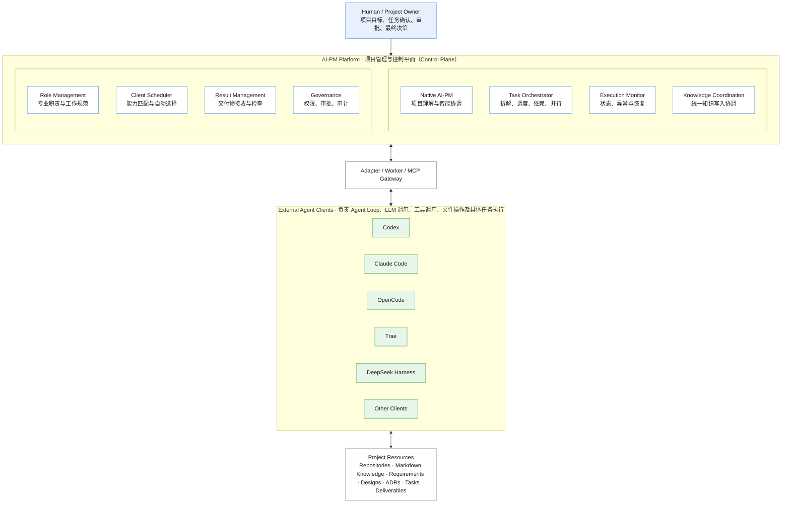
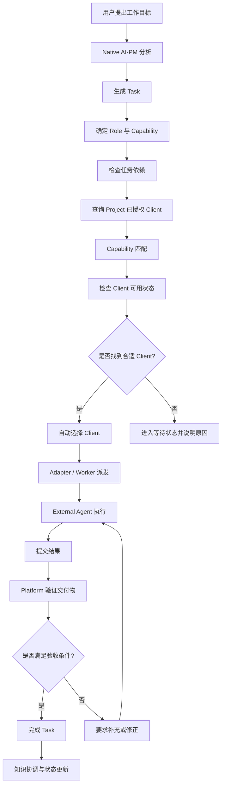

# Project AI Team V2.0 正式产品架构设计与裁决记录

> 状态：裁决已确认 · V2.0 · Architecture Baseline
> 日期：2026-11-06
> 本次裁决：Q1=A、Q2=B、Q3=A

本次裁决正式确立 Project AI Team 的核心架构方向：

AI-PM Platform 负责项目智能管理、任务调度、执行治理和知识协调；外部 Agent Client 负责具体专业任务的执行。

Platform 不建设一套包含大量专业 Agent 的内部 Agent Runtime。Codex、Claude Code、OpenCode、Trae、DeepSeek Harness 等外部执行环境，是 Project AI Team 的任务执行资源。

---

## 一、正式裁决记录

### 1.1 裁决结果

| 裁决项 | 用户选择 | 正式决定 |
| --- | --- | --- |
| Q1：Agent Client 管理范围 | A | 个人级注册，授权给不同 Project 使用 |
| Q2：Agent Client 任务分配方式 | B | Platform 根据 Role、Capability、可用状态和任务要求自动选择 |
| Q3：Role 与 Agent Client 关系 | A | Role 不绑定固定 Client，每个 Task 动态分配 |

### 1.2 Q1：Agent Client 管理范围

**选择 A · 个人级注册**

Agent Client 归属于用户个人，而不是 Project。

用户可以在个人层面注册和管理 Agent Client，并授权指定 Project 使用。

例如：

```text
User
 ├── Codex Client
 ├── Claude Code Client
 ├── OpenCode Client
 └── Trae Client

Project A
 ├── Authorized: Codex
 └── Authorized: Claude Code

Project B
 ├── Authorized: OpenCode
 └── Authorized: Codex

Project C
 └── Authorized: Trae
```

架构要求：

1. Agent Client 的注册、连接和基础配置归用户管理。
2. Project 不能直接拥有或修改用户的 Agent Client。
3. 用户可以将 Client 授权给一个或多个 Project。
4. 用户可以撤销某个 Project 的授权。
5. Project 只能使用已经获得授权的 Client。
6. Client 的个人级配置和 Project 授权关系必须分开存储。
7. 撤销授权后，不得继续向该 Client 分配新的任务；正在执行的任务进入明确的中断或取消处理流程。

这里要特别区分：

- **注册**：用户拥有一个可连接的 Agent Client。
- **授权**：允许某个 Project 使用该 Client。
- **调度**：Platform 根据任务条件选择一个已授权的 Client。

这三个行为不是同一个概念。

### 1.3 Q2：Agent Client 任务分配方式

**选择 B · Platform 自动调度**

Platform 根据任务需求自动选择 Agent Client。

调度系统需要考虑：

- Task 所需 Role。
- Task 所需 Capability。
- Client 实际支持的能力。
- Client 是否已经授权给当前 Project。
- Client 当前是否可用。
- Client 是否正在执行其他任务。
- Task 的优先级、依赖关系和并行要求。
- 用户设置的调度约束。

例如：

```text
Task: Project Dashboard UI/UX Design

Required Role:
  UI/UX Designer

Required Capabilities:
  - Information Architecture
  - UX Flow Design
  - UI Design
  - Figma Deliverable

Authorized Clients:
  - Codex
  - Claude Code
  - Trae

Scheduler:
  1. 检查 Client 授权
  2. 检查 Capability
  3. 检查 Client 状态
  4. 评估任务适配性
  5. 选择 Client
  6. 创建执行记录
  7. 派发 Task
```

本次选择 B，意味着**自动调度是系统默认工作方式**，而不是让用户逐个任务选择 Codex 或 Claude Code。

但自动调度不代表可以任意执行：

- 不满足 Capability 的 Client 不得被选择。
- 未授权的 Client 不得被选择。
- Client 不可用时不得假装任务已经派发成功。
- 没有符合条件的 Client 时，任务应进入明确的等待状态，并说明原因。
- 高风险操作仍然遵守人工审批和权限治理。

### 1.4 Q3：Role 与 Agent Client 关系

**选择 A · 动态分配**

Role 不绑定固定 Agent Client。

Role 表示任务职责、专业要求和工作规范；Agent Client 是执行任务的外部环境。

例如：

```text
Role: UI/UX Designer
  ├── Task A → Codex
  ├── Task B → Claude Code
  └── Task C → Trae

Role: Solution Architect
  ├── Task D → Claude Code
  └── Task E → Codex

Role: Developer
  ├── Task F → Codex
  └── Task G → OpenCode
```

相同 Role 的不同 Task，可以由不同 Client 执行。

同一个 Client 也可以承担多个 Role 对应的任务。

因此，Role 与 Client 之间不存在永久的一对一关系。

---

## 二、Project AI Team V2.0 产品定位

### 2.1 核心定义

Project AI Team 是项目级 AI 工作组织与执行协调体系。

它不是一个内部 Agent 集合，也不是一个 Agent Runtime。

它负责组织项目工作，并通过外部 Agent Client 完成具体专业任务。

核心职责：

1. 定义项目所需的 AI Roles。
2. 将项目工作拆解成可执行 Task。
3. 判断任务需要什么能力。
4. 从用户授权的 Agent Client 中选择执行者。
5. 调度任务，处理依赖关系和并行执行。
6. 监控执行过程和异常。
7. 接收并检查执行结果。
8. 协调知识库与业务数据更新。
9. 将需要人类决策的事项交给用户。

### 2.2 整体架构



架构边界：

| 能力 | 归属 |
| --- | --- |
| 项目管理、需求与任务协调 | AI-PM Platform |
| 项目级 Role 定义 | AI-PM Platform |
| 任务拆解和调度 | AI-PM Platform |
| Agent Loop | 外部 Agent Client |
| LLM 调用（外部 Client 执行时） | 外部 Agent Client |
| 文件与代码操作 | 外部 Agent Client |
| Git 工程操作 | 外部 Agent Client（受授权约束） |
| 任务状态与交付物管理 | AI-PM Platform |
| 知识版本和业务状态协调 | AI-PM Platform |
| 人工审批和最终决策 | 人类 |

---

## 三、Platform 原生 AI-PM 与外部 Agent 的边界

这是本次架构最重要的约束之一。

之前已经确定：即使 Project 没有连接 Codex、Claude Code 或其他外部工具，内置 AI-PM 仍然必须可用。

因此，不能因为 V2 强调外部 Client 执行，就把 Platform 设计成一个没有外部 Agent 就无法工作的空壳。

### 3.1 Native AI-PM

Platform 内置 AI-PM，使用 Team 配置的 LLM Provider 和模型策略。

它负责：

- 项目上下文理解。
- 需求分析。
- 需求建议。
- 任务分析与拆解。
- 风险识别。
- 架构一致性分析。
- 决策建议。
- 知识整理与草稿生成。
- 人工待处理事项识别。
- 外部 Agent 工作协调。

它可以直接调用模型完成结构化分析，不需要另外创建一个内部 Agent Client。

Native AI-PM 是 Platform 的原生智能能力，不是一个外部 Agent Client。

### 3.2 External Agent Client

外部 Client 负责复杂、专业或需要外部执行环境的任务：

- UI/UX 设计。
- 技术架构设计。
- 代码开发。
- Repository 分析。
- 自动化测试。
- 文件生成与修改。
- Git 操作。
- 其他需要 Agent 工具链的专业工作。

### 3.3 不建设内部多 Agent Runtime

V2 正式取消以下设计方向：

- Platform 内部为每种专业角色创建独立 Agent Runtime。
- 每个 Role 都运行独立 Agent Loop。
- Platform 内部多个 Agent 自行管理工具调用并相互委托。
- Role 与特定 Agent Client 永久绑定。

保留的是原生 AI-PM 智能、Role 工作规范和统一任务调度。

---

## 四、AI Role 体系

Role 是项目专业工作的职责定义，不是运行中的 Agent。

### 4.1 Role 目录

建议提供系统预置 Role，同时允许项目扩展。

| Role | 主要职责 | 执行方式 |
| --- | --- | --- |
| AI Project Manager | 项目理解、规划、拆解、协调 | Platform Native |
| Requirement Reviewer | 需求质量、完整性和冲突检查 | Native 或 External |
| Knowledge Manager | 知识整理、版本协调、知识质量 | Platform 主导 |
| Solution Architect | 技术方案与架构设计 | Native 或 External |
| UI/UX Designer | 信息架构、交互设计、界面设计 | 通常 External |
| Developer | 代码实现与工程修改 | 通常 External |
| QA Engineer | 测试设计、测试执行、质量检查 | Native 或 External |
| Risk Analyst | 风险识别、影响分析 | Native 或 External |

这里的执行方式不是 Role 的固定属性，而是任务层面的执行选择。

例如 Requirement Reviewer 可以先由 Native AI-PM 进行初步分析，再将复杂评审委托给外部 Client。

### 4.2 Role 定义结构

每个 Role 应具备：

| 字段 | 含义 |
| --- | --- |
| Role ID | 唯一标识 |
| Name | Role 名称 |
| Description | 职责描述 |
| Responsibilities | 职责范围 |
| Skills | 所需专业技能 |
| Instructions | 工作规范与执行要求 |
| Required Capabilities | 所需能力 |
| Input Contract | 输入要求 |
| Output Contract | 输出要求 |
| Acceptance Criteria | 交付验收条件 |
| Risk Constraints | 风险与权限约束 |
| Status | 启用、停用 |

Role 的具体 Instructions 和 Skills 可以随任务一起交给外部 Client 使用。

---

## 五、Agent Client 管理体系

### 5.1 个人级 Client Registry

按照 Q1=A，Agent Client 的注册和管理属于个人。

建议在个人设置中增加 Agent Clients：

```text
Personal Settings
 ├── Profile
 ├── Security
 ├── LLM Preferences
 └── Agent Clients
       ├── Codex
       ├── Claude Code
       ├── OpenCode
       └── Trae
```

这里不引入新的 Workspace 概念。

### 5.2 Client 信息模型

建议每个 Client 至少维护：

| 字段 | 含义 |
| --- | --- |
| client_id | Client 唯一 ID |
| owner_user_id | 所属用户 |
| client_type | Codex、Claude Code 等 |
| display_name | 用户自定义名称 |
| adapter_type | 连接适配方式 |
| capabilities | 已声明或验证的能力 |
| connection_status | 连接状态 |
| execution_status | 执行状态 |
| availability | 当前可用性 |
| last_seen_at | 最近在线时间 |
| configuration | Client 配置引用 |
| created_at | 创建时间 |

注意：Client 的能力声明不应被无条件信任。需要区分：

- 已声明能力。
- 已验证能力。
- 当前可用能力。

### 5.3 Project 授权关系

Project 通过授权关系使用个人 Client：

```text
user_agent_client
  └── project_agent_client_authorization
          ├── project_id
          ├── client_id
          ├── authorized_by
          ├── authorized_at
          ├── permission_scope
          └── status
```

授权关系应具有独立生命周期。

不能将 Project 的 Client 授权状态直接写进 Client 本身的个人配置。

### 5.4 权限隔离

必须满足：

1. Project A 不能读取 Project B 的任务上下文。
2. Client 只有在获得 Project 授权后才能接受该 Project 的任务。
3. Client 执行任务时必须携带 Project 和 Task 上下文。
4. 每次任务执行都必须检查授权有效性。
5. 撤销授权后，旧执行凭证不能继续获得新的操作权限。
6. 不允许通过共享 Client 绕过 Project 数据隔离。

---

## 六、Task Orchestration：任务调度体系

这是 Platform 最核心的能力之一。

### 6.1 调度流程



### 6.2 Task 数据结构

Task 必须是独立、可追踪、可恢复的工作单元。

建议结构：

| 字段 | 说明 |
| --- | --- |
| task_id | 任务 ID |
| project_id | 所属项目 |
| title | 任务标题 |
| description | 任务说明 |
| role_id | 所需 Role |
| required_capabilities | 所需能力 |
| input_refs | 输入上下文引用 |
| output_contract | 输出约定 |
| acceptance_criteria | 验收条件 |
| dependencies | 依赖 Task |
| priority | 优先级 |
| execution_mode | Native / External |
| assigned_client_id | 实际分配 Client |
| status | 任务状态 |
| created_by | 创建者 |
| created_at | 创建时间 |

特别强调：

**role_id 和 assigned_client_id 是两个不同维度。**

前者表示谁负责什么专业工作；后者表示本次由哪个外部执行环境完成。

### 6.3 任务状态建议

建议将任务生命周期设计为：

```text
DRAFT
  ↓
READY
  ↓
SCHEDULING
  ↓
ASSIGNED
  ↓
DISPATCHED
  ↓
RUNNING
  ↓
SUBMITTED
  ↓
REVIEWING
  ↓
COMPLETED
```

异常状态：

- WAITING_FOR_CLIENT：没有符合条件的 Client。
- WAITING_FOR_DEPENDENCY：依赖尚未完成。
- WAITING_FOR_HUMAN：需要人工决策。
- BLOCKED：任务被阻塞。
- FAILED：执行失败。
- CANCELLED：任务取消。

注意：以上是建议的 Task 生命周期，不应与既有 InitItem 六态混用。InitItem 六态仍然只是初始化事项的展示层状态。

### 6.4 自动调度规则

自动调度需要分成几个阶段：

**第一阶段：授权过滤**

只允许选择当前 Project 已授权的 Client。

**第二阶段：能力过滤**

Client 必须满足任务的必要 Capability。

**第三阶段：可用性过滤**

排除离线、故障、被停用或不接受新任务的 Client。

**第四阶段：任务适配**

根据任务复杂度、所需工具、执行环境、资源占用和优先级进行选择。

**第五阶段：执行派发**

创建 Execution 记录，分配 Client，并通过 Adapter/Worker 进行派发。

如果没有合适 Client，不允许静默降级为不符合要求的 Client，也不允许伪造执行成功。

---

## 七、Adapter / Worker / MCP 接入架构

这一部分必须与既有 Codex Bootstrap V1.3 架构保持一致。

### 7.1 核心原则

MCP 是通信接口，不是执行 Runtime。

Platform 不应该假设 Codex、Claude Code、OpenCode、Trae 等所有工具都使用相同接入方式。

建议：

```text
AI-PM Platform
      |
      v
Agent Gateway
      |
      v
Adapter Layer
  ├── Codex Adapter
  ├── Claude Code Adapter
  ├── OpenCode Adapter
  ├── Trae Adapter
  └── Generic Adapter
      |
      v
Agent Client
```

Adapter 负责处理不同 Client 的协议差异：

- 任务下发。
- 上下文传递。
- 身份认证。
- 执行状态同步。
- 结果回传。
- 中断与取消。
- 错误映射。

### 7.2 Worker 的定位

保留 Worker / Execution Bridge。

Worker 负责连接 Platform 和实际执行环境，不负责项目智能决策，也不应该自行创建另一套项目管理逻辑。

它是执行桥梁，而不是 AI-PM 的替代品。

---

## 八、Knowledge Coordination：知识统一协调

Knowledge Manager 不应该变成一个可以自由修改数据库的超级 Agent。

它是 Platform 的统一知识协调职责。

### 8.1 知识体系

继续沿用已经确定的知识权威模型：

| 系统 | 权威范围 |
| --- | --- |
| Markdown + Git | 需求、设计、ADR、项目知识正文 |
| PostgreSQL | ID、状态、版本引用、审批、状态机、审计和事件 |
| PageIndex | 可重建的派生索引 |
| AI-PM | 知识分析、维护、版本协调与质量门禁 |

### 8.2 知识写入流程

```text
External Agent
    |
    v
提交知识变更建议 / 文档
    |
    v
Platform Knowledge Coordination
    |
    v
校验项目权限与文档结构
    |
    v
检查知识一致性与版本
    |
    v
需要人工确认?
    |
    +---- Yes ---> Human Approval
    |
    v
正式写入 Markdown + Git
    |
    v
通过业务 API 更新 PostgreSQL
    |
    v
刷新 PageIndex
```

关键红线：

- 外部 Client 不能直接绕过业务 API 修改业务数据库。
- 正式需求确认必须由人类完成。
- 知识变更必须保留版本和审计。
- Agent 不得跨 Project 写入。
- PageIndex 不得成为知识正文的权威来源。
- 不能把知识写入权限等同于需求审批权限。

---

## 九、Team LLM Provider 与 Agent Client 的关系

本次 V2 裁决不改变既有 Team LLM Provider Management V1.0。

两者属于不同层次：

| 项目 | Team LLM Provider | Agent Client |
| --- | --- | --- |
| 主要服务 | Platform Native AI-PM | 外部 Agent 执行 |
| 配置归属 | Team | User |
| 模型调用 | Platform | Client 自身执行环境 |
| 凭证管理 | Team 管理 | 根据 Client 实际接入方式管理 |
| Project 使用限制 | Team 授权模型范围 | 用户授权 Project 使用 Client |
| 调度 | Native AI-PM 自身调用策略 | Task Scheduler 自动选择 Client |

例如：

- Native AI-PM 使用 Team 配置的模型完成需求分析。
- UI/UX 设计任务分配给 Codex。
- Codex 自身使用它所支持的模型和工具链执行任务。
- Platform 接收交付结果并进行验收。

不能假设所有外部 Client 都能由 Platform 直接注入 LLM Provider 凭证。

如果某些 Client 支持模型参数透传，可以通过 Adapter 能力扩展实现；但不能把它作为所有 Client 的统一前置条件。

---

## 十、Project AI Team 管理 UI

根据本次架构，Project AI Team 的主要管理入口应该放在 Project Settings 中，而不是占据 Project Dashboard 的核心区域。

建议结构：

```text
Project Settings
  └── AI Team
        ├── Roles
        ├── Agent Clients
        ├── Task Scheduling
        ├── Execution Policies
        └── Permissions
```

### 10.1 Roles

管理项目需要哪些专业角色。

显示：

- Role 名称。
- 职责。
- Capability 要求。
- 工作规范。
- 是否启用。

不显示固定的 Client 绑定关系。

### 10.2 Agent Clients

显示当前 Project 已授权的个人 Client。

| Client | 授权状态 | 连接状态 | 能力 | 调度状态 |
| --- | --- | --- | --- | --- |
| Codex | 已授权 | 在线 | Coding、Repository | 可调度 |
| Claude Code | 已授权 | 在线 | Coding、Analysis | 可调度 |
| Trae | 已授权 | 离线 | UI、Coding | 不可调度 |

上表仅为 UI 示例，不代表这些产品当前实际支持的所有能力。

Project Admin 可以查看和管理 Project 授权，但不能修改用户个人 Client 的归属。

### 10.3 Task Scheduling

显示：

- 自动调度开关。
- 调度策略。
- Capability 匹配规则。
- 并行执行限制。
- Client 不可用时的处理方式。
- 等待人工处理策略。

由于 Q2 已经确定为自动选择，手动指定 Client 不属于默认流程。未来若要增加人工覆盖，应作为单独的产品裁决，不在本次基线中擅自加入。

### 10.4 Execution Monitor

显示：

- 当前执行任务。
- 使用的 Client。
- 当前执行阶段。
- 执行耗时。
- 最近状态更新时间。
- 异常与阻塞原因。
- 结果提交状态。

### 10.5 Project Dashboard 不应成为 Client 管理页面

Dashboard 继续以用户真正关心的事项为核心：

1. 待人工处理。
2. 当前执行。
3. 项目风险。
4. 初始化进度。

Agent Client 的配置与管理属于 Settings；具体执行状态可以出现在 Dashboard 的当前执行区域。

---

## 十一、建议的领域模型

下面是 V2 的概念模型，供后续数据库设计使用。它不是要求一次性全部创建的数据库迁移清单。

```text
User
 └── AgentClient
       ├── AgentClientCapability
       └── ClientConnection

Project
 ├── ProjectRole
 ├── ProjectClientAuthorization
 ├── Task
 │    ├── TaskDependency
 │    ├── TaskExecution
 │    │    ├── ExecutionEvent
 │    │    ├── ExecutionResult
 │    │    └── ExecutionArtifact
 │    └── TaskReview
 ├── KnowledgeDocument
 └── ProjectAuditEvent
```

建议优先考虑以下核心实体：

| 实体 | 职责 |
| --- | --- |
| agent_client | 用户个人 Agent Client |
| agent_client_capability | Client 能力信息 |
| project_client_authorization | Project 授权关系 |
| project_role | 项目 Role 定义 |
| task | 项目工作单元 |
| task_dependency | 任务依赖关系 |
| task_execution | 一次具体执行记录 |
| execution_event | 执行事件 |
| execution_result | 执行结果 |
| execution_artifact | 交付物引用 |
| task_review | 交付检查与验收 |

特别注意：

**Task 和 TaskExecution 必须分开。**

同一个 Task 可能经历多次执行，例如首次失败后重新派发给另一个 Client。任务本身不应该因为重新执行就丢失历史。

---

## 十二、实施顺序建议

为了避免一次性建设过多功能，建议按以下顺序推进。

| 阶段 | 内容 | 目标 |
| --- | --- | --- |
| V2.0-A | Role Model | 建立 Role 与 Task 的职责关系 |
| V2.0-B | Personal Agent Client Registry | 用户注册和管理 Client |
| V2.0-C | Project Client Authorization | Project 授权个人 Client |
| V2.0-D | Capability Registry | 统一能力描述和验证 |
| V2.0-E | Task Scheduler | 自动匹配与分配 Client |
| V2.0-F | Adapter / Worker | 接入外部执行环境 |
| V2.0-G | Execution Monitor | 执行监控、异常处理和恢复 |
| V2.0-H | Result & Knowledge Coordination | 交付物验收和知识统一写入 |

建议优先完成 A～E，确保 Role、Client、授权和自动调度的数据模型正确，再扩展不同 Agent Client 的适配器。

---

## 十三、正式架构红线

以下内容纳入 Project AI Team V2.0 的架构约束。

**Architecture Guardrails**

1. AI-PM Platform 是项目管理与调度控制平面，不是多 Agent Runtime。
2. Platform 必须保留原生 AI-PM 能力，不依赖外部 Client 才能开展项目工作。
3. Role 是职责定义，不是 Agent 实例。
4. Task 是可追踪、可执行、可恢复的工作单元。
5. Agent Client 是外部执行环境，不属于 Project 内部创建的专业 Agent。
6. Agent Client 归用户个人管理。
7. Project 必须通过明确授权才能使用个人 Client。
8. Platform 自动选择 Client，不要求用户逐个任务手动分配。
9. Role 不绑定固定 Client。
10. Task 和 TaskExecution 必须分离。
11. MCP 是通信接口，不是执行 Runtime。
12. 知识库与业务数据库写入必须经过 Platform 的统一治理。
13. 外部 Client 不得绕过权限、审批、审计和 Project 数据隔离。
14. 没有合适 Client 时必须明确等待或阻塞，不得伪造执行结果。

---

## 十四、最终裁决摘要

**Project AI Team V2.0 · 正式基线已形成**

> **一句话定义**
>
> AI-PM Platform 负责组织和调度项目工作，外部 Agent Client 负责执行具体专业任务，知识与业务状态由 Platform 统一协调。

本次裁决：

| 项目 | 正式选择 |
| --- | --- |
| Client 管理范围 | 个人级注册 |
| Client 使用范围 | 用户授权给 Project |
| Task 分配 | Platform 自动调度 |
| Role 与 Client | 动态匹配，不固定绑定 |
| Platform 定位 | AI-PM Control Plane |
| 专业执行 | External Agent Client |
| 知识管理 | Platform 统一协调 |

架构核心关系：

```text
Human → AI-PM Platform → Task Scheduler → Agent Client → Deliverable → Knowledge Coordination
```