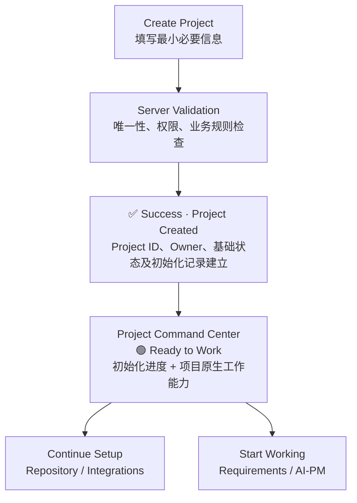

# S01 设计修订 · 第二份：S01-02 · Project Creation 设计修订稿 V1.1（专家供稿记录）

> **转交日期**：2026-11-05。本文件是对用户转交的专家设计修订稿的**忠实记录**（以转交文本为准）。
> 稿面状态（原稿自带）：**用户裁决已收编 · V1.1 修订 · 待基线确认**；§十 结论「建议冻结 V1.1 设计基线」——冻结动作待用户基线确认，记录阶段不执行。
> **章节号事实**：原稿章节自「七、Figma AI 设计提示词」直接跳「九、最终验收清单」（无八），转录保持原样。
> 图1 原件已归档：[assets/s01-02-creation-success-flow.png](assets/s01-02-creation-success-flow.png)；正文按原稿要求转化为 mermaid（§4.1）。
> 按既定协作约定：供稿阶段只记录不评审；评审须用户明确要求。

## 〇、修订目标（原稿自带）

本次修订需要同时解决两个问题：

1. 保留 11 月 4 日已经做出的 Project Creation 用户裁决。
2. 落实今天新的产品原则：**创建项目后即可工作**，不能因为 Repository、MCP 或外部 AI 工具尚未接入而限制项目能力。

---

## 一、历史裁决收编

此前的三项用户裁决：

| 裁决项 | 用户选择 | 收编结果 |
| --- | --- | --- |
| Q1 Project Key | A | 保留方案 A |
| Q2 Owner 指定 | A | 保留方案 A |
| Q3 创建成功后的行为 | A | 创建后立即进入初始化 |

**特别说明（原稿自带）**：现有历史记录能确认三个选项的选择，但没有完整保留方案 A 的具体规则正文。因此，本稿**不擅自重新解释** Project Key 的生成算法或 Owner 的指定细节，实施时应沿用原始裁决定义。

> **记录者核查（事实，2026-11-05）**：方案 A 正文**已在既有稿定位到**——
> `s01-02-project-creation-ux-v1-1.md:412-414` 裁决收编表（Q1=A 系统建议，人类确认 / Q2=A 默认当前用户，可修改 / Q3=A 自动进入初始化工作空间），
> 以及该稿 :59（Q1 段）、:88（Q2 段）、:208（Q3 段）三处详细裁决正文。本稿 §一 的担忧可由既有稿解除，基线确认时按该稿正文执行。详见附 A-1。

---

## 二、产品定位修订

### 2.1 Project Creation 的职责

Project Creation **只负责创建一个真正可以开展工作的 Project**。

它不负责：

- 配置代码仓库。
- 配置 MCP。
- 创建外部 AI Agent。
- 配置 Codex / Claude Code。
- 建立完整项目需求。
- 自动确认项目基线。

这些都属于项目创建之后的工作。

### 2.2 创建成功意味着什么？

```
Project Created —— Ready to Work
Project 已经具备基本的业务工作能力。
```

- Project 身份建立完成。
- Owner 归属建立完成。
- 项目基础状态建立完成。
- 初始化事项读模型可以使用。
- 原生 Requirements 能力可用。
- 内置 AI-PM 可以开展工作。
- 人工决策与项目知识管理可以开展工作。

**创建成功 ≠ 项目初始化完成，也 ≠ 项目基线已经确认。** 这三个概念必须分开。

### 2.3 创建后的导航行为修订

此前裁决是创建成功后立即进入初始化。

本次**保留这个意图，但修正页面组织方式**：

- 创建成功后自动进入新 Project 的 **Project Command Center**。
- 初始化进度在 Command Center 内呈现。
- 用户可以继续处理初始化事项。
- 用户也可以立即开始需求管理、需求分析等工作。
- 不再建立独立的 Workspace 业务实体。
- 不把用户强制锁定在初始化流程中。

也就是说，原来所说的「立即进入初始化」，现在落实为：

> **立即进入项目工作首页，并突出展示初始化进度。**

---

## 三、Project Creation 页面 UX 设计

### 3.1 页面目标

让用户能够以**最少的信息**创建一个 Project。

创建表单**不应该演变成项目初始化配置中心**。

### 3.2 字段设计

| 字段 | 必填 | 设计要求 |
| --- | --- | --- |
| Project Name | 是 | 项目名称 |
| Project Key | 是 | 沿用已裁决的方案 A |
| Description | 否 | 项目简介 |
| Project Type | 按既有规则 | 项目类型 |
| Owner | 是 | 沿用已裁决的方案 A |
| Tags | 否 | 项目分类标签 |

其他说明：

- Creator 由当前身份自动确定。
- Creator 和 Owner 是**两个不同概念**。
- Owner 不能由 AI 自行决定。
- 不允许在创建表单中塞入 Repository 配置。
- 不要求创建时提供 MCP 配置。
- 不要求创建时提供外部 Agent 配置。
- 不要求用户先写完整项目需求。

### 3.3 页面线框

（略——原稿未附；基线确认时可参照既有稿线框或补图，见附 B-1）

---

## 四、创建成功后的用户体验

这是本次修订**最重要的部分**。

### 4.1 成功流程

图1（原稿要求转化为 mermaid；原件见 [assets/s01-02-creation-success-flow.png](assets/s01-02-creation-success-flow.png)）：



**不要出现**：

- Project is not ready.
- Complete all setup before continuing.
- Connect Repository to activate your project.

这些表达都会错误地暗示项目无法开展工作。

---

## 五、后端与业务规则约束

### 5.1 创建事务

创建成功需要完成：

1. 建立 Project 主体。
2. 建立 Owner 归属关系。
3. 记录 Creator 和创建时间。
4. 初始化 Project 基础业务状态。
5. 创建必要的初始化流程记录。
6. 提供 Project ID。
7. 让初始化事项读模型能够正确展示。

具体事务边界**以现有 Application 和 Domain 实现为准**。

### 5.2 状态独立

必须保持以下概念独立：

| 概念 | 说明 |
| --- | --- |
| Project Status | 项目业务状态 |
| Initialization Status | 初始化进展 |
| Baseline Status | 项目基线确认状态 |
| Integration Status | 外部工具接入状态 |

例如：Project 可以已经处于 Active，而 Repository 尚未连接、Baseline 尚未确认。

**不能将这些状态合并成一个统一的 Project Initialization Status。**

### 5.3 权限和安全

- 服务端执行权限检查。
- Project Key 唯一性必须由服务端保证。
- Owner 必须满足既定身份与授权规则。
- 创建者与 Owner 分开记录。
- 防止重复提交造成重复 Project。
- 创建接口应具备适当的幂等保护。
- AI 只能提供建议，不得自行决定 Owner 或绕过人工授权创建项目。

### 5.4 AI-PM 初始化边界

创建项目时可以建立 AI-PM 所需的基础上下文和初始化记录。

但不得因此自动：

- 发起未经授权的外部 Agent 执行。
- 自动连接代码仓库。
- 自动修改项目正式需求。
- 自动确认项目基线。
- 自动执行需要人类正式确认的决策。

内置 AI-PM 可以在项目创建后提供分析和建议，其正式写入、发布及确认行为仍受相应治理规则约束。

---

## 六、异常与边界场景

| 场景 | 系统行为 |
| --- | --- |
| Project Name 为空 | 阻止提交并提示 |
| Project Key 重复 | 服务端拒绝，允许用户修正 |
| Owner 不符合授权规则 | 拒绝创建并提示 |
| 用户无创建权限 | 拒绝创建 |
| 网络中断 | 保留已填写内容，允许重试 |
| 重复点击 Create | 防止重复创建 |
| 创建成功但初始化记录失败 | 按既定事务与一致性机制处理，不能返回虚假的成功状态 |
| Repository 未接入 | 不影响创建成功 |
| MCP 未接入 | 不影响创建成功 |
| 内置 AI 服务暂不可用 | Project 仍然可以创建，非 AI 工作能力继续可用 |

---

## 七、Figma AI · UI/UX 设计提示词

以下可以直接交给 Figma AI（原稿原文，英文保持原样）：

```
# S01-02 · Project Creation — Figma UI/UX Design Prompt V1.1

## 1. Design Context

Design a professional enterprise AI Project Management platform.

This task is specifically for the Project Creation experience.

Project Creation must be lightweight, intuitive, and focused on creating a usable project rather than configuring integrations.

Core product principle:

**Create Project = Ready to Work**

After successful creation, users immediately enter the Project Command Center.

## 2. Design Goals

- Minimize the information required to create a project.
- Clearly distinguish Project Creation from Project Initialization.
- Avoid overwhelming users with technical configuration.
- Communicate that native project capabilities are immediately available.
- Support both first-time project creation and experienced project managers.

## 3. Project Creation Form

Create a clean enterprise-grade form containing:

1. Project Name — required.
2. Project Key — required, following the previously approved scheme A.
3. Description — optional.
4. Project Type — according to existing project type definitions.
5. Owner — required, following the previously approved scheme A.
6. Tags — optional.

Creator identity should be automatically derived from the authenticated user.

Do not add Repository URL, Git provider, MCP configuration, API keys, Agent configuration, or Codex settings to this form.

## 4. Layout

Use a centered modal or dedicated creation page, depending on the existing application navigation framework.

Requirements:

- Clear page title.
- Short explanatory subtitle.
- Consistent field spacing.
- Explicit required/optional indicators.
- Inline validation messages.
- Clear primary and secondary actions.
- Responsive layout.

Primary action: Create Project.

Secondary action: Cancel.

## 5. Success Experience

Design a successful project creation state.

Headline:

"Project created successfully"

Supporting message:

"Your project is ready. You can start managing requirements and working with AI-PM immediately."

Show two independent capabilities:

- Start Working: Requirements, AI-PM, Knowledge, Decisions.
- Continue Setup: Repository and external integrations.

The success state should transition into Project Command Center.

Initialization progress should be visible inside Project Command Center, not as a mandatory blocking wizard.

## 6. Visual Design

Use the existing Global Components and design system.

Visual direction:

- Professional enterprise SaaS.
- Calm, clear, trustworthy.
- Strong information hierarchy.
- Neutral surfaces.
- Consistent typography.
- Restrained accent colors.
- Clear interactive states.
- Avoid excessive cards and decorative gradients.

## 7. Required Deliverables

Generate:

1. Project Creation desktop page.
2. Project Creation validation states.
3. Project Key editing state.
4. Owner selection state.
5. Project creation loading state.
6. Project creation success state.
7. Responsive mobile layout.

Keep all components reusable.

Do not invent new business concepts or introduce Workspace as a business entity.

Do not design Repository or MCP setup inside Project Creation.
```

---

## 九、最终验收清单

- [ ] Project Creation 只承担项目创建职责。
- [ ] Project Key 采用已经裁决的方案 A。
- [ ] Owner 指定采用已经裁决的方案 A。
- [ ] Creator 与 Owner 独立记录。
- [ ] 创建成功立即获得 Project ID。
- [ ] 创建成功后自动进入 Project Command Center。
- [ ] 初始化进度在 Command Center 内展示。
- [ ] 不要求 Repository 接入。
- [ ] 不要求 MCP 接入。
- [ ] 不要求外部 AI Agent 接入。
- [ ] 内置 AI-PM 能够独立工作。
- [ ] 需求管理和项目知识管理可以立即使用。
- [ ] Project Status 与 Initialization Status 相互独立。
- [ ] 不引入 Workspace 业务实体。
- [ ] 创建流程具备权限、唯一性和幂等保护。

---

## 十、本次修订结论

> **建议冻结 V1.1 设计基线**
>
> S01-02 的核心变化不是增加字段，而是重新明确创建项目的意义：
>
> **创建 Project 是创建一个能够工作的项目，而不是创建一个等待接入工程工具的项目容器。**

（冻结动作待用户基线确认后执行，记录阶段不改动既有稿状态。）

---

## 附 A · 记录者附注：与既有文档的关系登记（事实登记，非评审）

| # | 既有文档/事实 | 关系登记 |
| --- | --- | --- |
| A-1 | 既有稿 `s01-02-project-creation-ux-v1-1.md` | **方案 A 正文已定位**：该稿 :412-414 裁决收编表（Q1=A 系统建议，人类确认 / Q2=A 默认当前用户，可修改 / Q3=A 自动进入初始化工作空间）+ :59/:88/:208 三处详细裁决段。本稿 §一「规则正文未完整保留」的担忧可由既有稿解除；基线确认时以该稿正文为准 |
| A-2 | 同上（Q3 落地方式） | 本稿 §2.3 将 Q3「自动进入初始化工作空间」落实为「自动进入 Project Command Center + 初始化进度内嵌」。既有前端已实施行为（创建后进初始化四态面板、ready 跃迁自动跳总控台，见 S01-07 并入 S01-01 的实施记录）与本稿方向同向；基线确认后须按本稿核对创建成功瞬间的落地页与跳转时机 |
| A-3 | 第一份修订稿（[s01-command-center-design-revision-v1-1.md](s01-command-center-design-revision-v1-1.md)） | 本稿 §2.3「创建成功后自动进入 Command Center」与其 §8 验收首条（创建 Project 后立即进入 Command Center）一致；两稿同属「创建即可工作」原则，互为前置 |
| A-4 | 裁决记录 R-S01-01-01 | §2.2（内置 AI-PM 可以开展工作）、§5.4（AI 初始化边界）、§六（内置 AI 服务暂不可用仍可创建）与裁决方案 A 同向 |
| A-5 | I5 总控台定稿 V1.1 | §2.3「初始化进度在 Command Center 内呈现」≈ I5 §4.1「初始化进度始终保留在总控台中」；§5.2 状态独立与 I5「初始化进度是动态投影、不是 Project 生命周期状态」（§4.1/4.5）同向 |
| A-6 | S01 工作包编号 | 本稿保持 S01-02=Project Creation，与第一份修订稿 §九 修订后顺序表一致 |

## 附 B · 待基线确认后的执行挂账

1. §3.3 页面线框原稿标注「（略）」——基线确认时可参照既有稿线框或请专家补图。
2. 按 §2.3 核对已实施前端：创建成功瞬间的落地页（当前=初始化面板跳转链 vs 本稿=直接进 Command Center）与跳转时机。
3. §5.2 四状态独立（Project / Initialization / Baseline / Integration）与现有后端读模型（`command_center` 聚合派生、`core.project.status`）的字段映射核验。
4. §十「冻结 V1.1 设计基线」动作待用户基线确认后执行，并回写既有稿 `s01-02-project-creation-ux-v1-1.md` 的状态标注。
