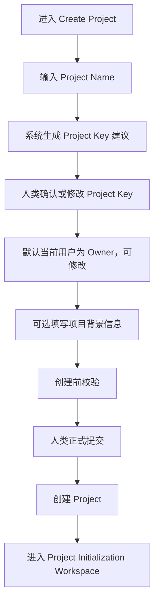

# S01-02 · Project Creation UX 设计稿 V1.1

> **文档编号**：S01-02
> **所属阶段**：S01 — Project Initialization
> **文档性质**：UX 设计规范
> **版本**：V1.1
> **状态**：设计稿完成，待整体冻结
> **修订日期**：2026-11-04
> **上一版本**：V1.0

> **⚠️ 2026-11-05 修订稿到达（已记录，未收编，待基线确认）**：专家《S01-02 Project Creation 设计修订稿 V1.1》见
> [s01-02-project-creation-design-revision-v1-1.md](s01-02-project-creation-design-revision-v1-1.md)。与本稿相关：① Q1~Q3 方案 A 保留——本稿 ：59/:88/:208 与 :412-414 即方案 A 原始正文（修订稿 §一 担忧已据此解除）；② 修订稿 §2.3 将 Q3 落地方式修订为「创建成功自动进入 Project Command Center、初始化进度内嵌呈现」，本稿 Q3「自动进入初始化工作空间」的落地表述将随之修订（待基线确认后执行）；③ 新增 Project/Initialization/Baseline/Integration 四状态独立约束。读本稿时须对照修订记录。

---

## 1. 设计目标

Project Creation 是 smark-pm 项目管理体系的入口。

其核心职责是建立一个具有明确身份、责任人和管理边界的 Project 实体。

Project Creation 不负责完成项目初始化，而是为后续 Repository Management、AI-PM Cognition、Project Baseline Confirmation 和 Codex Bootstrap 提供统一的项目管理主体。

核心原则：

1. Project 是长期存在的业务实体。
2. Project 不依赖 Repository 或 AI Agent 才能成立。
3. 项目创建由人类正式发起和确认。
4. AI 可以协助生成信息，但不能代替人类决定。
5. 创建流程尽量简单，复杂配置渐进式完成。
6. 创建成功后立即进入项目初始化工作空间。

---

## 2. 用户角色

| 角色 | 职责 |
| --- | --- |
| Project Creator | 发起并提交项目创建 |
| Project Owner | 对项目承担正式管理责任 |
| AI Agent | 提供项目资料整理和创建建议 |
| System | 校验权限、唯一性并执行实体创建 |

Project Creator 与 Project Owner 可以是不同的人。

系统必须分别记录两者身份。

---

## 3. Project Creation 信息模型

### 3.1 必填信息

| 字段 | 来源 | 规则 |
| --- | --- | --- |
| Project Name | 人类 | 必须填写 |
| Project Key | 系统建议，人类确认 | 必须唯一 |
| Project Owner | 默认当前用户，人类可修改 | 必须明确 |

### 3.2 Project Key 生成规则

用户裁决：Q1 采用方案 A。

采用系统自动建议、人类确认的方式。

流程：

1. 用户输入 Project Name。
2. 系统根据名称生成 Project Key 建议。
3. 系统检查唯一性。
4. 用户可以接受或修改建议。
5. 创建提交前再次校验唯一性。

示例：

```text
Project Name：Smark PM
Project Key：SMARK
```

规则：

- Project Key 创建时必须确定。
- 创建后不随 Project Name 修改而自动变化。
- 后续修改必须通过独立的受控操作。
- 修改应记录变更前后的值、操作者和时间。
- 唯一性作用域以现有数据库及项目隔离模型为准，不在本设计稿中擅自确定。

### 3.3 Project Owner 指定规则

用户裁决：Q2 采用方案 A。

默认当前登录用户为 Project Owner，允许修改。

规则：

- 当前用户默认成为 Owner。
- 用户可以选择其他具有相应权限的成员。
- 被指定人员必须具备有效的项目管理授权条件。
- Creator 与 Owner 分别记录。
- 不允许 AI 自动指定 Owner。
- 不允许将 AI Agent 设置为 Project Owner。

### 3.4 可选项目背景信息

| 字段 | 是否必填 | 用途 |
| --- | --- | --- |
| Project Description | 否 | 项目目标及用途 |
| Project Type | 否 | 项目分类 |
| Business Domain | 否 | 业务领域 |
| Expected Outcome | 否 | 预期成果 |
| Initial Context | 否 | 补充背景资料 |

这些信息用于后续 AI-PM Cognition。

特别规定：

项目描述不等于正式需求，不应因为用户填写了项目目标，就自动创建正式 Requirement 实体。

---

## 4. 延后配置原则

以下信息不属于 Project Creation 的必填范围。

| 配置 | 所属阶段 |
| --- | --- |
| Git Repository URL | S01-03 Repository Management |
| Branch / Commit | S01-03 Repository Management |
| 技术栈识别 | S01-04 AI-PM Cognition |
| 项目文档分析 | S01-04 AI-PM Cognition |
| 正式项目基线 | S01-05 Project Baseline |
| Codex 配置 | S01-06 Codex Bootstrap |
| MCP 授权 | S01-06 Codex Bootstrap |

不得因为上述信息尚未配置而阻止 Project 创建。

---

## 5. Project Creation 用户流程

### 5.1 主流程

1. 用户进入 Create Project。
2. 输入 Project Name。
3. 系统生成 Project Key 建议。
4. 用户确认或修改 Project Key。
5. 系统默认当前用户为 Project Owner。
6. 用户可以修改 Owner。
7. 用户可选填写项目背景信息。
8. 系统执行创建前校验。
9. 用户正式提交创建。
10. 系统创建 Project。
11. 系统自动将用户引导至 Project Initialization Workspace。



### 5.2 创建确认

提交创建前，系统必须能够让用户明确知道：

- 即将创建的 Project Name。
- 最终采用的 Project Key。
- Project Owner。
- 其他已填写的项目背景信息。

创建行为由人类主动触发。

AI 不得自行完成正式创建。

---

## 6. AI Assisted Creation

AI 在创建流程中提供辅助能力。

允许：

- 建议 Project Name。
- 建议 Project Key。
- 润色 Project Description。
- 建议 Project Type。
- 整理用户提供的背景信息。

不允许：

- 擅自确定 Project Owner。
- 将 AI 推断内容标记为用户提供的事实。
- 未经授权创建 Project。
- 因 AI 服务不可用而阻断人工创建。

AI 建议与用户最终提交内容必须能够区分来源。

建议保留原始用户输入、AI 建议及最终确认值，以支持后续审计和项目认知溯源。

---

## 7. 创建成功后的行为

用户裁决：Q3 采用方案 A。

创建成功后，系统自动进入 Project Initialization Workspace。

### 7.1 创建成功后的系统行为

系统必须：

1. 返回唯一 Project ID。
2. 建立 Project 与 Project Owner 的归属关系。
3. 记录 Project Creator。
4. 记录创建时间。
5. 初始化 Project 基础状态。
6. 建立或关联 Initialization Workflow。
7. 自动进入项目初始化工作空间。
8. 引导用户开始 Repository Management。

### 7.2 自动进入不等于自动执行

必须严格区分：

- 自动进入初始化工作空间：系统行为。
- 自动开始仓库连接：需要用户主动发起或授权。
- 自动执行 AI 分析：需要满足相应执行授权和前置条件。
- 自动确认正式基线：禁止，必须由人类完成。

创建成功后，系统可以展示下一步操作，但不能擅自访问未经授权的仓库或启动需要额外授权的执行任务。

### 7.3 创建失败处理

创建失败时：

- 明确显示失败原因。
- 保留用户已经填写的信息（在客户端允许的情况下）。
- 提供重新提交能力。
- 防止因网络重试创建重复 Project。

---

## 8. Project 与 Initialization 生命周期分离

Project 是长期存在的业务实体。

Initialization 是项目创建后的阶段性工作流程。

两者不得共用一个状态字段。

### 8.1 Project 生命周期 UX 语义

| 状态 | 说明 |
| --- | --- |
| Active | 正常管理中的项目 |
| Suspended | 暂停管理 |
| Archived | 已归档 |

具体状态值需要与现有代码及数据库状态机核验。

Project 创建成功后即可进入 Active，不必等待初始化完成。

### 8.2 Initialization 生命周期 UX 语义

| 状态 | 说明 |
| --- | --- |
| Not Started | 初始化尚未开始 |
| In Progress | 初始化进行中 |
| Waiting for Human | 等待人类操作或确认 |
| Blocked | 存在阻塞 |
| Completed | 初始化完成 |

### 8.3 状态关系

Project Active 不代表 Initialization Completed。

Initialization Blocked 不代表 Project Suspended。

用户可以退出初始化工作空间，之后继续完成初始化。

初始化失败不能导致 Project 实体丢失。

---

## 9. 异常与边界处理

| 场景 | 系统行为 |
| --- | --- |
| Project Name 为空 | 阻止提交 |
| Project Key 重复 | 提示并要求重新确认 |
| 创建过程中 Key 被其他请求占用 | 服务端拒绝并返回冲突 |
| 网络中断 | 查询原始请求结果，避免重复创建 |
| 用户连续点击提交 | 防止重复提交 |
| Owner 不具备授权条件 | 阻止创建并明确提示 |
| 创建者权限发生变化 | 服务端重新校验 |
| 项目描述为空 | 允许创建 |
| AI 建议生成失败 | 不影响人工创建 |
| 用户关闭页面且尚未提交 | 不创建 Project |
| 同名项目存在 | 提示可能存在相似项目，不简单以名称判定重复 |

### 9.1 幂等性要求

Project Creation 必须具备创建请求幂等机制。

场景：

1. 用户提交创建请求。
2. 服务端成功创建 Project。
3. 网络响应丢失。
4. 用户重试。

系统必须能够识别原始请求并返回已有创建结果，而不是生成重复 Project。

具体幂等键设计及数据库约束由技术设计阶段确定。

---

## 10. 权限与责任规则

| 操作 | 人类 | AI | System |
| --- | --- | --- | --- |
| 填写项目名称 | 决定 | 建议 | 校验 |
| 生成 Project Key | 确认 | 可建议 | 生成及校验 |
| 指定 Owner | 决定 | 不可决定 | 校验 |
| 填写项目描述 | 决定 | 可辅助 | 保存 |
| 正式创建 | 主动提交 | 不可擅自执行 | 执行 |
| 创建后初始化引导 | 使用 | 可建议 | 提供 |

权限校验必须由服务端执行，不能仅依赖前端状态。

---

## 11. 审计与数据要求

创建成功后至少需要能够追溯：

- Project ID
- Project Name
- Project Key
- Project Description
- Project Type
- Creator ID
- Owner ID
- Created At
- Project Status
- Initialization Status

AI 辅助创建还应保留：

- 原始用户输入（适用时）
- AI 建议内容
- 最终提交内容
- 建议与最终结果的差异
- 创建操作的责任主体

具体字段与现有数据库的映射需要通过代码事实核验确定，不直接以本设计稿作为新增数据库表的依据。

---

## 12. UX 验收标准

### A. 创建能力

- [ ] 不需要接入仓库即可创建 Project。
- [ ] Project Name 必须填写。
- [ ] Project Key 自动建议且由人类确认。
- [ ] Project Key 创建后不随名称自动变化。
- [ ] Project Owner 默认当前用户，允许修改。
- [ ] 可选项目背景信息不阻止创建。
- [ ] 创建成功返回唯一 Project ID。

### B. AI 协作

- [ ] AI 可以辅助填写项目信息。
- [ ] AI 建议与人类原始输入可区分。
- [ ] AI 不得擅自指定 Owner。
- [ ] AI 不得未经授权创建 Project。
- [ ] AI 服务不可用不影响人工创建。

### C. 创建后行为

- [ ] 创建成功后自动进入 Project Initialization Workspace。
- [ ] 创建成功不代表初始化完成。
- [ ] 不自动执行未经授权的仓库接入。
- [ ] 不自动执行未经授权的 AI 分析。
- [ ] 不自动确认正式项目基线。

### D. 生命周期

- [ ] Project 与 Initialization Workflow 生命周期分离。
- [ ] 初始化失败不影响 Project 实体。
- [ ] 初始化可以中断和继续。
- [ ] Project 创建请求具有幂等保护。

### E. 审计

- [ ] Creator 与 Owner 分别记录。
- [ ] 创建时间可追溯。
- [ ] AI 建议及最终提交结果可追溯。
- [ ] Project Key 修改有审计记录。

---

## 13. 用户正式裁决记录

| 裁决编号 | 问题 | 用户裁决 | 收编结果 |
| --- | --- | --- | --- |
| Q1 | Project Key 生成方式 | A：系统建议，人类确认 | 已收编 |
| Q2 | Project Owner 指定方式 | A：默认当前用户，可修改 | 已收编 |
| Q3 | 创建后是否立即进入初始化 | A：自动进入初始化工作空间 | 已收编 |

上述三项为用户正式裁决，不属于 AI 建议。

---

## 14. 与后续阶段的关系

| 后续阶段 | 依赖 S01-02 提供的内容 |
| --- | --- |
| S01-03 Repository Management | Project ID、Project Key、Owner |
| S01-04 AI-PM Cognition | Project Description、Initial Context |
| S01-05 Project Baseline | 项目身份及初始化分析结果 |
| S01-06 Codex / MCP Bootstrap | Project 身份与管理上下文 |
| S01-07 Project Workspace | 完整 Project 信息及初始化进度 |

---

## 15. 设计结论

S01-02 负责建立 Project 管理主体，而不是完成项目技术初始化。

最终确定的创建策略：

- Project Key：系统自动建议，人类确认。
- Project Owner：默认当前用户，可以修改。
- 创建完成：自动进入 Project Initialization Workspace。
- Repository：后续独立接入。
- AI：提供辅助，不取代人类创建决定。
- Project：独立于初始化流程长期存在。

**本设计稿 V1.1 已收编全部三项用户裁决，作为后续技术设计、Figma UX 落地和研发验收的依据。**

状态：待整体冻结及代码事实核验。