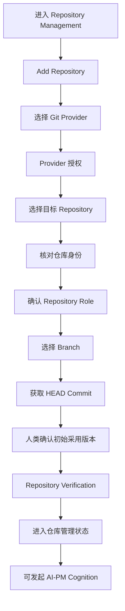

# S01-03 · Repository Management UX 设计稿 V1.1

> **文档编号**：S01-03
> **所属阶段**：S01 — Project Initialization
> **文档性质**：UX 设计规范
> **版本**：V1.1
> **状态**：设计稿完成，待整体冻结及代码事实核验
> **修订日期**：2026-11-04
> **上一版本**：V1.0

> **⚠️ 2026-11-05 修订稿到达（已记录，未收编，待基线确认）**：专家《S01-03 Repository Management 详细设计稿 V1.2》见
> [s01-03-repository-management-design-revision-v1-2.md](s01-03-repository-management-design-revision-v1-2.md)。与本稿相关：① R-03-01~04 四裁决与本稿同源一致（本稿 :48 §3.1、:68-88 §3.2 为裁决正文）；② V1.2 新增长期管理定位（非一次性初始化向导）、Default Branch / Observed HEAD / Confirmed Commit 三概念治理、AC-01~15、17 项代码核验清单（已并入[统一核验清单](s01-technical-verification-unified-checklist-v1.md)）；③ Role 词表三方差（本稿 vs 后端 `main/docs/service/infra` vs V1.2 建议 Backend/Frontend/…）登记待收敛；④ V1.2 §15 对原型的五点纠正——原型原件未入仓、位置待确认。读本稿时须对照修订记录。

---

## 1. 设计目标

Repository Management 是 Project 下的长期仓库管理能力。

首次接入属于 S01 初始化流程，后续仓库管理贯穿整个项目生命周期。

核心设计原则：

1. 一个 Project 可以关联多个 Repository。
2. Project 创建不要求必须存在 Repository。
3. Primary Repository 允许暂时不存在。
4. Repository 接入与 AI Cognition 分离。
5. Branch 与 Commit 必须区分。
6. 仓库最新代码不自动成为项目采用版本。
7. 正式 Baseline 不因仓库变化而自动更新。
8. AI 可以分析和提出建议，但不能擅自修改正式仓库配置。
9. Repository Disconnect 不等于删除历史数据。

---

## 2. 用户角色与职责

| 角色 | 职责 |
| --- | --- |
| Project Owner | 负责项目仓库管理 |
| Authorized Member | 在授权范围内执行仓库操作 |
| AI Agent | 提供仓库分析、核验和变更建议 |
| System | 执行连接、授权校验、版本核验和审计 |

权限必须复用项目现有权限体系，不另行建立独立角色体系。

---

## 3. Project 与 Repository 的关系

### 3.1 多仓库模型

用户正式裁决 Q1：

**允许一个 Project 关联多个 Repository。**

示例：

```text
Project: Smark PM

- Frontend Repository
- Backend Repository
- Shared Components Repository
- Infrastructure Repository
- Test Repository
```

Repository 是独立的仓库关联对象，不应把 Branch 或 Commit 建模为独立 Repository。

### 3.2 Primary Repository

用户正式裁决 Q2：

**允许暂时没有 Primary Repository。**

规则：

- Project 可以没有任何 Repository。
- Project 可以存在多个 Supporting Repository。
- Primary Repository 可以暂时为空。
- Primary Repository 用于标识项目主要代码仓库。
- 不得因为没有 Primary Repository 就阻止 Project 创建或其他合法初始化工作。
- 不得自动将第一个接入的仓库提升为 Primary Repository。

Primary Repository 的数量规则：

- 一个 Project 最多一个 Primary Repository。
- 可以有零个 Primary Repository。
- 用户可以通过受控操作指定或更换 Primary Repository。
- 如果 Primary Repository 被断开，项目进入无 Primary Repository 状态，系统提示用户处理，但不擅自选择替代对象。

### 3.3 Repository Role

支持以下角色：

| Role | 说明 |
| --- | --- |
| Primary | 项目主要代码仓库 |
| Supporting | 辅助代码仓库 |
| Infrastructure | 基础设施及部署仓库 |
| Test | 独立测试仓库 |

Role 是项目管理属性，不代表访问权限等级。

---

## 4. Repository 信息模型

每个 Repository 需要能够展示和追溯：

| 信息 | 说明 |
| --- | --- |
| Repository ID | 系统内部唯一标识 |
| Repository Name | 仓库名称 |
| Repository URL | 仓库地址 |
| Provider | GitHub、GitLab 等 |
| Repository Owner | 仓库所属组织或个人 |
| Repository Role | 在 Project 中的作用 |
| Default Branch | 仓库默认分支 |
| Selected Branch | 项目选用分支 |
| Selected Commit | 项目确认采用的 Commit |
| Connection Status | 仓库接入状态 |
| Verification Status | 最近核验状态 |
| Last Verified At | 最近核验时间 |
| Last Scanned At | 最近 AI 认知分析时间 |

以上是 UX 数据需求，具体数据库映射以代码核验结果为准。

---

## 5. 首次 Repository 接入

### 5.1 用户流程

1. 用户进入 Repository Management。
2. 发起 Add Repository。
3. 选择 Git Provider。
4. 完成 Provider 授权。
5. 选择目标 Repository。
6. 核对仓库身份。
7. 确认 Repository Role。
8. 选择 Branch。
9. 获取对应 HEAD Commit。
10. 人类确认初始采用版本。
11. 系统执行 Repository Verification。
12. 接入成功后进入仓库管理状态。
13. 用户可以继续发起 AI-PM Cognition。



### 5.2 Provider 授权策略

用户正式裁决 Q3：

**优先采用 Provider OAuth / App 授权。**

设计要求：

- 优先使用 Git Provider 官方授权机制。
- 根据 Provider 能力选择 OAuth 或官方 App 安装授权。
- 尽量采用最小权限原则。
- 读取权限与写入权限分离。
- 不因仓库接入成功就默认授予 AI Agent 写入权限。
- 授权范围应当可查看。
- 授权失效时提供重新授权入口。
- 不得在普通 UI 中明文展示凭证。

对于暂不支持 OAuth / App 的 Provider，可以在技术能力和安全评估允许的情况下提供其他受控接入方式。

具体支持的 Provider、授权协议和凭证存储方式，必须通过代码事实核验。

### 5.3 仓库身份确认

系统识别仓库后，用户必须能够核对：

- Provider。
- Repository Name。
- Owner / Organization。
- Repository URL。
- Default Branch。
- 当前访问权限。

如果发现已经关联的同一仓库，应提示用户，而不是重复建立关联。

---

## 6. Branch 与 Commit 管理

必须严格区分：

| 概念 | 定义 |
| --- | --- |
| Default Branch | Git 仓库自身默认分支 |
| Selected Branch | Project 当前采用的分支 |
| Selected Commit | Project 已确认采用的具体代码版本 |
| Branch HEAD | 当前分支最新指向的 Commit |

Branch 是动态引用，Commit 是具体版本。

仅保存 Branch 名称无法保证历史执行可追溯。

### 6.1 首次版本确认

1. 系统读取 Default Branch。
2. 推荐默认分支。
3. 用户可以选择其他分支。
4. 系统读取该分支当前 HEAD。
5. 用户确认 Branch 和 Commit。
6. 系统保存项目采用的初始版本。

### 6.2 Branch HEAD 变化处理

用户正式裁决 Q4：

**仅提示变化，由人类确认更新。**

具体规则：

- 系统可以检测 Branch HEAD 变化。
- 发现变化后，通知 Project Owner 或授权成员。
- 展示当前采用 Commit 与最新 HEAD Commit。
- 不自动更新 Selected Commit。
- 不自动修改正式 Project Baseline。
- 不自动改变已有 Agent Run 的执行版本。
- 用户确认后，才能更新 Project 当前采用的版本。

示例：

```text
当前项目采用版本：

Branch: main
Commit: abc123

仓库最新版本：

Branch: main
Commit: def456
```

系统行为：

发现版本变化 → 提示用户 → 展示差异 → 人类确认 → 更新采用版本。

如果用户暂不更新：

- 保留 abc123。
- 保留现有项目版本状态。
- 允许用户稍后处理。
- 不影响历史任务和历史 Run 的追溯。

### 6.3 版本更新记录

每次更新必须记录：

- 更新前 Branch。
- 更新前 Commit。
- 更新后 Branch。
- 更新后 Commit。
- 操作者。
- 操作时间。
- 更新原因。
- 关联 Repository。

---

## 7. Repository Verification

Repository Verification 与 AI Cognition 是两个独立业务过程。

核验项目：

| 检查项 | 内容 |
| --- | --- |
| Repository Identity | 仓库身份是否正确 |
| Access Permission | 是否具有有效访问权限 |
| Branch Availability | 目标分支是否存在 |
| Commit Availability | 指定 Commit 是否可读取 |
| Repository Metadata | 基础元信息是否完整 |

状态语义：

| 状态 | 含义 |
| --- | --- |
| Pending | 尚未完成 |
| Passed | 必要检查全部通过 |
| Warning | 存在非阻塞问题 |
| Failed | 必要检查失败 |

核验失败不应将已有有效仓库版本直接覆盖。

重新核验不等于重新扫描代码。

---

## 8. 长期 Repository Management

Repository Management 在初始化完成后仍然存在。

建议作为 Project Settings 下的管理能力，而不是长期占据项目主导航的重要位置。

初始化期间可以从 Initialization Workflow 直接进入。

### 8.1 支持的操作

| 操作 | 业务含义 |
| --- | --- |
| Add Repository | 新增仓库关联 |
| Edit Metadata | 修改仓库管理属性 |
| Change Role | 修改仓库角色 |
| Set Primary | 指定主要仓库 |
| Change Branch | 切换项目采用分支 |
| Update Commit | 更新项目采用版本 |
| Re-verify | 重新核验 |
| Re-scan | 重新进行 AI 认知分析 |
| Disconnect | 断开仓库关联 |
| Restore | 恢复仓库关联 |

### 8.2 Re-verify 与 Re-scan 的区别

Re-verify：

验证仓库身份、访问权限、Branch 和 Commit 的有效性。

Re-scan：

重新分析代码结构、文档、技术栈和架构信息。

两者的执行成本、权限及业务影响不同，不应合并成一个操作。

### 8.3 Disconnect

仓库断开采用逻辑断开语义，不等于删除。

断开后：

- 不再作为新的默认执行目标。
- 历史 Run 保留。
- 历史交付记录保留。
- 历史 Baseline 引用保留。
- 历史版本信息保留。
- 活跃任务依赖必须提示和处理。

恢复仓库时需要重新核验访问权限及版本状态。

---

## 9. Repository 与 Project Baseline

必须保持三个层次：

### 9.1 Repository Configuration

记录 Project 当前关联的仓库及其角色、配置和授权状态。

### 9.2 Repository Version Snapshot

记录某个时点实际采用的仓库版本。

例如：

```text
Repository A:
- Branch: main
- Commit: abc123

Repository B:
- Branch: develop
- Commit: def456
```

### 9.3 Project Baseline

正式基线可以引用一个或多个 Repository Version Snapshot。

规则：

- Baseline 引用固定版本快照。
- 仓库 HEAD 变化不自动修改 Baseline。
- Selected Commit 更新不自动修改 Baseline。
- 新基线必须经过独立提案及人类确认。
- 历史 Baseline 永远保留原有仓库版本引用。

因此，Repository 当前采用版本可以与 Project 正式基线引用版本不同。

这是合法的项目演进状态。

---

## 10. Repository 与 AI Agent

### 10.1 访问权限

- 未授权不得访问仓库。
- 读取权限与写入权限分离。
- 仓库接入成功不等于 AI 获得写权限。
- 凭证不能直接暴露给 Agent。
- 授权失效时停止依赖该授权的访问操作。

### 10.2 Agent Run 版本固定

每次 Run 必须记录实际使用的仓库集合：

- Repository ID。
- Branch。
- Commit SHA。
- 实际授权上下文。
- 执行时仓库关联状态。

Project 当前采用版本发生变化，不得改变已有 Run 的执行版本。

### 10.3 多仓库任务

任务需要使用多个 Repository 时：

- 明确任务的仓库依赖。
- 每个仓库分别记录 Commit。
- Run 记录实际使用的仓库集合。
- 不允许默认将 Primary Repository 当作全部任务的唯一仓库。

---

## 11. 异常与边界处理

| 场景 | 系统行为 |
| --- | --- |
| 仓库连接失败 | 提示原因，支持重试 |
| Provider 授权失效 | 要求重新授权 |
| Branch 不存在 | 要求重新选择 |
| Commit 不可访问 | 阻止版本确认，保留旧版本 |
| 仓库被删除 | 标记不可访问，保留历史 |
| 仓库权限撤销 | 停止新访问 |
| 仓库 URL 改变 | 核验新身份，不直接覆盖 |
| 重复添加仓库 | 提示已关联 |
| 没有 Primary Repository | 允许存在，提示但不阻断 |
| Primary Repository 断开 | 保持无 Primary 状态，不自动替换 |
| 多仓库部分失败 | 分别展示各仓库状态 |
| AI Cognition 失败 | 允许单独重试 |
| Branch HEAD 变化 | 仅提示，不自动更新 |
| 活跃任务依赖仓库 | 提示依赖关系，保护执行上下文 |

---

## 12. 权限与审计

### 12.1 权限原则

| 操作 | Project Owner | 授权成员 | AI Agent |
| --- | --- | --- | --- |
| 查看仓库 | 允许 | 按权限 | 按授权 |
| 添加仓库 | 允许 | 按权限 | 不可擅自执行 |
| 修改仓库配置 | 允许 | 按权限 | 不可擅自执行 |
| 指定 Primary | 允许 | 按权限 | 不可擅自决定 |
| 切换 Branch | 允许 | 按权限 | 仅可建议 |
| 更新采用 Commit | 允许 | 按权限 | 仅可建议 |
| 重新核验 | 允许 | 按权限 | 按执行授权 |
| 重新认知分析 | 允许 | 按权限 | 按执行授权 |
| 断开仓库 | 允许 | 按权限 | 不可擅自执行 |

实际权限名称和映射以现有权限体系为准。

### 12.2 审计记录

以下操作必须留下审计记录：

- Repository 添加。
- Repository 身份变更。
- Provider 授权变更。
- Repository Role 变更。
- Primary Repository 指定或变更。
- Branch 切换。
- Commit 更新。
- Repository 核验。
- AI Cognition。
- Repository Disconnect / Restore。

审计记录至少包含操作者、操作时间、操作类型、变更前后状态、关联 Project、关联 Repository 和版本信息。

---

## 13. UX 验收标准

### A. 多仓库管理

- [ ] 一个 Project 可以关联多个 Repository。
- [ ] Project 可以暂时没有 Repository。
- [ ] Project 可以没有 Primary Repository。
- [ ] 一个 Project 最多只有一个 Primary Repository。
- [ ] 不自动提升第一个接入的仓库。
- [ ] 支持新增、修改、断开和恢复。

### B. 授权

- [ ] 优先采用 Provider OAuth / App 授权。
- [ ] 授权范围明确。
- [ ] 读取与写入权限分离。
- [ ] 凭证不明文暴露。
- [ ] 授权失效有恢复入口。

### C. 版本管理

- [ ] Branch 与 Commit 分别管理。
- [ ] Branch HEAD 变化只提示。
- [ ] Selected Commit 不自动更新。
- [ ] 人类确认后才能更新采用版本。
- [ ] 正式 Baseline 不随仓库变化自动更新。
- [ ] 每个 Agent Run 固定执行版本。

### D. 生命周期

- [ ] Repository Management 是长期能力。
- [ ] 首次接入与日常管理使用统一模型。
- [ ] Repository Verification 与 AI Cognition 分离。
- [ ] 不要求重新执行整个 Project Initialization。
- [ ] Disconnect 不破坏历史记录。

### E. 多仓库执行

- [ ] 任务可以明确引用多个 Repository。
- [ ] 每个 Repository 分别记录 Commit。
- [ ] Run 可以追溯实际使用的仓库集合。
- [ ] 仓库配置变化不影响已创建 Run。

---

## 14. 用户正式裁决记录

| 编号 | 设计问题 | 用户裁决 | 状态 |
| --- | --- | --- | --- |
| Q1 | Project 是否允许多个 Repository | A：允许，一个 Project 可以关联多个仓库 | 已收编 |
| Q2 | 是否必须有 Primary Repository | A：允许暂时没有 Primary Repository | 已收编 |
| Q3 | 仓库授权方式 | A：优先 Provider OAuth / App 授权 | 已收编 |
| Q4 | Branch HEAD 变化处理 | A：仅提示变化，由人类确认更新 | 已收编 |

上述四项均为用户正式裁决，不属于 AI 建议。

---

## 15. 与其他阶段的关系

| 阶段 | Repository Management 提供的能力 |
| --- | --- |
| S01-02 Project Creation | Project 身份 |
| S01-04 AI-PM Cognition | 已核验仓库及固定版本 |
| S01-05 Project Baseline | Repository Version Snapshot |
| S01-06 Codex Bootstrap | 仓库执行上下文 |
| S01-07 Project Workspace | 长期仓库管理入口 |
| Task Execution | 每次 Run 的仓库及 Commit 信息 |

---

## 16. 最终设计结论

S01-03 V1.1 正式确定：

1. 一个 Project 支持多个 Repository。
2. Primary Repository 允许为空，最多一个。
3. Provider OAuth / App 是优先授权方式。
4. Branch HEAD 变化只通知，不自动更新。
5. 项目采用版本必须由人类确认。
6. Repository Verification 与 AI Cognition 分离。
7. Project Baseline 引用固定仓库版本快照。
8. Agent Run 固定实际执行的仓库版本。
9. Disconnect 不删除历史记录。
10. Repository Management 是 Project 下的长期管理能力。

**本版本已收编全部四项用户裁决，作为后续技术设计、Figma UX 落地和研发验收的依据。**

状态：V1.1 设计稿完成，待代码事实核验及整体冻结。