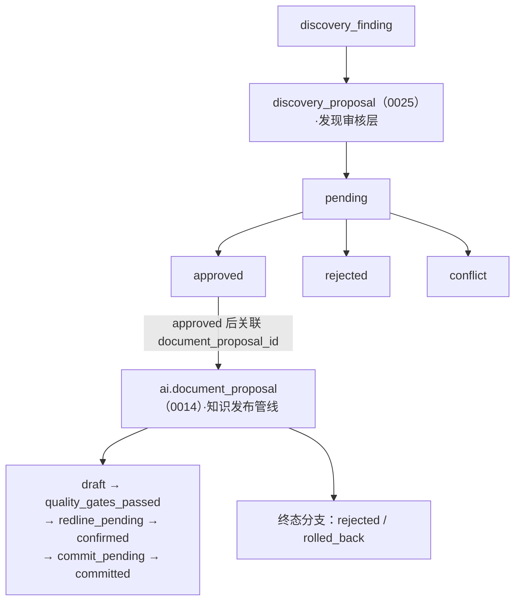

# S01 项目初始化与接入——现状依据汇总 V1.1

> **文档性质**：S01 专家裁决补充稿的现状依据部分
> **用途**：统一 migrations、菜单稿 V1、Codex Bootstrap V1.3、T-088 的既有模型和已裁决事项，作为后续 Q1～Q6 专家问题的事实基线。
> **状态**：现状依据整理稿，待与代码仓库及正式设计文档逐项复核。
> **原则**：已有模型优先复用；已冻结裁决不重复讨论；确实没有数据模型承载的内容才列为待裁决项。
>
> **V1.1 编者按**：本版已将《勘误修订 V1.1》的全部修正直接合并进正文——知识提案两级管线（C1）、F1～F4 映射到已有 Finding 模型（Q5）、repo_import 真实作业状态（Q2）、授权校验与令牌时效措辞（T-088），并连带更新 §5、§6、§8、§9 与裁决问题表。本仓侧已对本稿关键事实（migrations 0001/0014/0019/0025/0027、customers.rs 写入路径等）完成一轮代码级核对，勘误即源于该轮核对。

## 0. 阅读说明：证据等级

本稿区分三种信息，避免把设计意图、数据库事实和实施状态混在一起：

| 标记 | 含义 | 使用规则 |
| --- | --- | --- |
| 已有模型 | 已知 migrations 或代码中存在的表、字段、状态机 | 可以作为数据模型依据 |
| 已有裁决 | 已经由用户或专家确认的设计约束 | S01 必须继承，不得擅自改写 |
| 待复核 | 当前依据来自此前核对摘要，尚未在本轮重新读取完整文件或代码 | 可以用于组织讨论，不应宣称已完成代码级实测 |

本轮材料边界：当前可检索到的项目文件中，没有找到完整的 migrations 源文件、菜单稿 V1、Bootstrap V1.3 和 T-088 正文。因此，以下内容以此前提供的逐项核对结论和已确认设计事实为基础；涉及具体迁移号、字段和状态值的地方保留原有定位，但不冒充本轮重新执行了 SQL 或代码核查。

## 1. migrations：数据库现状与 S01 的数据模型边界

### 1.1 项目与租户关系

已知模型关系：

```text
Tenant
  └── tenant_member
        └── project_member
              └── Project
```

S01 必须遵循以下事实：

1. Project 属于 Tenant，不是跨租户的独立资源。
2. 租户成员通过 tenant_member 进入租户。
3. 项目成员通过 project_member 表达项目内身份和角色。
4. 项目负责人、项目成员应映射到 project_member 的角色，而不是另造一套 S01 专属成员表。
5. MCP 调用权限必须根据调用人的成员身份和授权实时判断，不能依赖可能过期的权限快照。

**对 S01 的影响**

创建项目时必须处于一个确定的租户上下文中。项目负责人不是一个脱离租户成员体系的自由文本字段，而是具备相应成员身份的用户。

### 1.2 Project 的状态和字段

已知现状：

| 项目 | 当前依据 | S01 设计约束 |
| --- | --- | --- |
| Project 状态 | core.project.status 默认值为 planning | 不得直接把它改成 draft 或 initializing |
| 状态约束 | 当前没有 CHECK 约束 | 新状态枚举需要专门核对使用情况和迁移影响 |
| 项目目标 | core.project 没有明确目标字段 | 优先评估由项目知识对象承载 |
| 项目类型 | 没有明确类型字段 | 可以作为后续可选字段，不应成为创建项目的必填条件 |
| Project Code | 当前全局唯一 | V1 暂时保留全局唯一，不主动改成租户内唯一 |

这里需要特别区分两个概念：

- planning 表示项目自身所处的业务阶段。
- 项目初始化进度表示项目空间、仓库、AI-PM 认知和执行环境等接入成果的完成情况。

因此，不能为了表达初始化进度而给 Project 增加一个 initializing 状态。初始化应由关联对象和条件派生。

建议暂时采用以下项目状态口径：`planning → active → archived`

但这只是建议口径，最终需要先核对现有 status 的实际写入位置、查询条件和测试覆盖，不能直接视为已经冻结的数据库枚举。

### 1.3 项目与仓库关系

当前已知：

- integration.project_repository 是项目与仓库的关联记录。
- 仓库 URL 存在于关联表中。
- 有 UNIQUE(project_id, url) 约束。
- 当前没有独立的全局 Repository 主数据实体。
- 当前没有完整的仓库 HEAD 基准 commit、访问状态、凭证状态等常驻字段。
- 任务级仓库基准已有 delivery.task_repository_commit 等交付模型承载。

由此可得：

当前模型表达的是「某项目接入了某个仓库」，而不是「平台拥有一份全局仓库主数据」。

S01 不应未经裁决就引入全局 Repository 实体。

多仓执行需要的基准 commit，应优先考虑已有任务级模型。不能因为项目接入阶段需要显示仓库信息，就直接把任务执行时的基准快照字段搬到项目仓库关联表中。

### 1.4 仓库分析与导入

当前仓库发现和分析由 `integration.repo_import` 承担作业职责，带有进度和 draft JSONB 等信息。

repo_import 的实际作业状态为：

| 阶段 | 实际状态 |
| --- | --- |
| 等待执行 | queued |
| 正在克隆 | cloning |
| 正在读取 | reading |
| 正在分析 | analyzing |
| 分析结果已形成 | draft_ready |
| 已形成提案 | proposed |
| 已应用 | applied |
| 已拒绝 | rejected |
| 失败/取消 | failed / cancelled |

其中 `queued / cloning / reading / analyzing` 是实际飞行状态。**IN_PROGRESS 不是 repo_import 的字面枚举值**：如果出现在 UI 或业务说明中，只能作为对多个运行中状态的概括性展示文案，不能当作数据库枚举值。

建议 UI 使用：等待执行 / 正在克隆 / 正在读取 / 正在分析 / 待审核 / 已应用 / 已拒绝。

因此，S01 中的「仓库分析状态」不能简单等同于「仓库连接状态」。例如：

- 仓库已经连接，但分析尚未开始。
- 仓库已经连接，但 Git clone 失败。
- 仓库已经连接，分析已完成，但提案等待人类确认。
- 仓库已经连接，分析提案已被应用。

这些是不同的业务事实。仓库接入与仓库分析仍然是两个独立事实：连接成功不意味着分析成功。

建议采用：**仓库连接事实 + repo_import 作业状态 + 最近一次分析结果**，而不是再给 project_repository 添加一套完整的分析状态机。

### 1.5 仓库职责与执行权限

当前仓库职责枚举为：`main / docs / service / infra`。

S01 提案中如果出现前端、后端、管理后台等职责，不应直接假定数据库已经支持这些枚举。V1 暂时沿用已有枚举。更细的业务职责可以先由描述或知识提案表达，后续再专门评估是否扩展。

此外，当前没有一个简单的项目仓库布尔字段能够完整表达 Agent 写权限。不能用 `allow_agent_write = true / false` 替代平台的实际授权体系。

授权必须沿用既有的成员身份、设备绑定、项目成员、仓库关联、任务授权和执行范围判断。

### 1.6 凭证与执行环境

已知已有凭证管理起点：`integration.project_ssh_key`。

它是仓库接入凭证方面的既有资产。S01 应引用现有能力，不另造一套项目 SSH Key 管理机制。

执行环境方面，应继承 devenv 的现有模型，不能用一个 connected 布尔字段代替环境生命周期和就绪状态。

## 2. 菜单稿 V1：S01 在产品信息架构中的位置

### 2.1 既有菜单结构

菜单稿 V1 已经定义项目工作区的长期菜单体系。

此前核对的十菜单中，和 S01 直接相关的入口包括：

| 产品能力 | 菜单归属 | S01 的用途 |
| --- | --- | --- |
| 项目总控台 | 项目工作区入口 | 展示初始化成果和待处理事项 |
| 仓库管理 | 项目工作区 | 接入、查看和管理项目仓库 |
| 项目知识库 / AI-PM 工作区 | 项目工作区 | 查看项目认知、知识提案和 AI-PM 工作情况 |
| 开发环境 | 项目工作区 | 查看开发者环境绑定和就绪情况 |
| 待处理中心 | 项目级或全局聚合入口 | 聚合需要人类确认、决策和审批的事项 |

### 2.2 初始化不是新增菜单

此前核对发现，菜单稿 V1 没有单独的「项目初始化工作区」菜单。

建议保持这一设计，不新增一个长期存在的初始化菜单。

初始化应该是项目总控台的一种状态视图：

```text
项目总控台
  ├── 项目概况
  ├── 初始化成果
  ├── 待处理事项
  ├── AI-PM 工作情况
  ├── 仓库接入情况
  └── 开发环境接入情况
```

当项目初始化达到可用条件后，页面不消失，而是转化为项目健康与接入状态概览。

### 2.3 混合模式 D 的既定交互原则

用户已选择：**项目总控台 + 人类待处理事项 + 全局 AI 指令入口**。

因此 S01 的 UI 应遵循：

1. 进入项目，首先看到项目总控台。
2. 初始化过程中，突出尚未完成的成果和需要人类处理的事项。
3. 人类无需进入 Agent 管理页面才能完成项目初始化。
4. AI 指令入口保持全局可用。
5. 初始化完成后，初始化进度转为持续健康状态。
6. 不因 S01 单独增加新的一级或二级菜单。

### 2.4 与现有总控台 P0 对齐

已有总控台 P0 包含七个页签。S01 后续 UI 设计必须逐项映射到这七个页签，确认：

- 哪些现有页签直接承载初始化信息。
- 哪些需要补充组件或数据。
- 哪些内容应进入仓库管理、知识库或开发环境页面。
- 哪些人类待处理事项应进入统一待处理中心。

不能为了 S01 再造一套与现有总控台并行的页面。

## 3. Codex Bootstrap V1.3：执行环境接入的既有裁决

### 3.1 Bootstrap 的产品定位

Bootstrap V1.3 已经形成接入引导和门禁链：`BOOT → C138 → … → C176`。

这套机制负责开发环境的初始化、配置、检查和接入门禁。

S01 不应该重新定义一套 Bootstrap 流程，也不应该把内部门禁编号暴露给普通项目用户。

产品 UI 应展示业务结果，例如：

- 开发环境是否已安装。
- 是否已连接平台。
- 是否已完成认证。
- 是否达到可用条件。
- 是否存在降级或失败。
- 最近一次检查时间。

内部 Bootstrap 步骤由平台负责执行和记录。

### 3.2 每个开发者分别绑定环境

Bootstrap V1.3 已明确：**每个开发者分别绑定自己的开发环境，平台统一发放配置。**

```text
Tenant
  ├── Developer A
  │     └── devenv A
  ├── Developer B
  │     └── devenv B
  └── Developer C
        └── devenv C
```

不能把开发环境设计成项目唯一的共享设备。

项目可以有多个开发者，每个开发者分别接入自己的环境。项目执行时，再由平台结合调用人、项目成员身份、任务授权等信息判断是否允许执行。

### 3.3 设备绑定不等于执行授权

Bootstrap 的设备接入只证明设备与用户之间的绑定关系，不代表该设备自动获得项目权限或仓库写权限。

必须区分：

| 事实 | 能证明什么 | 不能证明什么 |
| --- | --- | --- |
| Device 已绑定 | 设备与开发者的绑定关系成立 | 用户是项目成员 |
| Device 已连接 | 设备能够连接平台 | 设备已认证 |
| Device 已认证 | 身份认证通过 | 当前任务允许执行 |
| Environment Ready | 环境检查达到就绪条件 | 任务获得了执行授权 |

因此 S01 不应在环境连接成功后就显示「Agent 可以执行所有任务」。

### 3.4 执行环境采用双模型

此前核对确认，devenv.device 是：**生命周期（active/revoked）+ 就绪快照的双列模型**。

就绪快照采用六层状态：

| Readiness | 含义 |
| --- | --- |
| installed | 已安装 |
| connected | 已连接 |
| authenticated | 已认证 |
| ready | 检查就绪 |
| degraded | 降级运行 |
| failed | 检查失败 |

另有 `last_check_at` 记录最近一次检查时间。

这里必须注意：

- active/revoked 是设备生命周期。
- 六层 readiness 是环境检查快照。
- Connected 不等于 Available。
- **Execution Ready 是就绪快照结合任务授权后的派生判断，不是第七种 readiness 状态。**

S01 的环境 UI 应按这个模型展示，不应另造一个 environment_status 状态机。

## 4. T-088：服务端 Bootstrap 域与 MCP 调用人上下文

### 4.1 T-088 的核心定位

T-088 已经处理服务端 Bootstrap 域和 MCP 调用人上下文问题。

它与 S01 的关系不是「再做一套环境接入」，而是为项目初始化提供可信的身份和调用上下文基础。

S01 必须继承以下边界：

1. 调用人身份必须能够被服务端识别。
2. 开发者设备绑定关系必须能够被服务端验证。
3. 项目成员身份必须能够被服务端确认。
4. MCP 操作必须在实际调用上下文中进行权限判断。
5. 不允许因为设备已绑定，就跳过项目成员和任务授权检查。

### 4.2 MCP 授权判断

菜单稿 V1 §5.3 已有授权判断五步口径。

S01 不应该重新定义权限体系，而应直接引用该口径。

从业务角度，执行授权至少需要回答：

- 谁在调用？
- 调用人的租户成员身份是什么？
- 调用人是否属于当前项目？
- 当前任务与仓库是否允许该调用人执行？
- 当前执行操作是否符合对应授权范围？

其中，设备身份是调用上下文的一部分，但设备绑定不能替代成员授权。

### 4.3 授权校验与令牌时效

> MCP 每次调用均根据 T-088 调用人上下文重新执行授权链校验；外部 JWT 采用短时效策略。成员角色或项目成员关系发生变化后，后续 MCP 调用依据最新授权数据进行判断。外部已签发 JWT 的剩余有效期不作即时失效承诺。

这样准确区分了两件事：

- **服务端授权链**：每次调用校验。
- **外部身份令牌**：具有自己的有效期。

不能将「每次调用重新授权」错误描述为「所有已签发令牌即时撤销」。

此前已确认的权限约束包括：

- 租户成员角色变化必须有明确管理入口。
- MCP 不能依赖陈旧的成员权限快照。
- 项目成员权限与设备绑定关系必须分别判断。

因此 S01 的项目成员初始化和开发环境接入不能被设计成一次性授权后永久有效。如果用户后来被移出项目，或租户成员权限被撤销，后续调用的执行权限必须随之失效。

### 4.4 S01 的复用边界

| 能力 | 既有依据 | S01 应做什么 |
| --- | --- | --- |
| 开发者身份 | T-088 / Bootstrap | 使用已有身份上下文 |
| 设备绑定 | devenv 模型 | 展示绑定和环境状态 |
| 项目成员 | project_member | 使用已有项目成员关系 |
| MCP 调用人 | T-088 | 使用可信调用上下文 |
| 项目权限 | 菜单稿 V1 §5.3 | 沿用五步授权判断 |
| 执行授权 | 任务和策略模型 | 在实际执行时判断 |

## 5. 知识提案和项目认知：已有能力，不重复建设

S01 的核心工作之一是让 AI-PM 建立项目初始认知。

但目前已有知识提案机制，不能再单独设计一套初始化审批系统。

### 5.1 两级提案管线

项目认知发现与知识发布采用**两级提案链**，两级职责不得合并，也不得重复建设提案审核机制：

- **第一级 Discovery Proposal**：`discovery.discovery_proposal`（migration 0025）· 发现结果审核层，状态包括 pending / approved / rejected / conflict。审核 AI 发现的事实、归纳和推断。通过后关联 document_proposal_id。
- **第二级 Document Proposal**：`ai.document_proposal`（migration 0014）· 知识空间发布管线，状态包括 draft → quality_gates_passed → redline_pending → confirmed → commit_pending → committed（终态分支 rejected / rolled_back）。负责质量门、红线处理、确认、提交及回滚。它是知识空间稿六态发布状态机的数据库投影。



必须明确两级职责：

| 层级 | 核心问题 | 负责内容 |
| --- | --- | --- |
| Discovery Proposal | AI 提出的认知是否被接受？ | 发现结果审核、冲突处理 |
| Document Proposal | 被接受的知识能否安全发布？ | 质量门、红线、提交、回滚 |

由此，S01 不新增：

- 独立的初始化知识审批表。
- 独立的 AI-PM 知识确认状态机。
- 与现有提案管线平行的审核流程。

### 5.2 AI-PM 初始化采用 Discovery Session

现有 discovery 域已经提供 `discovery.discovery_session`。

已知 kind：`INITIAL_ONBOARDING / UPDATE / TASK_DISCOVERY`。

已知 status：`IN_PROGRESS / NEEDS_USER_INPUT / REVIEW_REQUIRED / COMPLETED / PAUSED`。

S01 的首次项目认知建立应使用 kind = INITIAL_ONBOARDING；后续持续更新项目认知使用 kind = UPDATE；任务发现使用 kind = TASK_DISCOVERY。

这意味着不需要额外创造 `Initializing`、`NeedsRevision`、`BaselineConfirmed` 等与现有状态重复的状态值。

### 5.3 基线确认是业务判断，不是新状态

此前已形成的口径：

BaselineConfirmed 大致对应：

```text
Discovery Session = COMPLETED
        +
必要提案已经 approved（两级提案链走通）
        ↓
初始项目认知基线成立
```

它是业务条件判断，而不是 Discovery Session 的新状态。

另外，两个需要人类参与的状态必须区分：

| 状态 | 含义 | 用户动作 |
| --- | --- | --- |
| NEEDS_USER_INPUT | AI-PM 缺少必要信息 | 补充信息或回答问题 |
| REVIEW_REQUIRED | AI-PM 已形成待审查结果 | 审查、确认或拒绝提案 |

不能把所有需要人类处理的情况都混成一个 NeedsRevision。

### 5.4 AI 发现内容的可信等级

F1～F4 分类是 S01 的业务解释层，不是一套需要新建的分类体系，也不是新增数据表。

discovery_finding 已有：

- kind：observed / user_confirmed / speculation / contradicted
- verification_status：PENDING / CONFIRMED / REJECTED / CONFLICT
- confidence
- evidence

因此 F1～F4 应当映射到已有字段：

| 业务分类 | Finding kind | verification_status | 处理建议 |
| --- | --- | --- | --- |
| F1 可验证客观事实 | observed | CONFIRMED | 有充分证据的客观事实可以确认记录 |
| F2 有明确证据的技术归纳 | observed 或 user_confirmed | 根据确认情况 | 保留 evidence 和 confidence，可形成 AI Summary |
| F3 业务语义或架构推断 | speculation | 通常先 PENDING | 需要人类确认后，可转为 user_confirmed |
| F4 治理和执行权限 | 不作为普通 Finding 处理 | 不适用 | 进入 governance 域，由人类决策和授权 |

示例：

- F1：仓库 URL、Commit SHA、目录结构、Cargo.toml 存在。
- F2：项目使用 Rust、Bevy，识别到某个 API 入口。
- F3：某个仓库是否是核心服务、模块之间的业务依赖。
- F4：Agent 是否允许修改某个仓库、生产部署限制、安全策略。

补充说明：

1. CONFLICT 是 Finding 的验证状态，不是 ai.document_proposal 的状态。
2. contradicted 表达 Finding 的内容类型，CONFLICT 表达验证过程中存在冲突，两者不是同一个维度。
3. confidence 不能替代 verification_status。
4. evidence 必须保留来源依据。
5. F4 不应因为 AI 生成了一个 Finding，就进入普通知识审核流程并被自动批准。

特别重要的一条：

> 把内容写进 Markdown，不会自动提高它的可信等级。证据事实、技术归纳、业务推断和治理授权必须保留不同的来源与确认语义。

## 6. S01 已有模型与业务成果映射

S01 最初定义的四个业务成果，应该映射到现有模型，而不是新增一个总初始化表。

| S01 业务成果 | 现有模型或机制 | 结果判断 |
| --- | --- | --- |
| 项目空间已建立 | core.project、Tenant、project_member | 项目及成员关系存在 |
| 仓库已接入 | integration.project_repository | 项目仓库关联建立 |
| AI-PM 初始认知已建立 | discovery.discovery_session、两级提案链（discovery_proposal → document_proposal）、知识文档 | 初始发现完成，必要提案已审核（两级链走通） |
| Agent 执行环境已接入 | devenv.device、Bootstrap、T-088 | 开发者环境接入，具备相应就绪快照 |

这四个成果是独立事实。

不能压缩成 `project.initialized = true`。因为一个项目可能已经建立，但没有仓库；也可能仓库已经接入，但 AI-PM 尚未完成认知；还可能 AI-PM 已经完成分析，但开发者环境尚未接入。

建议初始化总览使用派生状态：

```text
Project Onboarding Overview
  ├── Project Space
  ├── Repository Integration
  ├── AI-PM Baseline
  └── Execution Environment
```

## 7. 其他已知实施事实

### 7.1 多仓库是正式需求，不是扩展需求

已有多仓执行模型，包括：

- task_repository
- task_run_repository
- delivery.task_repository_commit

执行时按任务 × 仓库记录基线和交付事实。

因此 S01 从一开始就必须允许一个项目接入多个仓库，不能假定一个项目只有一个 Git 仓库。

同时，项目仓库接入和任务执行时的仓库基线是两个不同层次：

- 项目层：仓库关联及其用途。
- 任务层：本次执行使用的仓库、基准 commit、写入范围和交付结果。

### 7.2 内网 Git 是首要接入场景

当前部署现实：

- GitLab：192.168.2.16
- 服务端没有外网。

因此 S01 的仓库接入设计应优先支持：

1. 自建 GitLab。
2. Gitea 等自建 Git 服务。
3. 内网 SSH Git 仓库。
4. 其他可从执行环境访问的私有 Git 服务。

GitHub、GitLab.com 等公网服务应标注网络依赖。

不能只根据 URL 格式判断接入成功。实际接入必须检查：

- DNS / 网络可达性。
- SSH 或 HTTPS 认证。
- 仓库访问权限。
- 实际 clone 或读取能力。

### 7.3 仓库访问凭证

已有 integration.project_ssh_key，应继续作为现有凭证管理起点。

仓库接入 UI 只需提供必要的凭证配置与连接检查体验，不应在 S01 中设计一套新的密钥中心。

## 8. 现状依据总表：哪些已经确定，哪些还需要裁决

| 编号 | 事项 | 现状依据 | S01 处理 |
| --- | --- | --- | --- |
| E01 | 项目属于租户 | Tenant / tenant_member / project_member | 直接继承 |
| E02 | Project 状态 | planning 默认值 | 不随意替换 |
| E03 | Project Code | 全局唯一 | 暂时保留 |
| E04 | 仓库模型 | integration.project_repository | 暂不升格全局实体 |
| E05 | 仓库分析 | integration.repo_import | 使用作业态 + 最近结果 |
| E06 | 任务仓库基准 | delivery.task_repository_commit 等 | 任务层记录 |
| E07 | 仓库职责 | main/docs/service/infra | V1 沿用 |
| E08 | 凭证管理 | integration.project_ssh_key | 复用 |
| E09 | AI-PM 初始化 | discovery.discovery_session | 使用 INITIAL_ONBOARDING |
| E10 | 后续知识更新 | Discovery UPDATE | 复用 |
| E11a | 发现结果审核 | discovery.discovery_proposal（0025，4 态） | 复用（两级链第一级） |
| E11b | 知识发布管线 | ai.document_proposal（0014，8 态管线） | 复用（两级链第二级） |
| E12 | 知识可信状态 | 文档六态 / Console 知识三层 | 复用 |
| E13 | 设备生命周期 | active/revoked | 直接继承 |
| E14 | 环境就绪 | readiness 六层 | 直接继承 |
| E15 | 开发者环境绑定 | 每个开发者独立绑定 | 直接继承 |
| E16 | Bootstrap | V1.3 BOOT→C138～C176 | 直接继承 |
| E17 | MCP 调用人上下文 | T-088 | 直接继承 |
| E18 | 授权判断 | 菜单稿 V1 §5.3 | 直接继承 |
| E19 | 初始化入口 | 项目总控台 | 不新增菜单 |
| E20 | 人类待处理事项 | 统一待处理中心 | 复用 |
| E21 | Git 部署现实 | 内网 GitLab、无外网 | 内网优先 |
| E22 | 多仓执行 | 任务 × 仓库模型 | 直接继承 |

## 9. 明确禁止在 S01 中重复建设的内容

以下内容应作为正式稿的设计约束：

1. 不新增独立 Repository 主数据实体，除非 Q1 裁决明确批准。
2. 不在 project_repository 重复建立完整仓库分析状态机。
3. 不新增独立 AI-PM 初始化知识审批机制。
4. 不新增独立 Discovery Session 状态机。
5. 不新增独立设备就绪状态机。
6. 不把 Device 绑定解释为项目权限授权。
7. 不用 allow_agent_write 单布尔字段替代执行授权体系。
8. 不为初始化增加 Project.initializing 状态。
9. 不增加「项目初始化工作区」长期菜单。
10. 不把 Bootstrap 内部门禁编号直接暴露给普通用户。
11. 不把项目级仓库基准和任务级执行基准混为一谈。
12. 不把 AI 写入 Markdown 视为人类已经确认。
13. 不合并两级提案（Discovery Proposal / Document Proposal）的职责，也不在两级之外重复建设提案审核机制。

## 10. 本轮整理结论

现有系统已经具备 S01 的大部分底层基础：

- 项目与租户成员体系已经存在。
- 项目仓库关联已经存在。
- 仓库导入和分析作业已经存在。
- 多仓库任务执行模型已经存在。
- AI-PM Discovery Session 已经存在。
- 知识提案和文档状态体系已经存在。
- Bootstrap 和开发者设备绑定模型已经存在。
- MCP 调用人上下文和授权边界已经有既定设计。
- 项目总控台已经有 P0 页面基础。

因此，S01 的工作重点不是再建一套初始化子系统，而是：

> 把已有对象和能力组织成连贯的项目接入体验，明确成果如何判定、哪些认知需要人类确认，以及如何从初始化视图自然过渡到项目日常管理。

### 进入下一步前，必须保留的六个裁决问题

| 问题 | 当前建议 |
| --- | --- |
| Q1：Repository 是否升格为独立实体？ | V1 暂不升格 |
| Q2：仓库分析状态如何表达？ | repo_import 真实作业状态（queued/cloning/reading/analyzing/draft_ready/proposed/applied/rejected）+ 最近一次结果；IN_PROGRESS 仅作 UI 概括文案 |
| Q3：项目目标、项目类型如何承载？ | 目标优先评估知识对象，类型可选 |
| Q4：Project 状态如何处理？ | 保留 planning，初始化进度派生；先核对状态实际用法 |
| Q5：哪些 Finding 必须由人类确认？ | 现有 discovery_finding.kind、verification_status、confidence、evidence 是否足以承载 S01 的发现事实分类与人工确认规则？建议不新增 Finding 分类表，F1～F3 映射到现有字段，F4 治理事项走 governance 域。需确认各类 Finding 的默认验证策略、状态转换权限和进入两级提案链的条件 |
| Q6：Agent 仓库写权限如何表达？ | 不用单布尔，继承授权五步 |

以上六项是下一份《S01 项目初始化与接入——专家裁决补充稿》的待裁决主体。

## 11. 本稿的使用边界

它已经把现状依据整理成可供专家审阅的结构，但还不是代码级审计报告。正式定稿前，仍需将 migrations 全量文件、菜单稿 V1、Bootstrap V1.3、T-088 正文作为附件或可检索文件，逐项补上准确文件路径、章节、迁移号和实现证据。尤其 core.project.status 的真实使用情况、仓库关联字段和 T-088 的最终实施状态，不能仅凭摘要升级为已实测结论。
