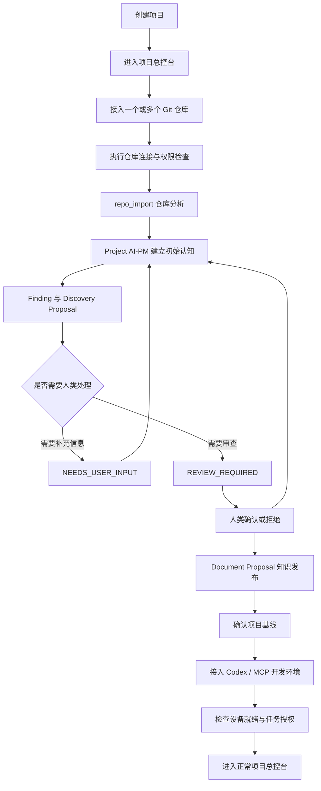
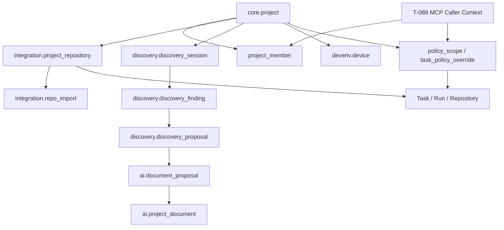

# S01 项目初始化与接入——最终设计基线 V1.2

> **文档性质**：S01 场景最终设计基线
> **版本**：V1.2
> **日期**：2026-11-03
> **状态**：六项技术裁决已确认，作为后续设计及实施依据
> **上位设计**：《AI R&D Workspace — 高保真设计系统 V1.0》
> **关联文档**：菜单稿 V1、Bootstrap V1.3、T-088、AI-PM Markdown Knowledge Space、现有数据库 migrations
> **设计原则**：复用现有领域模型，初始化进度条件派生，项目治理与 Agent 执行权限分离。

> **编者按**：本稿为 S01 最终基线，取代同目录 `smark-pm-s01-project-initialization-v1.md`（V1 场景稿）中与之冲突的状态机设计（Project 四态、Repository 接入态、AI-PM 初始化态、Execution Environment 态）；V1 场景稿的六阶段旅程、四项独立成果、异常场景与 UI 结论仍然有效。事实依据见 `smark-pm-s01-evidence-v1-1.md`。本文档原为 HTML 徽章格式，此处转为 Markdown 记号，其余内容原样保留。

---

# 一、设计目标与范围

## 1.1 场景目标

S01「项目初始化与接入」负责将普通软件项目转化为：

- 人类能够管理和治理的项目空间。
- Project AI-PM 能够理解项目背景、仓库结构和技术约束的项目。
- 多个 Execution Agent 能够在明确授权范围内协作执行任务的项目。

S01 不是 Agent 安装向导，也不是独立的项目初始化子系统。

它是对现有项目、仓库、Discovery、知识空间、开发环境和授权能力的业务编排。

## 1.2 管理原则

采用已经确认的项目管理模式：

**人类负责项目，AI Agent 协助执行。**

具体责任边界：

| 主体 | 职责 |
|---|---|
| 项目负责人 | 项目目标、项目基线、重大决策、审批和验收 |
| 项目成员 | 项目协作、知识确认及授权范围内的管理工作 |
| Project AI-PM | 项目认知、信息组织、分析、建议、任务协调 |
| Execution Agent | 在具体任务和授权范围内执行研发工作 |
| MCP | 提供 Agent 与平台之间的受控业务接口 |
| smark-pm | 保存项目事实、执行授权、管理状态及审计 |

AI 可以提出建议、生成知识提案、执行授权任务，但不能代替人类完成需要人类授权的治理行为。

## 1.3 S01 的四项独立成果

初始化不使用单一 `initialized` 布尔值。

四项成果分别表达：

| 成果 | 业务含义 | 主要依据 |
|---|---|---|
| 项目空间已建立 | 项目主体及成员关系存在 | `core.project`、项目成员 |
| 仓库已接入 | 项目已建立一个或多个仓库关联 | `integration.project_repository` |
| 初始认知已建立 | Project AI-PM 已完成初次发现和认知整理 | Discovery、Finding、Proposal、知识空间 |
| Agent 环境已接入 | 开发者环境已绑定并形成就绪快照 | `devenv.device` 及 readiness |

四项成果独立存在。

允许：

- 零仓库项目。
- 先创建项目，后接入仓库。
- 仓库已接入，但尚未完成 AI 分析。
- 初始认知已建立，但尚未接入 Codex。
- 环境已经连接，但项目基线尚未确认。

因此，初始化完成不是要求所有步骤按固定顺序一次性执行。

---

# 二、S01 用户旅程

## 2.1 总体流程



说明：

- 仓库接入不是必须的项目创建前置条件。
- Discovery 可以在仓库接入后启动，也可以基于已有项目信息启动。
- 需要人类处理的事项进入待处理中心。
- 项目基线确认不代表 Agent 已经获得执行授权。
- 环境接入不代表项目已经具备所有任务的执行能力。

## 2.2 初始化的六个业务阶段

| 阶段 | 用户目标 | 平台行为 | 完成判断 |
|---|---|---|---|
| 1. 创建项目 | 建立项目空间 | 创建 Project 和初始成员关系 | 项目主体存在 |
| 2. 接入仓库 | 关联项目代码 | 检查连接、认证、读取权限，启动分析 | 仓库关联存在，分析结果可独立查看 |
| 3. 建立初始认知 | 让 AI-PM 理解项目 | Discovery、Finding、Proposal | 初始认知达到可审查状态 |
| 4. 确认项目基线 | 人类确认重要事实 | 审核发现、确认知识、处理冲突 | BaselineConfirmed 派生成立 |
| 5. 接入开发环境 | 使 Agent 具备执行环境 | Bootstrap、设备绑定、MCP 接入、readiness 检查 | 环境接入事实成立 |
| 6. 进入项目总控台 | 开始正常项目管理 | 展示项目健康、待处理和执行情况 | 用户可以按需开展后续工作 |

这六个阶段是用户旅程，不是必须持久化的六态状态机。

---

# 三、Q1～Q6 最终技术裁决

## Q1：Repository 保持项目级关联，不升格全局实体

**已确认**

### 最终结论

V1 继续使用 `integration.project_repository` 表达项目与仓库的关联。

不新增全局 Repository 主数据实体。

### 现有模型

```text
Project A
  └── project_repository
        └── URL X

Project B
  └── project_repository
        └── URL X
```

同一 Git URL 可以分别关联到多个项目。

### 接受的代价

这是以模型简单性换取跨项目重复管理成本的明确选择。

同一仓库被多个项目接入时：

- 项目级凭证（例如 `project_ssh_key`）分别管理。
- `repo_import` 分别执行。
- 仓库分析结果分别维护。
- 项目级仓库职责及授权分别表达。

不在 V1 引入跨项目凭证共享、统一分析结果和全局仓库治理。

### 未来演进条件

当出现统一镜像、跨项目同步、共享凭证治理、全局 webhook 或仓库资产管理需求时，再评估全局 Repository 实体。

未来即使引入全局实体，也必须保留项目级关联和项目级授权边界。

### 实施约束

- 不新增全局 Repository 主表。
- 不改变项目仓库关联的核心语义。
- 不合并项目仓库和任务仓库模型。
- 现有仓库职责枚举继续沿用 `main / docs / service / infra`。

## Q2：仓库分析沿用 repo_import 作业模型

**已确认**

### 最终结论

继续由 `integration.repo_import` 承担仓库分析作业。

采用：

**分析作业历史 + 最近一次分析结果。**

不在 `project_repository` 增加重复的分析状态机。

### 状态语义

飞行状态：

```text
queued
  → cloning
  → reading
  → analyzing
```

结果状态：

```text
draft_ready
  → proposed
  → applied

其他结果：
rejected
```

`IN_PROGRESS` 仅为 UI 概括文案，不是数据库实际状态。

### 最近一次结果

最近结果按项目查询最新一条相关分析作业，不新增 `project_repository.last_analysis_status` 等冗余字段。

`stage_detail` 和 `progress` 已可为 UI 提供进度信息。

UI 需要区分：

- 当前正在执行的分析作业。
- 最近一次分析结果。
- 历史分析记录。
- 最近一次成功且被采纳的分析结果。

不得将当前正在运行的作业直接当成最近一次成功结果。

### 实施约束

- 每次重新分析保留独立作业事实。
- 不覆盖历史分析记录。
- 失败记录保留失败原因。
- 项目仓库关联不承担分析历史职责。
- UI 展示从现有 `repo_import` 数据派生。

## Q3：项目目标由知识对象承载，项目类型非必填

**已确认**

### 最终结论

项目目标不新增到 `core.project` 普通字段中，优先由项目知识对象承载。

项目类型不是创建项目的必填项。

### 具体数据落点

现有：

`ai.project_document.doc_type`

已有枚举：

```text
requirement
decision
architecture
knowledge
```

项目目标使用：

```text
doc_type = knowledge
doc_key = project-goal
```

即使用 `knowledge` 类型和约定的 `project-goal` 文档键承载。

不修改 `doc_type` 枚举。

### 项目目标建议内容

- 项目要解决的问题。
- 项目预期成果。
- 主要用户或使用对象。
- 项目成功标准。
- 当前阶段。
- 关键业务约束。
- 已知技术约束。

### 建立方式

项目目标可以：

1. 创建项目时由人类填写。
2. 仓库接入后由 AI-PM 提出初始整理。
3. 通过 Discovery 补充证据。
4. 由人类确认。
5. 随项目演进持续更新。

### 项目类型

V1 不要求用户在创建时选择项目类型。

未来如需用于模板、筛选或统计，再独立评估是否增加受控类型字段。

### 实施约束

- 不增加 `core.project.project_goal`。
- 不增加必填 `project_type`。
- 不修改 `ai.project_document.doc_type` 枚举。
- 使用既有知识文档机制承载项目目标。

## Q4：项目业务状态与初始化进度分离

**已确认**

### 最终结论

`core.project.status` 表达项目业务生命周期。

初始化进度由已有领域对象和业务事实条件派生。

不新增 `initializing / initialized` 项目状态，也不新增初始化布尔字段。

### 项目业务状态

V1 采用以下目标口径：

```text
planning
active
archived
```

当前已核对：

- 代码只写入 `planning`。
- 三态与现有代码使用不存在已知冲突。

实施前仍需检查所有 SQL、API、前端及外部集成对状态的读取和写入，确认完整兼容性后再统一约束。

### 初始化进度派生

| 维度 | 派生依据 |
|---|---|
| 项目空间 | Project 是否存在 |
| 仓库接入 | 项目仓库关联 |
| 仓库分析 | repo_import 作业及结果 |
| 初始认知 | INITIAL_ONBOARDING Session |
| 基线确认 | Session、Finding、Discovery Proposal 及知识发布结果 |
| 开发环境 | Device 生命周期和 readiness 快照 |
| 执行可用性 | 环境就绪与具体任务授权 |

`BaselineConfirmed` 是业务派生结果，不新增独立状态。

### 归档语义

`archived` 代表项目进入只读归档状态，不代表删除项目，也不代表立即破坏所有运行中的执行环境。

V1 采用以下规则：

| 行为 | archived 后的处理 |
|---|---|
| 查看项目、仓库、知识和历史记录 | 允许，仍需通过正常读取授权 |
| 查看历史 Run、交付及审计记录 | 允许 |
| 修改项目资料、仓库关联、项目知识 | 禁止 |
| 新建或派发研发任务 | 禁止 |
| 新建 Agent 执行实例 | 禁止 |
| 新建 Discovery Session | 禁止 |
| 推进现有 Discovery 状态及发布知识 | 禁止新的业务变更；未完成内容保留待处理状态 |
| 新的 Commit / Push / Merge / Release | 禁止 |
| 已运行的 Execution Run | 不直接强杀；进入受控停止或安全收尾流程 |
| 已有 MCP 读取调用 | 允许符合读取授权的只读调用 |
| MCP 写入或执行调用 | 拒绝 |

补充规则：

1. 归档时应阻止新的执行派发。
2. 已运行任务不得因为项目状态变化而被无条件视为已完成。
3. 已运行进程应通过既有 Run 生命周期管理机制安全收尾或取消。
4. 未完成的 Discovery Session 不应伪装为 `COMPLETED`；应保留现状，必要时按既有能力暂停。
5. 归档项目如需恢复，必须由具备权限的人类执行明确的恢复操作，并重新检查执行授权。
6. 恢复项目不自动恢复已撤销的设备、任务授权或外部凭证。

归档语义必须在服务端统一执行，不能只在前端隐藏按钮。

### 实施约束

- 不新增初始化状态机。
- 不新增 `initialized` 布尔字段。
- `planning / active / archived` 表达项目业务生命周期。
- 归档必须覆盖 MCP 写操作、任务派发和 Discovery 写入路径。
- 项目状态检查与授权检查应同时生效。

## Q5：F1～F4 映射现有 Finding 字段，两级提案链保持独立

**已确认**

### 最终结论

不新增 F1～F4 分类表。

沿用 `discovery_finding` 现有字段：

```text
kind:
  observed
  user_confirmed
  speculation
  contradicted

verification_status:
  PENDING
  CONFIRMED
  REJECTED
  CONFLICT

confidence
evidence
```

### 分类映射

| 分类 | kind | 初始验证策略 | 确认要求 |
|---|---|---|---|
| F1 客观事实 | `observed` | 依据证据判断 | 充分证据后按既有规则确认 |
| F2 技术归纳 | `observed` 或 `user_confirmed` | 结合证据和置信度 | 依据既有确认规则 |
| F3 业务/架构推断 | `speculation` | 通常 `PENDING` | 需要人类确认 |
| F4 治理与权限 | 不作为普通 Finding | 不适用 | 走 governance 授权流程 |

### F2 的知识落点

AI Summary 继续使用 Console 已有的知识三层模型中的 `aiSummary`。

不为 F2 新增独立摘要表或平行知识层。

AI Summary 是认知摘要，不等同于已获人类批准的治理事实。

### F3 的确认责任

`speculation → user_confirmed` 必须是一个有授权、有审计的业务动作。

执行要求：

1. AI 可以创建 `speculation` Finding。
2. AI 可以提交 Discovery Proposal。
3. 人类通过项目待处理事项查看证据和推断。
4. 具备项目确认权限的成员明确确认或拒绝。
5. 服务端执行 Finding 状态转换。
6. 记录确认人、确认时间及相关审计信息。
7. 后续根据既有两级提案链决定是否进入知识发布。

确认动作的 API/MCP 工具应复用现有 Finding/Discovery 管理接口；如果现有接口缺少这一明确的人类确认动作，应在实施设计中补充对应的服务端命令或端点。

权限约束：

- 项目负责人或具备相应项目治理权限的成员可以确认。
- 普通 Execution Agent 不得自行将 `speculation` 提升为 `user_confirmed`。
- Project AI-PM 不得通过普通自动写入绕过人类确认。
- 确认权限以服务端授权结果为准，不能只靠前端角色判断。

具体端点名称应以现有 API 规范为准，本基线不预设一个未经核对的 API 名称。

### 两级提案链

```text
discovery_finding
       |
       v
discovery.discovery_proposal
       |
       | pending / approved / rejected / conflict
       |
       | approved 后通过 document_proposal_id 关联
       v
ai.document_proposal
       |
       | draft
       | quality_gates_passed
       | redline_pending
       | confirmed
       | commit_pending
       | committed
       | rejected
       | rolled_back
       v
项目知识空间
```

两个状态机职责严格分离：

| 对象 | 负责的问题 |
|---|---|
| Discovery Proposal | AI 发现的内容是否被接受 |
| Document Proposal | 被接受的知识如何安全发布 |

不能把 `conflict` 加入 `ai.document_proposal`。

### Discovery Session

沿用现有类型：

```text
INITIAL_ONBOARDING
UPDATE
TASK_DISCOVERY
```

沿用现有状态：

```text
IN_PROGRESS
NEEDS_USER_INPUT
REVIEW_REQUIRED
COMPLETED
PAUSED
```

其中：

- `NEEDS_USER_INPUT`：等待用户补充信息。
- `REVIEW_REQUIRED`：等待人类审查。
- `COMPLETED`：该 Session 的发现流程完成，不自动意味着所有知识已发布。
- `BaselineConfirmed`：业务派生判断。

### 实施约束

- 不新增 F1～F4 分类表。
- 不新增初始化知识审批状态机。
- 不合并 Discovery Proposal 和 Document Proposal。
- 不把 AI Summary 当作已确认事实。
- 不允许 Agent 自行确认 F3 推断。

## Q6：拒绝 allow_agent_write，沿用既有授权体系

**已确认**

### 最终结论

不新增：

```text
allow_agent_write BOOLEAN
```

作为 Agent 仓库写权限的授权依据。

沿用既有三级策略模型、任务级覆盖策略及 T-088 调用人上下文授权链。

### 现有策略模型

migration 0013 已有：

`policy_scope`：

```text
organization
project
task_type
```

并且低层策略不得放宽高层策略。

现有 `task_policy_override` 包含：

```text
auto_accept
auto_merge
auto_publish_knowledge
require_human_approval
additional_checks
```

这些策略继续作为系统自动化行为的控制依据。

### 两个正交维度

必须明确区分：

**授权链决定调用人有没有权执行操作；`auto_*` 策略决定系统是否允许自动替调用人执行。**

| 维度 | 回答的问题 |
|---|---|
| Authorization | 这个调用人是否有权执行该操作？ |
| Automation Policy | 系统是否允许自动执行该操作？ |

例如：

- 调用人有 Merge 权限，但 `auto_merge=false`：可以进入人工确认或人工执行流程，不能自动合并。
- `auto_merge=true`，但调用人没有 Merge 权限：仍然不得合并。
- `auto_publish_knowledge=true`，但调用人没有知识发布授权：仍然不得发布。
- 上层策略禁止某项操作时，任务级覆盖不得将其放宽。

最终执行条件是两维约束同时满足，而不是二者相互替代。

### Git 操作分类

在授权链第 5 步“操作是否符合授权范围”中，明确使用以下六类操作语义：

| Action | 含义 |
|---|---|
| `repository.read` | 读取仓库内容 |
| `repository.write` | 修改工作区文件或产生代码变更 |
| `repository.commit` | 创建 Git Commit |
| `repository.push` | 推送到远端仓库 |
| `repository.merge` | 合并分支或进入受保护分支 |
| `repository.release` | 执行发布或部署 |

以上是授权链中的操作分类词表，不要求 V1 新增独立的 Action 数据库表。

### 权限判定

继续使用菜单稿 V1 §5.3 的授权判断五步及 T-088 MCP 调用人上下文。

第 5 步应使用上述 Action 分类判断具体操作是否在授权范围内。

本基线不重新定义或替代既有五步授权协议。

### 开发环境与权限分离

沿用 T-088 P1-1 的既有裁决：

- Device lifecycle 与 readiness 快照分离。
- Ready 六态属于设备就绪快照。
- 项目可用性由设备绑定与调用人成员资格等条件派生，不落库为一个设备权限状态。
- 设备绑定不产生项目权限。
- readiness 不产生仓库写权限。
- Execution Ready 是 readiness 与任务授权共同决定的派生判断。

### 撤权语义

统一表述：

**授权链每调用校验 + 外部 JWT 短时效。**

补充运维事实：

`token-service` 重启并更换签名密钥，是现有机制中使现存令牌全量失效的路径。

但这属于运维级全量令牌失效手段，不应描述成普通成员撤权的即时生效机制。

### 实施约束

- 不新增 `allow_agent_write`。
- 不绕过 `policy_scope` 三级策略。
- 不允许低层策略放宽高层限制。
- 不将 `auto_merge` 等自动化策略视为授权。
- Git 六类操作进入授权链第 5 步的 Action 判断。
- 不新增 Action 表，除非未来出现独立治理及策略配置需求。

---

# 四、最终领域模型关系

S01 只编排现有领域模型，不创造重复领域。



关系说明：

- 项目与仓库是一对多关联。
- 仓库分析由 `repo_import` 承担。
- 项目初始认知由 Discovery Session 驱动。
- Finding 经 Discovery Proposal 审核。
- 被接受的知识经 Document Proposal 安全发布。
- 项目目标使用 `ai.project_document` 的 `knowledge` 类型及 `project-goal` 约定键。
- 设备就绪与项目授权分离。
- Agent 的具体任务执行同时受到授权链和自动化策略约束。

---

# 五、S01 页面与菜单落点

## 5.1 菜单原则

S01 不新增菜单。

初始化是项目总控台的一种状态视图。

沿用菜单稿 V1 的项目工作区菜单及总控台 P0 七个页签，不另造一套初始化导航。

## 5.2 页面职责

| 页面/入口 | S01 中承担的职责 |
|---|---|
| 项目总控台 | 展示初始化进度、项目状态和下一步建议 |
| 项目概览 | 展示项目基本资料及项目目标摘要 |
| 仓库管理 | 接入仓库、检查连接、查看分析进度及历史 |
| 项目知识库 / AI-PM 工作区 | 查看 Finding、AI Summary、知识提案及项目基线 |
| 开发环境 | 展示开发者设备绑定和 readiness |
| 人类待处理事项 | 聚合需要人类补充、确认、决策和审批的事项 |
| 全局 AI 指令入口 | 用户向 Project AI-PM 提出项目级指令 |

上述页面应映射到现有菜单稿 V1 的实际页签和菜单项；表中是业务职责，不代表新增页面。

## 5.3 项目总控台初始化视图

建议总控台展示：

**第一层：项目整体状态**

- 项目名称及业务状态。
- 项目目标摘要。
- 初始化阶段概览。
- 需要人类处理的事项数量。

**第二层：四项初始化成果**

- 项目空间。
- 仓库接入。
- Project AI-PM 初始认知。
- Agent 执行环境。

**第三层：待处理事项**

- 等待用户补充信息。
- 等待 Finding 确认。
- 等待 Discovery Proposal 审查。
- 等待知识发布确认。
- 环境接入异常。
- 需要人类处理的授权事项。

**第四层：AI-PM 建议**

- 建议接入的仓库。
- 建议补充的项目目标。
- 建议确认的架构推断。
- 建议执行的后续任务。

建议只提供行动入口，不自动替用户完成授权、确认或审批。

## 5.4 初始化完成后的视图变化

初始化完成后，不跳转到另一套系统。

项目总控台转为正常的项目健康与接入状态概览：

- 项目目标和基线。
- 仓库健康情况。
- AI-PM 认知状态。
- Agent 环境可用性。
- 当前任务与交付情况。
- 待处理事项。

---

# 六、关键业务规则

## 6.1 仓库接入规则

接入一个仓库时，至少验证：

1. URL 与协议格式。
2. DNS 和网络连通性。
3. 认证信息有效性。
4. 仓库读取权限。
5. Clone 或读取能力。

内网 GitLab/Gitea 是首要接入场景。

不能只因为 URL 解析成功就显示“仓库接入成功”。

仓库连接检查失败与仓库分析失败必须区分。

## 6.2 初始认知规则

初始认知使用：

```text
discovery_session.kind = INITIAL_ONBOARDING
```

后续更新使用：

```text
discovery_session.kind = UPDATE
```

任务相关发现使用：

```text
discovery_session.kind = TASK_DISCOVERY
```

AI 发现的事实必须保留证据和验证状态。

不得将 AI 生成的所有内容直接写入已确认知识。

## 6.3 项目基线确认规则

项目基线确认不是一个独立的初始化状态字段。

其派生条件至少需要考虑：

- INITIAL_ONBOARDING Session 是否完成。
- 关键 Finding 是否达到确认要求。
- 相关 Discovery Proposal 是否完成审核。
- 应发布的知识是否经过既有 Document Proposal 流程。
- 是否仍存在阻断基线确认的冲突或待处理事项。

具体哪些 Finding 必须确认、哪些可以保留为待确认推断，应由项目基线确认规则明确，不应简单要求所有 Finding 都变为 CONFIRMED。

## 6.4 Agent 执行规则

Agent 执行至少需要同时满足：

- 调用人身份和项目授权有效。
- 任务处于允许执行的状态。
- 仓库操作在授权范围内。
- 开发环境达到相应 readiness。
- 自动化策略允许对应的自动操作。

任何一项不满足，都不能仅凭设备已经连接而放行。

## 6.5 多仓库与多 Agent

项目允许：

- 多个仓库。
- 一个任务涉及多个仓库。
- 多个 Agent 并行执行不同任务。
- 多个 Agent 同时产生项目知识提案。

项目知识写入仍由统一协调机制控制。

多个 Agent 的执行并行，不意味着项目知识可以无约束并发提交。

S01 负责建立项目认知和接入基础，不在此处重复定义多 Agent 知识写入协调机制。

---

# 七、状态与异常处理

| 异常情况 | 处理方式 | 不应发生的行为 |
|---|---|---|
| 仓库网络不可达 | 展示连接失败及检查信息 | 显示接入成功 |
| 仓库认证失败 | 引导用户检查凭证 | 将认证失败记成分析失败 |
| 仓库分析失败 | 保留 repo_import 失败记录 | 覆盖历史成功结果 |
| Discovery 缺少信息 | Session 进入 `NEEDS_USER_INPUT` | 假装分析完成 |
| Discovery 等待确认 | Session 进入 `REVIEW_REQUIRED` | 与等待用户补充混为一谈 |
| Finding 发现冲突 | 使用既有冲突状态和提案处理 | 把冲突塞进 Document Proposal |
| 知识质量门未通过 | 按 Document Proposal 既有管线处理 | 直接发布 |
| 开发环境未就绪 | 展示 readiness 具体问题 | 直接判定无项目权限 |
| 任务授权不足 | 拒绝对应操作 | 通过 `allow_agent_write` 绕过 |
| 项目归档 | 阻止新写入与新执行 | 强制将历史 Run 标为完成 |

---

# 八、实施影响清单

## 8.1 本次裁决明确不新增

| 项目 | 决定 |
|---|---|
| 全局 Repository 主表 | 不新增 |
| `project_repository.analysis_status` | 不新增 |
| `core.project.project_goal` | 不新增 |
| 必填 `core.project.project_type` | 不新增 |
| `initializing / initialized` 项目状态 | 不新增 |
| 初始化完成布尔字段 | 不新增 |
| F1～F4 Finding 分类表 | 不新增 |
| 第二套初始化知识审批状态机 | 不新增 |
| `allow_agent_write` | 不新增 |
| Git Action 独立数据库表 | V1 不新增 |

## 8.2 复用的既有能力

| 能力 | 既有落点 |
|---|---|
| 项目主体 | `core.project` |
| 项目成员 | `project_member` |
| 仓库关联 | `integration.project_repository` |
| 仓库分析 | `integration.repo_import` |
| 项目目标 | `ai.project_document` |
| 初始认知 | `discovery.discovery_session` |
| 发现事实 | `discovery.discovery_finding` |
| 发现审核 | `discovery.discovery_proposal` |
| 知识发布 | `ai.document_proposal` |
| 开发环境 | `devenv.device` |
| 自动化策略 | `policy_scope`、`task_policy_override` |
| MCP 调用人上下文 | T-088 |
| 项目菜单和授权 | 菜单稿 V1 |

## 8.3 需要实施设计明确的事项

以下不是重新开放 Q1～Q6，而是将已确认结论落实到实现时需要检查的工作：

1. 仓库接入检查与 `repo_import` 的调用及状态展示映射。
2. 最近一次仓库分析结果的查询规则及历史记录展示。
3. `project-goal` 文档的创建、读取、更新与知识发布路径。
4. 项目 `planning / active / archived` 的完整代码和 API 兼容性核查。
5. 项目归档对任务派发、Run、MCP 写操作和 Discovery 的统一服务端拦截。
6. F3 Finding 人类确认所使用的现有 API/MCP 工具及授权要求。
7. Finding 状态转换的确认人、时间和审计信息。
8. Git 六类 Action 与授权链第 5 步的映射。
9. `auto_*` 策略与调用人授权的正交检查。
10. 多 Agent 并行情况下，知识写入统一协调机制的既有约束。

---

# 九、实施前核对清单

以下工作应在进入 S01 实施任务拆分前完成：

- [ ] 核对 `integration.project_repository` 当前唯一约束和项目级凭证归属。
- [ ] 核对 `repo_import` 的实际查询关系、排序字段、`stage_detail` 和 `progress`。
- [ ] 核对 `ai.project_document.doc_type` 及文档键约定，确认 `project-goal` 无冲突。
- [ ] 全量搜索 `core.project.status` 的 SQL、API、前端和外部集成使用。
- [ ] 核对归档状态是否已被现有任务、MCP、Discovery 写入路径统一检查。
- [ ] 核对 Finding 现有状态转换 API 和角色授权。
- [ ] 核对 Console `aiSummary` 的现有读写及知识分层约定。
- [ ] 核对 T-088 P1-1、§7.3、§7.4 的设备就绪与项目可用性定义。
- [ ] 核对菜单稿 V1 §5.3 授权判断五步。
- [ ] 核对 migration 0013 的 `policy_scope` 和 `task_policy_override` 具体约束。
- [ ] 核对 `token-service` 更换签名密钥的实际运维流程。
- [ ] 核对现有多 Agent 知识写入协调机制，不重复实现。

---

# 十、最终设计原则

S01 V1.2 冻结以下十条原则：

1. 项目仓库关联保持项目级，不建立全局 Repository 实体。
2. 仓库分析继续使用 `repo_import`，不增加第二套分析状态机。
3. 项目目标进入既有知识空间，使用 `knowledge + project-goal`。
4. 项目业务状态与初始化进度分离。
5. `archived` 是服务端强制执行的只读归档状态。
6. Finding 分类复用现有字段，F3 推断必须经过授权的人类确认。
7. Discovery Proposal 与 Document Proposal 两级提案链保持独立。
8. 开发环境绑定与 readiness 不产生项目或仓库权限。
9. Agent 操作通过既有授权链，Git 六类 Action 在授权链第 5 步判断。
10. `auto_*` 表达自动化策略，授权链表达调用人权限，两者必须同时满足。

**最终定位：S01 是现有领域能力的初始化编排场景，不是新建一套项目、仓库、知识和 Agent 权限体系的理由。**

后续所有 S01 的 User Journey、State Machine、UI Specification 和实施任务，均应以本文件为共同设计基线。
