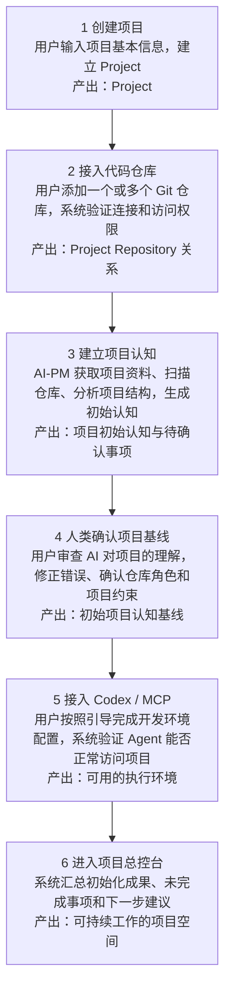
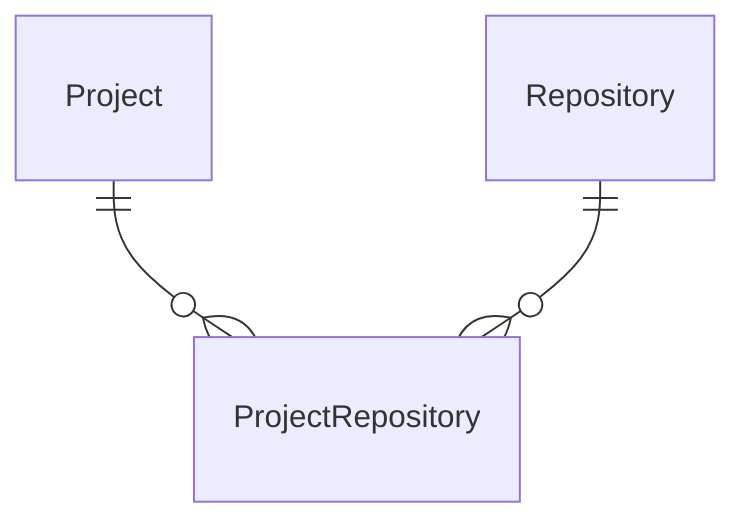
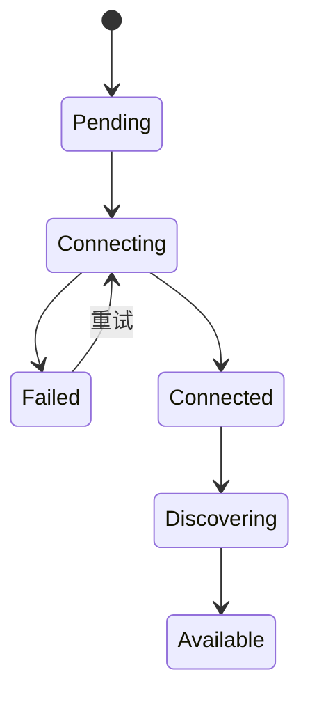
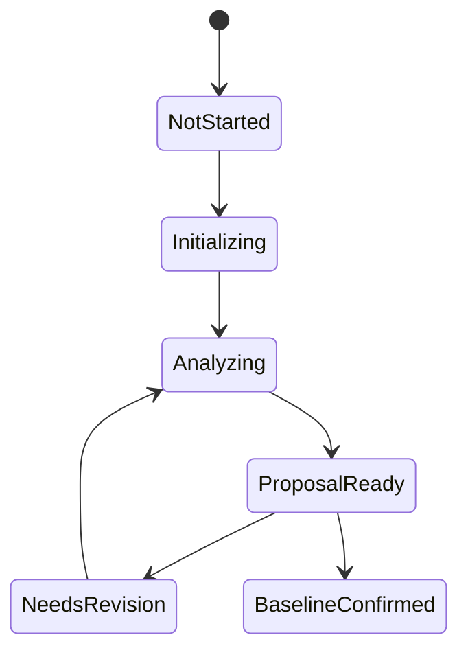
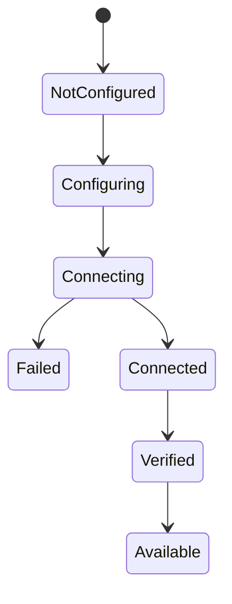
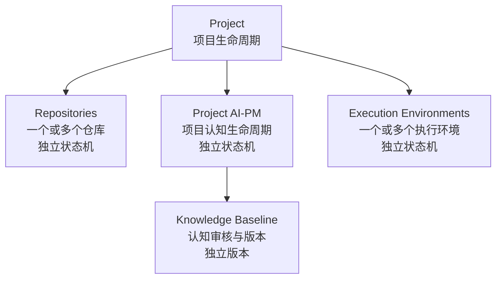

# S01 — 项目初始化与接入 业务场景设计

> D 混合模式 · V1.0
>
> 说明：文中图片均为功能结构示意图，不是最终视觉稿。

## 1. 场景定义

### 1.1 用户场景

用户准备使用 smark-pm 管理一个软件研发项目。

这个项目可能：

- 已经存在多个 Git 仓库。
- 只有需求文档，还没有代码。
- 已经有成熟代码，但没有项目知识库。
- 正在开发中，希望引入 AI Agent。
- 已经使用 Codex，希望接入 smark-pm 的 MCP。

用户希望完成的事情是：

> 把一个普通的软件项目，转变为一个可以由人类管理、AI-PM 理解、多个 Agent 协作执行的 AI 研发项目。

### 1.2 参与者

| 参与者 | 职责 |
| --- | --- |
| 项目负责人（Human） | 创建项目、确认配置、授权接入 |
| smark-pm | 管理项目、仓库、权限、业务流程 |
| Project AI-PM | 理解项目、分析仓库、建立项目认知 |
| MCP | 为 Agent 提供项目任务及上下文接口 |
| Codex Agent | 在开发环境中读取任务、执行研发工作 |
| Git 仓库 | 提供代码、分支、Commit 等基准事实 |

这里要区分两个 AI 角色：

- **Project AI-PM**：项目管理与认知协调者。它负责项目级分析、知识组织、任务组织。
- **Execution Agent**：研发执行者。它负责具体任务的代码修改、测试和交付。

不要把两者混为一个 Agent，也不要让用户在项目初始化时就必须管理多个 Agent 的内部配置。

## 2. 用户完成 S01 后应该得到什么？

我建议将初始化结果定义为四个独立成果。

> **① 项目空间已建立**
> 项目身份：项目名称、目标、描述、负责人、成员及项目基本约束。
>
> **② 仓库已接入**
> 代码来源：一个或多个 Git 仓库，包含仓库地址、默认分支、基准 Commit、访问状态等。
>
> **③ 项目 AI-PM 已初始化**
> 项目认知：项目基础上下文、仓库结构认知、初始知识材料及 AI-PM 工作规则。
>
> **④ Agent 执行环境已接入**
> 执行能力：MCP 配置、Codex 环境连接、身份验证和执行能力验证。

这里我想特别强调：**这四个成果不能被压缩成一个简单的项目状态。**

例如：

- 项目已经创建，但还没有仓库。
- 仓库已经接入，但 AI-PM 还没有完成分析。
- AI-PM 已经理解项目，但 Codex 尚未接入。
- Codex 已经连接，但某个仓库的权限已经失效。

它们代表不同的业务事实，应该分别记录。

## 3. 用户完整操作旅程（User Journey）

我把 S01 分为六个阶段。



注意：**六个阶段不应该设计成一个必须从头走到尾的长向导。**

例如，用户创建项目后，可以先完善需求文档，第二天再接入 Git；也可以先接入 Git，稍后再配置 Codex。

因此，应该采用：

> 分阶段初始化 + 随时保存 + 项目总控台持续显示完成情况。

## 4. 六个阶段的具体业务操作

这是 S01 最重要的部分。我们逐一明确用户做什么、AI 做什么，以及系统如何流转。

### 阶段一：创建项目

#### 录入项目名称和描述

**用户操作**

用户在系统中选择「创建项目」。

需要填写：

| 字段 | 是否必填 | 说明 |
| --- | --- | --- |
| 项目名称 | 必填 | 项目的正式名称 |
| 项目标识 | 必填 | 系统内部唯一标识 |
| 项目描述 | 建议 | 这个项目解决什么问题 |
| 项目目标 | 建议 | 希望实现什么 |
| 项目负责人 | 必填 | 项目管理责任人 |
| 项目类型 | 可选 | Web、Desktop、Game、Backend 等 |

这里不应该要求用户填写大量技术信息。

例如，不应该在创建项目时就要求用户填写：

- 技术架构。
- 编程语言。
- 数据库。
- Agent 数量。
- MCP 地址。
- 代码仓库列表。

这些信息可以后续逐步完善。

**系统行为**

1. 检查项目标识是否重复。
2. 创建 Project。
3. 创建项目负责人关系。
4. 初始化项目基础配置。
5. 创建一个 Project AI-PM 的逻辑工作空间。
6. 生成初始化待办事项。

**完成条件**

- [ ] 项目正式创建，进入初始化状态。

这里我建议项目创建后直接进入项目总控台，而不是进入第二个独立向导。

### 阶段二：接入 Git 仓库

这是非常关键的一步，因为一个项目可能包含多个代码仓库。

**用户操作**

用户进入项目的「仓库接入」区域，选择：

- GitHub
- GitLab
- Gitea
- 自建 Git 服务
- Git URL（如果当前连接方式支持）

然后添加仓库。

例如，一个电商项目：

| 仓库 | 角色 |
| --- | --- |
| shop-web | 前端 |
| shop-api | 后端 |
| shop-admin | 管理后台 |
| shop-infra | 基础设施 |

这些仓库都属于同一个 Project。

**系统行为**

每次添加仓库，系统执行：

1. 验证仓库地址。
2. 验证凭证及访问权限。
3. 获取默认分支。
4. 获取当前 HEAD Commit。
5. 获取仓库基本元数据。
6. 建立 Project 与 Repository 的关联。
7. 生成仓库接入结果。

这里有一个重要的设计决定：

> 仓库是独立的业务实体，Project 和 Repository 是多对多关系，不能把仓库地址直接作为 Project 的一个字段。

建议关系模型：



`ProjectRepository` 用来保存项目视角下的仓库配置，例如：

- 仓库在项目中的职责。
- 是否为主要仓库。
- 是否允许 Agent 执行写操作。
- 项目级仓库约束。
- 该项目使用的基准分支。

而 `Repository` 保存仓库本身的身份和 Git 元数据。

**异常处理**

| 问题 | 系统行为 |
| --- | --- |
| 仓库不存在 | 提示检查 URL |
| 没有访问权限 | 提示重新授权 |
| 默认分支不存在 | 要求用户确认分支 |
| 仓库已经关联 | 提示已存在 |
| 网络暂时失败 | 允许重试 |
| 部分仓库失败 | 保留已成功接入的仓库 |

特别是最后一点：**不能因为四个仓库中一个失败，就回滚另外三个已经成功的仓库。**

### 阶段三：AI-PM 建立项目认知

（图1，示例图，不是最终呈现）

这是 smark-pm 和普通项目管理系统最大的区别之一。

用户不需要自己手动整理所有项目资料，AI-PM 应该主动帮助建立项目认知。

**AI-PM 自动执行**

1. 获取项目基础信息。
2. 获取关联仓库列表。
3. 扫描仓库目录结构。
4. 识别语言、框架和依赖。
5. 读取 README、架构文档和已有设计文档。
6. 分析仓库之间的关系。
7. 识别现有模块、入口和关键技术组件。
8. 生成初步项目认知报告。

例如，AI-PM 可能得出：

```text
项目：Shop System

仓库：
  shop-web
    - React
    - TypeScript
    - 前端应用

  shop-api
    - Rust
    - Axum
    - API 服务

  shop-infra
    - Docker
    - 部署配置

初步识别：
  - 前后端分离架构
  - API 服务由 shop-api 提供
  - shop-web 依赖 shop-api
  - shop-infra 负责部署
```

但是，这些信息必须区分来源：

| 信息 | 可信程度 |
| --- | --- |
| Git 仓库 URL | 系统事实 |
| HEAD Commit | Git 事实 |
| Cargo.toml 中的依赖 | 代码事实 |
| AI 判断的架构关系 | AI 推断 |
| 用户确认的业务职责 | 人类确认事实 |

**AI 不能把推断直接当成正式项目知识。**

**用户操作**

AI-PM 完成扫描后，在总控台通知：

「项目初始分析已完成，请确认项目认知。」

用户可以：

- 确认。
- 修改。
- 拒绝。
- 要求 AI 进一步分析。
- 暂时跳过。

> AI 生成的认知应该先成为待审核提案，而不是直接覆盖正式知识库。

（认知提案示意：AI-PM 项目认知提案「待确认」——识别出的项目架构：shop-web（React 前端）→ shop-api（Rust API 服务）→ 数据库（AI 尚未确认具体类型）；AI 推断：shop-web 调用 shop-api，数据库类型需要进一步确认；用户可以执行的操作：确认提案 / 修改内容 / 拒绝提案。）

### 阶段四：确认项目基线

这个阶段非常重要。

我不建议让 AI 自己决定项目的正式技术架构和仓库职责。

应该由 AI 提供建议，人类确认。

用户确认后，才将相应内容写入正式项目知识。

另外，我建议这里不要设计成一次性的大审批。

例如，用户可以先确认仓库职责，暂时不确认数据库架构。

这样不会因为一个未知信息阻塞整个项目初始化。

### 阶段五：接入 Codex / MCP

这一阶段需要和项目认知初始化分开。

原因是：

- AI-PM 是项目级能力。
- Codex 是具体研发执行环境。
- MCP 是连接平台与执行 Agent 的通信接口。

用户可能已经完成项目认知，但暂时没有准备开发环境。

**用户操作**

在项目总控台看到：

「AI 执行环境尚未接入」。

点击后进入接入引导。

大致流程：

1. 获取当前项目的 Codex Bootstrap 配置。
2. 在开发环境安装或配置 MCP。
3. 建立用户与执行环境的身份关联。
4. 验证 MCP 是否能够连接 smark-pm。
5. 验证是否能够识别当前用户及项目授权。
6. 验证仓库访问和任务读取能力。
7. 完成一次安全的连通性测试。

这里有一个需要明确的架构原则：

> 项目不应该等同于一个 Codex 环境。

一个项目可能有多个开发者、多个执行环境，也可能有多个 Agent 并行执行。

所以建议数据关系是：

```text
Project
  │
  ├── Project Agent（逻辑协调者）
  │
  ├── Execution Environment A
  │       ├── Codex Agent 1
  │       └── Codex Agent 2
  │
  └── Execution Environment B
          └── Codex Agent 3
```

这些执行实例受项目授权和任务分配约束。

MCP 接入成功不代表所有 Agent 都已经启动；也不代表 Agent 已经获得所有仓库的写权限。

### 阶段六：进入项目总控台

当用户完成项目创建后，不应该再停留在初始化页面。

应该回到项目总控台。

系统显示：

- 项目基本情况。
- 仓库接入情况。
- AI-PM 初始化情况。
- Codex/MCP 接入情况。
- 待用户确认的事项。
- AI 对项目的下一步建议。

（图3，总控台初始化概觾示例：Shop System「可开始规划」——4/4 仓库已接入、85% 初始认知完成度、1 个 AI-PM 已就绪、0/2 执行环境已连接；需要你处理：确认数据库技术架构（AI-PM 的项目认知提案）「待确认」；AI-PM 建议：项目基础分析已经完成，建议下一步先建立项目需求基线，再开展技术设计。）

这里的数字只是说明 UI 的呈现方式。实际完成度不能简单用一个百分比代表项目是否可用。

## 5. 业务状态流转设计

这是从场景设计走向系统业务模型的关键。

我建议 S01 至少有四组独立状态机。

### 5.1 Project 状态

| 状态 | 含义 |
| --- | --- |
| Draft | 项目刚创建，基本信息尚未完善 |
| Initializing | 项目初始化过程中 |
| Active | 项目可以正常开展工作 |
| Archived | 项目已归档 |

建议**不要**增加 `Initializing_AI`、`Initializing_Repo`、`Initializing_MCP` 这样的 Project 状态。

这些属于不同子对象的状态，不应该全部塞进 Project 主状态机。

### 5.2 Repository 接入状态



其中：

- Connected：Git 连接及权限验证成功。
- Discovering：正在分析仓库。
- Available：仓库可以参与项目研发工作。

注意，仓库可以已经 Connected，但 Discovery 仍然失败。**这两个事实不能合并。**

### 5.3 AI-PM 初始化状态



这里还有一个重要的概念：

> BaselineConfirmed 不意味着 AI-PM 永远不再更新知识。

它只是表示项目的初始认知已经获得人类确认。后续研发过程中还会持续产生新的知识提案。

### 5.4 Execution Environment 状态



**Connected 和 Available 不能混淆。**

例如，MCP 能够连接，但用户没有任务读取权限，那么连接成功也不能算执行能力已经就绪。

### 5.5 四组状态之间的关系

这是我建议的整体业务关系：

（图4）



这样设计有个好处：

某个仓库暂时不可用，不意味着整个 Project 必须进入 Failed。

某个 Codex 环境离线，也不意味着 AI-PM 无法继续帮助用户分析需求。

这才是一个真正能够持续工作的项目管理平台。

## 6. 业务异常与特殊场景

正常流程只是其中一部分。实际使用中，S01 必须考虑以下情况。

| 场景 | 预期处理 |
| --- | --- |
| 项目没有代码仓库 | 允许先建立项目，后续接入 |
| 只接入部分仓库 | 保留成功仓库，失败仓库单独重试 |
| 仓库扫描失败 | 保留连接状态，允许重新扫描 |
| AI 分析结果不准确 | 用户修改或要求重新分析 |
| 用户暂时不确认认知 | 保存提案，继续其他工作 |
| Codex 尚未安装 | 项目仍可进行需求和设计工作 |
| MCP 连接中断 | 执行环境显示异常，不影响其他项目能力 |
| 仓库基准版本发生变化 | 重新获取基准信息，不覆盖历史分析记录 |
| 用户删除某个仓库 | 解除项目关联，但不直接删除 Git 仓库 |
| 项目负责人发生变化 | 更新负责人关系，保留历史操作记录 |

还有两个特殊情况值得明确：

**情况 A：一个项目可以没有任何仓库。**

例如一个全新的产品，用户首先希望通过 AI 讨论需求和设计架构。这时不应该强迫用户先创建 Git 仓库。

**情况 B：一个项目可以有多个执行环境。**

开发者可能在不同机器上运行 Codex，或者部署多个执行节点。执行环境属于接入能力，不属于项目的唯一属性。

## 7. D 混合模式下，S01 需要哪些 UI？

现在我们终于可以反推页面了。

我建议 S01 不要设计成六个独立菜单，而是设计成一个连续的项目工作空间。

### 页面一：项目总控台

用户创建项目后首先进入这里。

主要职责：

- 展示项目概况。
- 展示初始化进度。
- 显示需要人类处理的事项。
- 展示 AI-PM 的工作情况。
- 提供下一步操作入口。

### 页面二：项目初始化工作区

负责项目初始化的所有操作。

包括：

- 项目基本信息。
- 仓库接入。
- 仓库角色管理。
- 项目认知初始化。
- 初始认知审核。
- 执行环境接入。

注意：这是一个工作区，可以有不同的内容视图，不意味着每项工作都需要单独占用一个主菜单。

### 页面三：项目仓库管理

这是项目长期使用的功能，不仅仅属于初始化。

用户后续可以：

- 添加仓库。
- 移除仓库关联。
- 修改仓库职责。
- 查看仓库基准版本。
- 查看仓库访问状态。
- 重新扫描仓库。

### 页面四：项目 AI-PM 工作区

负责：

- 查看项目认知。
- 查看 AI 分析报告。
- 讨论项目认知。
- 审核知识提案。
- 查看 AI-PM 的工作记录。

### 页面五：执行环境管理

负责：

- 查看 Codex 接入情况。
- 管理多个执行环境。
- 查看 MCP 连接状态。
- 查看执行环境权限。
- 重新执行 Bootstrap。
- 管理环境异常。

其中，执行环境管理属于长期管理功能，不应该只在项目初始化时存在。

## 8. D 模式下的全局布局应该如何体现？

我建议 S01 期间的项目工作空间具有以下信息结构：

（图5，功能结构示意图，不是最终视觉稿）

```text
┌──────────────────────────────────────────────────────────┐
│ smark-pm                                    项目工作空间   │
├─────────────┬────────────────────────────────────────────┤
│ 项目导航     │  Shop System                「初始化中」     │
│  ▤ 项目总控台 │                                            │
│  ▣ 仓库管理  │  项目初始化                  仓库接入·AI-PM·MCP│
│  ◑ 项目认知  │  当前项目情况                4 个仓库·1 项待确认│
│  ○ AI 执行环境│  AI-PM                     初始认知分析已完成 │
│  ⚙ 项目设置  │                                            │
├─────────────┴────────────────────────────────────────────┤
│ 人类待处理事项（1）                确认数据库技术架构        │
├──────────────────────────────────────────────────────────┤
│ ✦ 询问 AI-PM 或继续推进项目…（AI 指令入口）                 │
└──────────────────────────────────────────────────────────┘
```

这个布局表达了 D 模式的三个核心区域：

1. **主工作区**：用户当前正在处理的业务。
2. **待处理区域**：需要人类关注、决策和确认的事情。
3. **AI 指令入口**：随时向 AI-PM 提出任务、问题和修改意见。

这里还要注意：**待处理事项应该是跨场景的全局能力，不是只在初始化页面出现。**

## 9. S01 最终需要确定的几个业务规则

我把目前的设计结论整理一下：

| 编号 | 设计决定 | 建议 |
| --- | --- | --- |
| S01-01 | 项目创建后进入哪里 | 项目总控台 |
| S01-02 | 初始化是否必须一次完成 | 否，允许分阶段 |
| S01-03 | Project 与 Repository 关系 | 多对多关联 |
| S01-04 | 仓库分析是否自动写入正式知识 | 否，先形成提案 |
| S01-05 | 项目 AI-PM 与 Codex 是否是同一个角色 | 否 |
| S01-06 | 一个项目是否允许多个执行环境 | 是 |
| S01-07 | Codex 未接入能否开展项目工作 | 能 |
| S01-08 | 仓库接入失败是否影响其他仓库 | 不影响 |
| S01-09 | 初始化完成是否意味着项目全部准备就绪 | 不意味着所有执行能力均就绪 |

我还建议定义两个重要的就绪级别：

**1. Planning Ready — 可以开始项目规划**

项目基本信息已建立，Project AI-PM 已初始化，用户可以开始需求分析、设计和任务规划。

**2. Execution Ready — 可以开始 AI 研发执行**

至少一个目标仓库已验证基准版本，执行环境及 MCP 已验证，且具备对应任务授权。

这样用户不会因为 Codex 尚未配置，就认为项目无法使用。

## 10. S01 的阶段性结论与下一步

目前我认为 S01 的业务设计已经有了比较完整的骨架。

但是，在进入高保真 UI 之前，还需要进一步把几个关键细节定下来：

1. 项目创建时，是否允许完全没有仓库？
2. 仓库接入时，是否支持先接入后分析？
3. AI-PM 初始认知，哪些内容需要人类确认，哪些可以直接作为事实记录？
4. Codex Bootstrap 是由项目负责人配置一次，还是每个开发者在自己的环境中分别配置？
5. 一个项目初始化完成后，是否需要 AI-PM 主动提出第一批项目工作建议？

我的建议是：**以上五项都采用允许渐进式完善的设计，不要把项目初始化做成强制填写的配置表。**
