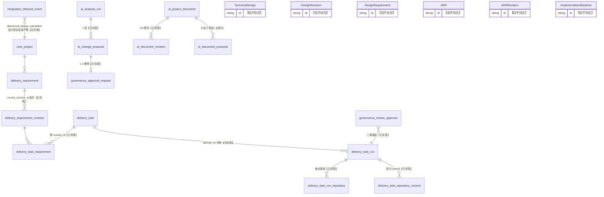
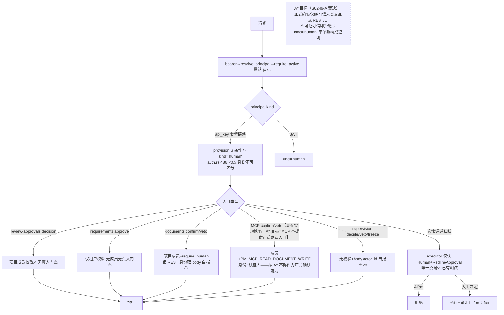
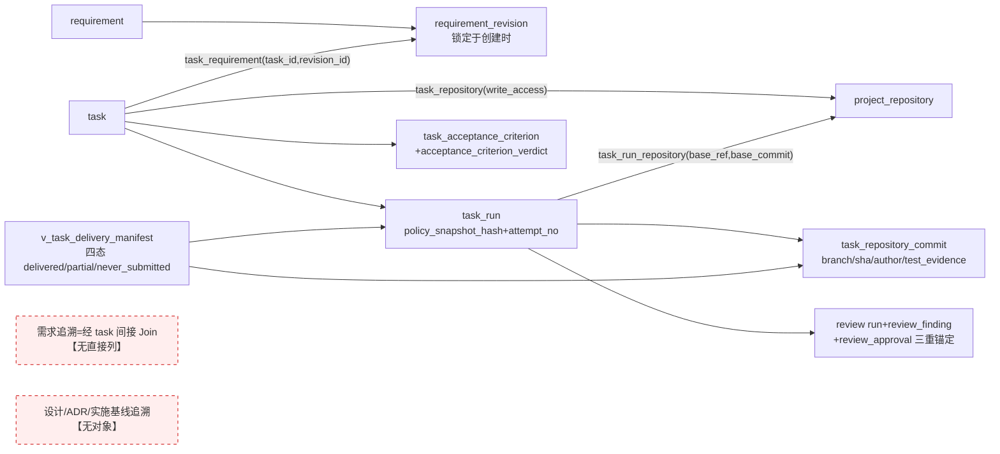
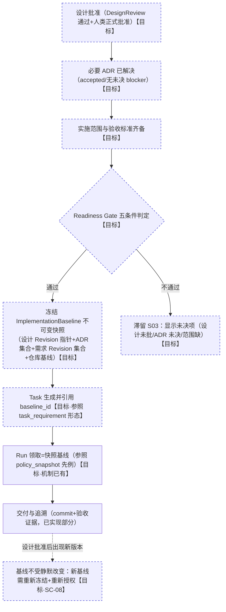

# S03-00 · 代码事实核验主报告 V1.1

**任务编号**：S03-00　**所属阶段**：S03 — Analysis, Design & Technical Decisions
**性质**：只读代码事实核验　**核验基线**：`feat/s01-implementation` @ `3ccb42f16c757bef7a89fa75ada34a7cab23ea7d`（2026-11-04 09:37:34 +0800）
**配套清单**：[database](S03-00-database-inventory.md)｜[domain-asset](S03-00-domain-asset-inventory.md)｜[api-and-mcp](S03-00-api-and-mcp-inventory.md)｜[permission-and-approval](S03-00-permission-and-approval-inventory.md)｜[implementation-traceability](S03-00-implementation-traceability-inventory.md)｜[reuse-assessment](S03-00-reuse-extension-new-assessment.md)｜[test-evidence](S03-00-test-evidence.md)

> 本任务为只读核验：未修改任何业务代码、Migration、数据库结构及现有业务配置。
> **V1.1**：收编评审意见 R1~R8（逐项记录见 [S03-00-v1.1-revision-log.md](S03-00-v1.1-revision-log.md)）。代码事实一律以 HEAD `3ccb42f` 为准；未提交工作树内容（业务代码与文档）均不属于本基线。

---

# 一、执行摘要

**总回答（任务书第十五部分）**：smark-pm 当前已具备的 S03 所需「技术设计与技术决策治理」能力**接近于零地基加一组高质量可参照形态**——需求域有完整实体/版本/确认/审计骨架（可直接复用与扩展），知识域有 Markdown+Git 权威与八态提案管线（可复用为正文载体），治理形态资产（审批形态先例/不可变触发器/快照锚定/乐观锁/幂等账本）齐备；但 **七项 S03 核心领域能力缺口**（Technical Design、Design Revision、Design-Requirement 关联、ADR、Design Review、Implementation Baseline、Readiness Gate——包含实体、版本实体、关联关系与流程/门禁，**不是七个同级的数据库实体**）**全部缺失**，且现有身份模型不满足 S02-I6-A A* 的正式确认安全要求（K-6，P0），AutoApply 路径未受拦截（K-5，DEF-02 沿用 S02 缺陷编号）。

十条关键结论：

| # | 结论 | 摘要证据 |
|---|---|---|
| K-1 | Technical Design 领域实体不存在。`pm_submit_technical_design` 仅是幂等 `technical_design_submitted` 事件写入 `integration.inbound_event` + 排队 `ai_analysis` 作业；无实体/版本/Git 正文/审批/需求关联 | `tools.rs:36-55`；`ingestion.rs:62-141`；`server.rs:72-91` |
| K-2 | ADR 独立实体不存在。`doc_type='decision'` 仅是知识文档枚举值，无接受/否决、无 supersede、无决策人字段、无结构化关联 | `0006:11-13`；搜索逐词零实体命中 |
| K-3 | **当前 Requirement 实现与 S02 正式裁决存在架构偏差**。当前代码事实：PG JSONB（`delivery.requirement_revision.content`）仍是运行时需求正文读写源，Markdown+Git 仅为单向镜像。已裁决目标架构（S02-04 V1.1 裁决 Q1，不再重议）：Markdown+Git 为需求正文唯一权威；PostgreSQL 负责业务 ID、版本引用、审批、状态、审计和事件；PageIndex 为可重建派生索引。S03 不得重新裁决需求正文权威，也不得把当前 PG JSONB 实现提升为目标权威 | `revision.rs:47`；`0006:1-5`；`knowledge_migrate.rs:1-6`；S02-04 裁决记录 |
| K-4 | `approve_requirement_revision` 是命令通道 CommandKind，**不是 MCP 工具**（19 个 MCP 工具中零 requirement 工具） | `server.rs:73-449`；`executor.rs:53-115` |
| K-5 | **DEF-02：AutoApply 路径当前仍可自动定稿需求修订**。DEF-02 是 S02 已识别的未完成治理缺陷（沿用原编号，关联 S02-I6-A 既有治理记录），不是 S03 新增裁决问题；治理要求=AutoApply 不得绕过正式人类确认；S03 不重复建立同义治理规则，也不得依赖该 AutoApply 路径实现设计批准或 ADR 接受。代码事实：黑名单策略模型，红线 10 项不含该命令 | `policies/ai-pm-ai-lead-v2.yaml:6-39`；`orchestrator.rs:270-279,496-514`；S02-02 DEF-02 / S02-I6-A 治理记录 |
| K-6 | **现有身份模型不能满足 S02-I6-A A* 的正式确认安全要求**（继承 S02-I6-A R-I6A-1 用户裁决 A* 及 V1.2 收编的治理约束）。A* 要求：①正式确认只能通过可信的人类交互式 REST/UI 入口；②MCP 不提供正式确认能力；③Agent 即使持有真人 MCP key 也不能获得 REST 正式确认权；④无法证明请求来自可信人类交互式操作时必须拒绝；⑤`kind='human'` 不能单独作为真人身份与操作可信性证明；⑥身份认证与业务授权分别校验；⑦DeviceClaim 不得单独作为授权凭据。当前代码偏差（均为现存实现缺陷，P0）：api_key provisioning 无条件写 `kind='human'`、auth_mode 零准入消费、MCP/REST token 同源 → 11 个确认/审批入口 api_key 全部可通过；现存 MCP confirm/veto 入口与 A* ②直接相悖；唯一真闸=命令通道红线 | `auth.rs:486-494,121-131`；S02-I6-A V1.2 / auth-isolation 核验档案；真人门体检表见[权限清单](S03-00-permission-and-approval-inventory.md) |
| K-7 | 现有审批引擎不可原样复用：`governance.approval_request` 经 FK+UNIQUE 1:1 硬绑 `ai.change_proposal`，Approve 语义硬编码=执行 ProjectCommand；仓库先例=每类审批建专表（`governance.review_approval`） | `0003:157-168`；`approval.rs:89-113`；`0026:223-249` |
| K-8 | 现有 Review 是 D5 交付复核专用（run_kind='review' + review_approval + append-only findings），无任意评审对象/多评审人/问题关闭 | `0026:15-23,165-186,223-249` |
| K-9 | Implementation Baseline 无 S03 语义对象，但同构先例充分：`task_run.policy_snapshot_hash`（SHA-256 快照）、每仓基线、review_approval 三重锚定、I1 归档行门闩 | `0032:15`；`0026:273-296`；`project_gate.rs:84-99` |
| K-10 | 历史缺陷静态重验：DEF-02 成立；DEF-03 在 REST 定稿路径成立（无锁 TOCTOU；执行器路径有三重 FOR UPDATE）；DEF-04 双入口语义分叉成立 | `revision.rs:84-120`；`executor.rs:823-907` |

**复用/扩展/新建统计（差异矩阵 15 项）**：A 直接复用 ×2｜B 扩展复用 ×5｜C 新建 ×8｜D 暂不确定 ×0。矩阵全文见 [reuse-assessment](S03-00-reuse-extension-new-assessment.md)。

---

# 二、调查代码基线

| 项目 | 实际值 |
|---|---|
| Repository | ai-pm（origin = git@192.168.2.16:tooling/ai-pm.git） |
| Worktree | `D:\kudi-project\templates\ai-pm-s01`（主 checkout 在 master@2933db8，为本分支真子集） |
| Branch | `feat/s01-implementation`（领先 master 43 commits，未合并未推送） |
| HEAD | `3ccb42f16c757bef7a89fa75ada34a7cab23ea7d` |
| HEAD Time | 2026-11-04 09:37:34 +0800 |
| Working Tree | 不干净：`crates/pm-infrastructure/src/outbox_handlers.rs`（未提交的 I1-B 锁序修复，TaskReady 归档守卫改 FOR UPDATE，不涉本报告事实）+ 1 个 docs 修改 + 6 个未跟踪 docs 文件。**以上未提交内容（业务代码与文档）均不属于 HEAD `3ccb42f`**；本报告全部结论仅依据 HEAD，无任何结论依赖工作树版本 |
| Latest Migration | `0034_s01_command_center_indexes.sql`（33 个文件，0001~0034，0029 空号） |
| Rust Workspace | apps：pm-api、pm-worker、ai-pm-worker；crates：pm-domain、pm-application、pm-infrastructure、pm-mcp、pm-ai |
| Frontend | frontend/（Vue3+TS） |
| 未合并分支 | `feat/s01-implementation`（本基线）；`prism-shell-wip`（历史 no-op） |

Migration 登记表 vs 文件：静态序列 0001~0034 连续无重复（唯一缺口 0029 空号）；运行时登记表 `_sqlx_migrations` 属具体部署（本机演示栈抽查=0001~0028，构建于 S01 批次前，与基线脱钩属预期）。0031 升级演练有测试/提交背书（commit `bcb169f`）。

---

# 三、调查范围与方法

**范围**：任务书第二部分 §2.1 全部 13 类对象——PostgreSQL 全部 Migration（33 文件逐表）、Rust 五 crate、REST（90+ 条路径）、MCP（19 工具）、权限与审批、AI 工作流（orchestrator/policy/executor）、Markdown+Git 机制、前端（workspace+shell/views）、Task/Run/Delivery 生命周期、Repository 与 Git 基准、测试盘点。

**方法**：静态三层核验（Migration DDL → 代码写读路径 → 测试背书），五路并行深查 + 五处承重结论本人复核（`revision.rs` 定稿全文、`auth.rs:486-494` provisioning、policy yaml 红线名单、`tools.rs` 输入 schema、`ingestion.rs` 入库事务）。全部结论带 `file:line`；未找到项列明搜索词。

**证据分级（用于场景验证）**：
- **T** 已有测试覆盖（引用测试文件与用例）
- **R** 已有运行验证（历史运行记录/运行时抽查）
- **S** 仅有静态代码证据
- **N** 当前无法验证
- **NOT IMPLEMENTED** 能力不存在（按任务书要求直接给出，不以临时开发证明）

**局限**：未运行任何测试套件（避免持久化副作用与并行会话干扰）；并发行为为静态代码路径判断，未运行时复现；运行时唯一抽查=演示栈 `_sqlx_migrations` 只读 SELECT。

---

# 四、Requirement 现状（详证见 [domain-asset](S03-00-domain-asset-inventory.md) §1~4）

- **实体**：`delivery.requirement`（0002:3-14，8 列）+ `current_revision_id` 指针 + `status TEXT DEFAULT 'draft'`（无 CHECK，实际仅 draft/approved）；无类型字段、无 created_by/updated_at。
- **版本**：`requirement_revision`（0002:16-34，state CHECK 三值 draft/approved/superseded，UNIQUE(requirement_id,version)）；正文=PG JSONB `{"markdown":...}`（**当前运行时读写源——与 S02 正式裁决存在架构偏差，见 K-3，不得作为目标权威**）；content_hash 双公式不一致；正文覆盖：应用层已检索写路径未发现正文覆盖操作（仅 4 处 UPDATE 且只改 state/approved_by），**数据库层尚无正文不可变保护**（无触发器/无约束）；目标要求=应用层与数据库层共同保障；approved 不可变性无 DB 保护（REST 有 draft 门槛，执行器无 state 前置——superseded 可复活）。
- **确认**：入口 3 个（REST approve、命令通道 approve_requirement_revision、supervision decide 间接）；REST 路径**无权限码/角色/项目成员校验**（仅租户）且**无并发防护**；审计含 before/after+compensation（执行器路径）；AutoApply 可自动定稿（K-5）。
- **Task 关联**：`task_requirement` 绑具体 revision_id（复合 FK，唯一写点=执行器）；需求变化后 Task 无失效/重校验；历史引用永久保留。
- Markdown+Git 镜像：`requirements/revisions/{id}/migrate` 单向显式（PG 不删不改）——该镜像形态即 K-3 偏差的组成部分；目标架构中 Markdown+Git 为权威、PG 为业务态。

# 五、Technical Design 现状（详证见 [domain-asset](S03-00-domain-asset-inventory.md) §5~7）

- `pm_submit_technical_design`（MCP #1）：5 参数（project_id/task_ref/idempotency_key/fixture/summary），无 requirement 关联、无正文；入库=inbound_event+ai_analysis job 单事务；幂等=同键同 hash 回放/异 hash Conflict；产出=通用 `ai.change_proposal` 提案；**无设计实体/版本/状态机/审批/Git 正文**。
- 设计正文唯一载体候选=`doc_type='architecture'` 知识文档（通用知识语义）；无 technical_design doc_type 值。
- Design↔Requirement 关联：不存在；唯一同构先例=`task_requirement` 复合 FK 绑 revision。
- 设计 diff：后端无端点（`pm_artifacts.rs:1-5` 自认无数据源），前端全 mock。

# 六、ADR 现状（详证见 [domain-asset](S03-00-domain-asset-inventory.md) §8~11）

- decision 文档：仅 doc_type 枚举值；生命周期在 document_revision（draft/published/rejected/rolled_back）；无 accept/reject 入口、无 supersede、无决策人列、无与 Requirement/Design 结构化关联。
- ADR 十问（独立表/ID/状态机/Revision/备选/理由/后果/替代/跨设计引用/独立审计）**全部不存在**（搜索词逐词零实体命中）。
- 唯一落库引用设施 `ai.knowledge_reference`（0014:82-104）方向相反（分析→文档，reference_kind 含 'decision'），可指向历史修订。

# 七、Review 与 Approval 现状（详证见 [permission-and-approval](S03-00-permission-and-approval-inventory.md)）

- 四类审批区分：文档发布审批=**已存在**（document_proposal 红线管线+veto）；普通变更审批=**已存在**（approval_request 1:1→change_proposal；escalated 无审批行仅通知）；技术设计批准=**不存在**；ADR 正式接受=**不存在**。
- 第四张审批表 `governance.review_approval`（0026:223-249）：三重锚定+pending 单向触发器——专表形态的现行先例（**结构路线留待 S03-05 论证，本报告不预设**）。
- D5 评审：多轮✅/问题登记✅/历史保留✅；对象任意挂载❌/多评审人❌/问题关闭❌/专家与裁决分离🟡。

# 八、权限与审计现状（详证见 [permission-and-approval](S03-00-permission-and-approval-inventory.md)）

- 角色：DB 六值（owner/member/ai_pm/architect/developer/tester，0030:7-13）vs 代码两档（ProjectMemberRole{Owner,Member}/is_manager）收窄；租户三档。
- Permission code：仅 2 个被消费（PM_MCP_READ/PM_MCP_DOCUMENT_WRITE，MCP 侧）；**REST 审批/确认/定稿端点零权限码校验**；仓库无权威清单。
- 真人门（**继承 S02-I6-A A* 治理约束**，R-I6A-1 用户裁决、V1.2 收编）：A* 要求=①正式确认仅经可信人类交互式 REST/UI；②MCP 不提供正式确认能力；③持真人 MCP key 不获得 REST 确认权；④不可证可信即拒绝；⑤`kind='human'` 不单独构成证明；⑥认证与授权分别校验；⑦DeviceClaim 不单独作授权凭据。当前代码=**不能满足 A\***，偏差均为现存实现缺陷：api_key provisioning 无条件产 human（`auth.rs:486-494`）；auth_mode 三分类零准入消费（`auth.rs:121-131`）；MCP/REST token 同源；**11 入口体检全部可通过（P0）**；现存 MCP pm_confirm/veto 入口与 A* ②相悖（不得解释为目标能力）；唯一真闸=命令通道红线（executor 仅认 Human+RedlineApproval，已有测试）。
- 并发与审计：乐观锁清单 30+ 处；唯一约束清单齐（**无「同需求至多一 approved」约束**）；审批幂等三套实现；需求定稿 REST TOCTOU 残留；audit_log 全列含 before_data/after_data/compensation/actor 四列/auth_mode，但 before 口径三处不统一；审批依据字段：approval_request.decision_reason / change_proposal.rationale+evidence / document_proposal.quality_gate_result+redline_kind / review_approval.manifest_hash 锚定——**需求定稿无审批依据字段**。事务边界：各写服务均为单事务（详表见权限清单 §5）。

# 九、Task / Run / Delivery 现状（详证见 [implementation-traceability](S03-00-implementation-traceability-inventory.md)）

- Task：13 值状态机 30 边（域层纯函数+守卫）；乐观锁 revision；关联表 task_requirement/task_acceptance_criterion/task_knowledge_ref/task_dependency/task_repository（实施范围=仓库集合+write_access）/task_supersession/task_waiting。
- Run：`delivery.task_run`（attempt_no 分轨、policy_snapshot_hash、每仓 task_run_repository 基线、execution_mode human/spawn）；领取=条件 UPDATE+租约+generation；回收=新 Run+supersedes_run_id 保留链；RunContract（run_context.rs:200-281）=Goal 快照+仓库范围+租约+Task+Deliverable+验收标准+知识引用，**无 Requirement Revision 视图、无设计依据**。
- Delivery：task_repository_commit（FK RESTRICT）+ v_task_delivery_manifest 四态（delivered/partial/never_submitted；expected=0→delivered）；视图列无需求/设计/ADR/基线追溯。
- 归档（I1）：project_gate 行门闩+锁序 project→run→task+归档事务+统一取消协议。

# 十、Repository Baseline 现状（详证见 [implementation-traceability](S03-00-implementation-traceability-inventory.md) §VF-18）

- 仓库身份：`integration.project_repository`（UNIQUE(project_id,url)，role 四值，status 四值+head_commit_sha write-once 于导入）。
- Run 基线：claim 事务内逐仓写 `task_run_repository`（base_ref/base_commit/workspace_path）+ `policy_snapshot_hash`（SHA-256）；执行期判定=不可变快照上界（缺失 deny-all）∩现状（未归档+仍 verified）。
- 执行前校验✅（claim 快照）；执行中变更=D4 逐仓校验（commit 须为基线后代）；交付时 commit 记录✅（task_repository_commit 含 branch/commit_sha/author/changed_files/test_evidence）；重新执行=新 Run 重新 claim 重新快照（旧 Run 与旧快照保留）。
- 平台不管理执行端工作树状态（交付时以 commit=HEAD+基线后代校验替代）。

# 十一、Implementation Readiness 现状（详证见 [implementation-traceability](S03-00-implementation-traceability-inventory.md) §VF-19）

七项检查逐项：需求完整性❌｜设计审批检查❌（无对象）｜ADR 检查❌（无对象）｜实施范围🟡（task_repository+write_access+task_dependency）｜验收标准🟡（task_acceptance_criterion+E1/E2 交付证据门）｜依赖检查✅（task_dependency+图锁并发测试）｜仓库基线检查✅（claim 快照+deny-all）。
**结论**：可组合出「仓库+依赖+验收证据」三类门；「需求完整性/设计审批/ADR 决策」三类检查因对象不存在而无从组合——Readiness Gate 主体需新建，判定输入可挂接已有三类门。

---

# 十二、八个关键场景核验结果（详证见 [test-evidence](S03-00-test-evidence.md)）

| 编号 | 场景 | 预期 | 结论 | 分级 |
|---|---|---|---|---|
| SC-01 | AI 创建 Design Revision，人类批准 | 完整版本+审批记录 | **NOT IMPLEMENTED**（无设计实体与批准入口）；最近似=知识文档提案+红线确认（健全） | 最近似 T |
| SC-02 | 已批准设计产生新 Revision，旧不被覆盖 | 旧 Revision 不变 | **NOT IMPLEMENTED**（设计）；需求域近似：应用层已检索写路径未发现正文覆盖=**S**（4 处 UPDATE 只改 state/approved_by+UNIQUE 约束；**不能推导为数据库禁止修改**——DB 层无正文不可变保护）+T（单流程）；并发窗口=**S**（TOCTOU 残留） | S+T |
| SC-03 | 一个设计关联三个需求 | 多对多+Revision 级追溯 | **NOT IMPLEMENTED**（无 DesignRequirement 表）；近似=task_requirement 复合 FK 绑 revision=**S+T** | S+T |
| SC-04 | 一个 ADR 关联多设计和需求 | 关联完整可查询 | **NOT IMPLEMENTED** | — |
| SC-05 | AI 尝试正式批准设计 | 必须拒绝 | **NOT IMPLEMENTED**（无批准对象）。近似事实：命令通道红线拒 AI=**T**（command_executor.rs）；但 11 个确认/审批入口 api_key 可过=**S**（P0） | T+S |
| SC-06 | 两人并发批准同一设计 | 无错误审批结果 | **NOT IMPLEMENTED**（设计）。近似：review_approval 并发=**T**（行锁+触发器+AlreadyDecided）；需求定稿并发=**S**（TOCTOU，无测试） | T+S |
| SC-07 | 关键 ADR 未解决→Readiness 不通过 | 门禁拦截 | **NOT IMPLEMENTED**（无 ADR、无 Gate） | — |
| SC-08 | 设计批准后新版本，原实施基线不被静默改变 | 基线隔离 | **NOT IMPLEMENTED**（无基线对象）。近似：task_requirement 锁定修订不随需求更新漂移=**S**；policy_snapshot 不可变=**T**（run_scope_snapshot.rs） | S+T |

---

# 十三、复用 / 扩展 / 新建差异矩阵（15 项）

| 能力 | 现有实现 | 目标要求 | 结论 |
|---|---|---|---|
| Requirement | delivery.requirement 实体+指针+审计 | 独立实体 | **A 直接复用** |
| Requirement Revision | 版本链+state CHECK+UNIQUE；应用层未检索到正文覆盖路径，数据库层无不可变保护；REST 无并发防护/执行器无 state 前置 | 不可变版本（应用层+数据库层共同保障） | **B 扩展复用** |
| Technical Design | 无实体（仅 ingestion 事件） | 独立实体 | **C 新建** |
| Design Revision | 无 | 不可变版本 | **C 新建** |
| Design-Requirement N:N | 无关联表（task_requirement 为形态参照） | 多对多 | **C 新建** |
| ADR | 无（decision 仅枚举值） | 独立实体 | **C 新建** |
| ADR Revision | 无 | 历史可追溯 | **C 新建** |
| Design Review | D5 交付复核专用，不支持任意对象 | 独立评审流程 | **C 新建** |
| Human Approval | 三套专表审批机制+真人门原语，但不可复用为通用引擎且真人门有 P0 缺口 | 人类正式确认 | **B 扩展复用** |
| Audit | audit_log 全列+触发器+outbox，但 before 口径不统一+身份冒认风险 | 完整审计 | **B 扩展复用** |
| Implementation Baseline | 无对象；同构先例=policy_snapshot_hash+三重锚定 | 不可变快照 | **C 新建** |
| Readiness Gate | 三类检查可组合（依赖/仓库/验收证据），五条件门禁不存在 | 五项准入条件 | **C 新建** |
| Task Traceability | 绑 requirement revision；无 design/ADR/baseline 引用 | 引用实施基线 | **B 扩展复用** |
| Run Traceability | task+每仓基线+策略快照+supersession 链完整保留 | 保留执行依据 | **A 直接复用** |
| Delivery Traceability | commit 级+test_evidence+manifest；无需求/设计/ADR/基线追溯 | 保留交付依据 | **B 扩展复用** |

**统计：A×2（13.3%）｜B×5（33.3%）｜C×8（53.3%）｜D×0**。逐项依据与判定原则见 [reuse-assessment](S03-00-reuse-extension-new-assessment.md)。

---

# 十四、六张架构图

图例：实线=当前已实现；`【部分】`=部分实现；`【无】`=尚不存在（当前）；`【目标】`=目标设计（非现状）。

## 图 1 · 当前 Requirement / Technical Design / ADR 实体关系图（当前实现）



## 图 2 · 当前文档发布与技术设计提交流程图（当前实现）

```mermaid
flowchart TD
    subgraph DOC["文档发布管线【已实现】"]
        A1[pm_submit_document / pm_propose_document MCP<br/>REST /v1/pm/documents/proposals] --> A2{质量门}
        A2 -- 不通过 --> A3[rejected]
        A2 -- 通过且无红线 --> A4[commit_pending<br/>平台自动 git commit]
        A4 --> A5[document_revision published<br/>八态中 3 态为死状态【部分】]
        A2 -- 命中红线 --> A6[redline_pending 不写 Git]
        A6 --> A7[人类 confirm<br/>REST body.confirmed_by⚠冒认面 / MCP 认证人]
        A7 --> A8[写 Git+published]
        A5 -.事后.-> A9[veto: git revert+rolled_back]
    end
    subgraph DESIGN["技术设计提交管线【仅事件,无设计生命周期】"]
        B1[pm_submit_technical_design MCP] --> B2[inbound_event technical_design_submitted<br/>无正文/无需求关联/无版本]
        B2 --> B3[job ai_analysis]
        B3 --> B4[Orchestrator 8 步<br/>context=任务+最新需求修订]
        B4 --> B5[ai.change_proposal 逐提案]
        B5 --> B6{策略门}
        B6 -- 红线 --> B7[redline_pending→approval_request→人类 decide]
        B6 -- 非红线=默认 --> B8[AutoApply 以 AiPm 直接执行<br/>含需求定稿 DEF-02 未修⚠]
        B8 -.事后 veto 窗口补偿.-> B9[change_applied 通知]
    end
```



## 图 3 · 当前人类审批和权限校验流程图（当前实现）



> 注：图 3 中带【现存实现缺陷】标注的入口为当前代码事实，与 A* 目标相悖，不得解释为目标能力。

## 图 4 · 当前 Task / Run / Delivery 数据追溯图（当前实现）



## 图 5 · 目标 S03 领域模型与当前实现差异图（目标设计 vs 现状）

```mermaid
flowchart TD
    subgraph CUR["当前实现"]
        R[Requirement+Revision]:::ok
        TR[task_requirement 绑 revision]:::ok
        KD[知识域 Git 权威+八态提案]:::ok
        AP[专表审批形态×3]:::ok
        SN[policy_snapshot 快照先例]:::ok
    end
    subgraph NEW["七项 S03 核心领域能力缺口（实体/版本实体/关联关系/流程门禁，非七个同级实体）【目标设计→新建 C】"]
        TD[TechnicalDesign]:::new
        DR[DesignRevision 不可变]:::new
        DQ[DesignRequirement 绑 requirement_revision_id]:::new
        ADR2[ADR+ADRRevision 六态]:::new
        DV[DesignReview 多人多轮问题关闭]:::new
        IB[ImplementationBaseline 不可变快照]:::new
        RG[Readiness Gate 五条件]:::new
    end
    subgraph EXT["扩展【B】"]
        E1[Human Approval 专表+真人门修复]:::ext
        E2[Audit before 口径统一]:::ext
        E3[Task/Run/Delivery 追溯列]:::ext
        E4[Requirement Revision 并发防护]:::ext
    end
    DR -.结构参照.-> R
    DQ -.结构参照.-> TR
    TD -.正文载体参照.-> KD
    ADR2 -.审批形态参照.-> AP
    IB -.快照参照.-> SN
    RG -.挂接.-> E3
    classDef ok fill:#dfd; classDef new fill:#fdd,stroke:#c00,stroke-dasharray:4; classDef ext fill:#ffd
```

## 图 6 · S03 → S04 实施基线交接流程图（**全图为目标设计，当前无任何环节存在**）



---

# 十五、尚未解决的问题（事实层，非实施任务）

1. **双入口统一无归属**：REST 与执行器定稿语义分叉（DEF-04），无修复切片认领。
2. **A* 偏差缺陷（关联 S02-I6-A 既有治理记录，沿用其编号体系）**：api_key provisioning 产 human + auth_mode 零消费 + token 同源，现有身份模型不满足 A* 七条正式确认安全要求（K-6）；修复方向已在 S02-I6-A 记录（step-up 确认票据建议等），属既有治理线的落地问题，S03 不重复建立同义规则。
3. **document_proposal 三死态**（draft/quality_gates_passed/confirmed）与 change_proposal expired 态：设计残留还是待实现，意图不明。
4. **策略角色 vs RBAC 角色**：required_role 值（release_manager/account_owner/authorized_acceptor/quota_approver 等）无角色实体支撑、无裁决人比对消费。
5. **需求正文权威偏差（K-3）**：当前实现（PG JSONB 运行时读写源 + Git 单向镜像）与 S02 正式裁决（Markdown+Git 唯一权威）不一致；收敛属既有裁决的落地问题，S03 不得重新裁决正文权威；引用口径与双轨收敛方式留待 S03 切片设计论证。
6. **DEF-02（AutoApply 绕过正式确认）**：S02 已识别的未完成治理缺陷，沿用原编号并关联 S02-I6-A 治理记录；S03 不依赖该路径、不重复建立同义规则。
6. **knowledge_reference 方向相反**：现有引用是分析→文档，S03 所需是设计/ADR→需求，是否反向扩展未决。
7. **前端展示口径**：RequirementsPage 纯 fixtures 与真数据页并存；Diff 视图全 mock 无后端数据源。
8. **任务书完整性**：本版已补齐 VF-14 尾项与 VF-15~19；十一部分八场景按静态+既有测试分级给出，运行时复测未执行（见 §三 局限）。

# 十六、技术建议（仅陈述证据指向，不做方案设计）

1. **写操作单入口**：DEF-04 的直接教训——S03 新实体的写路径应从第一天就收敛单一应用服务，REST/MCP/Executor 仅作适配（S02 评审已确立该架构约束，代码未落地）。
2. **审批语义边界（R6）**：Requirement Approval / Design Approval / ADR Acceptance / Design Review Decision / Implementation Baseline Freeze 五类业务决策必须各自具备独立、明确的领域语义与审计依据；具体结构（独立专表/共享基础设施/其他）**留待 S03-05 设计评审与批准切片论证**，本报告不预设路线；`governance.approval_request` 的现有 1:1 绑定语义不得直接复用为通用设计审批机制。
3. **不可变保护（R4）**：需求 Revision 当前状态=应用层未检索到正文覆盖路径（写路径纪律）+数据库层无正文不可变保护（无触发器/无约束）；目标要求=两层共同保障；0026 的触发器先例证明库级保护在本库可行。
4. **真人确认（继承 S02-I6-A A*）**：A* 七条约束为既定治理要求（R2）；当前实现不能满足（缺陷清单见权限清单 §2）；修复属 S02 既有治理线落地，S03 确认门禁应按 A* 设计（仅可信人类交互式 REST/UI、MCP 无正式确认入口），不得依赖 MCP 入口或 `kind='human'` 单一证明。
5. **结构参照三件套**：DesignRevision→requirement_revision；DesignRequirement→task_requirement；ImplementationBaseline→policy_snapshot_hash+review_approval 三重锚定。
6. **审计**：新实体审计从首版就带 before_data，避免重演三处只写 after 的口径分裂。

# 十七、核验结论

1. smark-pm **当前不具备** S03 所需的技术设计与技术决策治理能力本身（七项核心领域能力缺口缺失，15 项能力中 C 占 53.3%）；**具备**高质量的复用地基与形态先例（A+B 占 46.7%）。
2. Q4 裁决（AI 做设计、人类确认）的代码前提**当前不成立**：K-6=现有身份模型不满足 S02-I6-A A* 正式确认安全要求（P0 缺陷）；K-5=DEF-02（S02 已识别治理缺陷，沿用原编号）。两项均为既有治理线的落地缺口，S03 实施前须有前置修复或纳入首切片（归属见待裁决）。
3. 八个关键场景全部 NOT IMPLEMENTED 或仅近似能力有测试/静态证据；无任何场景在当前代码上可完整走通。
4. 本报告与七份清单全部结论锚定 HEAD `3ccb42f`，未修改任何业务代码、Migration、数据库结构及现有业务配置。
5. 按任务书第十五部分要求：**先提交本核验报告等待评审与裁决；未经用户确认不开始 S03-01 及后续切片，不创建任何 Migration。**

# 附录 · 用户待裁决问题（仅列确需用户决定项）

1. **A* 偏差与 DEF-02 修复的 S03 归属**：两项均为 S02 既有治理缺陷（沿用原编号与治理记录，R2/R3）；待裁决仅剩其修复在 S03 的切片归属——前置独立切片，还是并入 S03 首切片（不修复则「人类确认」在代码上无法成立）。

**备注（非裁决项，防止提前裁决）**：

- 审批结构路线（独立专表/共享基础设施/其他）**不在本次裁决范围**，留待 S03-05 设计评审与批准切片论证；本报告仅确认五类业务决策须有独立领域语义与审计依据（R6）。
- 迁移编号 **0035 仅为当前 HEAD `3ccb42f` 下的顺序推导**（0029 空号、最大 0034），不是永久确定编号；实施时必须重新检查最新合并基线、并行分支与 Migration 登记情况（R7）。
- 需求正文权威**已由 S02 正式裁决（Markdown+Git 唯一权威），S03 不重新裁决**（R1）；引用口径与双轨收敛方式留待 S03 切片设计论证。

# 附录 · 交付文档清单

| 文件 | 内容 |
|---|---|
| S03-00-code-facts-report.md | 本主报告 |
| S03-00-database-inventory.md | 全量 Migration/表/约束/视图清单 |
| S03-00-domain-asset-inventory.md | VF-01~12 领域资产详证 |
| S03-00-api-and-mcp-inventory.md | REST 90+ 路径 + MCP 19 工具 + 权限映射 |
| S03-00-permission-and-approval-inventory.md | 角色/权限码/真人门体检/四审批实体/并发与审计 |
| S03-00-implementation-traceability-inventory.md | VF-15~19：Task/Run/Delivery/仓库基线/Readiness |
| S03-00-reuse-extension-new-assessment.md | 15 项差异矩阵 A/B/C/D + 判定依据 |
| S03-00-test-evidence.md | 测试盘点 + SC-01~08 分级证据 + 运行时抽查记录 |

*历史稿说明：`docs/s03-00-technical-design-adr-domain-asset-inventory-v1.md` 为本核验第一轮（VF-01~14 可见范围）交付稿，已被本目录八份文件取代，保留作过程档案。*
